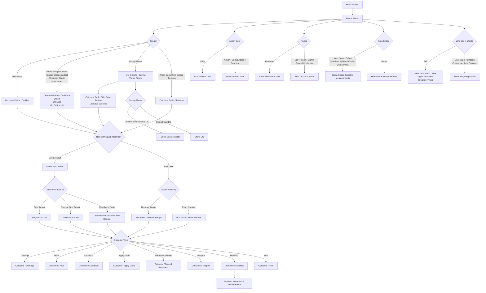

# Phase 8.1 - Figma: Shared Effect Editor Flow

## Status: Not Started

## Figma File

_URL to be added once the shared reference page exists in the approved file._

## Purpose

This document is the shared Figma planning brief for the full-view Effect Editor used by any domain that authors effects.

Use this page to design the effect-authoring shell once, then reuse it across domain pages with only noun changes where needed:

- Spell: `Effects`
- Feat: `Abilities`
- Feature: `Abilities`
- Race: `Abilities`
- Equipment: `Abilities` or `Special Properties`
- Creature: `Actions` or `Abilities`
- Vehicle: `Actions` or `Abilities`

This plan is Figma only. Do not write or modify frontend code as part of this plan.

## Design Rules

### Mandatory Design-System Preflight

Before designing any screen for this page:

1. Inspect the target page.
2. Inspect the `Components` page.
3. Inspect the `Icons` page.
4. Inspect the existing variables and tokens already in the file.
5. Reuse existing shells, cards, fields, accordions, buttons, chips, tags, steppers, rows, and icons before creating anything new.

### Non-Negotiable Reuse Rules

- Do not recreate components that already exist.
- Do not draw or remake icons manually.
- Use icon instances from the `Icons` page.
- Use component instances from the `Components` page.
- Do not detach instances to make one-off screen variants.
- Do not create new primitive components as part of this subplan unless a real gap is confirmed first.
- If a real gap is found, document it in the page notes before creating anything new.
- This subplan is page design only, not component-library expansion.

### Skill Reminder

When building these screens in Figma:

- use [$frontend-design](C:\Users\pilan\.codex\skills\frontend-design\SKILL.md)
- use [$figma-generate-design](C:\Users\pilan\.codex\skills\figma-generate-design\SKILL.md)

Both skills already require reuse of existing components, icons, and tokens. This document repeats that rule on purpose so it is impossible to miss.

### Page-Level Design Rules

- Design this as a shared reference page, not a domain page.
- Keep the shell implementation-friendly and structured like a real product surface.
- Use user-facing product language, not internal authored-model jargon.
- Treat this as a sectioned work-item editor, not a wizard.
- Show the important conditional states explicitly in Figma instead of leaving them implied in notes.
- Keep the controls compact and form-first. Do not use oversized conversational cards inside the editor.

### Shared Page Assembly Rules

This document should produce a page that a designer can build from directly, not a loose moodboard of reference states.

Lay out the shared reference page in clear groups:

1. Shell and navigation reference
2. `How It Starts` states
3. `Outcome Paths` states
4. typed `Outcome` editors
5. `Manifest Behaviors` nested-editing state
6. annotation strip for cross-screen rules that should stay visible while designing

Use consistent row spacing and group spacing so the page reads left-to-right and top-to-bottom like a real flow.

Use labels and connectors on the canvas to show:

- the primary happy path
- major conditional branches
- reference-only frames versus core flow frames

If a screen is part of the primary flow, it should be placed in the main reading path of the page.

If a screen is a supporting conditional or reference state, it should sit adjacent to the screen that reveals it, with a visible annotation or connector explaining the relationship.

Do not scatter related states across the page without visible relationship cues.

### Domain Adaptation Rules

This page is the shared template for later domain pages. The goal is reuse with light copy changes, not redesign.

Later domain pages may change:

- the top-level noun, such as `Effects`, `Abilities`, `Actions`, or `Special Properties`
- the entity example content used inside the mockups
- summary-card copy so it sounds natural for that domain

Later domain pages must keep:

- the full-view editor shell
- the breadcrumb pattern
- the sticky left rail pattern
- the `How It Starts` first section concept
- the `Outcome Paths` grouping model
- the typed `Outcome` editor pattern
- the roll-table row editor pattern
- the nested `Manifest Behaviors` editing pattern
- the restricted nested manifest outcome list

If a later domain needs a materially different shell or editing model, that is not a local tweak. It should be treated as a shared-pattern review.

## User-Facing Language

### Approved Product Terms

| Use This | Meaning |
|---|---|
| `Effect` | One authored capability at the product level |
| `Outcome Path` | A conditional path inside an effect |
| `Outcome` | One repeatable result inside a path |
| `Manifest Behaviors` | Nested behaviors for a manifested thing |

### Avoid As Primary Figma Copy

Do not use these as the main on-screen language:

- capability
- branch
- entry
- resolutionKind
- groupType
- originKind
- rollTableKind

### Preferred Shell Copy

Use these labels by default:

- `How It Starts`
- `Outcome Paths`
- `Add Effect`
- `Edit Effect`
- `Save Effect`
- `Cancel`
- `Action Cost`
- `Area Shape`
- `Who can it affect?`
- `Use a different range`
- `Use different targeting`
- `How is this path resolved?`
- `Direct Result`
- `Roll Table`
- `Outcome Structure`
- `One Result`
- `Choose One Result`
- `Resolve in Order`
- `Starts From`
- `Manifest Behaviors`

### Breadcrumb Copy

Use these patterns (each segment except the last is a clickable accent-color link):

- `{Entity Name} / Effects`
- `{Entity Name} / Effects / Effect {n}`
- `{Entity Name} / Effects / Effect {n} / How It Starts`
- `{Entity Name} / Effects / Effect {n} / Outcome Paths`
- `{Entity Name} / Effects / Effect {n} / Outcome Paths / {Path Name}`
- `{Entity Name} / Effects / Effect {n} / Outcome Paths / {Path Name} / Manifest Behaviors`
- `{Entity Name} / Effects / Effect {n} / Outcome Paths / {Path Name} / Manifest Behaviors / How It Starts`

### Internal Reference Mapping

Keep this as a short reference only. It is not primary UI copy.

| Internal Model | Product Language |
|---|---|
| capability | Effect |
| branch | Outcome Path |
| entry | Outcome |

## Editor Structure

The Effect Editor is a full-view, work-item style editor surface.

It must show:

- a breadcrumb navigation header with close action
- a main content region (full width — no sidebar)
- a sticky footer
- non-linear navigation via breadcrumb

It must not show:

- a horizontal wizard stepper
- "step 1 / step 2 / step 3" language inside the editor
- a left rail or side navigation panel
- accordion panels inside the editor

### Header

- Breadcrumb navigation on the left (see Navigation section below)
- Close action on the right
- Title area should feel like an editing workspace, not a modal dialog title bar

### Navigation — Breadcrumb Drill-In

The breadcrumb IS the navigation. Each segment is clickable to navigate back up. The user drills forward by completing a section and advancing, or by clicking a breadcrumb segment to return.

Example paths:

```
{Spell Name} / Effects / Effect 1 / How It Starts
{Spell Name} / Effects / Effect 1 / Outcome Paths / On Hit
{Spell Name} / Effects / Effect 1 / Outcome Paths / On Hit / Outcome 1
{Spell Name} / Effects / Effect 1 / Outcome Paths / On Hit / Outcome 1 / Manifest Behaviors / How It Starts
```

Rules:

- All segments except the last are styled as accent-color links
- The last segment is the current location — non-clickable, primary text color
- The editor shows one section at a time, full content width
- After trigger is selected in `How It Starts`, `Outcome Paths` becomes available as the next breadcrumb level
- Within `Outcome Paths`, each path (On Use, On Hit, On Miss, etc.) is a clickable row that drills into that path's editor

Which path rows appear is determined by trigger:

- `Direct Use` trigger → `On Use`
- any attack trigger → `On Attack`, `On Hit`, `On Miss`, `On Critical Hit`
- `Saving Throw` trigger → `On Save Failure`, `On Save Success`
- `When Something Enters the Area` trigger → `Passive`

### Main Content

- one section visible at a time
- compact form layout
- optional advanced fields are shown inline as a secondary sub-section — no accordion expand/collapse pattern inside the editor
- long row editors should scroll inside the content area rather than stretching the layout awkwardly

### Footer

- sticky footer
- primary action: `Save Effect`
- secondary action: `Cancel`

### Section Naming

Use `How It Starts` as the first editor section.

Do not use `Setup` as on-screen copy in the editor mockups. It is too generic for a product surface and does not tell the author what this section is actually for.

`How It Starts` is a full-page section navigated to via breadcrumb — not a rail item or accordion panel.

`How It Starts` is the section where the author defines:

- what causes the effect to happen
- what kind of action it uses
- how far it reaches
- whether it uses an area
- who it can affect
- whether it uses a saving throw

### Conditional Flow Map

This page must not leave branching behavior implied. The shared reference page should show how the editor changes when authors choose specific options.

Use the diagram below as the required branching map for the Figma page:



The page should also show these branching rules in a written reference table:

| If the author chooses... | Show next | Screen/state reference |
|---|---|---|
| `Trigger = Direct Use` | rail item `On Use` | `Outcome Paths - Direct Use Rail` |
| any attack trigger | rail items `On Attack`, `On Hit`, `On Miss`, `On Critical Hit` | `Outcome Paths - Attack Trigger Rail` |
| `Trigger = Saving Throw` | Saving Throw Ability + DC fields activate inline in the Trigger row; path rows `On Save Failure`, `On Save Success` appear in Outcome Paths | `How It Starts - Default` (inline), `Outcome Paths` |
| `Trigger = Spell Attack` | Spell Attack Ability field activates inline in the Trigger row | `How It Starts - Default` (inline) |
| `Trigger = When Something Enters the Area` | rail item `Passive` | `Outcome Paths - Enter Area Rail` |
| `Action Cost != Free` | `Action Count` | `How It Starts - Default` |
| `Range = Distance` | `Distance` and `Unit` | `How It Starts - Default` |
| an area shape is selected | shape-specific measurement fields | `How It Starts - Shape Measurements` |
| targeting is not `Self` | `Disposition`, `Max Targets`, `Excluded Creature Types` | `How It Starts - Default` |
| `Saving Throw = Use the Source Save DC` | `Source Ability` | `How It Starts - Saving Throw` |
| `Saving Throw = Use a Fixed DC` | `DC` | `How It Starts - Saving Throw` |
| `How is this path resolved? = Direct Result` | direct path editor | `Outcome Paths - Direct Result` |
| `How is this path resolved? = Roll Table` | roll table controls | `Outcome Paths - Roll Table / Number Range`, `Outcome Paths - Roll Table / Exact Number` |
| `Match Rolls By = Number Range` | `From` and `To` row fields | `Outcome Paths - Roll Table / Number Range` |
| `Match Rolls By = Exact Number` | `Value` row field | `Outcome Paths - Roll Table / Exact Number` |
| `Outcome Structure = Resolve in Order` | ordered outcomes with reorder affordance | `Outcome Paths - Resolve in Order` |
| `Outcome Type = Manifest` | manifest editor plus nested behavior flow | `Outcome - Manifest`, `Manifest Behaviors - Nested Editor` |

## Screen-by-Screen Flow

Each screen below defines the exact state that should exist on the shared reference page.

---

### Shell Reference

**Screen Name**
`Editor Shell - Reference`

**When it appears**
Always. This is the base chrome state before any trigger is selected.

**Purpose**
Define the shared editor chrome: breadcrumb navigation header, full-width content region, and sticky footer. This screen shows the shell with an empty/placeholder state so later domain pages can see the chrome pattern in isolation.

This must be a real screen on the page, not just an annotation block.

**Components to reuse**
- `AppShell` from the `Components` page
- breadcrumb text pattern (accent-color links + primary-color current segment)
- footer action row using `Button` Primary and Ghost variants from the `Components` page
- close icon from the `Icons` page

**Inputs**
- No active form content yet
- Show a placeholder state in the content area that tells the user to start in `How It Starts`
- No left rail, no sidebar

---

### 1. How It Starts - Default

**When it appears**
When the editor first opens and no trigger has been chosen yet.

**Purpose**
Define the base first section layout and the default field rhythm.

**Components to reuse**
- standard form fields from the `Components` page
- inline helper text pattern
- field grouping rows
- dropdowns, segmented controls, and number inputs

**Inputs**

- `Trigger`
  - Input type: dropdown
  - Options: `Direct Use`, `Melee Weapon Attack`, `Ranged Weapon Attack`, `Unarmed Attack`, `Spell Attack`, `Saving Throw`, `When Something Enters the Area`
  - Helper text: `Choose what causes this effect to happen.`
  - Conditional behavior: always shown

- `Action Cost`
  - Input type: segmented control or dropdown
  - Options: `Free`, `Action`, `Bonus Action`, `Reaction`
  - Helper text: `Choose what kind of action this effect uses when it resolves.`
  - Conditional behavior: always shown

- `Action Count`
  - Input type: number input
  - Options: none
  - Helper text: `Only show when the action is not Free.`
  - Conditional behavior: hidden when `Action Cost = Free`

- `Range`
  - Input type: dropdown
  - Options: `Self`, `Touch`, `Sight`, `Special`, `Unlimited`, `Distance`
  - Helper text: none
  - Conditional behavior: always shown

- `Distance`
  - Input type: number input
  - Options: none
  - Helper text: none
  - Conditional behavior: only when `Range = Distance`

- `Unit`
  - Input type: dropdown
  - Options: measurement units from the existing token/system options
  - Helper text: none
  - Conditional behavior: only when `Range = Distance`

- `Area Shape`
  - Input type: dropdown
  - Options: `Line`, `Cone`, `Cube`, `Cylinder`, `Sphere`, `Circle`, `Dome`, `Wall`
  - Helper text: `Leave blank if this effect does not use an area.`
  - Conditional behavior: optional

- `Who can it affect?`
  - Input type: dropdown
  - Options: `Self`, `One Target`, `Chosen Creatures`, `Area Contents`
  - Helper text: none
  - Conditional behavior: optional

- `Disposition`
  - Input type: dropdown
  - Options: `Any`, `Willing`, `Hostile`
  - Helper text: none
  - Conditional behavior: only when targeting is not `Self`

- `Max Targets`
  - Input type: number input
  - Options: none
  - Helper text: none
  - Conditional behavior: only when targeting is not `Self`

- `Excluded Creature Types`
  - Input type: multiselect
  - Options: use the existing selection pattern and system-backed creature type list
  - Helper text: none
  - Conditional behavior: only when targeting is not `Self`

- `Saving Throw Ability`
  - Input type: dropdown
  - Options: ability list (Strength, Dexterity, Constitution, Intelligence, Wisdom, Charisma)
  - Helper text: none
  - Conditional behavior: only when `Trigger = Saving Throw`
  - Design note: shown inline in the Trigger section, dimmed when inactive

- `Spell Attack Ability`
  - Input type: dropdown
  - Options: ability list
  - Helper text: none
  - Conditional behavior: only when `Trigger = Spell Attack`
  - Design note: shown inline in the Trigger section, dimmed when inactive

- `Difficulty Class`
  - Input type: number input
  - Options: none
  - Helper text: none
  - Conditional behavior: only when `Trigger = Saving Throw`
  - Design note: shown inline in the Trigger section alongside Saving Throw Ability, dimmed when inactive

> **Design decision:** The Saving Throw and Spell Attack conditional fields are shown inline in the Trigger row (dimmed when inactive) rather than as a separate screen. This eliminates the need for a separate "How It Starts - Saving Throw" screen.

---

### 2. Outcome Paths - Direct Result

**When it appears**
When the user drills into a path row (e.g. `On Hit`, `On Use`, `On Save Failure`) from the `Outcome Paths` section. Path rows are revealed by trigger selection in `How It Starts` — they are not rail items.

**Purpose**
Show the default path-editing experience.

**Components to reuse**
- compact section form layout
- add/remove row controls from the `Components` page

**Inputs**

- `Outcome Structure`
  - Input type: segmented control
  - Options: `One Result`, `Choose One Result`, `Resolve in Order`
  - Helper text: none
  - Conditional behavior: always shown

- `Starts From`
  - Input type: dropdown
  - Options: `Source`, `Primary Target`, `Previous Result's Target`
  - Helper text: none
  - Conditional behavior: optional

- `Use a different range`
  - Input type: inline add/reveal control
  - Options: none
  - Helper text: none
  - Conditional behavior: when revealed, reuse the same range fields as `How It Starts`

- `Use different targeting`
  - Input type: inline add/reveal control
  - Options: none
  - Helper text: none
  - Conditional behavior: when revealed, reuse the same targeting fields as `How It Starts`

- `How is this path resolved?`
  - Input type: segmented control
  - Options: `Direct Result`, `Roll Table`
  - Helper text: none
  - Conditional behavior: always shown

- `Duration`
  - Input type: duration picker
  - Options: existing duration pattern in the file
  - Helper text: none
  - Conditional behavior: optional

- `Advanced lifecycle`
  - Input type: inline sub-section with a show/hide toggle (not an accordion)
  - Fields: `Repeats On`, `Consumed On First Event`, `Ends On`
  - Helper text: keep visually secondary
  - Conditional behavior: optional

- `Outcomes`
  - Input type: repeatable list
  - Options: outcome editor rows
  - Helper text: none
  - Conditional behavior: at least one expanded outcome shown on this screen

---

### 5. Outcome Paths - Resolve in Order

**When it appears**
When `Outcome Structure = Resolve in Order`.

**Purpose**
Show how ordered outcomes should look and how the user understands sequence.

**Components to reuse**
- reorder row pattern
- drag/reorder affordance
- add/remove icons from the `Icons` page

**Inputs**

- Reuse the path inputs from `Outcome Paths - Direct Result`
- Show an `Outcomes` list with:
  - visible order
  - reorder affordance
  - add/remove actions

---

### 6. Outcome Paths - Roll Table / Number Range

**When it appears**
When `How is this path resolved? = Roll Table` and `Match Rolls By = Number Range`.

**Purpose**
Show the compact range-row editor pattern.

**Components to reuse**
- table-like row pattern already used for scaling/breakpoints
- plus/minus icon instances from the `Icons` page
- compact outcome editor row shell

**Inputs**

- `Roll Die`
  - Input type: text input
  - Options: none
  - Helper text: `Example: 1d20 or 1d100.`
  - Conditional behavior: always shown

- `Match Rolls By`
  - Input type: segmented control
  - Options: `Number Range`, `Exact Number`
  - Helper text: none
  - Conditional behavior: always shown

- Row fields
  - `From`
    - Input type: number input
    - Conditional behavior: always shown
  - `To`
    - Input type: number input
    - Conditional behavior: always shown
  - `Duration`
    - Input type: optional duration picker
  - `Outcome`
    - Input type: full typed outcome editor (same fields as the standalone Outcome screens below)
    - Note: "On Save Success" behavior does NOT live here — it is a branch-level concern on the `On Save Success` path row, not part of any individual outcome

---

### 7. Outcome Paths - Roll Table / Exact Number

**When it appears**
When `How is this path resolved? = Roll Table` and `Match Rolls By = Exact Number`.

**Purpose**
Show the exact-value row editor variant.

**Components to reuse**
- same row pattern as the range screen
- same plus/minus icons from the `Icons` page

**Inputs**

- Reuse `Roll Die` and `Match Rolls By`

- Row fields
  - `Value`
    - Input type: number input
  - `Duration`
    - Input type: optional duration picker
  - `Outcome`
    - Input type: full typed outcome editor (Effect Type dropdown first, then type-specific fields)
    - Note: "On Save Success" is NOT an outcome field — it belongs on the branch, not here

---

### 8. Outcome - Damage

**When it appears**
When the selected outcome type is damage.

**Purpose**
Show the complete damage editor pattern, including bonuses and explicit scaling.

**Components to reuse**
- compact outcome row/card shell
- dropdowns, segmented controls, and numeric fields from the `Components` page
- repeatable list row pattern
- plus/minus icons from the `Icons` page

**Inputs**

- `Effect Type`
  - Input type: dropdown (`effectKind` in model — always the first field in every outcome editor)
  - Options: all 8 outcome kinds — Damage, Condition, Heal, Apply Grant, Forced Movement, Teleport, Manifest, Rule
  - Helper text: none
  - Note: selecting a different Effect Type replaces all type-specific fields below it

- `Damage Type`
  - Input type: dropdown
  - Options: existing damage type options
  - Helper text: none

- `Value Kind`
  - Input type: dropdown (`valueKind` in model)
  - Options: `Fixed`, `Dice`, `Pool`
  - Helper text: none

- `Amount`
  - Input type: number input
  - Conditional behavior: show for fixed or pool where appropriate

- `Dice`
  - Input type: text input
  - Helper text: `Example: 2d6`
  - Conditional behavior: show for dice values

- `Multiplier`
  - Input type: number input
  - Conditional behavior: optional

- `Bonuses`
  - Input type: repeatable sub-list
  - Helper text: none
  - Row types:
    - `Ability Bonus`
    - `Skill Bonus`
    - `Proficiency Bonus`

- `Scaling`
  - Input type: table (not a collapsible list — always visible when scalingKind = Per Level)
  - Column headers: `Cast Level` | `Dice` (or `Amount` when valueKind = Fixed)
  - Each row: one `DamageProgressionLevel` entry — level number + the value for that level
  - Helper text: none

---

### 9. Outcome - Heal

**When it appears**
When the selected outcome type is heal.

**Purpose**
Show the heal editor using the same structural pattern as damage.

**Components to reuse**
- same outcome shell as Damage
- boolean chip/pill or checkbox pattern that already exists in the file

**Inputs**

- `Effect Type`
  - Input type: dropdown (`effectKind` in model)
  - Options: `Heal` (selected)

- `Temporary Hit Points`
  - Input type: boolean chip/pill or checkbox pattern already present in the file

- `Value Type`
  - Input type: segmented control
  - Options: `Fixed`, `Dice`, `Pool`

- `Amount`
  - Input type: number input
  - Conditional behavior: fixed or pool

- `Dice`
  - Input type: text input
  - Conditional behavior: dice

- `Bonuses`
  - Input type: repeatable sub-list

- `Scaling`
  - Input type: table — same pattern as Damage (always visible when scalingKind = Per Level)
  - Column headers: `Cast Level` | `Dice` (or `Amount` when valueKind = Fixed)

---

### 10. Outcome - Condition

**When it appears**
When the selected outcome type is condition.

**Purpose**
Show the simplest typed outcome with a real field.

**Components to reuse**
- compact outcome row/card shell
- dropdown field from the `Components` page

**Inputs**

- `Effect Type`
  - Input type: dropdown (`effectKind` in model)
  - Options: `Condition` (selected)

- `Condition`
  - Input type: dropdown
  - Options: existing condition options
  - Helper text: none

---

### 11. Outcome - Apply Grant

**When it appears**
When the selected outcome type is apply grant.

**Purpose**
Show how grant editing is organized without inventing new primitives.

**Components to reuse**
- collapsible section pattern
- repeatable row/list pattern
- add buttons from the `Components` page

**Inputs**

- `Outcome Type`
  - Input type: dropdown or segmented control
  - Options: `Apply Grant`

- `Modifiers`
  - Input type: collapsible sub-section
  - Conditional behavior: optional

- `Proficiencies`
  - Input type: collapsible sub-section
  - Conditional behavior: optional

- `Senses`
  - Input type: collapsible sub-section
  - Conditional behavior: optional

- `Spells`
  - Input type: collapsible sub-section
  - Conditional behavior: optional

Each sub-section should show repeatable rows plus an `Add` action.

---

### 12. Outcome - Forced Movement

**When it appears**
When the selected outcome type is forced movement.

**Purpose**
Show the conditional distance logic clearly.

**Components to reuse**
- compact outcome shell
- segmented control or dropdown pattern already in the file

**Inputs**

- `Outcome Type`
  - Input type: dropdown or segmented control
  - Options: `Forced Movement`

- `Direction`
  - Input type: segmented control or dropdown
  - Options: `Away From Source`, `Toward Source`, `Choice`

- `Action Economy`
  - Input type: segmented control or dropdown
  - Options: `None`, `Reaction`

- `Distance Mode`
  - Input type: segmented control
  - Options: `Up To Speed`, `Fixed Distance`

- `Amount`
  - Input type: number input
  - Conditional behavior: only when `Distance Mode = Fixed Distance`

- `Unit`
  - Input type: dropdown
  - Conditional behavior: only when `Distance Mode = Fixed Distance`

---

### 13. Outcome - Teleport

**When it appears**
When the selected outcome type is teleport.

**Purpose**
Show teleport-specific targeting and destination choices without making the panel feel heavier than necessary.

**Components to reuse**
- compact outcome shell
- dropdown pattern
- reused range fields from `How It Starts`

**Inputs**

- `Outcome Type`
  - Input type: dropdown or segmented control
  - Options: `Teleport`

- `Target Kind`
  - Input type: dropdown
  - Options: `Self`, `Target`, `Chosen Creatures`

- `Destination Kind`
  - Input type: dropdown
  - Options: `Self`, `Visible`, `Specified Point`, `Linked Location`, `Special`

- `Distance`
  - Input type: optional range control
  - Conditional behavior: reuse the same `Range`, `Distance`, and `Unit` pattern from `How It Starts`

---

### 14. Outcome - Manifest

**When it appears**
When the selected outcome type is manifest.

**Purpose**
Show that manifest can create a thing in play and optionally define what that thing can do.

**Components to reuse**
- compact outcome shell
- searchable picker pattern if one exists
- summary list card pattern for nested behaviors
- add button and icons from the existing pages

**Inputs**

- `Outcome Type`
  - Input type: dropdown or segmented control
  - Options: `Manifest`

- `Manifest Kind`
  - Input type: dropdown
  - Options: `Creature`, `Zone`, `Sensor`, `Weapon`, `Hand`, `Object`, `Illusion`

- `Area Shape`
  - Input type: optional shape control
  - Conditional behavior: reuse the `How It Starts` shape pattern

- `Linked Creature Template`
  - Input type: searchable picker or dropdown
  - Helper text: none
  - Conditional behavior: only when `Manifest Kind = Creature`

- `Manifest Behaviors`
  - Input type: summary list + `Add Behavior`
  - Helper text: `Use this when the manifested thing has its own behavior after it appears.`
  - Conditional behavior: optional

---

### 15. Outcome - Rule

**When it appears**
When the selected outcome type is rule.

**Purpose**
Show the placeholder state for the least-configurable outcome family.

**Components to reuse**
- compact informational panel / message pattern

**Inputs**

- `Outcome Type`
  - Input type: dropdown or segmented control
  - Options: `Rule`

- Informational message
  - Copy: `Use this when none of the typed outcomes fit yet.`
  - Input type: none

---

### 16. Manifest Behaviors - Nested Editor

**When it appears**
When the user chooses to edit or add a behavior inside a manifest outcome.

**Purpose**
Show the nested-editor state and make the restricted outcome list explicit.

**Components to reuse**
- same full editor shell as the main Effect Editor
- same rail and footer
- same outcome editor shell
- breadcrumb pattern from the `Components` page

**Inputs**

- Use the same `How It Starts` and `Outcome Paths` structure as the main editor
- Use the same outcome editor shell as the main editor
- Outcome type picker must visibly omit `Manifest`

Show the deeper breadcrumb:

- `{Entity Name} / Effect / Manifest Behaviors`

Do not imply the restricted list in notes only. Show it in the screen itself.

### Screen Relationships

Use this matrix when placing and connecting frames on the shared reference page.

| Current screen/state | If the author chooses... | Show next screen/state |
|---|---|---|
| `Editor Shell - Reference` | enters the editor | `How It Starts - Default` |
| `How It Starts - Default` | `Trigger = Direct Use` | `Outcome Paths` (breadcrumb) with `On Use` row visible |
| `How It Starts - Default` | any attack trigger | `Outcome Paths` (breadcrumb) with `On Attack`, `On Hit`, `On Miss`, `On Critical Hit` rows visible |
| `How It Starts - Default` | `Trigger = Saving Throw` | same screen — Saving Throw Ability + DC fields activate inline; then `Outcome Paths` with `On Save Failure`, `On Save Success` rows visible |
| `How It Starts - Default` | `Trigger = Spell Attack` | same screen — Spell Attack Ability field activates inline |
| `How It Starts - Default` | `Trigger = When Something Enters the Area` | `Outcome Paths` (breadcrumb) with `Passive` row visible |
| `How It Starts - Default` | `Range = Distance` | same screen with `Distance` and `Unit` visible |
| `How It Starts - Default` | an area shape is selected | `How It Starts - Shape Measurements` reference state, then back into the main `How It Starts` layout with the matching fields visible |
| `How It Starts - Default` | targeting is not `Self` | same screen with `Disposition`, `Max Targets`, and `Excluded Creature Types` visible |
| `How It Starts - Saving Throw` | `Use the Source Save DC` | same screen with `Source Ability` visible |
| `How It Starts - Saving Throw` | `Use a Fixed DC` | same screen with `DC` visible |
| any direct path screen | `Outcome Structure = One Result` | current path screen plus one expanded typed outcome editor |
| any direct path screen | `Outcome Structure = Choose One Result` | current path screen with multiple outcomes visible as mutually exclusive choices |
| any direct path screen | `Outcome Structure = Resolve in Order` | `Outcome Paths - Resolve in Order` |
| any path screen | `How is this path resolved? = Roll Table` | `Outcome Paths - Roll Table / Number Range` or `Outcome Paths - Roll Table / Exact Number` |
| `Outcome Paths - Roll Table / Number Range` | `Match Rolls By = Exact Number` | `Outcome Paths - Roll Table / Exact Number` |
| `Outcome Paths - Roll Table / Exact Number` | `Match Rolls By = Number Range` | `Outcome Paths - Roll Table / Number Range` |
| any path editor with an outcome row | `Outcome Type = Damage` | `Outcome - Damage` |
| any path editor with an outcome row | `Outcome Type = Heal` | `Outcome - Heal` |
| any path editor with an outcome row | `Outcome Type = Condition` | `Outcome - Condition` |
| any path editor with an outcome row | `Outcome Type = Apply Grant` | `Outcome - Apply Grant` |
| any path editor with an outcome row | `Outcome Type = Forced Movement` | `Outcome - Forced Movement` |
| any path editor with an outcome row | `Outcome Type = Teleport` | `Outcome - Teleport` |
| any path editor with an outcome row | `Outcome Type = Manifest` | `Outcome - Manifest` |
| any path editor with an outcome row | `Outcome Type = Rule` | `Outcome - Rule` |
| `Outcome - Manifest` | selects `Add Behavior` or edits a listed behavior | `Manifest Behaviors - Nested Editor` |

When building the page in Figma, use this matrix to determine:

- which frames need visible connector arrows or notes between them
- which states belong in the main flow
- which states sit as conditional side references
- which states should be paired visually because one immediately reveals the other

## Screen Tracker

| # | Screen | Purpose | Status |
|---|---|---|---|
| Shell | Editor Shell - Reference | Shared shell with breadcrumb, content region, sticky footer | Not started |
| 1 | How It Starts | Single screen covering all How It Starts states: trigger, ST/spell attack conditional fields inline, Range+Distance+Unit, Area Shape (Cylinder example showing max inputs), Targeting, Timing with timed duration fields. Shape Measurements reference folded in. | ✅ Done |
| 2 | Resolution Paths — Activated | Trigger = Activated; 1 branch: On Use | Not started |
| 3 | Resolution Paths — Attack | Trigger = any attack; 4 branches: On Attack, On Hit, On Miss, On Critical Hit | Not started |
| 4 | Resolution Paths — Saving Throw | Trigger = Saving Throw; 2 branches: On Save Failure, On Save Success | Not started |
| 5 | Resolution Paths — Enter Area | Trigger = Enter Area; 1 branch: Passive | Not started |
| 6 | Path Editor - Direct | resolutionKind = Direct, groupType = Single, one outcome shown | Not started |
| 7 | Path Editor - Sequential | groupType = Sequential, ordered outcomes with reorder affordance | Not started |
| 8 | Path Editor - Roll Table / Range | resolutionKind = Roll Table, range rows | Not started |
| 9 | Path Editor - Roll Table / Exact | resolutionKind = Roll Table, exact value rows | Not started |
| 6 | Outcome - Damage | Damage outcome editor | Not started |
| 7 | Outcome - Heal | Heal outcome editor | Not started |
| 8 | Outcome - Condition | Condition outcome editor | Not started |
| 9 | Outcome - Apply Grant | Apply grant outcome editor | Not started |
| 10 | Outcome - Forced Movement | Forced movement outcome editor | Not started |
| 11 | Outcome - Teleport | Teleport outcome editor | Not started |
| 12 | Outcome - Manifest | Manifest outcome editor | Not started |
| 13 | Outcome - Rule | Rule outcome editor | Not started |
| 14 | Manifest Behaviors - Nested Editor | Nested manifest behavior editor with restricted outcome list | Not started |

## Open TODOs

- **Resolution Paths row — outcome count badge:** Each branch row currently shows "Not configured" as its status. Consider adding a count badge (e.g. "3 outcomes") once the path has been configured, so the user can see at a glance what's already set up without drilling in. Deferred — revisit when designing the configured state of the Resolution Paths screen.

---

## Exit Criteria

- All required screens and states above exist on the shared reference page in Figma.
- All screen copy uses user-facing product language instead of authored-model jargon.
- The `Components` page was inspected and reused before any new pattern work began.
- The `Icons` page was inspected and reused before any icon placement or icon-state work began.
- No new primitive components were created without a documented confirmed gap.
- All important conditional states are visible in the mockups, not just implied in notes.
- The roll-table screens clearly differentiate `Number Range` from `Exact Number`.
- The manifest nested-editor screen clearly shows that `Manifest` is excluded from nested outcome type options.
- The page reads as a reusable shared reference for later domain pages instead of a spell-only page.
- The Figma URL is recorded at the top of this document.

## Assumptions

- This page is desktop-first. Mobile adaptations can be added later if a domain subplan explicitly needs them.
- This is a shared reference page, not a domain page.
- Domain subplans may override the top-level noun such as `Effects` vs `Abilities`, but they should not redesign the shell.
- Existing `Components`, `Icons`, and variable/token pages are the required source of truth for screen assembly.
- Friendly, product-facing labels are preferred everywhere in the page copy.
