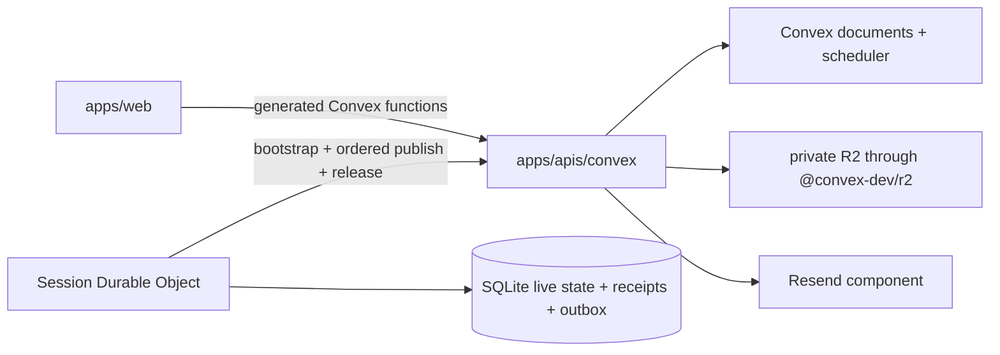
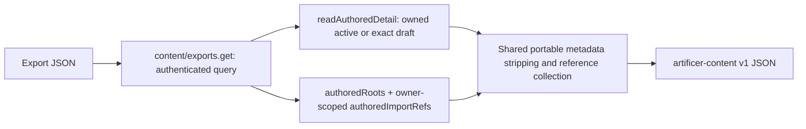

# API workspace

## Current native backend

`convex/` is the product backend under [ADR 0029](../../docs/adr/0029-convex-backend-cutover.md).
The browser uses generated Convex queries, mutations and actions for ordinary product work;
authenticated functions derive the user from `ctx.auth`, validate shared `packages/schema` contracts,
and keep private storage rows and secrets behind domain-owned functions. Active supported live
commands use the Session DO path described below.



During an active live Session, its Durable Object is the single authority for the supported Door,
standalone token move/undo and live Character command paths. It atomically commits the minimum SQLite
live projection, replay receipt and ordered Convex publication outbox before broadcasting success.
Convex independently revalidates those publications, fences overlapping direct writes while room
authority is active, drives subscriptions, and supplies recovery state after release or eviction.
Other product and Encounter commands use their owning Convex functions. The Worker also carries
recipient-filtered ephemeral previews. Canonical source import reads the preserved
`packages/source-data` corpus; media, notifications and cleanup use native Convex components.

Use the workspace scripts for focused work:

```text
yarn workspace @artificer-toolkit/apis codegen:convex
yarn workspace @artificer-toolkit/apis typecheck:convex
yarn workspace @artificer-toolkit/apis test:convex
yarn seed:srd:convex:local
yarn audit:srd:convex:local
```

Generated `convex/_generated` bindings are committed and must be regenerated, never hand-edited.
The [persistence guide](../../docs/architecture/persistence.md),
[live-session guide](../../docs/architecture/live-sessions.md),
[notification runbook](../../docs/runbooks/convex-notification-delivery.md), and
[R2 runbook](../../docs/runbooks/vtt-map-r2.md) own the current operational contracts.

## Historical Phase 8.2 implementation record

The sections below preserve dated implementation decisions and partial-gate notes. They are evidence
of how the cutover was built, not current deployment instructions or acceptance status. Use the
machine acceptance ledger and current guides above for present behavior.

Native `encounters/commands:execute` uses `encounterExecuteInputSchema` and the existing command
result DTO. Its current local slice implements GM reminder upsert/removal, with current authority,
exact Run versions and atomic state/projection/receipt writes. Matching retries return the original
stored result. Other commands, player reads and browser wiring remain unfinished; see
[native Run reminders](../../docs/architecture/persistence.md#native-run-commands--partial-local-implementation).

Shared System document reads live in `convex/content/systemDocuments.ts`; import them there,
not from the public `systems.ts` query module. This keeps authoring source reads independent
of capability registration and the play execution schemas. The platform Rules registry remains
the sole owner of installed capabilities and operations; public System query contracts are unchanged.

Character catalogue reads may pass their already-read transaction-local source document to
`content/documents.ts:canReadAuthoredRoot`. The helper still checks source UUID, System and both
source/root ownership; other callers retain the indexed lookup. Never pass a client-provided or
cross-transaction cached source. Campaign-share fallback and publication integrity checks remain
separate and unchanged.
The complete Builder catalogue checks Class parents and resolves Equipment parents from its already
authorized, validated current documents. It does not rehydrate those parents or compile unused
Equipment mechanics; missing or inaccessible parents still fail the complete catalogue read.
Commit, Sheet and source-loss preparation omit unused structural selectors while preserving all
Equipment/Feat/Spell options and Class candidates when subclass selection is due. Builder reads and
preview keep complete selectors. First-create inventory materialization refreshes only selected
rule facts, reusing its transaction's already-validated catalogue.

Native `campaigns/create:create` atomically creates a private Campaign, OWNER membership, default
play settings and public route after indexed entitlement and System/catalogue checks.
`campaigns/queries:get`, `settings` and `list` provide current member reads and an owner-only raw
settings view. They use the existing shared DTO/capability/text policies; profiles expose current
usernames only, and assignments expose validated Character summaries rather than private Sheet data.
`campaigns/archive:archive` adds the owner/version-checked read-only transition without deleting
member data. Social archival consequences remain pending with the native Social port.
`campaigns/playSettings:get` preserves member/owner maturity views, and `save` validates the current
owner, settings version, enabled initiative policy/graph sources and optional-combat selections before
atomically replacing settings. `options` reads current definitions only from the enabled catalogues
and returns compact policy/tie/optional-rule labels through the shared neutral projection. Inline
discovery is complete or fails at the existing 500-definition bound. The web Campaign settings and
table-settings panels use these reactive native reads and writes; existing Encounter snapshots are not
rewritten. Member mutation, reconciliation, copy/delete, other browser surfaces and complete account
deletion remain pending under their owning cases; see
[native Campaign persistence](../../docs/architecture/persistence.md#native-campaign-creation-and-reads--local-implementation).

`campaigns/contentShares:share` records an authenticated active member's currently Active owned
homebrew root after validating source ownership and published-document integrity. Repeated shares
preserve the existing identity and timestamps. `list` pages identities and resolves current documents,
omitting departed authors and missing/inaccessible roots without losing the candidate cursor. STANDARD
Campaign reads mask authored display text; the private share response retains original text. This
does not grant global authored access. Homebrew child sharing now requires explicit Homebrew parent
shares or parents from enabled official catalogues. Reads recheck the entire Equipment chain and
reject orphaned shares. Assigned Character source loading uses Campaign catalogue restrictions plus
owned Homebrew and exact current shared roots across Builder and Sheet source consumers, without
granting global GM Character access. Shared extra selectors mask their labels before search/order/cursor
construction. Owner-facing Builder/Sheet/rest/preparation/history responses apply Campaign text
presentation without changing stored mechanics or private notes. `contentShares:unshare` removes the
requested share plus shared Class/Race children and the complete shared Equipment descendant tree in one
version-checked, actor-bound replay transaction. Assigned Characters lose inaccessible direct selections,
remain Active only when current-source preparation is ready, and otherwise keep their identity, Sheet
state, receipts and repair draft. Unshared Vehicle definitions evacuate complete item trees and explicit
currency groups to party custody before deleting the instances. Party or Vehicle cargo that directly
holds unshared Equipment currently blocks the transaction until its retention policy is decided. The web
Campaign content panel uses the native paginated list/share/unshare functions and native owned-catalogue
candidates. Member removal and remaining cleanup producers stay with their owning cases. Owned authored-root deletion now
repairs personal, assigned and create-only Character state, removes exact Campaign shares, evacuates
shared Vehicle instances and advances each affected Campaign once in the same root-deletion transaction.
Archived Campaign and retained LEFT-author cleanup is lifecycle-only authority; existing public deletion
guards remain fail-closed. See
[native content sharing](../../docs/architecture/persistence.md#native-campaign-content-sharing--local-implementation).

`campaigns/partyInventory:items` and `currencies` provide paginated member reads of native party
custody. `campaigns/partyInventoryCommands:mutate` applies owner-only item CRUD and System currency
adjustments with inventory versions, exact actor-bound replay and atomic OWNER audit events.
`campaigns/inventoryAudit:list` returns the latest 180 days of owner-only history through the shared
encoded-payload contract, using indexed cutoff reads on every page without deleting stored events;
both audit paths mask STANDARD inventory labels without rewriting storage. `campaigns/currencySystems:list`,
`save` and `remove` now provide paginated Campaign currency definitions, single-reference management and
exact integer conversion of current party and Vehicle-scoped balances with atomic per-owner version invalidation. An optional
Campaign-system reference keeps custom and existing System balances distinct even when UUIDs collide;
foreign Campaign definitions cannot shadow System currency. Native Character currency options remain
System-only. Character conversion, Character/Vehicle transfers, placement, remaining lifecycle cleanup, generated client bindings and web
integration remain pending. Equipment held by party custody cannot be deleted before that cleanup.
See [native party inventory](../../docs/architecture/persistence.md#native-party-inventory--partial-local-implementation).

`campaigns/vehicles:list/create/update/remove` ports independent Campaign Vehicle metadata: bounded
member pages, owner-only active writes, current same-System official/shared source checks and expected
instance versions. STANDARD labels are presented without rewriting storage. Missing source authority
blocks definition-dependent writes, not metadata listing or empty-instance removal. Existing Campaign
custody rows now support an optional Vehicle owner without duplicating inventory storage; Party paths
explicitly exclude Vehicle rows. `campaigns/vehicleInventory:items` and `currencies` reuse bounded
party hydration and presentation for active members, including archived reads; same-Campaign Vehicle
metadata and consistent inventory ownership are mandatory. Missing inventory owners with existing
cargo reject both reads and writes. Nonempty Vehicle removal stays disabled pending the cargo-retention
decision; empty removal cleans only its own inventory-owner row. Unshare and owned authored deletion
provide source-loss evacuation. Vehicle inventory and currency transfers, member source-loss producers
and web bindings remain pending; no inventory writer
may be enabled before its full custody lifecycle exists. See
[native Campaign Vehicle instances](../../docs/architecture/persistence.md#native-campaign-vehicle-instances--partial-local-implementation).

`campaigns/gmReads:adjustments` and `conditions` read validated Campaign/Character state for the
current owner or the Character's current assigned player. Owners see all records; players receive
only VISIBLE records without internal attribution. Reads validate current assignment ownership,
System/route identity, state checksum and unique IDs/semantic slots before projecting existing DTOs.
Archived reads remain available. Native Sheet preparation now consumes the same validated state,
merges Campaign adjustments over player slots and applies Campaign attunement limits. The separate
`campaigns/characterSheet` get/panel/preparationOptions/restPreview/execute endpoints validate explicit
Campaign/Character scope; personal Character and Builder APIs remain owner-only. Scoped GM commands
use the existing atomic Character stream/receipt transaction with the actual authenticated actor.
GM custom names are shared, private notes are denied, and archived GM commands/replays reject.
Player history uses an actor-scoped index to exclude GM events. `campaigns/gmWrites` now saves/deletes
Campaign adjustments and conditions with exact record versions and an atomic private-actor audit event;
adjustment changes validate current Sheet evaluation before committing. `campaigns/events:list` retains
the existing UUID cursor and visibility projections with bounded indexed reads. Its native payload is
`payloadJson`; the shared `campaignEventTransport` decoder restores the unchanged domain event DTO.
Migration, non-GM event producers, scoped rolls and browser binding remain pending; see
[native GM state](../../docs/architecture/persistence.md#native-gm-character-state-and-audit--partial-local-implementation).

`campaigns/announcements:create` commits immutable announcements and safe notification intents in
one owner-authorized transaction, with command replay and current TABLE/PARTY recipient checks.
`list` uses permission-scoped pagination; `get` rechecks current destination access. PARTY remains
player-only, including page metadata. The web uses the native list/get/create seam. Campaign deletion
cleanup remains with Campaign lifecycle; see
[native announcements](../../docs/architecture/persistence.md#native-announcements--local-implementation).

`campaigns/conversations:open` establishes TABLE/PARTY/DIRECT room membership in a mutation; `list`
and `campaigns/chat:list` are reactive reads. `chat:send`, `edit`, `unsend` and `conversations:markRead`
use current room authority, access epochs, canonical UUIDs and retained message-time identity.
Compact entry headers keep unread counts bounded without hydrating every message/roll payload.
Text and public rolls share per-room 500-entry retention and the rolling send policy; edits/unsends
remain text-only. Admission/deletion lifecycle and native web wiring remain pending;
see [native conversations](../../docs/architecture/persistence.md#native-conversations-and-text-chat--partial-local-implementation).

`campaigns/rolls:execute` generates authoritative TABLE evidence for a player's own assigned Character
or a GM-scoped assigned Character, using current Sheet sources and current membership before replay.
Same-room/same-kind nonce retries return the original entry. Public rolls never enter private history.
`executePrivate` accepts GM-only manual rolls without a Character and retains only that GM's latest
twenty records. Fresh no-Character GM rolls require an existing valid assigned player Character.
`campaigns/characterSheet:executeRoll` handles assigned-Character private rolls for the current player
or explicitly scoped GM. It shares the evaluator and caller-only history, providing HIT_DIE evidence
for scoped short-rest preview/completion; it never opens a room. Archived generation rejects.
The shared native evaluator/history/retention helpers replace no privacy boundary; personal `rolls`
remains owner-only. Campaign browser rollers use these native endpoints; Encounter integration and
remaining acceptance stay with their owning cases. See
[native Campaign rolls](../../docs/architecture/persistence.md#native-campaign-rolls--partial-local-implementation).

`campaigns/notebooks:list` pages owner-visible notes or the player-only SHARED index range, preserving
the existing sort-order/UUID ordering with no total note cap. `create`, `update` and `remove` require
the active owner and a writable Campaign; updates check the note version in the mutation. Private
notes retain original text, while shared STANDARD notes are masked for every viewer. Shared UUID
DTOs omit internal attribution and storage fields. Notebook removal atomically deletes its Session
reference pins across all Sessions, preserving the former SQL cascade. Native browser editors and
pickers use explicit page continuation. Campaign copy/deletion remain unfinished; see
[native notebooks](../../docs/architecture/persistence.md#native-campaign-notebooks--partial-local-implementation).

`campaigns/sessions:list`, `get`, `create`, and `update` preserve numbered Session scheduling and
versioned metadata. Creation seeds assigned-Character attendance in the same mutation. Native
`sessionAttendance:list` / `set` keep actual attendance separate from `sessionRsvps:list` / `set`:
RSVP writes derive the responding user from authentication, and only the current owner receives
the RSVP list. Shared paginated contracts avoid imposing a total Session or historical roster cap.
`sessionFinish:finish` stores the finished projection and command fingerprint atomically for exact
replay after current owner authorization. `sessionNotes:list/create/update/remove` preserve shared
collaborative edits, author-or-owner deletion and GM-private sections, including after Session
finish. Player pages query only SHARED rows. `sessionReferences:list/create/remove` keep owner-only
reference pins as target identities, resolving current authorized authored labels or same-Campaign
notebook titles on each read. Missing/inaccessible targets are omitted without losing continuation.
Session browser workspaces and pickers use these native endpoints. `sessions:latestOpen` reads the
latest OPEN Session by index for the tabletop launcher. `campaigns/clock:get` and the eight owner
commands initialize/configure/start/pause/advance/reconcile/rewind/reset preserve version preconditions,
correction reasons and a monotonic recovery watermark. Clock/segment changes, any resource recovery,
Character history and TABLE audit commit atomically with the Campaign-wide receipt shared with Session
finish. Complete managed concurrency/control and cleanup acceptance remain pending; see
[native Sessions](../../docs/architecture/persistence.md#native-session-scheduling-and-attendance--partial-local-implementation).

Native `social/profiles:getEligibility`, `initialize` and `updatePreference` operate only on the
authenticated account's private Social profile. Initialization is idempotent; preference changes
retain the first adult-attestation timestamp and cannot restore suspension. Birth dates are validated
in memory through the shared age check and are absent from stored records and result DTOs. Account
deletion removes this owned profile. Native shared profile/listing reads, owner listing lifecycle,
application/invitation writers and four participant/owner inbox queries now have local implementation.
Inboxes use separate PENDING/HISTORY cursor groups; invitation pagination fixes an explicit `asOf`
expiry horizon until the client refreshes both groups. Shared reads enforce current symmetric blocks
and maturity masking. Discovery/search, blocks, audited moderation and the corresponding web bindings
also have local implementation proof. Full native backend/browser lifecycle acceptance remains pending. See
[inbox contracts](../../docs/architecture/persistence.md#native-social-admission-inboxes--local-implementation).

The internal `social/rateLimits` helper implements the shared Social fixed UTC hour/day allowances
with compact, transaction-owned counters and account-deletion cleanup. It exposes no client mutation;
application, invitation, report and block writers consume it. SQL callers
consume the same extracted shared policy. See
[native Social rate limits](../../docs/architecture/persistence.md#native-social-rate-limits--local-implementation).

Internal `social/retention` exposes bounded preview/apply pages and scheduled report-audit cleanup.
The root `yarn social:retention:convex` command selects an explicit deployment and fixed cutoff,
defaults to dry run and requires the existing purge confirmation for apply. Follow the
[retention runbook](../../docs/runbooks/social-retention.md). The legacy production/staging Social
population was empty in the 2026-09-10 read-only inventory; repeat that inventory before cutover.

Native `characters/drafts` now provides owner-scoped create/reopen, save, read, paginated recovery
and discard. It uses shared Character DTOs, scalar JSON/checksum persistence contracts, the existing
public route allocator and personal-Character entitlements. Draft commands never write active
Character state. Native Characters bind only to their immutable System; individual choices reference
exact authorized content UUIDs across compatible catalogues and owned Homebrew. Native inputs reject
the retired Character primary-catalogue field; readers verify old raw checksums before stripping it,
and new native writes omit it. Legacy SQL fields remain retirement-only compatibility.
Browser list, Sheet recovery and Builder edit reads now use native draft queries.
The edit loader uses `characters/builder:get` for its single working payload and preserves persisted
draft mode/state without a second legacy resolution. Mounted Builder create/reopen, save/discard,
candidate resolve/preview and reviewed-candidate commit now use native bindings. SSR/preload remain
read-only, write commands carry the persisted draft generation, and the server owns the active
baseline. Retired HTTP Builder methods are no longer exposed by the web adapter. Complete native
journey and promotion evidence remain pending; see [Character ownership and persistence](../../docs/architecture/character.md#native-convex-drafts--implemented-cutover-pending).

`characters/list:list` provides bounded owner-only canonical Character pages, including repair
`DRAFT` rows and working-draft summaries, but no never-activated rows. The existing draft page
supplies those separately. Neither list evaluates
rules or persists repairs; unavailable rules cannot hide a Character that needs Builder repair.
The web Character list and own-Character picker now consume both native paginated streams, merging
draft-only identities after both finish so existing client filters and totals remain complete.
Disabled pickers skip subscriptions. Other Builder, Sheet and Campaign integration remains pending.

The native personal Sheet query and receipt-backed command mutation have partial local coverage,
including spell slots, known/prepared selection, casting and source-specific display/mechanic
customization, inventory, currency, Creature/Vehicle extras and short/long rest completion.
Native `rolls` supplies current-Sheet-authorized evidence and caller-only latest-20 history;
the web roll adapter now uses its generated bindings and subscription-owned history. Native Campaign
public and private GM producers are described above; old SQL records are not bridged into native history.
`characters/rest:preview` is read-only, and completion consumes accepted evidence atomically with
state/version/receipt writes. Active-effect expiry and Campaign integration remain pending.
They use current authorized policy inputs and preserve Builder intent. The personal web Sheet now
uses generated native Sheet/draft/panel/preparation queries, native commands and read-only rest
preview. Convex owns optimistic rollback and subscription updates; legacy live-session socket
state no longer routes or gates Sheet commands. Extra-option discovery now subscribes to the native
owner-only `characters/extraOptions:list` query while its drawer has a selected kind, preserving the
existing 25-result search. The retired web HTTP Character facade is removed. Complete Builder journey
proof, Campaign authority and managed proofs remain pending. See
[native Sheet commands](../../docs/architecture/character.md#native-personal-sheet-commands--partial-local-implementation).
`characters/history:list` exposes owner-only native receipt history through bounded chronological
cursor pages. It shares replay's stored-history validation and remains readable when current rules
sources cannot render a Sheet; legacy/Campaign event integration remains pending. There is no existing
Character receipt-history UI consumer; these backend pages do not establish browser journey evidence.
`characters/panels:get` composes current authorized Sheet data with the neutral inspector resolver,
including calculation breakdowns, adjustment editors and owned spell/item/resource/extra targets.
This preserves existing supported panel kinds and does not implement the previously unsupported kinds.
`characters/preparationOptions:get` returns lightweight per-class preparation choices from the same
current authorized spell map, with spellbook eligibility and committed Sheet presentation preserved.
It adds no catalogue or persistence path. The web subscribes only while the Spells inspector is open;
Campaign visibility remains pending.

The server-only `characters/context` loader reads selected current personal sources and the exact
System document through Convex, including authorized Race/Equipment parents, direct feature ownership
and conditional Spell catalogues. It does not call the legacy services or provide the pending
Campaign overlay, Builder readiness/commit, or Sheet lifecycle.

Better Auth owns credentials and sessions. `userProfiles` maps its internal user identity to the
public UUID and app-owned profile data. Product authorization calls `requireIdentity`, validates the
active session, and returns only the shared public identity contract. Signup defaults closed.
The private `accountDeletion:confirmCredentials` mutation reuses the strict shared
`AccountDeleteInput`, resolves the current profile/session and email, and verifies exactly one
current Better Auth password credential without creating a session or changing account state.
It returns no credential or profile data. It is a preparation step for F12; the public deletion
command and web transport remain unfinished, and deletion is not enabled by this step. The final
command must keep credential confirmation, ownership checks and app/component cleanup inside one
native mutation, following the password-recovery transaction pattern. Calling Better Auth's default
delete API directly from an action would remove sessions/credentials in separate mutations before
the app-owned deletion guard; that cannot prove F12 refusal/rollback semantics. Shared-history policy,
complete owned-source reconciliation and real native/browser proof remain F12 requirements.
Native account password changes use `POST /api/auth/account/password` with the existing strict
`AccountPasswordUpdateInput`. Sensitive-session middleware reads the current stored session and user,
checks the submitted email against that user, and delegates password verification/update to the
installed Better Auth endpoint. The command preserves all sessions (`revokeOtherSessions: false`)
and does not sign in again. Native email changes use the installed Better Auth two-address confirmation
flow, retaining the current email until both addresses confirm and preserving existing sessions.
Account deletion remains unfinished; these local producers still require live backend/browser proof
and do not establish full R01/F12 acceptance.

Initial invitations use the internal `authInvitationsCli:invite` action, not public signup or
provider administration routes. After verifying the selected development target and configuring
its email provider, run from this workspace:

```powershell
yarn convex run authInvitationsCli:invite '{"email":"recipient@example.com"}'
```

This sends an email; it returns no token. Links expire after 24 hours and reissue invalidates the
previous link. Redeeming creates a verified ordinary account and consumes the link atomically,
then the recipient signs in normally. An existing account is never overwritten. Never put real
invitation links or passwords in validation logs. Deployment/runtime proof and browser acceptance
remain tracked in F06; the CLI must not be pointed at production without explicit authorization.

#### Development target

The user-approved workflow now keeps editing, generation, builds, typechecks, pure tests, and
`convex-test` local while allowing actual integration/E2E on a verified personal cloud dev
deployment. The confirmed project is `artificertoolkit/artificer-toolkit`. Personal cloud dev
`flexible-goshawk-837` is selected; its matching endpoints are
`https://flexible-goshawk-837.convex.cloud` and `https://flexible-goshawk-837.convex.site`.
The separately named `staging` deployment is `beaming-pig-820`, created without selecting it or
changing the default production target. It uses Convex's `prod` type for production-like behavior,
but remains staging, not the live release target. No application code was uploaded during setup.
The user deleted the former separate staging project. Staging remains promotion-only. See the
[ADR amendment](../../docs/adr/0029-convex-backend-cutover.md#historical-development-runtime-amendment--2026-09-03).
Cloud dev requires its own test data and delivery credentials; the loopback-only helpers below
cannot reach this computer from a managed action. No staging/production secrets are implied.

Retained optional local-backend setup from this workspace:

```powershell
yarn convex dev --configure existing --team artificertoolkit --project artificer-toolkit --dev-deployment local
yarn convex env set SITE_URL http://localhost:3000 --deployment local
# Pipe a newly generated secret to avoid shell history; never reuse staging credentials.
yarn convex env set BETTER_AUTH_SECRET --deployment local
yarn dev:convex
```

The local CLI writes ignored `.env.local` and `.convex/` state. Confirm loopback URLs before testing.
From the repository root, use `yarn turbo run typecheck:convex test:convex --filter=@artificer-toolkit/apis`.
With local Convex running and signup closed, run
`yarn tsx --env-file=apps/apis/.env.local apps/apis/tests/developmentFoundation.ts` for real HTTP/query proof.
No managed deployment is part of that optional local setup. Generated `convex/_generated` contracts are committed;
regenerate with the pinned CLI, never edit them manually.

The pinned `codegen` command does not accept `--deployment`. To generate against an existing local
backend while cloud development remains selected, supply both `--url` and `--admin-key`; these
explicit arguments select the backend before `.env.local` is considered. Verify `/instance_name`
on the loopback URL first and load the local key from ignored `.convex/local/default/config.json`
without printing it. Component codegen uploads source for analysis, including Node actions, but
does not finalize a deployment. Never fall back to unqualified codegen when only a local target is
authorized. The Windows Node executor also requires permission to create directory symlinks;
an `EPERM` from its external-dependency link is a failed local codegen gate.

Schema evaluation imports `shared/vtt/scene` constants and `shared/vtt/segments` predicates through
their focused paths. The predicate preserves robust orientation and intersection behavior without
loading rendering geometry or polygon-clipping's environment-dependent initialization into schema.

Cloud dev now has a successful backend push and real closed-signup/anonymous-denial smoke.
`convex.json` enables the pinned CLI's `codegen.staticApi`: validator-derived function references
keep backend implementation and Better Auth peer types out of the web TypeScript program.
The backend implementation is still independently typechecked; this is not a cast, skipped check,
or handwritten API facade. Both Convex and web app typechecks pass with the generated boundary.

The pinned Convex 1.45.0 CLI has a Yarn patch for empty-union code generation: it emits `never`
instead of an empty type, preserving contracts such as `Array<never>`. The patch covers the source,
module builds, and CLI bundle. Run `node apps/apis/tests/convexStaticApi.check.mjs` from the repository
root after dependency changes; remove the patch when the installed CLI contains the same fix.

`developmentFoundation.ts` and `developmentSourceImport.ts` also support an explicitly selected
`dev:<deployment-name>` with matching HTTPS `.convex.cloud`/`.convex.site` URLs. Their shared test
guard rejects prod/preview selectors, mismatched hosts, URL credentials, and non-loopback local
targets before network access. This is test-runner protection, not authorization or proof of the
deployment type: first verify the project/type with the CLI. Run the guard's offline check with
`yarn tsx apps/apis/tests/developmentTarget.check.ts` from the repository root. The full auth/email
and R2 harnesses still require their loopback test providers; they have not been silently widened.

`developmentDrafts.ts --equipment-capacity` uses a disposable Player-tier author to fill the
500-visible-Equipment option set through public draft/publication commands. The internal
`content/development:setFixturePlayerTier` accepts only an empty `draft_<12 hex>@example.invalid`
account at the localhost development application origin; it cannot overwrite another tier.
The runner removes registered Equipment UUIDs child-first, proves the original option set is
restored, then removes the temporary entitlement before deleting the fixture identity. This proves
the visible-option boundary, not a 500-generation managed inheritance workload or percentile headroom.
After an interrupted run, `--cleanup-equipment-capacity` additionally requires the original
`--fixture-email` and `--fixture-created-at` values. Recovery verifies both against the exact
disposable account, pages its named capacity generations, and uses normal ownership-checked
deletion commands. An uncertain deletion response is retried once only after re-reading its UUID;
failed content cleanup retains the account for recovery.

`developmentDrafts.ts --equipment-character` builds and commits an independent Character through
public APIs, adds a container/nested item and private Sheet state, saves an edit draft, then deletes
the owned Equipment. It checks active/draft reconciliation, surviving notes/currency/adjustments,
draft identity and foreign-user denial. Internal `characters/development:removePersonalFixtureCharacter`
retires only that exact disposable account's Character, draft, route, receipts and private rolls.
The shared fixture-account guard requires the localhost application origin. Current or retained
Campaign membership, Campaign ownership, any Character assignment, foreign ownership or more than
100 receipts/20 private rolls rejects the whole cleanup transaction. The runner removes the
Character before authored content, and removes empty sources only after all authored kinds are gone.
This is isolated test cleanup, not a public Character deletion or Campaign custody lifecycle.

`developmentDrafts.ts --encounter-character` reuses that Character setup for a two-account execution
diagnostic: public Campaign creation, controlled internal fixture admission, public assignment,
Session/Blueprint/Run creation, nested Character damage, exact/conflicting replay, stale-version and
authorization rejection, and Character initiative. It reports per-operation wall time and response
bytes; this small fixture does not establish the frozen six-client workload's percentiles. The same
command assertions and cleanup run locally in `encounters/developmentCharacterProof.test.ts`.
`encounters/developmentCampaign` admits and removes only the named synthetic fixture Campaign;
cleanup validates bounded Run/Session dependencies and linked GM Character receipts before deletion.
The harness discovers owned Campaigns before cleanup to cover lost create responses, removes their
dependencies before personal Characters, and retains identities if any cleanup fails.

`developmentDrafts.ts --character-concurrency` uses two authenticated clients for one synthetic
owner and two Characters. It exercises competing Builder commits, duplicate and conflicting Sheet
commands, independent Character streams, stale draft generations, exact replay after later writes,
and anonymous/foreign denial. Its shared assertions also run in
`characters/developmentConcurrencyProof.test.ts`. The managed driver then forces the SDK WebSocket
to close, checks subscription recovery on a new socket, and replays the original command without
advancing the stream again. Existing native transaction tests inject post-write failures; the
managed harness adds no failure endpoint. All exact Character, publication and account fixtures
are removed by the existing cleanup.

Authentication email uses `packages/emails` from the internal Node 24 `email.send` action. Set
`MAIL_DELIVERY_MODE=local` and `LOCAL_EMAIL_SINK_URL=http://127.0.0.1:3222/email` on the **local**
deployment for tests. Local delivery rejects non-loopback deployment/sink URLs and redirects.
`tests/localAuth.ts` starts that sink, exercises verification, email/username login, native bearer/JWT,
password recovery, and session revocation. Temporarily enable local signup for this check and always
restore it to closed afterward. Its test accounts use unique `@example.invalid` addresses.

Managed delivery uses `MAIL_DELIVERY_MODE=resend`, `AUTH_EMAIL_FROM`, and `RESEND_API_KEY` through
the official Resend component; notifications also require `NOTIFICATION_EMAIL_FROM`. Personal
development and staging use `RESEND_TEST_RECIPIENT=delivered@resend.dev` to route all auth and
notification emails to Resend's test address through the same component queue and receipts, with
component test mode enabled. `bounced@resend.dev` and `complained@resend.dev` can exercise failure
events; each address accepts an optional `+` label containing letters, digits, `_`, or `-`.
An invalid or empty configured override rejects delivery. Production leaves this variable unset
and delivers to the intended recipient. Keep managed credentials out of local tests, which use
the loopback sink. Signup verification uses links; password recovery retains six-digit codes.
OTP passwordless login/signup and email-change endpoints are not enabled.

#### Auth security boundary

Passwords, recovery codes, cookies, bearer tokens, signing secrets, and email links must never be
logged or exposed in product projections. Convex JWTs carry only required identity/session claims;
protected functions still validate the current Better Auth session, including after revocation.
Discoverable endpoints and public UUIDs are not authorization.

Better Auth rate limiting uses its persistent component storage. Direct/native HTTP requests use
Convex `ctx.meta.getRequestMetadata()`. The same-origin web `/api/auth` proxy uses Netlify
`getContext().ip`, strips caller IP claims, and signs a 30-second JOSE context bound to method, path,
issuer, and deployment audience. A separate server-only `AUTH_PROXY_SECRET` (at least 64 random
characters) must match in SSR and Convex; never use a `VITE_` prefix or reuse an account credential.
Invalid signed context is rejected. Missing trusted IP fails closed. Only loopback development
requests can fall back to one local bucket when no Netlify function context exists.

The optional server-only Convex `JWKS` variable enables the integration's static-key mode in both
`auth.config.ts` and the Better Auth Convex plugin. Convex then verifies JWTs from embedded public
keys without HTTP key fetches; the public-key endpoint and credential endpoints retain their rate
limits. Initialize it from that deployment's currently published Better Auth key set, preserving key
IDs and encrypted private-key material. The value is a secret: keep it out of browser variables,
source files and logs. Existing tokens remain valid when the same keys are retained. Future rotations
must update the configured key set and preserve verification keys for unexpired tokens. Removing
`JWKS` and redeploying both configurations restores database-backed keys; initial configuration
does not rotate or delete the stored keys. Each environment keeps its own signing keys.

For a selected development deployment on Windows, pipe a dotenv assignment rather
than a bare secret: `"AUTH_PROXY_SECRET=$env:AUTH_PROXY_SECRET" | yarn convex env set --force`.
The installed CLI's single-value stdin reader strips only LF, leaving PowerShell's
CR in the stored secret; the dotenv parser handles CRLF correctly. Keep the random
value in process memory and never print it or use a command-line value argument.

The web environment also requires public `VITE_CONVEX_URL` and server-only `CONVEX_SITE_URL`.
Vite reads the worktree-root `.env.local`, not the CLI's `apps/apis/.env.local`; configure both
for the same selected dev deployment. Supply the matching server-only `AUTH_PROXY_SECRET` when
starting the local web process. A previous process's in-memory variables do not survive restart.
Local Convex trusts `X-Forwarded-For` because it runs without the managed ingress; therefore local
checks do not establish managed proxy trust. `F03` must prove actual SSR wiring and `R09` must prove
Netlify/Convex ingress attribution; do not substitute arbitrary headers if platform context fails.
Recovery requests additionally use an atomic
per-account limit (three requests per 60 seconds) in existing Better Auth storage, applied identically
to known and unknown emails. IP rotation does not bypass that resend limit.

Better Auth 1.6.15 has a pinned Yarn patch for recovery verification-row selection/consumption.
`authRecovery.execute` runs request/check/reset through the original Better Auth APIs in one outer
Convex mutation: nested component operations atomically update failed attempts, consume all codes
for an identifier, change the password, and revoke sessions. Expected 4xx results return normally so
attempt counters commit; unexpected errors roll everything back. The patch alone is insufficient
without this transaction boundary. Remove it only after an upstream replacement passes the resend,
exhaustion, concurrent-reset, replay, and revocation regressions. No custom password hashing or token
cryptography is introduced.

`account.session` returns the closed shared UUID/profile/role/feature-flag projection, never the
Better Auth record or tokens. Authoring preference updates target only the authenticated profile.
Older local profile rows default to completed registration and guided authoring; new rows write
these values explicitly. Web recovery keeps its verified email/code only in component memory;
refresh requires code entry again. The router now carries only this shared session projection;
the root Better Auth/Convex provider invalidates routes and clears query caches on identity or role
changes. Authenticated SSR session responses are private and non-cacheable. `F03` is accepted with
native bearer/JWT proof and the localhost-browser/personal-dev journey: authenticated SSR/reload,
hydration, sign-out, session revocation, protected-route denial, and zero legacy shell requests.
This does not accept hosted performance or all account-management journeys.

`account.profile` and `account.updateProfile` expose only the caller's username and bio. They accept
no account ID, role, email, or generic patch. Username changes use Better Auth's validation and
uniqueness hooks; the component update and app-owned bio update share one Convex mutation. A
case-only edit updates `displayUsername` without rewriting the canonical username. The comparison
uses the stored canonical username, never its independently editable display label. Profile settings
now uses the native Convex query/mutation; the shared account-avatar adapter also uses Convex/R2.
Focused backend/component tests alone do not accept `F10` without deployed local/browser proof.

`F11` source now uses the supported locally defined `betterAuth` component and admin plugin. Better
Auth's user row owns the role; `userProfiles` still owns only app identity/profile data. The internal
`authAdmin.setRole` mutation takes the public UUID and closed `user | superadmin` role. Promotion
requires a verified, active account; demotion is allowed for disabled accounts too. Product role
checks read the current auth user/session, not a role claim cached in a JWT. Active bans reject access.
Every admin-plugin HTTP route is disabled, including impersonation, password changes, account lists,
and role updates. This does not create a public account-administration UI or API.

Regenerate the provider schema with `yarn workspace @artificer-toolkit/apis codegen:auth` from the
repository root, then regenerate Convex bindings with the pinned CLI. The schema generator is pinned
to Better Auth 1.6.15. Its separate CLI-only config uses dummy schema-discovery values, never runtime
credentials. Do not hand-edit generated schema/bindings or reset data to make a component switch pass.
The component keeps its name and public UUID mappings. Its generated schema now lists only enabled
plugin tables/fields; before a local push, verify existing data needs no omitted optional provider
fields/tables. Prove the same user/session IDs and profile mappings survive without reset.

F11 is not accepted: focused role/rollback/HTTP-route checks and targeted review pass, and official
cloud-dev codegen now produces the correct local-component bindings. The three stale `role`/`banned`
type diagnostics are resolved. Fresh dev installation is not proof of preserving an existing
provider's user/session IDs and mappings. That compatibility proof, real privileged endpoint
denial, and privileged content integration remain required.

#### Canonical source import

With the local deployment running, use `yarn seed:srd:convex:local`, then
`yarn audit:srd:convex:local` from this workspace. Both scripts explicitly select `local`.
`content/seed` is an internal Node action loading the preserved `packages/source-data` corpus;
`content/import` contains internal, indexed mutations and read-back queries. These are provisioning
operations, not public authoring endpoints. Verify public denial with
`yarn tsx --env-file=apps/apis/.env.local apps/apis/tests/developmentSourceImport.ts` from the root.

The importer validates existing domain schemas, UUIDs, metadata, and checksums before writing.
Batches contain at most ten records, target at most 128 KiB of UTF-8 input, and commit atomically.
A larger individual document remains whole. Ten Class records were about 1.27 MB and exceeded
the hosted mutation CPU limit; size-bounded batching passed the complete cloud-dev seed/read-back
without reducing domain validation or checksum checks. Exact repeats reuse content and may backfill
missing server-derived Equipment option facts after verifying the unchanged root and version.
Different stored content or existing option facts are an error, never an overwrite. Interrupted provisioning resumes by rerunning the
seed. Complete read-back audit is required before the import is accepted.

Master ownership comes from the PLATFORM content source with a null owner, not the canonical
payload's placeholder `userId`. Public/authored UUIDs remain distinct from Convex `_id` values.
Authored roots hold indexed summary metadata and a typed current-version pointer. Their immutable
version payload is canonical `documentJson` text: 13 unchanged SRD documents exceed Convex's
16-level nesting limit (maximum 23), although their sizes remain below the document limit. The
import validates the full typed document before encoding; read-back parses it and recomputes both
document and complete-record hashes. No source fields are flattened or discarded. Future public
authoring readers must return validated domain DTOs, never raw storage rows or unvalidated JSON.
Systems and reusable definitions remain structured documents within their measured limits.

This accepts source preservation/import only. Publication, compilation, master-copy-to-homebrew,
sharing, and runtime rule execution remain separate Gate 2 cases.

#### Authoring resolution — transitional

`authoring/nodeRuntime.resolve` and `normalizeValues` are authenticated, read-only Convex queries
over shared node-runtime DTOs. Native resolution returns `NodeRuntimeCompactResolveResponseDto`:
root metadata plus response-local distinct scope models and absolute-path/model-index pairs.
The web selector validates and expands this lossless representation for the existing renderer;
the native subscription remains a query. Normalization and the temporary SQL response are unchanged.
`packages/authoring` owns the extracted resolver and
normalizer; Convex supplies trusted System/definition/authored-source facts while the temporary SQL
adapter uses the same implementation. System vocabulary, visible reusable definitions, and
same-System published master/owned root and nested reference choices are supported. Closed
`authoringSources` metadata holds only resolver-reachable labels, category/property facts and
feature/option/grant/effect/ancestry relationships; exact seed replay backfills absent metadata without changing
canonical payloads. `PLATFORM` sources are public; `USER` sources and their roots must share the
authenticated owner. Reads use indexed System/kind/owner ranges; unrelated private sources do not
consume the caller's bound. Canonical import remains PLATFORM-only. Inline sets stop explicitly
at 100 caller-visible sources / 500 visible roots per subject kind;
unmigrated sources or missing/stale facts reject instead of clearing valid selections.
Do not wire the web forms until their
complete source and save/publication flow is ready. Unknown sources must never look like empty
choices during normalization. See [Authoring Schema ownership](../../docs/architecture/authoring-schema.md).

For an existing verified development deployment, run the internal metadata backfill with
`yarn convex run content/sourceMigrations:backfillAuthoringSources` from `apps/apis`.
Check `yarn convex run --component migrations lib:getStatus`, then run `content/seed:audit`.
The official migration is resumable, one current authored document per batch; it validates
ownership/currentness and rejects conflicting metadata. Content, UUIDs, versions and counts
are unchanged. Do not tighten the optional field before completion and read-back verification.

After verifying the selected dev deployment, `developmentDrafts.ts --authoring-resolver` runs
only the native resolver tracer with one disposable authenticated account, no email, and exact
cleanup. It resolves and normalizes the complete canonical Acolyte, including nested Equipment.
The in-memory `convex/authoring/nodeRuntime.test.ts` covers trusted data and rejection;
the original 40 resolver tests remain reusable through the SQL adapter.

#### Working drafts — transitional

`content/publication.publishDraft` publishes a saved Background, Equipment or Feat draft in one mutation.
Class uses the `content/classPublicationActions.publishDraft` action because its pure normalization
and compilation exceed the query/mutation CPU budget. Both accept the exact `expectedDraftUpdatedAt`
token and return the shared publication summary; reactive detail reads supply the document.
The Class action reads trusted source rows through internal queries and sends the normalized ACTIVE
document, compilation, and request-only source-row checksums to an internal commit mutation.
That mutation rechecks identity, draft/base tokens, canonical document metadata, parent relationships,
and every observed source table in one snapshot before replacing current content and consuming the
draft. Changed sources reject publication; no partial write or persistent preparation record remains.
There is no caller-provided owner or compiled plan. All eight SRD authored domains now materialize
checksum-bound compilation through the shared compiler. Exact seed replay can backfill missing
compilation without changing authored source data. Class publication requires a readable,
current BASE parent in the same System for a SUBCLASS. Background/Class/Feat web authoring uses native
detail/draft, copy, publication, artwork and resolver adapters. Catalogue-page semantics,
remaining publishers and dependent reconciliation remain
transitional and require their own integration proof.

Spell web authoring now uses the shared native detail/draft, publication, artwork, export and
node-runtime adapters locally. The approved generic JSON-depth guard is now 25, independently of
the unchanged 20-level nested-facet limit. Prismatic Wall's depth-22 document passes local resolution,
normalization and publication without flattening its mechanics. Class UUIDs remain in the published document/compilation;
canonical Spell import now stores the same checksum-bound compilation, including Prismatic Wall,
without running form normalization or changing the authored document. Exact replay backfills only
missing compilation and rejects conflicts; canonical read-back audits require exact compilation.
The native Spell root catalogue projection stores level, verified school ordering identity, Class
UUIDs and casting time. Publication, import and exact backfill maintain it atomically. Native list
reads filter Class/level/school before pagination, order by name/level/school, and resolve current
authorized Class and System labels; global summary reads return the corresponding facets within the
explicit 500-active-Spells-per-owner ceiling. The web Spell catalogue consumes these native reads.
Builder and preparation projections remain separate Character-owned paths. See the
[authoring guide](../../docs/architecture/authoring-schema.md) for request bounds and remaining
integration work. This is not release acceptance.

The local mutation also admits Vehicle through the existing Vehicle schema and compiler, including
nested features and fractional speed. Publication and deletion retain the shared owner/draft/route
transaction rules; no Vehicle parent index is required. Local Vehicle form/detail/list mutations,
Guided copy, node-map resolution, artwork, portable export, detail/edit and catalogue reads now use native adapters.
Canonical Vehicle import uses the same pure compiler; exact replay fills only missing compilation,
rejects conflicts atomically and audits the complete compiled record. Managed backfill/execution,
Character/Campaign instance play state and complete lifecycle proof remain separate cutover work.

Race publication resolves a current, readable same-System BASE parent for SUBRACEs. The root's
indexed `parentRaceId` is null for BASE and the parent UUID for SUBRACE; missing metadata fails closed.
BASE publication recompiles its published children atomically without replacing child source,
checksums or working drafts. Families are bounded to 500 records including the parent, with child
admission checked in the same mutation. Published children block parent deletion/category conversion.
Canonical import classifies Race parent UUIDs and selection-mode metadata from the validated source.
The internal exact canonical `raceRelationships.syncDerived` pass fills only missing parent metadata,
compilation and family ordering keys, rejecting conflicts. Seed runs BASE before SUBRACE and audit
checks the resulting current-parent compilation and read projections; this wiring is local, not deployed.
Race web authoring now uses native detail/edit, mutation, node-runtime, media and export adapters.
Guided copy/parent choices use exact-System native catalogue pages. Catalogue pages use native
UUID-family ordering and preserve subrace hierarchy and the Playable badge. Managed
concurrency/rollback proof and full lifecycle acceptance remain open.

Creature uses the same local publication/deletion transaction with its full schema and source-only
compiler. Copies preserve external Equipment/Spell references and remap owned action/loadout bindings;
spellcasting remains feature-owned grants. Native frontend activation and catalogue reads are locally
implemented. Canonical Creature import now stores and audits the same compilation; exact replay
backfills missing evidence without changing source documents or versions and rejects conflicts.
Managed backfill/execution, Encounter/Character consumer integration and complete lifecycle proof
remain uncompleted cutover work.

Equipment publication resolves current same-System visible parent chains, then atomically recompiles
published descendants with the shared compiler. Descendant authored checksums and drafts are unchanged;
unresolved descendants or cycles roll back the parent publication. Deletion rejects published variants.
Exact canonical replay first backfills `parentEquipmentId`; `content/import.syncEquipmentDerived` then
compiles one Equipment after all imported parents exist. Missing relationship metadata fails closed,
and conflicting evidence is never overwritten. See the [authoring guide](../../docs/architecture/authoring-schema.md)
for the existing bounded-authoring ceiling. Equipment's web transport and managed lifecycle proof are pending.

#### Portable exports — transitional



Background/Class/Feat/Equipment downloads use the current Convex client; a missing client or rejected query
never falls back to SQL. Other domains still use their existing REST export until their native
authoring cutover. The downloadable schema and UUIDs are unchanged. Active exports use the validated
current item; draft exports preserve the exact saved payload even when it is incomplete. Metadata
stripping and reference candidate collection live once in `shared/utils/portableContent.ts`, also
used by transitional SQL import/export. Portable array/depth/node/reference limits reject oversized
exports rather than truncating them.

Equipment variants include `parentEquipmentId` as an external Equipment reference in both draft
and active exports. The same shared key classification remaps that parent when importing a batch;
it must not be mistaken for an identity owned by the variant.

Reference labels require a readable, same-System root of the matching kind; inaccessible or missing
targets retain the supplied ID as their label. UUID lookup keys are canonicalized without changing
reference IDs in the portable file. Import provenance comes only from the caller's
`authoredImportRefs`, selecting the earliest `createdAt` through the compound owner/kind/subject/time
index. This preserves the existing external-source identity independently of draft/publication
lifecycle. The table is read-only from product endpoints in this packet: native import writes and
SQL-reference migration/reconciliation remain unimplemented and are not accepted by export tests.

`content/deletion.deleteActive` deletes an owned published Background, Class or Feat and its current
version atomically, maintaining catalogue counts. A working draft survives as `DRAFT_ONLY`
with a new server timestamp and no published-base binding; its public route alias survives too.
Without a draft, deletion removes the alias. Foreign, master, wrong-kind and corrupt stored
identities/counts reject before changes. Background, Class and Feat are enabled. Class deletion
and BASE-to-SUBCLASS conversion reject while published children reference the class. The indexed
root `parentClassId` is null for verified bases, a UUID for subclasses, and absent until canonical
replay backfills it. These operations fail closed while any same-System Class lacks that metadata;
exact import replay and the canonical audit verify it against the source document. Parent checks
and writes share the mutation transaction, including concurrent publication/deletion conflicts.

`content/drafts` owns authenticated `list`, `get`, `save`, `discard`, and `duplicate` commands.
Duplication permits readable platform masters and the caller's own published homebrew, never a
foreign private source or unpublished working edits. Drafts intentionally accept incomplete authored values; the server
sets identity, System, kind, owner and status, then stores canonical `payloadJson` with
indexed metadata. Only the owner reads or changes a draft. Published copies reuse the shared
deep-clone algorithm: owned UUIDs change, referenced vocabulary UUIDs do not. Background web
operations now use these endpoints plus native publication/deletion; other domain form operations
remain transitional. Managed Background catalogue proof, dependent reconciliation and the
full browser publication lifecycle are still incomplete. Field resolution and draft/active media
lifecycle now use the native paths described below.

Draft recovery lists use the `(userId, subjectKind)` index with the current authenticated
identity, never a caller-supplied owner. They return only the shared draft summary, newest-created
first, without decoding or returning mechanics payloads or internal publication metadata.
`paginationOpts` and page-split results retain Convex's native reactive pagination contract;
each read is bounded to 48 rows and 1 MiB (so a page can contain fewer items than requested).
`get` fetches the complete draft only when opened. Run the narrow two-account development proof
with `developmentDrafts.ts --draft-recovery`; it exercises one canonical Background plus
pagination and cleanup, without repeating all eight domain round trips or sending email.

`authoredDrafts.ts` is the focused schema entry point. Existing content exports re-export
the same definitions, so database schema evaluation does not load gameplay/geometry modules.
The shared entitlement policy is the single limit source; missing account entitlement means
FREE. New roots count the distinct union of owned active roots and drafts, bounded by the
20-root limit; editing one published root does not consume a second slot. Paid entitlement
is server-owned and cannot be supplied by a client command.

Account settings read the native reactive `accountEntitlements.get` projection. It combines the
current server-owned tier/pricing policy, existing profile media bytes and five stored usage counts.
`lib/accountUsage.ts` must run after any native source write changing usage identity, eligibility or
ownership in the same mutation. Active/draft Character and homebrew identities count once; active
Campaigns, OPEN/PUBLIC listings and saved Blueprints follow their existing quota meaning.
`accountUsageBackfill.run` serially backfills source entries before enabling existing profile totals.
The query rejects incomplete backfills. New accounts start ready at zero. Deployment operators can
use internal `accountEntitlements.setTier` with a profile UUID and shared tier enum; ordinary clients
cannot grant their own tier. Customer-facing billing belongs to Phase 09.

Compact URLs use indexed `authoredRouteIds`, separate from public UUID identity. Existing
SRD aliases retain their legacy encoding. Ordinary allocation starts above the full canonical
16-bit-domain/16-bit-index range, not just the currently imported maximum; later SRD imports
therefore cannot collide with drafts. The aggregate allocator is monotonic and discard never
decrements it. Rerun the idempotent canonical seed once to create aliases for existing imported
roots before connecting the new authoring frontend. Active edit drafts retain the initial
published-version timestamp/checksum; discard preserves the active root, version, and alias.

Focused tests are implementation evidence, not C12/C14 acceptance. The actual development
duplicate/get/save/get/discard round trip now passes for all eight authored domains, including
21-level equipment and 22-level spell payloads, with two-user denial and no transport flattening.
Web recovery and complete frontend/lifecycle proof remain required.

After verifying the selected development target, run from the repository root:
`yarn tsx --env-file=apps/apis/.env.local apps/apis/tests/developmentDrafts.ts`.
The Windows runner uses the installed PowerShell Yarn entry because nested Yarn batch shims
strip JSON argument quotes. It provisions only unique `@example.invalid` fixture invitation
hashes through the internal component CLI (no email), then uses real concurrent redemption,
email/password login and native bearer/JWT calls. Signup stays closed. Cleanup discards its own
drafts, removes exact fixture auth/profile records and proves stale JWT rejection. This is
not an account-deletion product API or email-delivery test; do not run against staging/production.

The `--campaign-inventory` mode exercises native party/Vehicle custody with two disposable accounts:
partial and whole item transfers, exact command replay, stale-version and authority refusal, OWNER
audit visibility, exact currency conversion across party and Vehicle balances, and source-loss
evacuation after unsharing an owned published Cart. It requires the
canonical SRD Cart, Club and Backpack records. The same driver runs in a local transactional test
before a selected-development invocation. Cleanup removes only its bounded inventory fixture state,
then uses the existing Campaign/publication/account cleanup. Character custody, populated-container
placement, the other source-loss producers and complete P12 proof remain tracked in the acceptance ledger.

The `--authoring-browser` mode creates only one owned Acolyte copy and drives its edit route on the
existing localhost:3000 server: native field resolution, draft save and reload, with exact backend
owner/payload checks, then opens Guided starting gear and checks a canonical equipment option.
It records credential-free screenshots under `.codex/validation`, rejects
legacy product requests, and uses the same fixture cleanup. This focused journey is not the full
Background publication or release gate.
The focused journey now passes native resolution/save/reload, exact owner/payload checks, Guided
equipment loading and strict zero-legacy-request/zero-console-error assertions. Desktop/mobile
screenshots were inspected.
It does not yet prove the complete catalogue or publication browser lifecycle.
The `--guided-copy-browser` mode starts at `/backgrounds/new`, chooses canonical Acolyte through
the native paginated catalogue, confirms Create copy, checks the resulting owned draft, and then
continues the same edit/save/reload/starting-gear journey. Cleanup discovers all Background drafts
for its unique disposable author even if the browser fails before returning the new draft ID.

The `--publication` mode runs the managed Background lifecycle without a browser: concurrent
publication requests (explicitly bypassing the HTTP client's mutation queue), anonymous/foreign
denial, active reads and checksums, invalid/stale publication rejection, replacement, owned copy,
discard, and active deletion preserving working edits. It provisions two disposable accounts,
uses product commands to remove their published content and drafts, and then removes the empty
default source through internal `content/development.removeEmptyFixtureSource`. That CLI-only
helper requires the localhost application origin and an exact fixture-account email, and refuses
sources referenced by roots, definitions, counts or catalogues. It is not a product source/account
deletion endpoint. No email, staging or production; this does not prove the full browser lifecycle
or dependent Character/Campaign reconciliation.

The `--publication-browser` mode extends Guided copy through Activate, published-detail reload,
Edit, a separately saved working draft, and reactivation. Backend read-back checks exact identity,
active/draft separation, draft consumption and stable owned catalogue count. It uses the same
published-content/source cleanup. List-returning deletion/discard controls remain outside this
journey until the catalogue page itself is native.

`content/equipmentOptions.list` supplies the Guided selector with UUID/label pairs for its exact
System. It reuses the Advanced resolver's authenticated, indexed platform/owner source reader and
checksum validation. The complete inline set is bounded to 500 items/100 sources; overflow or
missing materialized facts fails rather than silently truncating or falling back to legacy data.

#### Native authored detail reads — frontend integration pending

`content/details:get` accepts the shared subject kind, UUID or compact route alias, optional
active/draft view, and requested metadata keys. It returns the existing domain detail DTO.
Master reads require a same-System platform-source binding; private roots and drafts require
the current Better Auth owner. The default active view never includes a working draft payload.
An explicit draft view preserves invalid values and structured repair issues, with the valid
active item as a fallback when one exists. Internal IDs and version/checksum storage fields stay
server-side.

Detail metadata contains only referenced IDs actually used by the item, not selector catalogues.
Authored reference labels additionally require the correct kind, System, and current read access.
Vocabulary labels come from the checksummed System document. The recursive reference collector
is shared with the transitional service, not reimplemented by each transport.

Convex validates a JSON detail envelope because some authored Zod arms cannot be translated to
native validators. Every non-null response still passes its exact full domain response schema
before return. The eight-domain development runner above also exercises these native reads.
List pagination, node-runtime selectors, publication, and web form cutover remain separate work;
no legacy frontend caller is redirected to a half-migrated mutation/read flow.

#### Platform System queries

`content/systems:get` returns the validated platform System DTO for a public UUID, or null.
`content/systems:summary` returns one shared catalogue-summary DTO for an exact public UUID, or null.
`content/systems:list` returns those same summary DTOs using a cursor and
1..10 System page size. All three verify the stored System checksum and identity; catalogue reads
validate indexed same-System PLATFORM content-source bindings. Catalogue/source fanout is bounded
at 100 per System and rejects overflow instead of silently truncating options. These reads are
public because only the internal platform importer writes these tables; user-authored Systems
remain deferred. The legacy payload's `userId` is metadata, never authorization. Web list/detail
and authored-route System reads now use Convex. The authenticated `content/systems:capability`
query returns only the installed neutral registry's shared capability DTO for an exact System UUID,
or null when uninstalled. It validates the Better Auth session/profile before lookup; source metadata
never grants access. The System definition editor also uses native queries and mutations; selectors
in unmigrated domains remain transitional, so the old System router is not retired yet. The read-only
`tests/developmentSystems.ts` verifies the deployed canonical System/catalogue/UUID/checksum
contract; `tests/developmentSourceImport.ts` proves all eight internal endpoints remain private.

#### Reusable definition authoring

Authenticated `content/definitions` exposes `create`, `get`, `list`, `saveDraft`, and `publish` using
the shared reusable-definition contracts and neutral seven-family publisher. List pages merge indexed
PLATFORM and current-user owner ranges (1..10 rows); root reads recheck the actual content source.
UUIDs and owner identity are server-derived on create. USER source owners alone can save/publish;
generated Effect actions are not standalone authoring roots.

The root stores only one optional current publication tuple. A separate draft row and root marker
start at draft version zero. Exact root/draft preconditions and source/dependency reads participate
in the mutation transaction; publication replaces current, increments the root, and deletes draft.
Stored document identity, family, checksum and draft author are checked before mutation. Canonical
PLATFORM imports are decoded without backfilling metadata, preserving byte-exact seed replay.
Published node-runtime options exclude version-zero roots before applying the existing limit.
See [Rules Runtime](../../docs/architecture/rules-runtime.md) for persistence and publisher ownership.
Focused local proof does not replace managed verification or the complete pre-promotion lifecycle.

### Convex media foundation — in progress

`convex/media/storage.ts` uses the official `@convex-dev/r2` component (0.10.2). It does not export
the component's unrestricted client API: upload, delivery, and deletion must enter through
authenticated domain commands, not browser-supplied buckets or object keys. Account avatars now use
`media/assets` and `media/avatarActions`: reserve an owner-bound upload, sign its exact length/type,
normalize/crop in Node, then atomically attach after current authorization and revision checks.
The shared web media adapter and Shell use this path. All eight authored artwork domains use
`media/authoredAssets` and `media/authoredActions` with the same single-PUT signer, quota accounting,
Node processing helper and cleanup machinery. Its separate domain-owned active/draft slots follow
publication/discard/deletion atomically. Settlement checks the current draft instance and slot
revision; recropping copies verified source/display bytes to new keys and only regenerates the
thumbnail. Character portraits use `media/characterPortraitAssets` and `media/characterPortraitActions`
with owner-only direct access, exact Character upload targets, and a portrait revision fence.
Builder commits preserve the binding. Cleanup checks live Character references; fixture deletion
schedules retirement and account purge clears matching bindings. VTT maps and Campaign/VTT portrait
projection remain transitional.
AWS signing packages are explicit dependencies at the component's already-installed versions; the
component's configured S3 client is reused because its convenience signer does not bind body length.

All object retirements schedule `media/assets:deleteObjects`, which atomically starts a provider
deletion action and retains a follow-up mutation with the exact keys/action ID. It retries failed
or missing attempts every 15 minutes, and drops the obligation only after the provider DELETE and
component metadata deletion both succeed. This uses Convex's durable scheduler, not a new queue
table. Upload expiry, processing fences, and detached-asset grace precede cleanup.

`campaigns/attachments:list/create/remove` now provide native paginated metadata and member attachment
creation for owned READY Campaign-file assets, with uploader-or-GM removal and archived read-only behavior.
Notebook deletion cascades associated attachments atomically; shared asset references prevent
premature retirement, and deleted-account purge removes references before retiring bytes. The
stored file schema supports UTF-8 SOURCE variants without making image dimensions nullable.
`media/fileAssets:createUpload` reuses the avatar/artwork reservation and exact-length/MIME single-PUT
signer after current Campaign membership checks. Owner-scoped replay binds the target/profile and
file metadata, while abandoned uploads keep the existing expiry fence and quota cleanup. Upload
permission remains available to active members of archived Campaigns; attaching still requires an
ACTIVE Campaign. Internal begin/finish/reject finalization now preclaims immutable keys, normalizes
real R2 bytes, rechecks owner/current membership, and atomically settles actual quota. Validation
and quota rejection retire keys after the write fence; operational/killed actions preserve the raw
upload for same-asset retry after the 15-minute fence. Focused loopback tests cover partial writes,
rollback, revocation and cleanup. `media/fileActions:finalize` now orchestrates those internal
transactions and Node processing, preserving READY replay, REJECTED validation/quota outcomes and
fenced retry after operational failure. The Campaign file web surface now uses generated Convex
functions for signed PUT/finalize/attach and reactive paginated list/delivery/removal; its obsolete
attachment tRPC facade and query key are removed. Complete lifecycle proof remains pending; see
[native attachment metadata](../../docs/architecture/media.md#native-campaign-attachment-metadata--partial-local-implementation).
Internal `campaigns/attachments:readDelivery` now provides the member-authorized verified SOURCE
projection for `media/fileActions:getDelivery`. It resolves the current Campaign/attachment pair, rejects missing or
inconsistent file bindings, and permits archived/shared-member reads without granting notebook access.
The public action signs a five-minute R2 download with verified MIME type and encoded attachment
filename, returning the unchanged delivery DTO. The internal query never exposes object keys to clients.

`MEDIA_STORAGE_MODE=local` requires loopback `CONVEX_SITE_URL` and `LOCAL_R2_ENDPOINT`. It uses
the test-only `artificer-local-media` bucket and fixed dummy credentials, ignoring all managed
R2 credentials. `MEDIA_STORAGE_MODE=r2` requires a managed Convex site, HTTPS Cloudflare
`R2_ENDPOINT`, private `R2_BUCKET`, `R2_ACCESS_KEY_ID`, and `R2_SECRET_ACCESS_KEY`. Configuration
is server-only and read inside handlers. No staging variables were changed for this foundation.

`tests/localR2.ts` provides the existing in-memory local protocol server. Its default binding is an
ephemeral loopback port; a container may supply an explicit port and bind address while publishing
that port only on host loopback. The local Convex container currently serves it on port 8026 so
Windows clients and backend Node actions reach the same fixture objects. Cloudflare enforcement
and physical provider retention remain managed integration evidence.
The test server permits browser CORS only from the two local app origins on port 3000; object
operations retain the existing signature checks. Keep it running until scheduled fixture deletion
passes the existing operation fence before restarting its in-memory storage.

The Sharp helper is Node-only and externalized in `convex.json`; the avatar save action uses it.
Sharp must be called by a Node action, never a query/mutation or an HTTP action's
default runtime. This workspace sets
`installConfig.hoistingLimits=workspaces`: Convex 1.45's external-package discovery checks the
workspace's own `node_modules`, not a dependency hoisted to the monorepo root. A normal Yarn
install must therefore leave Sharp locally resolvable before codegen/deployment. Do not replace
this with manually copied native binaries or a platform-specific image-processing implementation.

The Windows local executor failed with `EPERM` while creating a directory symbolic link for external
dependencies, before any Sharp handler ran. Local verification can use the
[official self-hosted Linux Docker backend](https://github.com/get-convex/convex-backend/blob/main/self-hosted/README.md)
with a pinned image digest, separate persistent volume, loopback-only ports and explicit CLI URL/admin
key arguments. This requires no OS permission or SDK change. The current isolated backend is
`phase82-convex-local-linux` at `127.0.0.1:3210` / `127.0.0.1:3211`; its guarded setup, image identity and
ignored credentials are retained in `.codex/validation/local-convex-linux-20260915/` at the repository
root. On a fresh backend, set `JWKS` to an empty value to select the existing database-backed signing
keys until a deployment-specific static key set is configured. Official codegen and its TypeScript
check pass there. Keep test-only helpers under `tests/fixtures`; non-test-named files under `convex/`
are deployment entrypoints. The Scene preparation validator reuses only its accepted movement
branches so module loading remains within the unmodified 64 MB limit.

Keep these host ports equal to the official container's internal ports when advertising loopback
origins: Node actions use the advertised backend URL for callbacks. Mapping host 3220/3221 to
container 3210/3211 caused `ECONNREFUSED` inside the container. The corrected mapping retains the
same volume and instance identity. The root Yarn configuration injects `.env.local`; select the
ignored local application environment with `YARN_INJECT_ENVIRONMENT_FILES` and verify the effective
runtime URLs before testing. The development fixture CLI accepts the paired
`CONVEX_SELF_HOSTED_URL` / `CONVEX_SELF_HOSTED_ADMIN_KEY` only for an explicitly selected, matching
loopback development target, then passes the official CLI explicit URL/key arguments. It preserves
the saved cloud selection and does not print the key.

Local tabletop browser proofs also need the native [session Worker](../session-worker/README.md).
Use matching private `LIVE_SESSION_TICKET_SECRET` and `LIVE_SESSION_EXECUTOR_SECRET` values on
local Convex and the Worker, with `LIVE_SESSION_EXECUTOR_URL=http://127.0.0.1:3211`. Start the
Worker with its documented `--local` command on port 8787. The isolated Vite environment needs
`VITE_LIVE_SESSION_WEBSOCKET_URL=ws://127.0.0.1:8787` and
`VITE_MEDIA_STORAGE_ORIGIN=http://127.0.0.1:8026`; restart Vite after changing them and verify the
Worker health and browser CSP before creating fixtures.

The existing `tests/developmentDrafts.ts` driver accepts `--encounter-action-contention` and
`--encounter-reaction-contention` for the real native transaction schedules. Both reuse the existing
account and Campaign fixture cleanup. The action proof reuses its Campaign; the movement proof enables
its published initiative catalogue before starting the Run. These schedules are scoped V14 evidence.

For the retained Windows backend setup,
Its native dependency archive is renamed into local storage, so temporary files must use the same
drive as `.convex/local/default`. In the PowerShell session that starts local Convex:

```powershell
$convexTemp = Join-Path (Get-Location) '.convex/tmp'
New-Item -ItemType Directory -Path $convexTemp -Force | Out-Null
$env:TEMP = $convexTemp
$env:TMP = $convexTemp
$env:TMPDIR = $convexTemp
yarn dev:convex
```

These variables are process-local; saved database state stays in place. Convex 1.45 can print a
fatal local push error yet exit zero, so acceptance requires a successful post-push function call,
not the CLI exit code alone. `zod` is an explicit API dependency matching the shared schema version;
the root Vitest runner owns `@edge-runtime/vm`. Neither may rely on accidental dependency hoisting.

The loopback substitute in `tests/localR2.ts` tests single-PUT bytes, metadata, reads, and deletion.
It independently verifies dummy-key SigV4 PUT signatures, including length/type, and supports
injected DELETE outages. `media/avatar.test.ts` covers ownership, quota, replacement/CAS, replay,
revocation, account cleanup, oversized uploads, and recovery beyond the component's retry budget.
Actual Cloudflare signature/CORS enforcement still requires bounded development/promotion proof.
`tests/developmentDrafts.ts --auth-browser --avatar` reuses its disposable account to exercise real
R2 signed-size rejection, Node processing, private delivery and the no-legacy-request browser flow.
This avatar slice does not accept all of `F14`; other profile lifecycles remain to migrate.

### Historical tRPC transport record

Native `content/catalogue.list` and `.counts` expose published authored-domain summaries
without loading full documents. They share `packages/schema/api/authoredCatalogue` contracts;
UUIDs remain public identities and continuation cursors are opaque. Master and current-owner
index ranges are bounded before merging, with exact source checks and byte-limited pages.
`list.systemId` is optional: Guided callers retain exact-System pages, while the global index
supports browse across visible Systems. `.counts` remains exact-System; `.summary` owns global
totals. All eight authored-domain catalogue pages use the global list/summary reads locally;
managed verification remains incomplete.
Import/publication maintain optional additive root metadata and source/domain counts atomically;
queries fail closed during an incomplete backfill. Canonical seed replay backfills and audits them.
Canonical replay and the existing bounded `catalogueSearchBackfill.backfill` also fill absent
owner-counter memberships without changing existing search metadata, source counts or authored
versions. Conflicting metadata, missing/orphan owner aggregates and counter overflow fail the
transaction. The internal backfill handles owned roots as well as master roots; execution and
acceptance remain separate from local implementation.
Category filtering and category/name/UUID sorting use additive owner-scoped indexes, with optional
exact-System scope, without scanning authored documents. Search remains relevance-ranked and does
not accept a browse sort. Spell browse adds Class, level and school predicates before pagination,
plus owner-scoped level and lowercase-school order indexes. Its summary derives complete visible
facets from at most 500 active roots per owner and fails beyond that documented ceiling. Class and
Race catalogue pages use explicit family sorting: exact parent UUID
defines each group, with alphabetical labels ordering parents and siblings. Its additive family
projection is backfilled only from verified current data and refreshed transactionally on publication;
same-named parents remain separate. The approved cap is 500 published records per Class family,
including the parent. Race retains its existing 500-record inheritance ceiling and updates child
ordering keys in that same recompilation transaction. Its small selection-mode projection preserves
the Playable badge without reading full documents per list row. Ordinary name sorting remains
available for Guided pickers.
Background/Class/Feat/Equipment/Race/Creature/Vehicle web browsing uses bounded native ranges with separate draft pagination; search
uses the approved native-ranked source groups. Other list adapters remain transitional. Never
route legacy cursor requests to these functions.

At that intermediate cutover point, `apps/apis` exposed the tRPC product-data boundary, authenticated procedures, validated transport DTOs, and delegated to application services and repositories. That runtime source is removed.

### Historical ownership

- `src/trpc/handler.ts` adapts a request to tRPC; `dbContext.ts` creates the request-scoped database/auth context; `procedures.ts` owns the shared tRPC setup and middleware; domain router modules own procedure wiring; `router.ts` only composes them.
- `src/routes` contains the authenticated import/export REST boundary. Character product data uses tRPC; shared authored-domain and node-runtime orchestration lives in `packages/functions`.
- The composed router groups public application configuration, route IDs, systems, authored content, characters, Campaigns, Encounters, rolls, media, and node-runtime operations under the exported `appRouter`.
- Does not own domain compilation, character resolution, node-map execution, or SQL persistence. Delegate those to `packages/functions`, `packages/shared`, and `packages/db`.

### Historical request flow

Request → tRPC handler → Supabase claims/context → authenticated procedure → Zod input parse → functions-owned use case → declared tRPC output parse → response. Authored content procedures share list/detail/draft/activate/duplicate behavior while each domain supplies its schema, map ID, table, and service configuration.

### Historical invariants

- Product data enters and leaves `apps/web` through this seam; keep procedures thin.
- Do not recreate direct feature/grant/effect or root-domain REST write paths; nested records persist through their owning authored root.
- Procedures require a user and parse both input and output with `packages/schema` contracts.
- Unexpected failures return a generic internal error. Provider, database, configuration, credential, and token details must not cross this boundary.
- Import preview and commit are the only product-data REST exception; they retain same-origin authentication and shared byte, entry, fanout, depth, and node limits.
- `application.featureFlags` is intentionally unauthenticated and exposes only browser-safe booleans parsed from server environment; it must never expose raw environment values or secrets.
- Master content permissions are enforced through the authenticated context; drafts are user-scoped.
- Character Builder preview/commit, draft persistence, Sheet commands, and node-runtime resolution are separate procedures with separate DTOs. Resolved group nodes always carry their shared node-map presentation metadata; the API does not choose UI presentation.

### Historical validation

Run `yarn turbo run typecheck --filter=@artificer-toolkit/apis` for router changes and the focused owning tests under `apps/apis/src/trpc` or `apps/apis/src/routes`. Use the character, node-runtime, or import/export tests when changing those seams.

### Canonical references

- [Architecture overview](../../docs/architecture/overview.md)
- [Transport](../../docs/architecture/transport.md)
- [Data lifecycle](../../docs/architecture/data-lifecycle.md)
- [Character Builder and Sheet](../../docs/architecture/character.md)
