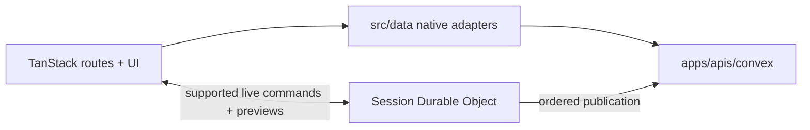

# Web workspace

`apps/web` is the TanStack Start frontend. It owns routes, authenticated shells, authoring, Character
Builder and Sheet, Campaigns, Encounters, the VTT, and browser presentation.

## Current native boundary

Browser and SSR data adapters use generated Convex queries, mutations and actions from
`apps/apis/convex`. Better Auth supplies the session. During active room authority, the live-session
WebSocket carries the supported Door, standalone token move/undo and live Character commands plus
recipient-filtered ephemeral previews. Durable publication converges through Convex subscriptions.



The web workspace does not own persistence, authorization, rules execution or live-command authority.
Shared payloads come from focused `packages/schema` imports; domain logic remains in the owning
shared/native backend package. Direct overlapping Convex writes are not a fallback while Session DO
authority is active.

Use the focused package scripts while implementing, then the ordered pre-staging lifecycle for final
acceptance:

```text
yarn turbo:typecheck:web
yarn workspace @artificer-toolkit/web test <focused-test-path>
yarn build:web
yarn validate:pre-staging:local
```

### Deployment configuration

Netlify packages the TanStack Start client and SSR/server routes. Product data, auth email,
notifications and media authority run through Convex; current browser code must not call a retired product API, database, or client-independent Netlify-function product boundary.

Configure the web deployment with:

- `VITE_CONVEX_URL`: public Convex client URL;
- `CONVEX_SITE_URL`: server-side Better Auth/HTTP Actions origin;
- `VITE_LIVE_SESSION_WEBSOCKET_URL`: exact managed Worker WebSocket origin;
- `VITE_MEDIA_STORAGE_ORIGIN`: exact signed media origin used by CSP;
- `VITE_SENTRY_DSN`: optional public Sentry DSN;
- `SENTRY_ORG`, `SENTRY_PROJECT`, and secret `SENTRY_AUTH_TOKEN`: build-time source-map upload.

`PUBLIC_SIGN_UP_ENABLED`, `LIBRARY_IMPORT_ENABLED`, email credentials, R2 credentials and live-session
secrets belong to the Convex or Worker deployment that reads them. They are never browser variables.

See the [architecture overview](../../docs/architecture/overview.md),
[transport guide](../../docs/architecture/transport.md),
[live-session guide](../../docs/architecture/live-sessions.md), and
[R2 runbook](../../docs/runbooks/vtt-map-r2.md).

## Historical Phase 8.2 implementation record

The sections below preserve dated migration notes and the retired tRPC/Supabase/Netlify-function
configuration. Every present-tense statement in those sections describes an intermediate historical
snapshot; it is not current deployment guidance, runtime behavior, or acceptance status.

### Owns and does not own

- Owns `src/routes`, route loaders, query/mutation adapters in `src/data`, the typed transport composition seam in `src/lib/api.ts` with domain owners in `src/lib/api/`, and shared UI/forms composition.
- `src/server/trpc.ts` is the frontend/server adapter: it checks same-origin requests, reads Supabase claims, and forwards an authenticated context to `apps/apis`.
- Does not own product-data rules, persistence, node-map resolution, or engine calculations. Those remain behind the [`apps/apis` seam](../apis/README.md) and the shared packages.
- Character Builder is intentionally a domain workflow distinct from node-map-driven content authoring; it may reuse form primitives without becoming another node-map.

### Key flow

#### Phase 8.2 transition

The [Convex cutover](../../docs/adr/0029-convex-backend-cutover.md) is in progress, not a completed
replacement of every domain below. Better Auth supplies the root session and the existing
`ConvexBetterAuthProvider` supplies authenticated subscriptions. Profile settings now reads
`account.profile` reactively and saves through `account.updateProfile`; neither endpoint accepts a
client user ID. The route's user ID only keys the local form, so account changes discard its draft.
Query failures show a generic unavailable state, and mutation failures retain the draft without
displaying backend error details. Clean fields follow subscription updates; unsaved fields are not
overwritten, including edits made during a pending save.

The root route's `shellComponent` owns the HTML document and `AppProviders`, including error and
not-found rendering. The normal route component owns session convergence and the outlet; a failed
root session load must not remove the providers needed by its recovery screen. Profile's native
`useQueries` request map is stable across renders and changes only when authentication changes.
Successful sign-in clears the prior identity's query cache and uses one router-owned navigation to
the validated return path (or `/home`). Do not invalidate the guest route first: its authenticated
redirect can preempt that destination. Root `beforeLoad` verifies the new cookie before protected
guards run; reactive session/role convergence remains active. A forced document reload can abort a
concurrent session refresh and surface a root-route error, so it is not used for this transition.
Convergence clears identity-bound query data immediately, but starts its session refresh only
when the router is idle. Router loading state retriggers the check so identity/role revocation
and preference changes are not dropped. This avoids overlapping match loads that can clear a
still-rendered pending match's promise; a real-router deferred-load regression covers that race.
The script-only account-menu trigger stays disabled until hydration; visible SSR content alone
does not mean its client event handlers are ready.

The same-origin auth proxy reconstructs a native request from standard Web fields,
preserving its body stream, cancellation signal, and signed headers. Do not clone
the incoming wrapper with `new Request(request)`: TanStack's local `NodeRequest`
does not carry Undici's private native request state. Both GET and POST wrappers
are covered by the SSR proxy regression alongside spoofed-header rejection.

Signup and profile settings share `auth/usernameStatus.ts`, which uses the existing username policy
and Better Auth availability endpoint. Availability is advisory; the mutation remains authoritative
for uniqueness. No manual profile cache or polling is needed. Profile's two-account browser journey
is accepted; the shared avatar adapter uses Convex/R2, while other media profiles keep `F14` in
progress. See the [fixed acceptance ledger](../../docs/roadmap/08-2-convex-cutover-acceptance.md).

Invitation setup server-renders its nonsecret shell and editable fields while the browser reads
and clears the URL fragment. Submission stays disabled until the fragment credentials are read;
hydration adopts native input values so early typing/autofill is not lost. Do not withhold the form
until hydration or put fragment credentials in server HTML. The Vite dependency list
explicitly pre-bundles Better Auth's browser and cookie entry points; otherwise the patched package
fans out into dozens of separate development requests. This changes development packaging only,
not session validation or cookie behavior. First post-edit Vite loads and warmed loads are separate
measurements, neither substitutes for the compiled release benchmark.

The `/systems` list loader and page now use the public Convex `content/systems.list` query with
ten-record cursor pages. Previous/Next navigation does not download every page or silently truncate
the catalogue. System detail and authored-route System lookups use the exact UUID Convex query;
the detail page reads its catalogue summary directly rather than downloading all Systems. Its
rule capability uses the authenticated native `content/systems:capability` query, also prefetched
by the route without a legacy API client. Definition list/get/create/save/publish now use native
Convex endpoints with ten-row cursor pages. The keyed editor retains local text and its original
version preconditions when a subscription reports another edit; explicit reload discards that text.
Publish is disabled behind unsaved edits, including invalid JSON. Guided Sense edits preserve
additional capabilities. Only the seven supported standalone publisher families are authorable.
System selectors in campaigns, encounter setup, social forms, and imports use `useSystemList`:
it subscribes to each ten-row native page and exposes options only after the cursor chain is complete.
A changed page boundary replaces the old tail; a failed page fails the complete selection. Disabled
selectors do not start page requests. Authored and Character create loaders share `loadSystemList`
using the request-local query cache. Neither path imposes a total System count cap. Character,
campaign, social, and import operations themselves remain transitional. After explicit user
approval, obsolete reference-data readers, their tests, and the frontend tRPC System adapter
were removed; their presentation types still serve detail pages. The legacy backend System
router remains pending its owning-case retirement. System-detail stories supply native
query/mutation fixtures through the existing TanStack client and Convex hook mock; they do not route
these operations through tRPC mocks. Story interaction proof is not real backend CRUD proof.

`getRouter()` creates one `ConvexQueryClient` and connects it to the router's TanStack Query client.
Its `ConvexBetterAuthProvider` shares that same Convex client with native hooks. Clients and caches
are created per router/request, not stored in a module singleton or serialized into route context.
The installed adapter provides consistent-timestamp SSR reads and browser subscriptions; explicit
legacy query functions continue to work. Before its first native SSR read, the bridge obtains an
authenticated HTTP client through the same signed request boundary as the session loader. Parallel
loaders share that request's initialization; later reads retain Convex's consistent timestamp.
Credentials remain in that server client, never in query results or serialized route context.
Responses are private/no-store. Token issuance failures abort reads; an ambiguous token 401 is
treated as signed out only after the session endpoint successfully confirms a null session.
Browser subscriptions continue to use the Better Auth provider, not the server credentials.
The client uses `expectAuth` so anonymous startup cannot overwrite authenticated SSR data.
Once auth confirms a guest, the root convergence component explicitly releases that initial
subscription gate with a null token. A changed session clears private cache and invalidates routes.

The pinned `@convex-dev/react-query` adapter has a [Yarn patch](../../.yarn/patches/convex-react-query-npm-0.1.0-stale-query-removal.patch)
for stale query-instance removal. TanStack can emit `removed` for an already-evicted instance while
a replacement with the same hash remains cached. The adapter must retain that replacement's live
subscription until the replacement itself leaves the cache. The bridge regression uses real
query observers and immediate GC, including pushed updates and exactly-once cleanup. It does not
increase catalogue retention or suppress missing-subscription errors. Remove the patch only when
an upstream version passes that regression. The router still connects the adapter before any reads
or hydration; late connection is not supported by this application setup.

Background and Class detail/edit routes now read native Convex detail DTOs by public alias. The shared
authoring provider passes its current Convex client into the existing session factory; their
save, publish, duplicate, discard and active-delete operations use that client without a legacy
fallback. Shared native operations save first and pass the returned server draft timestamp;
Class calls `content/classPublicationActions.publishDraft` while Background calls the publication
mutation. Session reuse
still preserves dirty form values. Other domain operations remain transitional. The shared create
loader reads native System pages and then the exact selected System; it does not invent a default
when no System exists. Background and Class root field resolution and prospective-value normalization now
use the same native Convex source reader. Disabled or System-less resolution is skipped; failed
normalization cannot commit an edit, and pending/stale results cannot clear current form values.
Guided Background and Class starting gear use native Convex equipment options for the session's exact
System. Missing System skips the query; pending/error states disable the selector. It keeps the
existing UUID/quantity edits and preservation of advanced equipment groups.
Guided Class parent choices use the native root node model's `parentClassId` options, preserving
the shared BASE-class rule and exact-System visibility without a second catalogue implementation.
Guided authored-domain copy choices load native catalogue pages for the session's exact System only after
the user chooses an existing source. All pages load before enabling the existing local searchable
picker; query failures remain local to that choice. System changes reset the selection. Copying
uses the existing native mutation and editor navigation. All eight authored domains use this native
loader; the unreachable legacy copy loader has been removed. Stream catalogue queries use
`convex-helpers/react` pagination so prior page ends remain pinned during reactive changes.
Background, Class, Feat, Equipment, Race, Creature and Vehicle catalogue pages now use native list and summary queries with five live page
ranges, backward cursor history and zero-GC options shared by SSR and client reads. Fixed-range
re-reads retain only a temporary placeholder for that currently displayed page; settled reads
release it. The viewport preserves its visible item and pixel offset across page eviction/reload.
Draft summaries load separately through native database pagination; the Drafts tab shows a loading
count until complete, without blocking active browsing. Class and Race name sorting group by the existing
parent UUID, then order families and siblings alphabetically; same-named parents stay distinct.
Only derived ordering keys change on a parent rename, not subclass references or authored data.
Other catalogue pages and full native
journey acceptance remain migration work. Background and Class artwork now use Convex draft/active bindings and R2 signed single-PUT
upload, processing, delivery and removal through the shared media adapter. Other authored kinds and
portraits keep their legacy adapter until their persistence migrates. Missing native bindings do
not trigger legacy reads; replacement/removal updates through the binding subscription.

Vehicle detail/edit routes and form/detail/list mutations now use the same native adapters locally.
Public aliases resolve through the detail query; mutation arguments retain subject UUIDs. Active
and draft subscriptions remain distinct, and publication forwards the saved draft's server timestamp.
Vehicle node-map resolution is native; Guided copy reads the exact-System native catalogue. Vehicle artwork and owned active/draft
JSON export also use the shared native adapters, without legacy fallback. Vehicle catalogue reads
use native category browse and ranked search; Character/Campaign/Encounter usage is outside this authoring adapter change. Managed
verification and the complete local lifecycle remain required before promotion.

Race uses the same native form/detail/edit, action, node-runtime, artwork and owned export adapters.
Guided copy and parent selection use the exact-System paginated native catalogue, with BASE-only
parent choices excluding the current subject. Detail inheritance subscribes to the parent named by
the selected active/draft source and rejects non-BASE or other-System parents. Race catalogue-page
reads now use native UUID-family ordering and preserve the Playable badge from current selection
metadata. Canonical backfill execution and full lifecycle acceptance are still open.

Creature uses the same native form/detail/edit, action, node-runtime, artwork and owned export
adapters locally. Its detail page derives reader references from the current reactive response
metadata. Guided copy loads exact-System native catalogue pages; catalogue-page list reads use
native category browse and ranked search. No new Creature-specific publication
or play-state model is introduced; managed proof and the complete local lifecycle remain open.

Encounter Builder and reinforcement now read Creature options through the native
`content/catalogue:list` endpoint and shared read/page contracts. Their existing paginator drains
48-item pages to `isDone` and rejects empty, repeated, or cyclic continuations without a total-item
cap. Setup selectors retain their existing scope across visible Systems; Guided copy remains scoped
to the authoring session's exact System. Browser story fixtures exercise the native client and saved
Creature UUID; they do not replace real backend or final release proof.
Native Spell detail and Campaign query modules import the generated Convex references and shared
schemas directly. Their unused legacy list/currency/content/Vehicle wrappers and unused Class/Feat
mutation adapters have been removed; keep current authored writes in `data/authoredOperations.ts`.
The old Rule Studio page, navigation, client/server pack-management operations and editor dependency
are retired and removed. Native System authoring remains the rules product surface. Account email
changes now call the native Better Auth confirmation flow; live backend/browser proof remains pending.
Portable import preview/commit and account deletion still require boundary completion. These local
changes do not establish the full native release boundary.

Spell uses the same native adapters locally, including separate active/draft detail subscriptions,
reactive reader metadata and exact-System Guided copying. All eight authored roots now route
resolution and prospective structural normalization to Convex. Nested-map reads use the same native
queries; obsolete legacy resolver/normalizer fallback branches and their client argument are removed.
Spell catalogue-page reads and Class/school filters
remain transitional. The approved 25-level generic JSON guard now admits Prismatic Wall's depth-22
mechanics in local resolver, normalizer and publication tests; nested facets remain capped at 20.
Managed canonical backfill and the full lifecycle remain open, so the Spell port is not accepted.

Campaign settings, table settings and shared content now use native Convex queries and mutations. The
settings panels subscribe to current Campaign and play-setting versions; structural saves invalidate
the still-transitional Campaign detail/list projections. Shared content uses native cursor pagination,
native share/unshare writes and active owned candidates from the native authored catalogue. The
version-bearing Campaign shell still reads PostgreSQL, so repeat native content removal can receive a
stale version; P11 remains open until the parent detail uses the same Convex record. Campaign lifecycle,
membership, Vehicles and realtime remain with their separate cutover cases.

Campaign announcements use native reactive pagination, authorized direct-link reads and immutable
create mutations. Unavailable announcement links keep the Campaign workspace usable. Notification
delivery and Campaign cleanup remain with their owning cases.

#### Historical transitional domains

Routes call a `src/data` query or mutation adapter. The adapter uses the `src/lib/api.ts` composition seam; `src/lib/api/transport.ts` sends tRPC requests and domain API modules parse responses with shared Zod DTOs. TanStack Query owns cache and invalidation; route components render the resulting DTOs through domain presenters and form/layout components.

For authoring, the flow is route → node-runtime DTO → `AuthoringFormLayout`/`FormRenderer` → TanStack Form state. Group presentation is supplied explicitly by the resolved node map: simple content stays inline, deep branches use the structure rail, and staged leaf collections use the shared overlay drawer. For characters, Builder draft/resolve/preview/commit and Sheet commands stay in character-specific adapters and routes.

### Invariants

- `apps/apis` is the only product-data boundary; do not add direct database or Supabase data writes to browser features.
- SSR loaders must use a request-scoped client from `createAuthenticatedConvexClient(request)` (`src/server/auth/convex.server.ts`). Never share the browser Convex client across server requests: it would mix authenticated identities.
- Use focused exports from `packages/schema` and `packages/shared`; do not invent local DTO shapes.
- Keep detail/read routes separate from `/edit` authoring routes and keep Builder state separate from Sheet play-state commands.
- Public-registration behavior comes from the server-owned `PUBLIC_SIGN_UP_ENABLED` flag. The root loader exposes only its parsed boolean to routes; Better Auth independently enforces it and requires email verification.
- Library import remains hidden unless the server-owned `LIBRARY_IMPORT_ENABLED` flag is exactly `true`. Disabled direct-route requests return to the authenticated Home surface.
- Supabase Postgres owns product-notification feed engagement and channel preferences. Authenticated notification APIs resolve only the caller; private Realtime messages invalidate cached state but never replace the authoritative API read. Notification links contain public source IDs and always reauthorize through the owning Social or Campaign API.
- `/auth/confirmed` is Better Auth's informational email-verification landing. Failed links show fixed recovery guidance; the page neither verifies tokens nor creates a session. The native sender sets this callback for signup and sign-in resends. Browser sign-in leaves its callback unset so the router retains ownership of successful-login navigation. Initial invitations instead use fragment-based `/update-password` setup and atomic native redemption. Public signup requires a username; sign-in accepts email or username without exposing the associated email. Password recovery and confirmation remain independent of the public-registration flag. See the [native verification contract](../../docs/architecture/transport.md).

### Focused validation

Use the cheapest surface that covers the change: `yarn workspace @artificer-toolkit/web test:forms`, `test:authoring`, or a focused route test; use `yarn turbo:typecheck:web` for type changes. Use `yarn dev` plus browser verification for meaningful layout or interaction changes. The root `yarn dev` first rebuilds the API workspace so the web server does not load stale `apps/apis/dist` artifacts; run `yarn dev:prepare` first when starting the web workspace directly.

TanStack Start's Vite plugin owns `src/routeTree.gen.ts` during development and builds. Do not run a separate route generator or edit the generated file manually.

### Historical Supabase/Netlify product deployment

The root Yarn resolution patches `@netlify/vite-plugin` 2.12.9 to cancel static
response bodies that its middleware discards before handing the request to Vite.
Without cleanup, those streams hold generated dependency files open and Windows
rejects Vite's optimizer directory rename. Netlify emulation remains enabled.
`netlify/tests/viteStaticResponse.test.ts` covers the actual middleware; remove the
patch when an upstream version passes that regression without it.

TanStack Start is deployed with `@netlify/vite-plugin-tanstack-start`, which packages SSR, server routes, and server functions for Netlify. The same project also deploys client-independent functions from the repository's root [`netlify/functions`](../../netlify/functions) directory. The workspace's [`netlify.toml`](netlify.toml) deliberately runs from the monorepo root so Yarn workspaces and Turbo build dependencies resolve correctly.

When creating the Netlify project, set the package directory to `apps/web` and leave the base directory at the repository root. The committed configuration runs `yarn build:web` and publishes `apps/web/dist/client`.

Production releases must be built by Netlify from the connected Git repository on Linux. Do not use a Windows `netlify deploy` artifact for this application: the server and live-session executor depend on GoRules' platform-native binding, and Windows manual packaging also preserves unusable absolute workspace symlinks. A local Windows build remains useful for validation, but pushing the reviewed source and allowing Netlify's Linux build to package all four functions is the release path.

The committed edge function limits `/api/trpc/*` to 60 requests per 60 seconds per IP and domain so mixed tRPC batches cannot bypass it. The application rejects tRPC POST bodies over 1 MiB from their actual streamed bytes before authentication or JSON parsing, and Postgres enforces the durable per-account root-creation windows. Confirm the rate-limit rule appears in each production deploy log; Netlify may accept a deploy even when a rule is invalid.

Set these values in the Netlify UI rather than in `netlify.toml`:

- `VITE_MEDIA_STORAGE_ORIGIN` for native media uploads and delivery. Set the exact HTTPS origin used by signed R2 URLs, including the bucket hostname when applicable. This public origin extends CSP `connect-src` and `img-src`; credentials, paths, queries, fragments and wildcards are rejected. HTTP loopback is allowed only in development.
- `VITE_SUPABASE_URL` and `VITE_SUPABASE_PUBLISHABLE_KEY` for the browser and SSR Supabase client. They are publishable values, not secrets.
- `VITE_SENTRY_DSN` for production browser and server error reporting plus the opt-in feedback form. The DSN is a public client identifier, not a secret. Both runtimes use the same Sentry project because they ship as one TanStack Start deployment. Sentry callbacks remove URL queries, fragments, and referrers before transmission; the app also sends only the request origin in browser referrers. Product Campaign invitations are tokenless inbox records and never enter URLs.
- `SENTRY_ORG=artificer-toolkit-rc` and `SENTRY_PROJECT=javascript-tanstackstart-react` for production source-map uploads during the build.
- `SENTRY_AUTH_TOKEN` for production source-map uploads. Keep it secret and available only to the build environment.
- `SUPABASE_URL` and `SUPABASE_SECRET_KEY` for server-only request authentication. They are required by the current server functions; make them available to Functions at runtime only. The application reads that exact secret-key name and does not fall back to `SUPABASE_SERVICE_ROLE_KEY`.
- `RESEND_API_KEY`, `SEND_EMAIL_HOOK_SECRET`, `AUTH_EMAIL_FROM`, and the canonical public app origin as `SITE_URL` for the server-only Supabase Auth Send Email Hook in `netlify/functions`. These values must be available to Functions at runtime only.
- `DATABASE_CONNECTION_STRING` for database-backed server routes. Use Supabase's Transaction Pooler connection string for Netlify's transient serverless functions. Make it available during the build and to Functions at runtime.
- `R2_ACCOUNT_ID`, `R2_ACCESS_KEY_ID`, `R2_SECRET_ACCESS_KEY`, and `R2_VTT_MAP_BUCKET` for private VTT map multipart upload, processing, and delivery. Use separate bucket-scoped values for staging and production; see [`docs/runbooks/vtt-map-r2.md`](../../docs/runbooks/vtt-map-r2.md).
- `PUBLIC_SIGN_UP_ENABLED=false` for closed alpha. Make it available during the build and to Functions at runtime.
- `LIBRARY_IMPORT_ENABLED=false` until the importer is ready for public use. Make it available during the build and to Functions at runtime.

Do not set `SUPABASE_SECRET_KEY`, any `R2_*` credential, `RESEND_API_KEY`, `SEND_EMAIL_HOOK_SECRET`, `SENTRY_AUTH_TOKEN`, or any database credential in a `VITE_` variable. These values must remain build or server secrets and must never reach browser code. Redeploy after changing an environment variable. Once the first production URL exists, add its `/auth/confirmed`, `/update-password`, and `/settings/account` paths to Supabase Auth's redirect URL allow list before sending invitations, password-recovery emails, or email-change confirmations.

### Canonical references

- [Architecture overview](../../docs/architecture/overview.md)
- [Transport](../../docs/architecture/transport.md)
- [Authoring Schema](../../docs/architecture/authoring-schema.md)
- [Character Builder and Sheet](../../docs/architecture/character.md)
- [Product intent](../../PRODUCT.md) and [design system](../../DESIGN.md)
