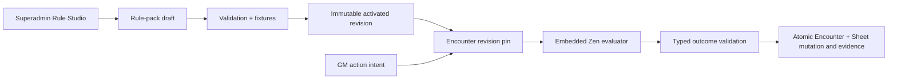

# ADR 0018: Embedded rule packs and authoritative Encounter resolution

- **Status:** historical — superseded by ADR 0023
- **Date:** 2026-08-13
- **Scope:** rule-pack authoring, activation, simulation, and Encounter resolution
- **Update when:** the rule-document format, activation gate, runtime deployment, Encounter outcome contract, or engine extraction boundary changes
- **Verification:** `packages/schema/src/api/rules.ts`; `packages/functions/src/services/rules`; `packages/functions/src/services/encounter/encounterActionResolution.ts`; `packages/db/src/domains/rules`; Rule Studio and focused rule/Encounter tests

## Context

Artificer needs game-system mechanics that can grow without scattering system-specific conditionals through the API, VTT, and Character engine. It also needs exact, replayable evidence for live outcomes. A separate rules microservice or custom BRMS would add deployment and operational cost before measured load exists, while arbitrary scripts would weaken determinism and security. ADR 0019 extends this runtime from Encounter actions to one shared Character/Encounter evaluator.

## Decision

Rule packs are immutable, versioned Postgres records identified by `rulesetCode` and `rulesetVersion`. Each pack has at most one mutable draft and one active-revision pointer. Activation runs every stored conformance fixture through the server runtime; an activated revision cannot be updated or deleted. Encounters pin the exact activated revision they start with and may upgrade only while prepared. Character pinning and the shared evaluator contract are governed by [ADR 0019](0019-versioned-cross-domain-rules-runtime.md).

The application embeds the GoRules Zen Node runtime in `packages/functions`; the product remains TypeScript and does not deploy a separate Rust service. The JDM editor is a lazy-loaded, superadmin-only authoring surface. Browser simulation is advisory; activation and live evaluation always run on the server. Zen-native typed explanations and source IDs are product output; a native Zen trace is diagnostic-only.

Rule documents allow only bounded declarative JDM nodes. Arbitrary Function/script nodes, wall-clock access, randomness, UUID generation, I/O, authentication, persistence, and mutation are rejected. ADR 0019 defines the exact repository-owned Character grant-fold and action-resolve Function exceptions; neither is available to Encounter models or Rule Studio authors. Application-owned dice remains external, is stored as evidence, and is supplied as facts. The evaluator proposes closed typed outcomes; Encounter orchestration reauthorizes actors/targets, applies them transactionally, and records the exact revision, checksum, normalized facts, traces, rolls, outcomes, and override.

`CLOSED_RULE`, `MANUAL_ADJUDICATION`, and effect kinds without an explicit resolver remain fail-closed/manual. The rule platform does not claim blanket execution of existing authored effects. Spatial geometry, movement, walls, fog, doors, zones, and renderer state belong to the Phase 08 scene/Encounter boundary, not Zen.

## Consequences

One product API supports multiple game systems through different packs and adapters without exposing multiple backends to clients. Rule evaluation is deployable with the existing application and can be extracted behind the same internal contract later only if measured CPU isolation, scaling, reliability, or release-cadence needs justify it. A Linux deploy preview must prove the native Zen artifact before production use; local Windows evaluation alone is insufficient deployment evidence.
