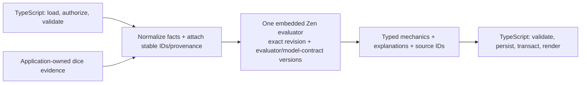

# ADR 0019: Versioned cross-domain rules runtime

- **Status:** historical — superseded by [ADRs 0023](0023-shared-rules-kernel-and-system-capabilities.md), [0024](0024-current-published-authored-content.md), and [0029](0029-convex-backend-cutover.md)
- **Date:** 2026-08-13
- **Scope:** Character, Encounter, and future VTT mechanical evaluation; rule-pack revisions and migration from the TypeScript engine
- **Update when:** evaluator boundary, revision identity, model contract, Character pin policy, command responsibility, or migration gate changes
- **Verification:** rule-pack revision and Character finalization/upgrade contracts; Character and Encounter evaluator conformance fixtures
- **Amended:** [ADR 0022](0022-versioned-domain-documents-and-correctness-projections.md) made version-matched Character mechanics projections durable correctness read models during this architecture's lifetime.

> Everything below records the retired Zen, rule-pack, SQL, and session-host architecture. ADRs 0023, 0024, and 0029 are current.

## Context

Character calculations and Encounter action resolution currently use separate mechanical paths. That duplicates game-system decisions and allows divergent answers. Artificer needs one deterministic, embedded evaluator while preserving TypeScript ownership of application concerns and keeping VTT geometry outside rules evaluation.

## Decision

One embedded Zen evaluator/runtime is the production authority for Character, Encounter, and future VTT mechanical decisions. A single top-level Character derivation runs once per structural fact set and may invoke pack submodels. It materializes the complete typed mechanical snapshot; it is not rerun merely because every Sheet widget or mutable usage field changed. Bounded Character and Encounter command policies consume the same exact revision and committed mechanical snapshot. One user command selects at most one mechanical evaluation lane, as defined by [ADR 0021](0021-command-scoped-rules-responsibilities.md); the client never fans one command out into independent evaluator calls. Output contains typed domain explanations and stable source IDs; native Zen traces are diagnostic only.

TypeScript owns data loading, candidate-fact normalization, stable ID/provenance attachment, authorization, validation, persistence, transactions, and renderer/geometry. It does not own game-system decisions. Dice remains an application-owned external result supplied as a fact.

Arbitrary and administrator-authored Function nodes remain forbidden. Three repository-owned models are exact-source exceptions: `character-grant-fold` reproduces ordered, accumulator-dependent Character grants, `character-action-resolve` resolves bounded action/mechanics templates, and `encounter-actor-policy` batches non-Character initiative modifiers and feature-resource maxima that JDM expressions cannot safely compose. The server deep-locks each complete graph and Function source to its canonical repository value, rejects every mutation or additional Function node, bounds normalized facts and results, and configures a 50 ms Function timeout. Rule Studio does not expose these reserved models or a Function palette. The Functions have no I/O, wall-clock, randomness, UUID, authentication, persistence, or mutation capability; all other executable-code attempts fail closed. VTT geometry, movement, fog, walls, doors, zones, and renderer state remain outside Zen; mechanically triggered effects belong in Zen.

Every activated rule revision records evaluator kind/version and model-contract version with its checksum. Determinism means identical normalized facts plus the exact revision/checksum and evaluator/model-contract versions produce the same typed result. It does not promise full historical authored-content replay: authored content continues to follow its current or Campaign binding.

Character drafts preview with the current compatible active revision. At first finalization, the commit transaction rechecks that revision and pins its exact revision identity, checksum, evaluator kind/version, and model-contract version. Later activation or retirement does not alter or invalidate a Character pin. An upgrade is an explicit preview/reconciliation command that repins only through a transaction and increments the Character stream version. Encounters retain their existing revision pin policy.

## Migration

The superseded TypeScript `RulesSystem`, `runEngine`, and duplicated mechanical resolvers were removed after the family parity, one-call lifecycle, and Linux deployment gates passed; no production compatibility shim remains. The pinned Character Builder and Sheet paths use one top-level Zen evaluation for grant/source ordering and eligibility, modifiers/stacking, derived formulas, spell access/slots, resources/charges, rest/exhaustion/attunement, action availability, and typed explanations. The grant-fold migration gate proved the reserved submodel against the former applicator, and the one-call integration gate proved that folded proficiencies and raw modifiers feed Zen stacking and derived-stat nodes without an intervening TypeScript mechanics pass. The production Sheet projection fails closed when no pinned evaluation is supplied or when that evaluation omits a known item's mechanics, a hydrated companion's mechanics, a spell-cast decision, or spell mechanics. `CAST_SPELL` applies the exact policy-projected cast decision instead of re-deriving cast-mode, preparation, resource, or slot eligibility in TypeScript. Encounter GM projections and mutations batch non-Character actor facts through `encounter-actor-policy` under the Encounter's exact pin; commands that change actor state evaluate the resulting fact set before returning one final projection.

## Consequences

No standalone rules microservice or Rust service is introduced; Zen remains an embedded Node binding in whichever authoritative application process evaluates the command. A live room retains committed mechanical snapshots for its attached aggregates because low-latency ordered play requires them; those snapshots are reconstructed from Postgres and exact pins after restart and are not a second durable authority or a generic cache. [ADR 0020](0020-local-and-remote-live-session-host.md) adds the separately deployed process, while [ADR 0021](0021-command-scoped-rules-responsibilities.md) assigns command lanes. Rule changes have explicit revision and Character-upgrade workflows instead of silently changing play mechanics. This ADR supersedes ADR 0005 as the target runtime decision and narrows ADR 0018 to its Encounter-specific concerns.
