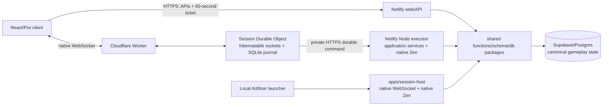

# ADR 0020: Local and remote authoritative live-session coordination

- **Status:** decision
- **Date:** 2026-08-14
- **Revised:** 2026-08-16
- **Scope:** live VTT coordination, local hosting, remote hosting, and the deployment boundary around Zen
- **Update when:** session authority, native WebSocket protocol, command scheduling, local packaging, remote deployment, or VTT synchronization changes
- **Verification:** Worker workerd tests; session-host build and authenticated local join, replay, reconnect, persistence, broadcast, and latency gates
- **Amended:** [ADR 0022](0022-versioned-domain-documents-and-correctness-projections.md) replaces command-time Character reconstruction at the authoritative executor seam; transport and journal ownership remain unchanged.

## Context

Netlify remains the request/response boundary for the web application and tRPC APIs, but its transient handlers cannot hold long-lived WebSockets. Supabase remains the durable gameplay, identity, and version authority; Realtime fanout is not a serialized game-room command processor. Live play needs immediate transient collaboration, durable command replay, private projections, and correct concurrency across Characters, Encounters, and scene resources.

The product must support both managed remote play and local hosting without creating different rule behavior. GoRules Zen's production Node package uses native/WASI-threaded runtime features that Cloudflare Workers do not provide. Node compatibility does not make that evaluator runnable inside a Durable Object, so remote coordination and authoritative command execution have different deployment responsibilities.

## Decision

Managed remote play uses a Cloudflare Worker with one hibernatable Durable Object per Campaign session. The browser obtains a single-use, 60-second room ticket from the authenticated Netlify API, then connects with native WebSocket to `/live-session/:sessionId`. The Worker verifies origin, signature, room identity, and ticket reuse before routing the socket to the named Durable Object.

The Durable Object owns admitted sockets, per-viewer private fanout, a bounded SQLite command journal, reconnect delivery state, and a dynamic conflict-key scheduler. It does not own canonical gameplay state and does not run Zen. Durable commands are journaled before the DO calls a private Netlify executor. That executor reauthorizes the user and room, claims or renews the Postgres command lease, runs the existing Node application service and pinned native Zen revision, and commits through the existing Supabase transaction. The DO journals the terminal result before acknowledging the caller or broadcasting a committed delta.

Transient pointer, drag, and measurement previews stay entirely inside the room coordinator. They are bounded and sequenced, are never persisted, and never call Netlify or Zen. Final token drops, doors, fog, Sheet actions, and Encounter actions remain durable commands.

Commands claim a conservative dependency and mutation set before execution. Keys are hierarchical (`character:<id>`, `encounter:<id>`, `scene:<id>:<resource-kind>:<resource-id>`), acquired atomically, and scheduled with conflict-local FIFO. Disjoint keys may execute concurrently, up to eight authoritative commands per room. Broad keys conflict with their descendants. Ambiguous executor timeouts remain pending and retain their conflict fence until an idempotent retry proves the outcome; unrelated work continues.

Postgres aggregate versions are canonical. The room's global `deliverySequence` orders transport recovery only and does not create a room-wide gameplay version. Scene commands based on an older scene version may rebase only when the persisted conflict-key history since that version is disjoint from the requested change. Multi-aggregate commands lock database rows in deterministic canonical-key order.

Durable Object events may interleave while awaiting the executor fetch, so scheduler ownership is explicit; the implementation does not hold `blockConcurrencyWhile()` across network I/O. One persisted alarm multiplexes command retries, reconnect release, and lease renewal. Each 10-second renewal returns current Campaign membership roles; removed members and stale-role sockets receive `UNAUTHORIZED` and close with code `1008`, while unaffected sockets continue. If the prior renewal identity has left, another connected active member renews the same room lease before the coordinator fails closed. Retryable renewal failure pauses durable draining; terminal authority loss closes sockets and forces a fresh ticket and canonical hydration. SQLite retains every nonterminal command plus the newest 10,000 terminal receipts and is recovery truth for pending delivery, while Supabase remains gameplay truth. Hibernation or isolate eviction reconstructs room delivery and renewal state from SQLite. A delayed replay returns its original persisted result only to its original authenticated actor, even after later commands have advanced the aggregate; clients never let an older receipt replace a newer `READY` or cached Character version.

Local play uses `apps/session-host`, a loopback-capable Node process with the same native WebSocket client/server contracts, signed tickets, private projections, conflict-key semantics, rule pins, reducers, and persistence services. It invokes native Zen and Supabase directly instead of taking the remote DO-to-Netlify hop. A future launcher may start it invisibly; Docker is not required for local play.

Campaign scene definitions remain renderer-neutral shared contracts. Attaching a definition to an Encounter materializes its exact version; Encounter scene events and projection own live tokens, doors, fog, measurements, and geometry overrides. React owns accessible controls and surrounding UI. One imperative PixiJS canvas boundary owns frame-rate rendering only. PixiJS, React, WebSocket, DOM, and database types do not enter scene contracts.

The authenticated tabletop runs in a dedicated reusable browser window launched from the Campaign Session workspace or from a Character Sheet's latest open Session. The originating application surface remains open independently. The tabletop does not launch or navigate back to those work surfaces. GMs can use Play and Edit modes while live; players receive only Play controls and authorized interactive elements. Structural choices such as door swing angle belong to the scene definition and GM editor.

If the latest open Session marks the displayed Character present, the independently open Character Sheet submits play-state commands through that Session's WebSocket coordinator. Existing optimistic Sheet projection may remain local, but success requires the persisted requester-only `COMMAND_COMMITTED` result; peer Character commits invalidate affected Sheet caches. Sheets outside room authority continue to use ordinary HTTP mutations. This prevents the source window from racing the Postgres live-command lease while preserving the same visible Sheet interaction model.

Primary scene changes and automatically derived exploration chunks persist as one atomic batch under one scene version. Pinned Character vision is applied as trusted command context unless a scene override exists. Player broadcasts are rebuilt from the current private projection after each durable scene commit; hidden or unexplored entities and geometry are never sent merely because the underlying structural delta changed them.

## Security boundary

- `LIVE_SESSION_TICKET_SECRET` signs short-lived browser admission tickets and is shared only by the Netlify issuer and the trusted coordinator.
- `LIVE_SESSION_EXECUTOR_SECRET` authenticates Cloudflare-to-Netlify executor calls and is never sent to browsers.
- The executor never trusts client-provided user, role, room, or state without signature and database authorization.
- Durable Objects store coordination metadata and private projections, not Supabase credentials or rule documents.
- Managed and local WebSocket upgrades require an exact configured `Origin`; originless clients are rejected.
- Transient token previews use the same per-viewer fog/control visibility predicate as durable scene projections.
- Full reusable scene definitions remain owner-only; players receive server-projected snapshots and deltas.

## Consequences

The monorepo has three backend deployment roles: Netlify for APIs and native-Zen execution, Cloudflare for managed remote WebSocket coordination, and Supabase for canonical persistence. No Render always-on service is required for initial managed play. Netlify cold starts affect only durable commands; transient map interaction remains on the hibernatable DO path.

Local and remote transport endpoints differ, but the browser protocol and mechanical results do not. Remote commands add one DO-to-Netlify hop and must meet the measured rule-bound p95 gate. If that hop misses the target, optimize payload, placement, and application work before considering a custom Zen build.

Socket.IO, Colyseus, Render room hosting, Redis, multi-region orchestration, a custom Zen WASM fork, and a polished self-hosting installer are not part of this decision. Add infrastructure only after measured need.

The native transport, Durable Object journal/hibernation path, local Node host, scene persistence, VTT map backend, deterministic geometry/exploration, private scene projection, standalone tabletop surface, launch points, source-window live Sheet route, GM editor, and accessible player controls are implemented as the Phase 08 foundation. The Pixi boundary progressively loads signed renderer tiles, keeps loaded textures independent of delivery expiry, refreshes delivery after a network reconnect, renders exploration masks and labeled measurements, relays pointer/drag previews, and expires abandoned transient visuals. The deployed managed journey, authorized remote asset delivery, and three-hour hardware soak remain Phase 08 work.

This decision supersedes ADR 0019's temporary statement that no second client-facing backend would be introduced. It does not change ADR 0019's single versioned rules authority or ADR 0009's Encounter/Character ownership and transaction boundaries.
