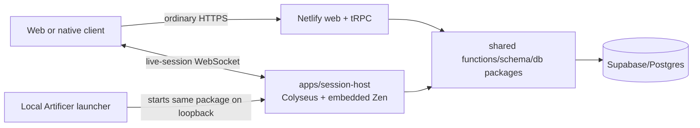

# ADR 0020: Local and remote authoritative live-session host

- **Status:** decision
- **Date:** 2026-08-14
- **Scope:** future live VTT coordination, local hosting, remote hosting, and the deployment boundary around the embedded Zen runtime
- **Update when:** session authority, room topology, local packaging, remote deployment, command ordering, or VTT synchronization changes
- **Verification:** session-host build and health checks; authenticated local and Linux-container join, replay, reconnect, persistence, broadcast, and latency gates

## Context

Netlify remains a good request/response boundary for the web application and tRPC APIs, but its transient handlers are not the authority for long-lived WebSocket rooms. Supabase remains the durable identity and data platform; Realtime fanout is not a serialized game-room command processor. Live VTT play needs fast ordered commands, compact state deltas, reconnect, and one authoritative answer when players, GMs, encounters, and Character Sheets change concurrently.

The product must support both Artificer-managed remote play and local hosting without creating different rule behavior. A separate deployment does not require a separate repository or a second rules implementation.

## Decision

Add `apps/session-host` to this monorepo as a dedicated Node.js process built from the free, self-hosted Colyseus core, Schema synchronization, and standard WebSocket transport. The session host is deployed independently from Netlify but imports the same shared contracts, application services, persistence repositories, and embedded Zen evaluator as the rest of the backend.

One Colyseus room owns one active live-session command stream. Before loading snapshots it claims a short-lived Postgres command-authority lease for the exact Campaign session, renews it while alive, and releases it on disposal. Character and Encounter transactions verify that lease under lock, so an ordinary tRPC mutation cannot race the attached room; an expired lease fails the room closed and restores the ordinary HTTP path. Clients submit typed commands with stable command identity and the expected committed version. The room authenticates admission, authorizes the actor, loads authoritative state, evaluates mechanical decisions through the exact pinned Zen rule revision, and persists the accepted event/projection transactionally before publishing the committed delta. A command is never acknowledged as committed before its durable transaction succeeds.

Client prediction is permitted only when the client can deterministically prevalidate the same command and can reconcile against the committed version. Token drag interpolation, pointers, measurement previews, and similar cues are ephemeral; they never replace committed state. Rejection after visible local feedback is reserved for genuine authorization, stale-version, or concurrent-state conflicts.

Public inspection of the [Mycorel beta](https://mycorel.com/) client on 2026-08-15 provided a useful transport comparison: token dragging renders locally, sends throttled Socket.IO movement updates at roughly `20 Hz`, and persists the final snapped position through REST. That corroborates the local-render/authoritative-commit split for scene interaction, but it does not reveal Mycorel's rules authority, conflict model, or measured latency and is not evidence for those decisions.

The same session-host package runs in two supported modes:

- **remote:** an Artificer-operated Docker container behind TLS, reached through the configured session-host URL;
- **local:** a future Artificer launcher starts the headless process on loopback without requiring Docker or a visible terminal.

The Docker image is an internal artifact for Artificer's managed remote deployment, not the local-play requirement or a supported advanced self-hosting product. A self-hosting installer, Compose stack, configuration UI, and support contract remain deferred. The initial deployment is one process using Colyseus local presence. Redis, distributed matchmaking, queues, caches, an alternate transport, and a separate rules service are added only when measured concurrency or availability requirements demand them.

The session host exposes a health endpoint and one authenticated `live-session` room. The room is filtered by durable Campaign/session identity, accepts only shared typed command envelopes, materializes present Character snapshots during admission, reconciles aggregate versions, and never exposes an unauthenticated sample room.

## Consequences

The frontend and live-session host are separate deployments from the same GitHub monorepo. Existing Netlify APIs remain in place for authoring, Builder, ordinary Sheet use, Campaign management, and session allocation. During an active live session, play-state commands for participating aggregates route through the authoritative room so they cannot race a parallel HTTP mutation path.

Zen remains embedded in the authoritative process that evaluates a command; it is not called through another network service. Local and remote play use the same command schemas, room implementation, rule-pack pins, evaluator version, and reconciliation behavior. Deployment location and transport endpoint may differ, but mechanical results may not.

This decision supersedes only ADR 0019's temporary statement that no second client-facing backend would be introduced. It does not change ADR 0019's single versioned rules authority or ADR 0009's Encounter/Character ownership and transaction boundaries.
