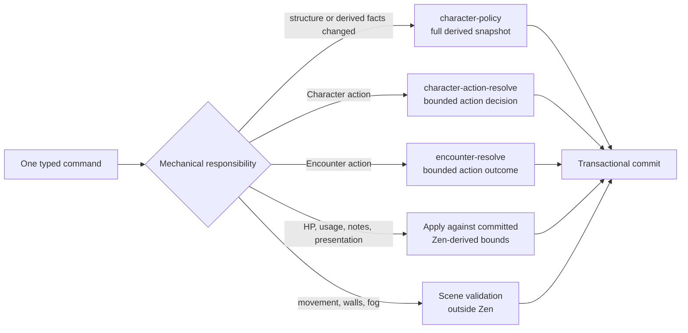

# ADR 0021: Command-scoped rules responsibilities

- **Status:** transitional — command ownership retained; versioned evaluator details superseded by ADRs 0023 and 0024
- **Date:** 2026-08-14
- **Revised:** 2026-08-15
- **Scope:** Character derivation, Sheet play commands, Encounter actions, live-session ordering, and future VTT mechanical commands
- **Update when:** a command changes policy ownership, the invalidation boundary changes, or a new live mechanical lane is added
- **Verification:** model-contract tests, Sheet and Encounter command parity, live-session conflict/replay/reconnect tests, and command-latency gates
- **Amended:** [ADR 0022](0022-versioned-domain-documents-and-correctness-projections.md) replaces room-only snapshots with synchronously committed, version-matched Character mechanics projections.

## Context

One rules authority does not require one giant evaluation for every user interaction. The converged Character model correctly derives a complete mechanical snapshot, but rebuilding that snapshot for HP edits, resource spends, notes, token commits, or every visible Sheet section adds avoidable database and fact-assembly work. Splitting one user action into simultaneous evaluator calls would introduce the opposite problem: partial answers could observe different versions and finish out of order.

Live play also needs correct answers when player, GM, Encounter, Character, and scene commands arrive close together. The live-session coordinator orders overlapping conflict sets while allowing unrelated aggregates and scene resources to progress concurrently. Postgres remains durable truth, and the pinned Zen revision remains the only game-system authority.

## Decision

Keep one versioned Zen runtime and divide evaluation by command responsibility, not by UI component.

The full `character-policy` owns grant/source eligibility, modifiers and stacking, derived statistics, spell access and slots, resource maxima, action availability, rest limits, and explanations. Its typed result is the committed mechanical snapshot for one Character fact version. It runs when the Character is loaded into an authoritative process and when a command changes facts that can affect those results.

Commands that only change mutable usage or presentation consume the current committed mechanical snapshot and apply typed deltas transactionally. Comparing a requested resource spend with Zen-produced availability, clamping current HP to a Zen-produced maximum, and persisting an accepted delta are application responsibilities, not a second mechanics implementation. Notes, labels, private UI state, pointers, and measurement previews require no rules evaluation.

Character actions and Encounter actions use bounded action contracts under the same exact revision. A future VTT mechanic uses an existing bounded contract or adds an explicit typed contract and fixture. Geometry, collision, walls, fog, interpolation, and renderer state never become rules models.

One user command selects at most one mechanical evaluation lane. The server does not call multiple independent rule models with `Promise.all`, and the client does not request rules per Sheet widget. Model subcalls inside one JDM graph remain one atomic evaluation. Commands sharing a conflict key observe committed predecessor state; commands over disjoint keys may execute concurrently.

## Live-session application

One coordinator owns each active Campaign session: a hibernatable Durable Object for managed remote play or the local Node host for local play. It derives a conservative set of hierarchical conflict keys from each validated command, claims the full set atomically, and preserves FIFO only between overlapping work. Disjoint Characters and scene resources can execute concurrently, within the room's bounded concurrency limit. Ambiguous executor outcomes keep their claimed keys fenced until an idempotent retry proves the result.

The authoritative Node executor claims the expiring Postgres command-authority lease and materializes the required Character and Encounter mechanical snapshots. Character, Encounter, and scene write transactions verify authority and canonical versions under row lock, preventing ordinary HTTP mutations from racing the room across processes. A Character snapshot retains the exact pinned evaluation and its matching structural Builder resolution at the same aggregate version. These snapshots are authoritative read models for that command scope, not a second database or a generic cache.

For every durable command the room:

1. validates the typed envelope and authenticated actor;
2. derives and atomically claims the complete conservative conflict-key set;
3. checks only the relevant expected aggregate versions against canonical state;
4. selects zero or one mechanical policy lane;
5. evaluates prospective facts when the command invalidates mechanics;
6. persists the aggregate event/projection transactionally;
7. journals the terminal result and publishes a private committed delta only after success.

Scene commands may rebase across a stale scene version only when the persisted conflict-key history since that version is disjoint from the command's requested keys. Multi-aggregate transactions acquire database locks in deterministic canonical-key order. A coordinator restart reconstructs pending delivery from its journal and gameplay state from Postgres plus exact pinned revisions. Reconnect receives a private ready snapshot and pending-command status. Managed-remote and local modes share the wire protocol, policies, reducers, and application services; only the coordination/execution topology differs.

## Invalidation boundary

| Change                                                                                                                                 | Rules work                                                                                         |
| -------------------------------------------------------------------------------------------------------------------------------------- | -------------------------------------------------------------------------------------------------- |
| Builder structure, rule-pack upgrade, mechanical adjustment, equipment state, mechanically active condition, exhaustion, or attunement | Re-evaluate `character-policy` once for prospective facts                                          |
| Cast/use action, resource usage, or slot usage against unchanged derived state                                                         | Evaluate `character-action-resolve` once with prospective action/usage facts                       |
| HP/temp HP, notes, labels, history, and other non-mechanical presentation                                                              | No rules evaluation; validate/apply against committed typed bounds                                 |
| Encounter action with targets, selections, or dice evidence                                                                            | Evaluate `encounter-resolve` once                                                                  |
| Initiative/resource facts for non-Character actors after a relevant state change                                                       | Evaluate `encounter-actor-policy` once for the bounded actor batch                                 |
| Token drag preview, pointer, measurement preview                                                                                       | Ephemeral room message; no persistence or Zen                                                      |
| Committed movement, walls, fog, and scene placement                                                                                    | Authoritative scene validation and event; Zen only when an explicit mechanical trigger requires it |

If a future mechanic cannot be assigned to one row, its command contract is underspecified and must be redesigned before implementation.

## Consequences

The ordinary HTTP Sheet path may remain more expensive while no active command can reuse a version-matched materialized snapshot, but active play does not rebuild the entire Character for every command. There is no rules microservice, cross-model fan-out, eventual mechanical answer, or acknowledgement before persistence. Performance work measures each lane separately: conflict-local wait time, remote coordination hop, fact assembly, Zen time, transaction time, acknowledgement latency, and reconnect hydration.

The first authenticated Node-host implementation materialized present Character and Encounter actor snapshots during room admission and retained the matching Builder resolution with each Character's pinned Zen result. A committed snapshot may supply current-command validation only when aggregate identity, pinned revision, and expected aggregate version still match. HP, presentation, and usage-only Encounter changes select no fresh evaluation. Character resource and spell-slot changes apply prospective usage to committed facts and evaluate the exact pinned `character-action-resolve` model once before persistence; they do not rerun `character-policy`. Encounter actions reuse the committed actor-policy output and evaluate only their bounded pinned action contract. Structural commands continue to evaluate prospective facts once. Historical local Node and Linux-container measurements remain useful lane baselines, but the current managed topology is a Durable Object plus private Netlify executor and has separate Phase 08 p95 gates. Admission absorbs initial snapshot materialization before active play begins.

This ADR refines ADR 0019's “one top-level Character evaluation” rule: one full evaluation remains atomic for one structural fact set, but it is not the universal command handler. It also moves the authenticated command-room foundation into Phase 07; Phase 08 adds scene contracts, renderer behavior, and VTT-specific commands on that proven room.
