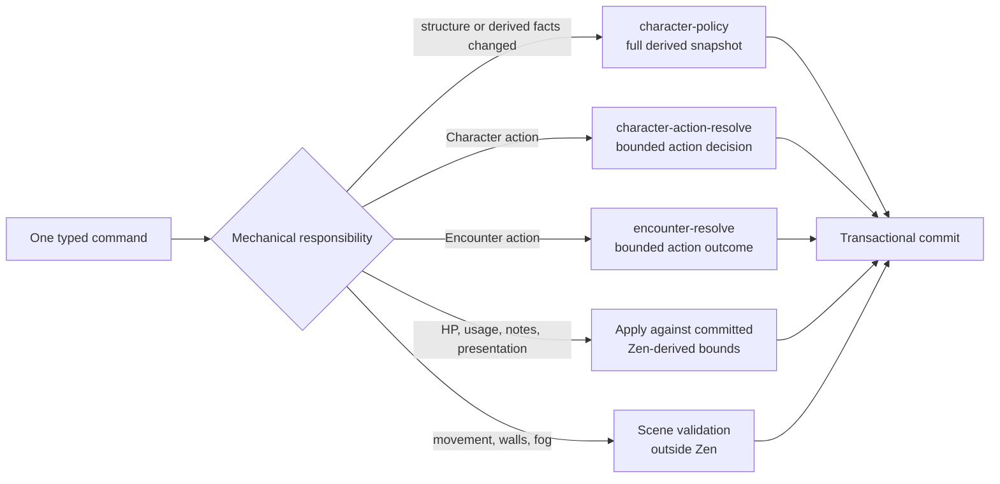

# ADR 0021: Command-scoped rules responsibilities

- **Status:** decision
- **Date:** 2026-08-14
- **Scope:** Character derivation, Sheet play commands, Encounter actions, live-session ordering, and future VTT mechanical commands
- **Update when:** a command changes policy ownership, the invalidation boundary changes, or a new live mechanical lane is added
- **Verification:** model-contract tests, Sheet and Encounter command parity, live-room serialization/reconnect tests, and command-latency gates

## Context

One rules authority does not require one giant evaluation for every user interaction. The converged Character model correctly derives a complete mechanical snapshot, but rebuilding that snapshot for HP edits, resource spends, notes, token commits, or every visible Sheet section adds avoidable database and fact-assembly work. Splitting one user action into simultaneous evaluator calls would introduce the opposite problem: partial answers could observe different versions and finish out of order.

Live play also needs one answer when a player, GM, Encounter, and Character command arrive close together. The Colyseus room owns that ordering, while Postgres remains durable truth and the pinned Zen revision remains the only game-system authority.

## Decision

Keep one versioned Zen runtime and divide evaluation by command responsibility, not by UI component.

The full `character-policy` owns grant/source eligibility, modifiers and stacking, derived statistics, spell access and slots, resource maxima, action availability, rest limits, and explanations. Its typed result is the committed mechanical snapshot for one Character fact version. It runs when the Character is loaded into an authoritative process and when a command changes facts that can affect those results.

Commands that only change mutable usage or presentation consume the current committed mechanical snapshot and apply typed deltas transactionally. Comparing a requested resource spend with Zen-produced availability, clamping current HP to a Zen-produced maximum, and persisting an accepted delta are application responsibilities, not a second mechanics implementation. Notes, labels, private UI state, pointers, and measurement previews require no rules evaluation.

Character actions and Encounter actions use bounded action contracts under the same exact revision. A future VTT mechanic uses an existing bounded contract or adds an explicit typed contract and fixture. Geometry, collision, walls, fog, interpolation, and renderer state never become rules models.

One user command selects at most one mechanical evaluation lane. The server does not call multiple independent rule models with `Promise.all`, and the client does not request rules per Sheet widget. Model subcalls inside one JDM graph remain one atomic evaluation. A later command always reads the committed result of earlier room commands.

## Live-session application

One Colyseus room serializes all durable commands for one active Campaign session. It first claims an expiring Postgres command-authority lease, then loads the durable aggregate versions and materializes the required Character and Encounter mechanical snapshots. Character and Encounter write transactions verify that lease under row lock, which prevents the ordinary HTTP path from racing the room across processes. A Character snapshot retains the exact pinned evaluation and its matching structural Builder resolution at the same aggregate version. Those in-memory snapshots are authoritative read models for that room epoch, not a second database or a generic cache.

For every durable command the room:

1. validates the typed envelope and authenticated actor;
2. checks the expected aggregate version against the room's committed version;
3. selects zero or one mechanical policy lane;
4. evaluates prospective facts when the command invalidates mechanics;
5. persists the aggregate event/projection transactionally;
6. replaces the room snapshot and publishes a committed delta only after success.

A restart discards room memory and reconstructs it from Postgres plus the exact pinned revisions. Reconnect receives the current committed versions before queued commands are accepted. The same room and policy code runs in managed-remote and local headless modes.

## Invalidation boundary

| Change                                                                                                                                 | Rules work                                                                                         |
| -------------------------------------------------------------------------------------------------------------------------------------- | -------------------------------------------------------------------------------------------------- |
| Builder structure, rule-pack upgrade, mechanical adjustment, equipment state, mechanically active condition, exhaustion, or attunement | Re-evaluate `character-policy` once for prospective facts                                          |
| Cast/use action, resource usage, or slot usage against unchanged derived state                                                         | Evaluate `character-action-resolve` once with prospective action/usage facts                       |
| HP/temp HP, notes, labels, history, and other non-mechanical presentation                                                              | No rules evaluation; validate/apply against committed typed bounds                                 |
| Encounter action with targets, selections, or dice evidence                                                                            | Evaluate `encounter-resolve` once                                                                  |
| Initiative/resource facts for non-Character actors after a relevant state change                                                       | Evaluate `encounter-actor-policy` once for the bounded actor batch                                 |
| Token drag preview, pointer, measurement preview                                                                                       | Ephemeral room message; no persistence or Zen                                                      |
| Committed movement, walls, fog, and scene placement                                                                                    | Authoritative scene validation and event; Zen only when an explicit mechanical trigger requires it |

If a future mechanic cannot be assigned to one row, its command contract is underspecified and must be redesigned before implementation.

## Consequences

The ordinary HTTP Sheet path may remain more expensive while no live room owns its materialized snapshot, but active play does not rebuild the entire Character for every command. There is no rules microservice, cross-model fan-out, eventual mechanical answer, or acknowledgement before persistence. Performance work measures each lane separately: room queue time, fact assembly, Zen time, transaction time, acknowledgement latency, and reconnect hydration.

The first authenticated implementation materializes present Character and Encounter actor snapshots during room admission and retains the matching Builder resolution with each Character's pinned Zen result. A committed snapshot may supply current-command validation only when aggregate identity, pinned revision, and expected aggregate version still match. HP, presentation, and usage-only Encounter changes select no fresh evaluation. Character resource and spell-slot changes apply prospective usage to committed facts and evaluate the exact pinned `character-action-resolve` model once before persistence; they do not rerun `character-policy`. Encounter actions reuse the committed actor-policy output and evaluate only their bounded pinned action contract. Structural commands continue to evaluate prospective facts once. The local Node and Linux-container gates require cold, warm p95, resource, and spell-slot commands to remain below `500 ms`. The prepared-caster baselines are `211/250/207/239 ms` locally and `410/338/365/339 ms` in Linux; reconnect measured `244 ms` and `412 ms`. Resource/spell-slot bounded evaluation measured `28.7/9.6 ms` and `34.8/13.2 ms` total/native-Zen locally, and `66.3/17.1 ms` and `50.3/10.0 ms` in Linux. Version-matched resolution reuse reduced repeated Builder work to effectively zero. The usage-only Encounter gate measured `33.8 ms` locally and `58.8 ms` through Linux; its Linux service timing was `39.5 ms` with no evaluation lane and zero actor/action Zen time. Both gates rejected parallel direct mutations and proved lease release on room disposal. Admission absorbs the one-time full snapshot materialization before active play begins.

This ADR refines ADR 0019's “one top-level Character evaluation” rule: one full evaluation remains atomic for one structural fact set, but it is not the universal command handler. It also moves the authenticated command-room foundation into Phase 07; Phase 08 adds scene contracts, renderer behavior, and VTT-specific commands on that proven room.
