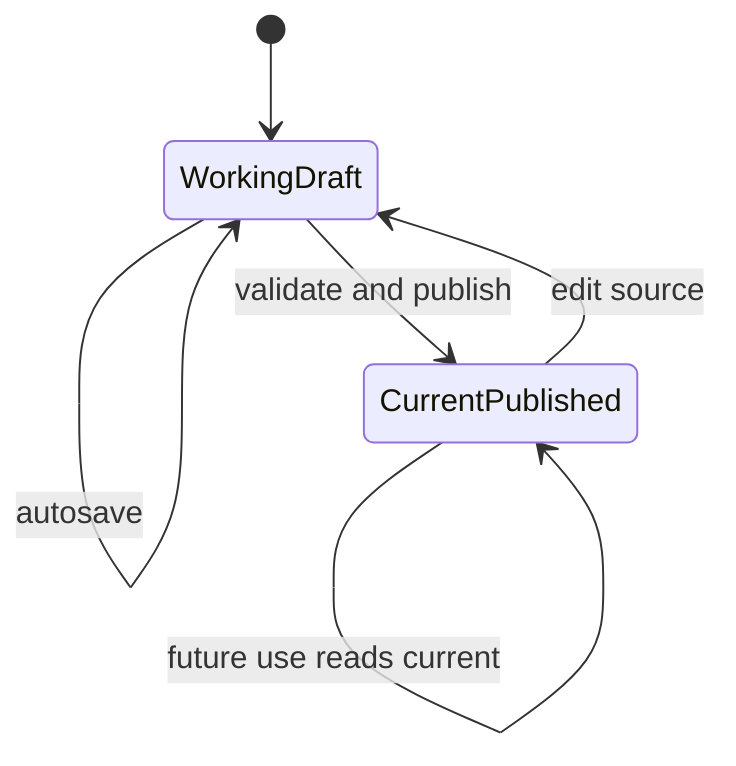

# ADR 0024: Current published authored content and frozen occurrences

- **Status:** decision
- **Date:** 2026-08-24
- **Scope:** authored identity, drafts, publishing, overrides, dependent reconciliation, and runtime audit
- **Update when:** source publishing, override scope, dependency reconciliation, or occurrence persistence changes
- **Verification:** publish/reject tests, dependency reconciliation, active-Encounter update tests, continuation replay, and seed/homebrew parity

## Context

Immutable authored versions and per-Character upgrade workflows make current homebrew changes slow and
create mixed live semantics. Creators instead need one obvious current source, separate one-off
customization, and deterministic behavior for work already in progress.

## Decision

Every reusable authored source has one stable UUID identity, one autosaved working draft, and one
current published typed document. Explicit Publish validates and atomically replaces current behavior.
The product exposes no historical source versions, forks, or consumer upgrade workflow.

The Gate 1 foundation records that contract as a reusable definition root, a single editable draft,
and an all-null-or-complete current document/checksum/contract tuple. The root version and draft
version are optimistic-concurrency controls, not authored history. A family-specific server publisher
locks referenced reusable-definition roots in canonical UUID order and revalidates exact current pins
inside the same publication transaction before replacing the current document.
revalidates the document at draft save and publish; repositories never accept arbitrary semantic JSON.

- Future uses and derived/passive facts use the current published document.
- Issued decisions, roll requests, active effects, continuations, and completed receipts retain the
  exact facts and rule identity required for their occurrence.
- Those frozen occurrences are audit/runtime state, not historical source versions.
- Reconciliation uses the same typed Game System rules as play. Publish never invents clamping,
  replacement, or repair policy.
- A structurally unresolved change rejects Publish with exact blockers before current behavior changes.

When an occurrence can pause or recur, its owning Character or Encounter transaction stores a
non-user-addressable frozen execution snapshot containing the validated reachable graph, operation
contract versions, resolved reusable-definition inputs, source identities/checksums, and current
execution state required to resume. This snapshot is lifecycle data for that occurrence, not an
authored-document revision and not a consumer-selectable pin. Completed receipts retain only the
committed evidence/result required for retry and audit.

- Stale derived projections may never be served; they are synchronously reconciled before an
  authoritative read or command.

Override, Edit Source, and Create New are distinct user intentions:

- Override changes one Character, owned item, Campaign, or Encounter without changing its source.
- Edit Source changes the reusable source for every future use.
- Create New produces an independent UUID-backed reusable source.
- Duplicate may initialize a new source but creates no inheritance or future linkage.

Seed/master and homebrew content use the same typed contracts, validator, capability discovery, and
runtime. Master content differs only by ownership/editability.

## Consequences

- Remove authored version-vector and rule-pack upgrade flows from active product contracts.
- Keep row versions/checksums only for optimistic concurrency, technical contract compatibility, and
  frozen occurrence integrity.
- Character-owned customization remains separate from reusable source authoring.
- Source updates during an Encounter affect later invocations while already-started work remains
  deterministic.

This decision supersedes ADR [0022](0022-versioned-domain-documents-and-correctness-projections.md)
and the active-version lifecycle portions of ADR [0008](0008-ruleset-identity-and-content-binding.md).
