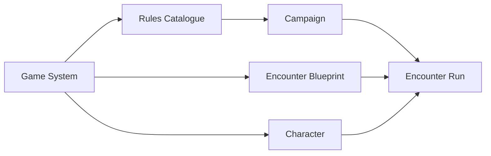

# ADR 0025: Game Systems, Rules Catalogues, and Encounter Blueprints

- **Status:** decision
- **Date:** 2026-08-24
- **Scope:** System selection, catalogue compatibility, Campaign binding, Character admission, and reusable Encounter preparation
- **Update when:** System/catalogue ownership, Campaign compatibility, Character admission, or Blueprint instantiation changes
- **Verification:** Campaign creation/settings, catalogue dependency rejection, Character admission/reconciliation, Blueprint reuse, and Encounter Run tests

## Context

Edition labels currently double as runtime selectors, Campaigns do not own a Game System, and Encounter
templates are Campaign-owned. That prevents clean multi-System product behavior and reuse of prepared
Encounters across compatible Campaigns.

## Decision

The initial catalogue persistence foundation makes a Rules Catalogue a UUID-backed metadata/policy
lineage owned by one Game System, and makes Content Source distinct UUID-backed provenance. Catalogue
inclusion is explicit many-to-many and relationally same-System constrained. A source is PLATFORM
(not mutable through ordinary application requests) or USER (exact owner mutation); it is not implicitly a catalogue or an
engine selector. These semantic records are server-only and do not change existing System vocabulary
policies.

- A Game System is a mechanically compatible product family delivered by the platform.
- A Rules Catalogue is a core lineage within one Game System.
- A Content Source is publication/creator provenance and is not automatically a catalogue or runtime
  selector.
- Every mechanics-bearing authored definition or item belongs to exactly one Game System.
- A Campaign selects an immutable Game System, enables compatible catalogues, and selects one current
  primary baseline catalogue. Campaign row `version` is optimistic concurrency only.
- Catalogue dependencies cannot be disabled while Characters, Campaign content, Encounter state, or
  frozen mechanics depend on them. Rejection names the dependents.
- Effective System-default or Campaign-selected initiative policy definitions and all graph sources
  they reference must be enabled by the Campaign catalogues. Prepared/active Encounter snapshots keep
  their exact source dependencies protected even after Campaign settings change.
- Campaign-created Characters inherit the Campaign Game System and primary catalogue. Admission never
  silently converts an incompatible Character.
- An Encounter Blueprint is creator-owned, Game-System-bound reusable Library content. It contains
  setup and reusable non-player material but no player Characters.
- An Encounter Run is a Campaign instantiation with independent participants and mutable state.
  Blueprint setup edits affect future Runs only; referenced authored mechanics follow ADR 0024.

## Consequences

- The application shell uses the selected System capability contract to show only supported domains
  and tools. Existing object/Campaign routes remain bound to their owning System.
- Social discovery may span Systems, but mechanics never cross Systems implicitly.
- D&D 2014 and a future D&D 2024 catalogue may coexist under the D&D Game System; D&D and Fate cannot.
- General Adventure Module Packages remain deferred. They will compose existing UUID-backed NPCs,
  Encounter Blueprints, maps, handouts, and preparation without arbitrary executable code.
