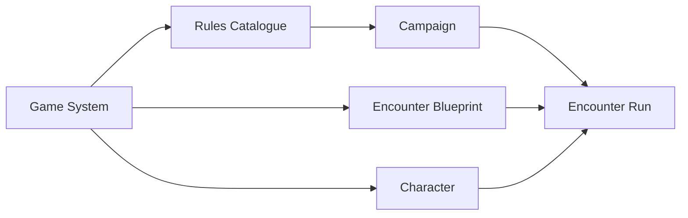
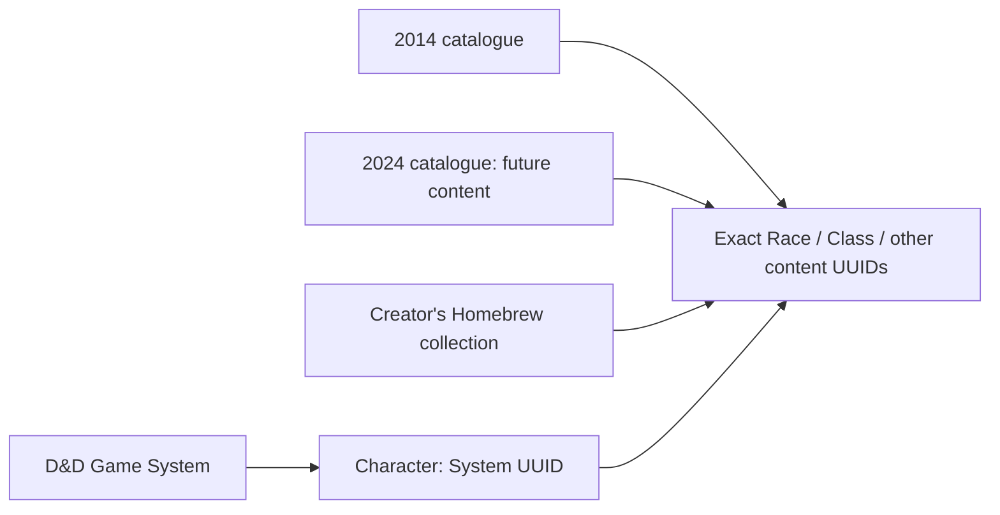

# ADR 0025: Game Systems, Rules Catalogues, and Encounter Blueprints

- **Status:** decision
- **Date:** 2026-08-24
- **Revised:** 2026-09-20
- **Scope:** System selection, catalogue compatibility, Campaign binding, Character admission, and reusable Encounter preparation
- **Update when:** System/catalogue ownership, Campaign compatibility, Character admission, or Blueprint instantiation changes
- **Verification:** Campaign creation/settings, catalogue dependency rejection, Character admission/reconciliation, Blueprint reuse, and Encounter Run tests

## Context

Edition labels currently double as runtime selectors, Campaigns do not own a Game System, and Encounter
templates are Campaign-owned. That prevents clean multi-System product behavior and reuse of prepared
Encounters across compatible Campaigns.

## Decision

The initial catalogue persistence foundation makes a Rules Catalogue a UUID-backed metadata/policy
lineage owned by one Game System, and makes Content Source distinct UUID-backed provenance. Catalogue
inclusion is explicit many-to-many and relationally same-System constrained. A source is PLATFORM
(not mutable through ordinary application requests) or USER (exact owner mutation); it is not implicitly a catalogue or an
engine selector. These semantic records are server-only and do not change existing System vocabulary
policies.

- A Game System is a mechanically compatible product family delivered by the platform.
- A Rules Catalogue is a core lineage within one Game System.
- A Content Source is publication/creator provenance and is not automatically a catalogue or runtime
  selector.
- Every mechanics-bearing authored definition or item belongs to exactly one Game System.
- A Campaign selects an immutable Game System, enables compatible catalogues, and selects one current
  primary baseline catalogue. Campaign row `version` is optimistic concurrency only.
- Catalogue dependencies cannot be disabled while Characters, Campaign content, Encounter state, or
  frozen mechanics depend on them. Rejection names the dependents.
- Effective System-default or Campaign-selected initiative policy definitions and all graph sources
  they reference must be enabled by the Campaign catalogues. Prepared/active Encounter snapshots keep
  their exact source dependencies protected even after Campaign settings change.
- Campaign-created Characters inherit the Campaign Game System. Admission never
  silently converts an incompatible Character.
- An Encounter Blueprint is creator-owned, Game-System-bound reusable Library content. It contains
  setup and reusable non-player material but no player Characters.
- An Encounter Run is a Campaign instantiation with independent participants and mutable state.
  Blueprint setup edits affect future Runs only; referenced authored mechanics follow ADR 0024.

## Consequences

- The application shell uses the selected System capability contract to show only supported domains
  and tools. Existing object/Campaign routes remain bound to their owning System.
- Social discovery may span Systems, but mechanics never cross Systems implicitly.
- D&D 2014 and a future D&D 2024 catalogue may coexist under the D&D Game System; D&D and Fate cannot.
- General Adventure Module Packages remain deferred. They will compose existing UUID-backed NPCs,
  Encounter Blueprints, maps, handouts, and preparation without arbitrary executable code.

### Character content-choice clarification — 2026-09-06

The user clarified that a Character belongs to its Game System, not to a Rules Catalogue. Each
structural choice references the exact authored UUID from the available compatible catalogues;
creation must not require selecting one catalogue that limits the Character's later choices.
D&D 2014, future D&D 2024 and the creator's Homebrew are peer content collections within D&D.
Homebrew is independent: do not add a field tracking which edition a homebrew item was based on.
Its existing creator-owned Content Source supplies ownership and collection identity; treating it
as Homebrew does not require creating a second ownership authority.

Active names are unique within user, catalogue and content type, preserving separately approved
parent-scoped subclass rules. One user's Homebrew cannot contain two active races named Hill Dwarf;
equivalent names in different catalogues or different creators' collections have distinct UUIDs.
Pickers must display the catalogue and creator when needed, not merge entries by label. Duplicate
draft labels remain allowed. With one Homebrew collection per owner/System, the current owned
publication name index already represents that collection's namespace; adding edition-origin keys
would incorrectly allow duplicate names within it.

Campaign catalogue policy remains a restriction on usable content, not Character membership in a
catalogue. Admission and catalogue-removal checks must inspect actual content dependencies instead
of a Character's former primary-catalogue field. Campaign policy defaults are separate from those
content choices; catalogue labels do not select the Rules Kernel or System adapter. This clarification
does not add D&D 2024 mechanics to Phase 8.2 or treat all same-System combinations as mechanically valid.

Native Character records omit the retired primary-catalogue binding. During the cutover, native
inputs rejected that binding and readers stripped it after checking original stored checksums.
Optional old storage and shared SQL payload fields are historical migration context, never native
authority. Their local runtime consumers have been removed; external Supabase retirement remains the
separately authorized R09 decision.

### Campaign shared-parent clarification — 2026-09-07

The user also clarified that all Campaign content sharing is Game-System-specific, including
reference material: content from another System cannot be shared or surfaced in that Campaign.
Multiple catalogues within the same System may be used, subject to the GM's enabled-catalogue
restrictions. Neither the Character nor a Homebrew item acquires a primary-catalogue binding.
This supersedes the transitional share/list behavior that did not impose a Campaign-System check.

The user requires a Homebrew subclass, subrace or Equipment variant's Homebrew parent to be
explicitly shared with the same Campaign before the child can be shared. Every Homebrew ancestor
in an Equipment chain must qualify. A parent from an enabled official catalogue is already
available and needs no Homebrew share. Sharing a child never grants implicit access to its parent,
siblings or the author's whole collection. Each read rechecks the current shared author, ownership,
publication and parent availability; missing or revoked prerequisites fail closed. Current
published parents replace the retiring pinned-dependency hydration, not this explicit access rule.

This ruling supersedes the transitional Campaign behavior that carried private parent access through
the child's exact dependency vector. Native unshare removes dependent shares and reconciles
Characters; native catalogue updates reject
removal when current Characters, saved drafts or Campaign content still require those sources.
Encounter and frozen-snapshot dependency guards preserve their accepted source requirements. The
Campaign membership and lifecycle behavior is accepted under P10 and P09; final local runtime removal
and the final-source lifecycle remain R01–R08 work.
