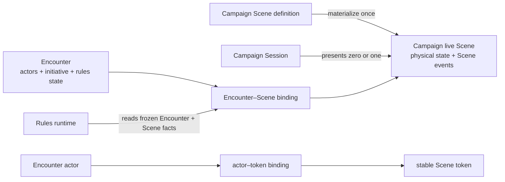

# ADR 0027: Campaign-owned live Scenes and optional Encounter bindings

- **Status:** decision
- **Date:** 2026-08-30
- **Scope:** Campaign VTT Scene ownership, Session presentation, Encounter spatial binding, and token identity
- **Update when:** Scene persistence, Session presentation, Encounter admission, token binding, Scene commands, or spatial replay ownership changes
- **Verification:** focused schema/repository/service/browser proofs plus the complete local Phase 08 lifecycle
- **Supersedes:** the Encounter-owned live Scene materialization in [ADR 0020](0020-local-and-remote-live-session-host.md); its transport, authority, journal, and renderer boundaries remain in force

## Context

Campaign Scene definitions already describe reusable maps, grids, barriers, lights, annotations, and
tokens. The current live-play implementation materializes a separate Scene snapshot only after a
definition is attached to an Encounter. That makes the tabletop unavailable before combat, destroys
the live Scene boundary when combat ends, and stores an Encounter actor ID on each persistent token.

The Campaign VTT must also present world maps, city maps, exploration maps, and prepared battle maps
without requiring combat. A GM must be able to start an Encounter on the Scene already being shown,
then end combat without replacing or destroying that Scene. Encounter rules still need exact Scene
facts for movement, reach, perception, auras, traps, and other spatial mechanics.

## Decision

Scene definitions remain reusable, versioned Campaign authoring data. A separate Campaign-owned live
Scene aggregate owns the mutable projection: token positions and rotation, door state, fog, lighting,
annotations, measurements, and other committed physical state. A Campaign Session selects zero or one
live Scene for presentation. The selected Scene survives Session reconnects, Encounter completion, and
later presentation by another Session.

An Encounter may bind to a live Scene, but does not own it. The binding is optional so theater-of-the-
mind Encounters remain valid. A normalized actor-token binding connects exact Encounter actors to
stable Scene token UUIDs for the lifetime of that Encounter. Scene tokens do not store Encounter actor
IDs; token identity, authored appearance, and physical state therefore remain stable across Encounters.

Scene commands are Scene-owned. Ordinary presentation and GM editing do not require an Encounter. If
the presented Scene has an active Encounter binding, the authoritative service resolves that binding,
locks the Encounter before the Scene, and runs the approved spatial mechanics. The Scene event records
the physical mutation; the Encounter occurrence and receipt record the mechanical result. Neither
aggregate duplicates the other's state.

The canonical lock families are:

- Scene-only command: Campaign/member authority → Session → live-command lease → Scene → Scene event.
- Encounter-bound Scene command: Campaign/member authority → Session → live-command lease → Encounter
  → Scene → binding/actor-token rows → rule state/effects → Scene event and Encounter receipt.
- Binding or presentation change: Campaign/member authority → Session → live-command lease when live
  → Encounter when supplied → Scene → binding or Session presentation state.

The Session coordinator hydrates the Session's presented Scene independently from Encounter state. Its
private projection may additionally contain the active Encounter binding and viewer-authorized combat
presentation. Starting or ending combat changes that overlay, not the underlying Scene projection.

Player-controlled movement without an Encounter is not part of the Phase 08 MVP. Outside an Encounter,
the GM may present and edit the Scene; players receive the authorized projected view. Exploration actor
ownership and lifecycle require a separate explicit product contract and must not be fabricated from
Encounter actors or token labels.

## Consequences

The current `encounter_scenes`, Encounter-keyed Scene events, `EncounterSceneState`, Scene-command
`encounterId`, and `SceneToken.actorId` contracts are transitional and must be replaced cleanly. Spatial
effects remain Encounter-owned and reference the exact Encounter–Scene binding. Existing geometry,
reducers, renderer, transport journal, private projection, rules kernel, Encounter mechanics, and
Scene-definition authoring remain reusable.

The Phase 08 denominator does not change. Only acceptance cases whose behavior depends on Scene
ownership, presentation, token binding, or reconnect are reopened; unaffected accepted evidence stays
accepted. The complete local lifecycle must be rerun after the persistence and transport cutover.
