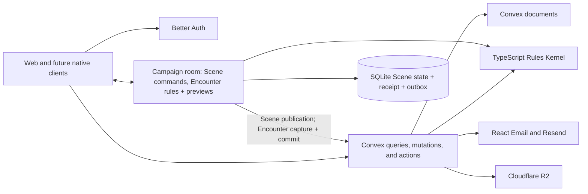
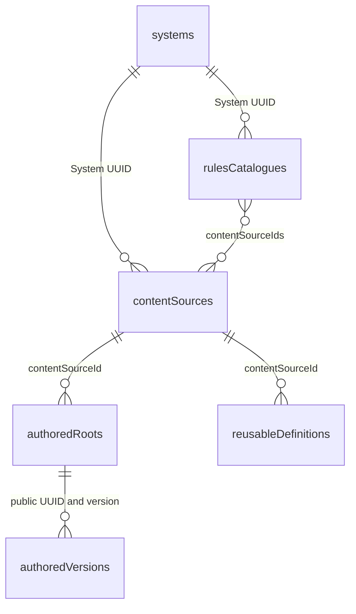

# ADR 0029: Convex backend cutover

- **Status:** decision (Session-scoped room identity and Session presentation superseded by [ADR 0033](0033-campaign-owned-play-and-session-log.md); per-command Convex capture and commit for live Encounter commands superseded by [ADR 0035](0035-room-authoritative-live-encounters.md); "Netlify hosts TanStack Start SSR" superseded by [ADR 0037](0037-web-app-on-cloudflare-workers.md))
- **Date:** 2026-09-03
- **Revised:** 2026-09-29

## Historical cutover context

Artificer Toolkit previously split authoritative commands across Netlify product functions,
Supabase/PostgreSQL, Kysely repositories, tRPC transport, a GoRules binding, and a Durable Object live
session host. Phase 8.1 proved behavior, replay, rollback, privacy, and PostgreSQL lock schedules,
but managed measurements showed that the multi-hop command path was too slow for VTT play.

A bounded POC ran the existing TypeScript Rules Kernel inside one Convex mutation with state reads,
evaluation, mutation, and receipt storage. Representative hosted Character, Encounter, and Scene
cases measured observer p95 of 129.6 ms, 119.3 ms, and 183.6 ms. These are directional POC measurements,
not release evidence: the harness was not a byte-for-byte production port and compared paths were not
network-equivalent. The published full GoRules engine ran only in a Convex Node action because its
WASI binding requires workers; that loses the desired single-mutation boundary.

## Current status

Convex remains the product persistence and authentication boundary. The TypeScript Rules Kernel is
the mechanics authority. The Campaign-owned Session Durable Object serializes live Scene commands
and Encounter rules evaluation, with authenticated, recipient-filtered previews. Encounter commands
still capture inputs from Convex and commit their results there; Character Sheet mutations also
remain in Convex. The SQLite Encounter store hydrates locally but is not yet the command authority.

[ADR 0035](0035-room-authoritative-live-encounters.md) replaces that per-command Convex path with
room-owned live state, held Character play state and fenced checkpoints; its authority switch is
pending. [ADR 0036](0036-versioned-content-snapshots-and-browser-builder.md) has moved Builder
evaluation and authored-content lists to browser snapshots locally. The web app has moved from
Netlify to Cloudflare Workers in the local source under [ADR 0037](0037-web-app-on-cloudflare-workers.md);
managed hosting remains pending. Retired Supabase/SQL/Kysely, tRPC/Netlify and GoRules runtime source
has been removed locally. R06, V15 and final-source R08 proof remain open. Staging, production and
external service retirement retain their separate authorization gates.

## Decision

The original placement of heavy live rules inside Convex mutations is superseded by the live rules
execution clarification below. The diagram shows the current transition; ADR 0035's checkpoint
authority switch remains pending.

Phase 8.2 replaces the product backend with Convex before launch:

- `apps/apis` remains the canonical product-data workspace and becomes the Convex backend.
- Public Convex functions replace product tRPC and Netlify functions. Arguments and results remain
  validated, JSON-compatible, discriminated, and independent of web types.
- Better Auth supplies identity. Authorization derives only from `ctx.auth`; client user IDs never
  establish identity or access. Public signup is server-feature-flagged and defaults closed.
- Better Auth also owns the closed `user | superadmin` role through its supported local component
  schema/admin plugin. App profile documents never become a second role authority. Initial role
  provisioning is internal-only; product privilege checks use the current user/session. Provider
  admin HTTP endpoints remain disabled rather than implicitly exposing account administration or
  impersonation. The local component switch requires no-reset data-preservation proof under `F11`.
- Authentication secrets never enter product projections or logs. Password recovery consumption,
  credential changes, failed-attempt updates, and session revocation use one Convex mutation; expected
  authentication rejection must not roll back attempt counters. HTTP rate-limit identity comes from
  platform request metadata, or short-lived signed context from the same-origin SSR proxy, never
  unsigned caller-provided headers. Proxy context grants no account access. The [API guide](../../apps/apis/README.md#auth-security-boundary)
  records the pinned Better Auth correction and remaining SSR attribution proof.
- Initial account invitations use an internal-only Node CLI action for 256-bit random tokens.
  A recipient-bound SHA-256 digest lives in Better Auth verification storage for 24 hours;
  reissue replaces the prior digest. Email links carry credentials in the fragment, which the
  setup page removes before submission and retains only in memory. A rate-limited Better Auth
  POST with the standard signup CSRF middleware delegates to one Convex mutation for verification,
  ordinary-account/password/profile creation and token consumption. Only this server-local
  provider instance permits signup after proof; global signup stays closed. No session is issued
  by redemption; the recipient signs in normally. Existing accounts cannot be invited or upgraded.
- Convex stores bounded authored aggregates and aggregate-owned state. Independently queried or
  contended memberships, notifications, Scene tokens, Encounter actors, occurrences, and receipts
  remain separate indexed documents. Convex `_id` values never replace public RFC UUIDs.
- The TypeScript Rules Kernel and code-owned system-neutral primitives run in Convex for Sheet
  mutations and in the room for live Encounter evaluation. Game System policies provide D&D mechanics;
  supported Campaign settings override System defaults. Unknown mechanics fail closed to manual adjudication.
- Authoritative dice are generated where rules execute: Convex for its commands and the room for
  live Encounter commands. Convex currently persists the evidence and command receipt. GoRules and
  the visual Rule Studio are retired from current product authority, and their runtime source has
  been removed. Final same-source proof remains R04/R08 work.
- Cloudflare R2 owns all media bytes through the official component and signed single-PUT uploads.
  Convex owns media identity, authorization, references, and lifecycle.
- React Email is rendered in a `"use node"` action and delivered through `@convex-dev/resend`.
- One Session Durable Object owns the minimum live projection and ordered execution while its
  authority epoch is active. Each supported Scene command atomically commits SQLite live state,
  its replay receipt and the next Convex publication outbox entry before success is broadcast.
- Convex independently revalidates each ordered publication, commits durable cross-session/system
  product state, drives subscriptions, and supplies recovery after authority release or eviction.
  Direct overlapping Convex writes are fenced while the Session DO is active.
- An unused `ACTIVATING` reservation lasts through the latest issued join ticket's expiry. Expiration
  restores direct Convex writes and permits a new epoch; active or draining authority does not expire.
  Replacement of provisional SQLite state requires current Convex verification and zero committed or
  published commands, receipts, and outbox entries. This prevents abandoned joins from permanently
  fencing Campaign play while preserving committed authority and replay evidence.
- Live Encounter rules execute in the room; their persistence remains in Convex until ADR 0035's
  switch. Character Sheet rules and persistence remain in Convex until held play actions move to the
  room. Recipient-filtered pings, measurement, drag and fog previews remain ephemeral.
- The web host serves TanStack Start SSR only (Netlify at the cutover; a Cloudflare Worker since
  [ADR 0037](0037-web-app-on-cloudflare-workers.md)). No GraphQL, generic document patches, dual
  writes, or compatibility database layer is introduced.

The [fixed acceptance contract](../roadmap/08-2-convex-cutover-acceptance.md) contains exactly 75 cases.
Its denominator changes only with explicit user approval.

### Live rules execution clarification — 2026-09-24

The rules placement below remains accepted. Its per-command capture and Convex commit contract is
superseded by [ADR 0035](0035-room-authoritative-live-encounters.md).

The user reaffirmed that heavy live rules belong in the Session Durable Object because the real
workload exceeded Convex execution and size limits. The small earlier Convex proof of concept does
not override those workload findings. Do not continue splitting or wrapping heavy rule execution
inside Convex merely to get individual calls below those limits.

Reuse the existing TypeScript Rules Kernel and rules-runtime services in the DO. This includes live
fact preparation hidden inside current "load facts" helpers. Convex supplies authorized stored inputs
and owns bounded, atomic persistence of Character/Encounter changes and receipts. Keeping Sheet
writes in Convex does not require heavy Encounter evaluation to run there. This clarification does
not reopen already accepted feature mechanics or replace the separately required R08/V15 proof.

R06 must establish the complete capture, DO evaluation, and validated commit boundary. The commit
must retain current authorization, source/version checks, idempotency, and all-or-nothing
Character/Encounter/Scene changes where required, without repeating the heavy evaluation in Convex.
A command relying on that Convex transaction cannot report success before its receipt commits.
Integrate these commands with the existing room order and standalone Scene journal/publication lane;
do not introduce a second unfenced Scene writer.

Historical (before S4-d removed `encounters/actionCommands.ts`): source called
`advanceNativeActionGraphs` inside that Convex action path and evaluated spatial movement during both
preparation and commit. The room now dispatches and evaluates Encounter commands through
`nativeRoomEncounterCommand.ts`, with authorized Convex capture and fenced commits. The remaining
authority switch is tracked in ADR 0035. Session finish and unfinished Runs were resolved by
[ADR 0033](0033-campaign-owned-play-and-session-log.md): Session finish changes no Run or room state.

### Character authority amendment — 2026-09-23

Historical: [ADR 0035](0035-room-authoritative-live-encounters.md) supersedes this amendment while a
Character is held by a live Run. The current implementation still writes Sheet play state in Convex;
the target routes held play actions through the room and keeps outside-play writes in Convex.

The user approved keeping all Character Sheet changes in Convex for Phase 8.2. The prior split sent
adjustments through the DO while HP, resources, and other writes advanced the same Character version
in Convex. A concurrent direct write could leave an acknowledged DO command unable to publish and
block its ordered outbox. Refreshing a snapshot does not close the race between refresh and commit.

All Sheet changes now share the existing authenticated Convex mutation, version check, and receipt
transaction. The Worker protocol and bootstrap contain Scene state and authority metadata only.
Character rules snapshots, their serialization, and the frontend live Sheet merge are removed.
Tabletop previews and supported Scene commands keep their DO path and latency requirements.

Promotion over the previous Worker requires draining and releasing active epochs with empty
outboxes before deployment. Recovery retains checksum validation for older Scene journal envelopes;
this amendment never permits deletion of committed Character publication or replay evidence.
The Character authority amendment was accepted at REVIEW on 2026-09-24. R06 ownership review is
reopened after V15-20260924-05 showed the active Session DO rejects Encounter-bound movement while
Convex direct writes are fenced, leaving no ordered forwarding path. The live rules execution
clarification above governs the remaining implementation; the 75-case denominator is unchanged,
and full V15 and final-source R08 proofs remain open.

### Scene presentation ordering clarification — 2026-09-23

A live Scene switch enters the Session DO's existing command order. The room publishes all prior
commands before a protected Convex mutation changes presentation under the exact authority epoch,
published sequence/checksum, and presentation version. It then invalidates the old Scene cache and
refreshes socket admission. Commands and Scene synchronization share this ordering boundary.

The same epoch and journal span Scene switches. This preserves replay evidence and permits A → B → A
without hydrating unpublished A state from Convex. Publication failure leaves the presentation in
place. Direct presentation mutations reject active authority; the authenticated `setLive` action
selects the ordered control path. No additional command queue or Scene persistence store is added.

### Committed publication authorization amendment — 2026-09-23

The user approved completing protected publication using the actor role recorded when the Session
DO authorized and atomically committed the command. Reapplying mutable Session, Campaign, or member
status afterward could permanently strand an acknowledged command when play ends or access changes.

Only the branded internal publication scope accepts retained historical membership and command-time
role evidence. Public access and new commands still require current authorization. The private
publisher verifies stable Campaign/Scene/Session identity, the active authority epoch, ordered
sequence, checksums, expected Scene version, permitted geometry, and exact result. Campaign deletion
must drain publication before deleting those identity rows. Scene switches separately publish prior
commands before changing presentation under the existing room order.

New outbox payloads require the command-time actor role. Promotion must drain older epochs with their
existing Worker and retain their receipts; missing role evidence is never inferred from current roles.
This amendment is undergoing local verification and does not authorize managed deployment.

## Cutover boundary

PostgreSQL acceptance is historical behavioral evidence. Convex independently proves atomicity,
replay, rollback, concurrency, privacy and cleanup. F15 has accepted the protected canonical corpus
in version-controlled `packages/source-data/src`, including stable UUIDs/references and exact import,
read-back and replay evidence. R03 may remove the retired database implementation only while
preserving that protected corpus.

Local Supabase, Kysely, SQL, tRPC, product Netlify-function, GoRules and unused workspace source has
been removed. R01–R08 still require the complete final-source lifecycle proof. External Supabase
service retirement occurs only after accepted R09 staging promotion and an explicit retirement
decision. Production data deletion is never implicit in this ADR.

## Consequences

### Historical development runtime amendment — 2026-09-03

The user approved a personal Convex cloud development deployment for actual backend execution.
Editing, formatting, code generation, builds, typechecks, pure tests, and `convex-test` stay local;
real backend integration and end-to-end journeys may use that isolated cloud dev deployment.
This replaces the requirement to run the Convex backend process on this Windows machine, not the
required correctness, security, replay, rollback, concurrency, or complete release-lifecycle proof.
The existing local backend and its accepted evidence are preserved, not reset or discarded.

The user subsequently confirmed `artificertoolkit/artificer-toolkit` as the single project and
reported deleting the former separate staging project. The CLI selected personal cloud dev
`flexible-goshawk-837` and created a non-default `staging` deployment, `beaming-pig-820`, at the
user's request. Staging uses Convex's `prod` deployment type but is not the default live production
target. No source upload, seed, data reset, or default-production change occurred during setup.
Verify the exact project, deployment type/reference, and matching URLs before each operation;
unfinished source may go to dev, never to staging through an inferred selector.

Development uses isolated test data and credentials. Loopback-only email/media substitutes remain
local; cloud dev must use explicitly configured development/test delivery, never production secrets
or an assumption that localhost is reachable remotely. Staging remains a bounded promotion check
after the complete development lifecycle passes on one final source state. Production actions and
destructive Supabase retirement retain their explicit approval gates. The 75 cases are unchanged.

This dated amendment records the deployment topology used for earlier evidence. It does not authorize
current staging, production or service-retirement work; the current Phase 8.2 execution boundary is
the local-only existing stack described above.

### Canonical content persistence — 2026-09-03

Roots carry searchable metadata and a Convex-typed `currentVersionId`; version records retain
public UUID, version, schema version, checksum, and canonical `documentJson`. This encoding is
necessary because 13 existing SRD records exceed Convex's 16-level nesting cap (maximum 23).
It preserves the cohesive authored model without arbitrary child tables or dropping mechanics.
Domain validation precedes encoding, and read-back decodes and checks full payload/metadata hashes.
Indexed fields remain native Convex values; the public authoring contract remains a typed object.
Systems (depth 4) remain structured. Reusable definitions were structured until authored basic actions (ATTACK-18, Dodge is 19 deep) outgrew the cap; their document is now canonical `documentJson` text too, decoded and checksum-verified on every read. This is not a generic
unvalidated JSON store or a change to rules execution semantics.

The internal seed inserts missing records and rejects conflicting existing content. Exact replay
may backfill absent server-derived authoring-source metadata only after verifying the unchanged
root and version; existing conflicting metadata still rejects. This includes the existing
Equipment projection and the closed nested-reference facts used by the shared Authoring Schema
resolver. An internal `@convex-dev/migrations` backfill applies the same integrity checks to existing
master and homebrew roots, one current document per batch. Neither path changes the authored
document, UUID, version or checksum. New metadata stays optional until backfill verification.
This is a read projection, not a second editable document or a new authored version. Batches
are atomic and bounded; a whole import is resumable provisioning, not one transaction. A complete
read-back audit must succeed before source import acceptance. No authored rows existed when this
schema was tightened: the initial oversized batch rolled back, verified by a local read.
The [API guide](../../apps/apis/README.md#canonical-source-import) owns commands and validation.

Runtime content-source storage also admits ADR 0025's `USER` source with its required owner UUID.
Canonical bootstrap/import contracts remain `PLATFORM`-only. Native authoring reads select
same-System platform sources plus the authenticated owner's sources through a compound index.
Published root access requires matching source/System/owner, including reference labels and draft
edits. The 100-source inline-selector bound applies to caller-visible sources, not all authors.
This source-visibility boundary does not introduce a source editor or Campaign sharing API.
Native publication is described below.

The native Background publisher now implements the publication portion: a saved-draft timestamp
and internal base checksum prevent stale publication; same-millisecond saves issue distinct
timestamps. It preserves the existing `default` USER-source convention using an indexed
owner/System/code lookup. Shared pure compilation is stored beside the current document with
its source and projection checksums, and canonical Background import uses the same compiler.
The previous current record is deleted in the same mutation as replacement and draft removal,
following ADR 0024 rather than reintroducing authored history. Compilation is optional during
domain migration; exact canonical replay backfills only missing Background compilation and
rejects conflicts. Source UUIDs/payloads/checksums and the canonical manifest remain unchanged.
This publisher alone does not accept dependent reconciliation, authored media or full web
authoring. Background/Class/Feat frontend adapters are now native, with their focused proofs
recorded in the acceptance ledger; the complete final-source journeys still own acceptance.

Portable export shares the existing pure metadata/reference rules with the transitional SQL
adapter. Native `authoredImportRefs` preserves owner, external source/kind/ID, mapped subject UUID,
and original timestamps; it is not an authored revision or a source of ownership. Exports select
only the authenticated owner's earliest reference and authorize referenced labels through the
normal System/source boundary. The portable file contract is unchanged. Import writers and
reference-data migration remain separate acceptance work; an empty new table is not migration proof.

Class publication uses a Convex-runtime action for pure normalization and compilation after real
development execution exceeded the one-second query/mutation CPU budget. Its internal commit
revalidates the saved draft, current root, parent relationships, and checksums of every trusted
source-table read before atomically replacing the publication. Source fingerprints are request-only
optimistic read-set evidence, not stored revisions or a prepared execution plan. Clients still submit
only the Class UUID and saved-draft token; they never supply compiled content or source fingerprints.

The 2026-09-05 catalogue ruling keeps Class family membership exclusively UUID-based. Parent
classes sort alphabetically; each parent's subclasses sort alphabetically within that UUID group.
Equal parent names do not merge or interleave families. An optional `catalogueFamily` read projection
stores the family UUID and lowercase parent label for indexed pagination, never as a relationship
or editable authored field. Publication updates the current Class key and, on a parent rename,
its children's keys in the same transaction. It does not rename children, change their parent
references, replace their authored versions, or alter their drafts/checksums/timestamps.
The user approved a maximum 500 published records per Class family including its parent. The final
commit checks child admission and rename fan-out through the parent-UUID index. A missing relationship
backfill or invalid child rejects the entire transaction. Exact canonical replay and the bounded
catalogue backfill may fill absent keys, but reject conflicting keys. This is local implementation;
managed backfill, maximum-workload proof and complete acceptance remain separate gates.

### Native notification delivery — local implementation

The existing narrow notification intent boundary becomes indexed Convex `notificationDeliveryIntents`,
not a second inbox or generic queue. Authorized native source mutations call the enqueue/cancel
helpers in their own transaction. An internal one-minute job claims at most ten due intents, writes
current-preference in-app delivery with latest-25 retention, and schedules bounded Node rendering.
React Email and the installed Resend component remain the rendering/delivery boundary. The intent UUID
is the component enqueue idempotency key; retries retain one logical feed item and component email.
Cancellation tombstones suppress delayed triggers and cancel queued, unsent component messages without
erasing retained history. Rendering hands off to an internal mutation that rechecks current source
eligibility, recipient, preferences and intent state, then enqueues the component email and persists
its ID atomically. Source checks reuse canonical Campaign authority, current Social counterpart/block
state, and announcement scope membership before both feed insertion and component enqueue.
The dispatcher polls that ID until provider acceptance or terminal failure; enqueue acknowledgement
alone never marks success. Dispatched retains the existing provider-acceptance (not inbox-delivery)
meaning, including when a later bounce is already visible at reconciliation.

Local auth retains its guarded loopback transport; native notification Resend enqueue uses the
component from its atomic mutation. Provider IDs stay private, and account deletion
schedules bounded intent cleanup.
Native Social/Campaign producers and invitation expiry are connected. Source predicates and delivery
transactions have focused local coverage; complete delivery acceptance is tracked in P18.
See [persistence](../architecture/persistence.md#notification-delivery).

### Cutover consequences

The 2026-09-05 naming ruling permits duplicate drafts but makes active names unique within each
owner/System/domain; subclasses additionally scope by parent Class UUID. Editing excludes only
the same active UUID. Master/SRD content does not reserve an owner's names, and names never replace
UUID identity. The native final publication transaction owns the indexed uniqueness check, not
Class action preparation or the frontend. The current comparison assumption trims outer whitespace
and lowercases without changing display labels. Existing roots receive an optional derived key via
a bounded name-only backfill; missing owner-scope keys fail closed and legacy duplicates are retained
for owner resolution. See [authoring schema](../architecture/authoring-schema.md) for the local
implementation and remaining migration gates.

The 2026-09-06 clarification excludes Characters from that authored-publication name rule:
Characters may share a name within the same owner and Game System. Their UUIDs remain their identity.

Feat extends the existing atomic Background publication path: its own schema and node map feed the
same normalizer, compiler and commit. Canonical Feat import audits/backfills only exact missing
compilation; UUIDs, authored payloads, source checksums and catalogue counts remain unchanged.
The Class action remains separate; Feat does not add another action or persistence mechanism.

Equipment extends that mutation with current parent-chain resolution and atomic descendant
recompilation. It uses the shared resolver/compiler, retains descendant authored source identity and
drafts, and rejects unresolved changes or parent deletion with published variants. Indexed parent
metadata is optional until exact canonical replay; imported Equipment compiles in a second pass after
all parent roots exist. This implements ADR 0024 current-source semantics without dependency history,
consumer pins or asynchronous stale projections. Focused local proof, managed execution limits and
frontend cutover remain separately tracked in C06.

- Convex's supported `codegen.staticApi` generates validator-derived client references. Backend
  implementation and Better Auth peer types do not enter the web TypeScript program through
  generated API imports. The API workspace independently typechecks implementations; arguments
  and results remain runtime-validated. No manually maintained API type facade is introduced.
- This is a backend cutover, not a persistence-driver substitution.
- Existing pure domain, node-map, compiler, and kernel tests remain. Persistence and transport proofs
  use Convex transactions, OCC, subscriptions, and authorization.
- `packages/schema`, `packages/shared`, and `packages/emails` remain. Canonical data moved to
  `packages/source-data`. `packages/functions` and `packages/db` have been deleted after their reusable
  pure code was extracted.
- The existing Authoring Schema resolver is extracted once into `packages/authoring`, depending
  on `schema` and `shared`. Convex and the temporary SQL adapter supply trusted source reads;
  neither owns a duplicate resolver. This avoids a dependency cycle through `shared` and is not
  a second rule engine. The [authoring guide](../architecture/authoring-schema.md) records current
  native-source coverage and the remaining web cutover boundary.
- The existing schema-aware execution wrapper and installed System modules move into
  `packages/rules-runtime`, with `schema` and `shared` as its workspace dependencies. The TypeScript Kernel stays in `shared`; form resolution/publication
  stays in `authoring`. This avoids both a `shared` → `schema` cycle and placing play execution in
  the form package. The temporary functions facade delegates to the same wrapper until its native
  callers are migrated. Continuation seals retained canonical UTF-8 HMAC-SHA256 and the existing key
  and DTO contracts; standard Web Crypto replaced Node crypto without changing stored seal bytes
  (historical: Amendment 1 removed the seal).
  System compilers retain the existing UUID v5 dependency and exact deterministic inputs. Shared
  server-source contracts replace DB/aggregate type dependencies without moving authority or
  transaction ownership. Native publishers consume the installed contracts/operations directly;
  the neutral package does not depend on the authoring package or legacy secret provisioning.
- Native authoring resolution keeps its reactive query boundary but compacts repeated scope models
  within each response. Every absolute scope path remains present; the shared schema codec validates
  model references and expands the result for the unchanged renderer contract. This is lossless
  transport encoding, not a cross-request cache or lazy omission of authored structure.
- ADRs describing Kysely, Supabase delivery, tRPC, GoRules, and SQL locking remain current history until
  their cutover cases pass, then become historical rather than compatibility requirements.
- Native compatibility is proved now with a protected Convex function called using a non-browser
  Better Auth bearer/JWT token; native UI implementation remains deferred.

### Native search semantics amendment — 2026-09-08

Use native Convex search patterns wherever the SQL-to-Convex cutover exposes a search behavior
mismatch. The architect explicitly approved this choice, with later refinement driven by user
feedback. Social keyword queries therefore use Convex full-text matching and relevance ordering;
filter-only discovery retains newest-publication/public-UUID ordering. Native cursor and input
limits belong to shared contracts. Preserve domain filters, authorization and privacy; do not emulate
PostgreSQL query syntax/order with a custom search service, unbounded collection or partial-page sort.

### Social safety fanout amendment — 2026-09-08

The architect approved immediate authoritative Social enforcement with bounded background cleanup
for blocking and profile suspension across unlimited hosted Campaigns. Do not introduce Campaign or
pending-request caps to fit one mutation. Discovery, new interaction/admission and unsent notification
delivery must honor the restriction immediately; existing Campaign memberships and Campaign access
are unchanged. Physical request-status finalization and notification cancellation may proceed in
bounded native Convex batches. Removing a block or restoring a profile must never revive a pending
request invalidated by an earlier safety action. Cleanup must therefore retain enough authoritative
invalidation state to survive retries, interruption and reversal. This is an approved target contract,
not a claim that the cleanup path is implemented or verified.

The architect clarified the email boundary on 2026-09-09: successful handoff into Resend's component
queue counts as in flight. Automatic source cancellation, blocking and suspension must stop future
handoffs immediately. Cleanup attempts to cancel waiting/queued messages, but already-handed-off
email may finish sending. Notifications remain trigger-based; there is no user cancellation control.
Installed Resend component 0.2.8 has no application authorization hook between its backlog and
provider submission. Current source/safety eligibility must be checked in the same transaction as
component enqueue. This ruling does not claim that the remaining safety implementation is complete.
Evidence: `.codex/validation/phase82-social-safety/notification-boundary-decision.md`.

### Command module boundary clarification — 2026-09-09

The complete production command graph exposed a module-loading constraint that the bounded POC
did not prove. Encounter delegates Character commands and initiative facts through internal Convex
mutation/query calls. Convex runs these in separate JavaScript contexts within the owning mutation's
transaction; nested calls do not permit partial commits. Arguments/results are shared validated
contracts, identity comes from inherited auth, and only consumed fields cross the boundary.
Character facts preparation is separate from Sheet presentation. The original atomicity, replay,
privacy and latency requirements remain unchanged; local import diagnostics and tests do not
constitute managed acceptance. Zod Mini remains an experiment until schema parity and the complete
execution envelope are proved.

### Account usage counters amendment — 2026-09-09

The architect approved stored Account usage counters so the Account read stays bounded as an
unlimited-tier collection grows. Native source mutations maintain a unique `(resource, sourceId)`
usage entry and adjust the owning profile in the same transaction. The entry deduplicates active
records and drafts and makes source backfill, replay, ownership changes and deletion idempotent.
This replaces legacy SQL Account summary reads while preserving existing source-based capacity
checks and the shared code-owned tier/pricing policy. Existing media-byte accounting is reused.

The installed Migrations component backfills sources before enabling existing profile totals.
Absent profiles are not recreated or counted; invalid existing counters and conflicting source
ownership fail closed. A native internal operator mutation owns manual tier assignment until Phase
09 billing. No public self-upgrade command or billing infrastructure is introduced. Implementation
and validation remain in progress under P19.

### Social retention transaction amendment — 2026-09-10

The architect approved retry-safe batches for Social retention: an interrupted purge may leave
some eligible records deleted and resume later. The existing retention periods, membership/report
protections, and permanent block/invalidation records remain unchanged. Each batch must recheck
eligibility in its own transaction. This replaces the legacy whole-run SQL transaction guarantee;
it does not authorize an unguarded staging/production purge or change deployment approval gates.
Implementation and retention proof remain required under P17.

### Character operational persistence clarification — 2026-09-29

Convex remains the application backend and durable product record. The approved Phase 8.2 completion
splits mutable Character storage into head, Build, play, inventory/currency, spell, extra and note
records, with complete domain assembly at rules, Builder, import/export and capture boundaries.
This is an access-pattern change within Convex. Complete authored versions, drafts, snapshots and
replay/capture artifacts may retain validated, checksummed JSON.

The structure and play clocks, UUIDs, current-source semantics, authorization, privacy, atomic writes,
replay and cleanup remain load-bearing contracts. Database-schema evaluation uses focused shared
validators without importing the full mechanics graph. See the [persistence target](../architecture/persistence.md#character-operational-records).
Typed head, Build, play and owned collection storage is implemented locally. The head retains complete
structure checksums to detect missing or altered collection rows. The Build record also carries
checksummed counts for each owned collection, so a selected query detects missing tail or all rows
without loading unrelated families. Count changes share the collection writer's transaction and
existing structure clock. Focused Sheet access is implemented locally; mechanical read narrowing
and integrated proof remain pending.
Public Sheet commands now return compact UUID/version/history/result acknowledgements. Private
Encounter execution retains its complete Sheet only inside its transaction. Owner-only note commands
reuse the existing reducer and writer without mechanics evaluation, retaining implicit Campaign
lifecycle checks before replay. These are local implementations of the approved narrower access target.
Development data is reset/seeded locally in the same change; no retired
storage compatibility path is retained for launch.

## Amendment 1 (2026-10-17): unsealed continuations

Decision Q23 (PLATFORM-24) removes the rules continuation seal. A continuation never leaves the
server, so the HMAC proved only that the server wrote it, and it cost a shared
`RULES_CONTINUATION_SECRET` in both Convex and the Worker. `resume` and `resumeWithGraph` now admit
the continuation's graph exactly as `executeFrozen` admits a persisted graph: the installed capability
for its Game System, a matching capability contract version, and `validateCompiledRuleGraph`. That
validation cannot detect an edited literal; Q23 accepts this because only server code writes
continuations. The schema field, `deriveRulesContinuationKey`, the `continuationIntegrityKey` option
and the secret are deleted with no compatibility path. Decisions paused before the change are
cancelled, as ADR 0033 cancelled decisions paused across its migration: the
`encounters/continuationSealMigration` migration voids each pending occurrence whose stored snapshot
carries a seal and removes its snapshot parts and checksum.

## Evidence

- POC: `.codex/worktrees/convex-gorules-spike/apps/convex-gorules-spike/RESULTS.md`
- Runtime research: `.codex/worktrees/convex-gorules-spike/apps/convex-gorules-spike/DEEP_RESEARCH.md`
- Release authority: [Phase 8.2 acceptance](../roadmap/08-2-convex-cutover-acceptance.md)

The POC source remains disposable. Its summarized measurements and caveats above are retained here;
they are not a promise that all production commands already meet the release budget.
