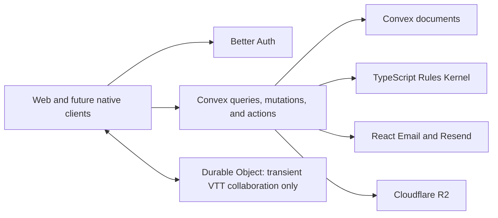

# ADR 0029: Convex backend cutover

- **Status:** transitional
- **Date:** 2026-09-03

## Context

Artificer Toolkit currently splits authoritative commands across Netlify product functions,
Supabase/PostgreSQL, Kysely repositories, tRPC transport, a GoRules binding, and a Durable Object live
session host. Phase 8.1 proved behavior, replay, rollback, privacy, and PostgreSQL lock schedules,
but managed measurements showed that the multi-hop command path was too slow for VTT play.

A bounded POC ran the existing TypeScript Rules Kernel inside one Convex mutation with state reads,
evaluation, mutation, and receipt storage. Representative hosted Character, Encounter, and Scene
cases measured observer p95 of 129.6 ms, 119.3 ms, and 183.6 ms. These are directional POC measurements,
not release evidence: the harness was not a byte-for-byte production port and compared paths were not
network-equivalent. The published full GoRules engine ran only in a Convex Node action because its
WASI binding requires workers; that loses the desired single-mutation boundary.

## Decision

Phase 8.2 replaces the product backend with Convex before launch:

- `apps/apis` remains the canonical product-data workspace and becomes the Convex backend.
- Public Convex functions replace product tRPC and Netlify functions. Arguments and results remain
  validated, JSON-compatible, discriminated, and independent of web types.
- Better Auth supplies identity. Authorization derives only from `ctx.auth`; client user IDs never
  establish identity or access. Public signup is server-feature-flagged and defaults closed.
- Convex stores bounded authored aggregates and aggregate-owned state. Independently queried or
  contended memberships, notifications, Scene tokens, Encounter actors, occurrences, and receipts
  remain separate indexed documents. Convex `_id` values never replace public RFC UUIDs.
- The TypeScript Rules Kernel and code-owned system-neutral primitives run within authoritative
  mutations. Game System policies provide D&D mechanics; supported Campaign settings override System
  defaults. Unknown mechanics fail closed to manual adjudication.
- Handler-local Convex random generation supplies authoritative dice; the same mutation persists the
  evidence and command receipt. GoRules and the visual Rule Studio runtime are removed.
- Cloudflare R2 owns all media bytes through the official component and signed single-PUT uploads.
  Convex owns media identity, authorization, references, and lifecycle.
- React Email is rendered in a `"use node"` action and delivered through `@convex-dev/resend`.
- Durable Objects retain transient presence, pointers, measurement, drag preview, and fog preview
  only. Convex owns committed Scene and Encounter state.
- Netlify hosts TanStack Start SSR only. No GraphQL, generic document patches, dual writes, or
  compatibility database layer is introduced.

The [fixed acceptance contract](../roadmap/08-2-convex-cutover-acceptance.md) contains exactly 75 cases.
Its denominator changes only with explicit user approval.

## Cutover boundary

Existing Supabase implementation remains current behavior until its replacement cases pass.
Phase 8.1's two unrun managed-Supabase latency cases are superseded, not accepted; their guarantees
move to Phase 8.2 `V15` and `R09`. PostgreSQL acceptance remains historical behavioral evidence, but
Convex independently proves atomicity, replay, rollback, concurrency, privacy, and cleanup.

Supabase, Kysely, SQL, tRPC, GoRules, and unused workspaces are removed only after replacement domains
are locally accepted. Supabase is retired only after accepted Convex staging promotion and explicit
confirmation. Production data deletion is never implicit in this ADR.

## Consequences

- This is a backend cutover, not a persistence-driver substitution.
- Existing pure domain, node-map, compiler, and kernel tests remain. Persistence and transport proofs
  use Convex transactions, OCC, subscriptions, and authorization.
- `packages/schema`, `packages/shared`, and `packages/emails` remain. Canonical data moves to
  `packages/source-data`. `packages/functions` and `packages/db` are deleted only after reusable pure
  code is extracted and no accepted runtime depends on them.
- ADRs describing Kysely, Supabase delivery, tRPC, GoRules, and SQL locking remain current history until
  their cutover cases pass, then become historical rather than compatibility requirements.
- Native compatibility is proved now with a protected Convex function called using a non-browser
  Better Auth bearer/JWT token; native UI implementation remains deferred.

## Evidence

- POC: `.codex/worktrees/convex-gorules-spike/apps/convex-gorules-spike/RESULTS.md`
- Runtime research: `.codex/worktrees/convex-gorules-spike/apps/convex-gorules-spike/DEEP_RESEARCH.md`
- Release authority: [Phase 8.2 acceptance](../roadmap/08-2-convex-cutover-acceptance.md)

The POC source remains disposable. Its summarized measurements and caveats above are retained here;
they are not a promise that all production commands already meet the release budget.
