# ADR 0030: Owner deletion and retained dependencies

- **Status:** decision
- **Date:** 2026-09-18
- **Revised:** 2026-09-20

## Context

Artificer Toolkit is a consumer SaaS. Owners must be able to delete their own authored content,
Characters and accounts without another user's references or content vetoing deletion. The earlier
SQL-style RESTRICT policy conflicts with the user's explicit deletion ruling.

## Decision

```mermaid
flowchart LR
    Owner["Authenticated owner deletes own source"] --> Cleanup["Native dependency repair and durable bounded cleanup"]
    Cleanup --> Deleted["Owned current/private data removed"]
    Cleanup --> Retained["Other owners' content and shared history preserved"]
    Retained --> Reads["Current authority and Deleted user presentation"]
```

Ownership and current identity authorize deletion. Third-party content, shared Scene references,
Social applications/reports/audits and pending Encounter decisions do not determine eligibility.
Repair or detach live dependencies; retain acquired mechanics and historical snapshots under existing
custody and source-loss rules. Do not delete another owner's content to make deletion pass.

FINISHED Sessions remain read-only history, including Runs still marked ACTIVE or SETUP. Trusted
cleanup skips those Runs before requiring live Character sources. Open encounters remove the owner's
Character actor and reconcile invalidated pending decisions while preserving already settled results.
Shared Campaign messages, rolls and Session history remain readable with the author presented as
`Deleted user`; private Characters and personal account data are removed.

Strict input validation, integrity checks, privacy, replay and atomic rollback remain required.
Malformed persisted data is a functional defect, not an approved deletion restriction. An owner still
explicitly transfers or deletes owned ACTIVE/ARCHIVED Campaigns before deleting their account.
Public Encounter editing and ordinary authored publication keep their separate constraints.

## Consequences

This supersedes deletion-only third-party RESTRICT policies in ADRs 0012, 0013, 0014, 0024, 0027,
0028 and their implementation guides. It does not change the Phase 8.2 denominator, scenarios,
thresholds, proof tiers or external promotion authorization. Native dependency repair, active-actor
removal, retained shared history, rollback and privacy proofs are implemented, and F12 is accepted.
The final-source release lifecycle remains R08 work.

The [persistence guide](../architecture/persistence.md#owner-deletion-cannot-be-vetoed-by-another-user--approved-2026-09-18)
owns lifecycle invariants. The implementation is centered in
[`accountDeletion.ts`](../../apps/apis/convex/accountDeletion.ts),
[`accountDeparture.helper.ts`](../../apps/apis/convex/campaigns/accountDeparture.helper.ts) and
[`content/deletion.ts`](../../apps/apis/convex/content/deletion.ts).
