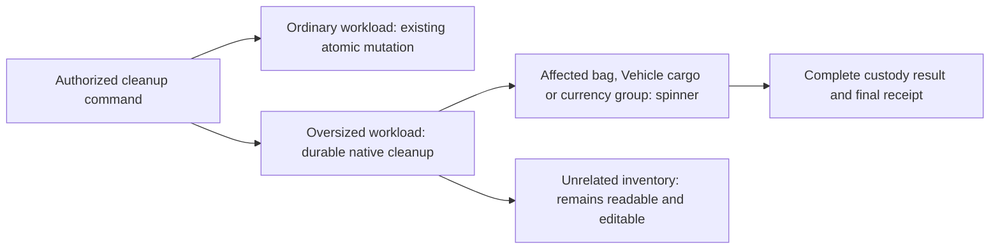

# ADR 0031: Oversized inventory cleanup

- **Status:** decision
- **Date:** 2026-09-18
- **Revised:** 2026-09-20

## Context

Inventory and Vehicle cargo have no approved aggregate size cap. Requiring every deletion,
departure or source-loss cleanup to fit one native transaction would impose an unstated quota.
The user approved background cleanup for oversized inventories and limited the temporary
read/write restriction to the affected bag, Vehicle cargo or currency group.

## Decision

Keep ordinary transfers and supported ordinary cleanup atomic. Oversized cleanup uses bounded,
durable native scheduling without a new service or a product inventory-size cap. Persist the
operation and its authorized scope before processing; retries cannot apply a page twice. Affected
contents stay hidden and cannot be edited until their complete result is published. Show a spinner
on the affected bag, Vehicle cargo or currency group; do not freeze unrelated inventory.

The initiating command captures and rechecks current authority in the same transaction that creates
the durable job. Each bounded continuation validates the stored scope, phase, fences and row markers;
those markers make replay idempotent. Owner-requested retry rechecks current authority. No partially
applied contents become readable.

Retain ownership, privacy, strict validation, containment, acquired mechanics, safe currency totals,
version fences, exact replay and complete cleanup. Initial authorization cannot be bypassed by a
scheduled continuation. Account or source loss cannot veto an owner's deletion; trusted cleanup
must remain resumable after the initiating account disappears. Failure must remain observable and
recoverable, never silently unlock partially reconciled contents.

## Consequences

This intentionally replaces the guarantee that every uncapped inventory cleanup fits one atomic
transaction. It does not weaken ordinary transfer atomicity or permit partial results to be exposed.
Localized locks, bounded continuation, idempotent retry, privacy, convergence and completion are
implemented and accepted with P12, P13, P10, P09 and F12. The Phase 8.2 75-case denominator, required
scenarios, proof tiers and performance thresholds remain unchanged. Final-source replay belongs to
the R08 lifecycle.

The [persistence guide](../architecture/persistence.md#oversized-inventory-cleanup--approved-2026-09-18)
owns lifecycle invariants. The implementation is centered in
[`vehicleCleanup.ts`](../../apps/apis/convex/campaigns/vehicleCleanup.ts),
[`inventoryCleanup.ts`](../../apps/apis/convex/campaigns/inventoryCleanup.ts) and
[`inventoryCleanupGuards.ts`](../../apps/apis/convex/campaigns/inventoryCleanupGuards.ts).
