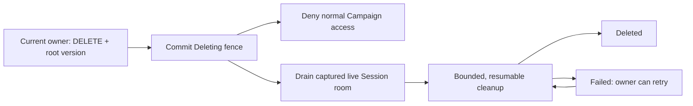

# ADR 0032: One Campaign deletion lifecycle

- **Status:** decision
- **Date:** 2026-09-23

## Context

Campaign history is uncapped. Deleting a populated Campaign in one Convex mutation can exceed its
transaction limit. Choosing an atomic path for small Campaigns and a background path for large ones
would give owners different behavior and require a size-dependent boundary.

## Decision

Use this lifecycle for every active or archived Campaign. The confirmed owner command validates
current ownership, ACTIVE OWNER membership, root version, and moderation restrictions, then commits
one deletion job. Normal product reads, writes, admission, and new live-room activation reject the
Campaign from that commit. The owner sees **Deleting** with progress or a recoverable failure;
unrelated Campaigns remain available. Confirmation and the public deletion result remain unchanged.

Keep the Campaign root, membership, assignments, and live projection while the captured Session room
drains committed SQLite outbox entries under its captured authority epoch. Trusted publication is
limited to that exact room, epoch, and job stage; it cannot admit new gameplay. Drain and release must
finish before Character reconciliation, root removal, and bounded child purging. Each continuation is
idempotent, checks its stored scope, and survives interruption. A failed continuation leaves the
Campaign inaccessible and permits an authorized owner retry. An initiating account disappearing
cannot restore access or strand already-authorized cleanup.
Control reaches existing room sockets asynchronously. An outage may delay their closure; commands
already committed under the captured epoch drain before authority releases.

## Consequences

User-visible deletion begins at the first transaction for Campaigns of every size. Physical cleanup
finishes later; **Deleting** and **Failed** are explicit states. This replaces the prior whole-Campaign
atomic cleanup guarantee. No partial Campaign becomes accessible. The existing Phase 8.2 case IDs,
scenarios, proof tiers, thresholds, and complete cleanup requirement remain unchanged. The P09
deletion proofs must be rerun for this changed contract before final-source release acceptance.
