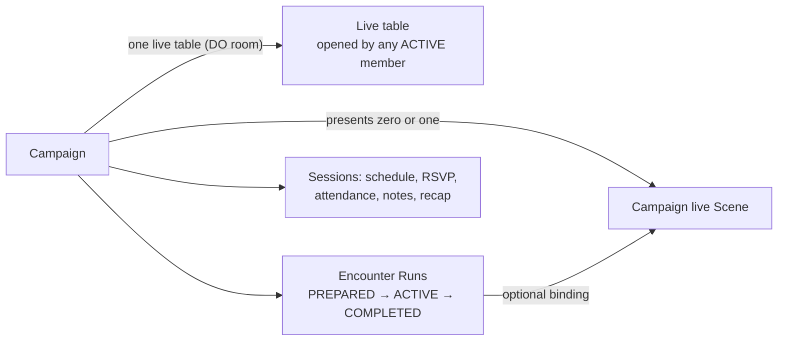

# ADR 0033: Campaign-owned play, implicit live table and Sessions as a log

- **Status:** decision (approved 2026-09-24; implemented locally 2026-09-24 — Convex, Worker and web; final-source R08 proof pending)
- **Date:** 2026-09-24
- **Revised:** 2026-09-29
- **Scope:** live-table admission and lifecycle, Scene presentation ownership, Encounter Run ownership and lifecycle, Campaign Session meaning
- **Update when:** live-table admission/lifecycle, presentation, Encounter Run ownership/status, or Session behavior changes
- **Supersedes:** Session presentation and the `Campaign → Session → …` dependency order in [ADR 0027](0027-campaign-scenes-and-encounter-bindings.md); Session-scoped room identity in [ADR 0029](0029-convex-backend-cutover.md) and [ADR 0020](0020-local-and-remote-live-session-host.md). All other decisions in those ADRs remain in force.

## Context

Before this decision, live play required an OPEN Campaign Session. The Session named the Durable
Object room, owned Scene presentation, gated every Encounter command and supplied the Encounter party
from its attendance. Finishing a Session closed the room but left its Encounter Runs untouched: an
ACTIVE Run in a finished Session could never be changed or completed, and because a Campaign could
have only one ACTIVE Run, it blocked every future START in that Campaign.

Tables stop mid-fight routinely. Comparable virtual tabletops (Foundry VTT, Roll20, Fantasy Grounds,
D&D Beyond) have no "run a session" step. The game is simply open, and combat is a persistent record
that resumes where it stopped. The product is pre-launch, so the user approved changing this model and
the affected Phase 8.2 acceptance cases now rather than after closed beta.

## Decision

- **One live table per Campaign.** The Session Durable Object room is named by Campaign. Any ACTIVE
  Campaign member may open the tabletop; ticket issue and authority claim require current membership
  and an ACTIVE Campaign, not an open Session. Command authority stays role-based (OWNER vs. PLAYER and
  token/Character control).
- **The room owns only what it executes.** While room authority is active, it is the single writer of
  the presented live Scene's committed state and of all Encounter commands. Editing other Scenes, and
  every other Campaign write, remains an ordinary Convex mutation. The campaign-wide direct-write fence
  narrows to the presented Scene.
- **Room lifecycle.** The room activates on the first admitted socket. When no socket has been admitted
  for five minutes, it drains its outbox and releases authority through the existing drain/release
  protocol. [ADR 0035](0035-room-authoritative-live-encounters.md) supersedes the outbox drain with an
  acknowledged final checkpoint when its authority switch lands. Campaign archive or deletion closes
  it. Membership removal and account deletion evict the exact user. Session finish does not affect it.
- **Campaign presentation.** The Campaign presents zero or one live Scene. Presentation survives
  reconnects, Encounter completion and Session finish.
- **Campaign-owned Encounter Runs.** Runs belong to the Campaign and may bind to one live Scene. A
  PREPARED Run may be deleted. START requires no other ACTIVE Run in the Campaign. An ACTIVE Run persists
  across sittings until COMPLETE. Runs carry no Session reference; any future per-sitting recap derives
  from timestamped command history rather than a stored tag.
- **Party at Run creation** comes from the Campaign's active Character assignments. The GM removes
  absent Characters before START with the existing actor-removal command.
- **Sessions become an optional log.** `OPEN`/`FINISHED` Sessions keep scheduling, RSVP, attendance,
  notes, references and recap. Finishing a Session changes no Run, presentation or room state.
- **Canonical dependency order** drops the Session:
  - Scene-only command: Campaign/member authority → Scene → Scene event.
  - Encounter-bound Scene command: Campaign/member authority → Encounter → Scene →
    binding/actor-token records → rule state/effects → Scene event and Encounter receipt.
  - Binding or presentation change: Campaign/member authority → Encounter when supplied → Scene →
    binding or presentation state.

## Consequences

- Session-keyed room identity, ticket claims, authority rows, presentations, live-rules revision
  scope and Encounter Run indexes move to Campaign keys, and every Session field they carried is
  removed. Stored development rows migrate through a bounded `@convex-dev/migrations` backfill
  (widen, migrate, narrow within the same change); no database reset is performed and no compatibility
  field remains. Runs stranded ACTIVE in a finished Session become resumable. Development Encounter
  decisions paused across the migration are cancelled rather than resealed.
- The tabletop route drops the Session number. The Session workspace keeps Prepare/Closeout as a log.
  Encounters are listed per Campaign.
- The technical name "live session" (`liveSessions/*`, `session-worker`) continues to mean the
  Campaign's live-table room. It no longer implies a Campaign Session. A rename is deferred to avoid
  churn across protocol, storage and test names.
- Phase 8.2 keeps its 75-case denominator. Cases P15, V05, V08, V09, V14 and F12 are amended to this
  contract, with the user's approval recorded in the acceptance ledger. Their prior evidence is
  historical, and they must pass again on the final source.
