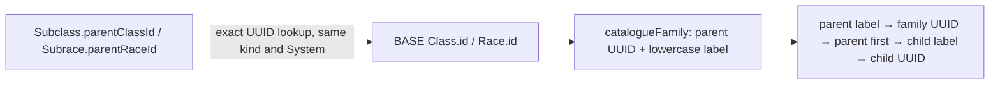

# Authoring Schemas and the authoring runtime

> Deletion-policy amendment, 2026-09-18: [ADR 0030](../adr/0030-owner-deletion-and-retained-dependencies.md)
> supersedes the published-child and Spell-reference deletion restrictions described below.
> A dependent owned by another user cannot veto deletion of the owner's source. Preserve and repair
> the dependent's content; ordinary publication/replacement/conversion guards remain separate.
> Native replacement cleanup preserves published children and linked Spells with server-only
> `catalogue.deletedReferences` source-kind/UUID/label provenance. Dependent documents, versions,
> compiled mechanics and working drafts stay unchanged; ordinary republication still validates a
> live selected parent/Class. Same-checksum catalogue backfill retains the labels. The complete owner
> deletion and retained-dependency lifecycle is accepted under F12 and ADR 0030.

> Status: canonical (current working-tree baseline)
>
> Scope: Authoring Schema contract, node-map DSL, registry, relationship execution, backend resolution, normalization, and presentation adapters
>
> Update when: node kinds, map IDs, condition/path semantics, runtime DTOs, or renderer behavior changes
>
> Verification: `packages/shared/src/utils/nodeDefinition.ts`, `packages/shared/src/domains/**/maps`, `packages/authoring/src/nodeRuntime`, `apps/apis/convex/authoring`, and `apps/web/src/forms`

An **Authoring Schema** describes the structure of authored content: which fields exist, their paths, labels, sections/steps, visibility/required rules, option sources, nested object/array groups, and narrow author-facing presentation intent. `NodeMap` is the current typed DSL and registry implementation of that contract. Product, API, and frontend architecture should use _Authoring Schema_ for the interface and reserve _node map_ for the low-level shared implementation.

Authoring Schemas are not a general character-rules language and do not contain React components, CSS classes, design tokens, or platform-specific geometry.

An authored mechanic is complete only when the same typed field is covered by the shared authored type and schema, its Authoring Schema node map, persistence/hydration, owned-ID replacement during copying, and compilation. Adding a value to the existing closed `CLOSED_RULE` discriminant does not create a new payload shape: the existing select node, schema enum, generic-outcome persistence, recursive exact-ID replacement, and compiler pass-through already cover it. A new field or outcome shape must update every boundary explicitly. New closed rule values are no longer added: per [ADR 0038](../adr/0038-rules-authored-from-core-options.md), a mechanic the node map cannot yet express gets a new generic option with an authoring-parity proof.

Line shapes author both length and width. Spell grants may author a casting ability independently from their source class so racial and other source-bound spells retain their SRD ability through compilation and character-level resolution.

Creature Spellcasting and Innate Spellcasting features reuse feature-owned spell grants for exact spell references, cast level, casting ability, at-will use, and limited-use charges. Creature-specific slot schedules and casting lifecycle are closed rule descriptors today (transitional: SPELLS-4 converts them to core options under ADR 0038); they do not justify a parallel creature-only spell model.

## DSL and registry

`buildNodeMap()` provides typed builders for strict `INPUT` and `GROUP` variants. Scalar inputs are `TEXT`, `NUMBER`, `RICH_TEXT`, or `TOGGLE`; select inputs are `SELECT_SINGLE`, `SELECT_NUMBER`, or `SELECT_MULTI` and require exactly one source. `SELECT_NUMBER` keeps numeric domain values while option codes remain serialized strings. Sources are explicitly discriminated as `INLINE_OPTIONS`, `INLINE_GROUPS`, `DATA`, or `LOCAL_COLLECTION`. `LOCAL_COLLECTION` reads value/label pairs from one bounded collection on the current authored root; it does not execute queries or accept expressions. Non-select inputs cannot declare a source. Object and array groups require a child map and accept only their own metadata.

The schema package exports the canonical authored limits used by all eight root contracts and their nested authored graphs. Node-runtime inputs carry only the corresponding text-length and numeric-bound metadata so web controls can mirror server validation with native bounds and the shared rich-text character counter. The server contracts remain authoritative for direct API clients.

Conditions are closed serializable trees: `PREDICATE`, `AND`, `OR`, and `NOT`. Database query evaluation additionally owns the internal `CONSTANT` result. IDs and paths are explicit so nested groups can refer to local, parent, or ancestor values. Hidden nodes declare `KEEP` or `CLEAR`; system-owned fields use explicit `authoring.exposure: 'system'` instead of path-name inference.

Every group declares structural presentation explicitly. Object groups support `inline` or `branch`. Array groups support `inline`, `table`, `summary`, `branch`, or `focused`:

- `inline` keeps a simple object or short repeatable value in the owning step.
- `table` presents homogeneous rows compactly for comparison.
- `summary` keeps a terminal collection scan-first and stages row add/edit in an overlay drawer.
- `branch` creates structure-rail hierarchy with independently navigable descendants.
- `focused` exposes a terminal collection through navigation while editing one selected row in the shared overlay.

A focused leaf renders its descendants inside the same editor; drawers never stack. The renderer does not infer these modes from map IDs, paths, or child shape.

### Authoring semantics

Authoring metadata carries product intent, never platform implementation:

- `actions` is an ordered list of closed `collection.add`, `collection.edit`, `collection.duplicate`, and `collection.remove` commands. Object groups accept only add/remove. Duplicate command types in one scope are invalid.
- Every action has a label and complete `default` appearance, with optional complete `compact` and `wide` overrides. Appearance uses typed display, emphasis, density, and width semantics; clients map them to controls.
- `ordering.mode: 'derived'` keeps resolver order and exposes no reorder control. `manual` requires a stable one-segment `identityPath`, optionally renumbers `orderPath`, and enables accessible drag/keyboard ordering.
- Collection semantics own item/empty labels, AND/OR joins, heading visibility, row layout/expansion, and a closed row-summary vocabulary.
- Group `appearance` may select responsive heading typography/tone and container surface recipes. It cannot contain CSS values, classes, Mantine props, raw font weights, colors, breakpoints, or native component names.

`compact`, `regular`, and `wide` describe available layout space, not device brands. Web derives them from the 760/900/992 contract; a future native adapter may derive them differently. Omitting an override always falls back to `default`.

```ts
authoring: {
  actions: [{
    type: 'collection.add',
    label: 'Add condition',
    presentation: {
      default: { display: 'text', emphasis: 'quiet', density: 'compact', width: 'content' },
      compact: { display: 'button', emphasis: 'primary', density: 'comfortable', width: 'full' }
    }
  }],
  appearance: {
    heading: { default: { style: 'heading', tone: 'primary' } },
    surface: { default: { role: 'panel' }, wide: { role: 'raised' } }
  }
}
```

Invalid examples include `presentation: 'focused-drawer'`, manual ordering without `identityPath`, a scalar input with options, a select input without a source, duplicate action types, `tone: '#ff9900'`, and any platform class or token path.

Grant lifecycle options on an effect (`path.ts`) are generic node-map options, not class rules: `endOnEvents`
(`ON_INCAPACITATED`; `ON_MOVE`, the holder's voluntary movement; `ON_TAKE_ACTION`, any action, bonus action or reaction the holder takes; `ON_IDLE_TURN`, the grant ends at the end of its holder's turn when the holder made no attack roll against a
hostile creature and took no damage since their previous turn), `endOnConditionIds` (a `condition_types` multi-select; the grant ends while its holder has any of them),
`holderEnd` (`{ activation }`, the holder may end it at that cost), `consumeOnFirstEvents`, `fromSourceOnly` (only the
effect's source meets its attacker grants and its attack consume) and `activeOnlyOnFinalAnchorTurn` (the timed effect is
dormant until its tick anchor's final counted turn and active only during it; SPELLS-4.T2k1). Modifier facets include
`TURN_MOVEMENT` (a facet predicate: the holder has moved at most `maxFeet`, or `maxSpeedFraction` of its speed, this turn; decided live from the Encounter's turn movement),
`ATTACK_ABILITY` / `ITEM_ATTACK_ABILITY` (gate a modifier on the ability an attack used), `ATTACK_ACTIVATION` / `ITEM_ACTIVATION` (gate it on the
activation the attack is made with, such as the bonus action of an off-hand attack; ATTACK-9.T5b) and the `SPELLCASTING_LOCK` `ENABLE`
domain (bars every spell cast) and the `ATTACK_DECOYS` `ENABLE` domain (an armor class and a threshold per decoys-left count, counted by the path lifecycle `uses`, with optional `exemptAttackerSenseDefinitionIds` for attackers that are unaffected; Mirror Image, SPELLS-4.T2k2), the `INCOMING_ATTACK_GATE` `ENABLE` domain (an attacker saving throw a creature must pass before a single-target attack or harmful spell targets the holder; SPELLS-4.T2k3), the `HEALING_RECEIVED` `ENABLE` domain (healing dice the holder receives take their maximum; Beacon of Hope, SPELLS-4.T2n1), the `HEALING_DEALT` `BONUS` domain (hit points the holder's spells restore beyond their own amount; the `addsSpellLevel` param also adds the cast level, a cantrip adds nothing; Disciple of Life, SPELLS-31.T4n), the `END_EVENT_EXEMPTION` `ENABLE` domain (`{ events, effectIds }`: the holder's own active effects with those authored ids no longer end on those lifecycle end events; Persistent Rage, SPELLS-31.T5f2). Rage (ATTACK-9.T1) is authored with these and has parity with the authoring form.

Maps live in `packages/shared/src/domains/{subjects,features,grants,effects,shared}/maps`. The authoring package's `mapRegistry` registers roots and recursively registers child maps by `mapId`. Duplicate IDs with conflicting signatures fail inventory validation; unknown IDs are `NodeRuntimeInputError`. Add-enabled child maps must have an exact web default factory—there is no generic `{ id, order }` fallback.

## Backend resolution

`@artificer-toolkit/authoring/nodeRuntime` owns the single resolver, normalizer, relationship
executor, registry, and trusted source manifest. It depends on `schema` and `shared`, never the
database or a client framework. Keeping this package separate avoids a `shared` → `schema` cycle.
`NodeRuntimeSourceReader` supplies trusted rows for a closed source key, columns, predicate, and
System UUID; it is not a client-provided query or a new rules language. Code-owned policy vocabulary
(`roll_influences`, `roll_modes`) comes in through the source reader: callers pass the System's lists to
`createNodeRuntimeSourceReader`, so this package still depends only on `schema` and `shared`.

`resolveNodeRuntime(sourceReader, request)`:

- loads the map by ID;
- turns map nodes into ordered steps and sections (with a default section when none is declared);
- evaluates visibility and required state against `values`, `parentValues`, and `ancestors`;
- executes relationship plans for data-backed options and inline filters, and resolves bounded
  `LOCAL_COLLECTION` options from the current authored root;
- serves `description` as the one option description (its tooltip), for both System vocabulary rows
  and shared code-list entries (`CoreMeta`). Every System vocabulary source in the node-runtime
  source manifest exposes `description`, and every node-map select on one selects it; there is no
  separate `tooltip` field on vocabulary records, code lists or the manifest. The web
  `AppSelect`/`AppMultiSelect` render a described option's text as a Mantine tooltip on the option;
- returns the root runtime DTO plus paths that should be cleared when hidden;
- recursively emits flat resolved scopes for every visible, populated nested object or array row, keyed by absolute path (an empty object whose child map is keyed by a System table still gets a scope);
- resolves each distinct scope once per request (RELIABILITY-21.T19). A scope's model is keyed by its map and the values its map's definitions read, so scopes that agree on those values share one model object, and the compact transport interns that object once. Invariant: a node map reads scope values only through `IdRef`-shaped refs (`{ from, up?, path }`, as conditions, relationship inputs and `where` values use) or `LOCAL_COLLECTION` sources. A new way to read a scope must be added to `collectScopeReads` in `nodeRuntimeService.ts`, or equal keys could share a wrong model.

The root and nested scopes are one authoritative resolution result. Rendering, structure-rail navigation, validation progress, and repair targeting consume those same scopes; production web code must not independently re-run the shared DSL. Step metadata may include an optional authored description, which the resolver preserves for platform-appropriate canvas guidance. This keeps parent/ancestor conditions and required state identical across every authoring surface while avoiding one request per nested branch.

`normalizeNodeRuntimeValues` resolves the same model, removes select values that are no longer visible/allowed, and clears hidden `CLEAR` paths. This keeps submitted values aligned with the resolved model before an authored save.

For interactive structural controls, the web normalizes prospective root values before committing the control change. If normalization would clear a populated path, the author must confirm the change-and-clear operation; cancellation leaves the aggregate unchanged. Empty hidden branches may be cleared without prompting. This preflight applies equally to nested and focused editors and replaces unconditional post-render clearing.

Multiple conditional controls may legitimately share an authored path when their option sources differ by branch. A hidden `CLEAR` node contributes a clear candidate only when no visible node in the resolved map owns that same path; the runtime deduplicates candidates by path before normalization. This prevents an inactive branch from erasing the active branch's value.

Current limitation: condition paths are `ShallowPath` (one field, `packages/shared/src/utils/nodeDefinition.ts`). They resolve from the current scope (`LOCAL`) or an enclosing one (`PARENT`, `ANCESTOR`), never from a child group. So a field cannot depend on a value inside a sibling group. For example, the Equipment effect `grip` stays always visible because its correct condition is the effect's own `invocation.triggerCode` (a child scope). A category proxy would be wrong, because gear such as acid vials, torches and spiked shields also has weapon attacks. The Equipment schema enforces grip per effect trigger on save. A bounded, typed child-scope reference is a candidate DSL extension to revisit after launch.

Placed zones (SPELLS-17, [ADR 0038](../adr/0038-rules-authored-from-core-options.md) parity): a `MANIFEST` `ZONE` `PLACED_SPACE` outcome authored through the Equipment `effects` node map is the same data an SRD record carries, so nothing in the compiler is specific to one item. The System runs it when it is one component with one behavior, a fixed save DC, one damage outcome, any `ON_SAVE_FAIL` stop-movement, and a point shape (`SPHERE`, `CYLINDER`, `CIRCLE` or a cube at a non-Self range); the DC, shape size and `bypassAtHalfSpeed` are free to vary. A directed shape (cone, line, Self cube), a second component, behavior or outcome, a non-fixed DC, an unmodeled field and an end event the System never reads (anything but `ON_HIT_POINTS_REGAINED`) compile as manual (`NOT_NORMALIZED`). `zoneAuthoringParity.test.ts` proves a variant zone survives `normalizeNodeRuntimeValues` unchanged and `encounterZonePlacementCompilation.test.ts` proves it compiles and plans like the SRD shape.

Relationship execution is in `relationshipExecutor.ts`; it evaluates table/column plans, local values, parent/ancestor references, filters, and stream transformations. The shared `schema/api/nodeRuntimeSources` contract owns the exact table-to-column pairs reachable from the 11 active roots, re-exported by `nodeRuntimeSourceManifest.ts`. Its parity test derives shipped `DATA` descriptors and fails if a schema adds or removes a source without updating the adapter boundary. Trust is pairwise—a column allowed for one table is not allowed for every table. Add new relationship behavior here rather than embedding ad-hoc queries in a route.

System-supplied vocabulary options (SPELLS-31.T5p, D175): a node whose codes belong to the Game System, not the platform (the spell slot pool `slotCost.poolCode`), reads a `DATA` source table (`spell_slot_pools`) that `systemCoreCodeRows` serves from the `coreCodes` the caller injects (`apps/apis/convex/authoring/systemSources.ts`, from the rules-runtime vocabulary registry). `packages/authoring` does not depend on `rules-runtime`.

Maps keyed by a System table (RULES-2.T9f3b, D193): a record keyed by System codes, such as a
Creature's `abilityScores` or a summoned stat block's `summonAbilityScores`, is declared with
`buildNodeMap().defineKeyed(mapId, { rows, entry })`. Its static `nodes` are empty and its registry
signature records the `rows` plan and `entry` contract. The resolver runs `rows` with the request's
`systemId` and emits one `entry` node per row, with the row's value as its id and path and the row's
label, in row order, so each System gets its own fields with no transport change. Normalization
clears a key that is not one of those rows, and refuses it at ingress when the table is a System
core-code table (`systemCoreCodeTables`). Only `requireAuthoredAbilities` (rules-runtime) requires a
score for every System ability. `keyedNodeMaps.test.ts` proves the expansion for a second System
and SRD parity.

## Frontend contract

The web `useResolvedNodeModel` hook calls `nodeRuntime.resolve`. The forms platform consumes the returned root model and absolute nested scopes, maps node paths to TanStack Form field names, renders controls through real `form.AppField` instances, and keeps object/array groups connected to one TanStack form. Simple inline leaf objects may use TanStack `withFieldGroup`; complex and repeatable groups continue to use their resolved scope and the same root form.

The web has no second resolver. Authoring stories and tests resolve node maps through the same
`resolveNodeRuntime` and `normalizeNodeRuntimeValues` over an in-memory reader built from the SRD
baseline (`apps/web/src/test/nodeRuntimeResolver.ts`). The reader is the one
`createNodeRuntimeSourceReader` factory the Convex source reader also uses (System vocabulary, sorted
reusable definitions, projected columns, System check); only the storage of authored rows and
reusable definitions differs, and the harness builds those rows through the production import
checksum and `authoredSourceFacts` path, so options match the server's. Test fixtures that need
scopes for a handcrafted model call the exported `resolveNestedRuntimeScopes`.
`FormArchitectureBoundaries.test.ts` fails if production web code imports
`@artificer-toolkit/authoring`, reintroduces a static resolved model, or imports `#test/` support;
the harness is a dev dependency under `src/test/` only. A form with `resolveModel: false` and no
provided `model` renders nothing instead of a locally computed copy.

The server emits scopes only for populated rows, so a group row added in the browser (or an object
group whose value is still `{}`) has no scope in the root model until the root re-resolves. A child
renderer without a scope resolves its own model (showing the loading state meanwhile) instead of
rendering blank.

Resolution failures remain inside the shared renderer: show a recoverable error and retry the existing query, preserve the owning TanStack form and unsaved values, and disable activation until resolution succeeds. Do not throw a resolver error through the route boundary or leave a failed query displayed as loading. Guided content remains available alongside the error.

The active step header is the canvas's single title owner. It displays the step label and its optional authored description; it never synthesizes guidance from child field labels. A same-named section or group suppresses its own heading, while genuinely distinct subsection labels remain visible beneath the step. This title-ownership rule is shared by desktop and compact authoring layouts.

Structured server-validation paths use the same navigation model. Each issue maps to the deepest target whose owned field paths contain the issue path, marks that rail target as an error, renders the message at the repairable target, and focuses that target after a failed authored mutation.

`branch` groups retain authored hierarchy in the structure rail so authors can jump directly through deep paths. A branch collection heading owns its overview target and remains a real destination when it has children; the rail does not synthesize a redundant `Overview` child. Its chevron controls expansion independently from navigation. Shared maps use semantic destinations such as Basics, Effects, Grants, and Features rather than a generic Mechanics bucket; charges and restrictions belong to the Basics step of their owning source. `summary` collections are staged terminal lists; `focused` additionally keeps the collection and row targets reachable through navigation. One selected row opens in the shared overlay editor, whose descendants remain inside that same editor rather than opening another drawer. Leaf editors overlay the workspace without resizing the canvas. Wide desktop keeps the structure and useful preview rails inline, while narrower contexts use drawers. Rail indentation is visually capped. Cancel restores the exact staged subtree and returns focus to the opener; explicit save commits it.

In an overlay structure rail, selecting a branch keeps the rail open so the author can traverse its children; selecting a leaf closes the rail and moves focus into the selected editor. When the original leaf control unmounts with the rail, cancellation restores focus to the equivalent canvas control.

Shared authoring navigation uses the inherited optional `?step=` search parameter. Rail entries and Back/Next controls are real links to the current record with only that parameter changed, so they remain navigable before hydration; hydrated navigation updates the URL without changing loader dependencies. `AuthoringFormProvider` resolves the URL against the current backend-produced navigation targets and commits the active target plus visit state together. Invalid or disappeared targets fall back to the normal target and replace the stale parameter. Authoring-step history entries carry internal router state so the root session loader does not revalidate for step-only navigation; normal route entries clear that state and retain the existing authentication refresh behavior. Because authored-domain targets do not exist until the node-runtime response is available, a direct target is retained from the URL and applied as soon as that authoritative model resolves rather than duplicating node-map logic in a route loader.

`FormRenderer.tsx` is the orchestration boundary, not the component library. It owns the active resolved scope, navigation target, validation/progress state, and shared renderer contexts. Input controls, object groups, array groups, collection overviews, leaf field groups, and the staged editor drawer live in focused renderer modules. Domain adapters provide defaults and item/object factories. They must not duplicate resolved-field wrappers, local nested forms, or local draft stores. Only top-level domain containers and isolated harnesses call `useAppForm`.

The renderer must use resolved semantics rather than child-map IDs for collection behavior, system-field visibility, labels, joins, row expansion/layout, action appearance, group typography/surfaces, or summaries. `authoringPresentationAdapter.ts` exhaustively maps portable semantics to Mantine and Vanilla Extract tokens; `collectionPresentation.ts` interprets collection content semantics; `collectionStyleMap.ts` maps row-layout intent to classes. Schemas never import those web modules. Exact domain defaults remain in `authoringNodeDefaultRegistry.ts`, separate from renderer behavior.

## Intent and boundaries

Authoring Schemas are the default for reusable authored roots and mechanics-bearing children, including
Creature content, spell details, grants, effects, equipment/loadouts, and starting equipment. Those
domains keep separate domain schemas; the web reuses mechanics-neutral controls, collection editors,
layout, and accessibility behavior rather than merging roots into one frontend-owned form model.

Character Builder currently uses explicit domain DTOs and services because its steps include build
intent, provenance, prerequisites, reconciliation, and play-state transitions. This current boundary
does not permit System-specific branching in React. As guided Character contracts mature, new
System-dependent step structure, choices, requirements, and guidance should be projected by the
backend through typed descriptors so the existing renderer can adopt them incrementally. This is a
convergence direction, not authorization for a Character rewrite or for treating Creature and
Character authoring as the same domain schema.

Current System vocabulary snapshots use version 4 for mechanics-bearing check definitions. A check
definition has its own UUID and a required governing-ability UUID-or-null value: a non-null UUID
references an ability in the same System snapshot, while null is authoritative abilityless semantics.
D&D's seeded checks use explicit non-null ability UUIDs. Optional-rule documents pin check UUIDs;
publication and Encounter admission resolve them server-side against the active System snapshot.
Codes, labels, and tooltips remain catalogue metadata and never select mechanics.

Starting-equipment option maps expose optional `eligibility` through the shared character-facet map. Authors can therefore express exact equipment proficiency, category-scoped equipment-property proficiency, and other supported character predicates without adding bespoke option fields. Builder evaluates the authored facet; node runtime only renders and normalizes it.

Facet condition arrays use the discriminated `facetCondition` map. `kind` selects either the property-predicate or related-subject (`EXISTS`) branch; both branches retain the authored flat payload shape, and every branch-only field uses `CLEAR` when hidden so changing the discriminant cannot retain stale payload. Generic facet contexts expose subject plus the corresponding `ALL`/`SELECTED` identity controls, while character-only facets use the narrowed character context map. Conditions inside `EXISTS.where` use the enclosing relation for the target subject and the `where` body for selected target IDs; the dedicated `facetBodyCondition` map preserves those two ancestor scopes through recursive nesting.

On a modifier grant, a Character context is evaluated for the Character, an Equipment context (identity, `EQUIPMENT_CATEGORY`, `EQUIPMENT_PROPERTY`, `SOLE_WIELDED_WEAPON`) is evaluated against the attacking item, a Spell context scopes the modifier to those spells' attack and damage rolls, and a Resource context scopes charge resets. `SOLE_WIELDED_WEAPON` holds when no other weapon is equipped beside the attacking item (a shield is not a weapon); Dueling uses it. Other subjects cannot be evaluated and fail closed; modifier grant validation rejects Spell contexts outside spell attack and damage. Creature damage defenses that hold only "from nonmagical attacks" are authored as typed `qualifiedDamageDefenses` entries (kind, damage types, bypassing attack traits), not as prose in the plain resistance and immunity lists.

Modifier grant validation also rejects kinds that no System consumer applies and the SRD does not use (S6g, 2026-09-25): `SAVE_DC` `SET_VALUE`, `PROFICIENCY_BONUS`, `CHARGE_LIMIT`, range, duration and shape changes, spell slot, known and prepared counts, and action and bonus action counts, plus `REACTION_COUNT` `BONUS`. `REACTION_COUNT` `SET_VALUE` stays authorable because SRD Shocking Grasp grants it through an `APPLY_GRANT` outcome (applied in Phase 8.3). An `ARMOR_CLASS` `SET_VALUE` is an armor class formula: `amount` plus each ability modifier in its required `abilities` list (Unarmored Defense is `10` with Dexterity and Constitution). Magic equipment bonuses are ordinary authored `+N` modifiers; Equipment has no maximum-bonus field.

The dnd5e Equipment builders (weapon attack effects; weapon ability, magic-bonus and armor Dexterity grants; the heavy armor Stealth disadvantage and Strength-requirement grants) live in `packages/shared` (`subjects/authored/dnd5eEquipmentBuilders.ts`, exported from `@artificer-toolkit/shared/authored`) and are the one definition shared by the SRD corpus and by imports. They take an `EquipmentChildId` (`(bucket, index, suffix?) => string`) and any System vocabulary ids as arguments and never resolve vocabulary themselves. `packages/source-data` binds the SRD's deterministic ids and vocabulary and must keep its serialized corpus byte-identical; `packages/authoring` binds fresh ids and the target System's vocabulary for custom imported Equipment.

Spell attack effects author their reach in the trigger, as weapon attacks do: `MELEE_SPELL_ATTACK` ("melee spell attack") or `RANGED_SPELL_ATTACK`. A passive rule that concerns every spell attack authors one effect per trigger.

## Historical Phase 8.2 implementation record

The dated progress statements below record how the native authoring cutover was built. Every
present-tense transition statement in this section describes its intermediate historical snapshot;
retired tRPC, SQL, Kysely, and Supabase paths are removed from the current tree. The DSL, ownership,
resolution, and frontend contracts above are canonical.

Phase 8.2's native `authoring/nodeRuntime.resolve` and `normalizeValues` are authenticated Convex
queries using shared request/result schemas. Native resolution uses the lossless compact transport
in `schema/api/nodeRuntimeTransport`: a response-local `nodes` table holds each distinct resolved
node once, root steps and the distinct scope `models` list node indexes in their sections, and
`scopes` pair every absolute path with its `modelIndex`. `compactNodeRuntimeResponse` is the only
producer and `expandNodeRuntimeResponse` the only consumer; response bytes are budgeted by the
seeded-Fighter test in `apps/apis/convex/authoring/nodeRuntime.test.ts` (RELIABILITY-21.T1).
The web query selector validates and expands these into the existing full renderer DTO; the
subscription cache retains the compact response. No populated scope is omitted, and models are
not cached across requests. At that intermediate point, the pure resolver and temporary SQL response
were unchanged; the SQL response path is now removed. Normalization is read-only: it does not
save a draft or authorize publication. The current Convex reader verifies the System document and
serves its vocabulary, same-System visible reusable definitions, and published authored references.
Content-source visibility is explicit: `PLATFORM` sources have no owner; `USER` sources belong
to the authenticated owner. Indexed reads select only platform sources and that owner's sources.
Published roots must agree with their source's System and ownership; private reference labels
use the same check as detail reads. Source selection does not itself publish or enable Campaign sharing.
Authored roots carry server-derived `authoringSources` tied to their document checksum: compact
root labels and resolver-reachable feature/option/grant/effect/ancestry relationships, including
Equipment categories/properties. These are read metadata, not independently editable domain records;
the reader uses indexed master/owner ranges, never other owners' roots or unpublished drafts.
Import derives these facts from the validated document; publication must update them atomically
with the current version. Stored facts carry `factsVersion`, the `AUTHORED_SOURCE_FACTS_VERSION`
of the derivation that produced them; bump it whenever `authoredSourceFacts` derives different
rows from the same document (a drift-guard test fails until it is bumped). Exact import replay
backfills missing facts and re-derives facts from an older or absent version after verifying the
unchanged root and version. Same-version facts that differ reject rather than overwrite.
Resolver reads reject a superseded version.

The internal `content/sourceMigrations:backfillAuthoringSources` uses the official migrations
component to process existing master and owned current roots one document per batch; it is also
the first step of `content/compilationMigration:run`. It validates source ownership, exact current
version, normalized document and checksum before filling absent metadata or re-deriving an older
version; same-version conflicting facts reject. It never rewrites authored content, UUIDs or versions.

Inline options are complete or fail: 100 caller-visible content sources and 500 definitions or visible
roots per subject kind, never silent truncation. Missing/stale facts or unsupported source keys
throw; normalization must not interpret a missing source as an empty list and erase
legitimate choices. Category/property filters use the existing relationship executor, without
inferring variant inheritance from labels or parent records.

The bounded current-definition decoder is shared with native Campaign settings discovery. Authoring
supplies its platform/owned sources; Campaign settings supplies only enabled same-System catalogue
sources. Sharing decoding never broadens either caller's source visibility. Campaign discovery uses
its existing compact policy/optional-rule DTO, not authoring node-query rows.

Guided Background and Class starting gear use `content/equipmentOptions.list`, a UUID/label projection of
the same authenticated Equipment source reader used by Advanced resolution. It accepts the exact
System UUID, never a caller-supplied owner or query plan, and retains the same completeness bounds
and checksum checks. The web selector skips missing Systems and disables pending/failed reads;
it does not fall back to a legacy catalogue or change the authored equipment structure.
Guided Equipment uses the same query with optional `excludeVariants: true` for its base-item
picker, preserving that Guided-only restriction. Other callers omit the flag and retain all
visible Equipment; Advanced variant parent resolution is unchanged. Filtering does not relax
the complete-source bounds or checksum checks.
Guided Class parent choices select the native root model's `parentClassId` options with the
SUBCLASS branch active. The shared node map owns the BASE-only rule; the same source reader owns
System/visibility restrictions. No duplicate catalogue filter or new parent-choice contract is added.

Guided Background, Class, Equipment and Feat existing-source choices read the ADR 0036 `list`
snapshot parts through `useContentCatalogue`, scoped to the session System and to the master or
owned source. The hook loads lazily (`enabled`) and reads the whole visible list, so local search
keeps the complete-options behavior. Missing System, failed loading or a source
removed by a reactive update cannot trigger a copy. The existing duplicate command reads only the
validated published document of a readable master or owned homebrew root, uses the shared UUID
clone operation and assigns the authenticated owner to a fresh draft. Working edits are not a
copy source and the original publication/draft remain unchanged. Other domains' picker transports
remain transitional; this picker does not change the separate catalogue page's search behavior.

Guided/Advanced mode switches share the existing account-preference write guard. While a choice
is saving, Advanced disables its switch and Guided receives no `onAdvanced` callback; the shared
Guided frame disables that control across every domain and the starting-point screen. Availability
is derived from the pending write, with no additional mode state or queued preference changes.

The web Background, Class, Equipment and Feat roots now select native Convex transport for both resolution and prospective
normalization, using the current provider client and the existing shared request/result contracts.
No native-client failure falls back to legacy data. Copy-insensitive debouncing, placeholder
clear-path suppression, request ordering and confirmation fingerprints remain frontend safeguards;
the backend still owns option and normalization decisions. At that intermediate point, other root
maps retained legacy transport and SQL services adapted the same extracted resolver. Those legacy
transport and SQL adapter paths are removed; all eight current root maps use native resolution and
normalization. This transition did not create a second frontend resolver.

Native Background/Class/Equipment/Feat publication consumes the saved draft and its server `updatedAt` token.
The approved naming rule permits duplicate draft labels but requires owned active labels to be
unique per user, System and authored domain; subclasses use their parent Class UUID as an additional
scope. An edit excludes only its own active UUID, not another active item. Master/SRD labels and
other users' labels are separate namespaces. Comparison currently assumes `label.trim().toLowerCase()`;
display labels are preserved, with no accent folding or internal-whitespace normalization.
The [2026-09-06 clarification](../adr/0025-game-system-catalogues-and-encounter-blueprints.md#character-content-choice-clarification--2026-09-06)
defines that owned namespace as the user's Homebrew catalogue within the System, not a restriction
across official catalogues. Homebrew is independent of official editions and has no based-on-edition
key. The current single Homebrew collection per owner/System therefore retains this uniqueness check;
equivalent names across official catalogues or other creators do not collide with it. Choice identity
is always the authored UUID; catalogue/creator presentation must distinguish equivalent labels.
The local native implementation checks this indexed range in the final commit mutation, including
Class action commits, and writes the derived `activeNameKey` atomically with the publication.
Draft saves remain unrestricted and conflicts preserve the saved draft with an actionable form error.
The key is optional during cutover: other unindexed owned roots in that System/domain block activation.
An internal two-root name-only backfill validates the current source/document, Class parent
projection and readable BASE parent before adding missing keys. It uses the existing catalogue-name index for stable cursors,
does not modify catalogue counters, and never renames or deletes existing duplicates; those need
owner resolution. A sole unindexed active root may be edited to populate its own key. These are local
implementation rules, not managed-backfill or concurrency acceptance; unported domains remain target work.
Saves advance that token even within the same millisecond. Publication checks draft ownership,
System/source coherence and the draft's base published checksum. Background, Equipment and Feat run the existing domain
schema, normalizer and shared compiler in its mutation. Class runs pure normalization/compilation in
an action to fit Convex's CPU limits, using internal queries for trusted source rows. The action
fingerprints each complete manifest-column table result before adding current-draft facts; its
internal commit re-reads those tables through one source reader and rejects changed fingerprints.
This gives normalization a coherent source snapshot at commit and keeps subsequent source changes
inside Convex OCC, without repeating the expensive traversal or persisting preparation state.
Publication creates/reuses the existing convention
of one default USER content source per owner/System. Current authored content, checksum-bound
compilation and draft deletion commit atomically. Replacing a publication removes its former
internal current-version record; no source-history or consumer-upgrade API is introduced.
The local Spell publication branch now reuses that mutation and compiler, preserving authored
Class UUIDs and copied nested mechanics. Canonical Prismatic Wall has 22 JSON levels. The approved
request policy separates the generic 25-level JSON-depth guard
from the unchanged 20-level facet limit, which counts nested `where` relations rather than JSON
structure. Node-runtime values, parent values, ancestor values, and portable import data use the
generic limit; ancestor context lists are also bounded at 25. A data root starts at depth zero and
each object-property or array-element edge adds one. Existing byte, array, and portable-node bounds
remain unchanged. This does not alter Convex document limits or the lossless JSON storage encoding.
Canonical Spell import uses the same pure compiler as publication and stores checksum-bound
compilation beside its unchanged document. Exact replay adds only missing compilation, rejects
conflicting evidence atomically, and read-back auditing verifies the complete compilation. This
import path does not invoke form normalization or relax the request guard. Publication, import and
exact replay also maintain strict root catalogue metadata for level, verified magic school, sorted
unique Class UUIDs and casting time. Missing or stale Spell metadata, System school identity, or
readable same-System Class identity fails closed.
Native Class deletion preserves the former SQL foreign-key restriction semantically:
`authoredSpellClasses` indexes each published Spell/Class pair by both UUIDs. The shared catalogue
publication/import transaction replaces those pairs, and active Spell deletion removes them while
retaining any working draft. The root's optional `spellClassesIndexed: true` marker covers empty
Class lists too. Exact canonical replay and the existing paged catalogue backfill populate missing
markers and pairs from validated immutable documents. Class deletion rejects while any Spell in its
System lacks that marker, then uses the Class index to reject a surviving reference before writing.
Concurrent Spell publication and Class deletion therefore conflict on the same indexed range.
Removing a Class never silently edits a Spell document. This local correction requires backfill and
managed proof before C04 can be accepted again.
Spell web form/detail/edit, publication/copy/delete/discard, artwork and portable export now reuse
the native authored adapters locally. Public aliases resolve natively, while mutations retain UUIDs.
Separate active/draft subscriptions supply current reader metadata; Guided copy uses exact-System
catalogue pages. The Product Library route uses native catalogue pages, Class/level/school filters,
name/level/school ordering and current Class/System labels. All eight root maps now use native
resolution and prospective normalization.
Nested maps also use these native queries. Legacy resolver/normalizer fallback branches and the
resolver's legacy client argument are retired after explicit conditional approval and verification
of the existing native child-map implementation. A native failure cannot switch transports or
commit unchecked form changes. Builder/preparation consumers, managed behavior and release proof
remain in their owning acceptance cases.
The local Vehicle publication branch uses the same mutation, full Vehicle schema and source-only
compiler. Fractional speed, optional weight independently of cost, zero-valued stats and nested
features remain authored intent; no Vehicle parent index or extra publication table is introduced.
Character/Campaign Vehicle instances still own separate play state and custody. Local Vehicle
detail/edit routes now read native DTOs by public alias and retain UUIDs for mutations; active and
draft views use separate queries, with reactive detail subscriptions. The existing form session,
detail/list actions, node-map resolution and Guided exact-System copy picker use native operations. Publication saves
first and forwards the server's draft timestamp. Vehicle artwork uses shared native draft/active
bindings and R2 processing; owned active/draft portable export uses the same native export query.
Neither path falls back to legacy transport. Catalogue-page reads also use native indexes.
Canonical Vehicle import now stores the same checksum-bound compilation, with exact replay/backfill
and audit; instance consumers, managed backfill/execution and full lifecycle proof remain open.
The local Creature publication branch also uses the full Creature schema and source-only compiler.
Copying remaps owned feature/loadout IDs and their action bindings, while external Equipment and
Spell UUIDs remain references. Feature-owned spell grants retain casting ability and charges;
category-specific profiles follow the existing node-map visibility/clearing rules. This does not
move Encounter/Character play-state ownership or introduce a Creature-only casting model.
The four defense arrays accept bounded authored text as well as vocabulary IDs; their shared
selectors preserve unknown values so publication does not erase canonical conditional prose or
named immunities. This does not relax Equipment/Spell reference selectors.
Creature web detail/edit reads and form/detail/list mutations now reuse native authored adapters
locally. Public aliases resolve through native detail queries, while writes retain subject UUIDs.
The reactive detail response owns the six reader metadata collections; routes do not retain a
separate reference snapshot. Node resolution, Guided exact-System copy, draft/active artwork and
owned portable export use the shared native paths. Catalogue-page reads now use native indexes.
Canonical Creature import stores the same checksum-bound compilation; exact replay fills only
missing compilation and rejects conflicting evidence atomically. Source documents, UUIDs, versions,
timestamps and catalogue data remain unchanged. Encounter/Character consumers, managed backfill/execution
and full lifecycle proof remain open.
The shared structural-change guard also routes prospective Race, Vehicle and Creature normalization
through native queries and validates the shared response before committing or clearing form values.
Missing clients, errors and stale results cannot fall back to the legacy normalizer.
Canonical imports for all eight authored domains use the shared compiler and audit/backfill only exact
missing compilation. Class preparation remains in its action; Equipment and Race compilation follows
parent import. The mechanics audit index is checked but not persisted. Class publication/import
requires a current, readable BASE parent in the same System for each SUBCLASS; self-parenting
is forbidden. The root's optional `parentClassId` stores null for BASE and the parent UUID for
SUBCLASS, indexed by `(systemId, subjectKind, parentClassId)`. Exact canonical replay backfills
missing parent metadata and compilation without changing source documents. Deletion and conversion
to SUBCLASS reject if published children exist or same-System Class metadata is still unbackfilled.
Parent/dependency checks and writes share the commit mutation, so concurrent child publication cannot bypass the guard.
Race uses the same current-parent contract for BASE/SUBRACE, with `parentRaceId` null for BASE or
the parent UUID for SUBRACE and an index on `(systemId, subjectKind, parentRaceId)`. Publication
fails closed while same-System Race parent metadata is missing. BASE replacement atomically
recompiles published children and refreshes their catalogue family keys; their source documents, current-version IDs, checksums and working
drafts remain unchanged. Invalid or foreign-owned dependents roll back the parent mutation, and a
dependent whose stored document fails the current schema is named. The seed passes `importSubjects`
the changed subjects a later batch replaces (`reimportedSubjectIds`); a Race or Equipment parent
replace leaves those dependents to their own import, which compiles them against the current parent.
The family limit is 500 records including the BASE; SUBRACE admission reads the sibling index in
the publication transaction and excludes itself on replacement. Published children block BASE
deletion and conversion to SUBRACE. Internal canonical `raceRelationships.syncDerived` fills only
missing parent metadata/compilation and family keys and rejects conflicts. Import now records exact
Race parent UUIDs and selection-mode metadata; seed runs the derived pass BASE before SUBRACE,
and audit checks current-parent compilation and family keys. This local wiring has not been deployed.
Race web detail/edit reads, form and
catalogue actions, node-map resolution, artwork and portable active/draft export use the shared native
adapters. Guided copy and BASE-parent choices use the exact-System paginated native catalogue;
parent choices exclude the current Race. Detail inheritance follows the selected active/draft source
and subscribes to its current readable same-System BASE parent. Catalogue-page reads use native
family ordering, parent hierarchy and Playable metadata. Actual managed
transaction proof and full lifecycle acceptance remain open; no source history or consumer pins are introduced.
Equipment variants resolve their complete current, readable same-System parent chain with the shared
Equipment resolver. The root's optional `parentEquipmentId` is null for a base and the parent UUID for
a variant, indexed by `(systemId, subjectKind, parentEquipmentId)`. Canonical import first records exact
parent metadata; a second per-Equipment pass compiles after all parent roots exist, concurrently
within the existing bounded import batches. Replay only backfills
missing evidence and rejects conflicting metadata or compilation. Publication fails closed while parent
metadata is incomplete. Parent publication and descendant recompilation share one mutation: cycles,
unreadable parents or invalid descendants roll back the entire change. Derived compilation updates do
not replace descendant source documents, checksums, timestamps or working drafts. Parent deletion
rejects published variants. Chains and descendant traversal use the existing 500-item inline authoring
ceiling and fail rather than truncate. This is current-source behavior, not source history or consumer pins.
Equipment detail/edit reads resolve UUIDs and public aliases directly through native detail queries;
active and draft views remain distinct. The detail response can request referenced classes,
currencies, Equipment, heritages and rarities. Class/heritage restriction labels come from the
authored restrictions, not an unbounded catalogue read; private, wrong-kind and cross-System
class labels are omitted. Reactive detail reads keep labels and draft state current. The editor
preserves its existing parent preview and uses the saved draft's System when an invalid payload
cannot yet be parsed. Equipment form/detail/list actions, artwork and portable export use native
operations; catalogue-page reads use native category browse and ranked search. Managed performance and complete lifecycle
proof are still required.
Background/Class/Equipment/Feat/Vehicle web authoring is native; catalogue-page semantics, other publication
domains and dependent Character/Campaign reconciliation remain transitional. The Background/Class
browser lifecycle is verified separately in the Phase 8.2 acceptance ledger, not accepted by this slice.

The local native catalogue summary aggregates master and authenticated-owner memberships across
Systems; callers cannot select another owner or a System. Source/category filters affect only the
matching total, not the visible master/owned totals or category facets. Stored owner memberships
require positive safe counts, strictly ordered unique category buckets, and a category-count sum
no greater than the root count (each root has at most one category). Reads and metadata updates
validate this shared contract and fail on incomplete membership backfill or corrupt counts.
Canonical replay and the bounded internal `catalogueSearchBackfill.backfill` add missing search
or owner-membership markers only after verifying all existing metadata. Membership and source
counts update in the same root transaction; retries do not recount marked roots. An owner
aggregate must exist exactly when at least one root in that owner/domain range is marked;
missing/orphan aggregates and unsafe counter increments fail rather than rebuilding totals.
This is local implementation evidence only; executed backfill and managed acceptance remain
incomplete. All eight authored-domain catalogue pages consume these native summary totals locally.
Spell summaries additionally scan at most 500 visible active roots per owner to return current
Class and magic-school labels, level facets, and the exact filtered total. Facets describe the
complete visible Spell catalogue independently of the selected source or Spell filters; a larger
owner catalogue fails with an explicit error until its facets are materialized.

The eight authored-content list pages no longer call Convex for rows, search or summary. They read
the ADR 0036 `list` snapshot parts and search and filter in the browser
([persistence](persistence.md#authored-content-list-snapshots-adr-0036-s11)),
so a page view reads 0 Convex documents beyond the catalogue manifest. `content/catalogue:list`,
`search` and `summary` were deleted; before that, a Class page read about 0.9 MB, a Spell page
0.48 MB and the Spell summary 1.5 MB (37 MB before the per-query read memo).
`catalogueReadBudget.test.ts` now bounds the manifest and `counts` reads. The paragraphs below
about the catalogue projection (metadata, counters, search text and the ranked Spell summary)
describe the retained projection, which only `counts`, the Campaign and Character option readers and
the development drivers still read; its deletion is a follow-up.

Native catalogue query endpoints read checksum-bound summary metadata on the
published root, not full authored documents or compiled mechanics. Import and publication update
that metadata and per-source/domain counts in the same mutation. Replacement does not recount a
root; exact canonical replay backfills missing metadata once and rejects conflicts. The seed audit
also compares counts to the complete canonical manifest. List/count queries reject partial backfills.
Lists select at most two domain/owner index ranges (master plus the authenticated owner),
validate exact visible content-source identity, and merge by lowercase label plus public UUID.
Catalogue and reusable-definition streams obtain index metadata from `content/schema`'s
`contentSchema`, built from the same `contentTables` objects as the deployed schema. Their database
reader view in `content/streams` forwards the real reader methods so TypeScript checks that subset
without assertions; queries retain their existing authority checks and indexes. Class relationship index guards live in
`content/classRelationshipIndex`, keeping catalogue reads independent of authored Class validation.
An optional `systemId` selects the existing exact-System index for Guided choices; omitting it
selects `by_kind_owner_name_id` across visible Systems without changing ownership or ordering.
Equipment, Creature and Vehicle category browsing uses category/name/UUID owner indexes, with
an exact-System variant for scoped callers. Category equality is applied in the index before
pagination; category sorting merges by category, lowercase label and UUID. With a selected
category, name and category sorting both reduce to lowercase label and UUID. These indexes use
existing metadata and require no new authored fields or category backfill. Unsupported
Background/Feat/Spell category browse requests are rejected. Class and Race catalogue pages request
explicit `sort: 'family'`. Guided pickers retain the
existing ordinary name sort. Family sorting is not accepted for other subjects until their
native family projection is implemented.

Spell browsing uses global and exact-System owner indexes for level and lowercase magic-school
ordering. Class, level and school predicates run on the merged stream before pagination, so a page
never filters after choosing its cursor boundary. Each returned row resolves Class labels from
current readable same-System roots and the school label from the current verified System document;
the stored UUIDs remain filter identity and stale labels cannot silently become catalogue data.



UUID defines membership and keeps same-named parents distinct. Labels only order the parent
groups and their siblings. `catalogueFamily` is separate derived read data, not an authored
relationship. Global and exact-System family indexes also have category-filtered variants so
scope and category are selected before merging/pagination. Family queries reject missing keys
within the selected range and verify each returned row's key against its current UUID parent;
they do not scan unreturned rows for out-of-band corruption. Ordinary name/category queries
remain independent of this backfill. Exact Class and Race
canonical replay and bounded catalogue backfill populate missing keys without changing authored
documents and reject conflicting existing keys. Canonical audits check the derived family key.
Class publication atomically updates its key and refreshes subclass keys when the parent label
changes; subclass UUID references, source documents, versions, timestamps and drafts stay unchanged.
Race publication writes its root key and refreshes subrace keys inside the existing child
recompilation transaction. Subrace source identities and working drafts remain unchanged; only
the already-owned inherited compilation and family ordering key change. The catalogue's optional
`selectionMode` comes from the validated BASE Race source; SUBRACE rows are always playable.
Exact metadata backfill fills missing selection mode without changing authored data or recounting
the root and rejects conflicts. Race reads require BASE selection metadata and never read full
authored documents just to render a list badge.
The user-approved 500-record Class family limit includes the parent and is enforced by indexed
child admission in the final publication transaction. Parent refresh rejects missing relationship
metadata, excessive fan-out or invalid dependents and rolls back the complete publication.
Metadata readiness is checked within the same selected ranges, before pagination. Exact-System
counts still require a System; global summary totals use the separate owner-membership contract.
Pagination has both row and byte limits. Guided catalogue consumers use the installed
convex-helpers pagination hook to preserve `endCursor`; the standard Convex hook does not pin
stream-query boundaries. Drafts use the standard hook because their endpoint uses native database
pagination, and remain a separate owner-only summary feed.
All eight authored-domain browsers use five live native page ranges, retain only cursor boundaries
for backward reload, and share zero-GC query options between SSR preloads and browser subscriptions.
A currently displayed range is a temporary placeholder while its fixed-boundary read arrives;
that placeholder is released when the query settles. Required splits preserve the original range
end, including an unread tail beyond a truncated continuation. The list restores the visible row
and its within-row offset before refreshing the anchor, and waits for the virtualizer's scroll
event before auto-paging again. Draft summaries finish their separate bounded pagination before
the existing complete-count/local-filter panel is shown; active browsing remains usable meanwhile.
Other catalogue adapters, search deployment/backfill verification and complete-domain acceptance
remain migration work; these local changes do not claim the old catalogue contract is fully replaced.
The user-approved catalogue search target (2026-09-04) is Convex-native word/prefix matching,
replacing legacy substring matching across labels, descriptions, and domain search metadata.
Typed search uses separate native-ranked SRD and Homebrew result groups with loaded-result counts,
not custom sorting or an exact match total. Each group is scoped to its authorized owner/source
inside the search index before pagination. Normal browsing retains its sorting, exact totals,
filters and navigation. This approved search behavior is not implementation or acceptance proof.

The local search implementation now covers Background, Class, Equipment, and Feat. Its root
projection uses one optional `catalogue.search` object containing both `version: 1` and `text`;
the database schema rejects a partial ready marker. Search readiness checks the small version
index, while ordinary list/count readiness remains independent of search backfill. The bounded
internal backfill validates the current document, source/owner, route, and exact existing metadata
before adding search data; it processes at most two roots per page to leave read headroom for
Class parent/version validation, and does not recount an existing projection. Class lineage must already
match the current Class document and reference a readable BASE Class. Missing parent projections
require the existing canonical replay, not repair by search backfill.

The web search branch reuses list rows/actions and displays independently paged SRD/Homebrew
groups in one scrolling results region. It keeps only the current result page per group and
cursor history for backward navigation. Draft filtering remains local. Background, Feat,
Equipment, Creature and Vehicle unsearched browsing/counts use native queries; other domains
retain transitional browse adapters. Category and sort changes discard previous browse cursor
history. Native category summaries supply filter options, and the same existing domain category
formatters render active and draft rows. Typed search remains relevance-ranked, independently of
the ordinary browse sort control.
Local unit/fixture checks are not
managed search-index or complete-domain acceptance evidence.

The web workspace contains a static resolver only for deterministic stories and tests, and it emits the same absolute nested-scope shape. Production rendering, navigation, and progress consume API-resolved Authoring Schema DTOs. Architecture tests prevent production navigation/progress from importing the static resolver. When a schema changes, update backend resolution tests and renderer tests covering visibility, option filtering, hidden clearing, presentation, and nested groups.
