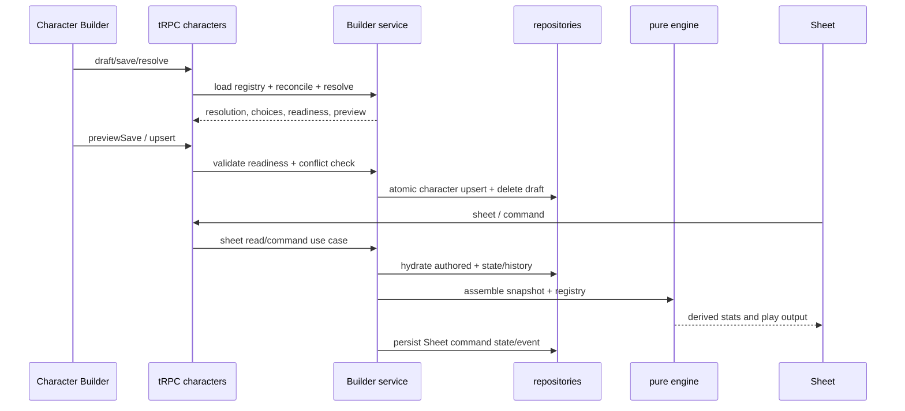

# Character Builder, Sheet, and engine flow

> Status: canonical (current working-tree baseline)
>
> Scope: character intent, draft lifecycle, reconciliation, preview/commit, snapshots, engine, Sheet commands, and history
>
> Update when: Builder DTOs, provenance rules, commit conflict checks, snapshot assembly, Sheet commands, or character persistence changes
>
> Verification: `apps/apis/src/routes/characters.ts`, `packages/functions/src/services/character/characterApplicationService.ts`, `builderService.ts`, `sheetService.ts`, `packages/db/src/domains/subjects/upserts/character.ts`, and character schema/tests

Characters are playable aggregates, not generic authored-content forms. Builder owns structural character changes; Sheet owns play-state interaction. Both use shared authored models, repositories, compiled content, and engine primitives, but their workflows and contracts remain separate.

## Builder draft and intent

`characters.draft` creates or reopens a `character_builder_drafts` record. Draft payloads contain the authored character plus optional builder-intent cache. `saveDraft` persists the draft as draft status; it does not finalize the active character. Route IDs can be public IDs, resolved to subject IDs by the route-identity repository.

Builder intent is explicit: race/subrace/ancestry, classes/subclasses/specializations, background, abilities, hit points, starting-equipment decisions, feature acquisitions, chosen grant selections, spell selections, and resource grants. Every hit-point level records character level, class identity, and class level so interleaved multiclass acquisition order remains structural rather than inferred from grouped class totals. Before a character first becomes active, reconciliation initializes current hit points from that ordered progression. Later Builder edits preserve an active character's live current-hit-point state; subsequent healing, damage, overrides, and rest recovery remain Sheet-owned commands. Provenance identifies the source (race, class, feature, option, manual, etc.) and timing identifies when it becomes available. Starting-equipment decisions establish progression-owned grants; runtime inventory ownership and management belong to Sheet state after play begins.

## Reconciliation and resolution

`reconcileCharacterBuilderCharacter` removes or preserves dependent selections based on provenance validity. Standalone calls load the current resolution registry, while preview/commit loads that registry once and supplies the same immutable snapshot to reconciliation and resolution. It clears obsolete starting-equipment selections, filters ancestry/feature/chosen-grant/spell/resource records that no longer match the current build, and merges required class resource grants. Starting-equipment options may carry a reusable character eligibility facet. Builder evaluates those facets from the equipment-free structural snapshot after grants and chosen proficiencies resolve, removes ineligible options from the returned selected class/background definition, and clears stale option/item decisions before preview or commit.

Selecting a subrace retains grants from both the base race and the subrace. Ancestry resolves from the selected subrace when it defines one, otherwise from the base race. Root class grant choices are acquired at class level 1; root subclass grant choices are acquired at the owning class's subclass-selection level, while their active level still tracks current class progression.

While an incomplete draft has no selected class levels, selected non-class sources are evaluated at effective character level 1 so ordinary race, background, feat, equipment, and ancestry choices remain authorable. Explicit level 2 or later unlocks remain gated, and class features always require the actual owning class level.

`resolveCharacterBuilder` derives summary, granted features/resources/spellcasting, outstanding required choices, blocking/warning validations, readiness, and a recommended section. It does not persist. UI uses this result for choices and progress; the final commit repeats the work server-side.

Multiclass prerequisites use one shared pure evaluator. The first selected class is not prerequisite-gated. Adding or replacing a class in a multiclass proposal requires all six ability scores and evaluates every class in that proposed set; server validation applies the same rule to crafted intent. Builder references expose structured class requirement groups, system alignment and lifestyle vocabularies, and canonical ability, advancement, ability-generation, hit-point, Standard Array, and Point Buy option metadata. Clients derive only contextual presentation such as a slot-relative Point Buy delta from those references; they do not maintain separate ruleset labels or costs. Selected-class presentation combines existing eligible feature, resource, and spellcasting grant summaries without adding acquisitions, and spell options expose authored level, school, ritual, and concentration metadata when available.

Builder presentation enriches authored references without mutating canonical intent: backgrounds provide descriptions, feature labels, and grouped authored detail rows; ancestry options provide feature previews; granted feature summaries provide ordered authored details; and starting-equipment views provide server-generated choice labels from authored filters and canonical equipment metadata. Redundant proficiency and cross-source spell candidates remain visible but disabled with their existing source label. Resolver eligibility and validation remain the authority for whether a crafted selection is accepted.

The web Builder applies backend-supplied ancestry previews synchronously from the active form value while authoritative resolution proceeds asynchronously. Resolution requests are sequence-guarded so stale responses cannot replace newer intent, and `aria-busy` clears when the latest request settles. Development builds record User Timing marks for intent, optimistic preview commit, and authoritative reconciliation; these marks are diagnostics, not production telemetry.

Selected-class grant summaries carry availability and authored presentation order and are normalized by the Builder service before reaching clients. Background references are compact, derived summaries with capped grant facts and feature labels; the selected background retains the full authored description and details. These are response projections only and do not extend canonical character intent.

Builder progress is visit-aware UI state. The rail counts only visible workflow steps; a step contributes to completion after it has been visited and its current requirements are satisfied. Unvisited requirement-free steps remain neutral, and later invalidation removes a visited step from the completed count. Resolver warnings and blocking validations are issues; unfinished steps are represented by progress rather than being relabeled as warnings.

Proficiency eligibility is a mechanical Builder rule, not an authored facet. Fixed and chosen grants from every active source contribute to the effective level for each target. Half proficiency requires a target below half, full proficiency requires a target below full, and Expertise requires existing full proficiency while rejecting an already doubled target. Ineligible options remain present and disabled with a repair reason, and the resolver emits blocking `REDUNDANT_PROFICIENCY_SELECTION` or `EXPERTISE_REQUIRES_PROFICIENCY` validation for stale or crafted selections. Selected-class DTOs group granted labels, player-facing choice instructions, and top-level choice IDs into proficiency categories; feature-owned choices remain attached to their owning feature. These presentation groups are derived and are not persisted character intent.

Builder registry catalog reads must scale with relation shape, not the number of authored roots. Spell, background, feat, race, and class repositories therefore hydrate `findAll`/`findByIds` root rows and owned link rows in sets, while single-record reads delegate to the same canonical batch assembly path. Nested aggregate repositories retain their own loading contracts; measure those separately before broadening the batch boundary. Race resolved-list hydration batch-loads missing parent lineage by depth. Do not reintroduce per-record root hydration loops or process-wide registry caches; homebrew ownership and publication changes require request-current data unless a separately designed invalidation contract exists.

## Preview, commit, and conflicts

`previewSave` reconciles and resolves a proposed authored character, predicts status changes and destructive removals, and returns a change preview. It is safe to display before commit.

`upsert` requires readiness, locks the active row, checks the draft’s `baseActiveUpdatedAt` (and stream version where supplied), then calls the repository aggregate upsert. On success it ensures route identity, deletes the builder draft, and returns the persisted character/resolution. A stale active row becomes `CharacterBuilderDraftConflictError`/tRPC `CONFLICT`.

The repository upsert is replacement-based and transactional; omitted child state is removed. See [persistence](persistence.md).

## Snapshot, Sheet, and history

The Sheet path only serves active characters. It hydrates authored character/state, resolves Builder content for labels/choices, assembles a `CharacterBuildSnapshot` containing both automatic structural features and explicit acquisitions, loads a compiled registry, and runs the pure engine before projecting the `CharacterSheetResponseDto`.

Character content selections currently store stable authored-definition IDs and resolve against `ACTIVE` content. Equipment engine inputs record that policy explicitly with `ContentRef` and embed the compiled item; race, class, background, feature, feat, and spell records are supplied through the compiled assembly registry from their raw stable IDs. Persisted revision pinning is target work that requires explicit character DTO/persistence bindings and revision-aware registry loading.

Sheet commands (rest, hit points, spell casting and slots, resources, conditions, exhaustion, runtime inventory add/remove/update, equipment/container placement, currency movement, and play notes) are dispatched through `dispatchCommandForUser`/`executeCharacterSheetCommand`, validated against the current character, persisted atomically, and returned with updated sheet data. `commandId` is retry-idempotent per character: the event repository checks prior application and the database enforces a unique `(character_id, command_id)` pair. Character events are read by the history procedure and projected through `buildCharacterHistoryView`.

Play notes are Sheet-owned titled records with groups and timestamps. Builder-owned profile, personality, and backstory fields remain structural content and are never rewritten by note commands. Spell casting is one atomic command that validates the selected source/cast mode before consuming a slot or limited-use resource. Inventory containers are owned equipment items with capacity metadata; item placement and container-owned currency remain Sheet play state.

## Decision: Builder is distinct from Authoring Schema authoring

Authoring Schemas describe reusable authored-content structure and resolve into generic form nodes. Character Builder instead encodes product workflow and game semantics: prerequisites, level-dependent grants, source provenance, reconciliation, readiness, preview/commit, and conflict handling. Do not extend the Authoring Schema into a character workflow language merely to share UI fields; share primitives and contracts where useful, while keeping the Builder’s domain service and DTOs explicit.

If a new Builder choice affects the Sheet, update authored intent, reconciliation, snapshot assembly, and the relevant API/schema tests together. Do not persist derived engine output as a parallel source of truth.
