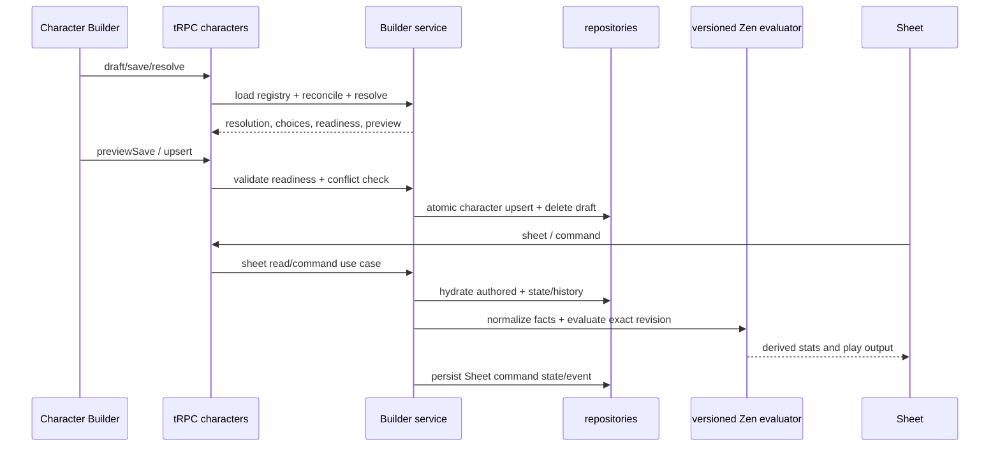

# Character Builder, Sheet, and engine flow

> Status: canonical (current working-tree baseline)
>
> Scope: character intent, draft lifecycle, reconciliation, preview/commit, snapshots, engine, Sheet commands, and history
>
> Update when: Builder DTOs, provenance rules, commit conflict checks, snapshot assembly, Sheet commands, or character persistence changes
>
> Verification: `apps/apis/src/trpc/characterRouter.ts`; `packages/functions/src/services/character/characterApplicationService.ts`, `builderService.ts`, `builderEligibility.ts`, `builderReconciliation.ts`, `characterBuilderView.ts`, `characterRuleEvaluation.ts`, `sheetProjection.ts`, `sheetRestService.ts`, `sheetCommandReducer.ts`, `sheetCommandValidation.ts`, and `sheetService.ts`; `packages/db/src/domains/subjects/upserts/character.ts`; and character schema/tests

Characters are playable aggregates, not generic authored-content forms. Builder owns structural character changes; Sheet owns play-state interaction. Both use shared authored models, repositories, compiled content, and engine primitives, but their workflows and contracts remain separate.

## Builder draft and intent

`characters.draft` creates or reopens a `character_builder_drafts` record. Draft payloads contain the authored character plus optional builder-intent cache. `saveDraft` persists the draft as draft status; it does not finalize the active character. Route IDs can be public IDs, resolved to subject IDs by the route-identity repository.

Builder intent is explicit: race/subrace/ancestry, classes/subclasses/specializations, background, abilities, hit points, starting-equipment decisions, feature acquisitions, chosen grant selections, spell selections, and resource grants. Every hit-point level records character level, class identity, and class level so interleaved multiclass acquisition order remains structural rather than inferred from grouped class totals. Before a character first becomes active, reconciliation initializes current hit points from that ordered progression. Later Builder edits preserve an active character's live current-hit-point state; subsequent healing, damage, typed adjustments, and rest recovery remain Sheet-owned commands. Provenance identifies the source (race, class, feature, option, manual, etc.) and timing identifies when it becomes available. Starting-equipment decisions establish progression-owned grants; runtime inventory ownership and management belong to Sheet state after play begins.

## Reconciliation and resolution

`reconcileCharacterBuilderCharacter` removes or preserves dependent selections based on provenance validity. Standalone calls load the current resolution registry, while preview/commit loads that registry once and supplies the same immutable snapshot to reconciliation and resolution. It clears obsolete starting-equipment selections, filters ancestry/feature/chosen-grant/spell/resource records that no longer match the current build, and merges required class resource grants. Starting-equipment options may carry a reusable character eligibility facet. Builder evaluates those facets from the equipment-free structural snapshot after grants and chosen proficiencies resolve, removes ineligible options from the returned selected class/background definition, and clears stale option/item decisions before preview or commit.

Selecting a subrace retains grants from both the base race and the subrace. Ancestry resolves from the selected subrace when it defines one, otherwise from the base race. Root class grant choices are acquired at class level 1; root subclass grant choices are acquired at the owning class's subclass-selection level, while their active level still tracks current class progression.

While an incomplete draft has no selected class levels, selected non-class sources are evaluated at effective character level 1 so ordinary race, background, feat, equipment, and ancestry choices remain authorable. Explicit level 2 or later unlocks remain gated, and class features always require the actual owning class level.

`resolveCharacterBuilder` derives summary, granted features/resources/spellcasting, outstanding required choices, blocking/warning validations, readiness, and a recommended section. It does not persist. UI uses this result for choices and progress; the final commit repeats the work server-side.

Multiclass prerequisites use one shared pure evaluator. The first selected class is not prerequisite-gated. Adding or replacing a class in a multiclass proposal requires all six ability scores and evaluates every class in that proposed set; server validation applies the same rule to crafted intent. Builder references expose structured class requirement groups, system alignment and lifestyle vocabularies, and canonical ability, advancement, ability-generation, hit-point, Standard Array, and Point Buy option metadata. Clients derive only contextual presentation such as a slot-relative Point Buy delta from those references; they do not maintain separate ruleset labels or costs. Selected-class presentation combines existing eligible feature, resource, and spellcasting grant summaries without adding acquisitions, and spell options expose authored level, school, ritual, and concentration metadata when available.

Builder presentation enriches authored references without mutating canonical intent: backgrounds provide descriptions, feature labels, and grouped authored detail rows; ancestry options provide feature previews; granted feature summaries provide ordered authored details; and starting-equipment views provide server-generated choice labels from authored filters and canonical equipment metadata. Redundant proficiency and cross-source spell candidates remain visible but disabled with their existing source label. Resolver eligibility and validation remain the authority for whether a crafted selection is accepted.

The web Builder applies backend-supplied ancestry previews synchronously from the active form value while authoritative resolution proceeds asynchronously. Resolution requests are sequence-guarded so stale responses cannot replace newer intent, and `aria-busy` clears when the latest request settles. Development builds record User Timing marks for intent, optimistic preview commit, and authoritative reconciliation; these marks are diagnostics, not production telemetry.

Selected-class grant summaries carry availability and authored presentation order and are normalized by the Builder service before reaching clients. Background references are compact, derived summaries with capped grant facts and feature labels; the selected background retains the full authored description and details. These are response projections only and do not extend canonical character intent.

Builder progress is visit-aware UI state. The rail counts only visible workflow steps; a step contributes to completion after it has been visited and its current requirements are satisfied. Unvisited requirement-free steps remain neutral, and later invalidation removes a visited step from the completed count. Resolver warnings and blocking validations are issues; unfinished steps are represented by progress rather than being relabeled as warnings.

Character Builder step navigation is URL-backed UI state through the shared optional `?step=` parameter. The provider validates it against the nine backend-backed visible steps during initial server rendering, falls back to the resolver recommendation, and owns both the active step and visited-step set. Progressive rail and Back/Next links preserve unrelated search parameters, while hydrated navigation changes only the search state and does not trigger character resolution. Browser history replays the same provider transaction; invalid step values are replaced with the current fallback.

Proficiency eligibility is a mechanical Builder rule, not an authored facet. Fixed and chosen grants from every active source contribute to the effective level for each target. Half proficiency requires a target below half, full proficiency requires a target below full, and Expertise requires existing full proficiency while rejecting an already doubled target. Ineligible options remain present and disabled with a repair reason, and the resolver emits blocking `REDUNDANT_PROFICIENCY_SELECTION` or `EXPERTISE_REQUIRES_PROFICIENCY` validation for stale or crafted selections. Selected-class DTOs group granted labels, player-facing choice instructions, and top-level choice IDs into proficiency categories; feature-owned choices remain attached to their owning feature. These presentation groups are derived and are not persisted character intent.

Builder registry catalog reads must scale with relation shape, not the number of authored roots. Spell, background, feat, race, and class repositories therefore hydrate `findAll`/`findByIds` root rows and owned link rows in sets, while single-record reads delegate to the same canonical batch assembly path. Nested aggregate repositories retain their own loading contracts; measure those separately before broadening the batch boundary. Race resolved-list hydration batch-loads missing parent lineage by depth. Do not reintroduce per-record root hydration loops or process-wide registry caches; homebrew ownership and publication changes require request-current data unless a separately designed invalidation contract exists.

## Preview, commit, and conflicts

`previewSave` reconciles and resolves a proposed authored character against the current compatible active rule revision, predicts status changes and destructive removals, and returns a change preview. It is safe to display before commit.

First finalization rechecks the active compatible revision inside the locked commit transaction and records its exact revision/checksum plus evaluator and model-contract versions with the Character. An explicit upgrade preview/reconciliation command is the only later path to change that pin, and it advances the Character stream version.

`upsert` requires readiness, locks the active row, checks the draft’s `baseActiveUpdatedAt` (and stream version where supplied), then calls the repository aggregate upsert. On success it ensures route identity, deletes the builder draft, and returns the persisted character/resolution. A stale active row becomes `CharacterBuilderDraftConflictError`/tRPC `CONFLICT`.

The repository upsert is replacement-based and transactional; omitted child state is removed. See [persistence](persistence.md).

## Snapshot, Sheet, and history

Sheet roll controls call the authenticated roll service with structured source context. The service owns randomness and returns immutable evidence; the web only presents that result. Non-manual requests must match a roll surface derived from the current Sheet projection. Ability checks, saves, skills, initiative, attacks, damage, healing, manual dice, and short-rest hit dice use this path; applying hit-die healing also references the persisted roll by ID. Canceling an unsettled presentation discards that caller-owned, unconsumed record so it never becomes visible roll history. The engine projects resolved initiative, saving-throw, and attack advantage/disadvantage modes; paired advantage and disadvantage cancel. Manual one-d20 rolls may choose a situational mode in the dice popover. Manual mixed-dice rows retain one modifier per dice term in evidence while preserving the aggregate modifier used by existing verification. Numeric modifiers apply once after the kept d20 is selected. Device-local presentation settings never affect roll authority.

The Sheet path only serves active characters. It hydrates authored character/state plus separately persisted typed adjustments/preferences, resolves Builder content for labels/choices, normalizes facts containing both automatic structural features and explicit acquisitions, and evaluates the Character's exact pinned Zen revision before projecting the `CharacterSheetResponseDto`. Optional manual source notes, actors, and timestamps remain Sheet metadata; only typed mechanical value intent is eligible for rules evaluation. Authored provenance retains its authoritative source labels independently of those notes.

One Campaign-aware authority resolver gates Sheet reads, panels, rests, rolls, history, and commands. The Character owner retains ordinary Sheet access; the active Campaign owner may access an assigned Character and issue only the explicit GM command allowlist. Archived Campaigns are readable but reject mutations. Builder reads and structural mutations remain Character-owner-only.

The main Sheet reference projection keeps canonical skills and saving throws in their dedicated calculated surfaces. Its compact proficiency collection carries only the closed `ARMOR`, `WEAPON`, `TOOL`, and `LANGUAGE` groups, including recognized broad equipment-property grants, so clients can group training without parsing display labels or repeating skills and saves.

Focused Sheet inspection uses the closed `CharacterSheetPanelDto` union. The backend panel resolver combines engine-authored effective values and breakdowns with Sheet-owned labels, notes, editability, valid options, and allowed commands. These DTOs contain design-system semantics only; drawer geometry, responsive composition, focus behavior, and native control selection remain client responsibilities. The web exhaustively maps panel variants into one overlay inspector and does not recalculate mechanics.

Functions modules follow those ownership boundaries directly. Builder loading/resolution orchestration stays in `builderService`; eligibility, reconciliation, hit points, spell selection, starting equipment, presentation, and DTO view construction have named sibling owners. `characterRuleEvaluation` is the production mechanical boundary; the superseded TypeScript mechanics engine has been removed. Sheet projection, completed-rest orchestration, pure command reduction, command validation, and transactional persistence are owned by `sheetProjection`, `sheetRestService`, `sheetCommandReducer`, `sheetCommandValidation`, and `sheetService` respectively. Callers import the real owner rather than a compatibility facade.

### Web Sheet state and composition

TanStack Query owns authoritative Character Sheet and panel server state. Safe command-specific optimistic projections snapshot the affected cache, update only direct play-state intent, restore the snapshot on failure, and replace the projection with the authoritative response on success. Derived values and any change requiring rules-engine resolution reconcile from the backend; the web does not reproduce those calculations.

Local React state is limited to transient interaction state and pre-commit field drafts. TanStack Form remains an Authoring Workspace and Builder tool, not a Sheet state container. Do not introduce a parallel Zustand Sheet store unless a future requirement establishes independent client state that TanStack Query and local component state cannot correctly own.

Prefer colocation and direct props while ownership is nearby. Introduce a narrowly scoped React context only when stable Sheet coordination spans a genuinely deep or branching subtree and repeated prop plumbing would otherwise couple intermediary components to behavior they do not use. Context must not duplicate server state, become a general store, or carry a monolithic Sheet controller. Every provider and layout wrapper must own a necessary behavior, state boundary, accessibility boundary, or visible structural responsibility; pass-through wrappers are not architecture.

The web Character domain exposes only its list and Sheet pages through `apps/web/src/domains/characters/index.ts`. Builder implementation lives under `builder/` by workflow ownership (`core`, `state`, `steps`, `choices`, `selection`, `save`, `shared`, and `fixtures`); Sheet implementation lives under `sheet/` by play surface (`core`, `hero`, `overview`, `vitals`, `status`, `rest`, `actions`, `spells`, `inventory`, `extras`, `notes`, `reference`, `mobile`, `inspector`, `shared`, and `fixtures`). Pages live under `pages/list` and `pages/sheet`. Internal callers import exact owning modules rather than nested barrels or compatibility aliases. Styles, focused tests, stories, fixtures, types, and helpers stay with the feature that owns them; shared folders contain only primitives used by multiple sibling features.

`CharacterSheetView` owns command dispatch, navigation, inspector focus restoration, and coordination of the one active Sheet overlay. Feature components receive only the Sheet slices and callbacks they use. Rest remains one public feature interface with private state, preview-content, recovery-summary, and responsive-overlay modules; the mobile drawer/desktop popover switch is presentation owned by that feature at `48rem`. The Sheet does not add a React context because current coordination is shallow and TanStack Query already owns authoritative and optimistic server state.

Character content selections store stable authored root IDs. Outside a Campaign they resolve against `ACTIVE` content. Assigned Characters may additionally bind a selected root to an immutable approved Campaign content version. Builder registry loading and assembly merge those pinned snapshots before planning the engine snapshot, including root feature and ancestry structure; the engine remains persistence-agnostic.

Rule evaluation is a separate pin: active Characters retain the exact activated rule revision/checksum and evaluator/model-contract version selected at first finalization. Later rule-pack activation or retirement never silently changes them. An explicit upgrade preview/reconciliation command may re-evaluate against a current compatible revision and repin it transactionally; that command increments the Character stream version. This does not pin ordinary authored content, which continues to follow its current or Campaign binding.

Sheet commands (typed adjustments, movement-display preference, rest, hit points, spell casting and slots, resources, conditions, exhaustion, runtime inventory add/remove/update, equipment/container placement, currency movement, and play notes) are dispatched through `dispatchCommandForUser`/`executeCharacterSheetCommand`, validated against the resolved viewer, persisted atomically, and returned with updated sheet data. Campaign-owner commands are restricted to approved play mechanics; player adjustments, private notes/customization, structural changes, and legacy inventory/currency custody commands remain denied. Typed resource and limited-use spell commands validate against resolved resource definitions, then persist usage through the typed resource repository path; the pure reducer does not duplicate that usage into `CharacterAuthored.state.resources`. Adjustment and preference commands also return the affected authoritative panel projections so immediate Sheet controls can replace optimistic local input with server truth. `commandId` is retry-idempotent per character: the event repository checks prior application and the database enforces a unique `(character_id, command_id)` pair.

Campaign adjustments are assignment-scoped overlays. A Campaign value replaces the same player adjustment slot only during projection; deleting it restores the stored player value. Engine calculation includes both visible and secret Campaign effects, then actor-aware DTO projection removes secret sources, hidden conditions, revealing breakdowns, and secret hit-point metadata from the player's response. The inverse GM projection preserves mechanical authority while removing player-private inventory names/notes, spell customizations, and action/resource/reference labels derived from them; GM commands cannot mutate those fields. Character history shown to the player excludes events authored by the Campaign owner; Campaign audit history remains in Campaign events. Active known and prepared spell choices remain Sheet play state and use the same versioned GM-authorized Sheet command path; inherently granted spells remain structural and cannot be removed there.

Assigned Characters resolve nullable Campaign play-policy overrides before Sheet state transitions. Attunement uses the Campaign override when present and otherwise the active ruleset's declared slot limit; clients never submit the effective limit with `ATTUNE_ITEM`.

Leaving, removal, reassignment, unassignment, ownership transfer, or Campaign deletion removes Campaign bindings, moves Campaign-only currency, removes the assignment, and then reconciles the Character. If a granted structural root is no longer resolvable, the existing stale selection is preserved as repair context while the active Character and owner-scoped Builder draft are persisted as `DRAFT` with blocking conflicts.

Complete rests use a read-only `characters.restPreview` query followed by the production `COMPLETE_REST` Sheet command. The preview resolves authoritative HP, aggregated class hit-die pools, ruleset recovery, eligible typed resources, selected companion recovery, and optional backend-generated roll evidence into a deterministic fingerprint. Character adjustments and Campaign overlays remain separate while deriving the effective rest result. Completion re-resolves that preview and applies HP, hit dice, spell slots, exhaustion, typed resources, selected companion state, and an optional Character maximum-HP modifier reset through the existing locked Sheet transaction. Only the Character owner may request that private reset; Campaign-owner requests are rejected and their projection omits its source metadata. The completed-rest event is appended last, stores the accepted result evidence, and the character stream advances exactly once. Concurrent retries with the same command identity converge on that stored result; stale versions or fingerprints write nothing. `USE_HIT_DIE` and `APPLY_REST` remain transitional compatibility commands and are not production web flows.

Typed adjustments use closed family tables and target identities outside `CharacterAuthored` and Builder drafts. The provisional `character_hitpoint_state.max_override` column is deprecated: migration backfills it into `character_hitpoint_adjustments`, repositories no longer hydrate it, and Sheet writes keep it null. Removal of the deprecated column waits for deployed backfill confidence.

Play notes are Sheet-owned titled records with groups and timestamps. Builder-owned profile, personality, and backstory fields remain structural content and are never rewritten by note commands. Spell casting is one atomic command that validates the selected source/cast mode before consuming a slot or limited-use resource. Inventory containers are owned equipment items with capacity metadata; item placement and container-owned currency remain Sheet play state. Item panels project authored item features and source-charge costs alongside item-instance pools and recoveries; charged feature rows carry the exact resource ID, as do their pool rows. Sheet reference feature rows preserve authored provenance, while eligible equipment source-charge features instead carry equipment-instance provenance and the same exact resource ID. Quantity rows represent fungible stacks only. Equipment with an owned charge pool is projected as non-stackable, so adding multiple physical copies creates a distinct owned item row and UUID for each copy. Each copy therefore owns its own `ITEM_INSTANCE` resource usage and equipment-derived source-charge actions spend only that copy's pool.

Sheet inventory item properties cross the transport boundary as structured `{ code, label }` facts. The stable code remains available for identity and commands, while the backend resolves the authored registry label so web and future native clients never derive presentation text from enum codes.

### Extras lifecycle (Branch 05 target)

Extras are Sheet-owned instances, not Builder intent and not authored creature/vehicle definitions. The closed extra-kind core options are `COMPANION`, `MOUNT`, `OWNED`, and `VEHICLE`; every core option crossing the API supplies a stable `code` and display `label`. A creature instance has a separate relationship role (`COMPANION`, `MOUNT`, or `OWNED`) and origin (`WORLD` or `SUMMONED`). Origin records how the current instance entered play; it does not alter authored creature metadata or establish a source binding to a spell or feature.

`customName` remains the persisted player-facing override. Sheet projections retain immutable `authoredName` and expose `displayName = customName ?? authoredName`; presentation adds the authored name in parentheses only when a custom name exists. The Sheet, rather than the client, authorizes an Add Extra flow, limits eligible sources to active master definitions or active definitions owned by the current user, revalidates the selected source immediately before persistence, persists the selected origin for creatures, and opens the returned explicit creature or vehicle panel. Existing attached instances continue to hydrate from an accessible source even when that source is no longer active, so a later source lifecycle change does not orphan Sheet state.

Creature Extras may use current/temp HP, structured hit dice, assigned equipment, typed companion adjustments, and `COMPANION_FEATURE` resources. Companion armor class, maximum HP, size, alignment, and creature type overrides enter the normal engine calculation context; projections expose the effective values and clamp current HP to the effective maximum. Compact Sheet rows project one creature movement mode: the first authored non-walking speed, or walking speed when no other movement mode exists. Vehicles have current HP and assigned equipment only in Branch 05. Authored actions and features are inspection data for both kinds, not automated combat commands. Instance removal is a versioned, retry-idempotent Sheet command that atomically removes instance-scoped state, resources, adjustments, and assignments while preserving inventory ownership and event history. Source-bound summons, dismiss/re-summon semantics, and automatic source-change removal are deferred.

## Decision: Builder is distinct from Authoring Schema authoring

Authoring Schemas describe reusable authored-content structure and resolve into generic form nodes. Character Builder instead encodes product workflow and game semantics: prerequisites, level-dependent grants, source provenance, reconciliation, readiness, preview/commit, and conflict handling. Do not extend the Authoring Schema into a character workflow language merely to share UI fields; share primitives and contracts where useful, while keeping the Builder’s domain service and DTOs explicit.

If a new Builder choice affects the Sheet, update authored intent, reconciliation, snapshot assembly, and the relevant API/schema tests together. Do not persist derived engine output as a parallel source of truth.
