# Character Builder and Sheet

> Status: canonical current Phase 8.2 boundary
>
> Scope: Character identity, Builder drafts/preview/commit, current-source reconciliation, Sheet state, commands, history, and Campaign assignment
>
> Update when: Builder or Sheet contracts, source-loss behavior, command receipts, or Character authority changes
>
> Verification: `apps/apis/convex/characters`, Character schema/tests, `packages/rules-runtime/src/character`, and the owning web Builder/Sheet adapters

Characters are playable aggregates rather than generic authored forms. Builder owns structural choices
and reconciliation. Sheet owns play-state commands. Both resolve current readable authored sources and
installed System capabilities from authorized current inputs; neither persists an authored-version vector or old rules
pack pin.

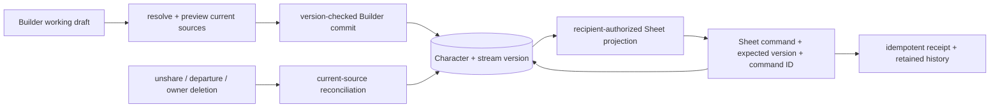

Canonical Character identity survives repair. Source loss removes inaccessible structural choices,
recomputes current mechanics, and keeps a ready Character active or moves it to a repair draft while
preserving its UUID, route, Sheet state, command receipts and shared history. A personal deletion is
never vetoed by another user's content; retained shared references keep safe labels/provenance.

Builder preview is read-only. Commit rechecks draft generation, Character stream version, current
sources, Campaign context and checksums in the final transaction. Starting inventory is materialized
once. A same command ID with the same input returns its stored result; a conflicting reuse fails.

Sheet reads expose only the authorized projection. Commands derive the user from authenticated context,
check Character/Campaign authority and expected stream version, validate bounded rule decisions, and
atomically update state, projections and receipts. Encounter-owned orchestration calls the owning
Character write ports in its transaction; full private Sheet data stays within that boundary.

**Held Character play (current source, unverified S7).** The room protocol now accepts
`CHARACTER_SHEET` with Character UUID, active Run UUID and one of the nineteen typed play commands in
[characterSheetLiveCommands](../../packages/schema/src/api/characterSheetLiveCommands.ts).
[roomCharacterSheetCommands](../../apps/session-worker/src/roomCharacterSheetCommands.ts) uses the
canonical Sheet reducer/resource helpers, current active-effect projection and real typed play writer
inside the caller's SQLite transaction. The private Character receipt and room journal commit before
acknowledgement. Current assignment/owner, active Campaign/System/Run and unfrozen Character actor
checks precede replay; socket replay also rereads the checksummed ACTIVE Run/unfrozen Character actor
and current Campaign/System/play ownership. Replay precedes expected-version refusal. GM restrictions apply when the viewer
is the Campaign owner rather than the Character owner. Only the initiator receives private history;
other admitted recipients advance the same room sequence with required `delta: null`. A pending
Sheet command waits for its own CHARACTER_SHEET delta before settling. Current vision is
composed before commit, and party visibility takes effect locally and survives an unpublished suffix.

The [liveCharacterHold contract](../../packages/schema/src/projections/liveCharacterHold.ts) records
one Character/active Run pair, Campaign and room epoch. Claim/recovery establishes holds, changed Run
or actor checkpoints reconcile them, and final acknowledged release removes that epoch's holds.
Held direct Convex play/preferences/rest writes refuse. Outside Builder/structure writes preserve the
entire acknowledged play row, stream clock and stats; Builder commit returns the actual persisted
play/version. At the next room command boundary, changed Builder inputs reconcile hit dice/usage,
filter equipped/attuned IDs against prepared inventory while preserving valid order, and
clamp current HP to the newly evaluated maximum whenever it is above it.
Canonical source-loss reconciliation already removes vanished inventory IDs, but held writes retain
native play until this room cleanup. All reconciliation joins one native transaction and advances
the play clock only on changed state. Existing SQLite commit/rollback/eviction/warm source checks
cover retained/removed IDs with mocked preparation; full integration remains unverified. The shared
[Character receipt test](../../packages/encounter-persistence/src/__tests__/characterSheetReceipts.test.ts)
adds raw STANDARD-to-MATURE replay/current-stream and checksum/fingerprint refusal coverage without execution.
`SET_HIT_POINTS.maxOverride`, rests, notes, structure and customization commands are outside this lane.

Frontend Sheet commands still use Convex; live routing and projection subscriptions are unfinished.
Membership, controller and account-deletion departures reconcile in the room (D74 in
[live sessions](live-sessions.md), current source, unverified). Campaign deletion includes
hold rows, but native lifecycle cleanup needs proof. The new schema needs the guarded local
reset/seed/codegen lifecycle. No generated check or integrated execution gate has run; S7/S8 remain open.

The focused [sheetSlices.liveAuthority](../../apps/apis/convex/characters/sheetSlices.ts) query now
reads head, epoch-matching holds and validated typed play to return owner/GM routing metadata:
Campaign/epoch/phase, held Run IDs, checkpoint sequence/time and acknowledged play stream. Party
readers receive null. It loads neither mechanics nor owned collections. Authority `checkpointedAt`
is set only by an actual acknowledged delta checkpoint or retained per-command publication; exact
retry and drain preserve it. Activation/new recovery has no timestamp, so routing metadata returns
null before the epoch's first acknowledgement. Pages outside the room use the Campaign-level
[campaigns/queries.liveAuthority](../../apps/apis/convex/campaigns/queries.ts) query only to route to the
room; they show no saved-at time (ADR 0035 A28, see [live sessions](live-sessions.md)).

Public `SET_INSPIRATION` and `SET_PARTY_VISIBILITY` acknowledgements now use
[sheetPlayPreferences](../../apps/apis/convex/characters/sheetPlayPreferences.ts) in current source.
They read head/play, current assignment authority, route/draft ownership and receipt facts without
assembling owned collections or evaluating mechanics. The typed play checksum, stream and play clock
advance atomically with the existing receipt; structure checksums/clocks, derived stats and unrelated
play fields remain intact. Current authority precedes replay. Assigned GMs may set inspiration, while
party visibility remains the Character owner's choice. The full Sheet executor remains for protected
comparators and internal consumers. Focused source coverage is present; execution evidence is pending.

Campaign assignment preserves identity separately from play eligibility. An active Encounter actor is
removed when its Character/account is deleted, while completed turns, rolls, Session records and other
shared Campaign history remain attributed to `Deleted user`.

## Historical implementation record

The remainder of this file preserves the superseded pinned-rules architecture and dated Phase 8.2
implementation notes. It is not current deployment guidance or acceptance status.

### Original Character guide

> Status: transitional current implementation; rules/content pins and upgrade workflows are superseded by ADRs 0023-0025
>
> Scope: character intent, draft lifecycle, reconciliation, preview/commit, snapshots, engine, Sheet commands, and history
>
> Update when: Builder DTOs, provenance rules, commit conflict checks, snapshot assembly, Sheet commands, or character persistence changes
>
> Verification: `apps/apis/src/trpc/characterRouter.ts`; `packages/functions/src/services/character/characterApplicationService.ts`, `builderService.ts`, `builderEligibility.ts`, `builderReconciliation.ts`, `characterBuilderView.ts`, `characterRuleEvaluation.ts`, `sheetProjection.ts`, `sheetRestService.ts`, `sheetCommandReducer.ts`, `sheetCommandValidation.ts`, and `sheetService.ts`; `packages/db/src/domains/subjects/upserts/character.ts`; and character schema/tests

Characters are playable aggregates, not generic authored-content forms. Builder owns structural character changes; Sheet owns play-state interaction. Both use shared authored models, repositories, compiled content, and engine primitives, but their workflows and contracts remain separate.

This guide remains authoritative for Builder/Sheet ownership and current behavior. Its immutable
authored-version vectors, rule-revision pins, and consumer upgrade workflows are not target contracts;
use [Shared rules runtime](rules-runtime.md) for the rebaseline.

### Native Convex drafts — implemented, cutover pending

Native canonical `characters` rows support `ACTIVE` and source-loss repair `DRAFT` status.
Canonical identity is distinct from play eligibility: repair retains the UUID, route, stream,
Sheet state and receipts. Builder opens it in edit mode; its separate working draft reports
`DRAFT_ONLY` because no active Character exists. Discard removes only that working draft,
and the canonical repair row remains in the owner's draft list. A ready Builder commit promotes
the same row to `ACTIVE` without granting starting equipment again. Sheet reads/commands and
Character-bound rolls (including manual rolls) reject repair state; owner history and Campaign
assignment identity remain readable. Assignment identity is not Sheet or Character-roll authority.
As in the existing Campaign contract, narrative ROLEPLAY chat, Session attendance, and the GM's
no-Character manual-roll prerequisite still use retained assignment identity, not mechanics readiness.

Native transactional source-loss producers now cover direct Campaign unshare, Character unassignment
or replacement departure, and deletion of a current owned authored root. They remove current source visibility before repair and use
`readCharacterCampaign` to validate a real assignment and supply either its real Campaign context or
`null` for a personal Character. Personal and assigned canonical Characters are deduplicated, retain
their identity, route, creation and Sheet state, and advance their stream only when canonical content
changes. Previously `ACTIVE` Characters are re-evaluated against remaining sources: ready state stays
`ACTIVE` with wounded HP clamped to the new maximum, while incomplete state becomes repair `DRAFT`.
Saved drafts prune the same direct roots while preserving their generation, mode, unrelated payload
and Builder intent. An owned create-only draft is pruned and checksummed directly without creating an
active Character. No-op Characters and drafts remain byte-for-byte unchanged.

Authored choice cleanup uses `rules-runtime/character/characterSourceReferences` to resolve kinds
from the existing Builder grant owners. `characterSourceLoss` requires that exact
grant/source/progression-keyed map, separately derived for each canonical or draft snapshot.
Only matching Spell, Feat, or Equipment choice targets are removed. System vocabulary and embedded
feature-option ID/IDS values are not authored references; UUID equality alone never justifies pruning
them. Native source discovery and pruning share this classifier, as do the retiring SQL adapters.
This is internal reconciliation ownership, not a new persisted or transport field.

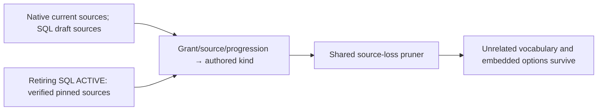

The retiring SQL adapter checks the canonical stream/revision before loading its pinned definitions;
commit derives pruning from the same prior pinned documents before removing source roots. This
transitional pin requirement does not apply to native Convex, whose approved source contract is current.

Direct unshare retains its active-Campaign membership, author-or-owner authority, expected-version
and actor-bound replay checks. Root-owner deletion discovers same-owner/same-System Characters and
drafts plus exact Campaign shares and their current assignments through UUID keyset batches. Its
trusted lifecycle cleanup also accepts an archived Campaign or the deleting author's retained `LEFT`
membership; this grants no ordinary archived write or GM Character authority. Each affected Campaign
advances once, including an owner-assigned Character with no share; only Campaigns that actually lose
a share receive the removal receipt. Shared Vehicle instances evacuate their item tree and currency to
party custody in the same transaction. The existing held-Equipment deletion guard remains until its
retention/removal policy is decided. Admission, catalogue-removal and membership-loss producers remain
separate pending integration work.

`apps/apis/convex/characters/drafts.ts` owns native draft create/reopen, save, private read,
paginated recovery summaries and discard. Browser lists, Sheet recovery and the Builder edit loader
now read native drafts. Builder create/save/discard also use generated native mutations, with the
generation ID required on save and discard. Native `create` returns the existing draft DTO; resolved Builder presentation is a
separate responsibility, not an implicit SQL call or a second write.

The [2026-09-06 catalogue clarification](../adr/0025-game-system-catalogues-and-encounter-blueprints.md#character-content-choice-clarification--2026-09-06)
binds native Characters only to their immutable Game System. Draft creation accepts UUID and System;
save/resolve/preview/commit reject a Character-level primary catalogue. Choices use exact authorized
content UUIDs across compatible official and creator-owned Homebrew collections. Homebrew has no
edition-origin field. Native readers check original checksums before removing the retired field
from old active/draft payloads; they do not rewrite data or rebase drafts during reads. New native
records omit it. The optional legacy shared/SQL and old-record metadata fields remain only until
their retirement/cleanup, not as a fallback binding or an accepted final schema.
The retiring SQL draft and active writers reject System-only payloads before writes; they are not
a fallback persistence path for native Characters.

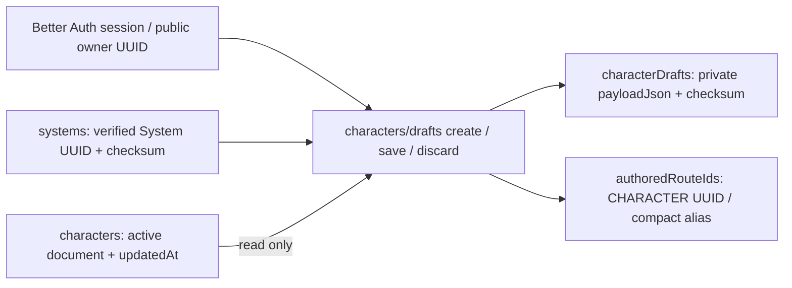

One mutation checks owner identity and immutable System binding, verifies the current System,
enforces the existing personal-Character entitlement, and saves the
draft plus any newly allocated route. Active Characters and drafts count once by Character UUID;
the free tier remains six, and paid tiers remain unlimited. Recovery is owner-indexed and paginated,
returning summaries rather than payloads, checksums or provider IDs.

Native storage keeps canonical authored documents and working-draft payloads as JSON strings with
checksums. Scalar persistence schemas live in `schema/projections/characterPersistence`; importing
full authored mechanics during database-schema evaluation is prohibited. The runtime validates
decoded payload identity against its metadata. The existing empty Character factory has one home
in `shared/character` and is used by both native and transitional callers.

Opening an active edit captures its current `updatedAt`; saving that draft preserves the original
baseline even when Sheet state advances. A caller cannot supply a newer token to silently rebase.
Saving or discarding changes only the draft, never active Character state. Reopening after discard
captures the latest active document and token. The native commit mutation below reconciles current
sources, checks that baseline and preserves authoritative Sheet state in its transaction. Save requires an existing draft;
save and discard require `expectedDraftId`, the returned draft UUID, so requests from a discarded
generation cannot overwrite or delete a reopened draft. The active baseline and draft-generation
token protect different lifecycles.

Character identities require RFC UUIDs, excluding the reserved non-RFC seeded-content namespace.
Compact route aliases survive discard with their owner UUID retained in `authoredRouteIds`;
another user cannot claim a discarded Character's identity or alias. This retention is not counted
as an active Character and has no lifetime alias quota: repeated create/discard can accumulate
route rows. Capacity/rate limits remain an explicit operational concern, not a new entitlement rule.

### Native current-source context — Campaign sources implemented, lifecycle integration pending

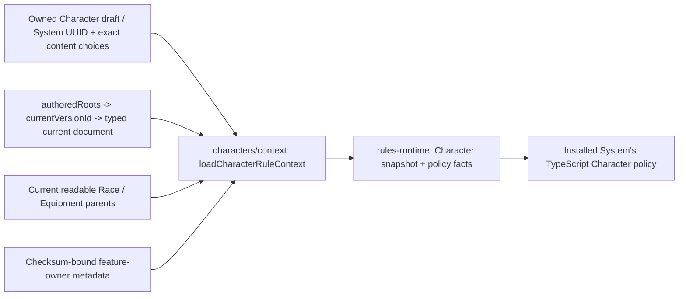

The server-only loader takes the trusted owner UUID, validates the Character's immutable binding,
and loads only selected Race, Class, Background, Equipment, Feat, Creature and Vehicle roots. It uses the same
current-document identity/checksum and platform-or-owner source visibility checks as authored content.
`readCharacterSources` limits platform roots to explicit same-System Rules Catalogue inclusion and
unions owned Homebrew. An assigned Character is restricted to its Campaign's enabled catalogues;
the loader checks the current active player, unique assignment, Character/route ownership and System.
Direct current shares from active authors add exact root access, never access to their whole sources.
Direct UUID reads, Builder selectors, spell/feature discovery, Sheet extras and extra-add commands
share that access boundary. Uncatalogued platform roots are unavailable; referenced catalogue sources must
exist and be same-System/platform-owned. Character inheritance passes the same allowed source set
through the existing Class, Race and Equipment parent readers, plus exact authorized shared parents,
without restricting authoring reads. The
[shared-parent ruling](../adr/0025-game-system-catalogues-and-encounter-blueprints.md#campaign-shared-parent-clarification--2026-09-07)
requires explicit Homebrew parent shares or enabled official parents. Share writes and shared reads
recheck these prerequisites; they do not infer dependency-only access. Missing/revoked parents fail
closed. Personal Character ownership still gates Builder and global Sheet access; this is not GM access.
It resolves current inheritance without historical version vectors. Working authored drafts never
enter this context; a later call sees a newly published source while a previously returned context
remains unchanged.

Missing, foreign and wrong-kind selections are unavailable inputs for the owning Builder repair
flow, not substituted mechanics. Corrupt current documents and unreadable inheritance parents fail
closed. Direct feature acquisitions locate their published owners through existing checksum-bound
source metadata; they do not read globally editable feature rows. Complete inline discovery retains
the existing 500-root-per-kind bound and throws instead of truncating. Spell summaries and exact
published documents are loaded only when the shared spell-context decision requires them. The
request-local document map is server-only and is not a transport DTO.

Selected Creature and Vehicle instances receive separate current-document maps rather than being
added to the Character's structural registry. Repeated instances share one loaded source but retain
their distinct instance identities in companion facts. Their IDs count toward the existing combined
500-selected-root limit. Native evaluation accepts the Creature map directly. The native personal
Sheet query below consumes both maps. Persistent source-loss repair now covers direct unshare and
owned authored deletion; other lifecycle producers remain separate integration work.

`rules-runtime/character/characterContextSpells` owns spell-catalogue need detection, selected-option
spell-grant detection and exact input Spell-ID collection. Both transitional and native loaders use
these same pure decisions. This packet proves a saved native draft can produce native policy facts
from actual current Convex publications; it does not complete the Builder API or browser journey.

Class spell list additions (a `CLASS_LIST_ONLY` spell grant, such as The Fiend's Expanded Spell List) are merged once by
`rules-runtime/character/spellClassListAdditions`: the Builder resolution (`builderResolution.ts`) owns the merged catalog
for prepare and known choices, and the Sheet's preparation catalog reads the same merge (SPELLS-31.T5p, D175).
Native Campaign-aware Sheet evaluation, scoped GM commands and supplemental-state writers are described below.
Admission, catalogue-removal and membership-loss writers plus remaining reconciliation producers and
browser Campaign wiring remain their owning integration work. Native Builder resolution, preview
and commit are described below.

Native owner responses apply Campaign maturity after mechanics and DTO construction: derived Builder
resolution/references/view and previews, Sheet reads/command responses, inspectors, preparation
options, rest previews and source-derived history summaries. Character authoring payloads and Builder
intent remain original. The owner-only Sheet private-notes block and its six note/group history event
summaries remain original; custom names and text-editor values retain originals for editing while
their displayed labels are filtered. Receipts and stored Character documents are never masked.
History checks current assignment authority without loading source publications, preserving access
when a missing source prevents Sheet rendering. Extra labels, including official content, are masked
before search/order/cursor construction. Enabled catalogue sources and owned Homebrew alone count
toward the assigned Character's source limit; disabled System sources are not enumerated.
Native roll execution validates the displayed source label against the matching ordered raw Sheet
candidate; expression, mode and kind remain raw authoritative inputs. Roll snapshots retain original
source and Character labels, while execute/history responses use current Campaign text presentation.
The optional presented-Sheet argument to `resolveCharacterSheetRoll` must preserve candidate order
and mechanics; the known-field presenter does so without rewriting expressions or IDs.

#### Campaign-aware Sheet evaluation and authority — local implementation

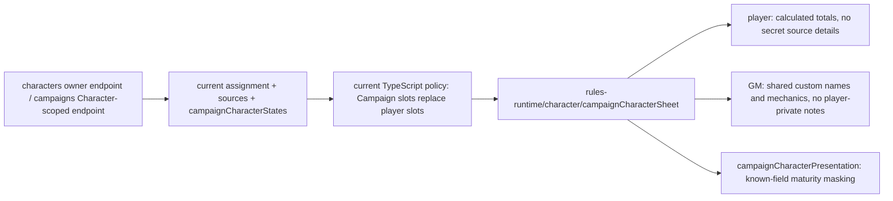

Campaign adjustment-slot precedence, visible adjustment/condition selection, Sheet/rest redaction
and owner-filtered history now have one pure implementation in the neutral package. The existing
service retains source reads, authority and mechanical-context checksums and re-exports the moved
helpers for transitional callers. Text presentation moved completely; its callers import the neutral
module directly. Projection test bodies are reused against the neutral implementation.

Native `characters/sheetPreparation` merges all current Campaign adjustments for policy evaluation,
including secret effects, and applies the Campaign attunement-slot setting. The separate player
adjustment document is unchanged; removing a Campaign slot restores the stored player value.
Visible Campaign conditions join player display conditions, while the GM sees all Campaign conditions.
Player inspectors use the display adjustment set to omit secret sources, adjustment IDs and
contribution breakdowns; secret HP editor metadata is removed while calculated totals remain.
Rest preview/reset re-evaluates the remaining player adjustments together with Campaign adjustments.

`campaigns/characterSheet` exposes scoped get, panel, preparation options, rest preview, executeRoll and execute
endpoints using shared UUID-backed contracts. Every call validates current active membership, exact
assignment, active assigned player, Character ownership, System and route. Only this explicit scope
admits the GM; personal Character endpoints and Builder remain owner-only. Source preparation uses
the validated Character owner's current source access, without changing authenticated actor identity.
Archived Campaigns remain GM-readable but reject GM commands, including retries.

Party visibility (current, ADR 0034 decision 5): the Sheet-owned `partyVisibility` state
(`SET_PARTY_VISIBILITY`, the Character's own player only; the GM allowlist rejects it) holds "Party
can view" and "Show my health to the party" (Hidden by default). `campaigns/characterSheet:get`
serves another active member only while "Party can view" is on: it loads the player's own view and
projects it as viewer `PARTY_MEMBER` (`projectCharacterSheetForViewer`), with every capability off,
player-private notes removed, and personality (traits, ideals, bonds, flaws), background
(organizations, allies, enemies, backstory) and the identity concept that repeats the backstory
never included. Only the Character's player receives `meta.partyVisibility`. Every other scoped
endpoint still requires the GM or the Character's player. `campaigns/characterSheet:basics` gives
any active member the public roster basics (name, class, level) and whether "Party can view" is on.
The roster shows each portrait through the Campaign-scoped portrait read ([media](media.md)).

Both execute endpoints use the same reducer, current-source evaluation, stream increment and
checksummed command receipt in one mutation. GM commands pass the neutral explicit allowlist before
receipt replay: play state and shared custom names are allowed; private notes, player adjustment
writes, movement preference and structural Builder changes are not. A supplied private-note field,
including null or empty text, rejects. Receipts retain the actual authenticated actor. Player history
uses the Character/actor/time/ID index and excludes GM-authored events before pagination.
Native GM adjustment/condition save/delete writes the Campaign-owned state and audit event atomically;
adjustment changes also validate current Sheet evaluation before committing. Condition saves validate
the current System vocabulary. Neither writer changes the Character stream or personal adjustments.
Resource and Spell slot counters, Spell casting, Clock recovery and GM adjustment post-write
validation may reuse authored sources within the same mutation. Known/prepared Spell selection also
reuses the complete authorized selector facts already loaded for that mutation; evaluation reads and
validates only newly selected Spell documents, without rebuilding the source catalogue. Character state, authority, overlays and
rule evaluation remain fresh; the internal context is bound to the Character, owner and System and is
never persisted or returned by public APIs. Commands requiring sources outside the loaded set load
sources again.
See [native GM state and audit](persistence.md#gm-character-state-and-audit).
Private Character roll generation uses the same explicit assignment authority and current Sheet
source resolver, rejecting archived Campaigns. It writes only the authenticated caller's roll history,
without borrowing the player's history or widening personal endpoints. Campaign rest hit-die evidence
must stay GM-visible: the caller's TABLE or To GM roll, or the GM's own Private roll; see the
[Campaign roll boundary](persistence.md#campaign-rolls). The existing rest transaction owns
evidence consumption, Character state/version and receipt; exact replay retains its authorization checks.
Full cleanup/reconciliation, clock recovery and browser Campaign wiring remain unfinished; these endpoints and
focused local checks do not constitute acceptance.
The personal web Sheet now receives its actual Campaign ID, but its chat, notebook, party-inventory,
tabletop and Campaign roll consumers still need native binding; this packet does not prove that browser journey.

**Approved clarification (2026-09-07):** private notes are player-only. Custom names on shared play
surfaces are GM-visible and GM-editable, not private notes. Native GM integration must preserve this
distinction instead of copying the transitional customization redaction wholesale. Campaign maturity
applies to displayed shared names; authorized edit fields and storage retain originals. This ruling
is implemented by the shared Sheet projection and native scoped command allowlist; it does not grant
personal Character endpoint access. GM inspector text editors omit private notes and preserve original
custom names for editing. Displayed shared names still receive Campaign maturity presentation.

### Builder route and draft session — local implementation

The server does not resolve the Builder (ADR 0036 S9): `builder.get`, `builder.resolve`,
`builder.preview` and the server's `selectors` catalogue scope were removed. The Builder resolves
and previews in the browser ([Browser Builder evaluation](#browser-builder-evaluation-adr-0036-s6--local-implementation-acceptance-pending)),
and `commit` revalidates on the server.

The edit loader reads `drafts.get` and `characters/builder.activeCharacter` through the
authenticated SSR query bridge and parses the shared DTOs at the app boundary. Both are cheap:
`activeCharacter` reads the active row and its route, never the draft, so an autosave does not re-run
it. Canonical handle redirects remain intact. The form opens from the stored draft payload
(`toCharacterFormValues(draft.payload)`); the Builder view appears with the first browser
evaluation, and until then the page shows the content state. The authoring session uses the
persisted draft mode and draft state; a draft-only Character reopened through `/edit` remains in
`create` mode and is not presented as an active Character with an edit draft. An active Character
without a draft is read without creating one during SSR or preload. The mounted editor
opens/reopens its private draft through `drafts.create`; `/characters/new` loads Systems only, then
the mounted client creates one UUID-backed draft and navigates to its canonical edit route. Retry
retains that Character UUID. An editable form requires the returned persisted draft generation. The
Builder renders its first step (or the step in the URL) at once; step progress and the recommended
step arrive with the first evaluation, which moves a Builder opened without a URL step to the
recommended step once (never over a URL step or a step the user already chose). An empty draft
recommends Basics.

The form key includes Character UUID and draft generation, not save time. Same-generation loader
updates preserve unsaved edits; a reopened generation creates a new form. An autosave marks the
saved values clean only if the user has not edited them while it was in flight. Reset uses the
saved form baseline. Cancel preserves private progress; successful discard exits to the list for a
draft-only Character or the Sheet for an active Character, rather than immediately reopening a
draft.

The commit mutation carries the draft generation. Resolution ignores superseded and unmounted
responses. Finalization submits the exact reviewed preview Character; the server rechecks readiness,
current sources and its own active baseline. The browser does not send a client baseline or a
retired primary catalogue, authored-version upgrade token or target-status override.

#### Draft autosave (ADR 0036 S8) — local implementation

The Builder saves its draft itself (`builder/save/draftAutosave.ts`). A change is saved once edits
have been idle for 2 s, and no sooner than 10 s after the previous save began; a step change, page
hide (best effort), leaving the Builder and "Save Draft" save at once. Saves never overlap, and a
save that throws retries the newest values with doubling backoff up to 30 s. A save rejected with
the typed `DRAFT_REPLACED` `ConvexError` (`characterDraftSaveErrorDataSchema`: the draft is gone,
its generation changed or its base revision moved, so it was finalized, discarded or reopened
elsewhere) is never retried: the autosave stops for good, one notification asks the user to reload,
and a draft owned by another user stays a plain error. The header's save state shows "Saving…",
"Saved", "Couldn't save, retrying" or "Opened elsewhere" (`draftSaveStatus` in the authoring form
state) in place of "Unsaved changes"; nothing else interrupts the form. Evaluation uses the form's
own ability-intent cache, so autosave never reloads the route.

`drafts.save` is structural only. It reads the draft head and checks the payload schema, the
head's generation, owner, mode, System binding and base revision; the old payload, the System, the
route and account usage are not read, since the head was bound to them when `drafts.create` opened
it and commit revalidates everything. An edit draft also reads its active row, only for the returned
`draftState` (a repair row has status `DRAFT`). It replaces the payload document
in place through the head's `payloadDocumentId` and replaces the head; only a chunked old payload
has chunks to delete. Draft rows are not Scene vision dependencies, so a save marks no Character
revision. Measured (convex-test, 2026-09-28, `draftSaveBudget.test.ts`): a level-5 Wizard draft
with 18 Spells, 15 inventory items and a long backstory (a 5.7 KB payload) reads 1.0 KB (the
caller's profile, 0.4 KB, and the draft head, 0.6 KB) and writes 6.8 KB (the payload document and
the head, replaced in place): 7.8 KB against the 32 KB budget. The same draft in edit mode also
reads its 6.4 KB active row: 7.5 KB read and 6.9 KB written, 14.4 KB. See [persistence](persistence.md#character-draft-payloads-adr-0036-s8).

#### Server Builder context

`characters/builderContext` serves the server paths that still prepare the Builder: Sheet repairs,
Campaign assignment, dependency updates and source-loss reconciliation (`resolution` scope), and the
Sheet (`active` scope). The `resolution` scope reads the selected mechanics registry, the Class
catalogue when a selected base class reaches its subclass level, and complete Equipment, Feat and
conditional Spell pools for choice validation and Sheet options. Unselected catalogue entries do not
become mechanics or inventory, and catalogue reads retain the existing complete-inline bounds.
Within one context load, pool enumeration reuses publications already validated for the selected
registry under the same user, System, sources and query snapshot. This internal map is not a
transport field and is rebuilt on the next load. Class publication parsing tries the known subclass
schema first for valid subclasses and retains the original union parser for invalid input and its
errors.

The shared native publication reader parses stored JSON once and preserves prototype-key
normalization before checking integrity. For parsed JSON with finite numbers and recursively lexical
object-key enumeration, native serialization produces the existing canonical rules-document bytes;
other input retains the sorted canonical serializer. Both paths use the same UTF-8 SHA-256 checksum
and metadata checks. This changes no stored format, ownership check or publication contract.

Commit reads referenced content only (see [Referenced commit reads](#referenced-commit-reads-adr-0036-s7--local-implementation)).
First-create starting-equipment materialization reloads the selected mechanics registry and reuses the catalogue
from the same transaction, so newly granted inventory contributes mechanics without a second full
catalogue read. The reload repeats System/source admission and selected-root validation while reusing
the complete checksum-bound Spell selector facts and previously referenced documents from that
preparation transaction. Newly granted spell-bearing equipment hydrates missing referenced documents.
Full authored Spell documents are mechanics inputs; selector facts are not substitutes for them. This remains
a transitional current-source path, not the pinned Sheet target below.

The existing pure Builder catalogue/presentation, hit-point, spell, equipment, chosen-grant,
feature-option fixed-point, resolution and view algorithms now have one home in
`rules-runtime/character`. The backend supplies trusted records and the eligibility evaluator;
the pure layer owns no revision binding, SQL loader or persistence. Named transitional adapters
retain legacy loading and revision checks while their remaining callers migrate.

These native API and browser read/write checks are implementation evidence, not P02 acceptance. Complete
remaining source-loss producers, Campaign overlays and the complete local journey
remain pending. Candidate resolution is not a commit authorization token.

### Structural preview — local implementation, acceptance pending

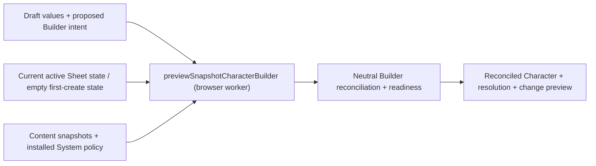

The finalization preview runs in the browser worker (ADR 0036 S6); commit repeats the same
reconciliation on the server. It replaces all proposed Sheet state with the current active document's state, or the existing empty
Character factory state for first creation. Reconciliation initializes first-create HP from the
System policy and preserves active current HP. It does not mutate the active record, draft or draft
baseline, even when the active document has advanced since the draft opened.

`rules-runtime/character/builderReconciliation` owns the existing structural repair algorithm;
the backend supplies a trusted context and evaluator. Chosen-grant ownership is evaluated against
the feature options remaining after eligibility pruning, not a stale pre-pruning selection copy.
Option provenance requires the exact parent acquisition to retain the selected option under its
`options` key (`ID` or `IDS`). Reconciliation repeats removal-only passes over acquisitions,
policy-invalid options, chosen grants, spell selections and resource grants until they settle;
later removals cannot leave an earlier dependent selection alive. The final policy evaluation sees
that settled intent, and required class resources are then merged using the existing rule.
`characterRuleEvaluation` composes trusted current facts and invokes the installed System policy;
the transitional functions adapter alone retains legacy revision checks.

The native preview contract omits the retired authored-version upgrade workflow (ADR 0024).
It is a read-only structural preview, not a finalization receipt or commit authorization.
Remaining lifecycle source-loss producers and the browser journey remain pending.
No current preview proof constitutes P02 or P03 acceptance.

### Browser Builder evaluation (ADR 0036 S6) — local implementation, acceptance pending

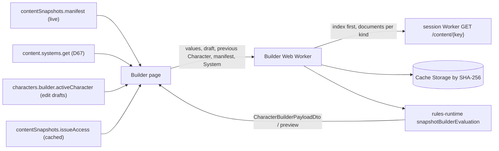

The Builder resolves and previews in the browser: each edit, after the Builder's
existing 150 ms debounce, runs `resolveSnapshotCharacterBuilderPayload`, and Activate runs
`previewSnapshotCharacterBuilder` (`rules-runtime/character/snapshotBuilderEvaluation`). They are
the S5 chain (`createLazySnapshotReaders` → `prepareCharacterRuleContext` →
`assembleCharacterBuilderContext` → `resolveCharacterBuilderPayload`, or
`prepareCharacterBuilderFromContext` → `toCharacterBuilderPreviewOutput`). The worker parses the
candidate as commit parses its input and sets the draft owner and `DRAFT` status. The System comes
from the existing `content.systems.get` query, since the System is not snapshotted yet (D67). An
edit draft evaluates against the active Character it replaces, read by
`characters/builder.activeCharacter`; replacement allowances and the change preview compare
against it, as commit does with its stored active document.

Web surfaces that show Character or Creature numbers (the Builder abilities step, class detail,
Creature detail, the Encounter enemy stat block) call the same `rules-runtime` functions and keep
no local copy: `hitDieAverage` and `hitPointGain` (`rules-runtime/systems/dnd5e/hitPointRules`,
also used by `builderHitPoints` and `characterVitals`), `abilityModifier`, and `proficiencyBonus`
(`rules-runtime/systems/dnd5e/proficiencyBonus`, also used by the derived-stat and modifier
modules). There is no hit point override: the Builder either rolls, takes the average, or enters a
manual roll, and `CharacterBuilderIntent` has no `overridden` field. The web also keeps no copy of
the Authoring Schema resolver ([authoring-schema](authoring-schema.md)).

- **Worker** (`domains/characters/builder/evaluation`). A module worker created after mount on the
  Builder route only, and started on its first evaluation; nothing evaluates during SSR. It keeps
  parsed objects by hash and the readers of the current manifest, with the documents they have
  loaded, until the manifest's hashes change. The page answers the worker's content token requests.
- **Snapshot client** (`data/contentSnapshots`). Reads every `index` object of the manifest first
  and a kind's `documents` objects only when a read needs them (a publication of that kind, a
  parent, the feature scan or the Spell catalogue). Private objects carry the content token, reused
  until one minute before it expires and re-issued once when the Worker refuses it. Every object is
  checked against the manifest SHA-256 before it is parsed or kept in Cache Storage; a new manifest
  evicts the hashes it no longer names, within the parts it manages (`retain(keep, parts)`), so the
  Builder's `index` and `documents` eviction never drops the authored-content lists' `list` objects
  and the reverse. The Builder never reads the `list` part
  ([persistence](persistence.md#authored-content-list-snapshots-adr-0036-s11)).
  The content origin is the session Worker's HTTP origin
  (`VITE_LIVE_SESSION_WEBSOCKET_URL`), also allowed in `connect-src`.
- **States.** Until the first evaluation the Builder shows only its content state; afterwards it
  keeps showing the last payload while content prepares. It shows the kinds being fetched, that content is still updating when a head's `revision` exceeds its
  `builtRevision`, and which kind failed to load, with a retry. The first ready evaluation and each
  manifest change re-resolve the current values.
- **Sign-out.** Sign-out, a sign-in and an identity change seen by the root session check drop the
  cached content tokens, terminate Builder workers and delete the snapshot Cache Storage
  (`clearPrivateContentSnapshots`).
- **On the server.** Only `commit` evaluates, and it stays authoritative (S7 narrows its reads).
- **Gates.** `rulesRuntimeBoundary.test.ts` walks the web app's runtime imports and forbids
  `rules-runtime/encounter*`. `builderEvaluationWorker.size.test.ts` builds the worker entry and
  holds it to 300 KB gzipped. `builderSnapshotParity.test.ts` (apps/apis) runs the worker's
  evaluation through lazy readers over the S5 corpus and compares resolve and preview with a pure
  full-pool evaluation over the publications Convex authorizes (`tests/fixtures/builderEvaluation.ts`:
  picker facts straight from the documents, Equipment resolved from its documents), and holds warm
  evaluation p95 to 100 ms in Node. `builderChoices.test.ts` exercises choices and readiness through
  the same browser path. `rules-runtime/__tests__/builderCatalogueAssembly.test.ts` holds the
  catalogue rules (Class and Equipment parents, projected against document Equipment facts, Feat
  scope merging, and the `resolution` scope equal to `selectors` apart from its catalogue) over
  snapshot objects.

### Native Builder commit — local implementation, acceptance pending

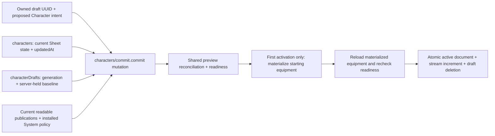

The transaction rejects a stale draft generation or active baseline before finalization. The caller
cannot rebase the draft through a commit argument. Preview and commit share server-owned state
replacement and current-source preparation; commit repeats this work rather than trusting a prior
preview. Missing acquired features, Feat sources, selected Spells and inventory Equipment block
readiness. Explicit currently authorized feature acquisitions use the same option eligibility,
count and replacement rules as structural grants, including dependent-option removal.
An explicit Feat-root acquisition (`featureId === source.featId`) contributes its unlocked child
features through the shared structural collector used by Builder and snapshot assembly. Matching
explicit child acquisitions retain their identity and selections without duplicating automatic
instances; a child-only acquisition does not implicitly acquire sibling features. Future acquisition
timing is excluded from mechanical snapshots and current option lookups. Feat children and root
progression use total current Character level even when acquisition timing names one class, with
effective level 1 during incomplete drafts. Feat-root chosen grants also participate in shared readiness and
reconciliation. The Feat root owns one grant source and charge pool, preferring its explicit root
acquisition identity over a child; root actions do not require a fabricated Feature definition.
Root charge presentation likewise resolves the Feat directly when no Feature summary exists, while
still rejecting a missing Feat definition or ambiguous feature presentation.
The committed Sheet reference collector includes child-only Feat acquisitions without adding siblings.
Repeated acquisition semantics remain unresolved: the current implementation blocks duplicate root
markers, but repeated child records can still produce multiple mechanics instances while Builder
choices address only feature and provenance. This is an open correctness gap, not an accepted repeat
policy; either duplicates must be rejected or Builder choices must become instance-aware.
These paths have local native-commit and shared fact/resource/action regressions. The existing
Builder view DTO still lacks Feat-specific controls, so this is not complete browser support or
P02/P03 acceptance.

The existing starting-equipment materializer now lives in `rules-runtime/character`. First activation
ignores proposed `applied` flags and grants the reconciled decisions into empty initial inventory and
currency. It reloads sources and readiness afterward, so an unavailable granted item cannot become
an active inventory record. Active edits never materialize starting equipment again; they retain
authoritative inventory, currency and current HP, with the existing structural hit-dice reconciliation.
The user confirmed that Characters may share names, including within one owner and Game System.

Only a ready Character becomes `ACTIVE`. Canonical validated JSON/checksum, monotonic `updatedAt`,
the next stream version and draft removal are one mutation. The receipt returns Character, compact
public alias and stream version, without retired authored pins or mechanics-projection checksums.
A consumed draft cannot commit again; concurrent or repeated calls cannot duplicate equipment.
This is not a retained command-receipt/reconnect implementation or P08 acceptance. Native Sheet,
Remaining Campaign lifecycle integration, managed limits and final-source browser
journeys remain required before the replacement lifecycle is accepted.

#### Referenced commit reads (ADR 0036 S7) — local implementation

Commit validates on the server from the content the Character references, not the complete pools.
`commit.commit` passes `prepareCharacterBuilder` one
`CharacterReferencedReads` (feature hints plus per-transaction root, publication, System and source
caches), which loads `loadCharacterReferencedContext` (`characters/referencedContext.ts`) for the
first preparation and the post-materialization reload. Parent reads, held-Equipment rule retention and
the stored-stat evaluation reuse the same caches and context, so a commit reads each root once:

- **Rule context.** `loadCharacterRuleContext` in referenced mode reads the selected roots as before.
  Spells are read by id: `prepareCharacterRuleContext` passes `readSpellCatalogue` the Spell
  selections, learned and prepared state, chosen-grant targets and feature-granted Spells, and pool
  readers ignore it. A feature missing from the selected roots is read from the root its
  acquisition's provenance names (`OPTION` follows its parent acquisition). A `MANUAL`, `FEATURE`
  or `ANCESTRY` acquisition needs a `{featureId, rootId}` hint; the server reads the hinted root and
  requires the feature in it, never trusting the hint alone.
- **Catalogue.** `assembleCharacterReferencedBuilderContext` (`rules-runtime/character/contextPreparation`)
  builds the catalogue from the registry's Races, Classes and Backgrounds, the referenced Equipment
  (with parents), Feats and Spells, plus witnesses: one readable subclass for a class row due a
  subclass with none selected, and one readable candidate for each chosen grant with no restricted
  option or selected Equipment property with no restricted carrier
  (`getChosenGrantWitnessQuestions`). Option sets are monotone in the pool and every selected id is
  in both pools, so each validation equals the complete pool's.
- **Fail closed.** A selected or held reference that is not readable content of its kind throws
  `ConvexError` data `{code: 'SOURCE_UNAVAILABLE', subjectId, message}`
  (`characterBuilderCommitErrorDataSchema`). Held Equipment with retained rules, Creatures and
  Vehicles keep their existing source-loss handling.

The [implementation plan](../handoffs/adr-0036-implementation-plan.md#referenced-commit-s7-current)
records the equivalence argument, the differential corpus and the measured reads.

The browser derives the hints in the Builder worker: a finalization preview also returns
`collectCharacterFeatureSourceHints` (`rules-runtime/character/featureSourceHints`) over the
previewed Character and the snapshot readers, and the Builder sends them with `commit.commit`. The
helper shares the provenance rule (`characterFeatureProvenanceRootId`) and the feature membership
(`publicationFeatureIds`) with the server, and takes the least root id when several roots hold a
feature, so the browser's snapshot scan and the server's pool agree.

Writing the committed row no longer rereads it: `writeCharacterRecord` evaluates its stored stats
over the row it wrote (`loadCharacterSheetFacts` and `loadCharacterSheetInputs` take the written
row), `loadCharacterSheetFacts` asks `listActiveRuleEffects` not to re-verify an owner it just
loaded or wrote, and commit passes the verified owner to `syncAccountUsage`.

### Character play state (ADR 0035 Amendment 12) — local implementation

> Status: current local operational storage implementation; integrated proof and focused Sheet access
> remain in progress. The two concurrency clocks retain Amendment 12's ownership.

A Character has a small head and typed operational records. Complete checksummed JSON is assembled
for rules, Builder, export and room captures; it is no longer stored in the mutable head.

| Record                 | Owner                                             | Holds                                                                                                                                                 | Concurrency clock |
| ---------------------- | ------------------------------------------------- | ----------------------------------------------------------------------------------------------------------------------------------------------------- | ----------------- |
| `characters`           | Builder and structural Sheet writes               | Identity, portrait, complete structure checksums                                                                                                      | `updatedAt`       |
| `characterBuildStates` | Builder and Sheet adjustments                     | Profile, intent, adjustments, movement preference, optional collection presence                                                                       | Head `updatedAt`  |
| `characterPlayStates`  | Sheet, rests, Encounter mechanics, GM adjustments | typed `state` (below), checksum, `maximumHitPoints`, `speeds` (feet per speed type), identity                                                         | `streamVersion`   |
| Owned collections      | Existing Builder/Sheet owners                     | Inventory items, currency groups, class spell state, spell customizations, Creature/Vehicle instances, equipment relationships, notes and note groups | Head `updatedAt`  |

- **Contract.** `packages/schema/src/projections/characterPlayState.ts` names the play fields
  (`characterPlayStateSchema`): the state's hit points (current, temporary, hit dice), resources,
  spell slots, conditions, exhaustion, inspiration and equipment item-use state, plus the Sheet state's
  resource usage, single-use item usage and party visibility. `splitCharacterPlayState`, `mergeCharacterStatePlay` and
  `mergeCharacterSheetStatePlay` are pure. `characterStoredState.ts` is the one
  reader (`readCharacterRecord`, `readCharacterSheetState`, checksum and identity checks) and pure
  re-encoder (`encodeCharacterRecord`) for a complete Character capture joined with its play record.
  `characterOperationalRecords.ts` defines typed storage; `characterOperationalState.ts` owns its
  split and assembly. Per-row checksums and the head's complete structure checksums reject altered,
  missing, duplicated or foreign rows. Checksummed Build collection counts also detect truncated
  selected reads, including missing final or all rows, without assembling unrelated collections.
  Array positions and optional collection presence preserve complete domain results. Apis,
  rules-runtime and the session worker share these contracts.
  The persisted play value is typed, replacing the retired `playJson` field. Its canonical checksum
  still guards assembly and replay captures. Database schema evaluation imports the focused
  `shared/character/sheetRest` value validator, never the complete Character mechanics barrel.
  Development data is reset and seeded with the local lifecycle; no compatibility reader is retained.
- **One writer.** `writeCharacterRecord` splits the document and Sheet state it is given, diffs
  individual owned records by ID and checksum, and advances the structure `updatedAt` only when
  structure changes. All changes share the caller's transaction. A play write replaces only the
  small play record. The Encounter persistence port reaches this same function.
- **Readers merge.** `readCharacterRow` assembles all indexed operational records; the Sheet projection, rules
  evaluation, Encounter facts and the live-session INPUTS capture (one joined `owner` row, from which
  the Worker derives the Character) all read the merged Character. Party visibility and health
  display for the room authorization cache read the play record alone. Character lists read only
  the head, play version, draft summary and route identity. NOTES reads its selected families alone;
  mechanical Sheet slices still use complete assembly before selecting their response.
  Public queries validate DTOs after viewer projection: a slice query validates its selected
  shared contract, while a complete Sheet query validates the complete response. Stored Character
  assembly and rules inputs retain their validation independently of the returned DTO.
- **Campaign state stays separate.** `campaignCharacterStates` and `characterActiveRuleEffects`
  remain per Character per Campaign. Folding them into the play record would fan one Character
  record out across every Campaign context that uses it and make each Campaign's write rewrite the
  others'. The room holds them beside the play record when it is built.

#### Concurrency rule

Two clocks, so a Builder save and a play change do not conflict on one version:

1. **Play commands** (Sheet commands, rests, GM adjustments, Encounter mechanics) check
   `expectedVersion` against `characterPlayStates.streamVersion` and advance it by one per
   transaction. They do not read `characters.updatedAt` for concurrency.
2. **Builder commits** check the draft's `baseActiveUpdatedAt` against `characters.updatedAt`. The
   commit overlays the live play state onto the draft's candidate before preparation, so a Builder
   save preserves current HP, slots and resources spent while the draft was open. It advances the
   play stream only when the commit itself changes play content (a new Character, hit dice
   reconciled to a class change, or current HP clamped to a lowered maximum); otherwise a play
   command in flight during the save still succeeds.
3. **Level-down clamp.** If the committed maximum hit points fall below the previous stored maximum
   and current HP is above the new maximum, the commit rewrites only the play record with current HP
   equal to the new maximum. The comparison uses the Character-only maximum, so a Campaign hit point
   adjustment is not visible to the Builder; readers still clamp to the effective maximum.
4. **Structure changes made by the Sheet** (inventory, currency, Sheet adjustments, spell
   customizations, movement preference) advance `characters.updatedAt`, so a stale Builder draft
   still conflicts with them.
5. **Single-use items** (D102) are a play record overlay, `itemUsage`, not a structure edit. The
   effective quantity is the stored quantity minus `used`; `readCharacterRecord` returns it and hides
   a row at 0, and the writer translates a structural edit back (stored = edited effective +
   `used`, hidden rows kept in place, usage of deleted rows pruned). Consuming an item therefore
   moves only `streamVersion`, so it works while a Run holds the Character. A Builder edit commit
   starts from the active record's current play state, so it never gives back an item used after
   the draft was read; Sheet inventory commands are fenced by `expectedVersion` and carry
   `itemUsage` through. A used-up row's equipped and attuned ids stay in storage so an undo
   restores them, but `readCharacterRecord` (`effectiveItemIds`) never reports a hidden row as
   equipped or attuned. Folding usage into structure at a quiet point is a documented candidate,
   not built.
6. **Stat refresh** (`maximumHitPoints`, `speeds`) re-evaluates after a Campaign-owned change and
   rewrites the play record without advancing `streamVersion`.

Convex retries a transaction whose reads or writes conflict, so a Builder commit and a play command
that overlap both survive: whichever runs second reads the first's result.

#### Write cost

`playStateBudget.test.ts` counts stored bytes through the `countDatabaseIo` wrapper. Before the
split both paths replaced the whole 7.6 KB Character row; now they replace the play record (about
0.5 KB), so the total is dominated by the command receipt.

| Path                            | Before                                    | After                                     |
| ------------------------------- | ----------------------------------------- | ----------------------------------------- |
| Sheet HP change                 | 8.2 KB (Character 7,589 B, receipt 648 B) | 1.1 KB (play record 496 B, receipt 648 B) |
| Encounter damage to a Character | 8.3 KB (Character 7,606 B, receipt 676 B) | 1.2 KB (play record 513 B, receipt 676 B) |

### Neutral Sheet commands — extraction, native persistence pending

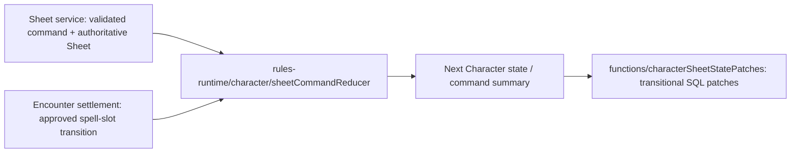

The existing state reducer and command-responsibility classifier have one home in `rules-runtime`.
Sheet, rest, projection and Encounter adapters import those implementations directly. The classifier
preserves which commands need Character policy evaluation versus committed evaluation; it does not
grant authority or implement persistence. The reducer retains its injected ID/time hooks, validation
and state transitions; complete rests still require an authoritative rest preview outside it.

SQL state-patch construction remains in the transitional backend, not the neutral package or public
transport. This extraction does not provide native Sheet queries, command receipts, reconciliation
transactions, or browser integration. Native callers must supply current authorized inputs under
ADR 0024 rather than reproduce the transitional version-vector workflow below.

### Neutral Sheet projection — extraction, native persistence pending

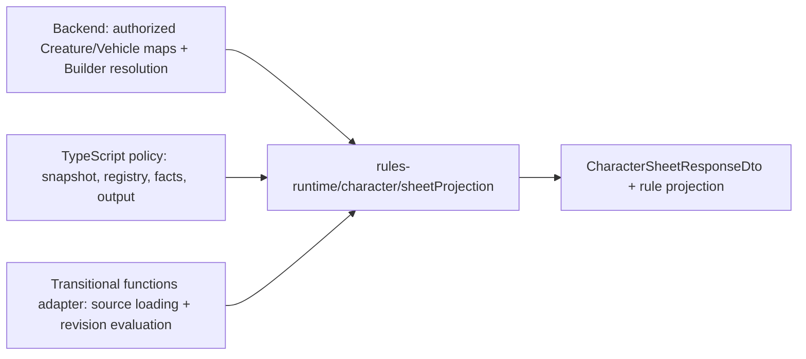

`projectCharacterSheetBundle` synchronously presents supplied authored records and evaluated rules.
The Sheet vocabulary, proficiency, action, mechanic and resource presenters share that neutral owner.
Projection accepts only the evaluation fields it consumes, not a database handle, revision binding,
loader callback or persisted projection. Spell display customization uses the existing Sheet source
contract; storage records remain the backend's responsibility.

The transitional `functions/character/sheetProjection` adapter retains source loading, committed
evaluation identity checks and the second evaluation needed to hydrate newly displayed spells.
Both paths reuse the same spell-selection and companion-input helpers. Native callers must load
current authorized sources and reconcile before authoritative reads/commands; this extraction alone
does not implement that transaction, native Sheet transport or browser integration.

### Native personal Character lists — locally integrated, acceptance pending

`characters/list:list` pages active, current-owner Characters by the existing owner/creation index.
It returns the shared list-item shape, including an edit-draft summary and its display label when
present; it never returns draft-only rows. `characters/drafts:list` remains the separate draft/recovery
page, including draft-only Characters. Both use the existing bounded cursor protocol. The active
query bounds primary rows to eight per page to leave room for full draft-document joins, validates
stored Character/route/draft identity, and does not evaluate rules or persist read-time repairs.
A Character requiring Builder repair therefore remains discoverable. There is no new list table,
stored projection or total-count scan.

The web list and Campaign's own-Character picker subscribe to both native page streams, loading all
personal summaries before exposing the existing client-side filters, sorting and totals. Active
pages supply edit-draft summaries; only draft-only identities absent from those pages are merged
from recovery. Disabled consumers skip both subscriptions and expose no retained data. The list
route no longer loads the legacy HTTP list. This deliberately retains full-summary client filtering;
server-side filters are a future change if personal list size requires them. Campaign's other reads
and writes remain transitional; this list integration is not Campaign or release acceptance.

### Focused Sheet reads — local implementation, acceptance pending

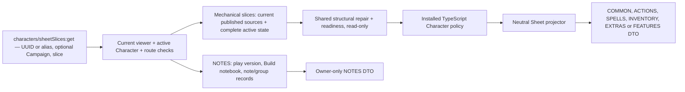

The queries read committed Character state. A working draft contributes only its presence
flag, never proposed structure, play state or private notes. UUID and route-alias lookups share the
same owner/route integrity checks; missing, draft-only and other-owner Characters return null, and
anonymous callers are denied. The current-source preparation and policy run synchronously on every
read. An unresolved structural source blocks the Sheet instead of serving a stored stale projection.
This query does not persist repairs, advance the stream or consume a draft.

The shared read envelope and DTOs live in `schema/api/characterSheetSlices`. The backend's Builder context loader retains
the selected Creature/Vehicle maps for the final policy/projection call without adding those records
to the structural registry. COMMON supplies identity, versions and visible vitals. The web subscribes
to a feature slice only while its surface is mounted, and immediately releases that subscription on
unmount. Mobile Overview does not mount hidden desktop Actions. Editable Creature/Vehicle equipment
selectors request INVENTORY while open; other inspectors use their existing focused panel query.

NOTES validates only the head, play and Build records and complete ordered note/group records against
the Build's checksummed collection counts, with no
inventory, spell, extras or authored-source reads and no mechanics evaluation. It is owner-only;
Campaign GM and party projections cannot request private notes. Both explicit and implicit assignment
authority retain the Campaign deletion fence. The mechanical slices still assemble and evaluate the
complete Character before selecting their DTO; narrowing HP and mechanical storage reads remains
completion work. The complete Sheet endpoint remains a transitional native-proof consumer.

### Native personal Sheet commands — partial local implementation

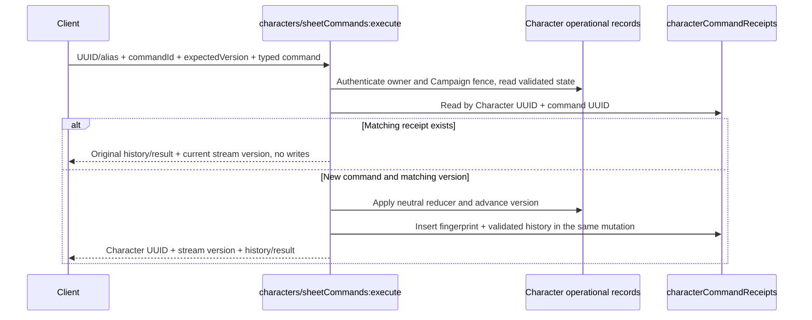

The mutation currently enables inspiration, HP setting/damage/healing, hit-die use, exhaustion level,
condition addition/removal, note/note-group creation/update/deletion, typed adjustment upsert/removal,
panel adjustment reset, movement display preference and resource use/recovery through both resource
IDs and owner references, spell-slot use/restoration, known/prepared spell selection, spell casting,
source-specific spell display customization and mechanic customization set/removal, inventory
add/remove/update, equip/unequip, attune/unattune, currency adjustment/movement, and
Creature/Vehicle extra add/update/removal, and short/long rest completion.
All other command variants reject without writes.
The shared execute input lives in `schema/api/characterSheetCommandInputs`; `characterSheetCommands`
retains its response schemas and compatibility exports. The existing legacy command
union remains transitional until all native consumers replace it. This is not complete P04 acceptance.

Receipts are separate indexed documents, not an unbounded array on the Character. Their scalar
persistence schema retains public UUIDs, authenticated actor, full parsed-command fingerprint and
checksummed canonical history JSON. Replay checks current owner access, including the implicit
assigned Campaign lifecycle fence, before reading a receipt; the original payload and expected
version must match. Public commands return only Character UUID, current stream version and the
original history/result acknowledgement. Subscriptions supply state. A different command with a stale version
rejects. Aggregate writes, version advancement and receipt insertion share one Convex mutation;
post-write validation/projection failure rolls everything back. Convex transaction conflict handling
owns competing writes; local `convex-test` schedules are not managed OCC acceptance evidence.

The six private note/group commands use `rules-runtime/character/sheetNotes` without source hydration,
rules evaluation or Sheet projection. They retain complete operational assembly for checksum validation,
the shared canonical writer, existing mechanical values and atomic receipt insertion. Focused note reads
and web subscriptions use the slices above. Mechanical commands still prepare
current-source facts; the private Encounter execution result retains its full Sheet transiently inside
the transaction, never in the public acknowledgement.

Native `characters/sheetFacts.ts` owns current-source authorization, record/route consistency,
Builder reconciliation/readiness, Campaign adjustments and rules evaluation. Sheet presentation in
`sheetPreparation.ts` consumes those facts and validates the full viewer response. The private
Encounter initiative query uses the facts directly, validates the pinned Character revision and
System, and returns initiative facts plus rule-policy output without building a Sheet response.
Spell identity hydration uses the shared `rules-runtime/character/sheetSpellIds` functions. Current
source reads preserve the complete authorized selector pool while loading full Spell documents for
learned, prepared, chosen and granted references. Opening an individual Spell inspector requests its
document and mechanics explicitly; the aggregate list does not expand every available Spell into
mechanical input. Post-command and post-materialization reuse reload missing referenced documents
within the same transaction. Retained acquired-Equipment Spell documents remain mechanics-only and
never re-enter the current picker catalogue.
The private Encounter Character mutation returns receipt identity, current Character stream version,
HP and visible conditions after the existing Sheet command completes. Encounter atomically advances
the actor and its snapshot to that returned version, including when an inner receipt replay returns
a freshly evaluated Sheet. Independent Sheet edits still require explicit Encounter synchronization
before initiative can consume that actor; mismatched snapshot identity and stale Character revisions
remain rejected. The private mutation runs inside the Encounter transaction, preserving
current-source replay and rollback semantics. This is local implementation; managed acceptance
remains pending.

Commands apply the reducer to the checksum-validated stored Character, not the reconciled projection
input. Read-time Builder repair may alter derived display inputs, but an unrelated notes/inspiration
write must preserve stored structural intent; owning reconciliation transactions remain separate work.
Commands do not edit or consume working drafts. Structural commands advance the active structure clock
and invalidate an older Builder commit baseline; play-only commands advance the separate Sheet stream.
Campaign-scoped authority and command/privacy
rules use the same transaction as described above. Active-effect rest expiry, cleanup and managed
transaction proofs remain pending. Native browser
command routing is described below; it is not Campaign or complete P04 acceptance.

Sheet command receipts serve command replay only. The D70 Character history API (`characters/history:list`)
was removed in A35-S10d because nothing in the browser read it, and Encounter commands no longer write
Character receipts (ADR 0035 Amendment 22).

The locally integrated [D71 cleanup](../adr/0035-room-authoritative-live-encounters.md#d71-bounded-deferred-private-payload-purge--2026-09-30),
recommended by Codex and approved by the user on 2026-09-30,
deletes account/Character state and private receipt headers atomically with durable purge intent.
Private history immediately becomes inaccessible; unreachable private Character ledger payloads are
physically purged in bounded, retryable native mutations through the existing deferred-cleanup lifecycle.
Purge verifies private ownership scope and the absence of live receipt headers, retaining shared
Encounter history. No lifetime retention cap is introduced. Publication, reads and selective cleanup
of retained history still require full payload validation. Focused local proof passed 54 API tests,
dependency builds/Convex TypeScript checks and local Docker codegen/deploy. Native proof
`phase82-receipt-max-v8-20260930` passed three 4,194,304-byte ledgers, creation/retirement rollback,
complete paging/replay, real `auth:onDelete` logical removal, bounded purge, duplicate retries,
SDK cleanup and stale-JWT denial. See the
[private receipt retirement evidence](../validation/phase-08-2/private-receipt-retirement-2026-09-30.md).
Final integration, the complete local lifecycle, F12/R08 acceptance and Q16 remain pending;
acceptance remains 51/75 with 24 open. Checkpoint packing and live authority remain pending.

`characters/panels:get` accepts the shared Character/target envelope and reuses the owner-authorized
current Sheet preparation. It retains the already-computed rule projection and passes the same
reconciled presentation Character, resolution, adjustments and movement preference to the neutral
`rules-runtime/character/sheetPanel` resolver. Panel reads never persist a repair or recompute rules
in the frontend. Calculation breakdowns and editor values therefore match the current Sheet after a
command. Per-panel behavior is unchanged: the Skills overview is read-only; FEATURE, BACKGROUND and
HIT_POINTS targets retain their existing unsupported status. The web inspector now subscribes to
the native query; Campaign redaction/editability remains separate. Public command acknowledgements do
not return panel data; the subscribed inspector query supplies it.
Spell inspectors receive known-spell eligibility from that same rule evaluation through the existing
policy helper. Learning capability is independent of preparation capability: spellbook users can
learn and prepare, while full-list preparers cannot manage learned spells. Known state comes from
the current Character's learned selection, so preparing a learned spell does not hide Forget.

`characters/preparationOptions:get` reuses that current owner-authorized Sheet and its already-loaded
Spell selector catalogue. Its shared DTO carries independent class limits, complete eligible and
prepared ID sets, and an authorized catalogue delivery choice. Character owners receive current
SOURCE/CAMPAIGN snapshot heads; the browser reads compact SPELL metadata once per immutable hash.
Campaign GMs receive compact inline eligible rows through the existing Character projection. This
preserves GM preparation authority without granting access to the owner's private USER source token
or unrelated authored content. Spellbook/learned sources are restricted to learned eligible roots;
full-list preparers receive their current eligible list. Spell commands revalidate current eligibility.
The picker virtualizes rows and pages their browser presentation; scrolling adds no Convex calls.
Commands derive the new selection from the complete prepared-ID set, independently of visible rows.
Stale stream versions, updating snapshot heads, missing eligible metadata and failed loads disable
preparation until current inputs are available. Snapshot labels use the existing Campaign text policy.
The query adds no catalogue, storage or repair writes.
The web opens this subscription only for the aggregate Spells inspector; other targets use native
`skip`, not only TanStack Query's `enabled` flag.

Adjustments and movement preference use typed `characterBuildStates` fields; resource usage lives in
the play record, and spell display customization uses `characterSpellCustomizations` rows. Complete
Sheet state is reconstructed through the shared contracts; its checksummed JSON envelope is retained
only in complete captures. Reads reject invalid Character bindings, duplicate adjustment UUIDs or
duplicate semantic slots. Shared adjustment input/output schemas canonicalize UUID casing, including
removal IDs, before identity checks. Upserts preserve slot identity and creation metadata while stamping the
authenticated updater and command time. Panel targets and explicit movement types are checked against
current authorized System/Character data. Builder commit preserves this Sheet-owned state.
HP override/modifier changes clamp stored current HP to the freshly evaluated maximum in the same
mutation; removing an override never heals. The neutral adjustment identity, prospective-state and
panel/command validators are shared with transitional adapters, which retain only database IO.

Resource usage is keyed by the shared canonical resource owner, not by an authored-state counter.
The current Sheet supplies available pools, action cost/availability and allowed recovery triggers.
Current Convex commands use `getSheetCommandResourceUsageUpdate` in the neutral
`sheetResourceUsage` module for pool admission, raw usage, casting costs and recovery;
room Sheet integration remains pending.
Use commands cannot exceed remaining capacity; restoration decrements raw stored usage even when
the current display has clamped it to a lower capacity. Full recovery removes the usage row. Reads
reject cross-Character rows and duplicate row/owner identities. Existing Sheet envelopes without
resource usage decode as an empty list. Both native and transitional adapters use the neutral
prospective-usage helper; native writes preserve row/creation identity and stamp command-time update
metadata. Rest recovery removes only the current preview's recovered owner keys; broader
source-loss resource cleanup remains pending.

Spell selection uses current policy facts/output, not the visible catalogue alone. The shared
eligibility helper distinguishes known-spell sources from full-list preparers and restricts spellbook
preparation to learned spells; the reducer also enforces class membership, preparation limits and
deduplication. These commands change `state.classes.spells`, never Builder spell-selection intent.
Slot commands validate current availability and retain raw usage in `state.spellSlots`. Casting
requires an unambiguous, available rule-approved source/slot combination. Ordinary casts consume
the approved slot; non-cantrip limited-use/fixed-level casts consume their canonical spell-source
resource pool. Free cantrips do not consume slots or resource usage. All changes use the same atomic
receipt/version transaction. Local native tests cover eligibility, costs, exact replay and rollback;
they do not accept managed OCC, source-publication reconciliation or browser journeys.

Spell display rows use the canonical spell-source identity. Updates preserve omitted fields and
creation metadata, clear nullable fields explicitly, and remove rows when no customization remains.
Absent stored rows decode as an empty list; cross-Character and duplicate row/source identities fail
closed. Mechanic commands reuse typed adjustment category replacement/removal and validate the
current source and effect category. Attack effects remain customizable for feature-only casters
without a character-wide spell attack bonus. Current Sheet reads hydrate known/prepared reference
spells, then any additional policy-visible spells, through the same authorized context; reference
mechanics are not limited to currently castable entries. Display rows never enter policy facts.

Inventory commands use the current authorized Equipment catalogue and owned item/container identities.
Charged items use separate server-generated instance UUIDs, never a shared quantity stack. Attunement
uses the current policy limit, not the reducer's transitional default. Removing an entire item or
setting its quantity to zero removes its ITEM adjustments and ITEM_INSTANCE resource usage in the
same mutation, matching the old inventory foreign-key cascades. Partial stack removal keeps those
records. Spell-source state is not an item-FK row; broader source-loss cleanup remains separate.
Currency commands preserve the existing debit clamping and zero-balance rows, reject unavailable
containers/denominations as applicable, and move balances atomically. Nested containers and removal
of containers with items/currency or assigned equipment remain rejected by the shared reducer.

Extra creation resolves the requested current published Creature/Vehicle through the same
owner/System/source/checksum boundary, rejects unavailable or inactive sources, and initializes
HP/hit dice from that authored source. Updates preserve omitted fields, allow display-only Creature
changes without temporary HP, and clamp explicitly supplied HP against the current Sheet maximum.
An owned equipment instance can be assigned to only one Creature or Vehicle extra at a time;
the neutral reducer enforces the exclusivity previously enforced by SQL. Removing a Creature extra
atomically clears its COMPANION adjustments, COMPANION_FEATURE usage and assignments. Vehicle removal
clears its assignments. Neither removal deletes owned inventory. Source-loss/republication policy
and browser selector integration remain separate work.

#### Native personal rolls and rests — local implementation, integration pending

```mermaid
sequenceDiagram
  participant UI as Sheet client
  participant Roll as rolls:execute
  participant History as userRollHistory
  participant Rest as characters/rest:preview
  participant Command as characters/sheetCommands:execute
  UI->>Roll: Character UUID + structured roll source
  Roll->>History: Insert authoritative evidence; trim caller history to 20
  Roll-->>UI: Immutable roll UUID + evidence
  UI->>Rest: Expected version + selected dice + roll UUID/evidence
  Rest-->>UI: Read-only current-policy preview + fingerprint
  UI->>Command: COMPLETE_REST + command UUID + fingerprint
  Command->>History: Verify caller-owned unconsumed evidence
  Note over Command,History: Same mutation: Character state/version, recovered usage, roll consumption, receipt
  Command-->>UI: Stream version + receipt + completed-rest result
```

`rolls:execute` resolves non-manual requests against current authorized Sheet mechanics. Manual
requests retain the legacy expression/mode behavior without requiring Builder readiness; both require
an owned active Character and use current System identity. Dice use mutation-local Web Crypto samples
with rejection sampling for unbiased bounded integers, never client randomness. `executeConfiguration` remains an authenticated standalone utility
without persisted history. Caller-only history returns the latest 20 records; discard removes only
unconsumed records and clear removes that caller's history. No hidden historical copy is retained.

The web roll adapter now uses generated Convex queries/mutations for generation, standalone dice,
history, discard and clear. History subscribes only when requested (`skip` while closed); native
optimistic discard rolls back through Convex, without manual React Query snapshots or reveal-time
history writes. The public history omits consumption metadata, so a protected consumed record may
briefly disappear optimistically before the authoritative no-op restores it. Native Campaign public
rolls now use the same evaluator with explicit Campaign/assignment authority and persist only in
TABLE or, for a player's "To GM" roll, the player-owner DIRECT conversation. Scoped
`campaigns/characterSheet:executeRoll` persists a player's "Just me" Character-bound rolls only in
the caller's history and never settles a Campaign rest; GM private rolls, with or without a
Character, use `campaigns/rolls:executePrivate` and can be revealed to the TABLE with `reveal` (`FULL` or `NOTICE`). Character-bound history applies the current Character Campaign's
text presentation for both GM and player snapshots, without granting current Character access.
The personal endpoint remains owner-only. The [Campaign roll boundary](persistence.md#campaign-rolls)
records visibility, replay and the remaining browser/Encounter integration. Native history never
bridges old SQL records.

The immutable roll UUID/evidence is the generation record. The public generation input does not gain
a business command UUID: Convex SDK retries of one invocation are distinct from explicitly invoking
the command again, which generates another roll. Rest completion has its own stable Sheet command
UUID. Its receipt embeds accepted evidence, so exact replay survives roll-history clearing/retention
and returns the original rest result with the current Sheet without consuming dice again.

Preview and completion share current-source preparation and the neutral rest algorithm. The fingerprint
binds stream version, current policy outputs, HP, selections, evidence and available recoveries. Native
previews omit the retired revision pin; the transitional adapter still includes it, preserving its
SHA-256 bytes. Completion recomputes the preview, rejects stale fingerprints/unresolved healing and
updates raw stored Character state, preserving Builder intent. Removing a requested maximum-HP modifier
re-evaluates policy first; unrelated adjustments survive. Resources recover by their current trigger,
Pact slots on short/long rest and standard slots on long rest. Only selected eligible companions recover.

Completed native rests delete Character-owned schema-version-two scalar-reduction effects whose
recovery triggers match the rest. Short rests match `SHORT_REST`; long rests match `SHORT_REST` and
`LONG_REST`. Other effects remain, and versioned deletion shares the Character command transaction and
receipt replay boundary. Active-effect production and projection remain Rules Kernel/Encounter work.
Campaign visibility, source-loss reconciliation, remaining Builder/Sheet browser orchestration and
managed concurrency retain their owning cases.

The exhaustion command preserves the checked-in transitional policy: level tracking and rest recovery,
not automatic exhaustion penalties on rolls, speed or maximum HP. The existing GoRules fixture at
level 2 explicitly expects normal roll modes. Adding automatic penalties is a separate System-rule
change; the cutover must not claim that behavior from presentation text alone.

### Native web Sheet — local integration, acceptance pending

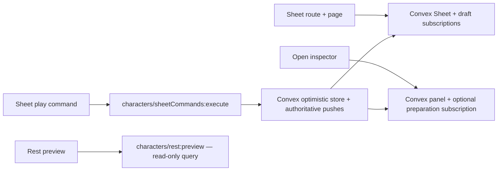

The route uses the request-authenticated Convex query bridge and preserves canonical public-handle
redirects. The page subscribes using that public handle; no result is copied from an alias cache into
a UUID cache. Draft payloads are parsed through the shared DTO at the loader boundary, including
serialized enum values. Mounted Sheet views are keyed by the returned Character UUID so switching
Characters resets overlays and unsaved play-field edits. A draft-only Character is recovered from the native draft table, not a
legacy Character fallback. Draft presence stays subscribed after the loader finishes.

Sheet commands use the generated native mutation with the displayed Sheet's `expectedVersion` and
the existing command UUID. Durable Object attendance, connection and aggregate-version state no
longer route or gate these durable writes. Campaign chat, notes, inventory and tabletop UI are not
removed; their owning integrations remain separate. Native Campaign access is not accepted yet.

The existing pure optimistic projections run inside Convex's optimistic store. They match the
returned canonical Character UUID across every loaded UUID/alias Sheet and panel query, leave
unrelated/unloaded entries alone, and never reproduce policy calculations. Convex owns rebasing,
rollback and authoritative subscription updates; mutation receipts do not overwrite the query cache.
Rest preview remains an imperative read behind the existing UI mutation interface. A latest-request
guard prevents an older preview success, failure or hit-die roll from replacing a reopened rest flow.
The Sheet roll controller resolves usable evidence only after the matching dice presentation reveals
it. A subsequent Sheet click cancels a pending request or unrevealed result; replacement and unmount
also settle the waiting consumer without evidence. Unrevealed private records, including late results,
are discarded with error feedback; TABLE and revealed records remain. Rerolling immediately removes
the previous rest preview, so a failed preview refresh cannot leave stale evidence available to Apply.
Completion still revalidates stream version, fingerprint and evidence in the server transaction.

The extra-options selector subscribes to `characters/extraOptions:list` only while the drawer is open
and a kind is selected. Creature relationships share the Creature catalogue; Vehicles use the Vehicle
catalogue. The existing 25-result search uses current authorized System sources and resets when the
kind changes. No write occurs during discovery. The retired web HTTP Character facade is removed;
there is no existing Character receipt-history UI to migrate. Builder orchestration uses the native
draft lifecycle described above. These adapters and focused tests are implementation evidence, not
complete Builder, Sheet or promotion acceptance.

### Transitional Builder and Sheet evaluation

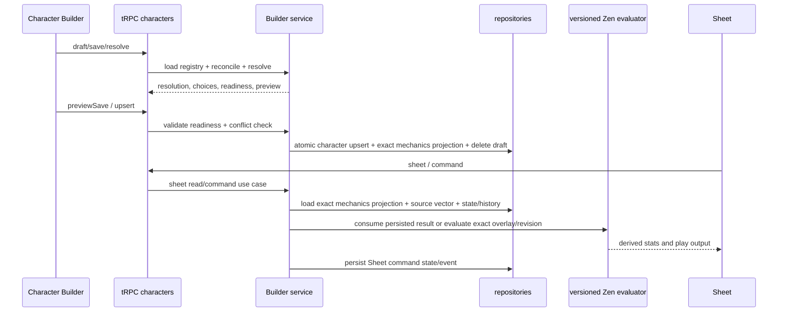

### Builder draft and intent

`characters.draft` creates or reopens a `character_builder_drafts` record. Draft payloads contain the authored character plus optional builder-intent cache. `saveDraft` persists the draft as draft status; it does not finalize the active character. Route IDs can be public IDs, resolved to subject IDs by the route-identity repository.

Builder intent is explicit: race/subrace/ancestry, classes/subclasses/specializations, background, abilities, hit points, starting-equipment decisions, feature acquisitions, chosen grant selections, spell selections, and resource grants. Every hit-point level records character level, class identity, and class level so interleaved multiclass acquisition order remains structural rather than inferred from grouped class totals. Before a character first becomes active, reconciliation initializes current hit points from that ordered progression. Later Builder edits preserve an active character's live current-hit-point state; subsequent healing, damage, typed adjustments, and rest recovery remain Sheet-owned commands. Provenance identifies the source (race, class, feature, option, manual, etc.) and timing identifies when it becomes available. Starting-equipment decisions establish progression-owned grants; runtime inventory ownership and management belong to Sheet state after play begins.

### Reconciliation and resolution

`reconcileCharacterBuilderCharacter` removes or preserves dependent selections based on provenance validity. Standalone calls load the current resolution registry, while preview/commit loads that registry once and supplies the same immutable snapshot to reconciliation and resolution. When a class or Background changes, it clears carried-over starting-equipment decisions and validates newly supplied decisions against the current source. Active edits preserve Sheet-owned inventory and never grant starting equipment again. It filters ancestry/feature/chosen-grant/spell/resource records that no longer match the current build, and merges required class resource grants. Starting-equipment options may carry a reusable character eligibility facet. Builder evaluates those facets from the equipment-free structural snapshot after grants and chosen proficiencies resolve, removes ineligible options from the returned selected class/background definition, and clears stale option/item decisions before preview or commit.

Selecting a subrace retains grants from both the base race and the subrace. Ancestry resolves from the selected subrace when it defines one, otherwise from the base race. Root class grant choices are acquired at class level 1; root subclass grant choices are acquired at the owning class's subclass-selection level, while their active level still tracks current class progression.

While an incomplete draft has no selected class levels, selected non-class sources are evaluated at effective character level 1 so ordinary race, background, feat, equipment, and ancestry choices remain authorable. Explicit level 2 or later unlocks remain gated, and class features always require the actual owning class level.

`resolveCharacterBuilder` derives summary, granted features/resources/spellcasting, outstanding required choices, blocking/warning validations, readiness, and a recommended section. It does not persist. UI uses this result for choices and progress; the final commit repeats the work server-side.

Multiclass prerequisites use one shared pure evaluator. The first selected class is not prerequisite-gated. Adding or replacing a class in a multiclass proposal requires all six ability scores and evaluates every class in that proposed set; server validation applies the same rule to crafted intent. Builder references expose structured class requirement groups, system alignment and lifestyle vocabularies, and canonical ability, advancement, ability-generation, hit-point, Standard Array, and Point Buy option metadata. Clients derive only contextual presentation such as a slot-relative Point Buy delta from those references; they do not maintain separate ruleset labels or costs. Selected-class presentation combines existing eligible feature, resource, and spellcasting grant summaries without adding acquisitions, and spell options expose authored level, school, ritual, and concentration metadata when available.

Builder presentation enriches authored references without mutating canonical intent: backgrounds provide descriptions, feature labels, and grouped authored detail rows; ancestry options provide feature previews; granted feature summaries provide ordered authored details; and starting-equipment views provide server-generated choice labels from authored filters and canonical equipment metadata. Redundant proficiency and cross-source spell candidates remain visible but disabled with their existing source label. Resolver eligibility and validation remain the authority for whether a crafted selection is accepted.

The web Builder applies backend-supplied ancestry previews synchronously from the active form value while authoritative resolution proceeds asynchronously. Resolution requests are sequence-guarded so stale responses cannot replace newer intent, and `aria-busy` clears when the latest request settles. Development builds record User Timing marks for intent, optimistic preview commit, and authoritative reconciliation; these marks are diagnostics, not production telemetry.

Selected-class grant summaries carry availability and authored presentation order and are normalized by the Builder service before reaching clients. Background references are compact, derived summaries with capped grant facts and feature labels; the selected background retains the full authored description and details. These are response projections only and do not extend canonical character intent.

Builder progress is visit-aware UI state. The rail counts only visible workflow steps; a step contributes to completion after it has been visited and its current requirements are satisfied. Unvisited requirement-free steps remain neutral, and later invalidation removes a visited step from the completed count. Resolver warnings and blocking validations are issues; unfinished steps are represented by progress rather than being relabeled as warnings.

Character Builder step navigation is URL-backed UI state through the shared optional `?step=` parameter. The provider validates it against the nine backend-backed visible steps during initial server rendering, falls back to the resolver recommendation, and owns both the active step and visited-step set. Progressive rail and Back/Next links preserve unrelated search parameters, while hydrated navigation changes only the search state and does not trigger character resolution. Browser history replays the same provider transaction; invalid step values are replaced with the current fallback.

Proficiency eligibility is a mechanical Builder rule, not an authored facet. Fixed and chosen grants from every active source contribute to the effective level for each target. Half proficiency requires a target below half, full proficiency requires a target below full, and Expertise requires existing full proficiency while rejecting an already doubled target. Ineligible options remain present and disabled with a repair reason, and the resolver emits blocking `REDUNDANT_PROFICIENCY_SELECTION` or `EXPERTISE_REQUIRES_PROFICIENCY` validation for stale or crafted selections. Selected-class DTOs group granted labels, player-facing choice instructions, and top-level choice IDs into proficiency categories; feature-owned choices remain attached to their owning feature. These presentation groups are derived and are not persisted character intent.

Draft Builder registry catalog reads must scale with relation shape, not the number of authored roots. Spell, background, feat, race, and class repositories therefore hydrate `findAll`/`findByIds` root rows and owned link rows in sets, while single-record reads delegate to the same canonical batch assembly path. Finalized Sheet and live-session lanes do not use this registry hydration: they load the committed exact source vector and vocabulary snapshot. Nested aggregate repositories retain their own loading contracts; measure those separately before broadening the batch boundary. Race resolved-list hydration batch-loads missing parent lineage by depth. Do not reintroduce per-record root hydration loops or process-wide registry caches; homebrew ownership and publication changes require request-current data unless a separately designed invalidation contract exists.

### Preview, commit, and conflicts

`previewSave` reconciles and resolves a proposed authored character against current active immutable content and the current compatible active rule revision, predicts status changes and destructive removals, and returns a change preview. For an active Character, it also returns a deterministic authored-version-vector delta and review checksum whenever the commit would change pinned content. It is safe to display before commit.

First finalization rechecks active immutable authored versions and the compatible rule revision inside the locked commit transaction, then records their exact authored-version vector, vocabulary snapshot, revision/checksum, evaluator version, and model-contract version in the Character mechanics projection. An explicit reviewed upgrade preview/reconciliation command is the only later path to change those pins, and it advances the Character stream version.

`upsert` requires readiness, locks the active row, checks the draft’s `baseActiveUpdatedAt` (and stream version where supplied), then writes canonical Character structure, exact mechanics projection, route identity, and draft deletion in one transaction. An active Character whose candidate vector differs must echo the reviewed upgrade checksum; otherwise the transaction fails closed. A stale active row becomes `CharacterBuilderDraftConflictError`/tRPC `CONFLICT`.

The repository upsert is replacement-based and transactional; omitted child state is removed. See [persistence](persistence.md).

### Snapshot, Sheet, and history

Sheet roll controls call the authenticated roll service with structured source context. The service owns randomness and returns immutable evidence; the web only presents that result. Non-manual requests must match a roll surface derived from the current Sheet projection. Ability checks, saves, skills, initiative, attacks, damage, healing, manual dice, and short-rest hit dice use this path; applying hit-die healing also references the persisted roll by ID. Canceling an unsettled presentation discards that caller-owned, unconsumed record so it never becomes visible roll history. The engine projects resolved initiative, saving-throw, and attack advantage/disadvantage modes; paired advantage and disadvantage cancel. Manual one-d20 rolls may choose a situational mode in the dice popover. Manual mixed-dice rows retain one modifier per dice term in evidence while preserving the aggregate modifier used by existing verification. Numeric modifiers apply once after the kept d20 is selected. Device-local presentation settings never affect roll authority.

The Sheet path only serves active characters. It loads the matching exact mechanics projection, its immutable authored-version documents, pinned vocabulary snapshot, canonical Character state, and separately persisted typed adjustments/preferences. It derives presentation from those bounded sources without Builder catalog hydration. An unchanged Sheet consumes the committed result; an overlay or mechanics-bearing command evaluates the exact pinned Zen revision only when its command lane requires it. Optional manual source notes, actors, and timestamps remain Sheet metadata; only typed mechanical value intent is eligible for rules evaluation. Authored provenance retains its authoritative source labels independently of those notes.

One Campaign-aware authority resolver gates Sheet reads, panels, rests, rolls, history, and commands. The Character owner retains ordinary Sheet access; the active Campaign owner may access an assigned Character and issue only the explicit GM command allowlist. Archived Campaigns are readable but reject mutations. Builder reads and structural mutations remain Character-owner-only.

The main Sheet reference projection keeps canonical skills and saving throws in their dedicated calculated surfaces. Its compact proficiency collection carries only the closed `ARMOR`, `WEAPON`, `TOOL`, and `LANGUAGE` groups, including recognized broad equipment-property grants, so clients can group training without parsing display labels or repeating skills and saves.

Focused Sheet inspection uses the closed `CharacterSheetPanelDto` union. The backend panel resolver combines engine-authored effective values and breakdowns with Sheet-owned labels, notes, editability, valid options, and allowed commands. These DTOs contain design-system semantics only; drawer geometry, responsive composition, focus behavior, and native control selection remain client responsibilities. The web exhaustively maps panel variants into one overlay inspector and does not recalculate mechanics.

Functions modules follow those ownership boundaries directly. Builder loading/resolution orchestration stays in `builderService`; eligibility, reconciliation, hit points, spell selection, starting equipment, presentation, and DTO view construction have named sibling owners. `characterRuleEvaluation` is the production mechanical boundary; the superseded TypeScript mechanics engine has been removed. Sheet projection, completed-rest orchestration, pure command reduction, command validation, and transactional persistence are owned by `sheetProjection`, `sheetRestService`, `sheetCommandReducer`, `sheetCommandValidation`, and `sheetService` respectively. Callers import the real owner rather than a compatibility facade.

#### Web Sheet state and composition

The native web Sheet uses Convex subscriptions through the TanStack Query bridge; Convex owns optimistic rebasing, rollback and authoritative updates. The former HTTP adapter's manual snapshot/restore/response-assignment path is retired for Sheet and panel reads. Derived values and changes requiring policy evaluation reconcile from the backend; the web does not reproduce those calculations.

Local React state is limited to transient interaction state and pre-commit field drafts. TanStack Form remains an Authoring Workspace and Builder tool, not a Sheet state container. Do not introduce a parallel Zustand Sheet store unless a future requirement establishes independent client state that TanStack Query and local component state cannot correctly own.

Prefer colocation and direct props while ownership is nearby. Introduce a narrowly scoped React context only when stable Sheet coordination spans a genuinely deep or branching subtree and repeated prop plumbing would otherwise couple intermediary components to behavior they do not use. Context must not duplicate server state, become a general store, or carry a monolithic Sheet controller. Every provider and layout wrapper must own a necessary behavior, state boundary, accessibility boundary, or visible structural responsibility; pass-through wrappers are not architecture.

The web Character domain exposes only its list and Sheet pages through `apps/web/src/domains/characters/index.ts`. Builder implementation lives under `builder/` by workflow ownership (`core`, `state`, `steps`, `choices`, `selection`, `save`, `shared`, and `fixtures`); Sheet implementation lives under `sheet/` by play surface (`core`, `hero`, `overview`, `vitals`, `status`, `rest`, `actions`, `spells`, `inventory`, `extras`, `notes`, `reference`, `mobile`, `inspector`, `shared`, and `fixtures`). Pages live under `pages/list` and `pages/sheet`. Internal callers import exact owning modules rather than nested barrels or compatibility aliases. Styles, focused tests, stories, fixtures, types, and helpers stay with the feature that owns them; shared folders contain only primitives used by multiple sibling features.

`CharacterSheetView` owns command dispatch, navigation, inspector focus restoration, and coordination of the one active Sheet overlay. Feature components receive only the Sheet slices and callbacks they use. Rest remains one public feature interface with private state, preview-content, recovery-summary, and responsive-overlay modules; the mobile drawer/desktop popover switch is presentation owned by that feature at `48rem`. The Sheet does not add a React context because current coordination is shallow and the native query/mutation bridge already owns server state.

Character content selections store stable authored root IDs. Draft previews and newly added sources resolve current `ACTIVE` owner, Master, or direct Campaign-shared content. First finalization pins the selected exact immutable authored versions; finalized Sheet reads and source-preserving commands keep those pins even when a root later activates another version. A Campaign share authorizes the root for that Campaign but does not create a version binding or repin an existing Character. Builder registry loading and assembly supply the exact pinned documents before planning the engine snapshot, including root feature and ancestry structure; the engine remains persistence-agnostic.

Rule evaluation is a separate pin: active Characters retain the exact activated rule revision/checksum and evaluator/model-contract version selected at first finalization. Later rule-pack activation or retirement never silently changes them. An explicit upgrade preview/reconciliation command may re-evaluate against a current compatible revision and repin it transactionally; that command increments the Character stream version. The same explicit reviewed upgrade boundary owns any later authored-version repin.

Sheet commands (typed adjustments, movement-display preference, rest, hit points, spell casting and slots, resources, conditions, exhaustion, runtime inventory add/remove/update, equipment/container placement, currency movement, and play notes) are dispatched through `dispatchCommandForUser`/`executeCharacterSheetCommand`, validated against the resolved viewer, persisted atomically, and returned with updated sheet data. The attended-live `ADJUST_HIT_POINTS` lane is the deliberate bounded exception: it locks and compares the canonical HP row with the committed mechanics projection, writes only that row, republishes the exact next Character/Campaign projections and command receipt in the same transaction, then returns a compact receipt for canonical Sheet refresh. Campaign-owner commands are restricted to approved play mechanics; player adjustments, private notes/customization, structural changes, and legacy inventory/currency custody commands remain denied. Typed resource and limited-use spell commands validate against resolved resource definitions, then persist usage through the typed resource repository path; the pure reducer does not duplicate that usage into `CharacterAuthored.state.resources`. Adjustment and preference commands also return the affected authoritative panel projections so immediate Sheet controls can replace optimistic local input with server truth. `commandId` is retry-idempotent per character: the event repository checks prior application and the database enforces a unique `(character_id, command_id)` pair.

The ordinary Sheet spell list remains the Character's committed exact authored documents. Manage Spells lazily loads a separate lightweight preparation-options query derived per active class spellcasting source from the same structured preparation capability input/output that validates `SET_PREPARED_SPELLS`: full-list preparers receive their eligible accessible current list, learned/spellbook preparers receive only eligible learned roots, and known-only sources receive no preparation options. Multiclass sources remain independent. This query is discovery, not authority or dependency input; it returns no authored documents, and the command transaction revalidates eligibility and exact owner, Master, or direct Campaign-share access before evaluation reduces committed Spell dependencies to authoritative rule output.

Campaign adjustments are assignment-scoped overlays. A Campaign value replaces the same player adjustment slot only during projection; deleting it restores the stored player value. Engine calculation includes both visible and secret Campaign effects, then actor-aware DTO projection removes secret sources, hidden conditions, revealing breakdowns, and secret hit-point metadata from the player's response. The inverse GM projection preserves mechanical authority while removing player-private inventory names/notes, spell customizations, and action/resource/reference labels derived from them; GM commands cannot mutate those fields. Character history shown to the player excludes events authored by the Campaign owner; Campaign audit history remains in Campaign events. Active known and prepared spell choices remain Sheet play state and use the same versioned GM-authorized Sheet command path; inherently granted spells remain structural and cannot be removed there.

Assigned Characters resolve nullable Campaign play-policy overrides before Sheet state transitions. Attunement uses the Campaign override when present and otherwise the active ruleset's declared slot limit; clients never submit the effective limit with `ATTUNE_ITEM`.

Unshare, member departure/removal, or authored deletion revokes the affected authority or source inside the owning Campaign-first transaction and reconciles only dependent Characters. Reconciliation begins from each Character's exact committed sources, removes only unavailable roots, preserves unrelated immutable pins, and republishes an `ACTIVE` Character when valid. Structural or required transitive loss persists the existing `DRAFT` repair path and removes live projections; authored activation alone never repins or demotes a finalized Character.

Complete rests use a read-only `characters.restPreview` query followed by the production `COMPLETE_REST` Sheet command. The preview resolves authoritative HP, aggregated class hit-die pools, ruleset recovery, eligible typed resources, selected companion recovery, and optional backend-generated roll evidence into a deterministic fingerprint. Character adjustments and Campaign overlays remain separate while deriving the effective rest result. Completion re-resolves that preview and applies HP, hit dice, spell slots, exhaustion, typed resources, selected companion state, and an optional Character maximum-HP modifier reset through the existing locked Sheet transaction. Only the Character owner may request that private reset; Campaign-owner requests are rejected and their projection omits its source metadata. The completed-rest event is appended last, stores the accepted result evidence, and the character stream advances exactly once. Concurrent retries with the same command identity converge on that stored result; stale versions or fingerprints write nothing. `USE_HIT_DIE` and `APPLY_REST` remain transitional compatibility commands and are not production web flows.

Death saves (D96) are two Sheet play-state commands. `SET_DEATH_SAVES` sets the success and failure marks at 0 HP only, with the same editor authority as `SET_HIT_POINTS` (three successes stabilize, three failures kill). `ROLL_DEATH_SAVE` is valid only while dying: the host rolls one d20 (Convex, or the Session worker room for a Character held by a running Run), the reducer applies it through `deathSavesAfterRoll`, and the same transaction records a roll card with source kind `DEATH_SAVE` through `recordRuleRollCard` (a player's roll goes to the Table, a GM's follows their stored preference, so the GM always sees it). Both commands are in `ROOM_CHARACTER_PLAY_COMMAND_TYPES`. A frozen Encounter Character actor stores `deathSaves`, so a departed or completed-Run Character that died still reads as Dead.

Typed adjustments use closed family tables and target identities outside `CharacterAuthored` and Builder drafts. The provisional `character_hitpoint_state.max_override` column is deprecated: migration backfills it into `character_hitpoint_adjustments`, repositories no longer hydrate it, and Sheet writes keep it null. Removal of the deprecated column waits for deployed backfill confidence.

Play notes are Sheet-owned titled records with groups and timestamps. Builder-owned profile, personality, and backstory fields remain structural content and are never rewritten by note commands. Spell casting is one atomic command that validates the selected source/cast mode before consuming a slot or limited-use resource. Inventory containers are owned equipment items with capacity metadata; item placement and container-owned currency remain Sheet play state. Item panels project authored item features and source-charge costs alongside item-instance pools and recoveries; charged feature rows carry the exact resource ID, as do their pool rows. Sheet reference feature rows preserve authored provenance, while eligible equipment source-charge features instead carry equipment-instance provenance and the same exact resource ID. Quantity rows represent fungible stacks only. Equipment with an owned charge pool is projected as non-stackable, so adding multiple physical copies creates a distinct owned item row and UUID for each copy. Each copy therefore owns its own `ITEM_INSTANCE` resource usage and equipment-derived source-charge actions spend only that copy's pool.

Sheet inventory item properties cross the transport boundary as structured `{ code, label }` facts. The stable code remains available for identity and commands, while the backend resolves the authored registry label so web and future native clients never derive presentation text from enum codes.

#### Extras lifecycle (Branch 05 target)

Extras are Sheet-owned instances, not Builder intent and not authored creature/vehicle definitions. The closed extra-kind core options are `COMPANION`, `MOUNT`, `OWNED`, and `VEHICLE`; every core option crossing the API supplies a stable `code` and display `label`. A creature instance has a separate relationship role (`COMPANION`, `MOUNT`, or `OWNED`) and origin (`WORLD` or `SUMMONED`). Origin records how the current instance entered play; it does not alter authored creature metadata or establish a source binding to a spell or feature.

`customName` remains the persisted player-facing override. Sheet projections retain immutable `authoredName` and expose `displayName = customName ?? authoredName`; presentation adds the authored name in parentheses only when a custom name exists. The Sheet, rather than the client, authorizes an Add Extra flow, limits eligible sources to active master definitions or active definitions owned by the current user, revalidates the selected source immediately before persistence, persists the selected origin for creatures, and opens the returned explicit creature or vehicle panel. Existing attached instances continue to hydrate from an accessible source even when that source is no longer active, so a later source lifecycle change does not orphan Sheet state.

Creature Extras may use current/temp HP, structured hit dice, assigned equipment, typed companion adjustments, and `COMPANION_FEATURE` resources. Companion armor class, maximum HP, size, alignment, and creature type overrides enter the normal engine calculation context; projections expose the effective values and clamp current HP to the effective maximum. Compact Sheet rows project one creature movement mode: the first authored non-walking speed, or walking speed when no other movement mode exists. Vehicles have current HP and assigned equipment only in Branch 05. Authored actions and features are inspection data for both kinds, not automated combat commands. Instance removal is a versioned, retry-idempotent Sheet command that atomically removes instance-scoped state, resources, adjustments, and assignments while preserving inventory ownership and event history. Source-bound summons, dismiss/re-summon semantics, and automatic source-change removal are deferred.

### Decision: Builder is distinct from Authoring Schema authoring

Authoring Schemas describe reusable authored-content structure and resolve into generic form nodes. Character Builder instead encodes product workflow and game semantics: prerequisites, level-dependent grants, source provenance, reconciliation, readiness, preview/commit, and conflict handling. Do not extend the Authoring Schema into a character workflow language merely to share UI fields; share primitives and contracts where useful, while keeping the Builder’s domain service and DTOs explicit.

If a new Builder choice affects the Sheet, update authored intent, reconciliation, snapshot assembly, and the relevant API/schema tests together. Do not persist derived engine output as a parallel source of truth.
