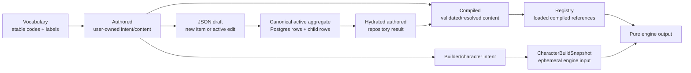

# Data lifecycle and model boundaries

> Status: canonical (current working-tree baseline)
>
> Scope: vocabulary, authored content, compilation, persistence, and engine input
>
> Update when: a model is renamed, a compiler changes output, or a new persistence/engine boundary is added
>
> Verification: `packages/shared/src/domains/subjects`, `packages/shared/src/domains/features`, `packages/shared/src/domains/grants`, `packages/db/src/repositories`, and `packages/shared/src/domains/engine/snapshot.ts`

The same game concept appears in several representations. Names are intentional; do not collapse them because their fields look similar.

## Definitions

- **Vocabulary** is controlled system data: ability codes, skills, damage types, currencies, senses, categories, statuses, and similar identifiers. SRD seed data lives in `packages/db/src/source-data/srd`; API vocabulary contracts live under `packages/schema/src/vocabulary`.
- **Authored** is the user-facing domain shape. `CharacterAuthored`, `SpellAuthored`, `ClassAuthored`, and feature/grant authored types retain intent, provenance, selection records, and relationships in a form that can be edited and round-tripped.
- **Compiled** is a normalized/validated representation used by resolution. Subject and feature compilers are in `packages/shared/src/domains/**/compilers`; compiled records are suitable for a registry and do not represent the editable draft contract.
- **Authored draft** is a complete JSON payload for a new root or an edit of an active Background, Class, Creature, Equipment, Feat, Race, Spell, or Vehicle. An active root has at most one edit draft.
- **Active aggregate** is the canonical normalized relational shape: a root row plus owned feature, option, grant, effect, and link rows. It is replaced transactionally by aggregate upsert when a draft activates.
- **Hydrated authored** is the repository boundary: repositories reconstruct authored-shaped objects from rows and related rows. Callers should not learn table layouts.
- **CharacterBuildSnapshot** is ephemeral. It is assembled from current character state and compiled registry content before each engine run and is never persisted (`packages/shared/src/domains/engine/snapshot.ts`).
- **Engine output** is derived play state (ability modifiers, proficiencies, spell slots, resources, senses, and item contributions). It is recomputed; it is not a second source of authored truth.

## Invariants

- Vocabulary IDs/codes are references; authored data chooses them, and compilers/engine interpret them through the active system.
- Authored data is the source of user intent. Compilation may add normalized values, but a compiler must not silently rewrite the draft.
- Recoverable legacy or editor-only input shapes may be normalized at the shared schema boundary when the canonical authored output remains stable. For example, Creature logistics-note editor rows normalize to canonical `string[]` before compilation and persistence.
- Persisted rows are replaced/rebuilt by repository upserts where the authored aggregate owns the child collection. See [persistence](persistence.md).
- Active aggregate replacement and draft deletion share one transaction. An edit draft's base active timestamp must still match before replacement.
- Features, feature options, grants, effects, outcomes, and details are nested aggregate content. They do not receive independent draft lifecycles.
- Duplicating an authored aggregate gives the root and every nested owned record a new ID and rewrites internal references; a copy never shares mutable owned identity with its source.
- The engine consumes a snapshot plus a registry and must not query or mutate persistence.
- Provenance on character acquisitions explains why a grant exists and allows reconciliation when an upstream choice changes.

## Character content binding

Structural character selections keep stable authored root IDs. Outside a Campaign, roots resolve against the canonical `ACTIVE` aggregate. An assigned Character may instead have an explicit binding from that selected root identity to an immutable approved Campaign content version.

Campaign versions persist a schema-validated hydrated/resolved root snapshot rather than duplicating normalized authored tables. Builder registry loading merges approved Campaign snapshots with ordinary active content, while assembly derives the same root-feature and ancestry structure expected by `planCharacterAssembly`. Persisted Character intent remains unchanged; the resulting normalized facts are evaluated through the Character's exact pinned Zen revision.

Removing an assignment deletes Campaign bindings before resolution. Reconciliation removes invalid dependent selections, preserves stale structural IDs as repair context, and persists the active Character plus owner-scoped Builder draft as `DRAFT` when a granted structural root is no longer available.
