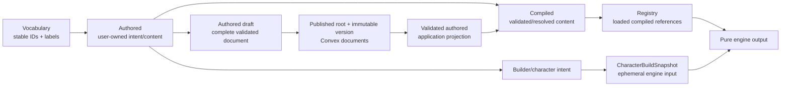

# Data lifecycle and model boundaries

> Status: canonical current Convex implementation; ADRs 0023-0025 govern authored and rules lifecycle semantics
>
> Scope: vocabulary, authored content, compilation, persistence, and engine input
>
> Update when: a model is renamed, a compiler changes output, or a new persistence/engine boundary is added
>
> Verification: `apps/apis/convex/content`, `apps/apis/convex/characters`, `packages/authoring`, `packages/shared/src/domains`, and `packages/shared/src/domains/engine/snapshot.ts`

The same game concept appears in several representations. Names are intentional; do not collapse them because their fields look similar.

This guide defines the current representation boundaries. [Shared rules runtime](rules-runtime.md)
owns immutable authored versions, vocabulary snapshots, rule pins, and upgrades.

Phase 8.2 Convex platform import admits exactly one System together with its matching
PLATFORM content source and catalogue in each atomic bootstrap. Additional platform
Systems use separate paired imports. Public System queries rely on this internal-only
admission boundary; homebrew Systems remain deferred and cannot use that importer.

## Definitions

- **Vocabulary** is controlled system data: ability codes, skills, damage types, currencies, senses, categories, statuses, and similar identifiers. SRD source data lives in `packages/source-data/src/srd`; API vocabulary contracts live under `packages/schema/src/vocabulary`. Phase 8.2 preserves the entire source tree independently of deployed persistence; native Convex import is the product admission path.
- **Authored** is the user-facing domain shape. `CharacterAuthored`, `SpellAuthored`, `ClassAuthored`, and feature/grant authored types retain intent, provenance, selection records, and relationships in a form that can be edited and round-tripped.
- **Compiled** is a normalized/validated representation used by resolution. Subject and feature compilers are in `packages/shared/src/domains/**/compilers`; compiled records are suitable for a registry and do not represent the editable draft contract.
- **Authored draft** is a complete JSON payload for a new root or an edit of an active Background, Class, Creature, Equipment, Feat, Race, Spell, or Vehicle. An active root has at most one edit draft.
- **Published aggregate** is the validated root plus its current immutable authored-version document and owned identities. Draft activation replaces the current publication atomically.
- **Validated authored** is the application boundary: Convex functions validate stored documents through shared schemas before compiling or projecting them. Callers do not depend on storage layout.
- **CharacterBuildSnapshot** is ephemeral. It is assembled from current character state and compiled registry content before each engine run and is never persisted (`packages/shared/src/domains/engine/snapshot.ts`).
- **Engine output** is derived play state (ability modifiers, proficiencies, spell slots, resources, senses, and item contributions). It is recomputed; it is not a second source of authored truth.

## Invariants

- Vocabulary IDs/codes are references; authored data chooses them, and compilers/engine interpret them through the active system.
- Authored data is the source of user intent. Compilation may add normalized values, but a compiler must not silently rewrite the draft.
- Recoverable legacy or editor-only input shapes may be normalized at the shared schema boundary when the canonical authored output remains stable. For example, Creature logistics-note editor entries normalize to canonical `string[]` before compilation and persistence.
- Persisted aggregate documents are replaced through validated Convex mutations where the authored root owns the nested collection. See [persistence](persistence.md).
- Publication and draft deletion share one transaction. The edit draft's expected base version must still match before replacement.
- Features, feature options, grants, effects, outcomes, and details are nested aggregate content. They do not receive independent draft lifecycles.
- Duplicating an authored aggregate gives the root and every nested owned record a new ID and rewrites internal references; a copy never shares mutable owned identity with its source.
- The engine consumes a snapshot plus a registry and must not query or mutate persistence.
- Provenance on character acquisitions explains why a grant exists and allows reconciliation when an upstream choice changes.

## Character content pins and Campaign authority

Structural Character selections keep stable authored root IDs. Draft previews and newly added sources resolve current `ACTIVE` owner, Master, or direct Campaign-shared roots. First finalization stores the exact immutable authored-version vector; finalized reads and source-preserving commands validate those exact versions without requiring the roots' active pointers to remain unchanged.

`campaignContentShares` grants Campaign-scoped authority to a root, not to a version snapshot. While the share remains valid, a finalized Character may keep using its pinned historical version. Authored activation changes the root's current version for drafts and future admission but does not rewrite finalized Characters.

Unshare, sharing-member removal, and authored deletion discover only actual dependents and reconcile inside the owning Convex transaction. Reconciliation removes unavailable roots, preserves unrelated exact pins, republishes valid `ACTIVE` Characters, and uses the existing `DRAFT` repair path with live-projection deletion for structural or required transitive source loss.
