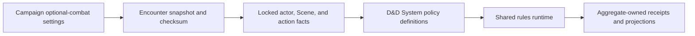

# D&D 2014 optional combat

Status: canonical target guide
Scope: the D&D 2014 miniature and combat options represented by the Phase 8 VTT packet.
Update when: an optional-combat definition, System policy, Campaign setting, Encounter snapshot,
or Gate 2–5 acceptance contract changes.
Verification: compare the definitions and source links with
`packages/schema/src/shared/optionalCombat.ts`, the D&D source adapter, and the fixed Phase 8
acceptance ledger. Source research and focused tests are evidence, not acceptance by themselves.

## Boundary

Campaign settings select UUID-backed System definitions. Encounter admission snapshots the
selected definitions and their checksums; an audited GM override is allowed only when no mechanical
decision is pending. The shared runtime supplies facts, stages, bounded choices, rolls, effects,
receipts, replay, and redaction. The D&D adapter supplies the policy. Labels, editions, and feature
names do not dispatch mechanics.

All options are disabled by default. Automatic resolves server-side; Assisted pauses for an
authorized bounded choice or roll and can be passed where the rule permits; Manual leaves the
mechanics inert and shows no rules cues (ADR 0034). Stored settings remain
auditable even when Manual makes them inactive.

## Variant policy matrix

| Definition                 | Automatic inputs and result                                                                                                                                                                                                                    | Bounded GM judgment / exclusion                                                                       |
| -------------------------- | ---------------------------------------------------------------------------------------------------------------------------------------------------------------------------------------------------------------------------------------------- | ----------------------------------------------------------------------------------------------------- |
| Flanking                   | Adjacent occupied squares, opposite side/corner, visibility, and non-incapacitation produce melee advantage; reach alone is insufficient.                                                                                                      | Unusual geometry or visibility not represented by authoritative Scene facts is manual.                |
| Alternating diagonals      | Path parity applies the 5/10-foot diagonal sequence consistently to movement and range.                                                                                                                                                        | Uncalibrated or unsupported grid facts are manual.                                                    |
| Facing                     | Authoritative orientation and occupied footprint select front/side/rear arcs; rear attacks and permitted sight checks use the pinned policy.                                                                                                   | Unusual arcs, shield-side interpretation, and presentation choices require GM policy/data.            |
| Climb onto larger creature | Size/suitability and an Athletics/Acrobatics contest create a bounded attached state; movement follows the pinned policy.                                                                                                                      | Whether a body is suitable, landing, and dislodging choices can be GM decisions.                      |
| Disarm                     | A qualifying attack replaces damage with a contest using the exact UUID-backed defender check definitions pinned by System data; size, handedness, and advantage/disadvantage facts are evaluated; success creates a dropped-item disposition. | Item grip, unusual anatomy, and unsupported item state are manual.                                    |
| Mark                       | A qualifying melee attack creates a bounded marker and permits the next eligible opportunity attack under the pinned resource/turn limit.                                                                                                      | Mark targets or timing unavailable in structured facts are manual.                                    |
| Overrun                    | A movement attempt resolves the exact UUID-backed contest definitions pinned by System data and the size modifier, then permits one bounded passage when successful.                                                                           | Legal passage space and unusual body/terrain facts are manual.                                        |
| Shove aside                | A toggle: while the Encounter uses it, the SRD Shove offers an authored 5-feet-aside option at disadvantage; a win pauses for the shover's pick of a legal in-reach square (D157).                                                             | None; with one legal square or none the pick is skipped.                                              |
| Tumble                     | A movement attempt resolves the exact UUID-backed contest definitions pinned by System data and permits one bounded passage.                                                                                                                   | Unsupported movement/space conditions are manual.                                                     |
| Hitting cover              | For ranged attacks, creature-provided cover is evaluated against the original attack total and cover creature defense; only the typed creature-cover case is automatic.                                                                        | Barriers, terrain, objects, and multiple unmodeled cover providers are manual.                        |
| Cleaving                   | A qualifying melee hit that reduces an eligible target to zero carries remaining damage to a chosen in-reach target through a bounded chain.                                                                                                   | Rider interactions, mixed damage, and target selection without structured facts are manual.           |
| Injuries                   | A configured trigger offers the GM a roll on the authored table; an accepted row is recorded on the Character as a consequence with its effect and named healing.                                                                              | Applying the effect and every recovery are GM rulings; the GM removes a recorded consequence (D187a). |
| Massive damage             | A qualifying damage event reaches the configured threshold, then resolves the pinned Constitution check and finite consequence.                                                                                                                | Unavailable Constitution or consequence facts are manual.                                             |
| Morale                     | A configured morale trigger resolves the pinned check and records a bounded flee/surrender/continue result.                                                                                                                                    | Triggering, group leadership, route, surrender terms, and narrative consequences are GM-owned.        |

Damage types, resistance, immunity, vulnerability, reduction, critical handling, and authored
advantage/disadvantage contributors remain shared stage facts or D&D policy modules; they are not
silently redefined by an optional variant. Optional action definitions must use the same action,
target, range, shape, modifier, resource, and effect primitives as ordinary authored content.

Optional-action availability and required selections are projected by the server from the exact
Encounter snapshot and current actor facts. Frontend controls render those closed descriptors; they
do not identify a D&D rule, calculate a modifier, or decide which fields a rule requires. This is the
same backend-described authoring/runtime boundary used by other schema-driven domains and leaves a
future System free to project a different action vocabulary through the same controls.

Action economy is System policy over shared aggregate-owned usage state. D&D supplies UUID-backed
Action and Bonus Action allowance definitions with bounded usage and a start-of-turn refresh. The
Encounter coordinator consumes only the exact definition selected by the System adapter; it does not
assume that another game has actions, bonus actions, reactions, spell slots, or any other D&D economy.
Overrun and Tumble first resolve against an exact hostile actor and a selected available allowance.
A declined opportunity consumes nothing; once the player starts either contest, the selected Action
or Bonus Action is consumed on success, tie, or failure. Success alone authorizes passage.
A success authorizes only the frozen remainder of that same submitted movement path and occurrence;
no later command inherits passage permission. The resumed path may cross that hostile footprint,
cannot end in an occupied footprint, and does not suppress an otherwise eligible opportunity attack.
The Scene supplies geometry while the Encounter occurrence owns the sealed continuation and receipt.

## Persistence and ownership

Campaigns store explicit optional-definition selections. Encounters store the effective snapshot,
source revision/checksum, and audited override receipt. Aggregate-owned state is used for persistent
consequences: item dispositions for disarm, attachment for climbing, marks for turn-scoped options,
and versioned injury/morale state where the policy requires it. Overrun and Tumble keep only their
pending frozen path continuation; they add no cross-command passage state. Scene owns
orientation, footprint, grid calibration, and other factual position data. No global workflow table,
feature-name branch, or client-trusted modifier is introduced.

Cleaving never silently chooses the next target, including when only one eligible target remains.
The acting Character controller or GM confirms the exact server-issued candidate. When mixed damage
types interact differently with candidate defenses, only the GM receives the allocation choice;
riders never transfer.

A disarmed Character's held/equipped disposition is a Character Sheet mutation through the scoped
Encounter capability; a Creature or Custom actor's disposition remains Encounter-actor state. This
packet does not create Scene ground-item simulation, so exact drop placement and later pickup are
visible GM adjudications. Climb attachment is Encounter-owned tactical state and never changes the
Character's authored body or inventory. A mark is represented by the existing active-effect lifecycle
with bounded per-turn usage evidence, not by a parallel mark or reaction-economy table.

**Climb cling (current, MOVE-4.T2a; follow current, MOVE-4.T2b1, see rules-runtime Drag; placement current, MOVE-4.T2b2).** The CLIMB
definition authors `effect`, the `ACTOR_RELATIONSHIP` active effect a won climb gives the climbed
creature (sourced by the climber; `SOURCE_FOLLOWS_TARGET` plus a `SOURCE_ATTACK_ROLL_INFLUENCE`
whose empty `actionEffectIds` means every attack). The climb seals `successMovement`
`ENTER_BLOCKER_SPACE`: a won contest's receipt audits `enteredPosition`, the contact pulled until the
climber's footprint lies inside the blocker's (`enteredBlockerPosition`, from the footprint the
response verified against `blockerCurrentnessChecksum`), and the move ends there with one token write.
The walked path, its cost and its fog end at the contact; `terminalMovementPathEnd` lets both the
publication segment check and the stored geometry check accept that one step in. The policy capability's `passageAppliedEffects`
re-derives its plan from the pinned definition; `evaluateEncounterMovementPassageResponse` builds the
record on a SUCCESS contest and the PASSAGE settlement step carries it as `createdEffects`.
`persistMovementSettlements` refuses an effect whose owner, origin or checksum does not match the
planned blocker and occurrence, then creates it. A Character-owned blocker also takes a forced Character\nstream version advance (phase `MOVEMENT_PASSAGE_EFFECT`, the same `applyMechanics` path Grapple's hold\nuses), published as a `PASSAGE` `MovementCommandTransition`. Scene undo refuses the move whose\ndecision was answered (`settledEncounterMechanics` also checks the receipts of the occurrence the\nmove rooted), so a settled cling cannot outlive the token's position. Nothing in the engine names\nclimbing.

**Marking (current, ATTACK-13.T1).** The MARK definition authors `qualifyingAttackKind` (`MELEE` or
`ANY`) and the `effect` a qualifying attack gives its target: one timed grant whose result lifecycle
anchors to the SOURCE's END_OF_TURN with `exclusivity: 'PER_SOURCE'`. The policy
(`systems/dnd5e/optionalMarkPolicy.ts`) compiles it into an `attackAppliedEffects` entry on the
optional-combat capability; `prepareAttackTargetGrantTriggers` (`encounterAttackAppliedEffects.ts`)
turns each entry into an `ATTACKED` grant trigger beside the holder's incoming-damage triggers, so it
lands on hit or miss. Melee is the attack's classification (`isMeleeAttackSource`), never its distance:
a reach attack marks. A mark made on the attacker's turn counts that turn's end as a tick, so it lasts
until the end of the attacker's next turn. `PER_SOURCE` makes the new mark replace the attacker's
earlier one on any holder (`replacedEffects`, restored by undo); another attacker's mark stays. A
homebrew copy may change the attack kind, anchor or grants with no Marking-specific code.

Marking (ATTACK-13, current) is offered in Campaign settings once its System policy resolves it. The
main action root, opportunity attacks and Legendary Action attacks each give their target the mark
through the same `prepareAttackTargetGrantTriggers`; a Legendary mark persists through the turn
re-derivation, which also ends the owner's earlier mark on any other holder. Area attacks with an
attack roll do not mark yet (see the deferred edge cases in `docs/roadmap/future-enhancements.md`).

**Marked opportunity attacks (current, ATTACK-13.T2).** The SRD mark's grants also carry a
`FREE_OPPORTUNITY_REACTION` `ENABLE` modifier beside its opportunity-attack advantage. The mark is
`fromSourceOnly`, so only the marker benefits. The D&D movement-reaction policy
(`systems/dnd5e/reactionEligibilityPolicy.ts`) then chooses the SRD "Free reaction allowance"
capability (`maximum: 1`, `refreshBoundary: EACH_TURN`) instead of the reaction while it is left this
turn; the option spends whichever allowance the policy chose. Conditions that suppress reactions
suppress the free allowance too, and a reactor that cannot act gets no option. See
[rules runtime](rules-runtime.md) for the turn-scoped usage record.

**Rule-owned actions (current, ATTACK-16.T1b).** Any optional-combat definition may author
`raisedEffects`, up to eight Effects (unique ids) the rule raises as its own actions: the rule,
never a player, decides when one runs and on which actor. The action source is `RULE`
(`rules-runtime/src/encounterRuleAction.ts`), id `<actorId>:RULE:<definitionId>:<effectId>`.
`resolveEncounterActionSource` reads the Effect from the Run's active definitions
(`activeOptionalCombatDefinitions`, so a rule that is off or a MANUAL Run makes the id stale, as
does an Effect the definition no longer raises), compiles it with `compileEffect` and
`bindEncounterEffect`, and runs it through the compiled graph path like a basic action. It resolves
before the Character and Creature branches, so it serves both. Each raised Effect is authored as an
activated self action, the shape the action compiler reads, and holds at most one lasting effect
(one timed condition or one grant), as any action does. The activation is replaced by `FREE`, so it
spends no action economy; the label is the definition's. Admission refuses every root that names a
rule action unless it is a resume or a rule-raised root (`SOURCE_REQUIREMENTS_NOT_MET`), so no member
applies a rule's outcomes at will.

Massive Damage (ATTACK-16, current) is offered in Campaign settings once its System policy resolves
it (T2). A failed save raises a rule action (ATTACK-16.T1c2b). Massive Damage's optional
`failedSaveEffectId` names one of its `raisedEffects` (the document refuses any other id); absent, a
failed save changes nothing. The SRD seed authors System Shock this way (ATTACK-16.T1d): a `1d10`
RANGE table whose 1 is `HIT_POINTS_TO_ZERO`, 2-3 that outcome then `STABILIZE`, 4-5 Stunned, 6-7 a grant of
no reactions and disadvantage on attack rolls and ability checks, and 8-10 a grant of no reactions; each
lasting row holds until the end of the holder's next turn. `HIT_POINTS_TO_ZERO` is a generic target-only
outcome, a sibling of `KILL` with the same receipt and undo path: it sets current and temporary hit points
to 0 without dealing damage (no D96 overflow, no damage triggers), so a Creature is defeated and a
Character starts dying through the ordinary 0-hit-point transition. The rule's former fixed outcome bands
and their executor-less primitives are gone. After every committed command,
`raiseRoomRuleEffects` (`roomEncounterRuleTriggers.ts`) reads the rule receipts in the current trigger
window (persistence guide, SYSTEM admission), and for each pinned `SAVE_FAILURE` whose holder still
stands and whose action has not run, raises the named Effect on the holder as a self-targeted `ACTOR`
root (`systemTrigger.trigger: RULE`, parent = the save's receipt). An authored system shock rolls its
table through the test-less direct phase (T1c2a). The kernel names no rule: the trigger reads only the
pinned rule's failed-save action.

Morale (ENCOUNTER-6, current) is offered in Campaign settings once its System policy resolves it.
The GM projection derives each creature's offers from Run state as a pure read: at or below half
hit points, half its side removed, and the leader named on an earlier group check defeated or gone.
Surprise, "cannot harm the opposition", and a leader incapacitated or taken prisoner have no
derived fact and are offered as GM-declared triggers. Two GM-only commands own it. `MORALE_SAVE`
lets the policy seal the roller (the named leader, or the side's best able save), DC, overwhelming-
opposition contributor and outcomes, then rolls the roller's own saving throw on the shared d20 path
with the usual roll card and visibility. `CONFIRM_MORALE` records the GM's outcome, proposed or not,
on every creature the check covered. The outcome lives on the Encounter actor beside the triggers
already fired, which are not offered again; the command receipts keep the history. Characters never
check morale: their players decide. Undo does not reverse a morale check; the GM confirms another
outcome instead.

Facing (ATTACK-12, current) is offered in Campaign settings. Facing is the token's
`rotationDegrees`, and both Encounter projections carry the rule's `facingStepDegrees` (null when
the rule is off). The tabletop reads that step and nothing else. While it is set, it draws Encounter
creatures' facing, and a walk ends with a facing choice that offers the direction of travel first.
The choice is sent as the move's `facingDegrees`. A selected creature the member controls offers
"Change facing (reaction)", which sends `CHANGE_FACING`. The room checks the rule, its step and the
reaction.

The D&D policy may be reused by other systems only through the shared typed primitives. Another
System can supply different contest, sense, damage, action-economy, or consequence definitions
without changing the runtime coordinator. Homebrew follows the same UUID-backed authored source,
revision, checksum, and capability validation path.

## Gate ownership

- Gate 2 proves contracts, current source/capability checks, policy execution, persistence, authorization, concurrency,
  receipts, replay, rollback, and privacy for representative combinations.
- Gate 3 owns Campaign settings, Encounter overrides, initiative/action controls, and accessible
  selectors.
- Gate 4 owns facing indicators, marks, positional previews, and token presentation.
- Gate 5 owns the local Convex lifecycle, transient WebSocket/multi-client behavior, browser journeys,
  replay/privacy/performance, and exact cleanup.

The fixed Phase 8 acceptance ledger remains the quantitative source of completion. Adding a
definition to this guide does not mark its case accepted; each case must advance through its stated
focused, review, and database evidence.

## Deferred execution variants

- Exact substitution for one attack inside Multiattack, Extra Attack, or a reaction attack remains
  deferred. The current packet admits an optional contested action only through an exact
  System-defined allowance already selected by the action resolver; FREE, REACTION, and
  no-activation sources cannot initiate it. Supporting individual-attack substitution requires a
  separately authored attack-allocation contract rather than approximating it as another Action.

## Sources

- [D&D 2014 Basic Rules: Combat](https://www.dndbeyond.com/sources/dnd/basic-rules-2014/combat)
- [D&D 2014 Basic Rules: Using Ability Scores](https://www.dndbeyond.com/sources/dnd/basic-rules-2014/using-ability-scores)
- [D&D 2014 Dungeon Master's Guide](https://www.dndbeyond.com/sources/dnd/dmg-2014)
- [D&D 2014 DMG reference](https://www.dndbeyond.com/sources/dnd/sae/dungeon-masters-guide-2014)

This guide paraphrases mechanics and records implementation boundaries; it does not reproduce
rulebook text.
