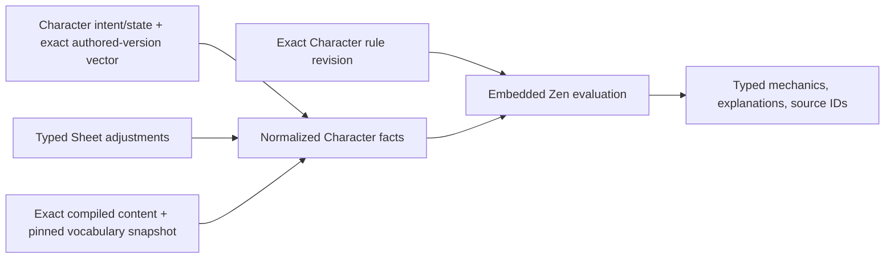

# Character engine — historical

> Status: historical; [shared rules runtime](rules-runtime.md) is the canonical current contract
>
> Scope: normalized Character facts, exact versioned mechanics inputs, rules evaluation, and derived output
>
> Update when: the transitional Character evaluator changes before the ADR 0023/0024 cutover
>
> Verification: rule-pack revision and Character evaluator contracts, migration fixtures, and focused Character tests

This guide records the current version-pinned Character implementation only. It must not be used to
extend the target architecture. ADRs [0023](../adr/0023-shared-rules-kernel-and-system-capabilities.md)
and [0024](../adr/0024-current-published-authored-content.md) replace global rule-pack selection,
authored version vectors, and consumer upgrade workflows with runtime capability discovery over the
current published modular definitions.

The current rules boundary turns normalized Character facts plus an exact pinned rule revision into
deterministic derived play data. It is not a repository and does not own persistence.

## Inputs

`CharacterBuildSnapshot` contains D&D-5e-family character inputs: identity/system, total level, race/background/classes, base ability scores, ordered per-level hit points with explicit class identity and class level, active features with provenance/timing/selections, chosen grant selections, carried inventory items with compiled forms plus equipped/attuned state, typed mechanical adjustments, movement-display preference, stable spell sources, and companion calculation inputs. Active features include structurally granted class, subclass, race, ancestry, and background features even when no redundant acquisition row is needed. It is assembled fresh and never persisted. Each class entry represents one base-class progression and carries an optional `subclassId`; subclasses are not duplicate pseudo-class rows. Sheet assembly consumes the persisted hit-point order directly and never rebuilds it from grouped class totals.

Chosen grants are addressed by grant ID, progression level, and stable provenance identity. Reusing one authored grant under multiple classes, features, or options must never let one owner's selection satisfy another owner. A selected feature option uses the character feature-acquisition ID plus option ID as its grant provenance.

Draft structural selections use stable authored root IDs and resolve against active immutable content. A finalized Character mechanics projection stores the complete exact authored-version vector, including transitive dependencies, alongside its exact rule revision and vocabulary snapshot. Equipment snapshot entries additionally carry an explicit `ContentRef` with system ID and `ACTIVE` binding plus the compiled item. An explicit preview, reconciliation, and commit operation is required to replace a finalized vector. Immutable Encounter rule-pack revisions are a separate application-owned binding described below; they do not revise the Character assembly model.

`CharacterAssemblyRegistry` contains compiled classes, races, backgrounds, features, feats, equipment, spell and grant material, and optional system references. The caller loads it (normally through DB repositories/functions); engine and assembly functions are pure readers. Ordered active spell groups are backend Sheet projection output, not registry contents. For each projected active spell group, authored `SPELL_CAST_LEVEL` scaling is the explicit intersection of the spell's legal cast levels and the source's available slot levels. Contextual `TO_HIT` and `SAVE_DC` targets are mutually exclusive; `DAMAGE` targets are bonus-only.

The normalized facts include the data needed for grant/source ordering and eligibility, modifiers/stacking, derived formulas, spell access/slots, resources/charges, rest/exhaustion/attunement, and action availability. TypeScript attaches stable identities and provenance but does not decide those mechanics. Zen returns typed results with domain explanations and source IDs; its native trace is diagnostic only.

## Resolution responsibilities

One top-level Zen Character derivation resolves all mechanics for one structural fact set and may invoke pack submodels. It applies grant/source ordering and eligibility, modifiers/stacking, derived formulas, spell access/slots, resources/charges, rest/exhaustion/attunement, and action availability. Fact discovery and spell hydration run before that evaluation, in parallel with exact revision binding where possible; no intermediate mechanics result is rendered. The retired D&D 5e 2014 functions workspace kept a separate rule-order contract; current ownership is documented in [shared rules runtime](rules-runtime.md).

That complete result is a materialized mechanical snapshot, not the handler for every play-state command. Fast HP, usage, notes, and presentation commands validate and apply against the committed snapshot without rebuilding it. Commands that change mechanical facts evaluate `character-policy` once for the prospective facts. Character and Encounter actions use their bounded action contracts under the same exact rule revision. One command selects zero or one evaluation lane; the browser does not make rules requests per Sheet section, and the backend does not fan one command out across independent models. [ADR 0021](../adr/0021-command-scoped-rules-responsibilities.md) owns the invalidation matrix.

The output includes derived ability scores/modifiers, saving throws, skills, passive checks, movement, initiative, armor class, max hit points, proficiencies, senses, spell state/slots, resources, per-source spell mechanics, per-instance item mechanics, equipment-feature source-charge bindings, companion stats, and typed explanations. Identical normalized facts plus the exact revision/checksum and evaluator/model-contract version must produce identical output.

Compiled effect groups preserve their stable effect ID and order, compiled invocation, and compiled path entries. A compiler must not reduce an authored effect to outcome arrays or otherwise discard targeting, saves, path overrides, timing, roll-table behavior, follow-up checks/saves, duration, lifecycle, or manifestation data.

Spell access resolves class, race, and subrace grants against the same character snapshot. Race and subrace grants use character-level gates, preserve their authored casting ability, and resolve chosen grants from the stored authored selection instead of exposing every candidate. Per-source spell mechanics use that grant-specific ability for attack and save calculations, including characters with no spellcasting class; class-wide derived spell values remain the default only for sources without an authored override.

`CLOSED_RULE` is a closed resolver-dispatch discriminant for deterministic SRD behavior that has no smaller existing typed outcome. It is not a scripting language and carries no free-form parameter bag. Values that vary per record remain in existing typed invocation, target, duration, path, manifest, modifier, or result fields. **Transitional ([ADR 0038](../adr/0038-rules-authored-from-core-options.md)):** no new closed rule kinds are added. Existing kinds stay fail-closed and manual until SPELLS-4 converts them to core authoring options and deletes them; a mechanic that cannot be expressed gets a new generic option, not a resolver.

## Sheet adjustments and calculation provenance

Application orchestration projects persisted adjustments through `toCharacterMechanicalAdjustment` before snapshot assembly. That projection deliberately removes character ownership, optional `sourceNote`, actors, and timestamps. The engine receives only stable adjustment identity, typed target, and mechanical value.

Each calculation returns its effective value and breakdown from the same pure resolver. Authored, equipment, and feature contributions retain stable mechanical provenance in the breakdown; repeated accepted grants are distinguished by their ordered fold index plus typed source identity rather than grant ID alone. Manual additions participate in normal calculation; an absolute target override is applied last and marks retained contributions as suppressed. Removing the override restores the current authored and additive result without restoring a cached total. Adjusted abilities feed saves, skills, passives, spell values, Constitution-derived maximum HP, and ability-based resource maxima. Repeated spells are keyed by source identity, while items and companions are keyed by owned-instance UUID.

Derived output is never canonical Character state or a generic presentation cache. A validated, bounded evaluator result is persisted only inside an exact Character mechanics or Encounter projection, with its complete input identity and checksum. The evaluator receives application-owned dice evidence as normalized facts and has no random access.

## Rules-system and encounter boundaries

Application orchestration resolves the system's `rulesetCode` and `rulesetVersion` through a fail-closed rule-pack registry before calling Zen. A Character draft preview uses the current compatible active revision; first finalization rechecks and pins that exact revision transactionally. An unsupported identity is an error, never a fallback to D&D.

The SRD seed installs the repository-owned D&D 5e 2014 Character model after the content corpus. It replaces only canonical model keys and their fixtures, preserves unrelated administrator-authored models, activates a new immutable revision only when the merged document changed, and backfills only active Characters that do not yet have a revision pin. A different open administrator draft aborts installation instead of being overwritten; rerunning after an activation/backfill interruption is idempotent.

The versioned rule pack is the extension seam. Later active-pack changes never silently affect a Character; retirement does not invalidate a pin. Explicit upgrade preview and `UPGRADE_RULE_PACK` commands re-evaluate and repin a Character transactionally, incrementing its stream version without exposing an intermediate client state. Authored content still follows its current or Campaign binding, so this pin is not a promise of full historical content replay.

VTT encounter sequencing belongs in the separate Encounter event application module. New Encounters retain their existing activated rule-pack pin. The repository-owned `encounter-actor-policy` evaluates all non-Character actors as one bounded fact set for initiative modifiers and feature-resource maxima; GM projection and state-changing commands use the exact Encounter pin, and a changed state is evaluated before the final response. A `RESOLVE_ACTION` command supplies server-assembled actors, targets, current Encounter state, untrusted selections, and application-owned dice evidence as normalized facts to the same embedded Zen evaluator. Orchestration validates target scope, applies Encounter and Character Sheet changes in one transaction, and stores exact revision/version identity, facts, diagnostic trace, rolls, proposed/applied outcomes, and optional GM override. The character evaluator and compiled authored content still do not persist rolls, targets, turns, or outcomes.

Arbitrary JDM Function nodes and nondeterministic or I/O-bearing expressions are rejected. The reserved `character-grant-fold`, `character-action-resolve`, and `encounter-actor-policy` models are the only Functions: their complete graphs and sources are repository-owned and server-locked, their facts/results are bounded, execution is capped at 50 ms, and no product editor exposes these models. They handle the ordered accumulator, bounded action-template work, and batched Encounter actor calculations that expression nodes cannot safely represent; the surrounding Character graph continues to own visible rule tables and expressions. Application-owned dice remains external and supplied as facts. `CLOSED_RULE`, `MANUAL_ADJUDICATION`, and effect kinds without an explicit resolver remain manual; neither Zen nor the compiled-effect catalog implies blanket execution. Geometry, movement, fog, walls, doors, zones, and renderer state remain outside this rules boundary; mechanically triggered effects are inside it. See [ADR 0019](../adr/0019-versioned-cross-domain-rules-runtime.md).
