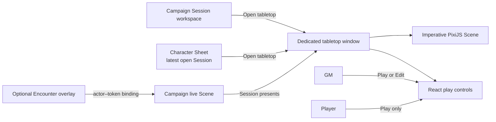
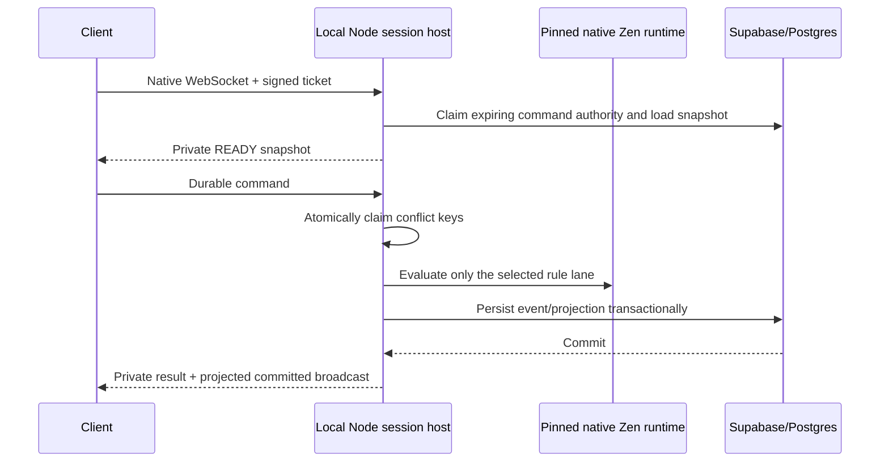
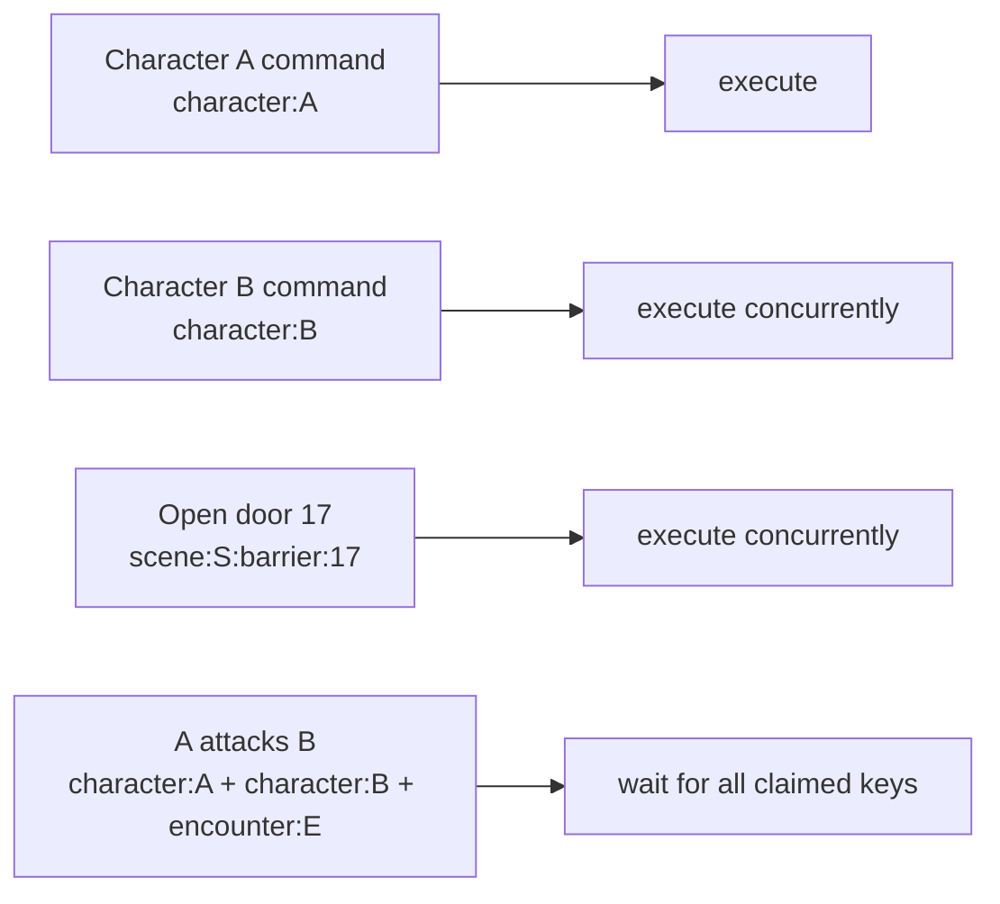

# Live-session coordination

> Status: native remote/local backend and retained production client implemented; the deployed remote gate remains Phase 08 work, while the headed three-hour hardware soak has passed.
>
> Scope: remote Durable Object coordinator, local Node host, authoritative command execution, synchronization, and deployment ownership
>
> Update when: admission, native WebSocket contracts, conflict scheduling, persistence, prediction, or deployment changes
>
> Verification: `apps/session-worker`, `apps/session-host`, private Netlify executor tests, authenticated local integration, and ADRs 0020–0021 plus 0027

Managed remote rooms run in `apps/session-worker`: a Cloudflare Worker routes each Campaign session to one hibernatable Durable Object. Local rooms run in `apps/session-host`: a Node process invokes the same application services and native Zen evaluator directly. Both expose the same Zod-validated native WebSocket protocol and use Supabase aggregate versions as canonical gameplay state. Cold room hydration reads bounded aggregate version metadata plus checksum-verified Character, Encounter, and Campaign Scene projections; it does not reconstruct normalized Encounter mechanics or run Zen before a command requires it. The Session's presented Scene is hydrated independently from the optional Encounter overlay. Ordinary Encounter API reads use the same current Encounter projection for both owner and player contracts; the player view is derived by strict server-side redaction rather than a second aggregate hydration path.

## Browser surface ownership



The tabletop is a separate authenticated browser surface so the Campaign workspace or Character Sheet can remain open independently. A stable Campaign/session window name reuses the same tabletop window, which may be tiled, moved to another display, or screen-shared. Navigation is one-way: the Session workspace or the latest open Session associated with a Character Sheet launches the tabletop; the tabletop does not become a launcher for workspace or Sheet windows. The GM may present and switch Campaign Scenes before, during, or after combat. Starting an Encounter binds its actors to tokens on the already-presented Scene; ending it removes the combat overlay without replacing the Scene.

One admitted user may keep multiple devices connected to the same Session. Each connection receives its own short-lived ticket and private projection; opening a tablet tabletop does not displace that user's desktop workspace or phone Character Sheet. Camera, zoom, selected tool, mode, and open panels are connection-local, while token positions, doors, fog, Character play state, and other committed gameplay remain shared through room authority. The server derives permissions from Campaign membership rather than trusting a device-selected role. Managed play supports this composition directly. The local host protocol also supports concurrent connections, but the current developer endpoint does not provide secure LAN discovery or browser delivery; a future launcher must supply that trusted local origin before local multi-device play is presented as an end-user workflow.

Tablet landscape is a first-class map surface. Player tablet play is map-first and keeps permanent chrome minimal; GM tablet play uses collapsible drawers for live and editing tools. Phone play is Character-Sheet-first. During an Encounter, the phone tabletop remains a focused, usable player surface for locating and moving the bound token, panning/zooming, measurement, and authorized Scene interactions, but it is not treated as a compressed full-map editor. Outside an Encounter, Phase 08 provides the authorized projected Scene without inventing exploration-actor control. Responsive behavior follows available space and input capability rather than device sniffing or separate client implementations.

When that open Session marks the displayed Character present, Sheet play-state commands use the same live-session WebSocket as the tabletop instead of the ordinary HTTP mutation path. The Sheet may project an existing optimistic UI update locally, but it treats the command as successful only after the coordinator returns the persisted `COMMAND_COMMITTED` result. The high-frequency `ADJUST_HIT_POINTS` lane returns a compact public receipt with no Sheet payload; the originating Sheet retains its optimistic value and immediately refetches its bounded canonical Sheet query. Character commits from another admitted client likewise carry no private response payload and invalidate the relevant Sheet caches. A Character that is not present in an open Session continues to use the ordinary HTTP path. This keeps the independently open Sheet responsive without allowing HTTP mutations to race the room's command-authority lease.

The transitional live maximum-HP policy lane follows the same public receipt contract while evaluating
the currently committed Character mechanics input. Its old exact rule-revision pin is not a target
contract: ADRs 0023-0025 replace it with current capability discovery and a frozen occurrence snapshot
when execution starts. It locks Campaign before Session authority and Character ownership state,
validates the checksum-bound base and Campaign mechanics projections, and commits the adjustment,
clamped HP, both projections, stream version, and idempotency receipt atomically. Campaign overlay
provenance distinguishes a Character-owned modifier from a Campaign-owned override without
reconstructing Campaign adjustment lists. Replays do not rerun mechanics, and no private mechanics
document is returned to the Worker or browser.

React owns the window header, mode controls, accessible alternatives, Scene selector, and editor inspectors. PixiJS owns only frame-rate Scene rendering. GMs may switch between Play and Edit while live. Players never receive editor chrome and may use only authorized Character actions and interactive Scene elements. Reusable definitions supply initial structure; committed live edits belong to the Campaign Scene aggregate.

## Remote command flow

```mermaid
sequenceDiagram
  participant Client
  participant API as Netlify API
  participant DO as Session Durable Object
  participant Exec as Private Netlify executor
  participant DB as Supabase/Postgres

  Client->>API: Authenticated ticket request
  API->>DB: Authorize Campaign/session membership
  API-->>Client: Single-use 60-second ticket
  Client->>DO: Native WebSocket + signed ticket
  DO->>Exec: Claim authority and load snapshot
  Exec->>DB: Authorize + load aggregate versions/private state
  DO-->>Client: Private READY snapshot + delivery high-water
  Client->>DO: Durable command(commandId, expected versions)
  DO->>DO: Journal PENDING; atomically claim conflict keys
  DO->>Exec: Signed private command request
  Exec->>DB: Reauthorize, evaluate pinned native Zen, commit transaction
  DB-->>Exec: Persisted result and aggregate version
  Exec-->>DO: Idempotent command result
  DO->>DO: Journal terminal result and delivery sequence
  DO-->>Client: Private caller result + projected committed broadcast
```

The DO-to-Netlify hop applies only to durable commands. Pointer movement, drag previews, selection, and measurement previews are bounded transient envelopes handled directly between admitted WebSockets. Token drag segments are checked against the authoritative scene geometry in the room coordinator before relay. When the scene uses on-drag reveal, the coordinator derives recipient-private temporary fog and newly visible scene objects from the accepted path; none of this touches Netlify, Zen, or Postgres.

Netlify remains viable because native Zen runs during an ordinary on-demand Node invocation. It does not require an always-on process. Warm invocations may reuse loaded modules, but correctness never depends on process memory or a warm evaluator cache.

Managed Scene commands use a dedicated bounded lane: one locked Postgres read verifies active membership, exact Campaign and Session identity, the open Session, the current room lease, the checksum-verified Campaign Scene projection, any optional Encounter binding, and any prior command receipt. Scene-only commands take locks in `Session → lease → Scene` order. Encounter-bound movement takes `Session → lease → Encounter → Scene → actor-token binding` before rule state and receipts. Presentation and binding changes follow the same roots but omit mechanics that they do not execute. TypeScript reduces the validated projection, then one dependent CTE appends the immutable Campaign Scene event and compare-and-swap publishes the next checksum-verified projection. Missing context, a lost lease, or a checksum/version mismatch fails closed; ordinary non-live GM Scene editing retains its direct Campaign authorization path.

## Local command flow



Local hosting avoids the Cloudflare-to-Netlify hop while preserving the protocol, current capability
discovery, frozen occurrence semantics, reducers, command identity, private projection, and
persistence semantics. It is online local hosting, not offline-first: Supabase still provides identity
and durable state unless a later product decision changes that boundary.

## Deployment ownership

| Surface                                         | Process                                       | Initial deployment                   |
| ----------------------------------------------- | --------------------------------------------- | ------------------------------------ |
| Web, SSR, ordinary tRPC, ticket issue           | `apps/web` + `apps/apis`                      | Netlify                              |
| Remote WebSocket rooms and transient fanout     | `apps/session-worker`                         | Cloudflare Worker + Durable Objects  |
| Remote durable command execution and native Zen | `netlify/functions/live-session-executor.mts` | Netlify Functions                    |
| Local WebSocket rooms and native Zen            | `apps/session-host`                           | Headless local Node process          |
| Identity and canonical gameplay state           | Supabase/Postgres                             | Isolated staging/production projects |

No separate repository is required. Named Wrangler environments isolate the staging and production Workers and Durable Object storage. Netlify Deploy Preview configuration points at the staging Supabase project and staging Worker; the Production context points at production. Render is not part of the initial managed architecture. A future launcher can start the local host invisibly; a polished self-hosting installer remains out of scope.

The private `live-session-executor` is pinned to Netlify's `cmh` region in `netlify.toml`, colocated with the current US East (Ohio) Supabase environments. A database-region move must update that deployment setting in the same cutover.

## Admission and authority

The authenticated Campaign-session API issues a signed ticket containing exact Campaign ID, session ID, user ID, membership role, unique ticket ID, and one-minute expiry. Browsers offer the application protocol and ticket as WebSocket subprotocols. The coordinator returns only the application protocol, consumes the ticket once, and rejects origin or room mismatches before admission.

The remote Worker and local host claim the existing expiring Postgres command-authority lease. Character, Encounter, and scene transactions verify that authority under lock so ordinary HTTP mutations cannot race a participating live aggregate. Each 10-second lease renewal also returns the Campaign's current active membership roles. A removed member or a socket whose ticket role no longer matches receives a connection-level `UNAUTHORIZED` rejection and closes with policy code `1008`; unaffected members remain connected, and the revoked client must obtain a fresh ticket. If the member whose identity last renewed the room has left, the coordinator retries through another connected identity before treating authority as lost. The Durable Object persists its renewal deadline and uses one multiplexed alarm to renew through the private executor while sockets, authoritative work, or reconnect grace remain. It never holds an outbound database connection. Retryable renewal failures pause durable command draining and schedule a bounded retry; terminal authority loss closes attached sockets and requires a fresh ticket and canonical hydration.

When renewal reports changed aggregate versions, the local host drains its existing conflict-key scheduler before replacing the canonical snapshot and coordinator. Commands already accepted finish under the old scheduler; commands arriving during refresh wait for the replacement. The Durable Object retains its single journal-backed scheduler while it refreshes canonical state. Neither adapter may split one room's durable work across independent conflict-key domains.

## Conflict-key scheduler

The scheduler is dependency-aware, not a room-wide queue and not three coarse type lanes.



- The server derives a conservative dependency and mutation set from the validated command; the client does not declare authority.
- Keys are acquired atomically as a set. A command never accumulates partial claims.
- `scene:<id>` conflicts with every descendant; resource keys conflict only with the same resource or a broad ancestor.
- Earlier overlapping work keeps conflict-local FIFO. Unrelated work may pass it.
- At most eight authoritative commands execute concurrently per room.
- Encounter actions claim the Encounter plus every bound Character they may read or mutate. If a future rule can affect an unknown participant set, it must claim the broader Encounter key before evaluation.
- Postgres row locks for multi-aggregate transactions use sorted canonical keys.

Scene events retain every recursively derived changed conflict key, including fog chunks inside batch deltas. A stale scene command rebases only when every change since its base version is disjoint from its requested keys; otherwise it fails as stale. This permits two token/door resources to commit concurrently without treating the scene's monotonic version as a global mutex while preventing derived exploration from being overwritten.

## Delivery, replay, and hibernation

Each durable command has a stable command ID and fingerprint. The DO stores `PENDING`, execution attempts, and terminal result in SQLite. It retains every nonterminal command and the newest 10,000 terminal receipts per room. A result is assigned the next global `deliverySequence` when it becomes journaled delivery truth, not when accepted. Aggregate versions remain independent and canonical in Postgres.

An ambiguous executor timeout remains pending and keeps its conflict-local fence. Retrying the same command ID is safe because the application services return the persisted result. A delayed replay remains valid even when later commands have advanced the aggregate. Browser Character caches apply requester results monotonically against the latest `READY`, committed broadcast, and cached stream versions; an older historical receipt triggers canonical refetch instead of replacing newer Sheet state.

Reconnect receives a full private `READY` snapshot with the global delivery high-water, then statuses only for pending command IDs originally submitted by that authenticated user. The high-water does not imply the client was authorized to see every lower delivery. Hibernation or isolate eviction restores the journal, lease-renewal deadline, and retry schedule from SQLite; a new connection cycle reloads canonical gameplay state through the executor. In-memory locks are never recovery truth.

The room may retain an exact Character mechanics payload only after the executor has loaded and
checksum-verified its durable projection. On each eligible host command it rechecks the compact
durable projection identity (stream, current capability/source identity, whole-projection checksum,
and command-lane checksum); a missing or mismatched identity falls back to the full verified read.
Once a command creates an occurrence, its frozen execution snapshot—not a consumer rule pin—governs
resume and replay. This server-only payload is stripped at the executor boundary and never enters a
browser `READY`, transient, or Durable Object journal; authorized receipts expose only their redacted
evidence contract.

## Private state

Scene snapshots, deltas, and token-drag previews are projected separately for each admitted viewer. Hidden or unexplored tokens, unrevealed barriers and doors, unrevealed lights and darkness, GM annotations, and other players' fog are withheld server-side. An owner may explicitly request one player's transient projection while using player-preview mode; this affects only that owner socket and does not broaden any player delivery. Character and Encounter response payloads are returned only to command requesters; peers receive committed aggregate/version information. Full reusable scene-definition APIs remain owner-only.

Token movement persists the validated sampled path, final position, and derived exploration as one append-only scene event. `Undo last token move` is owner-only and briefly claims the scene-wide conflict key while the server finds the latest eligible move. It appends a provenance-bearing inverse movement plus exact affected fog-layer replacements; it never rewrites or deletes prior events. Later overlapping token or fog changes make an undo fail closed, while unrelated state such as a door change remains intact.

A primary scene change and its automatically derived exploration chunks commit as one `BATCH` delta under one scene version. Players receive a fresh authoritative private scene snapshot after durable scene commits so newly explored entities appear without leaking the structural delta that revealed them. GMs may receive the compact committed delta. Reconnect and idempotent replay use the same current private snapshot path.

Token vision is resolved from the pinned Character output unless the scene token has an explicit vision override. For an assigned Character, scene-only hydration requires the checksum-verified Campaign mechanics overlay and reads its exact policy output; it never applies a second ad hoc Campaign adjustment or rebuilds a Sheet. The resolved mechanics remain command context, not scene-definition state. Token movement recalculates only that token's exploration. Door and barrier changes recalculate only tokens whose current sight radius intersects the changed segment; this keeps exploration deterministic without turning every structural edit into a full-table visibility pass.

## Current measurements and gates

The authenticated six-client native local integration currently measures approximately:

- warm Character round-trip p95: `156.15 ms`;
- rule-bound resource round trip: `160.61 ms` (`145.41 ms` host service, including `11.11 ms` native Zen);
- rule-bound spell-slot round trip: `180.38 ms` (`165.27 ms` host service, including `13.06 ms` native Zen);
- Encounter usage round trip with no rules lane: `34 ms` (`19 ms` host service);
- Scene host processing p95: `20.73 ms`;
- disconnect, new ticket, reconnect, READY recovery, and buffered command: `196 ms`.

These are local Supabase measurements, not production-region SLAs. The remote Worker is verified under real workerd/Miniflare for six distinct identities, private projections and transients, ticket admission, bounded SQLite journaling, actor-bound replay, concurrent disjoint scene commands, alarm-driven lease renewal, Durable Object eviction, hibernatable socket wake, and snapshot recovery. The real local-Supabase journey admits Player A first while Player B's distinct Character is present, verifies private response redaction, runs one GM plus five distinct players, and enforces a cold-command-ready budget below `500 ms` (latest `125.23 ms`), scene-only p95 below `100 ms` (latest `9.76 ms`), and rule-bound host p95 below `250 ms` (latest `136.21 ms`). Protocol-backed browser stories exercise the actual live-session client and scene reducer: the GM receives the editable scene, while the player receives a private READY projection with no editor chrome or unrevealed door. The retained browser fixture mounts an 8192×8192 map, 65 loaded map assets, 100 tokens, 200 barriers, 12 lights, darkness, fog, measurements, 25 Hz transient previews, and 4 Hz durable scene updates. Headless SwiftShader runs enforce fixture correctness, transient cleanup, and sampled-heap gates while retaining frame-pacing and real canvas wheel-gesture response as diagnostic evidence only. The headed hardware project rejects SwiftShader and requires sustained `45 FPS`, no Long Task or foreground-valid frame gap above `100 ms`, and real canvas wheel-gesture response no slower than `100 ms`. Raw RAF gaps remain bounded fixture diagnostics with timestamped focus, visibility, update-count, and observed-Long-Task attribution. A hardware run is valid only while its document stays continuously visible and focused: an external focus or visibility loss invalidates the run rather than being excluded from its result. The recorded three-hour full-mode soak passed at `60 FPS`, with a `17.7 ms` maximum frame gap, no Long Tasks, and about `7.8 MiB` peak sampled heap growth. The deployed remote journey is the remaining production tracer gate. Transient movement is evaluated separately because it never takes the durable path.

`yarn validate:pre-staging:local` is the required parent gate for every local live-session command: it resets and reseeds local Supabase, proves generated artifact parity, runs all workspace and Netlify tests serially, executes every real Postgres integration lane, provisions the VTT fixture, then runs the host and browser journeys. Staging cannot be used to discover a missing local lifecycle step. `yarn test:web:e2e:vtt-local` first builds the Functions runtime and its Turbo dependencies, then executes the full authenticated browser journey through Vite, local Wrangler Durable Objects, `apps/session-host/integration/localExecutorServer.ts`, and local Supabase. It is the behavioral and topology-parity gate: ticket issuance, private projections, asset delivery, the same reversible door and Max-HP workload, reconnect, recovery, and origin-correlated timing receipts. Because Vite, three rendered Chromium contexts, Wrangler, the executor, Docker, and Postgres share one PC, browser p95 samples use a fixed subsecond sanity ceiling; they are not an isolated-host performance claim. The direct Node-host integration is the strict local performance and transaction/concurrency gate: cold command below `500 ms`, Scene-only p95 below `100 ms`, and rule-bound p95 below `250 ms`. `yarn test:web:e2e:vtt-managed:release` uses the same workload against deployed credentials/endpoints and is the real connection, deployment, and performance gate with Scene-only p95 below `100 ms` and rule-bound p95 below `250 ms`. These fixed gates end investigation; no open-ended optimization loop follows a passing result.

Run the default browser diagnostic with `yarn test:web:e2e:vtt-load`. Run the hardware gate in PowerShell with `$env:VTT_HARDWARE_FPS_GATE='1'; yarn test:web:e2e:vtt-load:hardware`. Add `$env:VTT_SOAK_MINUTES='180'` for the required three-hour soak. The hardware project rejects SwiftShader explicitly rather than misreporting software-rendered CI throughput as product performance.

The deployed managed gate is `yarn test:web:e2e:vtt-managed:release`. It deliberately reuses one dedicated, non-concurrent production smoke Campaign so test runs do not accumulate Durable Object rooms or delayed media cleanup. Three dedicated accounts—one GM and two players—exercise real authenticated ticket issuance, the exact preflighted Cloudflare Worker, private Netlify executor, Supabase authority, a GM-only private-snapshot sentinel, exact signed VTT map bytes and renderer readiness for both players, two warmup plus ten measured reversible door commands delivered to all three clients, and the first player's reversible rule-bound Max HP adjustment (two warmup set/restore pairs plus ten measured pairs). The Netlify executor measures the successful authoritative application—including rules and persistence—not Durable Object or browser time. It labels Scene work `SCENE_ONLY`; Character and Encounter work is `RULE_BOUND` only when their service timing proves a rule-evaluation lane ran, otherwise `NON_RULE_BOUND`. The timing receipt is persisted with the command and delivered only to its authenticated origin, including replay/resume. The gate uses nearest-rank p95 limits of `100 ms` scene-only and `250 ms` rule-bound; click-to-render timing is diagnostic only. The test then disconnects every client through the authority-release grace period before reconnecting all three, forcing a new authoritative snapshot instead of accepting an already-hydrated room cache. It records sanitized timings with trace/video disabled and restores the door/adjustment state from its current authoritative state. Its required environment names and fixture contract are documented in `apps/session-worker/README.md`; credentials and paths remain uncommitted.

The retained Node geometry kernel benchmark uses an 8192×8192 map, 100 tokens with 60-foot vision, 200 barriers, and a 512×512 canonical fog mask. Full-table exploration currently measures `18.4 ms` p95; a changed barrier affecting 20 tokens measures `3.0 ms` p95. These are kernel measurements, not a substitute for the end-to-end managed host gate.

## Current foundation and remaining work

Implemented backend foundation being retained through the Campaign Scene cutover:

- native WebSocket ticket admission for remote and local play;
- hibernatable Durable Object room routing, alarm-driven authority renewal, bounded SQLite journal, conflict scheduler, retry/replay, and private fanout;
- private Netlify executor using existing application services, the shared rules runtime, frozen
  occurrences, and Supabase transactions;
- local Node host using the same wire protocol and direct application execution;
- renderer-neutral scene contracts, pure reconstruction, semantic scene rebase, persistence, and VTT map media profile/tiles;
- atomic scene/exploration batches, Character-derived vision, bounded deterministic exploration, and server-side private scene projection;
- focused workerd, local multi-client, authority, replay, reconnect, migration, and latency gates.

The standalone tabletop, launch points, live GM Play/Edit boundary, Scene authoring, map calibration, accessible controls, and Pixi renderer all exist and remain reusable. The previous local discovery lifecycle proved those surfaces against the transitional Encounter-owned Scene contract. ADR 0027 reopened only the affected ownership, presentation, binding, reconnect, and browser cases; they are not final acceptance evidence until the Campaign-owned Scene cutover and one final local lifecycle pass. Socket.IO, Colyseus, Redis, and a custom Worker Zen build are not compatibility paths.
