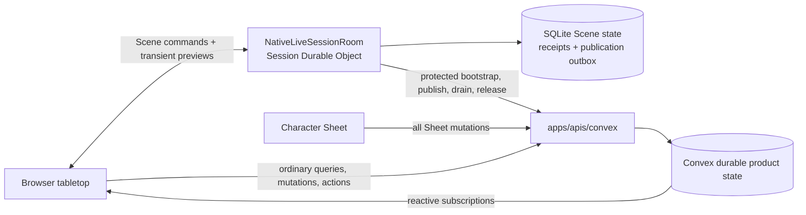
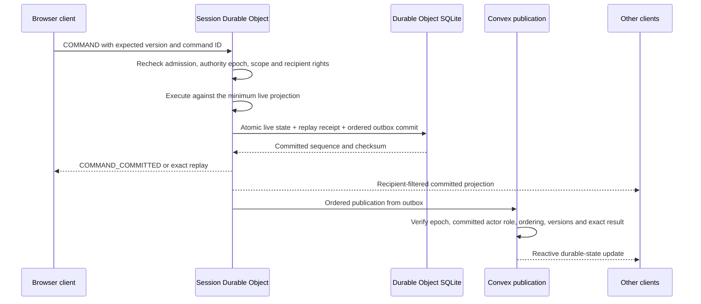
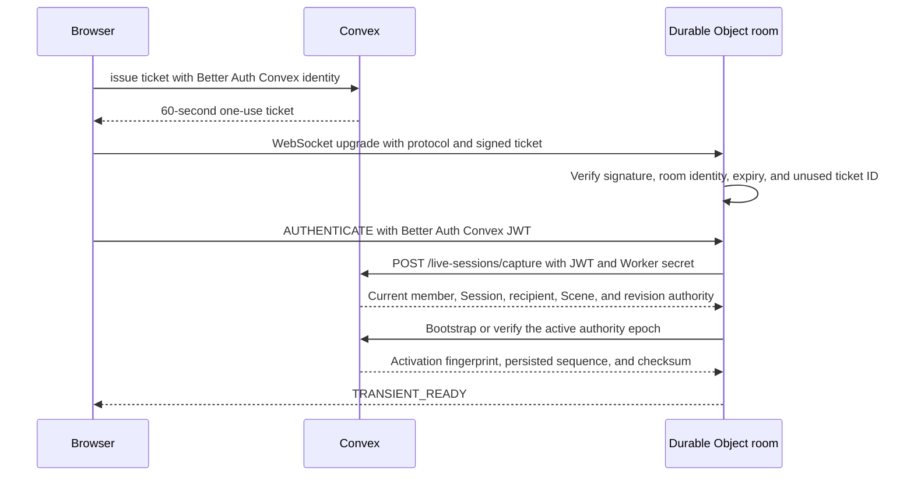

# Live-session coordination

> Status: canonical current partial Phase 8.2 implementation; DO rules execution remains incomplete
>
> Scope: active Session Durable Object authority, ordered Convex publication, transient fanout, fencing, and recovery
>
> Update when: ticket admission, supported live commands, SQLite state/receipts/outbox, Convex publication, transient projection, fencing, recovery, or deployment configuration changes
>
> Verification: `apps/session-worker/src/nativeLiveSessionRoom.ts`, `apps/session-worker/src/durableCommandJournal.ts`, `apps/apis/convex/liveSessions/{authority,state,bootstrap}.ts`, `apps/web/src/domains/campaigns/vtt/liveSessionClient.ts`, and [ADR 0029](../adr/0029-convex-backend-cutover.md)

> Transitional: [ADR 0033](../adr/0033-campaign-owned-play-and-session-log.md) (approved, implementation
> in progress) replaces the Session-keyed room below with one live table per Campaign, opened by any
> ACTIVE member, and removes Session gating from live play. Until that lands, this guide describes the
> current Session-keyed implementation.

A live Session has one temporary live-command authority and one durable product store. While an
authority epoch is active, its Session Durable Object is the single authority for the supported Door
and standalone token move/undo paths. It also streams recipient-filtered ephemeral previews.
Convex owns every Character Sheet mutation, including adjustments, HP, resources, and roll state,
and remains authentication/current-membership authority, the durable cross-session/system store,
the subscription source, and recovery authority.

The following flow describes the current narrow Scene lane. The approved target in
[ADR 0029](../adr/0029-convex-backend-cutover.md#live-rules-execution-clarification--2026-09-24)
also places heavy live rule evaluation and fact preparation in the DO, reusing the existing Rules
Kernel and rules-runtime. Convex supplies authorized stored inputs and validates atomic commits and
receipts. Sheet write ownership remains in Convex. This remaining R06 work must preserve the room's
command order, source/version checks, replay, and required Character/Encounter/Scene atomicity;
commands relying on a Convex transaction cannot acknowledge success before that transaction commits.

The private `/live-sessions/character-rules` and `/live-sessions/encounter-rules` captures now supply
authorized stored inputs to Worker preparation. Each response includes compact System, Campaign,
Session and relevant Character revisions read in the same transaction as its payload. Preparation
merges these observations and rejects a changed revision across pages or Character/Encounter reads.
The existing `sceneVisionRevisions` table tracks source publications, authority inputs, Run actors,
active effects, maintained/spatial effects, normalized initiative rounds/sides/participants and pending
occurrences; empty ranges are covered by their
owner's revision. Import completion also refreshes published root metadata in the same transaction
that makes staged publications visible; this supplies its System revision change. The bounded
`assertLiveSessionRulesRevisions` guard requires the complete authorized scope and compares its
observations before settlement writes. Commit callers must still perform fresh identity,
authority epoch, aggregate and any Scene-version checks. Rehydrating every captured payload
inside the commit would defeat paging and repeat the Convex read-limit problem. Command dispatch,
pending-response and complete contextual coordination remain unfinished.

Ordinary action preparation starts with `ACTION_COMMAND` on the private Encounter capture route.
It shares the native command's admission and complete receipt verification, including Character
concentration cleanup. Current GM access, open Session and live epoch remain mandatory. An exact
completed or pending retry returns its stored result before checking the latest Run version or
loading Character inputs. A fresh command must pass the existing version, turn and pending-occurrence
checks before preparation starts. Admission returns its normalized command and fingerprint, reads no
dice and performs no writes. This replay path is connected to Worker planning; room command dispatch
is still incomplete.

Preparation also captures the exact bound Scene token geometry and the acting actor's current
maintenance slot. The DO resolves grid/target policy and maintenance replacement using the same
runtime functions as native execution. Maintenance dependents and detached-owner effects page four
records at a time. A detached Character is readable only through a real dependent of that current
slot; its Character revision joins the commit fence. Existing issued pending checksums include the
stored Character owner record, so this private capture preserves those fields and native ordering.
The shared currentness hash preserves pending-action identity across native and DO preparation.
These captures perform no rule evaluation or writes. `planNativeLiveEncounterAction` runs the existing
graph evaluator after preflight, then the existing effect and mechanics planners. It returns a stored
replay, sealed pending evidence, or an uncommitted plan. Completed plans include HP/resource changes,
exact effect records, action economy and maintenance cleanup. They rebuild the selected Character
facts from the planned resulting state using the same projector and effect constructors as native
execution. Maintenance cleanup shares the mechanics Character increment and preserves conditions
owned by another effect or the original Character state. Completed plans also compute concentration
children from that post-action state. They then rebuild actor rule output and the final GM projection,
and construct the root command result and stored execution receipt. The native path and DO share the
same initiative cursor checks, maintenance transitions and receipt constructors.
The function accepts the existing runtime service internally; production continuation-key provisioning
remains unresolved, and the room does not yet call this planning path.

The `INITIATIVE_ROUND` capture reads only the authorized Run's current round, using the same bounded
indexed reader as native projection. Active projections require that stored round, the Run's policy
snapshot and its exact actor/side cursor. The capture adds its Session revision to the final plan;
changes to any normalized initiative table invalidate a plan captured before that change.

The read-only `SYSTEM_VOCABULARY` capture exposes the existing persisted snapshot used by native
concentration checks, including its identity, version and checksum. It verifies the snapshot checksum
and agreement with the current System, and refuses a missing snapshot. System import and Encounter
Blueprint preparation initialize that snapshot; live capture performs no initialization. Snapshot
writes also refresh the System revision used to fence DO planning.

Concentration context construction, d20 evidence evaluation, result construction and deterministic
child identities now live in focused rules-runtime modules. Native callers supply their existing
runtime and random source; their database reads, cleanup, receipt writes and ordering are unchanged.
Worker concentration orchestration consumes projected post-action targets and the authorized raw
definitions, vocabulary, slots and owners. Automatic checks produce child receipts; a failed save
plans dependent removal and condition cleanup with the Character's post-action version as its
baseline. Assisted checks retain a sealed child snapshot while the parent action remains complete.
The final plan carries revisions captured during these checks, including detached owners. These
results enter the completed-root terminal transaction; the initial pending-action endpoint cannot
publish a completed parent with a concentration child.

Completed ordinary action plans also compute optional Cleaving from the resulting actor and effect
state. The shared native choice and candidate calculations consume authorized `CLEAVING_BINDINGS`
and exact per-candidate `ACTION_SCENE` geometry. Additional Character facts load only after a retained
overkill result, bound Scene, melee action and optional-combat snapshot qualify the branch. Candidate
preparation overlays any planned maintenance/concentration Character changes before calculating
currentness and armor class. Unchanged targets are reused, and independent geometry captures run in
parallel while retaining candidate order. A pending concentration child carries the deferred Cleaving
context; otherwise the terminal transaction inserts a standalone choice. Concentration responses now
use the private DO path below; contextual choice responses remain unfinished.

The private `/live-sessions/encounter-action-pending` mutation accepts the Worker-computed sealed
ordinary action request. It requires both the Worker secret and the current GM's authenticated
identity, rechecks the open Session, live epoch, Run, root fingerprint, System and bound Scene, then
compares all captured revisions before inserting or advancing the pending occurrence. Detached maintenance owners
must still have a real dependent in the acting actor's current stored slot. The mutation advances no
Run or Character version and spends no resources. It returns only the existing recipient-safe result;
executable graphs and facts remain in the private stored snapshot. A retry returns the previously
stored command result before checking changed revisions. For an ordinary Assisted response, private
`ACTION_RESPONSE` capture reuses native initiator, evidence receipt, root and occurrence admission.
The Worker checks the sealed request and currentness, then resumes the existing Kernel continuation.
Each accepted evidence advances the same occurrence by one; a further pause stores its evidence receipt
without applying mechanics. Retrying an earlier evidence returns the current pending or completed root
result, matching native behavior, before preparing facts or rolling again. The Worker adapters are
available independently of room dispatch; production key provisioning remains outstanding.

The private `/live-sessions/encounter-action` terminal accepts an ordinary completed root. It requires
the Worker secret and current GM identity, repeats native admission/replay and current live-epoch,
Scene and complete revision checks, then applies all writes in one Convex mutation. Its strict payload
contains normalized receipt outcomes, resource/economy consumption, and bounded effect/child records;
it contains no Character or Run document patches. Raw stored Character/Sheet/campaign state supplies
the existing mechanics fold and CAS writer. The mutation validates exact effect provenance and receipt
projections, reconciles maintenance conditions, persists concentration children and Cleaving, and stores
the root occurrence, rule receipt, command receipt and final GM projection together. A late failure
rolls back every write; an exact retry returns the stored result before checking consumed revisions.
Source Character resources and target mechanics share one increment when source and target coincide.
Maintenance replacement shares that increment; failed concentration uses the post-action version as its
new baseline. Rule evaluation and Character fact preparation remain in the DO. The commit imports
focused pure mechanics, receipt, identity and projection modules, with no Kernel/runtime initialization.
The terminal also completes admitted ordinary Assisted responses, updating the existing occurrence and
inserting the response evidence receipt in that same transaction. Room dispatch and contextual command
coordination remain unfinished.

The private `/live-sessions/encounter-concentration` transaction completes an admitted Assisted
concentration response for the GM or the assigned Character's player. Private captures require the
Worker secret, current user identity, open Session, active DO epoch and that exact pending child.
The DO prepares current facts, checks the sealed continuation and parent damage envelope, resumes
the existing Kernel, and plans any cleanup or next decision. A successful save preserves the Run
version and stored projection. A failed save atomically removes the exact maintained slot and
dependents, reconciles Character/actor conditions, advances the Run once, and stores the new projection.
Both outcomes store the response command, completed child and evidence receipt together; exact
replay precedes consumed revisions and returns a recipient-safe result. Subsequent concentration
checks retain their ordered parent damage, while deferred Cleaving is rebuilt after cleanup before
becoming the next pending choice. Raw receipt-chain proofs remain in Convex; fact preparation and
rules evaluation stay in the DO. Room dispatch and real continuation-key provisioning still gate use.

Turn planning now lives in shared `rules-runtime` modules used by the native adapters and the DO
`nativeEncounterTurn` planner. `prepareEncounterTurn` preserves the existing order: outgoing effects, Legendary owner
decisions, new-round initiative when required, incoming resource refresh and Recharge, then incoming
effects. It carries staged Character facts across phases and returns pending evidence before any
aggregate writes. Effect perception, Recharge, initiative source preparation and Legendary execution
use authorized domain-read callbacks; none emulates a database or introduces another rules engine.
Legendary execution constructs its runtime only when an action executes. New-round initiative and its
later evidence responses retain the projected Character facts from outgoing effects; they must not
reload an uncommitted Character version from storage. Private `TURN_COMMAND` admission shares native
terminal and pending receipt checks. A pending initiative retry reconstructs its retained outgoing
decisions in the DO before returning its original result, without new initiative rolls.

Turn captures expose bounded maintained state and the Run's bound Scene geometry/spatial effects.
The planner retains the Scene version and definition save as well as the merged source revisions,
because Scene geometry changes do not advance the rules revision markers. Private Character inputs
retain the stored timestamp and use the authorized owner already on the Character; publication reads include their stored version
number for initiative declaration provenance. These fields do not transfer write authority.
The private `/live-sessions/encounter-turn-pending` transaction stores a fresh or resumed paused turn after
checking authority, normalized initiative, revisions and any Scene fence. The terminal route
`/live-sessions/encounter-turn` applies bounded effect, resource and concentration outcomes in one
Convex transaction, sharing native initiative validation and receipt persistence. Kernel evaluation,
Character fact preparation and derived actor rules remain in the DO. The private authenticated DO is
the trusted computation boundary; Convex validates scope, current revisions and domain writes rather
than repeating that computation. Turn capture requests are reused within one command, and no result
is acknowledged before its transaction commits. Direct Recharge, active-effect and Legendary choice/evidence
responses reuse the native response guards and the same DO turn planner. Each accepted response advances
the retained occurrence once; a further pause leaves aggregate state untouched. Commits recheck the stored
occurrence and exact response history, and completed retries use the native receipt proof before consumed
revision fences. Initial START now uses the same DO initiative preparation and private turn writers:
it admits a PREPARED Run, creates round 1 with an INITIAL_START pin, skips outgoing effects, and uses
incoming effect ordinal 0. Its initial pending occurrence leaves aggregate state unchanged. The
shared settlement guard rejects any proposed initial round other than 1; the native indexed check
prevents two ACTIVE Runs in one Campaign. Local transaction tests cover initial commit, exact replay,
late rollback, pending-state retention and continuation through two incoming Recharge responses.
Initial and each-round initiative evidence and order responses now resume the sealed staged round
through the existing lifecycle in the DO. Outgoing effects and decisions are restored before new
initiative consumes those facts; accepted history is replayed before applying restrictions to a new
response. Pending responses retain aggregate state, and the terminal transaction completes the prior
round and inserts the next round once. The initiative declaration patch uses that same lifecycle
(its focused private tests pass locally; see the
[declaration checkpoint](../validation/phase-08-2/initiative-declarations.md#resolution)): the DO
rechecks the issued options against captured sources, records the selected declaration, and either
issues the next actor's request or continues initiative scoring. The private `turnResponse` scope
admits the currently assigned PLAYER for their Character's declaration and permits the command's
bounded Run and Character captures. Each capture and write rechecks membership, assignment and the
issued occurrence; it cannot combine with movement or Concentration scope. START, ADVANCE_TURN,
score/order responses and other turn decisions remain OWNER-only. The root receipt identifies the
GM who initiated the turn; declaration response history identifies the actual responder. Current
assignment is required even for a completed response retry. The actual room caller remains unfinished;
native routing remains current. Focused parity and rollback tests are implementation evidence, not
release or frozen V15 acceptance.

The movement integration in progress uses the existing staged Scene save. Private
`/live-sessions/encounter-movement-begin` rechecks the DO authority epoch before staging a bound move
or a response to its sealed pending occurrence;
public Scene staging remains fenced. Each movement capture checks the receiving save, current
Session/presentation/Scene/Run, and the moving token's binding and control. A response instead requires
authority over its issued decision. Character preparation pins a current actor's source and version.
These internal captures require the Worker secret and authenticated caller and never enter client
responses. The DO needs the authorized Run cohort to discover movement reactions.

`nativeEncounterMovementInputs.ts` reuses the room's complete Scene after publication has drained,
checks its version and counts, and computes target facts, reaction discovery and perception in the DO.
Identical captures share one promise within the command. `nativeEncounterMovement.ts` prepares an
move or issued response using shared spatial, reaction, passage and concentration coordination.
Uncommitted target and maintenance projections feed later contacts in order. Movement Character
inputs include the original private row so existing maintenance checksums survive that projection;
they stay inside the trusted Worker boundary. The planner serializes ordered, bounded
spatial, reaction, passage-allowance and concentration outcomes and computes final actor rules in the DO. Private
preparation checks captured revisions and freezes the existing Scene save without gameplay writes.
The private movement commit coordinator reuses the native Scene, pending and terminal
publication writers, applying those closed outcomes in their original order within one Convex
transaction. Completed retries verify stored receipts before checking consumed source revisions.
Pending publication settles only the explicit applied spatial prefix and completed reactions. A
spatial dice pause may retain evaluated contacts that have not changed gameplay state; that evidence
must remain unsettled. Native pending publication shares its persistence writer through evaluation,
settlement and projection callbacks; native adapters retain their existing computation. The private
`encounter-movement-prepare` and `encounter-movement` HTTP routes require both the Worker secret and
the initiating user's identity, then use the same epoch, membership, save and revision checks as the
internal mutations. Initial pending, terminal and response publication share this commit route.
Response publication preserves prior contact evidence and commits only newly applied contacts and
new Concentration children; an already committed damage contact is not applied again when its child
check finishes. A completed passage consumes its validated allowance once before the remaining move.
Native response adapters reuse the same rules coordinators; the Convex publication layer imports
only the persistence and projection pieces. Local transaction tests cover response authority, retained
one-shot effects, PLAYER Concentration cleanup, Passage allowance rollback and exact retries. Durable
room dispatch/recovery remains unfinished. These private routes alone do not establish command acceptance.

An admitted movement can apply rules to another assigned Character. The private mechanics helper
validates that Character's current Campaign assignment using the Campaign owner, matching the existing
persistence writer. It retains the authenticated initiator in Character and Encounter receipts. Token
control is checked again at commit, so revoking control rejects a previously prepared move atomically.

Raw Run actor/effect captures retain current Character assignment, ownership, System and ACTIVE checks.
An unrelated Character's newer stream version does not invalidate its stored actor snapshot. Selected
source/target Character facts still require the exact expected stream version on `character-rules`;
the merged revision vector also fences changes occurring during capture.

Character source indexes page at most four raw roots or shares through one native Convex pagination
call per capture, including empty pages. They distinguish feature matches from other readable roots
so the existing 500-per-kind catalogue bound is enforced before loading matching document bodies.
Publication pages inspect at most four IDs and target 4 MiB of stored body data, allowing one existing
large publication. A shared source's parents are fetched on separate pages. Capture still verifies
each root's source ownership, import visibility, active sharing member, and ACTIVE document status;
the Worker validates the complete inheritance chain before consuming the publication. Every shared
ancestor requires an enabled platform source or its own current Campaign share. Character-private
ownership cannot substitute for that share. Race/Equipment parent metadata, kind, System, base
category, cycle and depth checks retain the native reader's meaning. The final revision vector covers
these parent reads. These local implementation changes still require real backend size-limit proof.



Direct Convex mutations that overlap the active Scene projection are fenced until the Session DO
drains and releases authority. Character and Encounter commands use their owning Convex functions.
One Character version and its receipt are committed in the same Convex transaction. The current
Scene command lane does not publish Character mutations; the new preparation path reads authorized
Character inputs for the approved DO rules integration.

Scene presentation uses `scenes/presentations:setLive`. With active room authority, its authenticated
owner request enters the same DO command order as moves and Scene synchronization. The room finishes
all pending publications before the protected Convex setter checks the epoch, published sequence,
checksum, and presentation version. It then invalidates the old Scene cache and reauthenticates the
sockets. The epoch, command sequence, and replay receipts remain intact. A failed publication leaves
the presentation unchanged. The direct `set` mutation remains available only without active authority.
This ordering permits A → B → A switching without hydrating a Scene whose prior moves are unpublished.

## Supported live-command flow



The room broadcasts success only after the SQLite transaction commits. A retry with the same valid
command identity and input returns the stored receipt; reuse with different input rejects. Outbox
publication is ordered and retryable, and an entry is acknowledged only after Convex returns the
matching authority epoch, sequence, state checksum, and result. Convex publication failure never
causes the room to bypass ordering or accept an overlapping direct write.

Publication finishes a command already authorized and committed by the room. Its protected payload
records the actor's command-time role. Only the internal publication scope may use retained historical
membership after departure or a role change, or publish after Session finish or Campaign archive.
Campaign, membership, Scene, and Session identity must still match; deletion permits publication only
while draining the room. Door and undo require the recorded OWNER role; movement requires that role
or control of the token. Epoch, contiguous sequence, checksums, Scene versions, and exact results remain
mandatory. Public access and new commands continue to require current permissions. Scene presentation
changes use the ordered control above, so prior commands publish before their presentation is replaced.

Current DO command coverage is incomplete: Door state, standalone token movement and its undo.
Character Sheet commands use Convex. Other Encounter rule commands still compute there, and
Encounter-bound movement is rejected by both the DO and the active-authority Convex fence. These
are remaining R06 integration gaps. Frozen decisions, rolls, effects, and receipts retain their
issued evidence while subscriptions expose the latest published durable state.

## Ticket and authentication flow

`liveSessions/tickets:issue` authorizes the current Campaign member and open Session before signing a
60-second HS256 ticket. The ticket issuer is `artificer-convex`; its subject, Campaign, Session, role,
unique ticket ID, audience, version, issue time, and expiry are signed. A room consumes each ticket ID
once and binds its persisted room identity to the exact Campaign and Session.

The signing key is checked before reserving authority. An `ACTIVATING` reservation expires at the
latest ticket expiry issued for that epoch; issuing another ticket extends that deadline without
changing the epoch. Once the reservation expires, direct Convex writes are available again and a new
join claims a fresh epoch. Expired tickets and epochs cannot activate it. `DO_ACTIVE` and `DRAINING`
authority never expires through this admission deadline. For transitional records without a deadline,
the last stored update plus the ticket lifetime is used; an obsolete pending join must request a new
ticket.

If a failed activation left an initial SQLite snapshot, a replacement epoch verified by Convex may
discard that snapshot only while its sequence and published sequence are zero and it has no receipts
or outbox entries. Committed state continues through the normal drain and release protocol.



The browser authenticates once after the socket opens. There is no periodic authentication heartbeat;
the admitted socket remains valid until its JWT expires, an explicit lifecycle invalidation arrives, or
the socket closes. At expiry or after `AUTHENTICATION_REQUIRED`, the browser obtains current
authentication and Convex recaptures product authority before transient readiness resumes.
`LIVE_SESSION_WORKER_SECRET` independently authenticates the Worker HTTP caller.

Lifecycle producers invalidate rooms immediately. Campaign leave/removal evicts that membership
generation. Account deletion, auth-account suspension/deactivation, and administrative auth-session
revocation evict the exact user from active rooms. Session finish and Campaign archive/delete close the
affected rooms. Sign-out and password/security actions close the browser's live socket; a later explicit
reconnect authenticates normally when the underlying auth session remains valid. Social profile
suspension is separate and continues to preserve Campaign access.

## Transient previews

The native WebSocket protocol separates command and transient traffic:

- browser messages: `AUTHENTICATE`, `COMMAND`, `TRANSIENT`;
- server messages: `AUTHENTICATION_REQUIRED`, `TRANSIENT_READY`, `COMMAND_COMMITTED`, `COMMAND_REJECTED`, `TRANSIENT`.

Pointer, measurement, fog-area, and token-drag previews remain ephemeral. Shared-party fog is the
default for local and remote play, so one player's accepted exploration is visible to the party. The
recipient-specific projection remains available for the GM preview tool and a future explicit remote
Campaign setting. The Worker captures current authority, hydrates the exact current Scene and
Character-vision inputs when needed, validates bounded movement geometry, and projects private state
for each current recipient. Hidden tokens, unrevealed barriers, GM annotations, DM-preview fog, and
other recipient-private state never enter a broader broadcast.

Durable Object SQLite stores the active authority epoch, minimum live projection, sequence/checksum,
replay receipts, undo evidence, and ordered publication outbox in addition to room/ticket state. The
live projection is authoritative only for that active Session epoch. Large Scene snapshots use bounded
SQLite chunk rows within the same transaction; recovery rejects incomplete chunks. This preserves
accepted Scene sizes without exceeding the platform's per-row limit. New movement undo receipts store
only the Scene identity/version and moved token's previous position; older full-Scene undo remains readable.

Hibernatable socket attachments retain connection identity and membership epoch. Transient sequence
high-water marks and drag paths use one indexed SQLite row per socket and stream, so attachments stay
within their 16 KiB limit. Each accepted sample updates only its stream; a path is reusable only for its
matching Scene and baseline version. Legacy attachment maps migrate before incoming traffic is handled.
Socket close, error, and eviction remove this temporary state; reconstruction removes orphan socket rows.
Preview frames never enter the command journal or publication outbox and disappear with their connection.

Fresh journal state contains only the Scene. Recovery verifies the complete stored checksum before
reading the Scene from older snapshots that also contain Character fields. Before promoting this
authority change over an older Worker, drain and release its active epochs and verify their outboxes
are empty. Pending Character publications must complete under the previous version; committed
receipts or outbox entries must never be discarded to force the change through.
The command-time actor role is also required for new publication payloads; drain older outboxes with
their existing Worker before promoting this protocol.

## Reconnect and convergence

The browser reconnects with exponential backoff capped at 30 seconds. Every connection attempt asks
Convex for a fresh one-use ticket; tickets and WebSocket admission are never resumed across sockets.
After the new socket authenticates and current capture succeeds, `TRANSIENT_READY` resets the backoff.

A reconnect to the active room can replay a matching SQLite receipt and resume ordered publication.
After authority release or eviction, a fresh epoch bootstraps its minimum live projection from current
Convex state; stale SQLite epochs cannot publish into the new authority. Convex subscriptions reconnect
independently and return current authorized durable projections. Transient previews may disappear
during reconnect because they are intentionally not durable.

## Browser surface ownership

The Campaign Session workspace and Character Sheet can open a dedicated authenticated tabletop window.
React owns accessible controls and inspectors; PixiJS owns frame-rate Scene rendering. The GM may edit
or present current Campaign Scenes. Players receive play controls and recipient-private projections.
Connection-local camera, zoom, selected tool, and previews stay local or transient. While room
authority is active, supported Door and standalone token move/undo commands use the Session DO.
The Sheet uses ordinary Convex mutations and subscriptions without a second socket or projection
merge. Scene publications and all other durable product state converge in Convex.

An open tabletop subscribes to the authorized presentation and recipient header for Scene identity and
version with `includeSnapshot:false`, and renders the room's recipient Scene. The header request
skips compact entity hydration as well as the full Convex loading path. Closed Sessions retain normal
Convex hydration. Header reads used only to fence a completed hydration also skip the compact
snapshot; their recipient revision is unchanged. Ordered command deltas update individual
tokens or door states while preserving unchanged objects; Pixi retains their graphics. Visibility
changes still recompute the affected fog and recipient-visible objects. Rejection corrections are
projected only when needed, and door delta visibility uses the canonical barrier predicate directly.

Encounter Scene-binding reads use the shared recipient context without importing Scene entity
hydration endpoints. They reuse the identity already authenticated in the current invocation while
retaining Scene Campaign membership, source snapshot, presentation, version, and revision checks.

The tabletop subscribes to `encounters/sessionReads:active` for its active Encounter and
pending decision together. One identity check, Campaign authorization, and active Run lookup supply
both recipient-filtered results from the same Convex snapshot. A different Session or no active Run
returns both values as null. Scene bindings and prepared Encounter decisions retain their own reads.

## Configuration

| Owner               | Name                              | Purpose                                                                                     |
| ------------------- | --------------------------------- | ------------------------------------------------------------------------------------------- |
| Browser             | `VITE_CONVEX_URL`                 | Public Convex query/mutation WebSocket endpoint                                             |
| Browser             | `VITE_LIVE_SESSION_WEBSOCKET_URL` | Session Worker WebSocket origin                                                             |
| Web/Convex runtime  | `CONVEX_SITE_URL`                 | Convex HTTP Actions origin used by server and local tooling                                 |
| Convex auth         | `SITE_URL`                        | Canonical application origin for Better Auth                                                |
| Convex auth         | `BETTER_AUTH_SECRET`              | Better Auth signing secret                                                                  |
| Convex auth         | `JWKS`                            | Optional deployment-specific static key set                                                 |
| Convex live session | `LIVE_SESSION_TICKET_SECRET`      | At least 32-byte ticket-signing secret shared only with the Worker                          |
| Convex live session | `LIVE_SESSION_WORKER_SECRET`      | At least 32-byte protected bootstrap/publication/control secret shared only with the Worker |
| Worker              | `CONVEX_SITE_URL`                 | Matching Convex bootstrap/publication/control HTTP Actions origin                           |
| Worker              | `LIVE_SESSION_ALLOWED_ORIGINS`    | Exact comma-separated browser origins                                                       |
| Worker              | `LIVE_SESSION_TICKET_SECRET`      | Matching ticket-verification secret                                                         |
| Worker              | `LIVE_SESSION_WORKER_SECRET`      | Matching capture/hydrate caller secret                                                      |
| Worker              | `LIVE_SESSION_ROOMS`              | Durable Object namespace binding                                                            |
| Convex + Worker     | `RULES_CONTINUATION_SECRET`       | At least 32-byte rules continuation sealing secret; identical on both sides, never sent over HTTP |

Browser variables must never contain either secret. Staging and production bind each Worker to the
matching Convex deployment and web origin.

## Verification and release gates

Use the existing local Convex deployment and the Worker command documented in
[`apps/session-worker/README.md`](../../apps/session-worker/README.md). Focused package checks are:

```powershell
yarn workspace @artificer-toolkit/session-worker typecheck
yarn workspace @artificer-toolkit/session-worker test
yarn workspace @artificer-toolkit/session-worker build
```

Focused checks are implementation feedback. The final local release source must pass
`yarn validate:pre-staging:local`, including native transaction/replay/rollback/privacy proofs and the
complete browser journeys. The frozen V15 workload keeps the original thresholds: transient delivery
at or below `150 ms`; durable browser p95 at or below `250 ms` and p99 at or below `500 ms`;
authoritative completion at or below `1,000 ms`; Scene-only host p95 below `100 ms`; and rule-bound
host p95 below `250 ms`. Managed verification runs only after the complete local lifecycle is green.
The [Phase 8.2 acceptance ledger](../roadmap/08-2-convex-cutover-acceptance.md) controls acceptance.

## Historical boundary

Before ADR 0029, remote durable commands flowed through a Worker journal and a private Netlify
executor into Supabase, while a local Node session host executed an equivalent path. That executor,
local-host, tRPC/Kysely, Supabase, and GoRules topology is retired. The current Session DO executes the
bounded live paths above and publishes directly to Convex; it does not revive the removed executor or
SQL stack.
