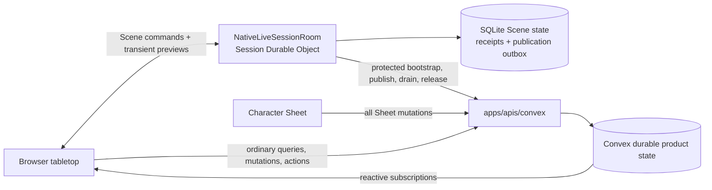
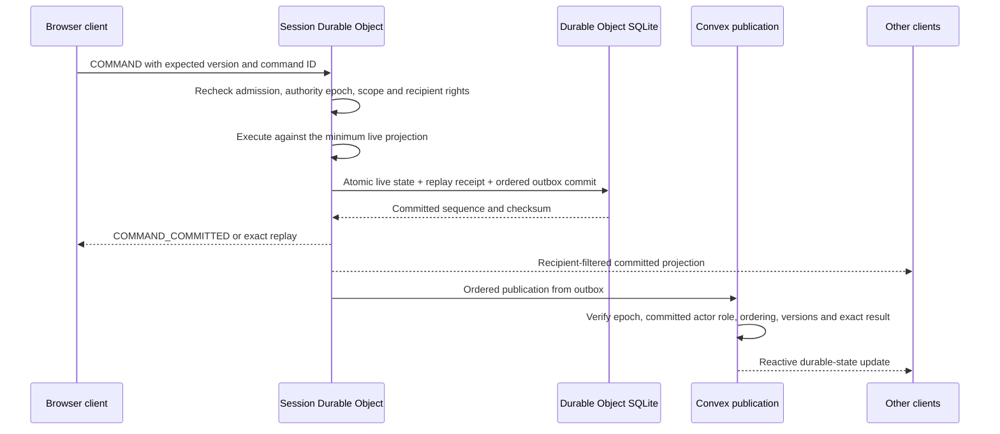
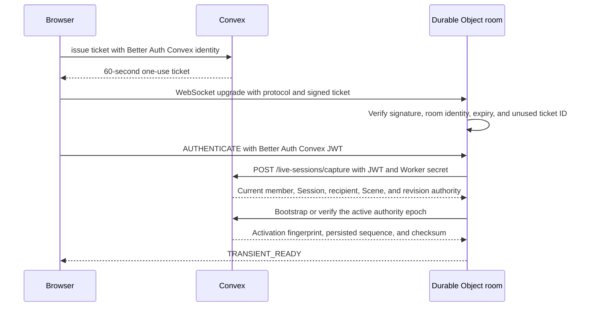

# Live-session coordination

> Status: canonical current partial Phase 8.2 implementation; DO rules execution remains incomplete
>
> Scope: active Session Durable Object authority, ordered Convex publication, transient fanout, fencing, and recovery
>
> Update when: ticket admission, supported live commands, SQLite state/receipts/outbox, Convex publication, transient projection, fencing, recovery, or deployment configuration changes
>
> Verification: `apps/session-worker/src/nativeLiveSessionRoom.ts`, `apps/session-worker/src/durableCommandJournal.ts`, `apps/apis/convex/liveSessions/{authority,state,bootstrap}.ts`, `apps/web/src/domains/campaigns/vtt/liveSessionClient.ts`, and [ADR 0029](../adr/0029-convex-backend-cutover.md)

> [ADR 0033](../adr/0033-campaign-owned-play-and-session-log.md) is implemented locally: there is one
> live table per Campaign, opened by any ACTIVE member, and no Campaign Session gates live play. The name
> "live session" below means that Campaign table; Campaign Sessions are an optional log.

A live Session has one temporary live-command authority and one durable product store. While an
authority epoch is active, its Session Durable Object is the single authority for the supported Door
and standalone token move/undo paths. It also streams recipient-filtered ephemeral previews.
Convex owns every Character Sheet mutation, including adjustments, HP, resources, and roll state,
and remains authentication/current-membership authority, the durable cross-session/system store,
the subscription source, and recovery authority.

The following flow describes the current narrow Scene lane. The approved target in
[ADR 0029](../adr/0029-convex-backend-cutover.md#live-rules-execution-clarification--2026-09-24)
also places heavy live rule evaluation and fact preparation in the DO, reusing the existing Rules
Kernel and rules-runtime. Convex supplies authorized stored inputs and validates atomic commits and
receipts. Sheet write ownership remains in Convex. This remaining R06 work must preserve the room's
command order, source/version checks, replay, and required Character/Encounter/Scene atomicity;
commands relying on a Convex transaction cannot acknowledge success before that transaction commits.

The private `/live-sessions/character-rules` and `/live-sessions/encounter-rules` captures now supply
authorized stored inputs to Worker preparation. Each response includes compact System, Campaign,
Campaign play (`PLAY`) and relevant Character revisions read in the same transaction as its payload. Preparation
merges these observations and rejects a changed revision across pages or Character/Encounter reads.
The existing `sceneVisionRevisions` table tracks source publications, authority inputs, Run actors,
active effects, maintained/spatial effects, normalized initiative rounds/sides/participants and pending
occurrences; empty ranges are covered by their
owner's revision. Import completion also refreshes published root metadata in the same transaction
that makes staged publications visible; this supplies its System revision change. The bounded
`assertLiveSessionRulesRevisions` guard requires the complete authorized scope and compares its
observations before settlement writes. Commit callers must still perform fresh identity,
authority epoch, aggregate and any Scene-version checks. Rehydrating every captured payload
inside the commit would defeat paging and repeat the Convex read-limit problem. Command dispatch,
pending-response and complete contextual coordination remain unfinished.

Ordinary action preparation starts with `ACTION_COMMAND` on the private Encounter capture route.
It shares the native command's admission and complete receipt verification, including Character
concentration cleanup. Current access (the GM, or a PLAYER who controls the acting actor; see
Player-controlled actors below) and the live epoch remain mandatory. An exact
completed or pending retry returns its stored result before checking the latest Run version or
loading Character inputs. A fresh command must pass the existing version, turn and pending-occurrence
checks before preparation starts. Admission returns its normalized command and fingerprint, reads no
dice and performs no writes. This replay path is connected to Worker planning; room command dispatch
is still incomplete.

Preparation also captures the exact bound Scene token geometry and the acting actor's current
maintenance slot. The DO resolves grid/target policy and maintenance replacement using the same
runtime functions as native execution. Maintenance dependents and detached-owner effects page four
records at a time. A detached Character is readable only through a real dependent of that current
slot; its Character revision joins the commit fence. Existing issued pending checksums include the
stored Character owner record, so this private capture preserves those fields and native ordering.
The shared currentness hash preserves pending-action identity across native and DO preparation.
These captures perform no rule evaluation or writes. `planNativeLiveEncounterAction` runs the existing
graph evaluator after preflight, then the existing effect and mechanics planners. It returns a stored
replay, sealed pending evidence, or an uncommitted plan. Completed plans include HP/resource changes,
exact effect records, action economy and maintenance cleanup. They rebuild the selected Character
facts from the planned resulting state using the same projector and effect constructors as native
execution. Maintenance cleanup shares the mechanics Character increment and preserves conditions
owned by another effect or the original Character state. Completed plans also compute concentration
children from that post-action state. They then rebuild actor rule output and the final GM projection,
and construct the root command result and stored execution receipt. The native path and DO share the
same initiative cursor checks, maintenance transitions and receipt constructors.
The function accepts the existing runtime service internally; production continuation-key provisioning
remains unresolved, and the room does not yet call this planning path.

The `INITIATIVE_ROUND` capture reads only the authorized Run's current round, using the same bounded
indexed reader as native projection. Active projections require that stored round, the Run's policy
snapshot and its exact actor/side cursor. The capture adds its Campaign play revision to the final plan;
changes to any normalized initiative table invalidate a plan captured before that change.

The read-only `SYSTEM_VOCABULARY` capture exposes the existing persisted snapshot used by native
concentration checks, including its identity, version and checksum. It verifies the snapshot checksum
and agreement with the current System, and refuses a missing snapshot. System import and Encounter
Blueprint preparation initialize that snapshot; live capture performs no initialization. Snapshot
writes also refresh the System revision used to fence DO planning.

Concentration context construction, d20 evidence evaluation, result construction and deterministic
child identities now live in focused rules-runtime modules. Native callers supply their existing
runtime and random source; their database reads, cleanup, receipt writes and ordering are unchanged.
Worker concentration orchestration consumes projected post-action targets and the authorized raw
definitions, vocabulary, slots and owners. Automatic checks produce child receipts; a failed save
plans dependent removal and condition cleanup with the Character's post-action version as its
baseline. Assisted checks retain a sealed child snapshot while the parent action remains complete.
The final plan carries revisions captured during these checks, including detached owners. These
results enter the completed-root terminal transaction; the initial pending-action endpoint cannot
publish a completed parent with a concentration child.

Completed ordinary action plans also compute optional Cleaving from the resulting actor and effect
state. The shared native choice and candidate calculations consume authorized `CLEAVING_BINDINGS`
and exact per-candidate `ACTION_SCENE` geometry. Additional Character facts load only after a retained
overkill result, bound Scene, melee action and optional-combat snapshot qualify the branch. Candidate
preparation overlays any planned maintenance/concentration Character changes before calculating
currentness and armor class. Unchanged targets are reused, and independent geometry captures run in
parallel while retaining candidate order. A pending concentration child carries the deferred Cleaving
context; otherwise the terminal transaction inserts a standalone choice. Concentration responses now
use the private DO path below; contextual choice responses remain unfinished.

The private `/live-sessions/encounter-action-pending` mutation accepts the Worker-computed sealed
ordinary action request. It requires both the Worker secret and the current GM's authenticated
identity, rechecks the live epoch, Run, root fingerprint, System and bound Scene, then
compares all captured revisions before inserting or advancing the pending occurrence. Detached maintenance owners
must still have a real dependent in the acting actor's current stored slot. The mutation advances no
Run or Character version and spends no resources. It returns only the existing recipient-safe result;
executable graphs and facts remain in the private stored snapshot. A retry returns the previously
stored command result before checking changed revisions. For an ordinary Assisted response, private
`ACTION_RESPONSE` capture reuses native initiator, evidence receipt, root and occurrence admission.
The Worker checks the sealed request and currentness, then resumes the existing Kernel continuation.
Each accepted evidence advances the same occurrence by one; a further pause stores its evidence receipt
without applying mechanics. Retrying an earlier evidence returns the current pending or completed root
result, matching native behavior, before preparing facts or rolling again. The Worker adapters are
available independently of room dispatch; production key provisioning remains outstanding.

The private `/live-sessions/encounter-action` terminal accepts an ordinary completed root. It requires
the Worker secret and current GM identity, repeats native admission/replay and current live-epoch,
Scene and complete revision checks, then applies all writes in one Convex mutation. Its strict payload
contains normalized receipt outcomes, resource/economy consumption, and bounded effect/child records;
it contains no Character or Run document patches. Raw stored Character/Sheet/campaign state supplies
the existing mechanics fold and CAS writer. The mutation validates exact effect provenance and receipt
projections, reconciles maintenance conditions, persists concentration children and Cleaving, and stores
the root occurrence, rule receipt, command receipt and final GM projection together. A late failure
rolls back every write; an exact retry returns the stored result before checking consumed revisions.
Source Character resources and target mechanics share one increment when source and target coincide.
Maintenance replacement shares that increment; failed concentration uses the post-action version as its
new baseline. Rule evaluation and Character fact preparation remain in the DO. The commit imports
focused pure mechanics, receipt, identity and projection modules, with no Kernel/runtime initialization.
The terminal also completes admitted ordinary Assisted responses, updating the existing occurrence and
inserting the response evidence receipt in that same transaction. Room dispatch and contextual command
coordination remain unfinished.

The private `/live-sessions/encounter-concentration` transaction completes an admitted Assisted
concentration response for the GM or the assigned Character's player. Private captures require the
Worker secret, current user identity, active DO epoch and that exact pending child.
The DO prepares current facts, checks the sealed continuation and parent damage envelope, resumes
the existing Kernel, and plans any cleanup or next decision. A successful save preserves the Run
version and stored projection. A failed save atomically removes the exact maintained slot and
dependents, reconciles Character/actor conditions, advances the Run once, and stores the new projection.
Both outcomes store the response command, completed child and evidence receipt together; exact
replay precedes consumed revisions and returns a recipient-safe result. Subsequent concentration
checks retain their ordered parent damage, while deferred Cleaving is rebuilt after cleanup before
becoming the next pending choice. Raw receipt-chain proofs remain in Convex; fact preparation and
rules evaluation stay in the DO. Room dispatch and real continuation-key provisioning still gate use.

Turn planning now lives in shared `rules-runtime` modules used by the native adapters and the DO
`nativeEncounterTurn` planner. `prepareEncounterTurn` preserves the existing order: outgoing effects, Legendary owner
decisions, new-round initiative when required, incoming resource refresh and Recharge, then incoming
effects. It carries staged Character facts across phases and returns pending evidence before any
aggregate writes. Effect perception, Recharge, initiative source preparation and Legendary execution
use authorized domain-read callbacks; none emulates a database or introduces another rules engine.
Legendary execution constructs its runtime only when an action executes. New-round initiative and its
later evidence responses retain the projected Character facts from outgoing effects; they must not
reload an uncommitted Character version from storage. Private `TURN_COMMAND` admission shares native
terminal and pending receipt checks. A pending initiative retry reconstructs its retained outgoing
decisions in the DO before returning its original result, without new initiative rolls.

Turn captures expose bounded maintained state and the Run's bound Scene geometry/spatial effects.
The planner retains the Scene version and definition save as well as the merged source revisions,
because Scene geometry changes do not advance the rules revision markers. Private Character inputs
retain the stored timestamp and use the authorized owner already on the Character; publication reads include their stored version
number for initiative declaration provenance. These fields do not transfer write authority.
The private `/live-sessions/encounter-turn-pending` transaction stores a fresh or resumed paused turn after
checking authority, normalized initiative, revisions and any Scene fence. The terminal route
`/live-sessions/encounter-turn` applies bounded effect, resource and concentration outcomes in one
Convex transaction, sharing native initiative validation and receipt persistence. Kernel evaluation,
Character fact preparation and derived actor rules remain in the DO. The private authenticated DO is
the trusted computation boundary; Convex validates scope, current revisions and domain writes rather
than repeating that computation. Turn capture requests are reused within one command, and no result
is acknowledged before its transaction commits. Direct Recharge, active-effect and Legendary choice/evidence
responses reuse the native response guards and the same DO turn planner. Each accepted response advances
the retained occurrence once; a further pause leaves aggregate state untouched. Commits recheck the stored
occurrence and exact response history, and completed retries use the native receipt proof before consumed
revision fences. Initial START now uses the same DO initiative preparation and private turn writers:
it admits a PREPARED Run, creates round 1 with an INITIAL_START pin, skips outgoing effects, and uses
incoming effect ordinal 0. Its initial pending occurrence leaves aggregate state unchanged. The
shared settlement guard rejects any proposed initial round other than 1; the native indexed check
prevents two ACTIVE Runs in one Campaign. Local transaction tests cover initial commit, exact replay,
late rollback, pending-state retention and continuation through two incoming Recharge responses.
Initial and each-round initiative evidence and order responses now resume the sealed staged round
through the existing lifecycle in the DO. Outgoing effects and decisions are restored before new
initiative consumes those facts; accepted history is replayed before applying restrictions to a new
response. Pending responses retain aggregate state, and the terminal transaction completes the prior
round and inserts the next round once. The initiative declaration patch uses that same lifecycle
(its focused private tests pass locally; see the
[declaration checkpoint](../validation/phase-08-2/initiative-declarations.md#resolution)): the DO
rechecks the issued options against captured sources, records the selected declaration, and either
issues the next actor's request or continues initiative scoring. The private `turnCommand` scope
admits a PLAYER for their controlled actor's declaration, or for `ADVANCE_TURN` when the current
actor is theirs, and permits the command's bounded Run and Character captures. Each capture and
write rechecks membership, control and the issued occurrence; it cannot combine with movement,
Concentration or `action` scope. START, score/order responses and other turn decisions remain
OWNER-only. The root `initiatorUserId` stays the Campaign owner (who answers turn decisions); the
root's `requestedByUserId` records who asked, and becomes the turn receipt's actor; declaration
response history identifies the actual responder. Current
assignment is required even for a completed response retry. The actual room caller remains unfinished;
native routing remains current. Focused parity and rollback tests are implementation evidence, not
release or frozen V15 acceptance.

The movement integration in progress uses the existing staged Scene save. Private
`/live-sessions/encounter-movement-begin` rechecks the DO authority epoch before staging a bound move
or a response to its sealed pending occurrence;
public Scene staging remains fenced. Each movement capture checks the receiving save, current
Session/presentation/Scene/Run, and the moving token's binding and control. A response instead requires
authority over its issued decision. Character preparation pins a current actor's source and version.
These internal captures require the Worker secret and authenticated caller and never enter client
responses. The DO needs the authorized Run cohort to discover movement reactions.

`nativeEncounterMovementInputs.ts` reuses the room's complete Scene after publication has drained,
checks its version and counts, and computes target facts, reaction discovery and perception in the DO.
Identical captures share one promise within the command. `nativeEncounterMovement.ts` prepares an
move or issued response using shared spatial, reaction, passage and concentration coordination.
Uncommitted target and maintenance projections feed later contacts in order. Movement Character
inputs include the original private row so existing maintenance checksums survive that projection;
they stay inside the trusted Worker boundary. The planner serializes ordered, bounded
spatial, reaction, passage-allowance and concentration outcomes and computes final actor rules in the DO. Private
preparation checks captured revisions and freezes the existing Scene save without gameplay writes.
The private movement commit coordinator reuses the native Scene, pending and terminal
publication writers, applying those closed outcomes in their original order within one Convex
transaction. Completed retries verify stored receipts before checking consumed source revisions.
Pending publication settles only the explicit applied spatial prefix and completed reactions. A
spatial dice pause may retain evaluated contacts that have not changed gameplay state; that evidence
must remain unsettled. Native pending publication shares its persistence writer through evaluation,
settlement and projection callbacks; native adapters retain their existing computation. The private
`encounter-movement-prepare` and `encounter-movement` HTTP routes require both the Worker secret and
the initiating user's identity, then use the same epoch, membership, save and revision checks as the
internal mutations. Initial pending, terminal and response publication share this commit route.
Response publication preserves prior contact evidence and commits only newly applied contacts and
new Concentration children; an already committed damage contact is not applied again when its child
check finishes. A completed passage consumes its validated allowance once before the remaining move.
Native response adapters reuse the same rules coordinators; the Convex publication layer imports
only the persistence and projection pieces. Local transaction tests cover response authority, retained
one-shot effects, PLAYER Concentration cleanup, Passage allowance rollback and exact retries. The room
now dispatches these routes itself; see "Convex-first Scene commits" below.

**Convex-first Scene commits (CURRENT, S4-c, D26-D29).** The room commits Encounter-bound movement
to Convex first, then applies it (`apps/session-worker/src/nativeExternalSceneCommit.ts`, called from
`#commitExternal` in `nativeLiveSessionRoom.ts`). `isExternalSceneCommand`
(`nativeRoomSceneCommand.ts`) selects every bound move, every move on an Encounter-bound Scene, and
any move or door change that derives fog exploration (`sceneDerivesExploration` in
`packages/shared` vtt, the one predicate Convex's fast commands use too). Other door changes and
moves stay on the outbox. Movement decision answers and a GM's movement void reach the same path
from `executeLiveEncounterCommand` (route `MOVEMENT`). Inside the command chain the room:

1. checks its journal for a replay, then the session sequence and Scene version (a decision answer
   skips the session sequence, D28: its Scene version pin already fences it);
2. publishes the outbox (it must be empty) and settles any unsettled record (below);
3. calls `encounter-movement-begin` (a move or door change with its presentation fence, a decision
   answer, or a GM void that `occurrenceVoid` turns into the decision's decline), then
   `encounter-movement-observe` with the cached Scene vision's Character revisions;
4. for a bound move, captures through the command's capture bundle (a `MOVEMENT_INPUTS` admission
   now starts one) and the room cache, runs `prepareNativeLiveMovement` on its cached Scene and
   freezes the outcome with `encounter-movement-prepare`;
5. stages each fog owner's complete layer (`deriveSceneCommandFogLayer`) with
   `encounter-movement-stage-fog`, following the walked segment (`preparedMovementSegment`);
6. predicts the published Scene (`preparedMovementSceneDelta`, the same function Convex publishes
   with) and the next state checksum, writes the SQLite write-ahead record
   (`durable_external_commit`, `beginExternalCommit`), and commits with
   `authority {sequence: N+1, expectedStateChecksum, stateChecksum}` and `expectedScene`:
   `encounter-movement` for bound moves and decisions, `scene-geometry` otherwise. In one Convex
   transaction the commit publishes the Scene, compares it with `expectedScene`, and advances the
   persisted authority, which must be at N (`publishWithAuthorityAdvance`,
   `liveSessions/externalCommit.ts`). A replay of a published save does not advance. A decision
   answer returns its member-presented Encounter result; a void also records the void and posts
   "The GM skipped this decision." to TABLE chat, keyed by the void command ID;
7. completes the record: new state, receipt, and sequence = published = N+1, with no outbox row;
8. sends the Scene delta to every member (only the initiator sees the decision summary), then
   STATE_SYNC when fog changed, then the ENCOUNTER result to a decision's initiator. The browser
   settles an Encounter command only on its ENCOUNTER result.

A commit refused with a response rolled back, so the record is dropped. Without a response the
record stays, and the room settles it before the next command, while activating, before a
presentation change and before the drain fence: the Worker-secret route
`external-commit-resolve` answers COMMITTED (the save published and the authority reached N+1 with
the predicted checksum) or ABANDONED (it expires the still-receiving save while the authority is at
N, so a delayed commit fails); anything else fails closed. A COMMITTED recovery applies the record,
drops the Scene cache and challenges every socket, because no member saw the change. Bootstrap
accepts a persisted sequence of N+1 only through that recovery; while a record exists the journal
refuses other commits, the drain fence and `discardReplaceableAuthority`.

The room cache holds every entity of the presented Scene: the transient capture's compact snapshot
is read unfiltered (`readCompactScene` with no viewer), never for the capturing member. It keeps each
token's and barrier's definition ordinal (`sceneSnapshot.baseOrdinals`, or the entity page ordinals)
and the bound `sceneEncounterId`, which the commit's `finish` and movement scope need. The room
never applies a bound token's own `controlledByUserIds`: `beginSceneGeometry` checks the bound
actor's controllers (`requireBoundTokenMoveControl`, refusing `NOT_ACTOR_CONTROLLER`), and
publication checks again. A room door save is readable by its player actor, and publication applies
the same lock rule to a player's door change as the tabletop.

The D26 hold: the capture carries `sceneMovementDecisionPending` (the bound Encounter's pending
occurrence is a movement context), and the room updates it after its own movement commits. While it
is set the room refuses token moves, door changes and undo on that Scene with `UNAVAILABLE`
"Waiting on a movement decision."; chat, Sheets, other Scenes and every Encounter command continue.
A forwarded Encounter command rereads the flag with one authority capture while it is set. The GM's
decision drawer offers "Skip decision" on a movement reaction or passage choice: a void routed
`MOVEMENT` that declines it (the movement continues). A decision on a Scene that is not presented
keeps the native path (D29). A player's Convex-first Scene command counts against the one-in-flight
limit. The skip also writes an `encounterDecisionSkips` row keyed by the decision's occurrence and
version, so `encounters/activeReads:decisionSettlement` answers `GM_SKIP` (or `ANSWER`) for the
decision a player was shown, and their drawer says "The GM skipped this decision." (D39). A skip on
the native path (D29) posts the same chat line and skip row through the same function, in
`occurrenceVoid:record` after its decline commits. It knows a movement decision from state that
survives the decline (the decline's receipt and a `MOVE_SCENE_TOKEN` root receipt), so a retry after
a crash still announces it; the skipped occurrence and version key both writes, so nothing repeats.

**Turn movement (CURRENT, D37-D38, V07.5).** The caller that holds the whole Scene (the room's
`prepareExternalSceneCommit`, or the native geometry action) measures each published segment of a
bound move with `measureScenePathMovementCost` (terrain included) and sends it as the finish input's
`movementCost`. `publishSceneGeometry` requires it for a voluntary bound move and adds it, in feet,
to an `encounterTurnMovements` row keyed by Run, round, the turn's current actor and the moving actor
(`encounters/turnMovement.ts`); forced movement and teleports add nothing. The row is outside the Run
version and checksum and fences nothing: the budget is shown, never enforced. A new turn reads a new
key, so it starts at zero; completing the Run deletes the rows. `encounters/activeReads:active`
returns `turnMovement` (`{actorId, used, budget}`) for the actors the viewer controls, every actor for
the GM; the budget is a Character's stored `walkingSpeed` or a creature stat block's walking speed.
The tabletop shows "Movement 15 / 30 ft" for the active controlled actor; past the budget Assisted
uses the soft-warning style and Manual shows the number only. Dash is not modeled yet (escalated).

**Single Encounter command door.** Browsers cannot execute Encounter commands directly:
`encounters/commands:execute` and `encounters/commandActions:execute` are internal. Every Encounter
command enters through the Session room. The private `encounter-route` query
(`liveSessions/encounterRoute:route`) names the room planner for the current pending occurrence —
`ACTION`, `TURN`, `CONCENTRATION`, `MOVEMENT` or `NATIVE` — and returns only that enum. It applies
the same native resume precedence as `commands.ts` through the one shared classifier,
`encounters/occurrenceOwner.ts`: Disarm and Cleaving occurrences route `NATIVE`. A PLAYER may
classify only an occurrence that `encounters/pendingReads` already shows them. The private
`encounter-command` action (`liveSessions/encounterCommand:execute`) runs a forwarded command
through the unchanged native implementation, including movement-response staging, as the forwarding
user. Both routes require the Worker secret, the user's identity, the expected user and role, an
ACTIVE Campaign, a `DO_ACTIVE` authority at the given epoch, and a Run in that Campaign
(`liveSessions/encounterCommandAdmission.ts`). The admission check and native execution run as
separate transactions, which Convex fences only by `DO_ACTIVE` authority. Current: room closure
(`#closeRoom` in `apps/session-worker/src/nativeLiveSessionRoom.ts`) closes every socket, so no new
command arrives, then awaits the in-flight command chain, including forwarded Encounter commands,
before it sets the drain fence and releases authority.

**Room capture cache (CURRENT, S4-b).** Room planners read System-level rules content through a
per-room cache beside the Scene cache (`apps/session-worker/src/nativeCaptureCache.ts`): Encounter
`DEFINITION` and `SYSTEM_VOCABULARY` captures (read as the Campaign owner) and every Character
source capture (`PUBLICATIONS` and the `SOURCE_INDEX` catalogues, read as the Character's owner).
An entry is keyed by route, Campaign (and Character), request and the plan's observed SYSTEM and
CAMPAIGN revisions, so a revision bump misses; a plan's first read always goes to Convex. A hit keeps
its original response and read checksum and adds only those two stamps to the plan's revisions, so
the commit fence still checks what was read. Volatile reads are never cached: command admission, Run
state, actors and effects, maintenance and turn state, and each Character's `INPUTS` (sheet, hit
points, conditions, Campaign state). The compiled Character rule context is rebuilt per command
from the fresh Character and the cached sources, since the Character document itself carries hit
points and conditions. The cache is cleared whenever the room bumps its cache generation
(presentation change, member eviction, room close) and is bounded by `ROOM_LIMITS` (60 s, 512
entries, 16 MB). When Convex refuses a commit (409) from a plan that reused any entry,
`executeLiveEncounterCommand` drops those entries and replans once from fresh reads; a second refusal
surfaces as before, and a plan that reused nothing is never replanned. Action and turn planning still
read every Run actor, because the committed actor rules, Concentration and Cleaving cover the whole
Run.

**Capture bundle (CURRENT, D32).** A room command's volatile reads arrive in one private query,
`/live-sessions/encounter-bundle` (`liveSessions/encounterCaptureBundle.ts`,
`packages/schema/src/api/liveSessionEncounterCaptureBundle.ts`). When a room planner makes its
admission capture (`ACTION_COMMAND`, `ACTION_RESPONSE`, `TURN_COMMAND`, `CONCENTRATION_RESPONSE` or
`MOVEMENT_INPUTS`),
`captureEncounterRules` sends the bundle instead. In one transaction the bundle runs the existing
capture builders for the admission, Run `INPUTS`, the `INITIATIVE_ROUND` of a turn, one `ACTOR`
(first effect page) per Run actor, the Concentration `MAINTENANCE_SLOT` per Run actor, and each
Character actor's `INPUTS`. Each part is exactly the response its own capture returns, with its own
read checksum and revisions, so commit fences are unchanged. The DO hands each part, once, to the
capture with the same complete input; anything else (later effect pages, other maintenance, Scene
reads, System-level content) is read as before. The bundle stops at the first failing part, and the
planner then reads that part separately and meets the same refusal. `liveSessionCharacterRulesScope`
derives a Character capture scope from an Encounter one for both sides. Warm commands now take two
round trips (the bundle and the commit); a decision answer adds its `encounter-route` read.
Every part reruns its builder, so the bundle reads through a transaction-local memo
(`lib/transactionReads.ts`): an identical `get`, or the same table, index range, order and read, is
served once and deeply frozen, so no part can change another part's view; filtered, search and
streamed reads pass through. At the legal maxima (100 actors: 12 Characters, one per player seat, and
88 Creatures) the largest action bundle reads 437 index ranges, 307 documents and 1.4 MB (0.85 MB
distinct) and returns 1.1 MB, each under a quarter of its Convex limit; without the memo it read
38.8 MB, over the 16 MiB limit.

**Import visibility (CURRENT, D34).** Imported rows are readable only while their import job is
`COMPLETED` (`imports/visibility.ts`). A trigger in `lib/mutations.ts` bumps the SYSTEM revision of
every System the job imported roots into whenever that visibility changes, so commit fences and the
room cache see it.

**Auto-roll and GM void (CURRENT, ADR 0034).** The `ACTION_COMMAND`, `ACTION_RESPONSE` and
`MOVEMENT_INPUTS` captures carry `autoRollByActorId`: for each Run actor, the "Auto-roll my dice"
preference of the user its rolls are routed to (see roll routing below). `TURN_COMMAND` carries the
Campaign owner's `autoRollDice` for the GM's turn steps, the same `autoRollByActorId` (with the owner
as initiator) for each actor's turn-effect and Concentration saves, and the issuing member's
`responderControlledActorIds`, so the planner can admit a player's turn-effect answer. All are read in the capture
transaction and covered by its read checksum, so DO planners decide between a server roll and a
pending prompt without a separate call. A GM `VOID_RULE_OCCURRENCE` that declines a movement
decision routes `MOVEMENT` (the route input carries its `commandType`; see "Convex-first Scene
commits"); every other void routes `NATIVE`:
`encounters/commandActions.ts` asks `encounters/occurrenceVoid:prepare` (GM only) to cancel a paused
action atomically (occurrence `VOIDED`, one `VOID_RULE_OCCURRENCE` receipt, one Run version) or
returns a decline that runs through the same path as a GM answer, including movement staging;
`occurrenceVoid:record` then adds the "Voided by the GM" receipt. When the declined turn or move
pauses again, the Run version cannot advance without breaking that flow's fences (each Run version
has exactly one receipt), so the void returns the next decision and adds no timeline entry. Steps
play cannot continue without (initiative, Concentration saves, Recharge, turn-effect saves,
Legendary Action dice and dice during a move) are refused with `DECISION_REQUIRES_ANSWER`.

**Player-controlled actors (CURRENT, S6b).** Control belongs to the Run actor (Foundry ownership).
Each actor stores GM-set `controllerUserIds` (current Campaign players only, sorted, at most 8; set by
the GM through `UPDATE_ACTOR`) and a `disposition` (`FRIENDLY` default for Characters, `HOSTILE` for
creatures and custom enemies). A CHARACTER actor's Campaign-assigned player is always a controller,
derived and never stored. `encounters/actorController.ts` is the one predicate (`GM` for the owner,
`CONTROLLER`, or none) used by action admission, action choices, Disarm, turn admission, declarations,
pending reads, Concentration and Cleaving responses, and movement decisions. A member's departure
removes them from every PREPARED or ACTIVE Run's controller lists in the same transaction.

- A PLAYER may `RESOLVE_ACTION` for an actor they control (public targets only, else
  `TARGET_UNAVAILABLE`), end the current actor's turn when it is theirs, and answer decisions routed
  to them. Every other Encounter command stays GM-only. Admitted actions read Character, definition
  and Scene inputs as the Campaign owner (Scene scope `MEMBER` for players); the player `action`
  capture scope carries the admitted command so later captures in the same plan pass.
- Encounter-bound token movement follows the bound actor's controllers plus the GM
  (`requireBoundTokenMoveControl`, checked at begin and at publication, refusing
  `NOT_ACTOR_CONTROLLER`); unbound tokens keep the Scene token's `controlledByUserIds`.
  The room applies the same rule to drag previews: a player's transient capture carries
  `originBoundTokenControl` (each bound token and whether they control its actor). On an
  Encounter-bound Scene the room renders a player's preview from its synchronized Scene cache and
  reads that control from the short-lived AUTHORITY capture it already reuses for pointers (D25).
- `encounters.activeReads.active` returns `waitingOn` (`GM`, `PLAYER` or null), so a player's view
  shows who a pending decision they can't answer is waiting on, also after a reload.
- Every result or replay returned to a non-owner goes through
  `encounters/resultPresentation.ts` `presentEncounterResultForMember` (player projection, with the
  pending decision re-read for that member). The room's `nativeRoomEncounterCommand.ts` refuses to hand
  a PLAYER anything that does not parse as a player projection. A replay by command ID returns only to
  the user who issued it.
- Health display (ADR 0034 decision 5, current): each player-projection actor carries `health` at
  its level only (`projectPlayerEncounterProjection`, `@artificer-toolkit/schema/api/healthDisplay`).
  Hidden (the default) carries `null`, Descriptive only the band (Unhurt, Hurt, Bloodied at or below
  half, Near death at or below a quarter), Bar only a ratio rounded to 5%, Exact current and
  maximum. A Character actor uses its player's Sheet setting; an enemy or NPC uses its GM override
  (`UPDATE_ACTOR.healthDisplay`) or else the Run's `healthDisplayDefault`
  (`SET_HEALTH_DISPLAY_DEFAULT`, GM only). Run creation stores the default `HIDDEN` and each new
  actor `healthDisplay: null`; both fields are required in stored state and projections. An
  actor's controllers, including a Character's player, see its exact health. The GM projection
  carries exact values, and GM surfaces show exact hit points. `encounters/healthDisplay:share`
  (GM only) posts one visible enemy's or NPC's descriptive state to the TABLE chat once per command
  ID without changing its level.
- Room flood control: a PLAYER has at most one Encounter or Convex-first Scene command in flight
  (`ROOM_LIMITS.maxInFlightEncounterCommandsPerPlayer`); a second is refused `UNAVAILABLE` "Your
  previous action is still resolving."

**Roll routing (CURRENT, S6b).** A roll belongs to the actor who makes it: pending evidence carries
`rollerActorId` (the attacker for an attack, the target for a save, the reactor or mover during a
move), and only that actor's controllers and the GM see and answer it. A player initiator answers only
rolls of actors they control; every other roll goes to the actor's controllers, even when the GM
initiates (Foundry baseline: the GM casts Fireball, each player rolls their own Character's save).
Rolls of actors no player controls stay with the GM, and the GM may answer any prompt as an
override. Turn-effect saves follow the same rule: the save belongs to the turn actor, so its pending
summary names it as `rollerActorId`, its controllers see and answer it (`pendingReads`,
`encounters/turnResponseAuthority.ts`, `prepareEncounterTurnResponse`), and its primary controller's
preference decides auto-roll; Concentration checks raised by turn damage do the same. Recharge
dice and Legendary Actions follow it too (D24, D30): the recharging Creature or the Legendary
Action's owner is the step's actor (`turnPendingActorId` in `rules-runtime/encounterTurnPending`),
so a Creature the GM granted to a player picks its Legendary Action and rolls its Recharge and
Legendary dice with that player and that player's auto-roll preference, while an ungranted
Creature stays with the GM. Initiative scoring and order remain GM decisions; initiative
declarations go to the declaring actor's controllers.

**Concentration chains (CURRENT, D23).** Damage to several concentrating actors raises ordered
checks. Each check auto-rolls by its actor's primary-controller preference, and the chain stops at
the first check that prompts. The command that answers a prompted check settles, in the same
transaction, every following check whose roller auto-rolls, and parks the first one that prompts
(`planNativeLiveConcentration` in the DO; `planNativeConcentrationChain` in Convex; the Worker commit
carries them as `concentration` and `pendingConcentration`, persisted by
`persistLiveEncounterConcentrationChildren`). That commit advances the Encounter version once when
any check it settled failed. Auto-rolled checks are START receipts chained by `correlationId` from
the answered check and pinned to the commit's version, so replay and continuation guards
(`concentrationResponseAdmission.ts`, `concentrationParent.ts`) count a commit's failures with
`readConcentrationCommitFailed`.

**Rule-check roll log (CURRENT, D23).** Every settled Concentration check, answered or automatic, is
logged once by `recordConcentrationCheckRoll` (`encounters/ruleCheckRolls.ts`), which
`persistNativeConcentrationResult` calls at every settle point, live and native. The entry is a
`RollRecordDto` carrying a `ruleCheck` (`kind: 'CONCENTRATION'`: actor, damage amount and type
label, source label, DC, faces, modifier, total, `KEPT`/`LOST`), authored by the settling member
with the "Rules" label and keyed by `ruleCheckRollId(occurrenceId, checkIndex)`, so replays add
nothing. It spends no chat rate limit, since its command was already limited. A hidden actor's
check goes to the GM's private roll history instead of TABLE chat. The parent records display
names for its damage envelope in the check context (`sourceLabels`: action or Creature Feature name,
turn-effect definition label; movement contacts have none yet), and each context carries a
`trigger` (source label, damage-type label, DC). The d20 pending summary exposes it as `trigger`,
so the decision drawer reads "Concentration check for Mira: took 12 fire from Fire Bolt (DC 10)". In Assisted mode an authored automatic reaction becomes a Use/Decline choice for its controller;
auto-roll fills in dice only. Each prompt row is answered one of three ways:

- `ROLL_RULE_EVIDENCE` ("Roll dice") rolls the request with secure randomness in Convex
  (`encounters/evidenceRolls.ts`), records the attempt (`encounterEvidenceRolls`), posts it to the
  table roll log ("Rolled by the app, attempt N", plus "Advantage, changed from Normal" when the roller
  overrides the rules-derived mode) unless the roller is hidden, and settles nothing. Rerolls add
  attempts. It always routes `NATIVE`.
- `SYSTEM_ROLL {requestId, rollId}` settles with the recorded faces of the responder's latest attempt
  for that request; anything else is refused `ROLL_UNAVAILABLE`. Captures return the verified
  `appRoll`, so the DO planner never sees a client-supplied app-roll value.
- `ENTER_DICE {rawFaces, rollMode}` or `ENTER_INTEGER` settle with entered values.

d20 evidence stores the chosen `rollMode` and the rules-derived `derivedRollMode`. Contest d20s keep
the derived mode. AUTOMATIC mode and auto-roll keep server rolls (`AUTO_ROLL` internally).

Real-backend HTTP development drivers (`apps/apis/tests/development*.ts`) therefore send Encounter
commands through the room like the browser: `DevelopmentHttpClient` (`developmentHttpClient.ts`)
issues a ticket, opens the Worker socket with the ticket subprotocol and the local web Origin,
authenticates, waits for `TRANSIENT_READY` and `STATE_SYNC`, and resolves on the `ENCOUNTER`
`COMMAND_COMMITTED` result or rejects on `COMMAND_REJECTED`. The in-process convex-test adapter still
calls the internal functions directly. The local pre-staging lifecycle starts the documented local
Worker for its proofs; its secrets must match the local Convex deployment's.

**Worker-boundary validators.** The private rules captures and commits
(`liveSessions/{characterRulesCapture,encounterRulesCapture,encounterAction,encounterActionCommit,
encounterCommand,encounterCommandAdmission,encounterConcentrationCommit,encounterMovement,
encounterRoute,encounterTurn,encounterTurnCommit}.ts`) are internal
functions reached only through the Worker-secret HTTP routes. They declare `args: v.any()` with no
`returns` validator; each handler takes `unknown` and parses it with its shared Zod contract before
any read, and the Worker parses every response with the same contracts. Converting these large
unions into duplicate Convex validators cost about 28 MB per module and pushed several modules past
the 64 MB module-load budget (for example `encounterRulesCapture` needed 65.8 MB to evaluate; it now
needs about 30 MB). Public functions keep generated Convex argument validators.

An admitted movement can apply rules to another assigned Character. The private mechanics helper
validates that Character's current Campaign assignment using the Campaign owner, matching the existing
persistence writer. It retains the authenticated initiator in Character and Encounter receipts. Token
control is checked again at commit, so revoking control rejects a previously prepared move atomically.

Raw Run actor/effect captures retain current Character assignment, ownership, System and ACTIVE checks.
A Character actor keeps no hit point or stream-version copy
([ADR 0034](../adr/0034-player-control-rules-assistance-and-roll-prompts.md) decision 4), so
`character-rules` takes no expected stream version: it returns the current Character, and its
CHARACTER revision joins the merged revision vector with the ACTOR capture's. The commit's
`assertLiveSessionRulesRevisions` call covers every Character actor in a rules-applying Run, so a
Sheet write between planning and commit refuses the stale plan; a retry re-captures. Commits read the fenced
Character's current stream version as the before version of each planned Character transition.

Character source indexes page at most four raw roots or shares through one native Convex pagination
call per capture, including empty pages. They distinguish feature matches from other readable roots
so the existing 500-per-kind catalogue bound is enforced before loading matching document bodies.
Publication pages inspect at most four IDs and target 4 MiB of stored body data, allowing one existing
large publication. A shared source's parents are fetched on separate pages. Capture still verifies
each root's source ownership, import visibility, active sharing member, and ACTIVE document status;
the Worker validates the complete inheritance chain before consuming the publication. Every shared
ancestor requires an enabled platform source or its own current Campaign share. Character-private
ownership cannot substitute for that share. Race/Equipment parent metadata, kind, System, base
category, cycle and depth checks retain the native reader's meaning. The final revision vector covers
these parent reads. These local implementation changes still require real backend size-limit proof.



Direct Convex mutations that overlap the active Scene projection are fenced until the Session DO
drains and releases authority. Character commands use their owning Convex functions; Encounter
commands enter through the room, which forwards them to their owning Convex functions.
One Character version and its receipt are committed in the same Convex transaction. An accepted
shield stow on `RESOLVE_ACTION` rides in the source Character's action batch with any resource use;
the action commit re-applies it and rejects a room result whose `sourceItemUseStateTransition` differs
from the committed stow ([drawn weapons](rules-runtime.md)). The current
Scene command lane does not publish Character mutations; the new preparation path reads authorized
Character inputs for the approved DO rules integration.

Scene presentation uses `scenes/presentations:setLive`. With active room authority, its authenticated
owner request enters the same DO command order as moves and Scene synchronization. The room finishes
all pending publications before the protected Convex setter checks the epoch, published sequence,
checksum, and presentation version. It then invalidates the old Scene cache and reauthenticates the
sockets. The epoch, command sequence, and replay receipts remain intact. A failed publication leaves
the presentation unchanged. The direct `set` mutation remains available only without active authority.
This ordering permits A → B → A switching without hydrating a Scene whose prior moves are unpublished.

## Supported live-command flow



The room broadcasts success only after the SQLite transaction commits. A retry with the same valid
command identity and input returns the stored receipt; reuse with different input rejects. Outbox
publication is ordered and retryable, and an entry is acknowledged only after Convex returns the
matching authority epoch, sequence, state checksum, and result. Convex publication failure never
causes the room to bypass ordering or accept an overlapping direct write.

Publication finishes a command already authorized and committed by the room. Its protected payload
records the actor's command-time role. Current: `liveSessions/state:publish` requires that role to
equal the stored membership role. The only exception, per ADR 0029 command-time role evidence, is a
command that occurred in the current authority epoch (at or after its `createdAt`) and before the
member's `accessStartedAt`, which covers ownership transfer or rejoin after the command committed.
Only the internal publication scope may use retained historical membership after departure, or
publish after Session finish or Campaign archive.
Campaign, membership, Scene, and Session identity must still match; deletion permits publication only
while draining the room. Door and undo require the recorded OWNER role; movement requires that role
or control of the token. Epoch, contiguous sequence, checksums, Scene versions, and exact results remain
mandatory. Public access and new commands continue to require current permissions. Scene presentation
changes use the ordered control above, so prior commands publish before their presentation is replaced.

Current DO command coverage is incomplete: Door state, standalone token movement and its undo use
the outbox; Encounter-bound movement, moves on an Encounter-bound Scene, fog-deriving moves and door
changes, and movement decisions commit to Convex first (see "Convex-first Scene commits").
Character Sheet commands use Convex. Other Encounter rule commands enter through the room but some
still compute in the native Convex implementation (see the single Encounter command door above).
These are remaining R06 integration gaps. Frozen decisions, rolls, effects, and receipts retain their
issued evidence while subscriptions expose the latest published durable state.

## Ticket and authentication flow

`liveSessions/tickets:issue` authorizes the current ACTIVE Campaign member before signing a
60-second HS256 ticket. The ticket issuer is `artificer-convex`; its subject, Campaign, Session, role,
unique ticket ID, audience, version, issue time, and expiry are signed. A room consumes each ticket ID
once and binds its persisted room identity to the exact Campaign; the WebSocket path segment is the Campaign ID.

The signing key is checked before reserving authority. An `ACTIVATING` reservation expires at the
latest ticket expiry issued for that epoch; issuing another ticket extends that deadline without
changing the epoch, but never past the reservation's `createdAt` plus five minutes
(`claimCampaignLiveAuthority` in `liveSessions/authority.ts`), so a reconnect loop cannot hold an
unused reservation indefinitely. Once the reservation expires, direct Convex writes are available again and a new
join claims a fresh epoch. Expired tickets and epochs cannot activate it. `DO_ACTIVE` and `DRAINING`
authority never expires through this admission deadline. For transitional records without a deadline,
the last stored update plus the ticket lifetime is used; an obsolete pending join must request a new
ticket.

If a failed activation left an initial SQLite snapshot, a replacement epoch verified by Convex may
discard that snapshot only while its sequence and published sequence are zero and it has no receipts
or outbox entries. Committed state continues through the normal drain and release protocol.



The browser authenticates once after the socket opens. There is no periodic authentication heartbeat;
the admitted socket remains valid until its JWT expires, an explicit lifecycle invalidation arrives, or
the socket closes. At expiry or after `AUTHENTICATION_REQUIRED`, the browser obtains current
authentication and Convex recaptures product authority before transient readiness resumes.
`LIVE_SESSION_WORKER_SECRET` independently authenticates the Worker HTTP caller.

Lifecycle producers invalidate rooms immediately. Campaign leave/removal evicts that membership
generation. Account deletion, auth-account suspension/deactivation, and administrative auth-session
revocation evict the exact user from active rooms. Campaign archive/delete close the Campaign's room;
finishing a Campaign Session does not affect live play. Sign-out and password/security actions close the browser's live socket; a later explicit
reconnect authenticates normally when the underlying auth session remains valid. Social profile
suspension is separate and continues to preserve Campaign access.

Room eviction and closure are fire-and-forget from their producing mutation. Current:
`liveSessions/control.ts` delivers them with up to five attempts, rescheduling through the Convex
scheduler after 1, 2, 4 and 8 seconds on network failure, 408, 429 or any 5xx. Other 4xx responses
and missing configuration fail immediately. Presentation control is synchronous and does not retry.

## Transient previews

The native WebSocket protocol separates command and transient traffic:

- browser messages: `AUTHENTICATE`, `COMMAND`, `TRANSIENT`;
- server messages: `AUTHENTICATION_REQUIRED`, `TRANSIENT_READY`, `COMMAND_COMMITTED`, `COMMAND_REJECTED`, `TRANSIENT`.

Pointer, measurement, fog-area, and token-drag previews remain ephemeral. Fog of war is opt-in per
Scene (ADR 0034, current). New Scenes start with fog `OFF`: every point, segment and polygon counts
as explored, so players see every non-hidden token, wall, door and light plus `TABLE` notes, and no
exploration is derived, previewed or painted. `SHARED_PARTY` shares one player's accepted exploration
with the party; `PER_PLAYER` keeps recipient-owned layers. The GM changes the mode with the live
Scene setting command `SET_SCENE_FOG_MODE` (versioned like vision reveal timing); stored fog layers
are kept while fog is `OFF`, so turning fog back on restores earlier exploration. Manual fog writes
and `FOG_AREA_PREVIEW` are refused while fog is `OFF`. The Worker captures current authority,
hydrates the exact current Scene and
Character-vision inputs when needed, validates bounded movement geometry, and projects private state
for each current recipient. Hidden tokens, unrevealed barriers, GM annotations, DM-preview fog, and
other recipient-private state never enter a broader broadcast.

Every preview envelope carries `audience: 'TABLE' | 'GM'` (current). The room delivers a `GM`
preview only to OWNER sockets. The tabletop sends GM previews (pointer, ruler, drag ghost, fog draft)
as `GM` by default, and the GM's "Show my previews to players" toolbar toggle switches them to
`TABLE`. Players always send `TABLE`.

Durable Object SQLite stores the active authority epoch, minimum live projection, sequence/checksum,
replay receipts, undo evidence, and ordered publication outbox in addition to room/ticket state. The
live projection is authoritative only for that active Session epoch. Large Scene snapshots use bounded
SQLite chunk rows within the same transaction; recovery rejects incomplete chunks. This preserves
accepted Scene sizes without exceeding the platform's per-row limit. New movement undo receipts store
only the Scene identity/version and moved token's previous position; older full-Scene undo remains readable.

Hibernatable socket attachments retain connection identity and membership epoch. Transient sequence
high-water marks and drag paths use one indexed SQLite row per socket and stream, so attachments stay
within their 16 KiB limit. Each accepted sample updates only its stream; a path is reusable only for its
matching Scene and baseline version. Legacy attachment maps migrate before incoming traffic is handled.
Socket close, error, and eviction remove this temporary state; reconstruction removes orphan socket rows.
Preview frames never enter the command journal or publication outbox and disappear with their connection.

Fresh journal state contains only the Scene. Recovery verifies the complete stored checksum before
reading the Scene from older snapshots that also contain Character fields. Before promoting this
authority change over an older Worker, drain and release its active epochs and verify their outboxes
are empty. Pending Character publications must complete under the previous version; committed
receipts or outbox entries must never be discarded to force the change through.
The command-time actor role is also required for new publication payloads; drain older outboxes with
their existing Worker before promoting this protocol.

## Reconnect and convergence

The browser reconnects with exponential backoff capped at 30 seconds. Every connection attempt asks
Convex for a fresh one-use ticket; tickets and WebSocket admission are never resumed across sockets.
After the new socket authenticates and current capture succeeds, `TRANSIENT_READY` resets the backoff.

A reconnect to the active room can replay a matching SQLite receipt and resume ordered publication.
After authority release or eviction, a fresh epoch bootstraps its minimum live projection from current
Convex state; stale SQLite epochs cannot publish into the new authority. Convex subscriptions reconnect
independently and return current authorized durable projections. Transient previews may disappear
during reconnect because they are intentionally not durable.

## Browser surface ownership

The Campaign Session workspace and Character Sheet can open a dedicated authenticated tabletop window.
React owns accessible controls and inspectors; PixiJS owns frame-rate Scene rendering. The GM may edit
or present current Campaign Scenes. Players receive play controls and recipient-private projections.
Connection-local camera, zoom, selected tool, and previews stay local or transient. While room
authority is active, supported Door and standalone token move/undo commands use the Session DO.
The Sheet uses ordinary Convex mutations and subscriptions without a second socket or projection
merge. Scene publications and all other durable product state converge in Convex.

An open tabletop subscribes to the authorized presentation and recipient header for Scene identity and
version with `includeSnapshot:false`, and renders the room's recipient Scene. The header request
skips compact entity hydration as well as the full Convex loading path. Closed Sessions retain normal
Convex hydration. Header reads used only to fence a completed hydration also skip the compact
snapshot; their recipient revision is unchanged. Ordered command deltas update individual
tokens or door states while preserving unchanged objects; Pixi retains their graphics. Visibility
changes still recompute the affected fog and recipient-visible objects. Rejection corrections are
projected only when needed, and door delta visibility uses the canonical barrier predicate directly.

Encounter Scene-binding reads use the shared recipient context without importing Scene entity
hydration endpoints. They reuse the identity already authenticated in the current invocation while
retaining Scene Campaign membership, source snapshot, presentation, version, and revision checks.

The tabletop subscribes to `encounters/sessionReads:active` for its active Encounter and
pending decision together. One identity check, Campaign authorization, and active Run lookup supply
both recipient-filtered results from the same Convex snapshot. A different Session or no active Run
returns both values as null. Scene bindings and prepared Encounter decisions retain their own reads.

## Security and limits

Current rate limits live in `apps/apis/convex/lib/rateLimits.ts` (`@convex-dev/rate-limiter` 0.4.0).
Each is keyed only by the authenticated user ID and consumed inside the authorized mutation before any
write, so a rejection rolls back the whole transaction. Account deletion resets every user-keyed counter.

| Limit                  | Kind and allowance                 | Consumed by                                                                                                                                               |
| ---------------------- | ---------------------------------- | --------------------------------------------------------------------------------------------------------------------------------------------------------- |
| `liveSessionTicket`    | Token bucket, 30/min, burst 10     | `liveSessions/admission:authorize`, called by `liveSessions/tickets:issue`                                                                                |
| `sceneWrite`           | Token bucket, 240/min, burst 80    | `scenes/commands:execute`, `geometryFastCommands:execute`, `fogCommands` begin/append/publish, `undo:executeFast`, `undo:finish`, `geometryStaging:begin` |
| `campaignConversation` | Token bucket, 30/min, burst 30     | Campaign chat, public rolls and table rolls                                                                                                               |
| Social                 | Fixed UTC-aligned hour/day windows | Applications, invitations, reports and blocks ([policy](persistence.md#native-social-rate-limits--local-implementation))                                  |

The `sceneWrite` burst admits two maximum fog saves (begin, 32 appends, publish) back to back.
The activation reservation cap, publication role check and control retry are described under
[Ticket and authentication flow](#ticket-and-authentication-flow) and
[Supported live-command flow](#supported-live-command-flow).

The Session room enforces its own limits (current, `apps/session-worker/src/roomLimits.ts`), so a
signed-in client cannot turn one socket into unbounded Convex work:

- **Message size:** a message over 64 KB of UTF-8 closes the socket (1008).
- **Message budgets:** each socket has a token bucket per message class. Exceeding one closes the
  socket (1008). Budgets: `AUTHENTICATE` 10 then 1 per 2 s; `COMMAND` 20 then 5/s; `RESUME` and
  `SYNCHRONIZE_SCENE` together 20 then 2/s; `TRANSIENT` 200 then 100/s (clients send each preview
  stream at about 31 Hz); unparseable messages 5 then 1 per 2 s.
- **Sockets:** at most 4 per user and 64 per room. An upgrade over either cap is refused (429 or 503)
  before its one-use ticket is consumed. Refusing, rather than closing an older socket, prevents a
  user's tabs from evicting each other in a reconnect loop.
- **Authentication window:** a socket that has not authenticated within 10 s is closed by the room's
  Durable Object alarm.
- **Idle release (ADR 0033):** when the last admitted socket of an active room leaves, the room
  stores a release deadline five minutes out (`ROOM_LIMITS.idleReleaseMs`, SQLite
  `room_idle_release`). One alarm serves this deadline and every admission window. An admitted
  socket cancels the deadline; a socket still inside its admission window defers the release. At the
  deadline the room runs the same drain and release as Campaign closure (`#closeRoom`: command chain,
  drain fence, outbox publication, Convex release). The next join claims a fresh epoch, and the room
  discards the released journal (`discardReplaceableAuthority`) before activating it.
- **Queues:** at most 8 pending commands per socket and 64 per room; a command beyond either is
  rejected with `UNAVAILABLE` and the socket stays open. At most 32 pending previews per socket;
  extra samples are dropped, since previews are lossy.
- **Preview captures:** pointer previews, and a player's bound-token drag previews on a synchronized
  Encounter-bound Scene (D25), reuse an AUTHORITY capture for the same origin and audience for up to
  2 s instead of querying Convex per sample. A Scene version change or presentation change bypasses
  the cached capture. On a Scene with Character vision, each GM or player drag preview first makes one
  small read (`/live-sessions/vision-revisions`, `liveSessions/transientCapture:visionRevisions`)
  of the Character revisions the synchronized vision was composed from (D33); unchanged revisions keep
  the fast path, and a changed revision forces the full capture and rehydration. Commits keep the full
  check.
- **Rules capture cache:** System-level rules captures are reused across Encounter commands for up to
  60 s, at most 512 entries and 16 MB (see "Room capture cache" above).
- **Admission freshness:** an admission lasts only until the access token expires; renewing it
  re-captures membership and role from Convex. Evictions close sockets through the retried control
  route.

Rate-limit rejections throw `ConvexError` data matching `rateLimitedErrorDataSchema`
(`packages/schema/src/api/rateLimits.ts`), which survives production error redaction. The web reads it
through `apps/web/src/lib/errorMessage.ts`.

Expected Encounter command rejections (current), such as a stale version, a pending decision, an
active Encounter already in the Campaign or a reused command ID, throw `ConvexError` data matching
`domainRejectionErrorDataSchema` (`packages/schema/src/api/domainRejections.ts`) through
`rejectDomain` (`apps/apis/convex/lib/domainRejections.ts`): a closed `reason` and a user-safe
`message`. The Worker-secret routes in `liveSessions/stateHttp.ts` return that data as JSON with
status 422; every other failure keeps the redacted 409 text. The room forwards it as
`COMMAND_REJECTED` with code `DOMAIN_REJECTED`, the domain `reason` and its message; every other
rejection carries `reason: null` and a generic message, so Convex internals never reach clients.
Integrity checks and authorization gates stay plain errors.

Rule warnings (current, ADR 0034 decision 2) are the one rejection with a payload: reason
`RULE_WARNINGS` is a discriminated variant of `domainRejectionErrorDataSchema` that also carries
`warnings: [{ code, message }]` (`packages/schema/src/shared/encounterRuleWarnings.ts`), and
`COMMAND_REJECTED` carries them in `warnings` (`null` for every other rejection). The DO action
planner raises the same data itself as a `LiveSessionDomainRejectionError`, so both RESOLVE_ACTION
paths reach the client identically. The web action drawer shows the warnings and resends the command
with `acknowledgedWarnings` when the user chooses "Do it anyway". `REVERT_LAST_ACTION` routes
`NATIVE`; its refusals use reason `REVERT_UNAVAILABLE` with a message naming what changed.

Scene command retention is current: `scenes/commandRetention:purge` runs daily at 09:00 UTC
(`convex/crons.ts`) and deletes `sceneLiveCommands` receipts older than 30 days together with their
`sceneGeometrySaves`, in self-rescheduling batches of 64. Replay by command ID and owner undo
therefore reach back at most 30 days. Open follow-up: derived fog saves keep a `geometrySaveId` that
can point at a pruned geometry save, and superseded fog saves and chunks are not yet garbage-collected.

## Configuration

| Owner               | Name                              | Purpose                                                                                           |
| ------------------- | --------------------------------- | ------------------------------------------------------------------------------------------------- |
| Browser             | `VITE_CONVEX_URL`                 | Public Convex query/mutation WebSocket endpoint                                                   |
| Browser             | `VITE_LIVE_SESSION_WEBSOCKET_URL` | Session Worker WebSocket origin                                                                   |
| Web/Convex runtime  | `CONVEX_SITE_URL`                 | Convex HTTP Actions origin used by server and local tooling                                       |
| Convex auth         | `SITE_URL`                        | Canonical application origin for Better Auth                                                      |
| Convex auth         | `BETTER_AUTH_SECRET`              | Better Auth signing secret                                                                        |
| Convex auth         | `JWKS`                            | Optional deployment-specific static key set                                                       |
| Convex live session | `LIVE_SESSION_TICKET_SECRET`      | At least 32-byte ticket-signing secret shared only with the Worker                                |
| Convex live session | `LIVE_SESSION_WORKER_SECRET`      | At least 32-byte protected bootstrap/publication/control secret shared only with the Worker       |
| Convex live session | `LIVE_SESSION_WORKER_URL`         | Worker origin that room eviction and closure control calls reach                                  |
| Worker              | `CONVEX_SITE_URL`                 | Matching Convex bootstrap/publication/control HTTP Actions origin                                 |
| Worker              | `LIVE_SESSION_ALLOWED_ORIGINS`    | Exact comma-separated browser origins                                                             |
| Worker              | `LIVE_SESSION_TICKET_SECRET`      | Matching ticket-verification secret                                                               |
| Worker              | `LIVE_SESSION_WORKER_SECRET`      | Matching capture/hydrate caller secret                                                            |
| Worker              | `LIVE_SESSION_ROOMS`              | Durable Object namespace binding                                                                  |
| Convex + Worker     | `RULES_CONTINUATION_SECRET`       | At least 32-byte rules continuation sealing secret; identical on both sides, never sent over HTTP |

Browser variables must never contain either secret. Staging and production bind each Worker to the
matching Convex deployment and web origin.

## Verification and release gates

Use the existing local Convex deployment and the Worker command documented in
[`apps/session-worker/README.md`](../../apps/session-worker/README.md). Focused package checks are:

```powershell
yarn workspace @artificer-toolkit/session-worker typecheck
yarn workspace @artificer-toolkit/session-worker test
yarn workspace @artificer-toolkit/session-worker build
```

Focused checks are implementation feedback. The final local release source must pass
`yarn validate:pre-staging:local`, including native transaction/replay/rollback/privacy proofs and the
complete browser journeys. The frozen V15 workload keeps the original thresholds: transient delivery
at or below `150 ms`; durable browser p95 at or below `250 ms` and p99 at or below `500 ms`;
authoritative completion at or below `1,000 ms`; Scene-only host p95 below `100 ms`; and rule-bound
host p95 below `250 ms`. Managed verification runs only after the complete local lifecycle is green.
The [Phase 8.2 acceptance ledger](../roadmap/08-2-convex-cutover-acceptance.md) controls acceptance.

## Historical boundary

Before ADR 0029, remote durable commands flowed through a Worker journal and a private Netlify
executor into Supabase, while a local Node session host executed an equivalent path. That executor,
local-host, tRPC/Kysely, Supabase, and GoRules topology is retired. The current Session DO executes the
bounded live paths above and publishes directly to Convex; it does not revive the removed executor or
SQL stack.
