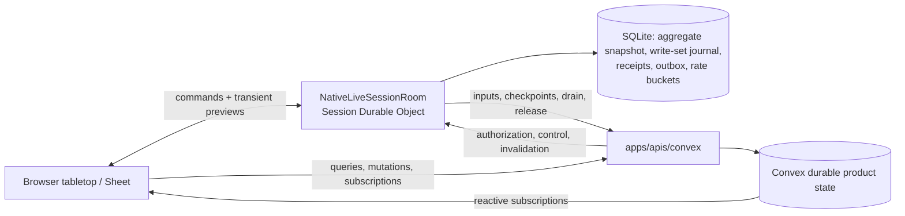
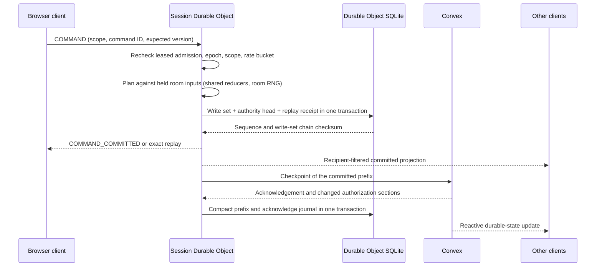
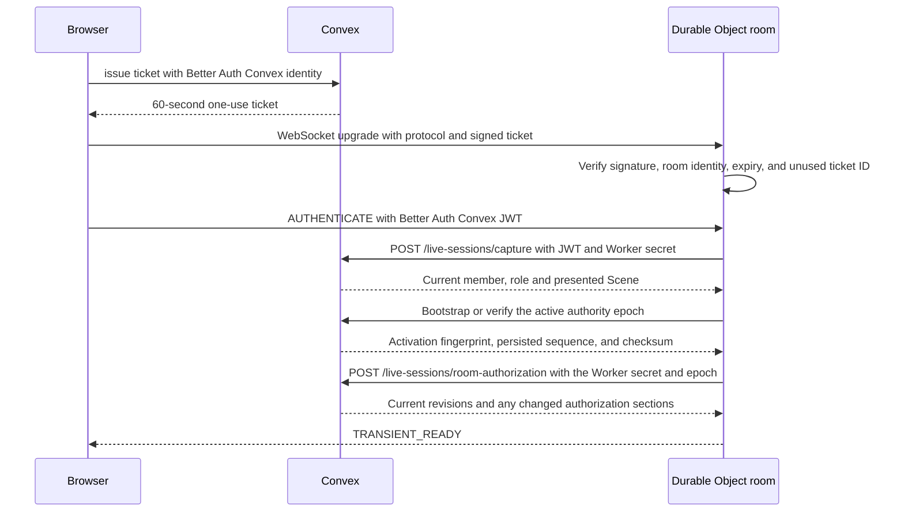

# Live-session coordination

> Status: canonical current. The Session Durable Object is the live-command authority for ACTIVE Campaign tables (ADR 0035). Integrated runtime acceptance is tracked in the acceptance ledger, not here.
>
> Scope: the room (Session Durable Object): admission and tickets, the authorization cache, inputs hydration, the SQLite store and journal, command execution, fan-out and privacy, checkpoints to Convex, drain and release, the alarm, recovery. Convex's side of the same seams (authority rows, checkpoint ingestion, control routes) is included where the room depends on it.
>
> Update when: ticket admission, supported live commands, SQLite state/receipts/outbox, room inputs, checkpoint publication, fencing, drain/release, recovery, limits or deployment configuration changes
>
> Verification: `apps/session-worker/src/nativeLiveSessionRoom.ts` and its `room*`/`native*` modules, `apps/session-worker/src/durableCommandJournal.ts`, `apps/apis/convex/liveSessions/*`, `packages/schema/src/api/liveSession*.ts`, `apps/web/src/domains/campaigns/vtt/liveSessionClient.ts`, and [ADR 0035](../adr/0035-room-authoritative-live-encounters.md)

Decisions that shaped this design: [ADR 0029](../adr/0029-convex-backend-cutover.md) (Convex cutover),
[ADR 0033](../adr/0033-campaign-owned-play-and-session-log.md) (one live table per Campaign, opened by
any ACTIVE member; no Campaign Session gates live play, and "live session" below means that
Campaign table), [ADR 0034](../adr/0034-player-control-rules-assistance-and-roll-prompts.md) (player
control, roll prompts), [ADR 0035](../adr/0035-room-authoritative-live-encounters.md) (room
authority) and [ADR 0036](../adr/0036-versioned-content-snapshots-and-browser-builder.md) (content
snapshots). Numbered decisions (`D72` and so on) are recorded in
[Phase 8.2 decisions](../handoffs/phase-08-2-decisions.md).

## Ownership and lifecycle

While a Campaign has live authority, its Session Durable Object (`NativeLiveSessionRoom`,
`apps/session-worker/src/nativeLiveSessionRoom.ts`, one object per Campaign ID) is the only writer of
live table state: the presented Scene and its fog, the open Encounter Runs, the held Characters'
play state, and Campaign chat and rolls. It commits each command to its SQLite store before
acknowledging it, then publishes the committed prefix to Convex as a fenced checkpoint.

Convex stays:

- the authentication and current-membership authority, and the issuer of tickets;
- the durable product store, the source of reactive subscriptions, and the recovery authority;
- the owner of the authority row (`campaignLiveAuthorities`, phases `ACTIVATING`, `DO_ACTIVE`,
  `DRAINING`; release deletes the row) that fences every Convex write that overlaps a live table.



Lifecycle of one epoch:

1. **Claim.** `liveSessions/tickets:issue` authorizes the member and reserves or reuses an
   `ACTIVATING` epoch. The browser opens the room socket with the ticket.
2. **Activate.** The room checks its journal against Convex (`/live-sessions/bootstrap`,
   `/live-sessions/activate`), loads its authorization cache and hydrates room inputs (below). A
   failed activation leaves no authority to serve; the next admission retries. A replacement epoch
   may discard an initial SQLite snapshot only while its sequence and published sequence are zero
   and it holds no receipts or outbox entries; committed state always goes through drain and release.
3. **Serve.** `DO_ACTIVE`: commands commit locally, checkpoints publish in the background.
4. **Drain and release.** When the last admitted socket has left for five minutes
   (`ROOM_LIMITS.idleReleaseMs`), or Convex sends `CLOSE_ROOM`, the room runs `#closeRoom`: close
   every socket, await the in-flight command chain, set the drain fence, `begin-drain`, publish the
   remaining checkpoint through the final sequence (`#checkpointThrough`), `release`, then drop the
   released journal state (`journal.release`) and clear its rate buckets and fog staging. The next
   join claims a fresh epoch.
5. **Close or delete from Convex.** Campaign archive sends `CLOSE_ROOM`, and the Campaign deletion job
   sends `DELETE_ROOM`, through the control route (below). `DELETE_ROOM` runs `#closeRoom` and then deletes the
   room's alarm and all its storage, so nothing the room retained (Scene command evidence, held Encounter
   history) outlives the Campaign. It is idempotent: after it the room answers further control calls with
   `{ closed: 0 }` and everything else with 410, and a repeat succeeds. If the final checkpoint or release fails, the room answers 503 and keeps
   its drain fence and unpublished checkpoint; Convex `deliver` retries the close, and the room's
   alarm retries an idle release the same way.

Direct Convex mutations that overlap live table state are refused or fenced while authority is
`ACTIVATING`, `DO_ACTIVE` or `DRAINING` (`apps/apis/convex/liveSessions/authorityGuard.ts`,
`readLiveCampaignAuthority`). No Convex function executes an Encounter command: every one enters
through the room, which runs `recordEncounterCommand` against its own journal.
`apps/apis/convex/encounters/commandBoundary.test.ts` asserts that no registered function accepts one.

Scene presentation is a room command: `scenes/presentations:setLive` sends `SET_SCENE_PRESENTATION`
over the control route, the room finishes pending publication, the protected Convex setter checks
the epoch, published sequence, checksum and presentation version, and the room then drops its Scene
cache and challenges every socket. A failed publication leaves the presentation unchanged. The
direct `set` mutation exists only without active authority.

## Supported live-command flow



Every command takes the same path. The room's command chain serializes commands; a command first
reloads a stale or expired authorization cache (a failed read refuses it with `UNAVAILABLE`), then
the journal answers an exact retry (same command ID and input) with its stored receipt, and a reused
command ID with different input is `INVALID_COMMAND`. An Encounter command's retry returns its own
journaled result (occurrence, roll) shown over the Run's current projection, so a retry after later
work never moves a client's view backwards (`replayRoomEncounterCommand`). A movement decision (a
`RESOLVE_RULE_OCCURRENCE` answer or a GM `VOID_RULE_OCCURRENCE` settled through the Scene) sends its sender two
messages with one command ID, the Scene `COMMAND_COMMITTED` and then the Encounter result, so its receipt stores
both as a JSON array; a retry replays the Scene receipt (with `replayed: true`, as for every Scene retry) and then
the re-presented Encounter result, each as live projected it for that sender. A command runs its planner inside one
`RoomEncounterStore.transact`, and `DurableCommandJournal.commitInTransaction` stores the receipt and
authority head in the same SQLite transaction. The room acknowledges and fans out only after that
transaction commits. A command that changes nothing writes no row.

Command scopes and their owning modules (all under `apps/session-worker/src/`):

| Scope               | Commands                                                                                                           | Module                                                                                                                 |
| ------------------- | ------------------------------------------------------------------------------------------------------------------ | ---------------------------------------------------------------------------------------------------------------------- |
| `SCENE`             | Moves, door changes, token and barrier edits, inline settings, fog painting, undo, presentation                    | `roomSceneGeometryCommand.ts`, `roomSceneEdits.ts`, `roomSceneUndo.ts`, `roomSceneFogUploads.ts`                       |
| `ENCOUNTER`         | Every Encounter command: actions, Disarm, Cleaving and Concentration answers, turns, basic actions, GM tools, dice | `roomEncounterCommands.ts`, `roomEncounterTurns.ts`, `roomEncounterBasicActions.ts`, `roomEncounterResponseRouting.ts` |
| `ENCOUNTER_BINDING` | GM binds an Encounter to the presented Scene                                                                       | `roomSceneBinding.ts`                                                                                                  |
| `CHARACTER_SHEET`   | Nineteen held-Character play commands                                                                              | `roomCharacterSheetCommands.ts`                                                                                        |
| `CAMPAIGN_CHAT`     | Chat, public and TABLE rolls, GM private rolls, roll reveals                                                       | `roomChatCommands.ts`                                                                                                  |

Contracts: [liveSessionEncounterCommand.ts](../../packages/schema/src/api/liveSessionEncounterCommand.ts)
(`ROOM_LOCAL_ENCOUNTER_COMMAND_TYPES` owns which Encounter commands run locally),
[characterSheetLiveCommands.ts](../../packages/schema/src/api/characterSheetLiveCommands.ts),
[campaignChatLiveCommands.ts](../../packages/schema/src/api/campaignChatLiveCommands.ts).

### Scene commands

The room is the only writer of a presented Scene. Planned and bound moves, door changes and token and
barrier edits run through `executeRoomSceneGeometry`, which derives each fog owner's exploration in
the same transaction. Inline edits (settings, lights, darkness, annotations, measurements) use the
shared planner `planSceneInlineCommand`; only the GM edits, except a player's own measurements. A
target changed after `expectedSceneVersion` is `STALE_STATE`; unrelated newer edits rebase. Character
vision is composed from the room's own rows before the journal commit and is never stored as a native
override. Undo selects the latest unmatched move (or published movement result) and restores or
deletes complete previous fog layers.

GM fog painting is staged, then published. `SCENE_FOG_BEGIN` carries the layer and chunk-checksum
manifest (at most 512x512 cells and 256 chunks); `SCENE_FOG_APPEND` sends at most 8 chunks per frame
so a frame stays under the 64 KB socket cap; the journaled `PUBLISH_SCENE_FOG_PATCH` writes the save,
chunks, merged layer and receipt in one transaction. Staging
([RoomSceneFogUploads](../../apps/session-worker/src/roomSceneFogUploads.ts), SQLite
`room_scene_fog_uploads`) is not Scene state and never reaches a checkpoint. It is keyed by epoch and
account and bounded to 2 unpublished patches per account within a 10-minute window; the alarm sweeps
expired staging, eviction removes the account's staging and release clears all of it.

While a bound Encounter has a pending movement decision, the room refuses token moves, undo and door
changes on that Scene with `UNAVAILABLE` ("Waiting on a movement decision."); chat, Sheets and other
Encounter commands continue. Bound-token movement happens only on the room's presented Scene
(`SCENE_NOT_PRESENTED` otherwise). Encounter-bound movement follows the bound actor's controllers plus
the GM (`NOT_ACTOR_CONTROLLER` otherwise).

### Encounter commands

`ROOM_LOCAL_ENCOUNTER_COMMAND_TYPES` run the shared reducers and planners from
`packages/rules-runtime` and `packages/encounter-persistence` through `executeRoomEncounterCommand`
(`roomEncounterCommands.ts`), drawing dice from the room's secure random source:

- `RESOLVE_ACTION` runs the action planner, or the contest planner (`nativeContest.ts`) when it carries
  an optional-combat intent (Disarm); a contested basic action (Grapple, Shove) starts in the action
  planner and settles through the same contest path, and an action authored with the `CHECK` test (First Aid) takes the check branch
  (`nativeCheckAction.ts`, persisted through `roomEncounterBasicActions.ts`); `ESCAPE` runs
  `nativeEscapeAction.ts`; `START` and `ADVANCE_TURN` run the turn planner (`nativeEncounterTurn.ts`).
- `ESCAPE` (D105, D146) is the current actor's attempt to break a hold: a fixed-DC grapple, or a condition
  a zone holds (`CONDITION_ESCAPE`, its DC pinned from the caster's save DC at placement). It shares the
  `BASIC_ACTION` capture scope with the `RESOLVE_ACTION` basic-action check path (`basicActionScopeAdmission.ts`
  dispatches by command type and pending context), and there is no Convex mutation for it. The command
  spends the effect's authored activation, then either settles in the same commit (the roller rolls
  automatically) or leaves a PENDING `ENCOUNTER_ESCAPE_CHECK` occurrence owned by `ESCAPE` that the roller's
  `RESOLVE_RULE_OCCURRENCE` settles through `nativeEscapeActionResponse.ts`. A total at or above the DC deletes
  the escaped effect and the conditions only it owned in that commit (`escapedEffectEndPersistence.ts`).
  The room's plan is never trusted for the effect's own terms: both commits (`escapePersistence.ts`,
  `escapeCheckSettlement.ts`) load the holder's stored effect and re-derive the escape
  (`escapeEffectVerification.ts`), refusing a DC, check, module or spent allowance it does not carry.
  `REVERT_LAST_ACTION` returns the activation of a failed escape and refuses a successful one ("Undo can't
  restore an escaped grapple; adjust manually.", also after its `RESOLVE_RULE_OCCURRENCE` answer), because the
  deleted effect row and the removed conditions are not kept in receipts. Action choices offer the attempt as
  `escapes`, labelled "Escape from <grappler>" or "Escape a grapple" when the grappler is hidden from the
  requester.
- A creature that moves out of a zone holding a condition on it until it leaves (`ON_LEAVING_AREA`, D146)
  is released in the move's commit. The spatial evaluator keeps those exits out of the graph candidates and
  returns them as `areaDepartures` on the TERMINAL preparation outcome (`MOVEMENT_COMPLETE` when nothing else
  executed). The room plans one `AREA_DEPARTURE` movement settlement per departure, after every other step;
  `persistMovementSettlements` checks it against the retained departures, and
  `persistLiveMovementAreaDeparture` re-derives the holder effect from current rows and ends it through the
  escape end path. The spatial receipt is unchanged.
- Pending decisions are routed by `roomEncounterResponseRouting.ts` from the Run's retained occurrence:
  TURN, ACTION, CONCENTRATION, CLEAVING, BASIC_ACTION, ESCAPE, CONTEST or MOVEMENT. The selected planner repeats canonical
  admission. A decision no planner owns is refused with `VERSION_STALE` unless it names the Run's one
  pending occurrence and the caller may answer it.
- `REMOVE_AREA_TARGET` (GM-only) takes one creature out of a pending area action (point or directed)
  (`areaTargetRemoval.ts`, routed with `AREA_REMOVAL` admission). It is not a Run command, and while the area
  still waits on another creature it writes no command receipt and leaves the Run version alone; only the
  occurrence version moves. A removal that leaves nothing to wait on writes nothing itself and the room commits
  the area through the same path as a last save answer. Area saves and `AREA_LEGENDARY_RESISTANCE` decisions
  are routed to the pending area occurrence and answered by each creature's controller or the GM in any order.
  The last answer, the last decision, a settling removal, or the open when every save auto-rolls commits the
  area in one transaction: a root receipt with the source spend plus one child receipt per kept creature
  (current, D103).
- The GM tools and dice commands run `recordEncounterCommand`. A GM `UPDATE_ACTOR` with a
  `characterCommand` commits that Sheet command on the Run's held Character; the same command on a
  Character the room does not hold is refused ("Make this change from the Character Sheet.").
- One ACTIVE Run per Campaign: the RUN input carries the Campaign's `activeEncounterId`, `START`
  refuses `ACTIVE_ENCOUNTER_EXISTS`, and checkpoint ingestion refuses a checkpoint that would leave
  two ACTIVE Runs.
- Only commands that change a Convex-owned hold set `checkpointBeforeAcknowledgement` (ADR 0035
  Amendment 17): `START`, `COMPLETE` and removing a Character actor. The room flushes a checkpoint
  before acknowledging them, including when a retry recovers that receipt after a restart. The rest of
  the synchronous list is not room commands: Encounter delete and adding a Character actor (assignment
  or `START`) happen in Convex, and the departure reconcile (D81) flushes in the room's own departure
  path. Token bind and unbind and round changes ride the next flush. `REVERT_LAST_ACTION` is an
  ordinary room command (it reads the receipts the room holds for the Run, D85 and D88); Convex
  records no Encounter command.
- `COMPLETE` also deletes, in the same save, every Run child row except the Run, its actors and the
  source facts they name (ADR 0035 Amendment 30), including the Scene binding. The room refuses
  further commands on a completed Run ("Completed Encounters are read-only."), the Play authorization
  section and transient capture no longer resolve it, and a retry of an earlier command is still
  answered from the room's command journal. The Run played on a Scene is the Campaign's ACTIVE Run when its binding names that
  Scene (`readActiveSceneEncounter`, shared by Convex and the room); a PREPARED Run bound to the same
  Scene never plays, and no lookup ranks Runs by recency.
- `RESOLVE_ACTION` naming a Creature's Legendary Action option is refused (`LEGENDARY_WINDOW_ONLY`).
- Steps play cannot continue without (initiative, saves, Recharge, Legendary dice, dice during a move)
  refuse a GM void with `DECISION_REQUIRES_ANSWER`. Other voids cancel the occurrence
  (`VOID_RULE_OCCURRENCE`).

Encounter planning reads rules content through `LiveCaptureReads`
(`nativeEncounterReads.ts`), which the room answers from its own SQLite transaction: `encounterRules`
serves the `liveSessionEncounterRules` capture requests from the hydrated Run, System and Character
inputs, and `prepareCharacter` builds a Character's rule context from the room-held Character. No
planner read reaches Convex. This is current behavior.

**Control and roll routing (ADR 0034).** Control belongs to the Run actor. Each actor stores
GM-set `controllerUserIds` (current Campaign players only, at most 8) and a `disposition`; a
Character actor's assigned player is always a controller, derived and never stored. A Campaign grant
(`campaignCharacterAssignments.controllerUserIds`, SCENE-5.1) is a second derived source: `shared/campaign/characterControl`
merges it with the per-Run list for Convex, the player projection and the room, so a granted player controls the
Character in every Run and a revoke is immediate. A Scene token carries an optional `characterId`; a grantee moves an
unbound token only when its `characterId` is a Character granted to them.
For Scene vision and fog the room treats a token linked by `characterId` as controlled by that Character's player and
grantees (`withCharacterControllers`, derived per read; the stored Scene is untouched), so a member who controls several
Characters sees the Scene through the main Character or selected token they pick (SCENE-5.2).
`encounters/actorController.ts` is the one predicate used by admission, reads and responses. A PLAYER
may `RESOLVE_ACTION` for an actor they control, end the current actor's turn when it is theirs,
answer decisions routed to them, and enter initiative once for an actor they control, rolled
(`ROLL_ACTOR_INITIATIVE`) or hand-entered (`SET_INITIATIVE` without a `manualOrder`), only while the Run is
`PREPARED` and the actor has no initiative yet (`recordEncounterToolCommand` checks
`requireEncounterActorControl`). Every other Encounter command is GM-only (`GM_ONLY`), including a second
entry, a re-roll and any initiative change once the Run is active. The matrix test
`apps/session-worker/test/nativeRoomPlayerParity.test.ts` classifies every command in the schema
registry as PLAYER, SHEET or TABLE and fails on a command with no class. A roll belongs
to the actor who makes it: pending evidence carries `rollerActorId`, and only that actor's controllers
and the GM see and answer it. Results returned to a non-owner pass through
`presentEncounterResultForMember`; the room refuses to hand a PLAYER anything that does not parse as a
player projection. Health display follows ADR 0034 decision 5 (Hidden, Descriptive, Bar, Exact), applied
by `projectPlayerEncounterProjection`.

**Why a listed creature is unseen (D131).** Each player actor carries `unseenReason: 'HIDDEN' | 'INVISIBLE' | null`,
set only by `projectPlayerEncounterProjection`: null when the viewer controls the actor or sees it, `INVISIBLE` when
it carries one of the System's Invisible condition types (`invisibleConditionTypeIds`, matched by code), else
`HIDDEN`. An UNNAMED reveal exposes this one fact and nothing else of its conditions. Hosts build the viewer with
`readEncounterProjectionViewer` (encounter-persistence `playerViewer.ts`), so the room and the Convex fallback share
one pure function. Character actors' conditions live on the Sheet and are not in the projection, so an Invisible
Character reads `HIDDEN` (deferred in `future-enhancements.md`).

**Which creatures a player sees (ATTACK-17.3, D121).** `projectPlayerEncounterProjection` lists a public
actor for a player only when the viewer controls it, the map draws its token, the GM revealed it, or it
is not a creature staged off the map. `unseenEncounterActorIds` (rules-runtime) is the one pure
predicate, used by every host. With no Scene the Encounter lists everything. With a Scene, an actor is
unseen when its token on that Scene is not drawn for the viewer, or when it has no token there and is
not a Character (the GM stages creatures off-map by leaving them unbound). The Convex reads never read
fog (`readViewerSceneTokens` returns null), so every bound creature is unseen there until revealed; the
room passes the tokens `projectSceneForViewer` draws and only ever lists more, so Convex may over-hide
and the room narrows exactly. `readEncounterPlayerViewer` (encounter-persistence `playerViewer.ts`) reads
the Scene binding row and one `by_encounterId_actorId` token binding per actor, then applies the
predicate. The GM's reveal is the per-actor `reveal` (null, UNNAMED, NAMED), set by a GM-only
`UPDATE_ACTOR`; UNNAMED lists "Unseen creature" with no name, source, conditions, grants or health. The
player projection carries no concealment or observer data (D116). `requireTargetSeenByMember`
(`targetVisibility.ts`) refuses a player command that names an unseen actor with `TARGET_UNAVAILABLE`
(action, disarm and basic-action admission and the action-choice reads). The Encounter drawer's actor row
carries the GM reveal control; the Target select drops the acting creature when the action's
`target.self` is `REFUSED`.

**Flood control.** A PLAYER has at most one Encounter or planned geometry command in flight
(`ROOM_LIMITS.maxInFlightEncounterCommandsPerPlayer`); a second is refused `UNAVAILABLE` ("Your
previous action is still resolving."). Each account also has D72 token buckets (below).

### Held Character Sheet commands

While a Character is held (an unfrozen actor of an open Run in a live room), its Sheet play commands
are `CHARACTER_SHEET` envelopes (`characterId`, `encounterId`, one of nineteen `CharacterPlayState`
commands) executed by `executeRoomCharacterSheetCommand` inside `RoomEncounterStore.transact`.
Membership, assignment, ownership, ACTIVE Run and unfrozen-actor checks precede replay and version
refusal; replay reads the stored Character receipt through `readCharacterCommandReplay`. Maximum
overrides, rests, notes, structural edits and customizations stay outside this lane: the Builder owns
structure and Convex owns rests, notes and overrides. A single-use item an Assisted action uses up
(D102) is play: the room increments the Character's `itemUsage` in the same Character version as the
action, the effective inventory (stored quantity minus usage) hides the used-up row, and the commit
input's `itemConsumption` lets Convex check it against the receipt. Only the initiator receives private Character
history; other admitted members receive the same room sequence with `delta: null`.

`SUBSCRIBE_CHARACTER_SHEET { characterId }` (one per socket) is admitted only for the Character's owner
or the GM. [RoomCharacterSheetFeed](../../apps/session-worker/src/roomCharacterSheetFeed.ts) pushes the
viewer-projected Sheet at once and after every committed transaction that changed its `streamVersion`
(unsequenced `CHARACTER_SHEET` message). Every push re-admits, so a lost assignment, hold or membership
drops the subscription. The web Sheet takes `expectedVersion` from the pushed `streamVersion`
(`useLiveCharacterSheet`). The feed also pushes again when the Character's inputs change (System,
Campaign or Character revision), which a content edit changes without changing `streamVersion`
(`roomCharacterInputsKey`).

### Live Campaign summary (current, ADR 0035 Amendment 19)

`SUBSCRIBE_CAMPAIGN_SUMMARY` and `UNSUBSCRIBE_CAMPAIGN_SUMMARY` (one per socket) subscribe a member to
`CAMPAIGN_SUMMARY { summary }` (unsequenced, `liveCampaignSummaryDtoSchema`):
`{ characters: [{ characterId, currentHitPoints, maxHitPoints, tempHitPoints, conditions }], encounter:
{ encounterId, status: 'ACTIVE', round, currentActorId } | null }`. It replaces the Campaign page's
Character roster HP and Encounter strip reads from Convex.
[RoomCampaignSummaryFeed](../../apps/session-worker/src/roomCampaignSummaryFeed.ts) pushes after admission and
after every committed transaction or reload (`#queuePostCommit`), only when the socket's serialized
summary changed. It never widens what Convex shows the member:

- only Characters held by the ACTIVE Run appear, and only the ACTIVE Run: a PREPARED Run never appears,
  to the GM or a player;
- a Character appears only if the member could read its common Sheet slice from Convex: its owner, the
  GM, or a party member of a Character whose `partyVisibility.sheet` is on (not the Encounter health
  display levels). Hit points and conditions come from `projectRoomCharacterSheetForViewer` with that
  viewer kind, the projection the Sheet feed uses;
- `currentActorId` is the player projection of the Run (`presentEncounterRun`), so it is null for a
  player while that actor is hidden.

### Held Encounter session

`SUBSCRIBE_ENCOUNTER_SESSION { timeline }` and `UNSUBSCRIBE_ENCOUNTER_SESSION` (one per socket) subscribe a
member to the Encounter state the room holds.
[RoomEncounterSessionFeed](../../apps/session-worker/src/roomEncounterSessionFeed.ts) sends an unsequenced
`ENCOUNTER_SESSION` frame after admission and after every committed transaction (`#queuePostCommit`, after
the Sheet push), only to subscribed sockets and only when the socket's serialized frame changed. The frame
is `{ held: false }` while the room holds no open Run for the Campaign (the feed never lazy-loads a Run, so
the web falls back to Convex), else `{ held: true, version, state, preparedPending, actorSides,
settlement, timeline }`:

- `state` is the `EncounterSessionStateDto` (the active Run in the member's projection plus its pending
  decision, `waitingOn`), `preparedPending` the PREPARED Runs with a pending initiative or recharge
  decision, `actorSides` the GM's actor-side map (null for a player), `timeline` the newest 50 entries
  when the socket asked for them (the web asks only while the chat roll view is Encounter, or in the
  Encounter workspace), and `settlement` how a player's last shown decision ended (D39), remembered per
  socket.
- Frames are built by the same readers Convex uses
  ([sessionReads](../../packages/encounter-persistence/src/sessionReads.ts),
  [timelinePages](../../packages/encounter-persistence/src/timelinePages.ts)) over the room store through
  `roomEncounterReadPorts`, so projection, privacy (players see TABLE entries and their own redactions)
  and integrity checks cannot drift. Authorization, budgets and receipt-ledger loading stay in the
  Convex reads. Every push re-admits the socket against the current authorization.
- A command's `expectedVersion` comes from the pushed `version`; the checkpointed Convex version lags the
  room while the Run is held, so a client must not compare the two.
- Timeline audiences (current, D103): an entry is `PRIVATE` (the GM), `TABLE` (every member) or `ISSUER` (the
  GM and the user who issued the command). A `RESOLVE_ACTION` is `ISSUER` when it stores `issuerLines`, which
  an area action uses for what its caster perceived; `readEncounterTimelinePage` merges a player's TABLE
  entries with the ISSUER entries they issued, and a player's copy always has empty `gmLines` (the GM-only
  lines, such as "GM removed <label> from the area"). A stored entry that does not match its audience is an
  integrity error. The web does not render `caught`, `issuerLines` or `gmLines` yet.

#### Held turn reads

The four version-keyed turn reads (`actionChoices.get`, `actionChoices.optional`,
`evidenceRolls.latest`, `sceneBindings.get`), the Scene's actor token bindings and the target modifiers are
not in the frame; they are answered on demand. `ENCOUNTER_READ { requestId, read }` carries `read`, a union
over the seven reads with the Convex query's arguments less `expectedVersion`
([encounterRead.ts](../../packages/schema/src/api/encounterRead.ts)). The room answers at its own current
version with an unsequenced `ENCOUNTER_READ_RESULT { requestId, version, result }`, or
`ENCOUNTER_READ_REJECTED { requestId, code, reason, message }` (the rejection codes of `COMMAND_REJECTED`).

- [RoomEncounterReads](../../apps/session-worker/src/roomEncounterReads.ts) runs each read on the room's
  command chain (it sees one committed version, never a half-applied command), re-admits the socket against the
  current authorization, then applies the same checks as the Convex query (Campaign authority, actor
  control, visibility). A domain refusal is `DOMAIN_REJECTED` with its reason and message.
- `ACTOR_TOKEN_BINDINGS { encounterId, sceneId }` returns the held `encounterActorTokenBindings` rows for
  that Scene, only for tokens the reader sees in the room's presented Scene
  (`projectNativeLiveSessionState`), so a player never learns which actor stands behind a hidden token.
  Binding and unbinding no longer checkpoint, so Convex's `scenes/recipientActions:encounterBindings` trails
  the room; the web view (`CampaignVttStage`) reads this while routed and re-asks when the viewer's token
  set changes. It keeps the Convex action for an unrouted read. A Scene the room does not present is
  `UNAVAILABLE`.
- `HELD_RELATIONSHIPS { encounterId }` is room-only, like the release it offers: the holds whose source
  the reader controls (every hold for the GM), each `{ sourceActorId, heldActorId, activeEffectId, label }`
  with the held creature's name hidden from a player unless it is public
  (`readEncounterHeldRelationships`). It reads on any turn, and the turn-order drawer lists them under
  Holding with a Release that sends `RELEASE_RELATIONSHIP` for the hold's source (D152). The current actor's
  action choices carry the same holds as `releases`. A `TARGET_DRAGGED` hold also carries
  `drag: { doublesCost }` (null for a hold that does not drag), decided by `encounterDragDoublesCost`
  from the source's and the held creature's sizes at read time, the same rule settlement uses; the Scene's
  route preview doubles a dragging grappler's priced route with it (D105). A size that changes mid-hold
  can leave the preview stale until the next read; settlement recomputes the cost.
- `ACTION_TARGET_MODIFIERS { encounterId, actorId, actionId, scene }` answers ATTACK-17.2's hover readout
  ([encounterActionTargetModifiers.ts](../../packages/schema/src/api/encounterActionTargetModifiers.ts),
  [actionTargetModifierReads.ts](../../packages/encounter-persistence/src/actionTargetModifierReads.ts)). For
  each creature the viewer can list it returns the d20 mode the acting Character believes (ATTACK-10.1, D100:
  the same believed-mode mechanism as the roll prompt, never the true mode) and the player-safe reasons, or
  `attack: null` when the action makes no attack roll against it. The web asks once when targeting starts
  (`useActionTargetModifiers`, keyed by Encounter, actor, action and Scene) and never per hover; the
  Convex query `encounters/actionTargetModifiers:get` is the fallback and agrees with the room. The GM reads
  the same believed mode in this version.
- A save is sight-governed the same way when the saver holds a sight-gated save contributor (ATTACK-10.5,
  D100): `loadAttackPerception` takes a `roller` (`TARGET` for a save, so the saver's own facts are the
  observer) and a point area uses what each saver sees of the origin
  ([nativeAttackPerception.ts](../../apps/session-worker/src/nativeAttackPerception.ts)). The area save
  prompt shows the believed mode, the save settles in the true mode, and the stored `modeAdjustment`
  carries the generic player caption and the GM-only reason.

#### Targeting from the map or the list (ATTACK-17.1, 17.2)

Choosing an action whose target is one creature lets the caster pick it on the map (the area-aim pattern).
`CampaignVttStage` owns the targeting request and the picked creature; the Action drawer's Target select,
"Pick on map" button, the map and the Encounter drawer all read and write that one pick.

- `vttTargeting.model.ts` is the pure model: it lists the creatures the action can name, measures each one's
  footprint distance and reach band from the caster's token on the Scene, and sorts the list (D131): creatures
  the GM revealed but the player cannot see lead, marked "Invisible" (it carries the Invisible condition) or "Hidden" (otherwise) with "Distance unknown", and are
  never measured or offered on the map; visible creatures follow nearest first, a visible creature with no
  token last. It flags exactly the listed visible tokens in normal or long range as
  targetable. The renderer draws the flag as a ring, shows a pointer cursor and turns a click into
  `onTokenPick`; Escape calls `onTargetingCancel`.
- While targeting, the Encounter drawer is the target list: non-modal beside the map, ordered by the model,
  each listed creature a labelled `Target <name>` button with its distance, reach and believed modifier text.
  Out-of-range creatures stay selectable from the list (marked "Out of range"); only the map refuses them.
  When targeting ends the drawer closes (or returns to turn order) and the order is initiative order again.
- The readers are shared with the Convex queries
  ([actionChoiceReads](../../packages/encounter-persistence/src/actionChoiceReads.ts),
  [evidenceRolls](../../packages/encounter-persistence/src/evidenceRolls.ts),
  [sceneBindingReads](../../packages/encounter-persistence/src/sceneBindingReads.ts)) over an
  `EncounterTurnReadTransaction`: the store plus the ports a turn read needs (Character turn facts, the
  current definition, the Basic Action definitions, the Scene readers). The room implements them over its
  store in
  [roomEncounterTurnReadPorts](../../apps/session-worker/src/roomEncounterTurnReadPorts.ts); the Convex
  queries stay as thin wrappers (identity, authority, budget) for use outside live play.
- **A read never calls Convex.** The room hands the readers `RoomInputs.heldOnly()`, a view over the same
  held inputs whose load paths throw `RoomInputsUnheldError`. An input the room does not hold current
  (stale Character, unknown definition, unloaded Scene) refuses the read as `UNAVAILABLE`, and the client
  reads the Convex query instead. `version` is the Run's version; the Scene binding is read against the
  Scene the room presents.
- Reads count against the `READ` message class (20 then 5/s per socket), apart from `SYNC` so a burst of
  reads cannot starve Scene synchronization.
- The web ([useRoomEncounterRead](../../apps/web/src/domains/campaigns/vtt/useRoomEncounterRead.ts))
  requests the reads while the `ENCOUNTER_SESSION` frame is held, asks again when the frame's `version`
  changes, drops a reply older than the frame, and reads the Convex query on `UNAVAILABLE`, a lost
  socket or an unheld frame. A `DOMAIN_REJECTED` or `FORBIDDEN` answer is shown as the answer instead of
  being retried against Convex, which trails the room.

**Holds.** [liveCharacterHolds](../../packages/schema/src/projections/liveCharacterHold.ts) fence each
Character and active Run pair by Campaign and epoch. Claim and recovery establish holds, checkpoints
reconcile them (`reconcileCharacterHolds`) and release removes them (`releaseCharacterHolds`). Direct
Convex play, preference and rest writes reject a held Character; a checkpoint accepts writes for an
unassigned Character this epoch still holds. A GM removal of a Character takes it out of initiative but
keeps its actor until the Run ends (D82). Room reconciliation clamps current HP to the evaluated
maximum.

**Departures (D74, D81).** For an open Run the room owns, `removeCampaignCharacterAssignment`,
`removeEncounterActorController` and account deletion write no Run actors in Convex; Convex sends
`EVICT_USER` and `INVALIDATE_INPUTS`. The room runs
[reconcileRoomActorDepartures](../../apps/session-worker/src/roomActorReconcile.ts) from one coalesced
post-commit task (`#queuePostCommit`) after every committed room transaction, authorization reload and
Sheet subscribe. A CAMPAIGN `INVALIDATE_INPUTS` reloads membership at once, with or without a socket, and
runs the reconcile inside that same task on the room's serialized command chain (`#queueEagerReload`,
`#queueMembershipReload`), so a checkpoint barrier, command or read that follows the notice orders behind
the reload and the freeze; queuing the reconcile only through `#queuePostCommit` would append it after them.
It runs one `RoomEncounterStore` transaction (with a journal entry, `delta: null`) only
when an open Run names a departure: Characters that no longer exist (read as `DELETED` through the
CHARACTERS input scope) lose their actors, other unassigned Character actors are frozen, and departed
controllers are unlisted, via
[reconcileRunActorDepartures](../../packages/encounter-persistence/src/actorDepartures.ts). A removal
checkpoints before its receipt, then the room drops cached play and Scene and challenges every socket.
`RoomInputs.evictCharacter` drops the departed Character's cached inputs. A failed step is logged and the
next trigger retries it. Until the next checkpoint, Convex's own Run reads present a held Run's unassigned,
unfrozen Character actor as frozen at its play record's values and leave out the actor of a deleted
Character (`readEncounterCharacterStates`); outside a held Run the same state is an integrity error.
A Run the room never hydrated this epoch is covered at release by
`reconcileOpenRunsAtRelease` in Convex. Checkpoint ingestion rejects an open Run's actor row that names a
departed controller or an unassigned unfrozen Character. Scene vision composition (`composeRoomSceneVision`)
skips such an actor, and a frozen one, so a departure never fails activation: it binds no Character vision
(`isDepartedCharacterActor`, the same departed test as `readEncounterCharacterStates`). Commands that
would read a departed actor's Character (its ACTOR/EFFECTS rules capture, or moving its token) refuse with
the domain rejection `TARGET_UNAVAILABLE` ("That Character has left the Campaign.") rather than an
internal error.

**Hold ends (D152).** The same post-commit task then runs the relationship end sweep
([roomRelationshipEnds.ts](../../apps/session-worker/src/roomRelationshipEnds.ts)) on the journal head. For
each ACTIVE Run, an actor relationship ends when its source can't act (DEFEATED or INCAPACITATED, as
Concentration reads it) or when the held creature's bound token stands beyond the reach the relationship
sealed (`encounterEndedRelationships`). A first read outside any transaction finds nothing to end in the
usual case and journals nothing. Otherwise one `RoomEncounterStore` transaction (a journal entry,
`delta: null`) ends each broken relationship as the Campaign owner and records one `RELATIONSHIPS_ENDED`
command per Run ("Hold ended", receipt `relationshipEnds`)
([relationshipEndSweep.ts](../../packages/encounter-persistence/src/relationshipEndSweep.ts)), and the
receipt goes to the admitted sockets. An ended hold is not restored by undo. A failed sweep is logged, and
the next commit retries it. The source releases a hold itself with the free `RELEASE_RELATIONSHIP`.

Known gap: a Character actor already frozen whose account is deleted later is removed only at release,
because a frozen actor names no departure for the room to reconcile.

### Chat and rolls

While live authority exists, general chat, public rolls and TABLE rolls are `CAMPAIGN_CHAT` commands;
the command ID is the entry's client nonce. `executeRoomCampaignChatCommand` validates the author
through the room's read ports, resolves Character rolls from held inputs, and writes the paired header
and payload with the shared conversation writers so the next checkpoint carries both. The entry fans
out at once to the conversation's members (others receive the same room sequence with `delta: null`);
the web routes chat and rolls through the room (`useCampaignChatRoom`) and merges pushed entries into
Convex history. Edit and unsend remain Convex-only; Convex fences `campaigns/chat:send` and
`campaigns/rolls:execute` while authority exists.

Conversation entries read back in insertion order: the shared `insertConversationEntry` (used by
Convex and the room) stamps `createdAt` strictly after the conversation's newest entry, at the cost of
one indexed header read per insert, so same-millisecond writers never fall to the random id tiebreak.

The GM's private roll (`EXECUTE_PRIVATE_ROLL`) and both reveals (`REVEAL_ROLL`, `FULL` or `NOTICE`) are
`CAMPAIGN_CHAT` commands. A private roll is answered to the GM alone and carried in the checkpoint
`retainedRolls`. A private roll made before the live table started exists only in Convex, and the room
refuses to reveal it. Every automatic rule roll gets a card through `recordRuleRollCard`; a hidden
roller is PRIVATE, a roller with a non-owner controller is TABLE, otherwise the command's `visibility`
or the stored `gmRollVisibility` decides. Convex and the room present rolls through one
`presentRoll`/`presentRetainedRoll` in `@artificer-toolkit/rules-runtime`.

Area save cards (current, D103): each caught creature's save is its own card, authored by the creature's
roller and routed by the rules above, except that a creature the area's caster cannot perceive is routed as a
hidden roller (`rollerAsPerceivedByCaster`, D62), so its card is PRIVATE and never reaches the table. The
area's one damage roll is carded once, with the first creature. A PRIVATE card of a creature a player
controls is also that player's own (ATTACK-17.5): `recordRuleRollCard` retains the generic `roll` in the
player's history with no reveal binding (`retainPrivateRoll`, `gmCampaignRoll: null`) beside the GM's
bound copy, and returns `playerCopyUserId`, so the answer to the player's command carries the roll while
the table and the area's caster get nothing. The room pushes it as a `privateRoll` to that player's
sockets only. A hidden creature the GM controls, or whose controller left the Campaign, stays the GM's
alone. A hidden creature's Concentration check card takes the same route (ATTACK-17.6): the GM's bound copy
plus the controlling player's own generic copy through the shared `retainPrivateRuleRoll`, and nothing to the
table. Its Concentration end notice is a chat message, not a roll card, and a hidden creature posts none.

**Rate buckets (D72).** Per-account token buckets live in room SQLite
([roomRateLimits](../../apps/session-worker/src/roomRateLimits.ts), allowances in `roomLimits.ts`):
chat and every roll share the TABLE bucket (players 30 per minute, burst 30; the GM 60/60); Scene writes
use 240 per minute, burst 80. A charge commits inside the command's durable transaction, so exact
retries and rolled-back commands are never charged and reconnects share the bucket. Eviction removes
the account's rows; release clears them. Fog staging steps check the Scene allowance, and publication
consumes it. The TABLE bucket is charged for `ROLL_ENEMY_ACTION` only when its `visibility` is `PUBLIC`,
and for `ROLL_ACTOR_INITIATIVE`.

## Ticket and authentication flow

`liveSessions/tickets:issue` authorizes the current ACTIVE Campaign member before signing a 60-second
HS256 ticket (issuer `artificer-convex`; subject, Campaign, Session, role, unique ticket ID, audience,
version, issue time and expiry are signed). A room consumes each ticket ID once and binds its persisted
room identity to the exact Campaign; the WebSocket path segment is the Campaign ID. The Worker entry
(`apps/session-worker/src/index.ts`) checks the browser Origin against `LIVE_SESSION_ALLOWED_ORIGINS`,
verifies the ticket and routes to the room object.

The signing key is checked before reserving authority. An `ACTIVATING` reservation expires at the
latest ticket expiry issued for that epoch; issuing another ticket extends the deadline without
changing the epoch, but never past the reservation's `createdAt` plus five minutes
(`claimCampaignLiveAuthority` in `liveSessions/authority.ts`). After expiry, direct Convex writes are
available again and a new join claims a fresh epoch. `DO_ACTIVE` and `DRAINING` authority never expires
through this deadline.



The browser authenticates once after the socket opens. There is no periodic heartbeat; the admitted
socket stays valid until its JWT expires (about 15 minutes), an invalidation arrives, the room's
authorization cache no longer admits it, or the socket closes. After `AUTHENTICATION_REQUIRED`, the
browser obtains current authentication and the room re-admits it warm or, failing that, Convex
recaptures product authority (see "Warm admission"). Every cold admission also renews the room's
authorization cache and is refused when that cache does not admit the captured member.

**Proactive re-challenge (ADR 0035 Amendment 23, current).** The room does not wait for a request to
find an expired token. Through its single coalesced alarm it sends `AUTHENTICATION_REQUIRED` to each
admitted socket at `Admission.deadline` minus `reauthenticationLeadMs` (60 s), including a socket
restored by a wake: a restore arms no expiry, so the alarm that wakes the room challenges it. The browser's
`liveSessionClient` answers every challenge with an access token, so a passive socket re-admits before
expiry. `useCampaignLiveSession` reuses its token while more than `LIVE_SESSION_REAUTHENTICATION_LEAD_MS`
(the same 60 s, in `liveSessionIdentity.ts`) remains before its `exp`, and fetches a new one otherwise, so a
repeated challenge costs no token fetch and the room's same-token check absorbs a duplicate answer. A socket that has not been re-admitted at its deadline is closed with the reason
"Live-session sign-in expired." (1008). A revoked session cannot obtain a token, so an unanswered
challenge ends the socket at expiry rather than by notice. The challenge drops the socket's feed
subscriptions as any `AUTHENTICATION_REQUIRED` does, and the re-admission resends the state sync.

**Warm admission (ADR 0035 Amendment 18, current).** The ticket (version 3) carries `authSubject`,
the Better Auth user ID (`identity.subject`, never an argument), beside `sub`, the app user ID. When an
AUTHENTICATE arrives for a socket that was already admitted as a member, the room verifies the access
token locally (`accessTokenSubject.ts`): RS256 against the Convex site JWKS
(`/api/auth/convex/jwks`, one cached `createRemoteJWKSet` per site URL), issuer the Convex site URL,
audience `convex`, `exp` checked. A proven `sub` equal to the ticket's `authSubject`, with the cached
authorization lease current and admitting the member (`admitsRoomMember`), re-admits the socket with no
Convex call: no flush, capture, authority check, authorization refresh or background publish, and the
lease is not renewed. A proven `sub` that differs closes the socket ("Live-session identity changed.").
Any token the room cannot prove (a JWKS fetch failure, an unknown key, a bad signature, an expired
token), a lapsed lease or a first admission goes the cold path, where Convex decides: it flushes,
captures, ensures authority and refreshes the lease. An idle socket therefore re-admits warm only
while the 60 s (2N) authorization lease is current. `LIVE_SESSION_WORKER_SECRET` authenticates the
Worker's HTTP calls to Convex and Convex's control calls to the Worker.

**Control route.** Convex reaches a room through `POST /internal/live-sessions/control`
(`LIVE_SESSION_CONTROL_PATH`), authenticated by the Worker secret header and routed to the room object by
Campaign ID. Operations: `EVICT_USER` (a membership generation or user), `INVALIDATE_INPUTS { scopes }`,
`SET_SCENE_PRESENTATION`, `CLOSE_ROOM` and `DELETE_ROOM`. Producers: Campaign leave and removal evict the membership
generation; account deletion, auth-account suspension and administrative auth-session revocation evict the
user; Campaign archive closes the room and Campaign deletion deletes it (`DELETE_ROOM`; account deletion
reaches it only through the Campaign deletion job, because an owned Campaign blocks account deletion); finishing a Campaign Session does not affect live play.
Sign-out and security actions close the browser's own socket.

`liveSessions/control.ts` `deliver` is fire-and-forget from the producing mutation and reschedules on a
network failure, 408, 429 or any 5xx after 1, 2, 4, 8 seconds and so on. An eviction keeps retrying, at
most a minute apart, until the room acknowledges it or no room holds the Campaign's authority
(`liveSessions/authority:held`). Closure and `INVALIDATE_INPUTS` stop after five attempts; the
authorization lease covers a lost invalidation. Other 4xx responses and missing configuration fail
immediately. Presentation control is synchronous and does not retry.

## Room authorization cache (ADR 0035 S4)

The room caches the authorization inputs of its Campaign (`apps/session-worker/src/roomAuthorization.ts`,
contract `packages/schema/src/api/liveSessionRoomAuthorization.ts`):

| Section      | Contents                                                                                       | Changes with                         |
| ------------ | ---------------------------------------------------------------------------------------------- | ------------------------------------ |
| System stamp | Canonical revision for the held System inputs; no separate authorization section payload       | SYSTEM revision                      |
| Campaign     | Owner, ACTIVE members (role, membership epoch), Campaign Character assignments                 | CAMPAIGN revision                    |
| Characters   | Each assigned Character's owner and party visibility ("Party can view" and health display)     | That Character's CHARACTER revision  |
| Preferences  | Each member's "Roll my dice automatically" and canonical username                              | A digest of the members' preferences |
| Play         | The presented Scene's ACTIVE bound Encounter: token bindings, actor control and health display | PLAY revision                        |

**Loading.** `liveSessions/roomAuthorization:read`, behind the Worker-secret route
`/live-sessions/room-authorization`, is authorized by the room's `DO_ACTIVE` epoch, not a member's token.
The room sends the revisions it holds (`known`); Convex reads the revisions and returns only the sections
whose revision differs.

**Lease.** The cache is trusted for `ROOM_LIMITS.authorizationLeaseMs` (60 s, 2N) from the start of the read
that loaded it. Each socket's authentication, including its renewal at token expiry, renews it. A
checkpoint never renews it and Convex reads no authorization for it (Amendment 18). Instead
`#renewAuthorizationIfDue` starts one background `/room-authorization` read once half the lease has passed
(`RoomAuthorization.renewalDue`), riding a message or an alarm that is already running and only while a
socket is connected. An idle room with no sockets sets no alarm for it; the lease lapses and the next
admission reads. A lost invalidation is therefore corrected within the lease. When SQLite retains an
unpublished suffix, the room rebuilds actor controls, health display and token bindings from committed
native records after a reload.

**Own writes.** The checkpoint bumps PLAY and its delta Characters' revisions itself. Convex reads those
revisions before applying, and the response's `adopted` carries each post-write revision only where the
pre-write one equalled what the room sent. `RoomAuthorization.adopt` applies it while the cache still holds
the revisions the checkpoint was sent with. Anything not adopted keeps its old revision, so the next read
fetches that section. The held PLAY stays the room's own, which `applyPlay` keeps current.
`RoomInputs.adopt` restamps the cached input records read at the sent PLAY and Character revisions, so
the room's own checkpoint does not reload them: a held part never carries what a checkpoint writes (the
Campaign part has no play data, and a Character part's play state, effects and sheet state are replaced by
the room's own on every read). For that reason Convex stamps a Character part with its SYSTEM, CAMPAIGN and
CHARACTER revisions only, as it does the Authority and Definition parts: a PLAY change racing a command's
reads (a checkpoint landing between the part and the System read) cannot split the part from the System
read it is merged with, and a checkpoint never reloads a held Character. A restamped record is served with the restamped revisions, not the ones
it was stored with, so a part merged with a fresh System or Campaign read reports one revision per scope
(a stale one fails the merge with `RulesRevisionChangedError`, "Live rules revision changed during
preparation", naming the scope and both revisions; the room prepares the command again, see Domain rejections). The restamp is memory only and ignored once its record is rewritten, so
an outside edit, which advances a revision the room did not adopt, still misses and reads, and a room
woken from hibernation reads once. A multi-page flush adopts per page: each page is sent the revisions
after the previous page's adoption (`adoptRevisions`), and `RoomCheckpoints` reports every page's response
through `onPublished`; a retained pending checkpoint retries with its own persisted revisions.

**Invalidation.** `INVALIDATE_INPUTS { scopes }` marks the cache stale; nothing is trusted until the next
read. The tracked mutation builders in `apps/apis/convex/lib/mutations.ts` collect, per transaction:

- CAMPAIGN: any CAMPAIGN revision bump (Campaign, memberships, assignments, content shares);
- PLAY: `campaignPlaySettings` writes. Encounter writes also bump PLAY but are not pushed; the room marks
  its Play section stale after its own Encounter commands and bindings;
- CHARACTER: any CHARACTER revision bump, mapped to its Campaign through the assignment;
- PREFERENCES: an auto-roll change for each Campaign the user is an ACTIVE member of, and a change of
  the user's canonical username.

One notice per Campaign is scheduled when the mutation succeeds, and only while that Campaign's
authority is `DO_ACTIVE`. SYSTEM changes are pulled, never pushed. Checkpoint-originated writes send no
invalidation back to their own room.

**Eager reload (current, ADR 0035 Amendment 21).** With an admitted socket connected, a notice queues
one reload on the command chain (`#queueEagerReload`; notices that arrive before it runs share it). It
does what a command's stale path does: refreshes authorization, and if the aggregate must reload,
flushes `RELOAD` and reloads it (`#reloadRoomAggregate`, shared with the command path); otherwise it
rebuilds a Scene vision built from superseded Character revisions and sends `STATE_SYNC`. It then
queues the post-commit pushes, so a Feature or Builder edit reaches the Sheet, Encounter and summary
feeds with no command. A failed reload leaves the cache stale for the next command and closes no
socket. With no socket connected a CAMPAIGN notice still reloads at once, because membership can end
sockets, and other notices reload before their next use.

**Use.**

- A command first reloads a stale or expired cache; a failed read refuses the command with `UNAVAILABLE`.
- Every admission, including the first after a wake or an eviction, builds the presented-Scene cache
  before the socket's first `STATE_SYNC` when the room holds none, so a sync always carries the presented
  Scene. `STATE_SYNC` also carries `presentationVersion`, the Campaign's presentation version as the room
  holds it (`null` until a Scene was ever presented). A `RESUME` answers only the asking socket, so a
  table rejoining at once costs N state syncs, not N². A present (`SET_SCENE_PRESENTATION`) drops the
  cache and challenges every socket; each re-admission rebuilds it for the new Scene and version.
- Every read closes each socket whose member left, changed role or started a new membership epoch
  ("Campaign access ended."), so a removed member's queued commands never run.
- Broadcasts are refused while the cache is stale or past its lease: a preview or ping is dropped and one
  background read starts (one at a time; after a failure, none for `previewRetryMs`, 5 s). Only admitted
  members are recipients.
- A player's bound-token drag preview takes its control from the Play section.
- A token drag checks that the Scene's vision was built from the Character revisions the cache holds;
  otherwise the cache reloads and, if a Character changed, the Scene's vision is rebuilt.

**Accepted exposure.** Until the next read, a member whose removal notice was lost keeps receiving
broadcasts and can run room-local commands for at most one lease. No per-command authorization fetch is
added to a warm command; the final SQLite fence is the commit check.

## Room store and journal

`apps/session-worker/src/roomEncounterStore.ts` is an `EncounterStore` (the subset of `ctx.db` the
Encounter writers use, `packages/encounter-persistence`) over the object's SQLite. It reuses the
in-memory reference store (`createMemoryEncounterStore`) as the live index, so planners and writers run
against memory and SQLite is the durable copy. Beside it, `DurableCommandJournal`
(`durableCommandJournal.ts`) owns the authority head, replay receipts and the publication outbox
(`durable_session_authority`, `durable_command_receipts`, `durable_command_outbox`,
`durable_command_json_chunks`).

| Table                    | Rows                                                                             |
| ------------------------ | -------------------------------------------------------------------------------- |
| `room_snapshot_head`     | One row: the snapshot's epoch, sequence, chain, id counters and page count       |
| `room_snapshot_pages`    | The aggregate as of the last snapshot, in pages of about 96 KB (see Compaction)  |
| `room_writeset_log`      | One row per command: its write set, the counters, and the chained state checksum |
| `room_scene_fog_uploads` | Staged fog patches (not Scene state, never checkpointed)                         |
| `room_idle_release`      | The idle-release deadline                                                        |
| `room_authorization`     | One row: the authorization lease, kept across hibernation (see Hibernation)      |
| `room_scene_cache`       | One row: the map cache's identity, kept across hibernation (see Hibernation)     |

**Write path.** `transact` gives each command an all-or-nothing overlay: writes reach the in-memory index
through a journal, and only when the callback resolves does one `INSERT` into `room_writeset_log` make
them durable before the journal commits. A callback that throws, or a row that cannot be written, rolls
the index back. The billed cost is one row per command. A write set over 1.8M characters is refused with
`RoomWriteSetTooLargeError` before anything is written.

**Checksum.** Each row stores the SHA-256 of its write set and the chain value
`sha256(previous chain + ":" + that checksum)`. A replayed log reproduces it, and checkpoints fence on
it. `commitInTransaction` stores the same cumulative chain as the authority head beside the write-set
commit. Stored display Scene JSON has its own content checksum (`liveRoomStoredSceneStateSchema`) that
does not replace the chain.

**Raw and display state.** Native Scene rows and the display Scene (with composed Character vision) are
separate. Raw rows are what checkpoints carry; vision is recomputed. Native storage-row helpers are in
`roomSceneRecords.ts`.

**Token senses (current, VTT_UI-3.4, VTT_UI-5.2).** A token's `vision` is authored only, and fog follows authored
vision only. Composition (`resolveSceneActorVision`, keyed by bound Encounter actor) writes a bound
token's senses (Darkvision, Blindsight, Tremorsense, Truesight and similar) to the token's `senses`: a
Character's granted senses or a Creature's structured stat-block senses (D111), both pinned to the
System's Sense definitions by the one `createActorSensePinner` and derived by the one
`deriveActorSceneVision` (`packages/rules-runtime/src/actorSenses.ts`). An unbound token carries none
(`apps/session-worker/src/roomSceneVision.ts`). Senses are player-private: `projectSceneForViewer` and
both Scene delta projections empty `senses` on every token the PLAYER does not control, using the
room's per-viewer bound-token control
(`#boundTokenControl`, ADR 0034; no current play authorization reads as no control). The GM sees all
senses. The client renderer applies the view token's senses on top of authored lighting.
Senses are never persisted. One storage rule enforces it: `sceneStoredTokenDtoSchema`
(`packages/schema/src/api/vttScenes.ts`) rejects a token with senses. Scene definition batches
(scenes/definitions:append, via `appendSceneDefinitionInputSchema`) and room checkpoints
(liveSessions/checkpointScenes, via `sceneStoredLiveEntitySchema`) both parse through it and reject, so
Convex paged recipient reads need no senses redaction. The transport `sceneTokenDtoSchema` still allows
senses for composed live Scenes.

**Compaction.** `compact({ epoch, sequence, checksum })` requires the checkpoint acknowledgement from
Convex, verifies the epoch, prefix checksum and the journal rows through that sequence, and applies
that prefix's write sets to an in-memory acknowledged base. It then rewrites only the snapshot pages those
writes touched, updates the head and deletes the log rows through that sequence in one `transactionSync`;
a failed transaction rolls the base back. A page holds one table's documents, or the room records, in
insertion order; new entities fill the newest page, an oversized page splits and an emptied page is
deleted. A page's text is stored in parts of at most 96,000 characters with its SHA-256 on each part.
Compaction cost therefore follows what the prefix changed, not the Run's history: a whole-snapshot
rewrite stalled the room for up to a second per checkpoint once history reached several megabytes, and
rewrote every row each time (REL-5). The page size keeps the rows read on wake to the snapshot size
divided by 96 KB, instead of one per document. Later rows are verified when they are acknowledged or
rehydrated, so draining a backlog in several checkpoints stays linear in its size. Commands committed
after the acknowledged prefix stay in the journal and in memory. The head retains the id counters, so
replay after eviction preserves consumed identities. Hydrating a new epoch writes every page afresh and
replaces every old log row.

**Journal reads for checkpoints.** `committedWriteSets` reads a bounded consecutive prefix
(`packages/schema/src/api/liveSessionCheckpointJournal.ts`), verifying epoch, starting
sequence and checksum, row hashes and chain continuity, and refusing pending transactions, corrupt or
missing rows and compacted ranges. `checkpointSnapshot()` reads and verifies the durable base.
`packages/schema/src/projections/encounterStore.ts` owns the table schemas and indexes shared by room
replay and checkpoint validation.

**Restore.** `restoreDocument` marks a native row already durable in Convex (`RESTORE`): it creates or
rebases that input's checkpoint base instead of recording a gameplay insertion. The checkpoint builder
refuses a restore that would replace uncheckpointed mutable changes or append-only history.

**Rules inputs beside the aggregate.** The store keeps opaque records (`hydrate({documents, records})`,
`record(kind, key)`, `setRecord`): the cached Character Builder structure, per-root definition records
and the complete-inventory marker. Structure refresh, preparation (hit-die and resource reconciliation,
HP clamping, equipped/attuned filtering) and the command share the caller's SQLite transaction and roll
back together; room-owned play and effects are not replaced when structure refreshes.

## Room inputs and content snapshots

`apps/session-worker/src/roomInputs.ts` fills the authorized base from Convex. `liveSessions/roomInputs:read`
answers one Convex query page; the Worker-secret route `/live-sessions/room-inputs`, authorized by the
`DO_ACTIVE` epoch, answers a **batch** of consecutive pages (`readRoomInputsBatch`,
`packages/schema/src/api/liveRoomInputsBatch.ts`) until it holds 2048 documents or 2 MiB, so one Worker
call is one subrequest however many query pages it spans. A page is at most 1024 documents. Scopes:

- `RUN`: one Encounter's aggregate with the Run's `encounterVersion`; a page read at another version is
  left for the next call, so the Worker repeats a read that a command tore.
- `CHARACTERS`: up to 128 Character ids per request; each Character's stored inputs on its first part,
  then its active Rule Effects. A Character the Campaign no longer has assigned reads as `UNASSIGNED`
  (or `DELETED`) rather than failing; a frozen actor's inputs are not loaded.
- `CAMPAIGN_PLAY`, `SYSTEM` (the System and its vocabulary) and `DEFINITIONS` (every System PLATFORM root
  and Campaign-owner USER root, including unpublished roots, retained as per-root `ROOM_DEFINITION`
  records and one inventory marker; stale SYSTEM/CAMPAIGN pins reload the whole inventory).
- `AUTHORITY`: the native Campaign document, memberships of all statuses and assignments.
- `CAMPAIGN_CLOCK` (D151): the Campaign clock's absolute minute now, or `null` without a clock. It is
  derived at read time from the running clock, so it carries no revisions and the room never caches it; a
  Run's START reads it only when a Character holds a carried-over effect.
- `CHAT_METADATA`: conversations, members and entry headers, excluding text and roll bodies.
- `SCENE`: the five native Scene families (`sceneLiveStates`, `sceneLiveEntities`, `sceneFogLayers`,
  `sceneFogSaves`, `sceneFogChunks`) behind immutable definition, presentation and Scene-version pins. A page
  with changed pins is left for the next batch so the Worker retries the whole read. Scene command receipts
  and geometry saves are not hydrated: the room already holds them, and `hydrate` carries them across (below).
  Encounter history rows are carried the same way for every Run the room holds, not only the hydrated one.

Every response carries its revision vector. `RoomInputs.hydrate` reads these scopes, verifies content
snapshots and Scene evidence, and replaces the store in one transaction; with no Run it still loads the
Campaign, System and presented Scene scopes. Demand reads (`character`, `play`, `system`, `definition`)
return the held copy while its revisions are among those the caller observes and read again otherwise.
A subrequest budget applies: every Convex call from the Worker is a subrequest (50 on Workers Free), and
the Run-and-Characters fixture of 100 actors with 12 Characters takes five calls within the 2 MiB batch
(asserted at most ten in `roomInputs.test.ts`). The Durable Object CPU limit is 30 s per request on
Workers Free (ADR 0035).

**Content snapshots (ADR 0036).** `CAMPAIGN_PLAY` carries the GM's Campaign-restricted source manifest;
a Character's first part carries its owner's manifest. The room reads index and document objects
through its R2 binding (`roomContentSnapshots.ts`, `contentSnapshotStorage.ts`; the Worker also serves
browser delivery under `/content/`, `contentSnapshots.ts`) and checks current built revisions, authorized scope, byte length,
SHA-256, headers, canonical schemas and root count and order before using them. Verified objects stay in
memory under their complete manifest; invalidation reloads affected content before replacing stored
inputs, and a failed load leaves prior SQLite inputs intact. After hibernation the room reloads R2
objects from its SQLite manifest without another Convex read. `roomCharacterRules` authorizes each
object's scope against the Character's manifest, then `nativeCharacterRules` prepares the Character over
its SQLite inputs and `createSnapshotReaders`. Warm preparation makes no Convex, HTTP or R2 calls.

**Activation.** After the checkpoint flush, the room hydrates when the store's epoch or acknowledged head
requires replacement. An unpublished head must match the recovered journal before hydration proceeds. The
bound Encounter comes from the authorization cache's Play section. A failed hydrate fails activation.

## Checkpoints to Convex

The checkpoint carries the room's committed prefix: mutable record deltas, append-only history (packed
Campaign history and separately packed private Character history) and the Scene/fog records.

- **Fix and retain.** [RoomCheckpoints](../../apps/session-worker/src/roomCheckpoints.ts) fixes a committed
  prefix and stores its canonical input in SQLite chunks of at most 72,000 bytes. A retry, including
  after eviction, uses the same checkpoint ID, source pins, range and payload digest.
- **Publish.** `roomCheckpointPublication.ts` sends every checkpoint in one request to
  `/live-sessions/checkpoint` (`liveSessions/checkpoint:publish`); Convex accepts arguments up to 16 MiB.
  A page is the longest journal prefix whose folded records fit the 1 MiB bound, so a save normally
  publishes the whole unsaved journal at once and rows created and dropped within it never reach Convex
  (ADR 0035 Amendment 31; see [persistence.md](persistence.md), "Checkpoint size").
- **Fence.** `api/liveSessionCheckpointFence` owns the epoch, range, state and payload digest stored on
  `campaignLiveAuthorities`. Only a contiguous newer batch applies; an exact retry returns `REPLAYED`; an
  altered retry, foreign epoch, stale base or exceeded drain fence applies nothing.
- **Ingestion.** The Convex mutation checks public keys against complete indexes, previous and next
  record digests, Campaign and assigned-Character scope, stored shapes and domain checksums. Mutable
  changes, history and the authority acknowledgement commit atomically. Character play deltas carry the
  room's `streamVersion`, accepted only when strictly greater than the stored version. Builder structure
  is excluded. Scene rows are written only by the room checkpoint
  (`liveSessions/checkpointScenes.ts`), and they read each record once, before the write (ADR 0035
  Amendment 27). Scene command receipts and geometry saves never reach Convex (Amendment 26).
- **Acknowledge.** The response carries the adopted revisions (see "Own writes"), not authorization
  sections, and does not renew the lease. The room compacts the snapshot and calls `acknowledgeCheckpointInTransaction` in one SQLite transaction.
  Commands committed while publication is in flight remain as a suffix.
- **Timing (current, ADR 0035 Amendment 25).** There is no flush interval and no deadline alarm: a
  room that nobody saves for calls Convex only to renew its authorization lease. It checkpoints at
  save points: a Run's START and COMPLETE and removing a Character actor
  (`checkpointBeforeAcknowledgement`, flushed before the command is acknowledged), a Scene
  presentation, a departure reconcile that removes Characters, a cold admission (a warm one does not),
  recovery and reload, drain, idle release and close. The alarm keeps only idle release, the
  authorization window, retries and lease renewal.
  The backlog bound adds one more save. After a command commits, the room reads
  `RoomEncounterStore.unsavedChatEntries`, a running count kept as write sets are logged, replayed,
  compacted and discarded, so it reads no storage. When the unsaved chat entries and roll cards reach
  `LIVE_SESSION_PUSHED_CHAT_ENTRY_LIMIT` (200, the chat push window), it flushes with reason `BACKLOG`
  in the background (`#saveBacklogIfFull`). The journal's size is not a trigger (persistence.md,
  "When the room saves"). A failed backlog save is logged and not retried for `alarmRetryMs`.
  Backlog and admission flushes run beside the command chain, not on it, so commands never wait on a
  publish. A command holds its store transaction across Convex reads, so the flush prepares each send
  and compacts each acknowledgement through `RoomEncounterStore.whenClosed`, between transactions
  (REL-5). Each preparation is a synchronous block that delays preview fan-out, so it costs its
  journal page, not the retained snapshot (persistence.md, "Checkpoint size").

### Checkpoint triggers and the room meter (D85)

Every checkpoint send names one trigger, `LIVE_SESSION_CHECKPOINT_REASONS` in
`api/liveSessionCheckpoint`: `BACKLOG` (the unsaved chat entries reached the chat push window),
`ADMISSION` (a socket authenticates, or a background retry after admission), `ACTIVATION` (bootstrap
recovery and the first publication after activation), `RELOAD` (the room aggregate must reload from
Convex before a command), `ACKNOWLEDGEMENT` (a command with `checkpointBeforeAcknowledgement`),
`PRESENTATION` (before a Scene presentation commit), `DRAIN` (the final checkpoint before release) and
`BARRIER` (development only: `POST /internal/live-sessions/checkpoint/<campaignId>` publishes everything
the room has journaled through the head of its command chain and answers `{ publishedSequence }`, or 409).
A flush already in flight keeps its own reason, so a concurrent caller is attributed to the send that
actually ran.

[RoomMeter](../../apps/session-worker/src/roomMeter.ts) counts per authority epoch and is reset at
release. It changes no room behavior and is wired in at entry points only: the room's SQLite storage is
wrapped once (`meterStorage`, the one choke point for rows read and written; the runtime's own
`DurableObjectState` is never proxied, workerd rejects that), and sockets are watched when accepted or
found after a hibernation wake, so outgoing frames are counted by `send()`. It records incoming requests by kind
(WebSocket message, HTTP, alarm), messages and outgoing frames by `type` (new types need no edit),
admissions and the peak concurrent sockets per member (the case for merging a client's sockets),
command wall time, and checkpoints by reason with payload bytes, Worker-to-Convex request count, wall
time and the Convex-reported `io`, in total and per section (fence, records, scopes, holds, scenes,
history, privateRolls, remainder). Each
checkpoint logs one `[room-meter]` JSON line and release logs the epoch summary. The totals are
readable only in development, through `GET /internal/live-sessions/meter/<campaignId>` on the Worker. The
meter, barrier and test-rolls routes require the `LOCAL_CONTENT_SNAPSHOT_ORIGIN` marker (any
`http://127.0.0.1:<port>`; see `isLocalDevelopment`), a loopback host and the worker secret header. The
test-rolls route queues the room's next dice (`LiveSessionTestRollsInputDto`: consumed in order and
unclamped, then an optional repeat value, ahead of `secureRandomInt`) and the room itself ignores any
queue when it is not local. `yarn workspace @artificer-toolkit/session-worker check:deployed-config`
(`scripts/assertNoLocalMarker.mjs`) fails when the top-level (production) or any `env` entry of
`wrangler.jsonc` sets the marker as a var or required secret; `build:staging`, both `deploy:*` scripts and the
pre-staging lifecycle run it. It cannot see dashboard-set values (`keep_vars`), which the loopback-host and
worker-secret checks above still refuse: the dice queue can only be filled through the test-rolls route,
so a dashboard-set marker cannot rig dice. `apps/apis/tests/fixtures/localRoomWorker.ts` runs the real Worker in local
workerd with these routes, loopback R2 and a Convex bridge, so tests fake the platform and never the room.

**Room test fixtures (current).**

- apis tests that route through a room drive the real Session room in local workerd through
  `apps/apis/tests/fixtures/localRoomWorker.ts`, with a file-level `useLocalRoomWorker()`.
- Receipt-level evidence (command receipts, rule receipts, evidence rolls) belongs in session-worker room
  tests, because Encounter history lives only in the room (D85, D88). Convex tests assert only
  `encounterReplayIndex` rows and checkpointed state.
- There are no stand-in room fixtures: a test either runs the real room or does not touch room behavior.
  Room-routed refusals the room alone decides, such as the `GM_ONLY` refusal in
  `apps/apis/convex/encounters/actorReorderCommand.test.ts`, would fail under a stand-in that skipped them.
- Session-worker tests fake the Convex side with data only (audit 2026-10-07, PLATFORM-11):
  `liveRoomFixture.ts` answers `LIVE_SESSION_ROUTE_PATHS` by exact path and validates bodies with the real
  schemas, while `roomInputsFixture.ts` and `roomAuthorizationFixture.ts` return canned rows parsed by the
  real schemas. They make no authorization or rules decision. The real producers' page properties are
  proved against the real Worker in `apps/apis/convex/liveSessions/roomInputs.test.ts`.
- `activateFixtureRun` (`apps/apis/tests/fixtures/activeInitiative.ts`) seeds an ACTIVE Run as data
  and settles its initiative round with the real `settleEncounterInitiativeRound`. The START command
  itself is proved through the room, for example in `encounters/commands.test.ts`.

`scripts/v15Budgets.mjs <proofName>` judges the `v15-workload` proof and `validatePreStagingLocal` runs it
after that stage. The driver (`developmentEncounterCutover.ts`) brackets measured windows: each Run's
START (`start`, one window per aggregate, in its preparation), combat, the COMPLETE of every Run
(`save`, the save that holds what combat left) and paced out-of-combat Scene moves, with the
development-only no-op mutations
`liveSessions/developmentMeasurement:openWindow` and `closeWindow`, reads each window's state from room
frames (never from Convex), and writes `v15-room-evidence.json` into the proof's evidence directory: the
meter before and after each window, the COMPLETE results, and the size of every document a checkpoint
writes (`checkpointDocumentSizes`, read from the completed Run). The script reads the native Convex log between the markers: in combat
and save only checkpoint ingestion, authorization refresh, sign-in token refresh and background jobs may
reach Convex (no command does); the start window only costs its checkpoint ingestion, because opening
the room reaches Convex besides the START save; the out-of-combat window has the same rule unless real browsers ran. A
paced out-of-combat window has no save point, so it must make no checkpoint and no checkpoint call may
reach Convex in it (ADR 0035 Amendment 25). The script also checks the largest checkpoint document
against the Convex document limit with Q16 headroom, and the Convex I/O and Durable Object use per
session against Q16's allowances. It reports unit costs (per combat command, per save, per out-of-combat
minute, per checkpoint reason). A save is one Run's START or COMPLETE, counted from the aggregates the
driver measured, not from checkpoint pages. The session estimate is `lifecycle + fights * (START save +
COMPLETE save) + commands * combat + minutes * out-of-combat`; the close save is not measured. The
model (`SESSION_MODEL`) and its overrides (`V15_ESTIMATE_FIGHTS`, `V15_ESTIMATE_COMBAT_COMMANDS`,
`V15_ESTIMATE_OOC_MINUTES`, `V15_ESTIMATE_SESSION_HOURS`) describe how a table plays and are not
measured. The out-of-combat pace is likewise a user-set assumption (`V15_OOC_STEPS_PER_MINUTE`,
`V15_OOC_MINUTES`; defaults 6 and 4).

The room retains Scene command evidence (geometry saves and command receipts) for 30 days
(`SCENE_COMMAND_RETENTION_MS`, ADR 0035 Amendment 26), so replay by command ID and undo reach back at most
30 days and read only the room's copy. It is stored as `SCENE_EVIDENCE_ROW` records stamped with the write
time in `revision`. It survives reloads, release and new epochs because `RoomInputs.hydrate` carries it
across, like the held Encounter history, and a hydrate drops evidence past the cutoff, so there is no alarm
and no delete write set. It is excluded from checkpoints, and it is a record, never a chat entry, so it never
triggers a backlog save. Campaign deletion removes it with the rest of the room's storage (`DELETE_ROOM`). Open follow-up: a fog
save's `geometrySaveId` is an opaque back-reference that can point at a dropped save, and superseded fog
saves and chunks are not yet garbage-collected.

## Drain, release, alarm and recovery

**Alarm.** One Durable Object alarm (`alarm()`, `#scheduleAlarm`) serves every pending deadline: the
10-second authentication window of unauthenticated sockets, the idle release, the lease renewal and
the expired fog staging sweep (`RoomSceneFogUploads.expire`). It holds no checkpoint deadline
(Amendment 25). A failed release in the alarm logs and retries after `alarmRetryMs` (30 s); the
unpublished checkpoint and drain fence persist, so a later alarm resumes them.

**Drain and release.** See "Ownership and lifecycle". Convex side: `begin-drain` moves the authority to
`DRAINING` with the final sequence and checksum; final publication uses its separately fenced internal
scope so Campaign deletion can checkpoint committed state; `release` reconciles open Runs
(`reconcileOpenRunsAtRelease`, `liveSessions/releaseReconcile.ts`) and deletes the authority row.
`CLOSE_ROOM` answers 503 when the final checkpoint or release fails.

**Recovery.** The constructor loads the snapshot head and pages and replays the log rows after it. Any
invalid row, missing or altered page part, page count that differs from the head's, duplicate entity, broken chain or sequence gap leaves the store empty and sets
`corruption`; durable rows are retained, never silently discarded. `assertAuthorityHead` compares the
recovered epoch, sequence and chain with the head committed beside each command. Corruption refuses
ordinary hydration. Recovery then calls the Worker-secret route `/live-sessions/recover-storage` with the
abandoned epoch: Convex refuses inactive or deleting Campaigns, fences that epoch with a fresh
`ACTIVATING` epoch over its acknowledged product state, and returns an already newer authority unchanged
on retry. After confirming the new fence, one SQLite transaction installs an empty replacement base and
removes the old journal, receipts, outbox and pending checkpoint; a failure retains the old rows. No
abandoned suffix is published. Missing storage with a nonzero checkpoint follows the same path. Clients
reconnect with fresh tickets and the replacement serves commands only after it hydrates the acknowledged
Convex inputs.

**Hibernation (ADR 0035 Amendment 24, D89).** Hibernation is transparent: what the room trusts while
awake is stored when it changes and restored when the room wakes.

- **Socket attachment:** connection identity, membership epoch, the admission's token expiry
  (`admissionDeadline`, never the token) and the socket's feed subscriptions (`feeds`, including the
  player's last shown pending decision). `#admit` writes them; any challenge or close clears them, so
  only a socket admitted when the room slept is restored.
- **`room_authorization`:** the authorization lease, written after every change to it.
- **`room_scene_cache`:** the map cache's identity: presented Scene header, presentation version,
  bound Encounter and cache key. The map itself is rebuilt from the room's own Scene rows and
  journal state.

A woken room restores each live admission and its feeds and handles the message that woke it. Within
the lease this costs no sign-in round and no Convex call; past it, one Worker-secret authorization
read. A socket whose token expired while the room slept, or that was challenged before it slept, is
challenged on wake. The room rebuilds its map cache with `POST /live-sessions/room-scene-capture`
(Worker secret and active epoch, `roomScene` in `transientCapture.ts`), so no player's token is ever
needed after admission. Cold re-admissions stay single-flight: the first that cannot admit warm runs
the one cold admission, and each other member socket with a locally proven token waits for it and
then admits warm against the renewed lease. Transient state (sequence high-water marks, drag paths, background-refresh flags) lives in memory and is
lost on hibernation, restart or eviction; that is safe because the next sample starts from the token's
position and a hibernating room has received no samples.

## Transient previews

The WebSocket protocol separates command and transient traffic. Browser messages include `AUTHENTICATE`,
`COMMAND`, `TRANSIENT`, `RESUME`, the fog upload steps, the Sheet and Encounter
session subscriptions and `ENCOUNTER_READ`; server messages include `AUTHENTICATION_REQUIRED`,
`TRANSIENT_READY`, `COMMAND_COMMITTED`, `COMMAND_REJECTED`, `TRANSIENT`, `ENCOUNTER_READ_RESULT` and
`ENCOUNTER_READ_REJECTED` ([liveSessions.ts](../../packages/schema/src/api/liveSessions.ts)).

Pings and measurement, fog-area and token-drag previews are ephemeral and never enter the journal or
checkpoints. Fog of war is opt-in per Scene (ADR 0034): new Scenes start with fog `OFF`, so every point
counts as explored and nothing is derived, previewed or painted. `SHARED_PARTY` shares one player's
exploration with the party; `PER_PLAYER` keeps recipient-owned layers. The GM changes the mode with
`SET_SCENE_FOG_MODE`; stored layers are kept while fog is `OFF`, and manual fog writes and
`FOG_AREA_PREVIEW` are refused. The room renders each sample from its cached Scene and authored
vision, validates bounded movement geometry and projects private state per admitted recipient. Hidden
tokens, unrevealed barriers, GM annotations, DM-preview fog and other recipient-private state never enter
a broader broadcast.

**Preview cost rules (ADR 0035):**

- **Only during a gesture.** There are no live cursors. Token drags, measurements and fog drafts send
  previews while they last.
- **Pings.** A `PING` is one message about one map point, sent after a 500 ms press-and-hold without
  moving more than 8 screen pixels, or by `P` on the focused map. Recipients draw a 1.5 s ring and a
  polite live region announces it. The room never echoes a ping to its origin socket.
- **At most 10 Hz; pings at most 2 Hz.** `liveSessionClient` sends each preview stream at most once per
  100 ms and a ping at most once per `VTT_SCENE_LIMITS.pingIntervalMs` (500 ms). A ping also takes a
  per-socket `PING` token; faster pings are dropped without closing the socket.
- **No Convex call or storage access per sample.** The Scene must be the room's cached Scene at the
  sample's version, else the sample is dropped and one background rebuild starts (at most one at a time,
  at most once per `previewRetryMs`). Origin and recipients are admissions the authorization cache still
  admits; while the cache is stale or past its lease, samples are dropped and one background read renews
  it, so previews fail closed. The worst case is a drag preview using a revoked actor control or
  superseded Character vision whose notice was lost, for up to one lease. The commit is still fully
  checked.

Every preview carries `audience: 'TABLE' | 'GM'`. A `GM` preview reaches only OWNER sockets; the tabletop
sends GM previews as `GM` by default and the "Show my previews to players" toggle switches them to `TABLE`.
A GM's ping follows only that audience. A player's ping reaches every OWNER socket, and another player only
where `isScenePointExplored` shows the point in that player's fog (always while fog is `OFF`). A ping
outside the map is dropped.

## Reconnect and convergence

The browser reconnects with exponential backoff capped at 30 seconds. Every attempt asks Convex for a fresh
one-use ticket; tickets and admission are never resumed across sockets. After the new socket authenticates
and current capture succeeds, `TRANSIENT_READY` resets the backoff. A reconnect to the active room can
replay a matching SQLite receipt. After release or eviction, a fresh epoch hydrates from current Convex
state, and stale SQLite epochs cannot publish into the new authority. Convex subscriptions reconnect
independently and return current authorized durable projections. Previews may disappear during reconnect.

## Browser surface ownership

The Campaign workspace and Character Sheet can open a dedicated authenticated tabletop window. React owns
accessible controls and inspectors; PixiJS owns frame-rate Scene rendering. The GM may edit or present
current Campaign Scenes; players receive play controls and recipient-private projections. Connection-local
camera, zoom, tool and previews stay local or transient.

While room authority is active, Scene, Encounter, binding, held Sheet and chat commands go through the room.
A Sheet whose Character the room holds opens the room through `useCampaignLiveSession`, sends play
commands as `CHARACTER_SHEET` envelopes and derives its play slices from the pushed Sheet; notes, rests,
maximum overrides and structural commands stay on Convex. Other Sheets use ordinary Convex mutations and
subscriptions. The focused `characters/sheetSlices` `liveAuthority` query supplies owner and GM routing
metadata (Campaign, epoch, phase, held Run IDs, `checkpointedAt`); `campaigns/queries.liveAuthority`
returns any member the live epoch and nullable `checkpointedAt`, which chat routing uses. Scene
publications and all other durable product state converge in Convex.

Nothing reads a running table's state from Convex (ADR 0035 A28): Convex copies are stale between save
points by design, so a page never shows one as current. HP, conditions, round and turn come from the
Campaign summary feed, a held Character's Sheet from the Sheet feed, the Run from the Encounter session
feed, and the Scene from the room's recipient Scene. The Encounter list between START and COMPLETE and
private roll history are not room-owned and stay on Convex. The Session workspace therefore has no
"saved at" notice: the data it still reads from Convex does not lag, and `checkpointedAt` is routing
metadata only.

While the room holds authority, an open tabletop renders the room's recipient Scene from `STATE_SYNC` and
takes the presentation version the GM's present control sends (`expectedPresentationVersion`) from the
same frame. It does not subscribe to `scenes/presentations:get`, the small Convex pointer, and never to
the Scene header or recipient reads: the room alone writes a presented Scene, so Convex trails it between
save points. Only while no room state has reached the page does `useCampaignPresentedScene` read the
pointer (`CampaignVttStage.tsx` still shows no Scene until the room sends one). A Run the room does not hold reads its Scene bindings from Convex with a one-shot header
read, not a subscription. Ordered command deltas update
individual tokens or door states; Pixi retains unchanged graphics. The Stage renders on demand
(`vttSceneRenderer.ts`, `autoStart: false`): every display-tree change requests a frame, and the ticker
runs only while previews or pings animate, so an unchanged Scene costs no frames. Continuous rendering
saturated V15's headless browsers and inflated durable-paint latency. Pixi hit-tests against transforms
it computes when it renders, so a press first renders any pending frame.

A woken room restores its admitted sockets, and any admission after the wake builds the presented-Scene
cache before it syncs, so no sync is sent without the presented Scene. The page keeps the last recipient
state across a reconnect, so a wake does not rebuild the renderer.

While the room holds an Encounter the web reads it from the room, not Convex (see
[Held Encounter session](#held-encounter-session)). The tabletop, the Encounter workspace, chat and the
player decision prompt fall back to the Convex reads (`encounters/activeReads:active`,
`projectionReads:pendingPrepared`, `activeReads:decisionSettlement`) only while the frame says
`held: false`. The timeline and latest evidence roll come only from the room (ADR 0035 Amendment 22). Convex reads are reactive subscriptions; no Encounter read polls.

## Security and limits

Convex rate limits live in `apps/apis/convex/lib/rateLimits.ts` (`@convex-dev/rate-limiter`). Each is keyed
by the authenticated user ID and consumed inside the authorized mutation before any write, so a rejection
rolls back the transaction. Account deletion resets every user-keyed counter.

| Limit                  | Kind and allowance                 | Consumed by                                                                                 |
| ---------------------- | ---------------------------------- | ------------------------------------------------------------------------------------------- |
| `liveSessionTicket`    | Token bucket, 30/min, burst 10     | `liveSessions/admission:authorize`, called by `liveSessions/tickets:issue`                  |
| `campaignConversation` | Token bucket, 30/min, burst 30     | Campaign chat, public rolls and table rolls outside live play                               |
| Social                 | Fixed UTC-aligned hour/day windows | Applications, invitations, reports and blocks ([policy](persistence.md#social-rate-limits)) |

Convex has no Scene write allowance. While a live room holds authority, chat, roll and Scene allowances
apply per account in the room (D72, see [Chat and rolls](#chat-and-rolls)).

The room enforces its own limits (`apps/session-worker/src/roomLimits.ts`), so one socket cannot become
unbounded Convex work:

- **Message size:** a message over 64 KB of UTF-8 closes the socket (1008).
- **Message budgets:** a token bucket per message class per socket; exceeding one closes the socket (1008).
  `AUTHENTICATE` 10 then 1 per 2 s; `COMMAND` 20 then 5/s; `RESUME` and the Sheet
  subscriptions together 20 then 2/s; `ENCOUNTER_READ` 20 then 5/s; `TRANSIENT` 200 then 100/s; `SCENE_FOG_BEGIN` and `SCENE_FOG_APPEND`
  together 40 then 20/s (one full 256-chunk fog patch in a burst); unparseable messages 5 then 1 per 2 s.
- **Sockets:** at most 4 per user and 64 per room. An upgrade over either cap is refused (429 or 503)
  before its one-use ticket is consumed, so a user's tabs cannot evict each other in a reconnect loop.
- **Authentication window:** a socket not authenticated within 10 s is closed by the alarm.
- **Idle release (ADR 0033):** when the last admitted socket of an active room leaves, a release deadline
  five minutes out is stored (`room_idle_release`). An admitted socket cancels it; a socket inside its
  admission window defers it. At the deadline the room runs `#closeRoom`.
- **Queues:** at most 8 pending commands per socket and 64 per room; a command beyond either is rejected
  with `UNAVAILABLE` and the socket stays open. Previews are not queued.
- **Admission freshness:** an admission lasts until its access token expires, across hibernation
  (Amendment 24). Renewing it admits warm against a current lease, or otherwise recaptures membership
  and role from Convex and renews the authorization cache.

Rate-limit rejections throw `ConvexError` data matching `rateLimitedErrorDataSchema`
(`packages/schema/src/api/rateLimits.ts`); the web reads it through `apps/web/src/lib/errorMessage.ts`.

**Domain rejections.** Expected Encounter rejections (a stale version, a pending decision, an active
Encounter already in the Campaign) throw `ConvexError` data matching `domainRejectionErrorDataSchema`
(`packages/schema/src/api/domainRejections.ts`) through `rejectDomain`
(`apps/apis/convex/lib/domainRejections.ts`): a closed `reason` and a user-safe `message`. The
Worker-secret routes in `liveSessions/stateHttp.ts` return that data as JSON with status 422; every other
failure keeps the redacted 409 text. A nested Convex function stopped at its execution limit changed
nothing, so the route answers 503 and the room refuses with `UNAVAILABLE` and
`LIVE_SESSION_TRY_AGAIN_MESSAGE` (D47). A Campaign the caller cannot see is refused the same way
(`CAMPAIGN_NOT_FOUND`) by `requireCampaignAuthority`, so deployed Convex redaction cannot hide it from
the web. A command whose authorization, admission or table changed
between its start and its commit (`RoomAdmissionExpiredError`, thrown by every commit-time fence in
`nativeLiveSessionRoom.ts`: Encounter, Encounter binding, Character Sheet, Scene edit, Scene geometry
and Scene commands, and by their pre-commit admission checks) wrote nothing and is refused the same
way (`UNAVAILABLE` with the try-again message, mapped by `encounterCommandRefusal`); the fence stays strict, so an
outside change that a reload picks up mid-command (an Encounter created in Convex, which bumps PLAY
without a notice) costs that one command a retry, and the same command ID resent is answered by the
journal. The development room client (`developmentHttpClient.ts`) resends such an Encounter or
Encounter-binding command up to twice.
Both errors extend `RetryableCommandError` (`nativeRulesRevisions.ts`), which `encounterCommandRefusal` and
the Scene-command refusal map to that try-again refusal by class. An input that changes while a command is
being prepared (a GM edit to Campaign or System content between two reads, `RulesRevisionChangedError`) is
not refused at once: `retryPreparation` (`roomPreparationRetry.ts`) wraps the one preparation-and-commit
transaction of the Encounter, Sheet, Scene edit, Scene geometry and binding commands (`#prepareWithRetry`),
rolls it back, reloads authorization (`#refreshAuthorization`, so held inputs reload against the new
revisions) and prepares again, at most `MAX_PREPARATION_RETRIES` (2) times; past that the error reaches the
try-again refusal. Only the transaction repeats; the journal commit lives in the commit fence, so a retry
never commits twice and idempotency and replay are untouched. Dice reach a command only through the
injected `random`; `retryPreparation` records each draw (size and value) and replays them on a retry, so a
retried command rolls the dice an undisturbed one would (a retry that needs a die the earlier attempt never
rolled draws it fresh, from that point on) and a queued test roll is spent once.
A version the client supplied that is behind the room (a Run `expectedVersion` on a turn command, an
`expectedOccurrenceVersion` on a movement response) is the client's stale view, not an internal change: it
is refused at once as `VERSION_STALE` through `rejectDomain` and never retried.
A selected movement reaction whose retained option no longer matches its source's current facts is the same
stale view and is refused as `VERSION_STALE`. A decline never fails for a different reactor's stale retained
group: movement continuation discovers that group's options again through the existing discovery path, and a
group with no options left resolves as no reaction. A player's voluntary move that would end inside a hostile
footprint is refused as `MOVEMENT_BLOCKED` with a message that names no creature.
The room forwards a domain rejection as `COMMAND_REJECTED` with
code `DOMAIN_REJECTED`, the `reason` and its message; every other rejection carries `reason: null` and a
generic message, so Convex internals never reach clients. A permission refusal says what it is
(`GM_ONLY`, `NOT_ACTOR_CONTROLLER`) and never reads as stale state; a genuinely stale version keeps
`VERSION_STALE`, and the room's generic `STALE_STATE` stays for redacted refusals.

Rule warnings (ADR 0034 decision 2) are the one rejection with a payload: reason `RULE_WARNINGS` carries
`warnings: [{ code, message }]` (`packages/schema/src/shared/encounterRuleWarnings.ts`) and
`COMMAND_REJECTED` carries them in `warnings`. The web action drawer shows them and resends the command
with `acknowledgedWarnings` on "Do it anyway".

**Worker-boundary validators.** The private checkpoint function
(`liveSessions/checkpoint.ts`) is an internal function reached only through the
Worker-secret HTTP route. It declares `args: v.any()` with no `returns` validator; its handler takes
`unknown` and parses it with its shared Zod contract before any read, and the Worker parses the response
with the same contracts. Duplicating large unions as Convex validators pushed modules past the 64 MB
module-load budget. Public functions keep generated Convex argument validators.

## Configuration

| Owner               | Name                              | Purpose                                                                          |
| ------------------- | --------------------------------- | -------------------------------------------------------------------------------- |
| Browser             | `VITE_CONVEX_URL`                 | Public Convex query/mutation WebSocket endpoint                                  |
| Browser             | `VITE_LIVE_SESSION_WEBSOCKET_URL` | Session Worker WebSocket origin                                                  |
| Web/Convex runtime  | `CONVEX_SITE_URL`                 | Convex HTTP Actions origin used by server and local tooling                      |
| Convex auth         | `SITE_URL`                        | Canonical application origin for Better Auth                                     |
| Convex auth         | `BETTER_AUTH_SECRET`              | Better Auth signing secret                                                       |
| Convex auth         | `JWKS`                            | Optional deployment-specific static key set                                      |
| Convex live session | `LIVE_SESSION_TICKET_SECRET`      | At least 32-byte ticket-signing secret shared only with the Worker               |
| Convex live session | `LIVE_SESSION_WORKER_SECRET`      | At least 32-byte secret for Worker-to-Convex routes and Convex-to-Worker control |
| Convex live session | `LIVE_SESSION_WORKER_URL`         | Worker origin that room eviction, closure and invalidation control calls reach   |
| Worker              | `CONVEX_SITE_URL`                 | Matching Convex HTTP Actions origin for room calls                               |
| Worker              | `LIVE_SESSION_ALLOWED_ORIGINS`    | Exact comma-separated browser origins                                            |
| Worker              | `LIVE_SESSION_TICKET_SECRET`      | Matching ticket-verification secret                                              |
| Worker              | `LIVE_SESSION_WORKER_SECRET`      | Matching shared secret                                                           |
| Worker              | `LIVE_SESSION_ROOMS`              | Durable Object namespace binding                                                 |

Browser variables must never contain either secret. Staging and production bind each Worker to the matching
Convex deployment and web origin. The Worker also binds the R2 content-snapshot bucket (see
`apps/session-worker/wrangler.jsonc`).

## Verification and release gates

Use the local Convex deployment and the Worker command documented in
[`apps/session-worker/README.md`](../../apps/session-worker/README.md). Focused package checks are:

```powershell
yarn workspace @artificer-toolkit/session-worker typecheck
yarn workspace @artificer-toolkit/session-worker test
yarn workspace @artificer-toolkit/session-worker build
```

Focused checks are implementation feedback. The final local release source must pass
`yarn validate:pre-staging:local`, including transaction, replay, rollback and privacy proofs and the
complete browser journeys. The frozen V15 workload keeps its thresholds: transient delivery at or below
`150 ms`; durable browser p95 at or below `250 ms` and p99 at or below `500 ms`; authoritative completion
at or below `1,000 ms`; Scene-only host p95 below `100 ms`; rule-bound host p95 below `250 ms`. The workload
(`apps/apis/tests/developmentEncounterCutover.ts`) sends every command through the room from the member who
controls its actor and measures from the sockets: warm durable convergence is the slowest peer's held
Encounter session at the commit's Run version, timed from the initiator's own `COMMAND_COMMITTED` frame
(the room's journal commit); Convex durability is checked after a barrier. Real-backend development drivers do the same through `DevelopmentHttpClient`, which
issues a ticket, opens the Worker socket and resolves on the `COMMAND_COMMITTED` result. Managed verification
runs only after the complete local lifecycle is green. The
[Phase 8.2 acceptance ledger](../roadmap/08-2-convex-cutover-acceptance.md) controls acceptance.
