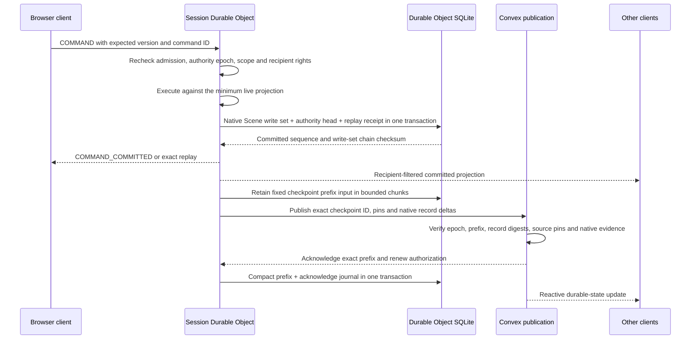
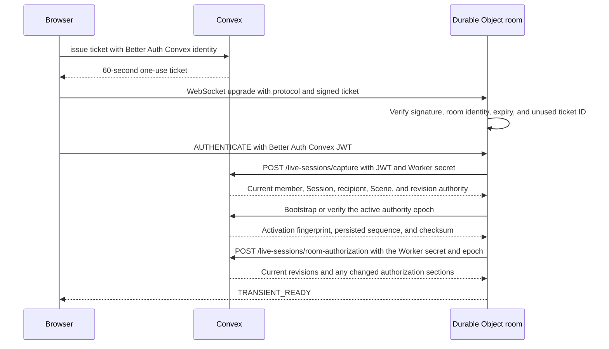

# Live-session coordination

> Status: canonical current partial Phase 8.2 implementation; DO rules execution remains incomplete
>
> Scope: active Session Durable Object authority, ordered Convex publication, transient fanout, fencing, and recovery
>
> Update when: ticket admission, supported live commands, SQLite state/receipts/outbox, Convex publication, transient projection, fencing, recovery, or deployment configuration changes
>
> Verification: `apps/session-worker/src/nativeLiveSessionRoom.ts`, `apps/session-worker/src/durableCommandJournal.ts`, `apps/apis/convex/liveSessions/{authority,state,bootstrap}.ts`, `apps/web/src/domains/campaigns/vtt/liveSessionClient.ts`, and [ADR 0029](../adr/0029-convex-backend-cutover.md)

> [ADR 0033](../adr/0033-campaign-owned-play-and-session-log.md) is implemented locally: there is one
> live table per Campaign, opened by any ACTIVE member, and no Campaign Session gates live play. The name
> "live session" below means that Campaign table; Campaign Sessions are an optional log.

A live Session has one temporary live-command authority and one durable product store. While an
authority epoch is active, its Session Durable Object is the single authority for the implemented
local Scene and Encounter paths. It also streams recipient-filtered ephemeral previews. Native
Encounter mechanics and the nineteen supported held Sheet play commands write Character play in the
same room transaction in current source; frontend Sheet routing remains transitional. Convex remains authentication/current-membership authority,
the durable cross-session/system store, the subscription source, and recovery authority. The current
source has no integrated runtime acceptance. A35-S6c3 deleted the per-command Convex path (every
Encounter, movement, binding, geometry, dice, capture and external-commit route); the room commits
in SQLite and Convex receives fenced checkpoints. Sections below labeled historical describe that
deleted path; the full rewrite of this guide belongs to A35-S9.

The following flow describes the current narrow Scene lane. The approved target in
[ADR 0029](../adr/0029-convex-backend-cutover.md#live-rules-execution-clarification--2026-09-24)
also places heavy live rule evaluation and fact preparation in the DO, reusing the existing Rules
Kernel and rules-runtime. Convex supplies authorized stored inputs and validates atomic commits and
receipts. The held Sheet protocol/core now commits locally in source; frontend routing, subscriptions
and lifecycle integration remain S7 completion work.
This remaining R06 work must preserve the room's
command order, source/version checks, replay, and required Character/Encounter/Scene atomicity;
commands relying on a Convex transaction cannot acknowledge success before that transaction commits.

The private `/live-sessions/room-inputs` route supplies authorized stored inputs to the room on
hydration (the per-command `character-rules` and `encounter-rules` captures were deleted in S6c3).
Each response includes compact System, Campaign,
Campaign play (`PLAY`) and relevant Character revisions read in the same transaction as its payload. Preparation
merges these observations and rejects a changed revision across pages or Character/Encounter reads.
The existing `sceneVisionRevisions` table tracks source publications, authority inputs, Run actors,
active effects, maintained/spatial effects, normalized initiative rounds/sides/participants and pending
occurrences; empty ranges are covered by their
owner's revision. Import completion also refreshes published root metadata in the same transaction
that makes staged publications visible; this supplies its System revision change. The bounded
`assertLiveSessionRulesRevisions` guard requires the complete authorized scope and compares its
observations before settlement writes. Commit callers must still perform fresh identity,
authority epoch, aggregate and any Scene-version checks. Rehydrating every captured payload
inside the commit would defeat paging and repeat the Convex read-limit problem. Room dispatch is
described under "Single Encounter command door" below.

Ordinary action preparation starts with `ACTION_COMMAND` through the shared capture algorithm,
bound to room readers in current source; the private Encounter capture remains a comparator/fallback.
It shares the native command's admission and complete receipt verification, including Character
concentration cleanup. Current access (the GM, or a PLAYER who controls the acting actor; see
Player-controlled actors below) and the live epoch remain mandatory. An exact
completed or pending retry returns its stored result before checking the latest Run version or
loading Character inputs. A fresh command must pass the existing version, turn and pending-occurrence
checks before preparation starts. Admission returns its normalized command and fingerprint, reads no
dice and performs no writes. This replay path is connected to Worker planning and native room
dispatch in source; integrated execution proof remains pending.

Preparation also captures the exact bound Scene token geometry and the acting actor's current
maintenance slot. The DO resolves grid/target policy and maintenance replacement using the same
runtime functions as native execution. Maintenance dependents and detached-owner effects page four
records at a time. A detached Character is readable only through a real dependent of that current
slot; its Character revision joins the commit fence. Existing issued pending checksums include the
stored Character owner record, so this private capture preserves those fields and native ordering.
The shared currentness hash preserves pending-action identity across native and DO preparation.
These captures perform no rule evaluation or writes. `planNativeLiveEncounterAction` runs the existing
graph evaluator after preflight, then the existing effect and mechanics planners. It returns a stored
replay, sealed pending evidence, or an uncommitted plan. Completed plans include HP/resource changes,
exact effect records, action economy and maintenance cleanup. They rebuild the selected Character
facts from the planned resulting state using the same projector and effect constructors as native
execution. Maintenance cleanup shares the mechanics Character increment and preserves conditions
owned by another effect or the original Character state. Completed plans also compute concentration
children from that post-action state. They then rebuild actor rule output and the final GM projection,
and construct the root command result and stored execution receipt. The native path and DO share the
same initiative cursor checks, maintenance transitions and receipt constructors.
The function accepts the existing runtime service internally, and the room now calls this planning
path in source. Production continuation-key provisioning and integrated execution proof remain open.

The `INITIATIVE_ROUND` capture reads only the authorized Run's current round, using the same bounded
indexed reader as native projection. Active projections require that stored round, the Run's policy
snapshot and its exact actor/side cursor. The capture adds its Campaign play revision to the final plan;
changes to any normalized initiative table invalidate a plan captured before that change.

The read-only `SYSTEM_VOCABULARY` capture exposes the existing persisted snapshot used by native
concentration checks, including its identity, version and checksum. It verifies the snapshot checksum
and agreement with the current System, and refuses a missing snapshot. System import and Encounter
Blueprint preparation initialize that snapshot; live capture performs no initialization. Snapshot
writes also refresh the System revision used to fence DO planning.

Concentration context construction, d20 evidence evaluation, result construction and deterministic
child identities now live in focused rules-runtime modules. Native callers supply their existing
runtime and random source; their database reads, cleanup, receipt writes and ordering are unchanged.
Worker concentration orchestration consumes projected post-action targets and the authorized raw
definitions, vocabulary, slots and owners. Automatic checks produce child receipts; a failed save
plans dependent removal and condition cleanup with the Character's post-action version as its
baseline. Assisted checks retain a sealed child snapshot while the parent action remains complete.
The final plan carries revisions captured during these checks, including detached owners. These
results enter the completed-root terminal transaction; the initial pending-action endpoint cannot
publish a completed parent with a concentration child.

Completed ordinary action plans also compute optional Cleaving from the resulting actor and effect
state. The shared native choice and candidate calculations consume authorized `CLEAVING_BINDINGS`
and exact per-candidate `ACTION_SCENE` geometry. Additional Character facts load only after a retained
overkill result, bound Scene, melee action and optional-combat snapshot qualify the branch. Candidate
preparation overlays any planned maintenance/concentration Character changes before calculating
currentness and armor class. Unchanged targets are reused, and independent geometry captures run in
parallel while retaining candidate order. A pending concentration child carries the deferred Cleaving
context; otherwise the terminal transaction inserts a standalone choice. Concentration and Cleaving
responses use the private DO paths below.

The following private action/decision endpoints remain protected Convex comparators for S5.
Current native dispatch uses their extracted persistence algorithms inside SQLite; integrated
execution proof remains pending.

The private `/live-sessions/encounter-action-pending` mutation accepts the Worker-computed sealed
ordinary action request. It requires both the Worker secret and the current GM's authenticated
identity, rechecks the live epoch, Run, root fingerprint, System and bound Scene, then
compares all captured revisions before inserting or advancing the pending occurrence. Detached maintenance owners
must still have a real dependent in the acting actor's current stored slot. The mutation advances no
Run or Character version and spends no resources. It returns only the existing recipient-safe result;
executable graphs and facts remain in the private stored snapshot. A retry returns the previously
stored command result before checking changed revisions. For an ordinary Assisted response, private
`ACTION_RESPONSE` capture reuses native initiator, evidence receipt, root and occurrence admission.
The Worker checks the sealed request and currentness, then resumes the existing Kernel continuation.
Each accepted evidence advances the same occurrence by one; a further pause stores its evidence receipt
without applying mechanics. Retrying an earlier evidence returns the current pending or completed root
result, matching native behavior, before preparing facts or rolling again. The Worker adapters are
now bound to native room dispatch in source; integrated runtime proof remains outstanding.

The private `/live-sessions/encounter-action` terminal accepts an ordinary completed root. It requires
the Worker secret and current GM identity, repeats native admission/replay and current live-epoch,
Scene and complete revision checks, then applies all writes in one Convex mutation. Its strict payload
contains normalized receipt outcomes, resource/economy consumption, and bounded effect/child records;
it contains no Character or Run document patches. Raw stored Character/Sheet/campaign state supplies
the existing mechanics fold and CAS writer. The mutation validates exact effect provenance and receipt
projections, reconciles maintenance conditions, persists concentration children and Cleaving, and stores
the root occurrence, rule receipt, command receipt and final GM projection together. A late failure
rolls back every write; an exact retry returns the stored result before checking consumed revisions.
Source Character resources and target mechanics share one increment when source and target coincide.
Maintenance replacement shares that increment; failed concentration uses the post-action version as its
new baseline. Rule evaluation and Character fact preparation remain in the DO. The commit imports
focused pure mechanics, receipt, identity and projection modules, with no Kernel/runtime initialization.
The terminal also completes admitted ordinary Assisted responses, updating the existing occurrence and
inserting the response evidence receipt in that same transaction.

The private `/live-sessions/encounter-concentration` transaction completes an admitted Assisted
concentration response for the GM or the assigned Character's player. Private captures require the
Worker secret, current user identity, active DO epoch and that exact pending child.
The DO prepares current facts, checks the sealed continuation and parent damage envelope, resumes
the existing Kernel, and plans any cleanup or next decision. A successful save preserves the Run
version. A failed save atomically removes the exact maintained slot and dependents, reconciles
Character/actor conditions and advances the Run once.
Both outcomes store the response command, completed child and evidence receipt together; exact
replay precedes consumed revisions and returns a recipient-safe result. Subsequent concentration
checks retain their ordered parent damage, while deferred Cleaving is rebuilt after cleanup before
becoming the next pending choice. The shared response writer now validates retained receipt chains
through the room's logical store as well as the protected Convex comparator. Fact preparation and
rules evaluation stay in the DO. Native room dispatch is source only; runtime proof remains pending.

**Cleaving answers and Disarm (CURRENT, S4B).** A Cleaving choice's answer is planned in the room
(`apps/session-worker/src/nativeCleavingResponse.ts`): the `CLEAVING_RESPONSE` admission
(`encounters/cleavingResponseAdmission.ts`, replay first) is followed by the DO rebuilding the
sealed choice from current facts, applying the retained damage (`cleavingDamageApplication`), the
target's Concentration checks, and the next choice on an overkill. The private `encounter-cleaving`
commit (`liveSessions/encounterCleavingCommit.ts`) re-applies the damage through the shared
mechanics batch, fences the choice's Scene version and revisions, and records the receipts. A
Disarm and each participant's d20 are planned the same way (`nativeDisarm.ts`): the `DISARM`
admission (`encounters/disarmAdmission.ts`) and the shared contest preparation
(`rules-runtime/encounterDisarmPreparation.ts`) seal the contest, both d20s roll in the room with
each participant's auto-roll preference (an auto-rolled initiator keeps its faces while the
defender's controller is prompted), and the private `encounter-disarm-pending` and
`encounter-disarm` commits store the paused contest or re-derive the item and ACTION changes from
current state and record them. Earlier room/native comparisons preceded this extraction. Current
native Cleaving and Disarm dispatch use the shared pending/terminal writers; retained occurrence
and receipt evidence route retries, and canonical admission handles replay. These current source
bindings still need integrated runtime proof.
Turn planning now lives in shared `rules-runtime` modules used by the native adapters and the DO
`nativeEncounterTurn` planner. `prepareEncounterTurn` preserves the existing order: outgoing effects, Legendary owner
decisions, new-round initiative when required, incoming resource refresh and Recharge, then incoming
effects. It carries staged Character facts across phases and returns pending evidence before any
aggregate writes. Effect perception, Recharge, initiative source preparation and Legendary execution
use authorized domain-read callbacks; none emulates a database or introduces another rules engine.
Legendary execution constructs its runtime only when an action executes. New-round initiative and its
later evidence responses retain the projected Character facts from outgoing effects; they must not
reload an uncommitted Character version from storage. Private `TURN_COMMAND` admission shares native
terminal and pending receipt checks. A pending initiative retry reconstructs its retained outgoing
decisions in the DO before returning its original result, without new initiative rolls.

Defeated actors (D63, [rules runtime](rules-runtime.md#0-hit-points-d63-current)) keep their
initiative place but lose their turns. `planEncounterInitiativeAdvance` moves to the next actor that
isn't defeated (wrapping the round when none remains), and the commit's
`applyEncounterInitiativeAdvance` marks each skipped actor as having acted and completes each side it
leaves, so the stored cursor stays contiguous. The next turn is chosen after the turn transition
settles: `prepareEncounterTurn` runs the outgoing turn's effects and Legendary windows, then plans the
advance again with the actors as they stand (`planEncounterTurnAdvance`, also used for the root's
first plan), and only then rolls a new round's initiative when the plan wraps into one, refreshes the
entering actor's resources, runs its Recharge and its start-of-turn effects. An actor defeated by the
outgoing turn's effects or a Legendary Action therefore loses that turn, including a round's opener.
Convex's pending and settlement reads accept a plan that also skips actors beyond those defeated when
the turn ended (`isSettledEncounterInitiativeAdvance`); the terminal commit applies the advance only
after the outgoing effects and Legendary Actions have committed, replanning with those actors, so a
plan skipping a living actor is refused. A new round rolled at each round opens with its first
actor that isn't defeated; Convex checks only that the staged cursor is valid and names a settled
actor. `RESOLVE_ACTION` naming a Creature's Legendary Action option is refused in the room with
`LEGENDARY_WINDOW_ONLY`; the option runs only in its window.

Turn captures expose bounded maintained state and the Run's bound Scene geometry/spatial effects.
The planner retains the Scene version and definition save as well as the merged source revisions,
because Scene geometry changes do not advance the rules revision markers. Private Character inputs
retain the stored timestamp and use the authorized owner already on the Character; publication reads include their stored version
number for initiative declaration provenance. These fields do not transfer write authority.
The private `/live-sessions/encounter-turn-pending` transaction stores a fresh or resumed paused turn after
checking authority, normalized initiative, revisions and any Scene fence. The terminal route
`/live-sessions/encounter-turn` applies bounded effect, resource and concentration outcomes in one
Convex transaction, sharing native initiative validation and receipt persistence. Kernel evaluation,
Character fact preparation and derived actor rules remain in the DO. The private authenticated DO is
the trusted computation boundary; Convex validates scope, current revisions and domain writes rather
than repeating that computation. Turn capture requests are reused within one command, and no result
is acknowledged before its transaction commits. Direct Recharge, active-effect and Legendary choice/evidence
responses reuse the native response guards and the same DO turn planner. Each accepted response advances
the retained occurrence once; a further pause leaves aggregate state untouched. Commits recheck the stored
occurrence and exact response history, and completed retries use the native receipt proof before consumed
revision fences. Initial START now uses the same DO initiative preparation and private turn writers:
it admits a PREPARED Run, creates round 1 with an INITIAL_START pin, skips outgoing effects, and uses
incoming effect ordinal 0. Its initial pending occurrence leaves aggregate state unchanged. The
shared settlement guard rejects any proposed initial round other than 1; the native indexed check
prevents two ACTIVE Runs in one Campaign. Local transaction tests cover initial commit, exact replay,
late rollback, pending-state retention and continuation through two incoming Recharge responses.
Initial and each-round initiative evidence and order responses now resume the sealed staged round
through the existing lifecycle in the DO. Outgoing effects and decisions are restored before new
initiative consumes those facts; accepted history is replayed before applying restrictions to a new
response. Pending responses retain aggregate state, and the terminal transaction completes the prior
round and inserts the next round once. The initiative declaration patch uses that same lifecycle
(its focused private tests pass locally; see the
[declaration checkpoint](../validation/phase-08-2/initiative-declarations.md#resolution)): the DO
rechecks the issued options against captured sources, records the selected declaration, and either
issues the next actor's request or continues initiative scoring. The private `turnCommand` scope
admits a PLAYER for their controlled actor's declaration, or for `ADVANCE_TURN` when the current
actor is theirs, and permits the command's bounded Run and Character captures. Each capture and
write rechecks membership, control and the issued occurrence; it cannot combine with movement,
Concentration or `action` scope. START, score/order responses and other turn decisions remain
OWNER-only. The root `initiatorUserId` stays the Campaign owner (who answers turn decisions); the
root's `requestedByUserId` records who asked, and becomes the turn receipt's actor; declaration
response history identifies the actual responder. Current
assignment is required even for a completed response retry. The native room caller now binds this
shared planner and persistence in source. Focused parity and rollback tests are implementation evidence, not
release or frozen V15 acceptance.

Historical (deleted in A35-S6c3): the Convex movement comparator used the existing staged Scene
save. The private
`/live-sessions/encounter-movement-stage` route rechecks the DO authority epoch before staging a bound
move or a response to its sealed pending occurrence;
public Scene staging remains fenced. Each movement capture checks the receiving save, current
Session/presentation/Scene/Run, and the moving token's binding and control. A response instead requires
authority over its issued decision. Character preparation pins a current actor's source and version.
These internal captures require the Worker secret and authenticated caller and never enter client
responses. The DO needs the authorized Run cohort to discover movement reactions.

`nativeEncounterMovementInputs.ts` reuses the room's complete Scene after publication has drained,
checks its version and counts, and computes target facts, reaction discovery and perception in the DO.
Identical captures share one promise within the command. `nativeEncounterMovement.ts` prepares an
move or issued response using shared spatial, reaction, passage and concentration coordination.
Uncommitted target and maintenance projections feed later contacts in order. Movement Character
inputs include the original private row so existing maintenance checksums survive that projection;
they stay inside the trusted Worker boundary. The planner serializes ordered, bounded
spatial, reaction, passage-allowance and concentration outcomes and computes final actor rules in the DO. The
commit checks captured revisions and freezes the plan on the existing Scene save before it publishes.
The private movement commit coordinator reuses the Convex Scene, pending and terminal publication
writers, applying those closed outcomes in their original order within one Convex transaction. Completed retries verify stored receipts before checking consumed source revisions.
Pending publication settles only the explicit applied spatial prefix and completed reactions. A
spatial dice pause may retain evaluated contacts that have not changed gameplay state; that evidence
must remain unsettled. Pending and terminal publication take their evaluation, settlement and
projection as callbacks, which the room's commit supplies from its frozen plan. The private
`encounter-movement-stage` and `encounter-movement` HTTP routes require both the Worker secret and
the initiating user's identity, then use the same epoch, membership, save and revision checks as the
internal mutations. Initial pending, terminal and response publication share this commit route.
Response publication preserves prior contact evidence and commits only newly applied contacts and
new Concentration children; an already committed damage contact is not applied again when its child
check finishes. A completed passage consumes its validated allowance once before the remaining move.
The Convex publication layer imports only the persistence and projection pieces; Convex evaluates no
movement rule and rolls no movement die (D41, D43). Local transaction tests cover response authority, retained
one-shot effects, PLAYER Concentration cleanup, Passage allowance rollback and exact retries on earlier
source. Current native geometry dispatch is described below; those older checks do not validate it.

**Native geometry dispatch (SOURCE WIP, execution proof pending).** Planned moves and door changes,
including Encounter-bound movement and `MOVEMENT` decision responses, now enter
`NativeLiveSessionRoom.#commitRoomGeometry` and
[executeRoomSceneGeometry](../../apps/session-worker/src/roomSceneGeometryCommand.ts). The coordinator
uses the actual `RoomEncounterStore.transact`; its durable callback calls
`DurableCommandJournal.commitInTransaction` with the write-set chain checksum and receipt before
fanout. The branch no longer calls `#commitExternal` or a per-command Scene commit route. It stages
geometry and fog, captures/plans movement, and applies the shared pending/terminal writers through
real room transactions and owning ports. Movement-response replay now uses the native replay path.
[Local Character vision composition](../../apps/session-worker/src/roomSceneVision.ts) is authored
and wired before journal commits for geometry, native Encounter commands and binding; it derives the
display Scene separately from native rows. This is source integration with no execution proof.
Planned/fog/settled-movement undo now has native source dispatch through shared `sceneUndoPublication`
and `roomSceneUndo`, described below. No execution gate or acceptance criterion has been advanced. General
chat/public/TABLE/evidence rolls, held Sheet frontend/rest/live-view work and lifecycle/recovery cleanup remain transitional
or open. The original comparator flow below records the protected API algorithms, not current room
geometry dispatch.

**Historical Convex-first Scene commits (S4-c, D26-D28, D42; deleted in A35-S6c3).** The
`durable_external_commit` record, its routes and the Convex commit modules below no longer exist;
the journal drops the table on open. Previously the room committed Encounter-bound movement
to Convex first, then applies it (`apps/session-worker/src/nativeExternalSceneCommit.ts`, called from
`#commitExternal` in `nativeLiveSessionRoom.ts`). `isExternalSceneCommand`
(`nativeRoomSceneCommand.ts`) selects every bound move, every move on an Encounter-bound Scene, and
any move or door change that derives fog exploration (`sceneDerivesExploration` in
`packages/shared` vtt, the one predicate Convex's fast commands use too). Other door changes and
moves use native local checkpoint records. Movement decision answers and a GM's movement void reach the same path
from `executeLiveEncounterCommand` (route `MOVEMENT`). Inside the command chain the room:

1. checks its journal for a replay, then its D72 Scene allowance and the Scene version (the client's
   session sequence no longer rejects a command: every input the room-side planner reads comes from
   room state or is checked authoritatively, so the Scene version fences the Scene and the
   sequence stays in the command fingerprint for replay only);
2. flushes pending checkpoints and settles any unsettled record (below);
3. stages the command in one private call, `encounter-movement-stage`
   (`liveSessions/encounterMovement:stage`, D52): in one transaction Convex routes a decision
   (`routeEncounterDecision`, the `encounter-route` classification; another planner's occurrence
   returns `ROUTED` and stages nothing), begins the save (a move or door change with its
   presentation fence, a decision answer, or a GM void that `occurrenceVoid` turns into the
   decision's decline), observes the cached Scene vision's Character revisions and, for a bound
   move, reads the command's capture bundle (`MOVEMENT_INPUTS` admission) under the staged save,
   taking the moving token's definition ordinal from the room's `tokenOrdinals`;
4. for a bound move, hands the bundle to its captures (`bundleCaptures`) and runs
   `prepareNativeLiveMovement` on its cached Scene with the room cache;
5. derives each fog owner's complete layer (`deriveSceneCommandFogLayer`), following the walked
   segment (`preparedMovementSegment`);
6. predicts the published Scene (`preparedMovementSceneDelta`, the same function Convex publishes
   with) and the next state checksum, writes the SQLite write-ahead record
   (`durable_external_commit`, `beginExternalCommit`), and commits with
   `authority {sequence: N+1, expectedStateChecksum, stateChecksum}`, `expectedScene` and the fog
   layers: `encounter-movement` for bound moves and decisions, `scene-geometry` otherwise. In one
   Convex transaction the commit checks every captured owner, freezes the room's plan on the save
   (`persistSpatialPreparation`), stages each fog layer, publishes the Scene, compares it with
   `expectedScene`, and advances the persisted authority, which must be at N
   (`publishWithAuthorityAdvance`, `liveSessions/externalCommit.ts`). A replay of a published save
   stages nothing and does not advance. A decision answer returns its member-presented Encounter
   result; a void also records the void and posts "The GM skipped this decision." to TABLE chat,
   keyed by the void command ID;
7. completes the record: new state, receipt, and sequence = published = N+1, with no outbox row;
8. sends the Scene delta to every member (only the initiator sees the decision summary), then
   STATE_SYNC when fog changed, then the ENCOUNTER result to a decision's initiator. The browser
   settles an Encounter command only on its ENCOUNTER result.

A commit refused with a 4xx response rolled back, so the record is dropped. Without a response (or
on a 5xx) the record stays, and the room settles it before the next command, while activating,
before a presentation change and before the drain fence: the Worker-secret route
`external-commit-resolve` takes the record's `subject` and answers COMMITTED (the change landed and
the authority reached N+1 with the predicted checksum) or ABANDONED (it did not land and the
authority is at N, after a fence that makes a delayed commit fail: a still-receiving save expires);
anything else fails closed. Only a retry of the same room commit replays in Convex; a replay whose
authority has not reached the room's sequence is refused, since the change was made outside the
room. An exact retry the room answers from its journal reports `replayed: true` in its Scene or
binding result, as Convex replays do (D47). A COMMITTED recovery applies the record,
drops the Scene cache and challenges every socket, because no member saw the change. Bootstrap
accepts a persisted sequence of N+1 only through that recovery; while a record exists the journal
refuses other commits, the drain fence and `discardReplaceableAuthority`.

The room cache holds every entity of the presented Scene: the transient capture's compact snapshot
is read unfiltered (`readCompactScene` with no viewer), never for the capturing member. It keeps each
token's and barrier's definition ordinal (`sceneSnapshot.baseOrdinals`, or the entity page ordinals)
and the bound `sceneEncounterId`, which the commit's `finish` and movement scope need. The room
never applies a bound token's own `controlledByUserIds`: `beginSceneGeometry` checks the bound
actor's controllers (`requireBoundTokenMoveControl`, refusing `NOT_ACTOR_CONTROLLER`), and
publication checks again. A room door save is readable by its player actor, and publication applies
the same lock rule to a player's door change as the tabletop.

The D26 hold: before planning a Scene command the room reads its own loaded Run
(`readMovementDecisionPending` in `encounter-persistence/occurrenceOwner`): whether the bound
Encounter's pending occurrence is a movement context. While it is, the room refuses token moves,
`UNDO_LAST_SCENE_MOVE` and door changes on that Scene with `UNAVAILABLE` "Waiting on a movement
decision."; chat, Sheets, other Scenes and every Encounter command continue. The GM's
decision drawer offers "Skip decision" on a movement reaction or passage choice: a void routed
`MOVEMENT` that declines it (the movement continues). Bound-token movement and its decisions happen
only in the room, on its presented Scene (D42, D43; D29's native staging path is gone): the room
refuses a decision whose Encounter is not bound to its synchronized presented Scene, and Convex's
public staging (`scenes/geometryActions:execute`, through `beginSceneGeometry`) refuses every
Encounter-bound move, whether no room is live or a live room presents another Scene. Both refusals
use domain reason `SCENE_NOT_PRESENTED` ("Present this Scene to move Encounter tokens."); the
tabletop opens a room before it moves tokens. Unbound moves and door changes still stage natively
while no room owns the Scene, and `finishSceneGeometry` publishes only Scene changes without
Encounter rules. A player's geometry command counts against the one-in-flight limit. The
skip also writes an `encounterDecisionSkips` row keyed by the decision's occurrence and version, so
`encounters/activeReads:decisionSettlement` answers `GM_SKIP` (or `ANSWER`) for the decision a
player was shown, and their drawer says "The GM skipped this decision." (D39). The skipped
occurrence and version key both writes, so a retry repeats nothing.

**Encounter binding through the room (SOURCE, execution proof pending, D47).**
`NativeLiveSessionRoom.#executeEncounterBinding` now calls
[executeRoomSceneBinding](../../apps/session-worker/src/roomSceneBinding.ts) and shared
`sceneBindingPersistence` inside the actual SQLite transaction. Binding rows, local controls and
Character vision composition join the journal head/receipt before acknowledgement. The shared
algorithm retains identity, GM/active-Campaign/System guards, exact command/fingerprint replay and
the presented Scene/version fence. New binding dispatch makes no external binding commit call.
This source is unverified; old external journal recovery and protected comparators remain until
final retirement.

**Historical external binding publication (D47).** While a room owned the presented Scene,
`encounters/sceneBindings:bind` keeps refusing a direct binding, and the GM binds an Encounter to
that Scene mid-session through the room: live command scope `ENCOUNTER_BINDING` with the
`BIND_ENCOUNTER_TO_PRESENTED_SCENE` input (`#executeEncounterBinding` in `nativeLiveSessionRoom.ts`).
A player was refused with `GM_ONLY`. The previous Convex-first binding path
flushes checkpoints, writes the write-ahead record with subject `ENCOUNTER_BINDING`, and calls the
Worker-secret route `encounter-binding` (`liveSessions/encounterBinding:commit`), which binds with
the room's synchronized Scene and presentation fence (`bindEncounterToPresentedScene`, shared with
the native mutation) and advances the authority to N+1 in the same transaction
(`commitWithAuthorityAdvance`). The room's state and checksum do not change; only the sequence
advances. The commit carries `expiresAt` (now plus the route timeout) and Convex refuses it after
that time, so `external-commit-resolve` answers ABANDONED for a binding only once `expiresAt` has
passed, touching the authority row so a commit still in flight conflicts and reruns past its expiry;
before then it fails closed and the room asks the member to try again. On success the room points
its Scene at the Encounter and sends every member
`COMMAND_COMMITTED` with the new sequence and an `ENCOUNTER_BINDING` delta; members read the binding
through `sceneBindings:get`. Without a live room the native mutation still binds. Deleting a
prepared, bound Encounter (the only unbinding) still refuses while the room owns the Scene.

**Turn movement (CURRENT, D37-D38, V07.5).** The room, which holds the whole Scene
(`prepareStagedSceneCommit`), measures each published segment of a bound move with
`measureScenePathMovementCost` (terrain included) and sends it as the finish input's `movementCost`. `publishSceneGeometry` requires it for a voluntary bound move and adds it, in feet,
to an `encounterTurnMovements` row keyed by Run, round, the turn's current actor and the moving actor
(`encounters/turnMovement.ts`); forced movement and teleports add nothing. The row is outside the Run
version and checksum and fences nothing: the budget is shown, never enforced. A new turn reads a new
key, so it starts at zero; completing the Run deletes the rows. `encounters/activeReads:active`
returns `turnMovement` (`{actorId, used, budget}`) for the actors the viewer controls, every actor for
the GM; the budget is a Character's stored `walkingSpeed` or a creature stat block's walking speed,
once more for each of the row's `speedBonuses` (a Dash this turn).
The tabletop shows "Movement 15 / 30 ft" for the active controlled actor (`readActiveTurn` in
`CampaignVttStage.model.ts` picks the current actor's entry only when the viewer acts for it); past
the budget Assisted uses the soft-warning style and Manual shows the number only.

**Basic combat actions (CURRENT, Q11, D38).** The Run System's basic actions are its published
platform `basic-action` reusable definitions (SRD: Dash, Disengage, Dodge, Help, Hide, Ready, Search,
Use an Object in `packages/source-data/src/srd/basicActions.ts`). Each carries a name (the definition
label), rules text, an action cost and zero or more closed mechanic kinds
(`BASIC_ACTION_MECHANIC_CODE` in `packages/shared`). `encounters/actionChoices:get` lists them for
every actor apart from its features. `USE_BASIC_ACTION` plans as `BASIC_ACTION` in the room
(`nativeBasicAction.ts`): the `BASIC_ACTION` admission (`encounters/basicActionAdmission.ts`, replay
first) is followed by the entry's current definition, the Assisted allowance and target warnings and
the effects (`rules-runtime/encounterBasicActions.ts`). The private `encounter-basic-action` commit
(`liveSessions/encounterBasicAction.ts`) checks the plan against the current platform entry and Run,
records the allowance use, appends the effects to the actor's Run resources (`basicActionEffects`),
adds a `speedBonuses` count to the turn movement row for `SPEED_MOVEMENT_BONUS` and stores a
`USE_BASIC_ACTION` run command whose label the timeline shows; it evaluates no rules. Entries without
mechanics (Hide, Ready, Search, Use an Object) are only logged. Effects live on the actor that took
the action and end as its next turn starts (the turn planner stages `stagedBasicActionExpiry` and
`persistLiveTurnResources` clears it). Each effect records the Run's `turnSequence` (D45): START and
ADVANCE_TURN always begin a new turn, and each GM change of the current actor or round
(`SET_CURRENT_ACTOR`, `PREVIOUS_TURN`, `SET_ROUND`, removing the current actor) counts one more.
`NO_OPPORTUNITY_ATTACKS` therefore applies only during the turn it was taken in, and setting that
actor current again does not revive it; the room's movement reaction discovery skips a mover it
covers. `DISADVANTAGE_ON_ATTACKS_AGAINST` and `SAVE_ADVANTAGE` (Dodge) apply to the holder's target
facts in the room (`withEncounterBasicActionDefense`, called by `prepareNativeLiveMovementTarget`):
a disadvantage contributor on every attack roll against it (`basicActionAttackContributors`, merged
by `prepareEncounterActionMechanics`) and an advantage contributor on its saving throws of the
entry's `saveAbilityIds` (Dexterity for Dodge). An entry with `suspendedWhileUnableToActOrMove`
applies neither while its holder can't act (the System's actor-action capability is suppressed, for
example by Incapacitated) or every speed it has is 0; the effect stays and applies again once it
can. `ALLY_ADVANTAGE` (Help) adds an advantage contributor to the named ally's next d20 in any
Encounter flow: an action or opportunity attack roll, a Disarm attack roll or check, or an Overrun or
Tumble check. That flow's commit removes the Help from its helper (`allyAdvantageUses` on the action,
Disarm, movement reaction and passage commits, through `encounters/allyAdvantage.ts`), and a passage
removes it from the targets its move continues with, so a later roll in the same move can't reuse
it. Contributor source ids name the entry, so the derived-mode reason reads "Dodge" or "Help". A
custom actor spends no allowance. The GM's `REVERT_LAST_ACTION` undoes the Run's last basic action
exactly from its stored receipt (effects, allowance use, Dash speed bonus) and gives back any Help an
undone action used; it still refuses once a later command changed the Run. Feet already moved stay
recorded, so the readout can show more used than the restored budget. Known gaps: Dodge does not
check that the dodger sees its attacker, because no Encounter flow computes that perception fact;
speed 0 is read from evaluated speeds (a Character's rule output, a Creature's stat block), so a
condition that zeroes a Creature's speed without changing those is not seen; and targets rebuilt
inside turn-effect saves carry no Dodge contributors.

**Single Encounter command door (CURRENT, D78).** Browsers cannot execute Encounter commands
directly: `encounters/commands:execute` is internal and records only GM tools. Every Encounter
command enters through the Session room, and every ACTIVE-Run command commits in room SQLite before
acknowledgement, with no Convex call. `ROOM_LOCAL_ENCOUNTER_COMMAND_TYPES`
(`packages/schema/src/api/liveSessionEncounterCommand.ts`) run the shared reducers through
`executeRoomEncounterCommand` (`apps/session-worker/src/roomEncounterCommands.ts`), drawing dice
from the room's secure random source: `RESOLVE_ACTION` runs the action planner, or Disarm when it
carries an optional-combat intent (Disarm is the one contested action); `USE_BASIC_ACTION` runs the
basic-action planner; `START` and `ADVANCE_TURN` run the turn planner; the GM tools and the dice
commands run `recordEncounterCommand`. A TABLE roll (`ROLL_RULE_EVIDENCE`, TABLE
`ROLL_ENEMY_ACTION`) posts its table card through the room's `insertTableRoll` port and spends one
D72 TABLE token inside the commit, as a chat roll does; the room checks the allowance before any
work. A GM `UPDATE_ACTOR` with a `characterCommand` commits that Sheet command on the Run's held
Character through the room's `executeCharacterCommand` port, and the Run command history keeps its
Sheet receipt id; a command that is not live Sheet play, or one on a PREPARED Run (its Character is
not room-held), is refused with "Make this change from the Character Sheet.". One ACTIVE Run per
Campaign holds across the cutover: the room's RUN input carries the Campaign's `activeEncounterId`
at load and `START` refuses `ACTIVE_ENCOUNTER_EXISTS` when another Run is ACTIVE, and checkpoint
ingestion refuses a checkpoint that would leave two ACTIVE Runs. Character effects load with their
Character, so the RUN input's first page also lists the Characters holding each maintained state's
dependents (`maintenanceCharacterOwners`). Before a Character dependents capture, the room loads
those owners through `readCharacterRow`; a detached owner that is no longer ACTIVE or assigned refuses
the command, as the Convex capture did. A retried commandId replays its
journaled result byte-identically; a reused commandId with different input is `INVALID_COMMAND`
(the durable command journal is the replay authority, not the Convex receipt). A decision answer or GM void is
classified from the room's loaded Run (`readRoomEncounterResponseRoute`): a movement decision goes
to its movement commit, a native-owned answer or void to its native planner, and a decision no
planner owns is refused as Convex refused it (`refuseUnroutedEncounterDecision` in
`roomEncounterResponseRouting.ts`): `VERSION_STALE` unless it names the Run's one pending
occurrence and the caller may answer it, otherwise unavailable.

**Historical Convex Encounter routes (retired in S6c3).** Before D78 the room picked a planner with
`roomEncounterPlanner` (`apps/session-worker/src/nativeRoomEncounterCommand.ts`), asked the private
`encounter-route` query (`liveSessions/encounterRoute:route`) which planner owned a decision, and
forwarded the GM tools in `CONVEX_RECORDED_ENCOUNTER_COMMAND_TYPES` to the internal
`encounter-command` mutation (`liveSessions/encounterCommand:execute`). A35-S6c3 deleted those
routes, the Room dice routes below and their admission module.

**Room dice (HISTORICAL, D41; retired in S6c3).** A dice command took two private round trips. The `encounter-roll-dice`
query (`liveSessions/encounterRoll:dice`) admits the member and names the dice the command draws, as
die sizes in draw order: one d20 for initiative, the roll definition's dice (two d20s for advantage or
disadvantage) for an enemy action, and the request's die for "Roll dice"; none for a retried command,
which replays its recorded roll. The room draws each with its secure random source, and the
`encounter-roll` mutation (`liveSessions/encounterRoll:commit`) records the command with those draws
(`recordEncounterCommand` in `encounters/commands.ts`). It refuses the draws `VERSION_STALE` unless
every draw is used within its die, so a roll whose dice changed between the two calls records
nothing. Initiative and enemy actions are the GM's; "Roll dice" is any member's who may answer the
decision. Convex rechecks everything else at the commit, so a refused roll's draws are discarded.

authority. Current: room closure
(`#closeRoom` in `apps/session-worker/src/nativeLiveSessionRoom.ts`) closes every socket, so no new
command arrives, then awaits the in-flight command chain, including forwarded Encounter commands,
before it sets the drain fence and releases authority.

**Room capture reads (CURRENT, S6c3).** Room planners read rules content through `LiveCaptureReads`
(`apps/session-worker/src/nativeCaptureCache.ts`), which the room answers from its own SQLite
transaction: `encounterRules` serves the Encounter capture kinds from the hydrated Run, System and
Character inputs, and `prepareCharacter` builds a Character's rule context from the room-held
Character and its hydrated sources. `liveEncounterCaptures` shares identical requests within one
planner, checks each response's kind, and accumulates the observed revisions and read checksums
that the room's checkpoint carries. No planner read reaches Convex: the inputs arrive through
`roomInputs` on hydration and are refreshed by the room's own commits.

**Historical (deleted in A35-S6c3, D78).** Before the switch, room planners read through a per-room
capture cache keyed by route and SYSTEM/CAMPAIGN revisions, one private capture bundle query
(`/live-sessions/encounter-bundle`, D32) with a Run System stamp, and the `encounter-rules` and
`character-rules` capture routes; the Convex movement stage and commit mutations
(`liveSessions/encounterMovement.ts`) served their reads through a per-transaction mutation read
memo (`memoizedInternalMutation`). All of these, and the refused-commit replan, were deleted with
the per-command Convex path.

**Import visibility (CURRENT, D34).** Imported rows are readable only while their import job is
`COMPLETED` (`imports/visibility.ts`). A trigger in `lib/mutations.ts` bumps the SYSTEM revision of
every System the job imported roots into whenever that visibility changes, so commit fences and the
room cache see it.

**Auto-roll and GM void (CURRENT, ADR 0034).** The `ACTION_COMMAND`, `ACTION_RESPONSE` and
`MOVEMENT_INPUTS` captures carry `autoRollByActorId`: for each Run actor, the "Auto-roll my dice"
preference of the user its rolls are routed to (see roll routing below). `TURN_COMMAND` carries the
Campaign owner's `autoRollDice` for the GM's turn steps, the same `autoRollByActorId` (with the owner
as initiator) for each actor's turn-effect and Concentration saves, and the issuing member's
`responderControlledActorIds`, so the planner can admit a player's turn-effect answer. All are read in the capture
transaction and covered by its read checksum, so DO planners decide between a server roll and a
pending prompt without a separate call. A GM `VOID_RULE_OCCURRENCE` that declines a movement
decision routes `MOVEMENT` (see "Native geometry dispatch"). A GM void that declines a Legendary
Action choice or a Cleaving choice routes `TURN` or `CLEAVING` with the GM's decline
(`voidDeclineCommand`, a deterministic command ID); the room plans that decline like any GM answer
and then records the void through the private `encounter-void-record` route. Every other void routes
`VOID`: the private `encounter-void-prepare` route (`liveSessions/encounterVoid.ts`, GM only, no rules
evaluated) cancels a paused action atomically (occurrence `VOIDED`, one `VOID_RULE_OCCURRENCE`
receipt, one Run version) or refuses. The `encounter-void-record` route adds the "Voided by the GM"
receipt after a decline. When the declined turn or move
pauses again, the Run version cannot advance without breaking that flow's fences (each Run version
has exactly one receipt), so the void returns the next decision and adds no timeline entry. Steps
play cannot continue without (initiative, Concentration saves, Recharge, turn-effect saves,
Legendary Action dice and dice during a move) are refused with `DECISION_REQUIRES_ANSWER`.

**Player-controlled actors (CURRENT, S6b).** Control belongs to the Run actor (Foundry ownership).
Each actor stores GM-set `controllerUserIds` (current Campaign players only, sorted, at most 8; set by
the GM through `UPDATE_ACTOR`) and a `disposition` (`FRIENDLY` default for Characters, `HOSTILE` for
creatures and custom enemies). A CHARACTER actor's Campaign-assigned player is always a controller,
derived and never stored. `encounters/actorController.ts` is the one predicate (`GM` for the owner,
`CONTROLLER`, or none) used by action admission, action choices, Disarm, turn admission, declarations,
pending reads, Concentration and Cleaving responses, and movement decisions. A member's departure
removes them from every PREPARED or ACTIVE Run's controller lists in the same transaction.

- A PLAYER may `RESOLVE_ACTION` for an actor they control (public targets only, else
  `TARGET_UNAVAILABLE`), end the current actor's turn when it is theirs, and answer decisions routed
  to them. Every other Encounter command stays GM-only. Admitted actions read Character, definition
  and Scene inputs as the Campaign owner (Scene scope `MEMBER` for players); the player `action`
  capture scope carries the admitted command so later captures in the same plan pass.
- Encounter-bound token movement follows the bound actor's controllers plus the GM
  (`requireBoundTokenMoveControl`, checked at begin and at publication, refusing
  `NOT_ACTOR_CONTROLLER`); unbound tokens keep the Scene token's `controlledByUserIds`.
  The room applies the same rule to drag previews: a player's AUTHORITY capture carries
  `originBoundTokenControl` (each bound token and whether they control its actor). On an
  Encounter-bound Scene the room renders a player's preview from its Scene cache and a per-player
  lease of that control, renewed in the background (D25; see [Transient previews](#transient-previews)).
- `encounters.activeReads.active` returns `waitingOn` (`GM`, `PLAYER` or null), so a player's view
  shows who a pending decision they can't answer is waiting on, also after a reload.
- Every result or replay returned to a non-owner goes through
  `encounters/resultPresentation.ts` `presentEncounterResultForMember` (player projection, with the
  pending decision re-read for that member). The room's `nativeRoomEncounterCommand.ts` refuses to hand
  a PLAYER anything that does not parse as a player projection. A replay by command ID returns only to
  the user who issued it.
- Health display (ADR 0034 decision 5, current): each player-projection actor carries `health` at
  its level only (`projectPlayerEncounterProjection`, `@artificer-toolkit/schema/api/healthDisplay`).
  Hidden (the default) carries `null`, Descriptive only the band (Unhurt, Hurt, Bloodied at or below
  half, Near death at or below a quarter), Bar only a ratio rounded to 5%, Exact current and
  maximum. A Character actor uses its player's Sheet setting; an enemy or NPC uses its GM override
  (`UPDATE_ACTOR.healthDisplay`) or else the Run's `healthDisplayDefault`
  (`SET_HEALTH_DISPLAY_DEFAULT`, GM only). Run creation stores the default `HIDDEN` and each new
  actor `healthDisplay: null`; both fields are required in stored state and projections. An
  actor's controllers, including a Character's player, see its exact health. The GM projection
  carries exact values, and GM surfaces show exact hit points. `encounters/healthDisplay:share`
  (GM only) posts one visible enemy's or NPC's descriptive state to the TABLE chat once per command
  ID without changing its level.
- Room flood control: a PLAYER has at most one Encounter or planned geometry command in flight
  (`ROOM_LIMITS.maxInFlightEncounterCommandsPerPlayer`); a second is refused `UNAVAILABLE` "Your
  previous action is still resolving."

**Roll routing (CURRENT, S6b).** A roll belongs to the actor who makes it: pending evidence carries
`rollerActorId` (the attacker for an attack, the target for a save, the reactor or mover during a
move), and only that actor's controllers and the GM see and answer it. A player initiator answers only
rolls of actors they control; every other roll goes to the actor's controllers, even when the GM
initiates (Foundry baseline: the GM casts Fireball, each player rolls their own Character's save).
Rolls of actors no player controls stay with the GM, and the GM may answer any prompt as an
override. Turn-effect saves follow the same rule: the save belongs to the turn actor, so its pending
summary names it as `rollerActorId`, its controllers see and answer it (`pendingReads`,
`encounters/turnResponseAuthority.ts`, `prepareEncounterTurnResponse`), and its primary controller's
preference decides auto-roll; Concentration checks raised by turn damage do the same. Recharge
dice and Legendary Actions follow it too (D24, D30): the recharging Creature or the Legendary
Action's owner is the step's actor (`turnPendingActorId` in `rules-runtime/encounterTurnPending`),
so a Creature the GM granted to a player picks its Legendary Action and rolls its Recharge and
Legendary dice with that player and that player's auto-roll preference, while an ungranted
Creature stays with the GM. Initiative scoring and order remain GM decisions; initiative
declarations go to the declaring actor's controllers.

**Concentration chains (CURRENT, D23).** Damage to several concentrating actors raises ordered
checks. Each check auto-rolls by its actor's primary-controller preference, and the chain stops at
the first check that prompts. The command that answers a prompted check settles, in the same
transaction, every following check whose roller auto-rolls, and parks the first one that prompts
(`planNativeLiveConcentration` in the DO; `planNativeConcentrationChain` in Convex; the Worker commit
carries them as `concentration` and `pendingConcentration`, persisted by
`persistLiveEncounterConcentrationChildren`). That commit advances the Encounter version once when
any check it settled failed. Auto-rolled checks are START receipts chained by `correlationId` from
the answered check and pinned to the commit's version, so replay and continuation guards
(`concentrationResponseAdmission.ts`, `concentrationParent.ts`) count a commit's failures with
`readConcentrationCommitFailed`.

**Rule-check roll log (CURRENT, D23).** Every settled Concentration check, answered or automatic, is
logged once by `recordConcentrationCheckRoll` (`encounters/ruleCheckRolls.ts`), which
`persistNativeConcentrationResult` calls at every settle point, live and native. The entry is a
`RollRecordDto` carrying a `ruleCheck` (`kind: 'CONCENTRATION'`: actor, damage amount and type
label, source label, DC, faces, modifier, total, `KEPT`/`LOST`), authored by the settling member
with the "Rules" label and keyed by `ruleCheckRollId(occurrenceId, checkIndex)`, so replays add
nothing. It spends no chat rate limit, since its command was already limited. A hidden actor's
check goes to the GM's private roll history instead of TABLE chat. The parent records display
names for its damage envelope in the check context (`sourceLabels`: action or Creature Feature name,
turn-effect definition label; movement contacts have none yet), and each context carries a
`trigger` (source label, damage-type label, DC). The d20 pending summary exposes it as `trigger`,
so the decision drawer reads "Concentration check for Mira: took 12 fire from Fire Bolt (DC 10)". In Assisted mode an authored automatic reaction becomes a Use/Decline choice for its controller;
auto-roll fills in dice only. Each prompt row is answered one of three ways:

- `ROLL_RULE_EVIDENCE` ("Roll dice") rolls the request with the room's dice (see "Room dice"),
  records the attempt in Convex (`encounters/evidenceRolls.ts`, `encounterEvidenceRolls`), posts it
  to the table roll log ("Rolled by the app, attempt N", plus "Advantage, changed from Normal" when
  the roller overrides the rules-derived mode) unless the roller is hidden, and settles nothing.
  Rerolls add attempts.
- `SYSTEM_ROLL {requestId, rollId}` settles with the recorded faces of the responder's latest attempt
  for that request; anything else is refused `ROLL_UNAVAILABLE`. Captures return the verified
  `appRoll`, so the DO planner never sees a client-supplied app-roll value.
- `ENTER_DICE {rawFaces, rollMode}` or `ENTER_INTEGER` settle with entered values.

d20 evidence stores the chosen `rollMode` and the rules-derived `derivedRollMode`. Contest d20s keep
the derived mode. AUTOMATIC mode and auto-roll keep server rolls (`AUTO_ROLL` internally).

Real-backend HTTP development drivers (`apps/apis/tests/development*.ts`) therefore send Encounter
commands through the room like the browser: `DevelopmentHttpClient` (`developmentHttpClient.ts`)
issues a ticket, opens the Worker socket with the ticket subprotocol and the local web Origin,
authenticates, waits for `TRANSIENT_READY` and `STATE_SYNC`, and resolves on the `ENCOUNTER`
`COMMAND_COMMITTED` result or rejects on `COMMAND_REJECTED`. The in-process convex-test adapter still
calls the internal functions directly. The local pre-staging lifecycle starts the documented local
Worker for its proofs; its secrets must match the local Convex deployment's.

**Worker-boundary validators.** The private checkpoint functions
(`liveSessions/{checkpoint,checkpointStaging,developmentCheckpoint}.ts`) are internal functions
reached only through the Worker-secret HTTP routes. They declare `args: v.any()` with no `returns`
validator; each handler takes `unknown` and parses it with its shared Zod contract before any read,
and the Worker parses every response with the same contracts. Converting large unions into
duplicate Convex validators cost about 28 MB per module and pushed modules past the 64 MB
module-load budget (the deleted `encounterRulesCapture` needed 65.8 MB). Public functions keep
generated Convex argument validators.

An admitted movement can apply rules to another assigned Character. The private mechanics helper
validates that Character's current Campaign assignment using the Campaign owner, matching the existing
persistence writer. It retains the authenticated initiator in Character and Encounter receipts. Token
control is checked again at commit, so revoking control rejects a previously prepared move atomically.

Raw Run actor/effect captures retain current Character assignment, ownership, System and ACTIVE checks.
A Character actor keeps no hit point or stream-version copy
([ADR 0034](../adr/0034-player-control-rules-assistance-and-roll-prompts.md) decision 4), so
`character-rules` takes no expected stream version: it returns the current Character, and its
CHARACTER revision joins the merged revision vector with the ACTOR capture's. The room holds every
Character actor of a rules-applying Run, so a Sheet write is ordered in the same command chain as
planning; the per-command `assertLiveSessionRulesRevisions` fence was deleted in S6c3.

Character source indexes page at most four raw roots or shares through one native Convex pagination
call per capture, including empty pages. They distinguish feature matches from other readable roots
so the existing 500-per-kind catalogue bound is enforced before loading matching document bodies.
Publication pages inspect at most four IDs and target 4 MiB of stored body data, allowing one existing
large publication. A shared source's parents are fetched on separate pages. Capture still verifies
each root's source ownership, import visibility, active sharing member, and ACTIVE document status;
the Worker validates the complete inheritance chain before consuming the publication. Every shared
ancestor requires an enabled platform source or its own current Campaign share. Character-private
ownership cannot substitute for that share. Race/Equipment parent metadata, kind, System, base
category, cycle and depth checks retain the native reader's meaning. The final revision vector covers
these parent reads. These local implementation changes still require real backend size-limit proof.

```mermaid
flowchart LR
  Browser["Browser tabletop"] <-->|Scene commands + transient previews| Room["NativeLiveSessionRoom<br/>Session Durable Object"]
  Sheet["Character Sheet"] -->|transitional frontend command routing| Api["apps/apis/convex"]
  Sheet -->|held play commands + pushed Sheet (unverified source)| Room
  Room --> Sqlite[("SQLite native Scene / Run / Character play<br/>write-set journal + replay receipts")]
  Room -->|protected bootstrap, checkpoints, drain, release| Api["apps/apis/convex"]
  Browser -->|ordinary queries, mutations, actions| Api
  Api --> State[("Convex durable product state")]
  State -->|reactive subscriptions| Browser
```

Direct Convex mutations that overlap the active Scene projection are fenced until the Session DO
drains and releases authority. The held Character Sheet protocol and implemented Encounter paths
commit in the room's SQLite transaction; frontend Sheet dispatch still calls Convex and is unfinished.
Unheld Character commands use their owning Convex functions. One Character version and its private
receipt commit atomically with the room journal or in the owning Convex transaction. An accepted
shield stow on `RESOLVE_ACTION` rides in the source Character's action batch with any resource use;
the action commit re-applies it and rejects a room result whose `sourceItemUseStateTransition` differs
from the committed stow ([drawn weapons](rules-runtime.md)). The current
Scene geometry and native Encounter/Sheet paths now join their Character play writes to the room
checkpoint journal in source. These current integrations have no runtime acceptance.

Scene presentation uses `scenes/presentations:setLive`. With active room authority, its authenticated
owner request enters the same DO command order as moves and Scene synchronization. The room finishes
all pending publications before the protected Convex setter checks the epoch, published sequence,
checksum, and presentation version. It then invalidates the old Scene cache and reauthenticates the
sockets. The epoch, command sequence, and replay receipts remain intact. A failed publication leaves
the presentation unchanged. The direct `set` mutation remains available only without active authority.
This ordering permits A → B → A switching without hydrating a Scene whose prior moves are unpublished.

## Supported live-command flow

The following standalone Scene path is implemented in source; integrated execution proof remains pending.



For standalone move, door and undo, the room broadcasts success only after the SQLite transaction
commits. A retry with the same valid command identity and input returns the stored receipt; reuse
with different input rejects. Checkpoint publication is ordered and retryable, and compaction requires
the matching authority epoch, sequence and cumulative checksum. A failed publication retains the
exact input and committed suffix; it cannot bypass ordering or permit an overlapping direct write.

Historical (deleted in A35-S6c3): the per-command `liveSessions/state:publish` endpoint. Its contract finished an already authorized command and records the
actor's command-time role. It requires that role to
equal the stored membership role. The only exception, per ADR 0029 command-time role evidence, is a
command that occurred in the current authority epoch (at or after its `createdAt`) and before the
member's `accessStartedAt`, which covers ownership transfer or rejoin after the command committed.
Only the internal publication scope may use retained historical membership after departure, or
publish after Session finish or Campaign archive.
Campaign, membership, Scene, and Session identity must still match; deletion permits publication only
while draining the room. Door and undo require the recorded OWNER role; movement requires that role
or control of the token. Epoch, contiguous sequence, checksums, Scene versions, and exact results remain
mandatory. Public access and new commands continue to require current permissions. Scene presentation
changes use the ordered control above, so prior commands publish before their presentation is replaced.

Current DO command coverage is incomplete: Door state, standalone token movement and its undo stage
native Scene checkpoint records locally. Planned moves/doors, including Encounter-bound and
fog-deriving changes and movement decisions, now use the native transaction branch in source
(see "Native geometry dispatch"). Movement replay and local Character vision composition are wired
in source, and Encounter binding now joins the SQLite journal transaction. These branches remain
unverified; planned/fog/settled-movement undo also has native source dispatch. No acceptance advancement is claimed.
The frontend Character Sheet command path still uses Convex; the native held Sheet lane is described
below. Encounter tools in
[the shared `ROOM_LOCAL_ENCOUNTER_COMMAND_TYPES` list](../../packages/schema/src/api/liveSessionEncounterCommand.ts)
now execute the existing local reducers through
[roomEncounterCommands](../../apps/session-worker/src/roomEncounterCommands.ts),
reusing the existing blueprint enemy builder for reinforcement. The shared list also covers reminders,
turn corrections, initiative setting, feature resources, Creature equipment, optional combat policy,
health display defaults, completion and action undo (`REVERT_LAST_ACTION`); its predicate is the
command ownership authority. Action undo uses the existing shared action-revert reducer locally.
`UPDATE_ACTOR` qualifies only when `characterCommand` is absent; embedded Character Sheet commands
retain their transitional Convex path.
`ROLL_ACTOR_INITIATIVE` uses secure room RNG in the native transaction. Only the initiator receives
roll evidence; other recipients receive privacy-filtered projections with `roll: null`. Replay
retains the recorded evidence without drawing again. `ROLL_ENEMY_ACTION` qualifies for the same
local transaction and private replay evidence only with `visibility: 'PRIVATE'`; TABLE rolls
remain transitional until native chat ports are integrated.
Their writes and `DurableCommandJournal.commitInTransaction` receipt/head commit in the same SQLite
transaction, then each admitted recipient receives its own projection. These current source paths
await validation; remaining Encounter rules and GM tools retain their transitional Convex commits
(see the single Encounter command door above).
Character actor removal, `COMPLETE` and any actual Run round change persist
`checkpointBeforeAcknowledgement` with their SQLite receipt and flush the checkpoint before success,
including when a retry recovers that receipt after restart. The round barrier applies to the resulting
round change, including `SET_ROUND` or `PREVIOUS_TURN`, preserving the ADR round boundary.
Local reducer replay rechecks current admission, role and Character health visibility. It returns the
recorded projection at the same Run version or the current projection after later commands, projected
through the canonical current-member presenter, including player occurrences. The final durable
callback also compares current lease revisions before journal commit. The direct Convex
`encounters/commands.execute` endpoint now refuses every command type while
`readLiveCampaignAuthority` finds nonexpired ACTIVATING, DO_ACTIVE or DRAINING authority; unheld
execution retains native authorization and reducers. Separate epoch-fenced `liveSessions` endpoints
retain transitional Worker commits. Their protected Convex comparator remains for
S5 shadow parity and backend fixtures; the room intercepts these commands locally, so the comparator
adds no steady-state traffic. It retires in step 6 after S5. These receipt and ownership safeguards
are current source with execution evidence pending.
These are remaining R06 integration gaps. Frozen decisions, rolls, effects, and receipts retain their
issued evidence while subscriptions expose the latest published durable state.

The turn transaction now shares admission, pending/terminal persistence, normalized settlement,
terminal initiative receipts, effect CAS writes and resource persistence through
`packages/encounter-persistence`. Concentration binding/children, exact dependent cleanup and
maintenance-owner reconciliation use the same store and Character ports. Convex supplies its real
revision fence, definition/mechanics and concentration callbacks; native dependent pagination
stays in the host. Shared turn capture supplies the binding and Scene-version guards, with actual
host Scene readers. The room mechanics adapter applies the existing batch planner and typed
Character writer to current SQLite play. Authorization, controller checks, replay order, pending
snapshots, private receipts and rollback remain part of the transaction. Current source binds
[START/ADVANCE and stored turn-owned resolution](../../apps/session-worker/src/roomEncounterTurns.ts)
to that planner and the shared pending/terminal writers within SQLite. The
[basic-action path](../../apps/session-worker/src/roomEncounterBasicActions.ts) uses the existing
planner and extracted persistence reducer. Paged `DEFINITIONS` hydration retains the complete
System PLATFORM and Campaign-owner USER inventory, including unpublished roots. SYSTEM/CAMPAIGN
pins fence the inventory; PLAY changes do not reload it. A first-use or missing ID resolves locally
while those pins remain current. Each retained root carries its source kind, preserving the
platform-only basic-action gate independently of Campaign catalogue membership.
Concentration logging shares paired TABLE entries and native
private roll records; checkpoint appends merge immutable evidence into the owner's global twenty-roll
history and refuse cross-Campaign identity replacement. Ordinary action pending/terminal and evidence
responses, Concentration, Cleaving and Disarm now use shared admission, evidence, effect/child and
response writers in native dispatch. These extractions replace dependencies with typed stores and
owning callbacks while preserving guards, clocks, privacy, receipts and write order; logical receipt
inserts still use Convex's packed ledger adapter in the protected comparator.

[Retained-evidence routing](../../apps/session-worker/src/roomEncounterResponseRouting.ts) selects
TURN, ACTION, CONCENTRATION, CLEAVING or DISARM from occurrence ownership and receipts; the selected
planner then repeats canonical admission. GM cancellation/refusal retains the existing void policy,
while TURN/CLEAVING declining voids execute the same response writer as an explicit decline. State,
Character play, effects, paired rules chat, private rolls and receipts commit with the journal in
one SQLite transaction. The lease-revision fence and current-member replay presenter remain required.
These are source-only implementations. Movement/bound fog integrated proof, general chat/public/TABLE/evidence rolls,
held Sheet frontend/rest/lifecycle and focused HP/Common reads remain open. Definition first-use backend fetches
have been replaced by the complete revision-pinned inventory. Shared `tableRollPersistence` and
`conversationPresentation` preserve the API algorithms, but general native routing awaits the
live rate-scope decision. The note-write aggregate-checksum proposal awaits the user's decision;
its rejected partial change was restored and current integrity checks remain in place. S5 parity,
budgets and the final local lifecycle/promotion gates remain pending; the ledger stays **51/75
cases and 190/276 criteria accepted**. No integrated runtime gate has run on this source. The
[source batch record](../validation/phase-08-2/room-command-source-batch-2026-09-30.md) distinguishes
source inspection from execution evidence; the [Claude handoff](../handoffs/phase-08-2-claude-source-first.md)
records the remaining implementation and approval boundaries.

**Held Character Sheet commands (current source, unverified S7).**
[characterSheetLiveCommands](../../packages/schema/src/api/characterSheetLiveCommands.ts) defines
nineteen typed `CharacterPlayState` commands. The shared `CHARACTER_SHEET` envelope carries
`characterId`, `encounterId` and the validated command; maximum overrides, rests, notes, structural
edits and customizations remain outside this lane. `NativeLiveSessionRoom` dispatches through
[executeRoomCharacterSheetCommand](../../apps/session-worker/src/roomCharacterSheetCommands.ts)
inside `RoomEncounterStore.transact`. Current native Campaign membership/assignment, Character
owner, ACTIVE Run/System and unfrozen actor checks precede replay/version refusal. The canonical
reducer/resource helpers and active-effect Sheet projection feed the real typed play writer. Shared
[Character receipts](../../packages/encounter-persistence/src/characterSheetReceipts.ts) and
`journal.commitInTransaction` commit before acknowledgement. Current vision composes before commit.

Only the initiator receives private Character history; other admitted members receive the same room
sequence with required `delta: null`. A pending Sheet command settles only on its CHARACTER_SHEET
delta, matching Encounter scope handling. Retry rechecks current owner/GM permission, the actual
checksummed ACTIVE native Run/unfrozen Character actor and current Campaign/System/play ownership, then presents the compact
receipt with current native play stream and maturity. Party visibility applies immediately and is
restored from an unpublished SQLite suffix after eviction. `liveSessionClient` advances Encounter and
Sheet room sequences without applying their results as Scene deltas; a same-sequence legacy receipt
still only settles its pending command.

Sheet journal replay now calls shared `readCharacterCommandReplay` against the actual indexed native
`characterCommandReceipts` row after those authority guards. It verifies raw history checksum,
receipt identity and command fingerprint, requires the journal/private event IDs to match, then
presents using current maturity and native stream. Reading the raw receipt preserves the original
history for current privacy presentation instead of reusing already redacted journal text. This
correction is source-only and unvalidated.

**Chat and rolls through the room (current source, unvalidated S8a, D69/D72).** While the Campaign's
live authority exists, general chat, public rolls and TABLE rolls are `CAMPAIGN_CHAT` room commands
([campaignChatLiveCommands](../../packages/schema/src/api/campaignChatLiveCommands.ts)); the command
ID is the entry's client nonce. [executeRoomCampaignChatCommand](../../apps/session-worker/src/roomChatCommands.ts)
validates the author through the room's read ports, resolves Character rolls from held room inputs,
and writes the paired header and payload with the shared
[conversation writers](../../packages/encounter-persistence/src/conversationEntryRecords.ts), so
the next checkpoint carries both. The entry fans out at once to its conversation's members (other
members receive the same room sequence with `delta: null`); an exact retry replays the journal
receipt. Per-account D72 token buckets live in room SQLite
([roomRateLimits](../../apps/session-worker/src/roomRateLimits.ts), allowances in `roomLimits.ts`):
chat and every roll share one bucket (players 30/min burst 30, the GM 60/60) and Scene writes use
240/min burst 80. A charge commits inside the command's durable transaction, so exact retries and
rolled-back commands are never charged, reconnects share the bucket, and rows are keyed by epoch.
Eviction removes the account's rows and room release clears them. Evidence rolls and TABLE enemy
rolls commit in the room (D78) and spend the same bucket inside their commit; their table cards
reach other members' chat history at the next checkpoint. Convex fences `campaigns/chat:send` and
`campaigns/rolls:execute` while authority exists, and the web routes both through the room
(`useCampaignChatRoom`), merging pushed entries into Convex history. Edit, unsend and GM reveal
remain Convex-only.

[liveCharacterHolds](../../packages/schema/src/projections/liveCharacterHold.ts) fences each
Character/active Run pair by Campaign/epoch. Claim/recovery establishes holds, changed Run/actor
checkpoints reconcile them and final acknowledged release removes that epoch's holds. Direct Convex
play/preferences/rest writes reject a held Character. Outside structure writes preserve the entire
checkpoint play row, clock and stats; Builder commit returns actual persisted play/version. A changed
Builder clock triggers room reconciliation against the prior native maximum, clamping current HP
only when the newly evaluated Character-only maximum decreases. Campaign deletion includes hold rows. The new hold schema needs guarded local reset/seed/codegen.
No generated check or integrated execution gate has run, and S7/S8 acceptance is unchanged.

**The room pushes the held Sheet (D73, current source, unverified).** A client sends
`SUBSCRIBE_CHARACTER_SHEET { characterId }` (one per socket; `UNSUBSCRIBE_CHARACTER_SHEET` ends it).
[RoomCharacterSheetFeed](../../apps/session-worker/src/roomCharacterSheetFeed.ts) admits it only for
the Character's owner or the Campaign GM while the Character is an unfrozen actor of an ACTIVE Run,
pushes the viewer-projected Sheet at once and, after every committed `RoomEncounterStore`
transaction (`onCommitted`), pushes once per viewer kind for each subscribed Character whose play
`streamVersion` changed. The unsequenced `CHARACTER_SHEET { characterId, streamVersion, sheet }`
message uses the projection `roomCharacterSheetProjection` shares with the command path. Every push
re-admits, so a lost assignment, hold or membership silently drops the subscription; closing or
evicting a socket drops it too. The web Sheet takes `expectedVersion` from the pushed
`streamVersion`; party readers are unchanged.

**Departures reconcile in the room (D74, current source, unverified).** Under live authority the
room owns every open Run of the Campaign (PREPARED or ACTIVE; `isRoomHeldRun`), whether or not it
has hydrated that Run this epoch. For such a Run, `removeCampaignCharacterAssignment`,
`removeEncounterActorController` and account deletion write no Run actors. Convex still sends
`EVICT_USER` and, through the tracked-mutation wrapper, `INVALIDATE_INPUTS` for the changed
CAMPAIGN rows. The room runs
[reconcileRoomActorDepartures](../../apps/session-worker/src/roomActorReconcile.ts) from one
coalesced post-commit task (`#queuePostCommit`), triggered after every committed room transaction,
every authorization reload (so a cold activation too) and every Sheet subscribe, so a Run hydrated
later is corrected too. It reconciles first, then pushes the held Sheets. It runs in one
`RoomEncounterStore` transaction with a journal entry (receipt `delta: null`) only when an open
Run names a departure. Account deletion is told apart without a new signal (A35-S7b): when an
unfrozen Character actor's assignment is gone, the room reads those Characters once through the
CHARACTERS input scope, where a Character that no longer exists reads as `DELETED` rather than
`UNASSIGNED`. The transaction then removes the deleted Characters' actors with the shared
`removeMissingCharacterActors` (as the Campaign owner, as Convex's release does), freezes the other
unfrozen Character actors whose assignment is gone and unlists controllers who are no longer
members, using the shared
[reconcileRunActorDepartures](../../packages/encounter-persistence/src/actorDepartures.ts). A
removal checkpoints before the receipt, like a room `REMOVE_ACTOR`, then drops the cached play and
Scene and challenges every socket so members resume from the committed state. A failed step is
logged and the next trigger retries it. Hydrating a Run reads only its assigned Characters' inputs:
an actor whose Character left or was deleted stays unfrozen until this reconcile, which runs right
after the hydrating command commits. A Run the room never hydrated this epoch is covered at
authority release: `release` calls `reconcileOpenRunsAtRelease` in the same transaction, using
current membership and assignment as truth (removes actors of deleted Characters, freezes
unassigned Character actors, unlists departed controllers). Checkpoint ingestion rejects an open
Run's actor row that names a departed controller or an unassigned unfrozen Character, and a change
whose `previousChecksum` no longer matches the Convex row (fail closed).

Known gap: a Character actor already frozen (its player left the Campaign earlier) whose account is
deleted later is removed only at release, because a frozen actor names no departure for the room to
reconcile. Until then the frozen actor remains visible in the Encounter.

**Equipment reconciliation (implemented source, unverified).** Canonical Character source-loss
reconciliation already removes vanished inventory IDs from equipped/attuned lists. Held structural
writes preserve the entire native play row, so `prepareRoomLiveCharacterSheet` now filters current
play's equipped/attuned IDs against prepared inventory alongside HP, hit dice and resource usage in
the same native transaction. Valid IDs retain order; removed IDs disappear, and the play clock
advances only when state changes. Existing real SQLite commit/rollback/eviction/warm source checks
include retained/removed equipment, but preparation remains mocked and is not full integration proof.
The shared [Character receipt test](../../packages/encounter-persistence/src/__tests__/characterSheetReceipts.test.ts)
also covers raw STANDARD-to-MATURE replay at the current native stream and checksum/fingerprint
refusals. These checks have not run.

The focused [sheetSlices.liveAuthority](../../apps/apis/convex/characters/sheetSlices.ts) query supplies
owner/GM routing metadata from Character head, epoch-matching holds and validated typed play;
party readers receive null. It loads no mechanics or owned collections. Returned Campaign/epoch/phase,
held Run IDs, checkpoint sequence/time and acknowledged play stream support the pending frontend
router. Optional authority `checkpointedAt` is set only by an actual acknowledged delta checkpoint
or retained per-command publication, and exact retry/drain preserve it. Activation/new recovery has
no timestamp; the routing DTO returns null before the epoch's first acknowledgement. The Campaign-level
[campaigns/queries.liveAuthority](../../apps/apis/convex/campaigns/queries.ts) query returns any member the live epoch and nullable `checkpointedAt`;
chat routing uses it, and the session workspace outside the room shows when the Encounter details
it reads were last checkpointed (or that none has been yet). Native Encounter/Sheet receipts now advance the browser's room
sequence without changing Scene state, and legacy same-sequence acknowledgements only settle retry.

Shared movement source now includes `liveMovementAdmission`, `spatialSceneGeometry`,
`spatialPendingPublication`, `spatialTerminalPublication`, movement resolution documents/reads/publication,
spatial/reaction/Concentration persistence, target-state reads and `movementSettlementPersistence`.
The API adapters keep their original signatures and real authorization, Scene and Character readers.
Room geometry reader/staging/capture and shared publication now feed `#commitRoomGeometry` through
`executeRoomSceneGeometry` and the actual SQLite store/journal transaction. That source branch has
replaced its per-command Convex Scene commit route. Movement replay and local Character vision
composition are wired in source, as is native Encounter binding through `sceneBindingPersistence`.
No verified atomic lifecycle or acceptance is claimed. Shared `sceneUndoPublication` preserves staged
fog/movement undo, now bound to the native room transaction. General chat/public/TABLE/evidence, held
Sheet frontend/rest/live-view, lifecycle/deletion/recovery cleanup and budgets remain open; old external journal
recovery/comparators await retirement.

## Ticket and authentication flow

`liveSessions/tickets:issue` authorizes the current ACTIVE Campaign member before signing a
60-second HS256 ticket. The ticket issuer is `artificer-convex`; its subject, Campaign, Session, role,
unique ticket ID, audience, version, issue time, and expiry are signed. A room consumes each ticket ID
once and binds its persisted room identity to the exact Campaign; the WebSocket path segment is the Campaign ID.

The signing key is checked before reserving authority. An `ACTIVATING` reservation expires at the
latest ticket expiry issued for that epoch; issuing another ticket extends that deadline without
changing the epoch, but never past the reservation's `createdAt` plus five minutes
(`claimCampaignLiveAuthority` in `liveSessions/authority.ts`), so a reconnect loop cannot hold an
unused reservation indefinitely. Once the reservation expires, direct Convex writes are available again and a new
join claims a fresh epoch. Expired tickets and epochs cannot activate it. `DO_ACTIVE` and `DRAINING`
authority never expires through this admission deadline. For transitional records without a deadline,
the last stored update plus the ticket lifetime is used; an obsolete pending join must request a new
ticket.

If a failed activation left an initial SQLite snapshot, a replacement epoch verified by Convex may
discard that snapshot only while its sequence and published sequence are zero and it has no receipts
or outbox entries. Committed state continues through the normal drain and release protocol.



The browser authenticates once after the socket opens. There is no periodic authentication heartbeat;
the admitted socket remains valid until its JWT expires (about 15 minutes), an explicit lifecycle
invalidation arrives, the room's authorization cache no longer admits it, or the socket closes. At
expiry or after `AUTHENTICATION_REQUIRED`, the browser obtains current authentication and Convex
recaptures product authority before transient readiness resumes. Every admission, first or renewed,
also renews the room's authorization cache (below) and is refused when that cache does not admit the
captured member. `LIVE_SESSION_WORKER_SECRET` independently authenticates the Worker HTTP caller.

Lifecycle producers invalidate rooms immediately. Campaign leave/removal evicts that membership
generation. Account deletion, auth-account suspension/deactivation, and administrative auth-session
revocation evict the exact user from active rooms. Campaign archive/delete close the Campaign's room;
finishing a Campaign Session does not affect live play. Sign-out and password/security actions close the browser's live socket; a later explicit
reconnect authenticates normally when the underlying auth session remains valid. Social profile
suspension is separate and continues to preserve Campaign access.

Room eviction, closure and input invalidation are fire-and-forget from their producing mutation.
Current: `liveSessions/control.ts` reschedules through the Convex scheduler on network failure, 408,
429 or any 5xx, after 1, 2, 4, 8 seconds and so on. An eviction keeps retrying, at most a minute
apart, until the room acknowledges it or no room holds the Campaign's authority
(`liveSessions/authority:held`), so a lost eviction is the only case the authorization lease covers
(ADR 0035 Amendment 14). Closure and `INVALIDATE_INPUTS` stop after five attempts; the lease covers
a lost invalidation. Other 4xx responses and missing configuration fail immediately. Presentation
control is synchronous and does not retry.

Current, deferred to S6: departure (`campaigns/membershipDeparture.ts`) and account deletion
(`campaigns/accountDeparture.helper.ts`) still remove the member's assignment and Encounter actor
control in Convex, then evict. Nothing holds a Run in the room yet, so the target rule that a held
Run's departure only evicts and notifies, with the room applying the change, arrives with S6.

## Room authorization cache (ADR 0035 S4)

Current. The room caches the authorization inputs of its Campaign
(`apps/session-worker/src/roomAuthorization.ts`, contract
`packages/schema/src/api/liveSessionRoomAuthorization.ts`):

| Section      | Contents                                                                                   | Changes with                         |
| ------------ | ------------------------------------------------------------------------------------------ | ------------------------------------ |
| System stamp | Canonical revision for the held System inputs; no separate authorization section payload   | SYSTEM revision                      |
| Campaign     | Owner, ACTIVE members (role, membership epoch), Campaign Character assignments             | CAMPAIGN revision                    |
| Characters   | Each assigned Character's owner and party visibility ("Party can view" and health display) | That Character's CHARACTER revision  |
| Preferences  | Each member's "Roll my dice automatically" and canonical username                          | A digest of the members' preferences |
| Play         | The presented Scene's bound Encounter: token bindings, actor control and health display    | PLAY revision                        |

**Loading.** `liveSessions/roomAuthorization:read`, behind the Worker-secret route
`/live-sessions/room-authorization`, is authorized by the room's `DO_ACTIVE` epoch, not a member's
token. The room sends the revisions it holds (`known`). Convex always reads the revisions, which is
small, including the canonical SYSTEM Scene-vision stamp, and returns only the sections whose revision
differs. The System stamp preserves revision-bound room inputs without a warm per-command fetch.
Party visibility comes from the typed Character play record, so only a changed Character is re-read.

**Lease.** The cache is trusted for `ROOM_LIMITS.authorizationLeaseMs` (240 s, 2N) from the start of
the read that loaded it. Each socket's authentication, including its renewal at token expiry, reads
the revisions and renews it. `RoomAuthorization.acceptCheckpoint` applies the checkpoint response's
changed authorization sections to the held cache and renews the same lease without an extra warm read,
preserving the local Play overlay. After memory eviction, an exact checkpoint retry may omit sections
from its older `known` stamp; an incomplete response requires a full authorization read before admission.
When SQLite retains an unpublished suffix, the room rebuilds actor controls, health display and token
bindings from committed native records after authorization reload or prefix checkpoint acceptance.
A concurrent older read cannot erase that newer observation. These paths are implemented in source;
integrated evidence remains pending.

**Invalidation.** `INVALIDATE_INPUTS { scopes }` marks the cache stale; nothing is trusted until the
next read. The triggers in `apps/apis/convex/lib/mutations.ts` collect, per transaction:

- CAMPAIGN: any CAMPAIGN revision bump (Campaign, memberships, assignments, content shares);
- PLAY: `campaignPlaySettings` writes (also a PLAY revision source now). Encounter writes also bump
  PLAY but are not pushed: the room's own forwarded Encounter commands and bindings change them, and
  the room marks its Play section stale after each one;
- CHARACTER: any CHARACTER revision bump, mapped to its Campaign through the assignment;
- PREFERENCES: an auto-roll change, for each Campaign the user is an ACTIVE member of. The BetterAuth
  user-update hook also schedules this invalidation when `displayUsername ?? username ?? null`
  changes. Canonical author names join the preference payload and digest; warm commands use that
  leased value without a per-command auth lookup.

When the mutation succeeds (`onSuccess` of the tracked mutation builders), one notice per Campaign is
scheduled, only while that Campaign's authority is `DO_ACTIVE`. SYSTEM changes are pulled, never
pushed. `withSceneVisionTracking` alone tracks revisions but sends no notices. A CAMPAIGN notice
reloads at once, because membership can end sockets; other notices reload before their next use.

**Use.**

- A command, and `SYNCHRONIZE_SCENE`, first reloads a stale or expired cache (the command boundary).
  A failed read refuses the command with `UNAVAILABLE`.
- Every read closes each socket whose member left, changed role or started a new membership epoch
  (`Campaign access ended.`), so a removed member's queued commands never run. A command whose
  member the cache no longer admits is not run either.
- Broadcasts are refused while the cache is stale or past its lease: a preview or ping is dropped
  and one background read starts (one at a time; after a failure, none for `previewRetryMs`). Only
  admitted members are recipients.
- A player's bound-token drag preview takes its control from the Play section: GM-granted control
  while the user is still a player, or the actor of their assigned Character. The Play section must be
  current and bound to the cached Scene's Encounter.
- A token drag checks that the Scene's vision was built from the Character revisions the cache holds;
  otherwise the cache reloads and, if a Character really changed, the Scene's vision is rebuilt.

**Accepted exposure.** Until the next read, a member whose removal notice was lost keeps receiving
broadcasts and can run room-local commands for at most one lease. Implemented local Encounter paths
use current leased admission and the final SQLite fence; remaining transitional paths also perform
their existing Convex checks. No warm per-command authorization fetch is added to local dispatch.

**Not yet consumed.** Party visibility, health display and auto-roll preferences are held and
reloaded, but nothing in the room reads them before the S6 fan-out and the S7 Sheet.

## Room Encounter store (ADR 0035 S2)

Hydrate and rehydrate load the room aggregate. Standalone Scene move, door and undo, plus the
shared-list local Encounter tools and native turn/basic-action/action/Concentration/Cleaving/Disarm
paths, now write through this store in current source. Planned geometry, bound/fog movement and
movement-decision responses now also enter `executeRoomSceneGeometry` through the same actual
store/journal transaction. Native binding now uses the same transaction, and local Character vision
composition precedes geometry/Encounter/binding journal commits. Staged undo now joins the same
transaction in source, including its current Character vision composition.
Held Sheet/rest/live-view and lifecycle/recovery cleanup remain transitional or open.
Integrated execution proof and complete S6/S7 authority remain pending.

`apps/session-worker/src/roomEncounterStore.ts` is an `EncounterStore` (the subset of `ctx.db` the
Encounter writers use, `packages/encounter-persistence`) over the Session Durable Object's SQLite. It
reuses the in-memory reference store (`createMemoryEncounterStore`) as the live index, so planners and
writers run against memory, and SQLite is only the durable copy.

| Table                  | Rows                                                                             |
| ---------------------- | -------------------------------------------------------------------------------- |
| `room_snapshot_chunks` | The aggregate as of the last snapshot, in bounded chunks under one `generation`  |
| `room_writeset_log`    | One row per command: its write set, the counters, and the chained state checksum |

**Write path.** `transact` gives each command an all-or-nothing overlay: the writers' writes reach
the in-memory index through a journal, and only when the callback resolves does one `INSERT` into
`room_writeset_log` make them durable, before the journal is committed. A callback that throws, or a
row that cannot be written, rolls the index back from the journal; a command that changes nothing
writes no row. The billed cost is one row written per command, whatever the number of
documents it touches; there are no per-sample writes. A write set over the row limit (`1.8M`
characters) is refused with `RoomWriteSetTooLargeError` before anything is written; S6 must decide
how a command that large is split.

**Authorized input restore (current source; validation pending).** `restoreDocument` uses `RESTORE`
for a native row already durable in Convex. It creates or rebases that input's checkpoint base rather
than recording a gameplay insertion. The checkpoint builder refuses a restore that would replace
uncheckpointed mutable changes or append-only history, and restored evidence emits no false `INSERT`
history. This permits stale authorized inputs to refresh without treating them as room-created rows.

**Checksum.** The state checksum is a chain over the commands: each row stores the SHA-256 of its
write set and the chain value `sha256(previous chain + ":" + that checksum)`. A replayed log
reproduces it, and checkpoints fence on it. `DurableCommandJournal.commitInTransaction` stores the
same cumulative chain as the authority head beside the write-set commit. Stored display Scene JSON
uses `liveRoomStoredSceneStateSchema` and its independent content checksum; that hash does not replace
the authority chain.

**Compaction (local foundation).** `compact({ epoch, sequence, checksum })` requires the shared
checkpoint acknowledgement contract. The caller supplies the authenticated Convex acknowledgement;
the method verifies the epoch, prefix checksum and retained journal before writing a new snapshot
generation and deleting only rows through that sequence in one `transactionSync`. Commands committed
after the acknowledged prefix stay in the journal and in live memory. An exact retry writes nothing;
invalid fences or corruption retire nothing. Snapshots retain the id counters (clock and sequence),
so replay after eviction preserves consumed identities. Hydrating a new epoch replaces every old
log row. The [focused prefix proof](../validation/phase-08-2/checkpoint-prefix-2026-09-30.md) covers
rollback and real Durable Object eviction at 11 and 100 actors. The publication caller is now
implemented in source; its integrated execution proof and S3 acceptance remain pending.

**Checkpoint journal prerequisite (local).** `committedWriteSets` reads a bounded consecutive
prefix from the existing SQLite journal. Its shared contract is
`packages/schema/src/api/liveSessionCheckpointJournal.ts`. It fences the epoch and starting
sequence/checksum, verifies row hashes and chain continuity, counts serialized UTF-8 bytes, and
refuses pending transactions, corrupt/missing rows and already compacted ranges. Identical reads
are repeatable and do not write SQLite. `checkpointSnapshot()` reads and verifies the durable base
under the same epoch, sequence and chain anchor, including opaque records and preserving database
identities only inside the room.
`packages/schema/src/projections/encounterStore.ts` owns the table schemas and indexes reused by room
replay and checkpoint validation. The checkpoint record contract uses public UUIDs and natural keys,
separates mutable deltas from append-only evidence, and excludes Character structure and authorization
inputs. The packed ledger writer and delta publication are connected by the local checkpoint source
below; the complete room authority switch remains pending.

**Checkpoint publication (local implementation; integrated acceptance pending).**
`api/liveSessionCheckpointFence` owns the scalar epoch, range, state and payload digest fence stored
on `campaignLiveAuthorities`; evaluating the database schema does not load complete room or mechanics
contracts. `api/liveSessionCheckpoint` composes the mutable-record/history payload and authorization
revision request. `/live-sessions/checkpoint` requires the existing Worker secret and calls the
internal checkpoint mutation. The actual payload digest must match before publication or replay.
Only a contiguous newer batch may apply; an exact last-checkpoint retry returns `REPLAYED`, and an
altered retry, foreign epoch, stale base or exceeded drain fence applies nothing.

The mutation checks public keys against existing complete indexes, previous/next record digests,
Campaign/assigned Character scope, stored shapes and domain checksums. Mutable changes, packed
Campaign history, separately packed private Character history and the authority acknowledgement
commit atomically. Actor and actor-facts keys contain both Encounter UUID and actor UUID. Stored JSON
is decoded for deltas and restored at the persistence boundary. Character play deltas omit the Convex
`streamVersion`; publication advances that clock once per changed play record. Builder structure is
excluded. Outside-view revisions refresh in the same transaction, and checkpoint-originated writes
send no input invalidation back to their own room. The response returns current authorization sections
to renew the existing lease.

**Oversized checkpoint transport (local implementation).** The Worker sender publishes requests up
to 240 KiB inline. Larger record payloads use the same 240 KiB UTF-8 chunks as receipt storage:
`checkpoint-stage` binds immutable byte counts to the epoch and checkpoint fence, `checkpoint-part`
accepts indexed canonical base64 bytes, and `checkpoint-commit` reads and validates all parts before
applying the ordinary publication transaction. State, history, acknowledgement and staging deletion
commit together. An exact acknowledged retry uses the retained fence and validated payload digest
after uploaded bytes have been removed; no payload is applied again. The existing 4 MiB journal page
bound applies to one payload, so a backlog is published as consecutive prefixes. Abandoned uploads
expire after the existing Scene staging window of 24 hours and scheduled cleanup removes at most
four inaccessible parts per pass. Staging metadata evaluates independently of mechanics.

[RoomCheckpoints](../../apps/session-worker/src/roomCheckpoints.ts) fixes a committed prefix before
publication and stores its canonical input in SQLite chunks of at most 72,000 bytes (96,000 base64
characters). A retry, including after eviction, uses the same checkpoint ID, source pins, range and
payload digest. The existing inline/staged sender publishes it; the exact acknowledgement compacts
the snapshot and calls `DurableCommandJournal.acknowledgeCheckpointInTransaction` in the same SQLite
transaction. Commands committed while publication is in flight remain as a suffix. The earliest
unpublished receipt's timestamp fixes the unchanged 120-second alarm; later commands do not extend
it. Checkpoint responses renew the existing 240-second authorization lease. Admission, Scene
presentation and final drain flush checkpoints before their next authority boundary. These coordinator
paths are implemented in source; integrated execution proof remains pending.

**Scene/fog checkpoint records (local implementation; integrated proof pending).**
`api/liveSessionCheckpointScenes` owns normalized Scene deltas and exact immutable source and
presentation pins. `records.scenes` publishes live heads, entity overrides, fog layers and complete
published save/chunk/receipt references in the ordinary checkpoint transaction. Source definitions
and materialization remain authored inputs. Public keys select complete indexes; previous/next
digests fence mutable rows. Saves, chunks and receipts remain append-only. Fog undo may remove a
layer. Ordering clocks retain ordinals consumed by intermediate creation/deletion, and the final
rows must have consistent counts, allocation intervals and unique indexed ordinals.
Unchanged fog chunks reuse their existing published save/chunk references and payloads; publication
validates each referenced native save/tile without reinserting unchanged chunks. Execution evidence
for this reuse remains pending.

The room checkpoint builder folds the reserved opaque `SCENE_CHECKPOINT_SOURCE` and
`SCENE_CHECKPOINT_ROW` records beside rules writes. Source pins remain immutable within a checkpoint;
rows carry native persistence metadata rather than the display Scene's composed Character vision.
Pending movement may append evidence without advancing the Scene version. Scene receipts retain
their existing native payload format; their history packing (A35-S3c) follows S6c, which deletes the
per-command Convex Scene writers ([D77](../handoffs/phase-08-2-decisions.md)).

[The raw Scene pager](../../apps/apis/convex/liveSessions/roomSceneInputs.ts) and
[RoomInputs](../../apps/session-worker/src/roomInputs.ts) now hydrate all seven native families:
`sceneLiveStates`, `sceneLiveEntities`, `sceneLiveCommands`, `sceneFogLayers`, `sceneFogSaves`,
`sceneGeometrySaves` and `sceneFogChunks`. Indexed pages preserve tombstones, allocation counters,
receipt evidence and only published saves/chunks. Source definition, presentation and Scene-version
pins fence every page; a changed whole read retries before replacing the aggregate. The cursor visits
families in that order and pages chunks under one scoped fog save, using separate save-selection and
chunk pages with one native paginate per query. Shared pure
[geometry/value](../../packages/encounter-persistence/src/sceneGeometryValues.ts),
[live-state](../../packages/encounter-persistence/src/sceneLiveState.ts) and
[evidence parsers](../../packages/encounter-persistence/src/sceneGeometryDocuments.ts) in
`packages/encounter-persistence` validate storage meaning independently of Convex.

`SCENE_DEFINITION` pages also retain the immutable header and entity rows, validating source pins,
base counts, ordinals and checksums before replacement. [Room Scene reads](../../apps/session-worker/src/roomSceneRead.ts)
reuse the shared canonical current-entity algorithm over that base and the native override rows;
these inputs survive SQLite recovery and do not require a backend read for each command.

[The native Scene writer](../../apps/session-worker/src/roomSceneCommandPersistence.ts) stages
standalone `MOVE_SCENE_TOKEN` and `SET_SCENE_DOOR_STATE` records inside
`RoomEncounterStore.transact`. Its write set and `DurableCommandJournal.commitInTransaction` head,
display state and replay receipt share one SQLite transaction before acknowledgement. Raw state and
display state remain separate so composed Character vision is never persisted as a native override.
Integrated proof of hydration, commands, alarms, drains and unified sequence remains pending.
Bound/fog/movement-decision and Encounter binding paths now dispatch natively in source. Character
vision composition is wired before their journal commits. Planned/fog/settled-movement undo is now
bound through [roomSceneUndo](../../apps/session-worker/src/roomSceneUndo.ts) and shared publication.
The room intercepts `UNDO_LAST_SCENE_MOVE`, admits the GM, and writes undo state, current Character
vision and the journal receipt in one `RoomEncounterStore` transaction before acknowledgement/fanout.
The helper selects the latest unmatched persisted geometry move or published movement result,
retains canonical parent/token/fog/version guards, and restores or deletes complete previous fog
layers. Restored chunks use shared `parseSceneReferencedFogChunk` integrity validation. After commit,
raw/composed caches and recipient fog sync use the restored state. This helper is the room's only
Scene undo: the fast-only undo copies the journal once kept (`undo_json` and its `undo:` chunks) are
dropped on the journal's next construction. Native storage-row helpers now live in [roomSceneRecords](../../apps/session-worker/src/roomSceneRecords.ts)
to avoid module cycles. Undo selection scans O(N) retained Scene history rows, with sorting and
unmatched-move lookup; the existing `ponytail` comment defers a keyed index until frozen workload
measurements require it. Neither V15 nor Q16 is proven. External recovery and comparators remain for
retirement. Scene receipt
payload packing, S5 parity, complete S6/S7 authority, chat, budgets and the final-source local lifecycle
remain open; this source integration accepts no additional ledger case.

**Recovery.** The constructor loads the newest complete snapshot generation and replays the log rows
after it. Any invalid row, including the last row, a missing snapshot chunk, a broken chain or a
detectable sequence gap leaves the store empty and sets `corruption`. Durable rows are retained;
recovery does not silently discard a possibly acknowledged command. `assertAuthorityHead` compares
the recovered epoch, sequence and chain to the authority head committed beside each local command,
detecting a missing terminal log row before an unpublished aggregate can be replaced. Corruption
refuses ordinary hydration and retains durable evidence. The current source recovery path calls the
Worker-secret-only `/live-sessions/recover-storage` route with the abandoned epoch. Convex refuses
inactive/deleting Campaigns, fences that epoch with a fresh `ACTIVATING` epoch over its acknowledged
product state, and returns an already newer authority unchanged on retry. After confirming the new
fence, one SQLite transaction installs an empty replacement base and removes the old journal,
receipts, outbox and pending checkpoint. A failed request or local transaction retains the old rows.
Clients reconnect with fresh tickets; the replacement cannot serve commands until it hydrates the
acknowledged Convex inputs. No abandoned suffix is published. Missing storage with a nonzero
checkpoint follows the same new-epoch path. Integrated execution proof remains pending.

**Rules inputs.** Beside the Encounter documents the store keeps opaque records
(`hydrate({documents, records})`, `record(kind, key)`, and `setRecord` inside a transaction). The
cached Character Builder structure is one such input per Character id. It joins the local typed
Character head, play and active effects for preparation; room-owned play/effects are not replaced
when Builder structure refreshes. At the next local command boundary, preparation reconciles hit-die
pools through the existing Builder rules, removes usage for resource pools no longer granted, and
preserves current HP, temporary HP, conditions and slot spend. A lower Builder maximum clamps HP
using the captured Builder maxima; Campaign-adjusted maxima do not trigger that clamp. State changes
advance the play clock once, while derived-stat-only changes preserve it. Structure refresh,
reconciliation and the command share the caller's SQLite transaction and roll back together.
`apps/session-worker/src/roomInputs.ts` fills the authorized base
from Convex. This is current source implementation with validation pending:

- `liveSessions/roomInputs:read` answers one Convex query page; the Worker-secret route
  `/live-sessions/room-inputs` is authorized by the room's `DO_ACTIVE` epoch and answers a whole
  **batch**: it runs consecutive pages (`readRoomInputsBatch`, `packages/schema`) until it holds 2048
  documents or 2 MiB, so one Worker call is one subrequest however many query pages it spans. A page
  is at most 1024 documents, far below Convex's 16384-document and 8 MiB read limits. Scopes: `RUN`
  (one Encounter's aggregate, with the Run's `encounterVersion`; a page read at another version is
  left for the next call, so the Worker repeats a read that a command tore), `CHARACTERS` (up to 128
  Character ids in one request, each read as a part: its stored inputs on the first part, then its
  active Rule Effects), `CAMPAIGN_PLAY`, `DEFINITIONS` and `SYSTEM` (the System, and its vocabulary,
  through the capture builders, Amendment 11). Those answers carry their revision vectors. `SCENE`
  carries immutable definition/presentation pins and `sceneVersion` instead; pages with changed pins
  or version are left for the next batch so the Worker retries the whole read. Its cursor tracks the
  seven-family position, native pagination cursor and current fog-save chunk continuation.
- `AUTHORITY` pages carry the native Campaign document, memberships of all statuses through the
  Campaign/status index prefix, then assignments through the Campaign index. Membership pages also
  carry only the user IDs whose indexed native account profiles remain, including LEFT members;
  no account lifecycle flag is invented. Exact SYSTEM/CAMPAIGN pins fence the whole read. Initial
  hydration or a stale revision reload restores these native rows into the shared Encounter store;
  warm commands use the held copy.
- `DEFINITIONS` pages read every System PLATFORM root and Campaign-owner USER root, including
  unpublished roots with a null current definition. The room validates identities, System ownership,
  definition checksums and identical SYSTEM/CAMPAIGN pins across pages, retrying the whole read on a
  torn revision. Per-root `ROOM_DEFINITION` records and one complete-inventory `ROOM_INPUT` marker
  are retained in SQLite. Current inventory returns both present and missing IDs locally; a stale
  inventory replaces all roots and its marker atomically in the caller's transaction. Deleted or
  no-longer-readable roots disappear. PLAY revisions alone leave the inventory current.
- `CHAT_METADATA` pages native conversations, conversation members and entry headers through
  Campaign-prefixed indexes, excluding historical text and roll bodies. Initial epoch hydration
  checks scope, public and storage identities, referenced conversations and author nonce uniqueness
  before restoring those rows. ROLL headers retain the existing strict retry fingerprint; CHAT
  headers retain kind-only retry evidence. Shared conversation/rules-message writers and typed
  checkpoint deltas are integrated in source; general chat/TABLE roll routing and execution proof
  remain pending.
- A Character the Campaign no longer has assigned reads as `UNASSIGNED` instead of failing the
  request. Its Run actor already holds the Character's state (`frozenState`, written when the player
  left; see `campaigns/characterDeparture.ts`), so `RoomInputs` loads no inputs for a frozen actor and
  hydrate does not fail. An actor that is unassigned but not frozen is re-read once for the departure
  race and otherwise fails closed.
- `RoomInputs.hydrate` reads native Campaign authority, the Campaign play scope, the System, its
  vocabulary, complete definition inventory, chat metadata and the Run with its Characters and the presented Scene's raw records in parallel,
  verifies authorized content snapshots
  and native Scene evidence, and replaces the store in one transaction. With no Run it still loads
  the Campaign, System and presented Scene scopes. Character actors are found from the actor
  documents' stored state, not from the play-state shape.
- Demand reads (`character`, `play`, `system`, `definition`) return the held copy while its revisions
  are among those the caller observes, and otherwise read again. A Character reload refreshes Builder
  structure and its typed head while retaining existing local play/effects, then joins current play
  for the returned inputs. A first load restores the native play/effects base; a Character that has
  since left the Campaign is refused.

Definition demand reads use the complete inventory's SYSTEM/CAMPAIGN pins. They do not perform
per-ID requests or treat a missing ID as an incomplete cache; stale pins trigger one whole-inventory
reload. The separate protected Encounter rules capture remains a comparator with its own `DEFINITION`
scope, rather than the room-input hydration contract.

**Content snapshot inputs (ADR 0036 S10, local integration).** `CAMPAIGN_PLAY` carries the GM's
Campaign-restricted source manifest; a Character's first part carries its owner's manifest. These
private epoch-authorized responses include selected PLATFORM sources, own USER sources and the
Campaign share head. A missing head becomes an empty `0/0` head only after an indexed authoritative
read proves that scope has no content records. A populated missing head fails closed.

The room reads both index and document objects through its R2 binding (the same raw fixture path
locally). Before using them it checks current built revisions, authorized scope, byte length, SHA-256,
headers, canonical schemas, root count/order and document System. Version 2 document objects retain
each root's original publication UUID, storage checksum, numeric version, source and stored parent.
SOURCE content takes precedence
over a duplicate Campaign share. Verified objects stay in memory under their complete manifest;
unchanged reads reuse them, while invalidation reloads affected content before replacing stored
inputs. A failed load leaves the prior SQLite inputs/effects intact. After hibernation, the room can
reload R2 objects from its SQLite manifest without another Convex input read. System/vocabulary keep
their existing revision-bound input path. `roomCharacterRules` runs the same Character preparation
core against those verified publications and SQLite inputs. It now passes compact snapshot Spell
index entries to `nativeCharacterRules`, capturing and parsing only referenced Spell documents for
mechanics. The protected capture comparator remains as a fallback; this source optimization awaits
execution proof. Local parity checks preserve the original
source pins and refuse wrong epochs; repeated warm preparation makes no Convex, HTTP or R2 calls.
The live command coordinator still uses transitional captures until the authority switch.

Active input/admission authority rejects Campaign deletion jobs. Final draining publication retains
its separately fenced internal publication scope so deletion can checkpoint committed state.

**Activation.** After the checkpoint flush, `NativeLiveSessionRoom` hydrates when the store's epoch
or acknowledged head requires replacement. The constructor recovers its SQLite aggregate across
hibernation, restart and eviction. A new epoch loads from Convex (ADR 0035 Amendment 2); the remaining
Convex-first command paths also reload the acknowledged aggregate at a boundary. An unpublished
head must match the recovered journal before hydration can proceed. The bound Encounter comes from
the authorization cache's Play section. A failed hydrate fails activation, and the next admission retries.

**Subrequests.** Every Convex call from the Worker is a subrequest (50 on Workers Free). A hydrate is
one call for the play scope, two for the System and its vocabulary, one or more for the Run, one
or more for its Characters, and indexed batches for the presented Scene's raw families. The Run and
Character-only fixture of 100 actors with 12 Characters takes five
calls when it fits the 2 MiB batch (asserted at most ten in `apps/session-worker/src/roomInputs.test.ts`),
and a further call per 2 MiB beyond it. The Durable Object's CPU limit is 30 s per request on Workers
Free (ADR 0035 Amendment 9), not 10 ms.

## Transient previews

The native WebSocket protocol separates command and transient traffic:

- browser messages: `AUTHENTICATE`, `COMMAND`, `TRANSIENT`;
- server messages: `AUTHENTICATION_REQUIRED`, `TRANSIENT_READY`, `COMMAND_COMMITTED`, `COMMAND_REJECTED`, `TRANSIENT`.

Pings and measurement, fog-area, and token-drag previews remain ephemeral. Fog of war is opt-in per
Scene (ADR 0034, current). New Scenes start with fog `OFF`: every point, segment and polygon counts
as explored, so players see every non-hidden token, wall, door and light plus `TABLE` notes, and no
exploration is derived, previewed or painted. `SHARED_PARTY` shares one player's accepted exploration
with the party; `PER_PLAYER` keeps recipient-owned layers. The GM changes the mode with the live
Scene setting command `SET_SCENE_FOG_MODE` (versioned like vision reveal timing); stored fog layers
are kept while fog is `OFF`, so turning fog back on restores earlier exploration. Manual fog writes
and `FOG_AREA_PREVIEW` are refused while fog is `OFF`. The room renders each sample from its cached
current Scene and Character-vision inputs, validates bounded movement geometry, and projects private
state for each admitted recipient. Hidden tokens, unrevealed barriers, GM annotations, DM-preview
fog, and other recipient-private state never enter a broader broadcast.

**Preview cost rules (current, ADR 0035 Amendment 15):**

- **Only during a gesture.** There are no live cursors (Q19). Token drags, measurements and fog
  drafts send their own previews while they last.
- **Pings, not pointer streams (Q19, current).** A `PING` envelope is one message about one map
  point. The tabletop sends it when a primary press (mouse, pen or touch) is held on the map for
  500 ms without moving more than 8 screen pixels, outside another gesture, or when the focused map
  receives `P`, which pings the centre of the view kept within the map. Every recipient draws a
  1.5 s teal ring that keeps its screen size (only fading under reduced motion), and a polite live
  region announces "`<username>` pinged the map." The sender draws its own ring locally; the room
  never echoes a ping to its origin socket.
- **At most 10 Hz; pings at most 2 Hz.** `liveSessionClient` sends each preview stream (per kind,
  dragged token or fog owner) at most once per 100 ms and a ping at most once per
  `VTT_SCENE_LIMITS.pingIntervalMs` (500 ms), dropping samples in between. The room's message
  budgets remain the backstop; a ping also takes a per-socket `PING` token (capacity 1, one per
  500 ms) when it fans out, and faster pings are dropped without closing the socket.
- **No Convex call or storage access per sample.** A sample is handled within its WebSocket message
  and never waits on Convex or SQLite:
  - The Scene must be the room's cached Scene at the sample's version; any other sample is dropped.
    The cache is filled by `SYNCHRONIZE_SCENE`. When it is missing (for example after an
    eviction), the sample is dropped and one background rebuild starts.
  - Origin and recipients are the room's current admissions that its authorization cache still
    admits. Membership loss reaches the room through eviction or `INVALIDATE_INPUTS`, and an
    admission ends with its access token, as for committed Scene deltas.
  - Membership, a player's bound-token control on an Encounter-bound Scene (D25) and the Character
    revisions behind the cached vision (D33) all come from the
    [room authorization cache](#room-authorization-cache-adr-0035-s4). While it is stale or past its
    240 s lease the sample is dropped and one background read renews it, so previews fail closed. A
    Character revision the Scene's vision was not built from rebuilds the Scene cache.
  - A Scene rebuild runs at most once at a time and starts at most once per `previewRetryMs` (5 s).
  - The worst case is a drag preview that uses a revoked actor control or superseded Character
    vision whose notice was lost, for up to one lease. The commit is still fully checked.

Every preview envelope carries `audience: 'TABLE' | 'GM'` (current). The room delivers a `GM`
preview only to OWNER sockets. The tabletop sends GM previews (ping, ruler, drag ghost, fog draft)
as `GM` by default, and the GM's "Show my previews to players" toolbar toggle switches them to
`TABLE`. Players always send `TABLE`.

Ping recipients (current): a GM's ping follows only that audience, so a shared GM ping reaches every
player whatever their fog. A player's ping reaches every OWNER socket, and another player only where
`isScenePointExplored` shows the point in that player's fog (always, while fog is `OFF`). A ping
outside the map is dropped. Like every preview, a ping is handled from the room's cached Scene with
no Convex call or storage access, and nothing about it is written to SQLite.

Durable Object SQLite stores the active authority epoch, native Scene records, write-set chain,
display projection, replay receipts, undo evidence and retained checkpoint input beside room/ticket
state. The journal also retains its existing outbox table for prior publication evidence. The
live projection is authoritative only for that active Session epoch. Large Scene snapshots use bounded
SQLite chunk rows within the same transaction; recovery rejects incomplete chunks. This preserves
accepted Scene sizes without exceeding the platform's per-row limit. New movement undo receipts store
only the Scene identity/version and moved token's previous position; older full-Scene undo remains readable.

Hibernatable socket attachments retain connection identity and membership epoch. Transient sequence
high-water marks and drag paths live only in room memory, per socket and stream (ADR 0035 Amendment
15); nothing about a preview is written to SQLite. Each accepted sample updates only its stream; a path
is reusable only for its matching Scene and baseline version. Socket close, error, and eviction drop
the state. A room that hibernates or restarts loses it, which is safe: while samples arrive the room
cannot hibernate, and the next sample after a wake starts again from the token's position. Preview
frames never enter the command journal or publication outbox and disappear with their connection.

Fresh display state contains only the Scene. Recovery validates `liveRoomStoredSceneStateSchema`
and its content checksum independently of the journal's cumulative write-set chain. Before promoting this
authority change over an older Worker, drain and release its active epochs and verify their outboxes
are empty. Pending Character publications must complete under the previous version; committed
receipts or outbox entries must never be discarded to force the change through.
The command-time actor role is also required for new publication payloads; drain older outboxes with
their existing Worker before promoting this protocol.

## Reconnect and convergence

The browser reconnects with exponential backoff capped at 30 seconds. Every connection attempt asks
Convex for a fresh one-use ticket; tickets and WebSocket admission are never resumed across sockets.
After the new socket authenticates and current capture succeeds, `TRANSIENT_READY` resets the backoff.

A reconnect to the active room can replay a matching SQLite receipt and resume ordered publication.
After authority release or eviction, a fresh epoch bootstraps its minimum live projection from current
Convex state; stale SQLite epochs cannot publish into the new authority. Convex subscriptions reconnect
independently and return current authorized durable projections. Transient previews may disappear
during reconnect because they are intentionally not durable.

## Browser surface ownership

The Campaign Session workspace and Character Sheet can open a dedicated authenticated tabletop window.
React owns accessible controls and inspectors; PixiJS owns frame-rate Scene rendering. The GM may edit
or present current Campaign Scenes. Players receive play controls and recipient-private projections.
Connection-local camera, zoom, selected tool, and previews stay local or transient. While room
authority is active, supported Door and standalone token move/undo commands use the Session DO.
The Sheet uses ordinary Convex mutations and subscriptions, except for a Character a room holds (D73,
current source, unverified): the Sheet opens the room through `useCampaignLiveSession`, sends play
commands as `CHARACTER_SHEET` envelopes and derives its play slices from the pushed Sheet. Notes,
rests, maximum overrides and structural commands stay on Convex. Scene publications and all other durable product state converge in Convex.

An open tabletop subscribes to the authorized presentation and recipient header for Scene identity and
version with `includeSnapshot:false`, and renders the room's recipient Scene. The header request
skips compact entity hydration as well as the full Convex loading path. Closed Sessions retain normal
Convex hydration. Header reads used only to fence a completed hydration also skip the compact
snapshot; their recipient revision is unchanged. Ordered command deltas update individual
tokens or door states while preserving unchanged objects; Pixi retains their graphics. Visibility
changes still recompute the affected fog and recipient-visible objects. Rejection corrections are
projected only when needed, and door delta visibility uses the canonical barrier predicate directly.

Encounter Scene-binding reads use the shared recipient context without importing Scene entity
hydration endpoints. They reuse the identity already authenticated in the current invocation while
retaining Scene Campaign membership, source snapshot, presentation, version, and revision checks.

The tabletop subscribes to `encounters/sessionReads:active` for its active Encounter and
pending decision together. One identity check, Campaign authorization, and active Run lookup supply
both recipient-filtered results from the same Convex snapshot. A different Session or no active Run
returns both values as null. Scene bindings and prepared Encounter decisions retain their own reads.

## Security and limits

Current rate limits live in `apps/apis/convex/lib/rateLimits.ts` (`@convex-dev/rate-limiter` 0.4.0).
Each is keyed only by the authenticated user ID and consumed inside the authorized mutation before any
write, so a rejection rolls back the whole transaction. Account deletion resets every user-keyed counter.

| Limit                  | Kind and allowance                 | Consumed by                                                                                                                                               |
| ---------------------- | ---------------------------------- | --------------------------------------------------------------------------------------------------------------------------------------------------------- |
| `liveSessionTicket`    | Token bucket, 30/min, burst 10     | `liveSessions/admission:authorize`, called by `liveSessions/tickets:issue`                                                                                |
| `sceneWrite`           | Token bucket, 240/min, burst 80    | `scenes/commands:execute`, `geometryFastCommands:execute`, `fogCommands` begin/append/publish, `undo:executeFast`, `undo:finish`, `geometryStaging:begin` |
| `campaignConversation` | Token bucket, 30/min, burst 30     | Campaign chat, public rolls and table rolls                                                                                                               |
| Social                 | Fixed UTC-aligned hour/day windows | Applications, invitations, reports and blocks ([policy](persistence.md#native-social-rate-limits--local-implementation))                                  |

The `sceneWrite` burst admits two maximum fog saves (begin, 32 appends, publish) back to back.
While a Campaign's live room holds authority the allowances apply per account within that room
instead (D72; chat and rolls 30/min, burst 30, the GM 60/60; Scene 240/min, burst 80), as described
under the chat paragraph in [Supported live-command flow](#supported-live-command-flow); these
Convex buckets apply outside live play.
The activation reservation cap, publication role check and control retry are described under
[Ticket and authentication flow](#ticket-and-authentication-flow) and
[Supported live-command flow](#supported-live-command-flow).

The Session room enforces its own limits (current, `apps/session-worker/src/roomLimits.ts`), so a
signed-in client cannot turn one socket into unbounded Convex work:

- **Message size:** a message over 64 KB of UTF-8 closes the socket (1008).
- **Message budgets:** each socket has a token bucket per message class. Exceeding one closes the
  socket (1008). Budgets: `AUTHENTICATE` 10 then 1 per 2 s; `COMMAND` 20 then 5/s; `RESUME` and
  `SYNCHRONIZE_SCENE` together 20 then 2/s; `TRANSIENT` 200 then 100/s (clients send each preview
  stream at most 10 Hz, only during a gesture); unparseable messages 5 then 1 per 2 s.
- **Sockets:** at most 4 per user and 64 per room. An upgrade over either cap is refused (429 or 503)
  before its one-use ticket is consumed. Refusing, rather than closing an older socket, prevents a
  user's tabs from evicting each other in a reconnect loop.
- **Authentication window:** a socket that has not authenticated within 10 s is closed by the room's
  Durable Object alarm.
- **Idle release (ADR 0033):** when the last admitted socket of an active room leaves, the room
  stores a release deadline five minutes out (`ROOM_LIMITS.idleReleaseMs`, SQLite
  `room_idle_release`). One alarm serves this deadline and every admission window. An admitted
  socket cancels the deadline; a socket still inside its admission window defers the release. At the
  deadline the room runs the same drain and release as Campaign closure (`#closeRoom`: command chain,
  drain fence, checkpoint publication, Convex release). The next join claims a fresh epoch, and the room
  discards the released journal (`discardReplaceableAuthority`) before activating it.
- **Queues:** at most 8 pending commands per socket and 64 per room; a command beyond either is
  rejected with `UNAVAILABLE` and the socket stays open. Previews are not queued: each is handled
  within its message.
- **Preview inputs:** a preview sample never calls Convex (see [Transient previews](#transient-previews)).
  Membership, bound-token control (D25) and Character-vision revisions (D33) come from the
  [room authorization cache](#room-authorization-cache-adr-0035-s4): no Convex call per sample after
  warm-up, one small revisions read per lease or notice while previews flow. Commits keep the full
  check.
- **Rules capture cache:** System-level rules captures are reused across Encounter commands for up to
  60 s, at most 512 entries and 16 MB (see "Room capture cache" above).
- **Admission freshness:** an admission lasts only until the access token expires; renewing it
  re-captures membership and role from Convex and renews the authorization cache. Evictions close
  sockets through the retried control route, and every authorization read closes the sockets it no
  longer admits.

Rate-limit rejections throw `ConvexError` data matching `rateLimitedErrorDataSchema`
(`packages/schema/src/api/rateLimits.ts`), which survives production error redaction. The web reads it
through `apps/web/src/lib/errorMessage.ts`.

Expected Encounter command rejections (current), such as a stale version, a pending decision, an
active Encounter already in the Campaign or a reused command ID, throw `ConvexError` data matching
`domainRejectionErrorDataSchema` (`packages/schema/src/api/domainRejections.ts`) through
`rejectDomain` (`apps/apis/convex/lib/domainRejections.ts`): a closed `reason` and a user-safe
`message`. The Worker-secret routes in `liveSessions/stateHttp.ts` return that data as JSON with
status 422; every other failure keeps the redacted 409 text. The room forwards it as
`COMMAND_REJECTED` with code `DOMAIN_REJECTED`, the domain `reason` and its message; every other
rejection carries `reason: null` and a generic message, so Convex internals never reach clients.
Integrity checks stay plain errors. A permission refusal says what it is (D42) and never reads as a
stale state: a player sending a GM-only Encounter command is refused with `GM_ONLY` ("Only the GM
can do that."), and a member answering a decision or acting for an actor they do not control with
`NOT_ACTOR_CONTROLLER`. A genuinely stale version keeps `VERSION_STALE`, and the room's generic
`STALE_STATE` stays for redacted Convex refusals. The default messages live in
`DOMAIN_REJECTION_MESSAGES` beside the reason enum. A nested Convex function stopped at its
execution limit ("Function execution timed out", for example a rules capture under load) changed
nothing, so the route answers 503 instead of 409 (`isConvexExecutionTimeout`), and the room refuses
with `UNAVAILABLE` and `LIVE_SESSION_TRY_AGAIN_MESSAGE` ("The table is busy right now; try again.")
rather than `STALE_STATE` (D47). Convex gives no structured code for this, so the check matches its
message.

Rule warnings (current, ADR 0034 decision 2) are the one rejection with a payload: reason
`RULE_WARNINGS` is a discriminated variant of `domainRejectionErrorDataSchema` that also carries
`warnings: [{ code, message }]` (`packages/schema/src/shared/encounterRuleWarnings.ts`), and
`COMMAND_REJECTED` carries them in `warnings` (`null` for every other rejection). The DO action
planner raises the same data itself as a `LiveSessionDomainRejectionError`, so both RESOLVE_ACTION
paths reach the client identically. The web action drawer shows the warnings and resends the command
with `acknowledgedWarnings` when the user chooses "Do it anyway". `REVERT_LAST_ACTION` now executes
the shared local action-revert reducer in current source; its protected Convex comparator remains
for S5 parity. Its refusals use reason `REVERT_UNAVAILABLE` with a message naming what changed.

Scene command retention is current: `scenes/commandRetention:purge` runs daily at 09:00 UTC
(`convex/crons.ts`) and deletes `sceneLiveCommands` receipts older than 30 days together with their
`sceneGeometrySaves`, in self-rescheduling batches of 64. Replay by command ID and owner undo
therefore reach back at most 30 days. Open follow-up: derived fog saves keep a `geometrySaveId` that
can point at a pruned geometry save, and superseded fog saves and chunks are not yet garbage-collected.

## Configuration

| Owner               | Name                              | Purpose                                                                                           |
| ------------------- | --------------------------------- | ------------------------------------------------------------------------------------------------- |
| Browser             | `VITE_CONVEX_URL`                 | Public Convex query/mutation WebSocket endpoint                                                   |
| Browser             | `VITE_LIVE_SESSION_WEBSOCKET_URL` | Session Worker WebSocket origin                                                                   |
| Web/Convex runtime  | `CONVEX_SITE_URL`                 | Convex HTTP Actions origin used by server and local tooling                                       |
| Convex auth         | `SITE_URL`                        | Canonical application origin for Better Auth                                                      |
| Convex auth         | `BETTER_AUTH_SECRET`              | Better Auth signing secret                                                                        |
| Convex auth         | `JWKS`                            | Optional deployment-specific static key set                                                       |
| Convex live session | `LIVE_SESSION_TICKET_SECRET`      | At least 32-byte ticket-signing secret shared only with the Worker                                |
| Convex live session | `LIVE_SESSION_WORKER_SECRET`      | At least 32-byte protected bootstrap/publication/control secret shared only with the Worker       |
| Convex live session | `LIVE_SESSION_WORKER_URL`         | Worker origin that room eviction, closure and invalidation control calls reach                    |
| Worker              | `CONVEX_SITE_URL`                 | Matching Convex bootstrap/publication/control HTTP Actions origin                                 |
| Worker              | `LIVE_SESSION_ALLOWED_ORIGINS`    | Exact comma-separated browser origins                                                             |
| Worker              | `LIVE_SESSION_TICKET_SECRET`      | Matching ticket-verification secret                                                               |
| Worker              | `LIVE_SESSION_WORKER_SECRET`      | Matching capture/hydrate caller secret                                                            |
| Worker              | `LIVE_SESSION_ROOMS`              | Durable Object namespace binding                                                                  |
| Convex + Worker     | `RULES_CONTINUATION_SECRET`       | At least 32-byte rules continuation sealing secret; identical on both sides, never sent over HTTP |

Browser variables must never contain either secret. Staging and production bind each Worker to the
matching Convex deployment and web origin.

## Verification and release gates

Use the existing local Convex deployment and the Worker command documented in
[`apps/session-worker/README.md`](../../apps/session-worker/README.md). Focused package checks are:

```powershell
yarn workspace @artificer-toolkit/session-worker typecheck
yarn workspace @artificer-toolkit/session-worker test
yarn workspace @artificer-toolkit/session-worker build
```

Focused checks are implementation feedback. The final local release source must pass
`yarn validate:pre-staging:local`, including native transaction/replay/rollback/privacy proofs and the
complete browser journeys. The frozen V15 workload keeps the original thresholds: transient delivery
at or below `150 ms`; durable browser p95 at or below `250 ms` and p99 at or below `500 ms`;
authoritative completion at or below `1,000 ms`; Scene-only host p95 below `100 ms`; and rule-bound
host p95 below `250 ms`. Managed verification runs only after the complete local lifecycle is green.
The workload (`apps/apis/tests/developmentEncounterCutover.ts`) sends every command through the
Session room from the member who controls its actor: the GM for the first actor, the five players for
the rest (V15.3). Durable convergence runs from the committing command's acknowledgement (Convex has
committed before the room acknowledges) to each player's Convex subscription delivery of that Run
version, and in the browsers to each peer's paint of the Scene version. The last actor's turn
provokes no reaction: eleven actors on two dispositions (D17) cannot each provoke a hostile reactor
whose reaction resets before the next round needs it.
The [Phase 8.2 acceptance ledger](../roadmap/08-2-convex-cutover-acceptance.md) controls acceptance.

## Historical boundary

Before ADR 0029, remote durable commands flowed through a Worker journal and a private Netlify
executor into Supabase, while a local Node session host executed an equivalent path. That executor,
local-host, tRPC/Kysely, Supabase, and GoRules topology is retired. The current Session DO executes the
bounded live paths above and publishes directly to Convex; it does not revive the removed executor or
SQL stack.
