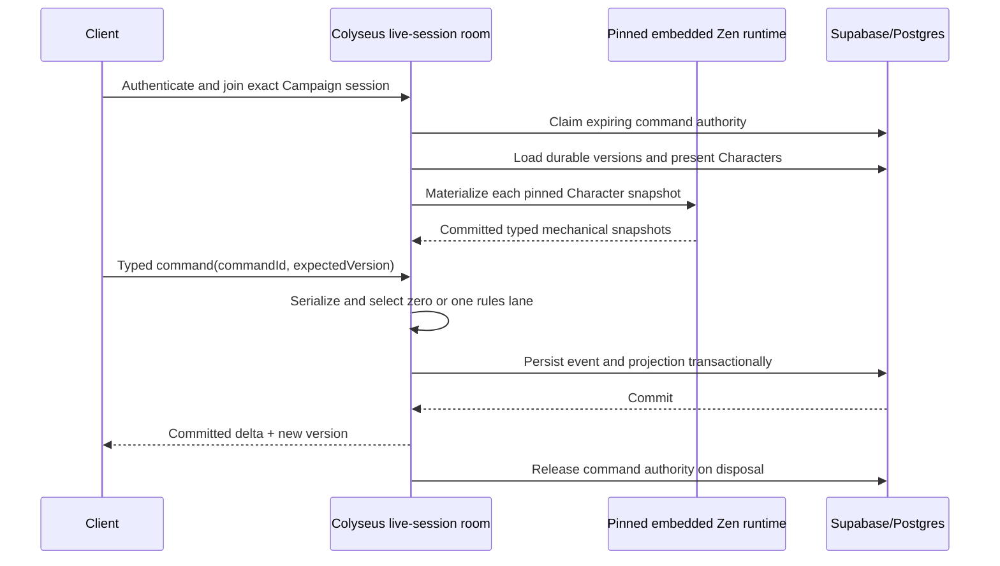

# Live-session host

> Status: command-room foundation in progress; VTT scene and renderer contracts remain Phase 08 work
>
> Scope: local and remote live-session process, deployment ownership, and synchronization invariants
>
> Update when: Colyseus room ownership, admission, commands, persistence, prediction, or deployment changes
>
> Verification: `apps/session-host`, ADRs 0020–0021, focused host tests, authenticated local integration, and authenticated Linux-container integration

Live VTT coordination runs in `apps/session-host`, a long-lived Node.js process separate from Netlify's transient web and tRPC handlers. It uses Colyseus core, Schema state synchronization, and the standard WebSocket transport. It remains in the monorepo and consumes the same schema, functions, database, and embedded Zen boundaries rather than duplicating domain logic.

## Deployment ownership

| Surface                            | Process                  | Deployment                                      |
| ---------------------------------- | ------------------------ | ----------------------------------------------- |
| Web, SSR, and ordinary tRPC        | `apps/web` + `apps/apis` | Existing Netlify site                           |
| Managed live VTT sessions          | `apps/session-host`      | Dedicated Docker service                        |
| Local live VTT sessions            | `apps/session-host`      | Headless process started by the future launcher |
| Identity and durable product state | Supabase/Postgres        | Existing Supabase project                       |

Local and remote modes differ only in endpoint and process ownership. They share the session protocol, authoritative room code, state versions, rule-pack pins, Zen evaluator, and persistence semantics. Initial local hosting is not offline-first: identity, Campaign authorization, and durable persistence still use the configured Artificer services unless a later offline product decision explicitly changes that boundary.

## Invariants

- One room serializes one active live-session command stream.
- A participating Character or Encounter has one mutation path while attached to a live room; an expiring Postgres command-authority lease makes a parallel tRPC write fail transactionally before persistence.
- The room publishes committed deltas only after the durable transaction succeeds.
- Ephemeral drag/pointer/measurement messages cannot mutate or overwrite committed state.
- Reconnect restores the committed version before accepting new commands.
- Zen evaluates mechanics inside the authoritative process through the exact pinned revision; it is not a network dependency.
- TypeScript owns admission, authorization, facts, transactions, and transport. It does not decide game-system mechanics.
- The first deployment is one process. Redis and distributed matchmaking require measured need and explicit design work.

## Current tracer

`apps/session-host` provides the portable Node entrypoint, strict port parsing, `GET /health`, local scripts, and the managed-remote deployment boundary. Its `live-session` room now provides authenticated admission, exact durable Campaign/session identity, eager pinned Character snapshot materialization, typed existing Sheet/Encounter command envelopes, one serialized command coordinator, aggregate-version reconciliation, idempotent replay handling, reconnect readiness, private command results, and committed aggregate-only broadcasts.

The command room retains the committed Zen-derived Character evaluation and matching structural Builder resolution, plus the committed Encounter actor-policy evaluation, at their aggregate stream versions. Matching snapshots supply current-command validation and projection without rebuilding those representations. HP, presentation, and usage-only Encounter commands select no evaluation lane. Character resource and spell-slot changes apply prospective usage facts and evaluate the pinned `character-action-resolve` model once before persistence; structural Character commands evaluate prospective `character-policy` facts once. An Encounter `RESOLVE_ACTION` command injects the committed actor-policy output and evaluates only its pinned bounded action model, with a second stage only when the typed dice-evidence protocol requests it. The room claims a 30-second session command-authority lease before snapshot hydration, renews it every 10 seconds, and releases it on disposal. Character and Encounter transactions lock and verify that authority; expiration fails the room closed and permits ordinary HTTP commands only after the lease is no longer active. The authenticated Windows/Node integration measured a `211 ms` cold Character command, `250 ms` warm p95, `207 ms` resource spend, `239 ms` spell-slot spend, and `244 ms` reconnect. The same prepared-caster gate against the rebuilt Linux Docker image measured `410 ms`, `338 ms`, `365 ms`, `339 ms`, and `412 ms`, respectively. Both use local Supabase and are validation baselines, not production-region SLAs. The managed image is verified but not yet deployed.

The action tracer reports its selected lane and both total/native-Zen time. Resource/spell-slot evaluation measured `28.7/9.6 ms` and `34.8/13.2 ms` locally, and `66.3/17.1 ms` and `50.3/10.0 ms` in Linux. Reusing the matching committed resolution reduced both pre- and post-command Builder resolution to effectively zero. A committed Encounter actor snapshot reduced a usage-only enemy resource command to `33.8 ms` locally and `58.8 ms` through the Linux container; the Linux service measured `39.5 ms`, selected `NONE`, and spent `0 ms` in actor/action evaluation. Both integrations proved that direct Character and Encounter mutations fail while the room owns the lease, room commands continue to commit, and disposal removes the lease. Phase 08 extends the proven room with scene state, VTT commands, transient collaboration, and renderer-specific clients.
