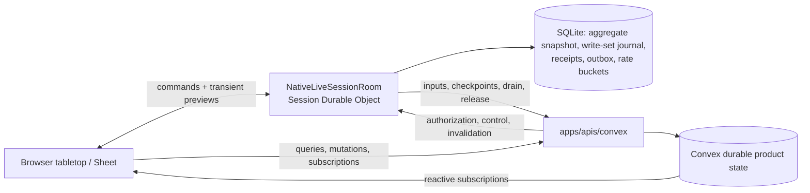
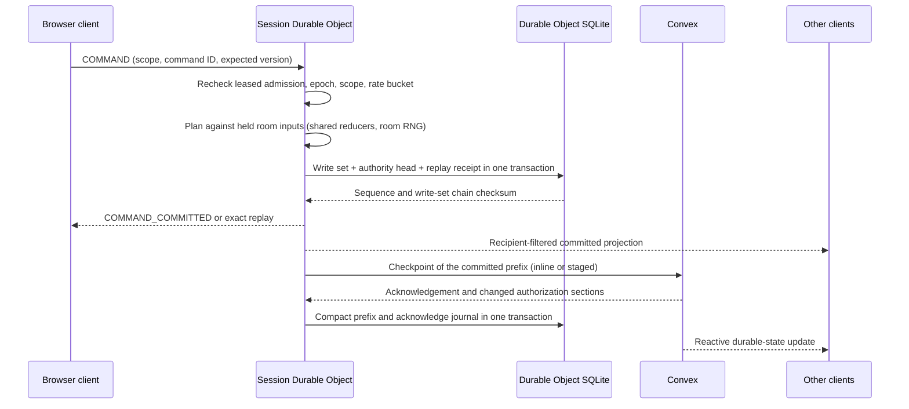

# Live-session coordination

> Status: canonical current. The Session Durable Object is the live-command authority for ACTIVE Campaign tables (ADR 0035). Integrated runtime acceptance is tracked in the acceptance ledger, not here.
>
> Scope: the room (Session Durable Object): admission and tickets, the authorization cache, inputs hydration, the SQLite store and journal, command execution, fan-out and privacy, checkpoints to Convex, drain and release, the alarm, recovery. Convex's side of the same seams (authority rows, checkpoint ingestion, control routes) is included where the room depends on it.
>
> Update when: ticket admission, supported live commands, SQLite state/receipts/outbox, room inputs, checkpoint publication, fencing, drain/release, recovery, limits or deployment configuration changes
>
> Verification: `apps/session-worker/src/nativeLiveSessionRoom.ts` and its `room*`/`native*` modules, `apps/session-worker/src/durableCommandJournal.ts`, `apps/apis/convex/liveSessions/*`, `packages/schema/src/api/liveSession*.ts`, `apps/web/src/domains/campaigns/vtt/liveSessionClient.ts`, and [ADR 0035](../adr/0035-room-authoritative-live-encounters.md)

Decisions that shaped this design: [ADR 0029](../adr/0029-convex-backend-cutover.md) (Convex cutover),
[ADR 0033](../adr/0033-campaign-owned-play-and-session-log.md) (one live table per Campaign, opened by
any ACTIVE member; no Campaign Session gates live play, and "live session" below means that
Campaign table), [ADR 0034](../adr/0034-player-control-rules-assistance-and-roll-prompts.md) (player
control, roll prompts), [ADR 0035](../adr/0035-room-authoritative-live-encounters.md) (room
authority) and [ADR 0036](../adr/0036-versioned-content-snapshots-and-browser-builder.md) (content
snapshots). Numbered decisions (`D72` and so on) are recorded in
[Phase 8.2 decisions](../handoffs/phase-08-2-decisions.md).

## Ownership and lifecycle

While a Campaign has live authority, its Session Durable Object (`NativeLiveSessionRoom`,
`apps/session-worker/src/nativeLiveSessionRoom.ts`, one object per Campaign ID) is the only writer of
live table state: the presented Scene and its fog, the open Encounter Runs, the held Characters'
play state, and Campaign chat and rolls. It commits each command to its SQLite store before
acknowledging it, then publishes the committed prefix to Convex as a fenced checkpoint.

Convex stays:

- the authentication and current-membership authority, and the issuer of tickets;
- the durable product store, the source of reactive subscriptions, and the recovery authority;
- the owner of the authority row (`campaignLiveAuthorities`, phases `ACTIVATING`, `DO_ACTIVE`,
  `DRAINING`; release deletes the row) that fences every Convex write that overlaps a live table.



Lifecycle of one epoch:

1. **Claim.** `liveSessions/tickets:issue` authorizes the member and reserves or reuses an
   `ACTIVATING` epoch. The browser opens the room socket with the ticket.
2. **Activate.** The room checks its journal against Convex (`/live-sessions/bootstrap`,
   `/live-sessions/activate`), loads its authorization cache and hydrates room inputs (below). A
   failed activation leaves no authority to serve; the next admission retries. A replacement epoch
   may discard an initial SQLite snapshot only while its sequence and published sequence are zero
   and it holds no receipts or outbox entries; committed state always goes through drain and release.
3. **Serve.** `DO_ACTIVE`: commands commit locally, checkpoints publish in the background.
4. **Drain and release.** When the last admitted socket has left for five minutes
   (`ROOM_LIMITS.idleReleaseMs`), or Convex sends `CLOSE_ROOM`, the room runs `#closeRoom`: close
   every socket, await the in-flight command chain, set the drain fence, `begin-drain`, publish the
   remaining checkpoint through the final sequence (`#checkpointThrough`), `release`, then drop the
   released journal state (`journal.release`) and clear its rate buckets and fog staging. The next
   join claims a fresh epoch.
5. **Close from Convex.** The Campaign archive and delete lifecycle sends `CLOSE_ROOM` through the
   control route (below). If the final checkpoint or release fails, the room answers 503 and keeps
   its drain fence and unpublished checkpoint; Convex `deliver` retries the close, and the room's
   alarm retries an idle release the same way.

Direct Convex mutations that overlap live table state are refused or fenced while authority is
`ACTIVATING`, `DO_ACTIVE` or `DRAINING` (`apps/apis/convex/liveSessions/authorityGuard.ts`,
`readLiveCampaignAuthority`). No Convex function executes an Encounter command: every one enters
through the room, which runs `recordEncounterCommand` against its own journal.
`apps/apis/convex/encounters/commandBoundary.test.ts` asserts that no registered function accepts one.

Scene presentation is a room command: `scenes/presentations:setLive` sends `SET_SCENE_PRESENTATION`
over the control route, the room finishes pending publication, the protected Convex setter checks
the epoch, published sequence, checksum and presentation version, and the room then drops its Scene
cache and challenges every socket. A failed publication leaves the presentation unchanged. The
direct `set` mutation exists only without active authority.

## Supported live-command flow



Every command takes the same path. The room's command chain serializes commands; a command first
reloads a stale or expired authorization cache (a failed read refuses it with `UNAVAILABLE`), then
the journal answers an exact retry (same command ID and input) with its stored receipt, and a reused
command ID with different input is `INVALID_COMMAND`. A command runs its planner inside one
`RoomEncounterStore.transact`, and `DurableCommandJournal.commitInTransaction` stores the receipt and
authority head in the same SQLite transaction. The room acknowledges and fans out only after that
transaction commits. A command that changes nothing writes no row.

Command scopes and their owning modules (all under `apps/session-worker/src/`):

| Scope               | Commands                                                                                                           | Module                                                                                                                 |
| ------------------- | ------------------------------------------------------------------------------------------------------------------ | ---------------------------------------------------------------------------------------------------------------------- |
| `SCENE`             | Moves, door changes, token and barrier edits, inline settings, fog painting, undo, presentation                    | `roomSceneGeometryCommand.ts`, `roomSceneEdits.ts`, `roomSceneUndo.ts`, `roomSceneFogUploads.ts`                       |
| `ENCOUNTER`         | Every Encounter command: actions, Disarm, Cleaving and Concentration answers, turns, basic actions, GM tools, dice | `roomEncounterCommands.ts`, `roomEncounterTurns.ts`, `roomEncounterBasicActions.ts`, `roomEncounterResponseRouting.ts` |
| `ENCOUNTER_BINDING` | GM binds an Encounter to the presented Scene                                                                       | `roomSceneBinding.ts`                                                                                                  |
| `CHARACTER_SHEET`   | Nineteen held-Character play commands                                                                              | `roomCharacterSheetCommands.ts`                                                                                        |
| `CAMPAIGN_CHAT`     | Chat, public and TABLE rolls, GM private rolls, roll reveals                                                       | `roomChatCommands.ts`                                                                                                  |

Contracts: [liveSessionEncounterCommand.ts](../../packages/schema/src/api/liveSessionEncounterCommand.ts)
(`ROOM_LOCAL_ENCOUNTER_COMMAND_TYPES` owns which Encounter commands run locally),
[characterSheetLiveCommands.ts](../../packages/schema/src/api/characterSheetLiveCommands.ts),
[campaignChatLiveCommands.ts](../../packages/schema/src/api/campaignChatLiveCommands.ts).

### Scene commands

The room is the only writer of a presented Scene. Planned and bound moves, door changes and token and
barrier edits run through `executeRoomSceneGeometry`, which derives each fog owner's exploration in
the same transaction. Inline edits (settings, lights, darkness, annotations, measurements) use the
shared planner `planSceneInlineCommand`; only the GM edits, except a player's own measurements. A
target changed after `expectedSceneVersion` is `STALE_STATE`; unrelated newer edits rebase. Character
vision is composed from the room's own rows before the journal commit and is never stored as a native
override. Undo selects the latest unmatched move (or published movement result) and restores or
deletes complete previous fog layers.

GM fog painting is staged, then published. `SCENE_FOG_BEGIN` carries the layer and chunk-checksum
manifest (at most 512x512 cells and 256 chunks); `SCENE_FOG_APPEND` sends at most 8 chunks per frame
so a frame stays under the 64 KB socket cap; the journaled `PUBLISH_SCENE_FOG_PATCH` writes the save,
chunks, merged layer and receipt in one transaction. Staging
([RoomSceneFogUploads](../../apps/session-worker/src/roomSceneFogUploads.ts), SQLite
`room_scene_fog_uploads`) is not Scene state and never reaches a checkpoint. It is keyed by epoch and
account and bounded to 2 unpublished patches per account within a 10-minute window; the alarm sweeps
expired staging, eviction removes the account's staging and release clears all of it.

While a bound Encounter has a pending movement decision, the room refuses token moves, undo and door
changes on that Scene with `UNAVAILABLE` ("Waiting on a movement decision."); chat, Sheets and other
Encounter commands continue. Bound-token movement happens only on the room's presented Scene
(`SCENE_NOT_PRESENTED` otherwise). Encounter-bound movement follows the bound actor's controllers plus
the GM (`NOT_ACTOR_CONTROLLER` otherwise).

### Encounter commands

`ROOM_LOCAL_ENCOUNTER_COMMAND_TYPES` run the shared reducers and planners from
`packages/rules-runtime` and `packages/encounter-persistence` through `executeRoomEncounterCommand`
(`roomEncounterCommands.ts`), drawing dice from the room's secure random source:

- `RESOLVE_ACTION` runs the action planner, or the Disarm planner (`nativeDisarm.ts`) when it carries
  an optional-combat intent; `USE_BASIC_ACTION` runs `nativeBasicAction.ts`; `START` and
  `ADVANCE_TURN` run the turn planner (`nativeEncounterTurn.ts`).
- Pending decisions are routed by `roomEncounterResponseRouting.ts` from the Run's retained occurrence:
  TURN, ACTION, CONCENTRATION, CLEAVING, DISARM or MOVEMENT. The selected planner repeats canonical
  admission. A decision no planner owns is refused with `VERSION_STALE` unless it names the Run's one
  pending occurrence and the caller may answer it.
- The GM tools and dice commands run `recordEncounterCommand`. A GM `UPDATE_ACTOR` with a
  `characterCommand` commits that Sheet command on the Run's held Character; the same command on a
  Character the room does not hold is refused ("Make this change from the Character Sheet.").
- One ACTIVE Run per Campaign: the RUN input carries the Campaign's `activeEncounterId`, `START`
  refuses `ACTIVE_ENCOUNTER_EXISTS`, and checkpoint ingestion refuses a checkpoint that would leave
  two ACTIVE Runs.
- `REVERT_LAST_ACTION`, Character actor removal, `COMPLETE` and any Run round change set
  `checkpointBeforeAcknowledgement`: the room flushes a checkpoint before acknowledging, including
  when a retry recovers that receipt after a restart.
- `RESOLVE_ACTION` naming a Creature's Legendary Action option is refused (`LEGENDARY_WINDOW_ONLY`).
- Steps play cannot continue without (initiative, saves, Recharge, Legendary dice, dice during a move)
  refuse a GM void with `DECISION_REQUIRES_ANSWER`. Other voids cancel the occurrence
  (`VOID_RULE_OCCURRENCE`).

Encounter planning reads rules content through `LiveCaptureReads`
(`nativeEncounterReads.ts`), which the room answers from its own SQLite transaction: `encounterRules`
serves the `liveSessionEncounterRules` capture requests from the hydrated Run, System and Character
inputs, and `prepareCharacter` builds a Character's rule context from the room-held Character. No
planner read reaches Convex. This is current behavior.

**Control and roll routing (ADR 0034).** Control belongs to the Run actor. Each actor stores
GM-set `controllerUserIds` (current Campaign players only, at most 8) and a `disposition`; a
Character actor's assigned player is always a controller, derived and never stored.
`encounters/actorController.ts` is the one predicate used by admission, reads and responses. A PLAYER
may `RESOLVE_ACTION` for an actor they control, end the current actor's turn when it is theirs, and
answer decisions routed to them; every other Encounter command is GM-only (`GM_ONLY`). A roll belongs
to the actor who makes it: pending evidence carries `rollerActorId`, and only that actor's controllers
and the GM see and answer it. Results returned to a non-owner pass through
`presentEncounterResultForMember`; the room refuses to hand a PLAYER anything that does not parse as a
player projection. Health display follows ADR 0034 decision 5 (Hidden, Descriptive, Bar, Exact), applied
by `projectPlayerEncounterProjection`.

**Flood control.** A PLAYER has at most one Encounter or planned geometry command in flight
(`ROOM_LIMITS.maxInFlightEncounterCommandsPerPlayer`); a second is refused `UNAVAILABLE` ("Your
previous action is still resolving."). Each account also has D72 token buckets (below).

### Held Character Sheet commands

While a Character is held (an unfrozen actor of an open Run in a live room), its Sheet play commands
are `CHARACTER_SHEET` envelopes (`characterId`, `encounterId`, one of nineteen `CharacterPlayState`
commands) executed by `executeRoomCharacterSheetCommand` inside `RoomEncounterStore.transact`.
Membership, assignment, ownership, ACTIVE Run and unfrozen-actor checks precede replay and version
refusal; replay reads the stored Character receipt through `readCharacterCommandReplay`. Maximum
overrides, rests, notes, structural edits and customizations stay outside this lane: the Builder owns
structure and Convex owns rests, notes and overrides. Only the initiator receives private Character
history; other admitted members receive the same room sequence with `delta: null`.

`SUBSCRIBE_CHARACTER_SHEET { characterId }` (one per socket) is admitted only for the Character's owner
or the GM. [RoomCharacterSheetFeed](../../apps/session-worker/src/roomCharacterSheetFeed.ts) pushes the
viewer-projected Sheet at once and after every committed transaction that changed its `streamVersion`
(unsequenced `CHARACTER_SHEET` message). Every push re-admits, so a lost assignment, hold or membership
drops the subscription. The web Sheet takes `expectedVersion` from the pushed `streamVersion`
(`useLiveCharacterSheet`).

### Held Encounter session

`SUBSCRIBE_ENCOUNTER_SESSION { timeline }` and `UNSUBSCRIBE_ENCOUNTER_SESSION` (one per socket) subscribe a
member to the Encounter state the room holds.
[RoomEncounterSessionFeed](../../apps/session-worker/src/roomEncounterSessionFeed.ts) sends an unsequenced
`ENCOUNTER_SESSION` frame after admission and after every committed transaction (`#queuePostCommit`, after
the Sheet push), only to subscribed sockets and only when the socket's serialized frame changed. The frame
is `{ held: false }` while the room holds no open Run for the Campaign (the feed never lazy-loads a Run, so
the web falls back to Convex), else `{ held: true, version, state, preparedPending, actorSides,
settlement, timeline }`:

- `state` is the `EncounterSessionStateDto` (the active Run in the member's projection plus its pending
  decision, `waitingOn`), `preparedPending` the PREPARED Runs with a pending initiative or recharge
  decision, `actorSides` the GM's actor-side map (null for a player), `timeline` the newest 50 entries
  when the socket asked for them (the web asks only while the chat roll view is Encounter, or in the
  Encounter workspace), and `settlement` how a player's last shown decision ended (D39), remembered per
  socket.
- Frames are built by the same readers Convex uses
  ([sessionReads](../../packages/encounter-persistence/src/sessionReads.ts),
  [timelinePages](../../packages/encounter-persistence/src/timelinePages.ts)) over the room store through
  `roomEncounterReadPorts`, so projection, privacy (players see TABLE entries and their own redactions)
  and integrity checks cannot drift. Authorization, budgets and receipt-ledger loading stay in the
  Convex reads. Every push re-admits the socket against the current authorization.
- A command's `expectedVersion` comes from the pushed `version`; the checkpointed Convex version lags the
  room while the Run is held, so a client must not compare the two.

Out of scope for the frame (still Convex reads): `actionChoices.get`, `actionChoices.optional`,
`evidenceRolls.latest` and `sceneBindings.get`.

**Holds.** [liveCharacterHolds](../../packages/schema/src/projections/liveCharacterHold.ts) fence each
Character and active Run pair by Campaign and epoch. Claim and recovery establish holds, checkpoints
reconcile them (`reconcileCharacterHolds`) and release removes them (`releaseCharacterHolds`). Direct
Convex play, preference and rest writes reject a held Character; a checkpoint accepts writes for an
unassigned Character this epoch still holds. A GM removal of a Character takes it out of initiative but
keeps its actor until the Run ends (D82). Room reconciliation clamps current HP to the evaluated
maximum.

**Departures (D74, D81).** For an open Run the room owns, `removeCampaignCharacterAssignment`,
`removeEncounterActorController` and account deletion write no Run actors in Convex; Convex sends
`EVICT_USER` and `INVALIDATE_INPUTS`. The room runs
[reconcileRoomActorDepartures](../../apps/session-worker/src/roomActorReconcile.ts) from one coalesced
post-commit task (`#queuePostCommit`) after every committed room transaction, authorization reload and
Sheet subscribe. It runs one `RoomEncounterStore` transaction (with a journal entry, `delta: null`) only
when an open Run names a departure: Characters that no longer exist (read as `DELETED` through the
CHARACTERS input scope) lose their actors, other unassigned Character actors are frozen, and departed
controllers are unlisted, via
[reconcileRunActorDepartures](../../packages/encounter-persistence/src/actorDepartures.ts). A removal
checkpoints before its receipt, then the room drops cached play and Scene and challenges every socket.
`RoomInputs.evictCharacter` drops the departed Character's cached inputs. A failed step is logged and the
next trigger retries it. A Run the room never hydrated this epoch is covered at release by
`reconcileOpenRunsAtRelease` in Convex. Checkpoint ingestion rejects an open Run's actor row that names a
departed controller or an unassigned unfrozen Character.

Known gap: a Character actor already frozen whose account is deleted later is removed only at release,
because a frozen actor names no departure for the room to reconcile.

### Chat and rolls

While live authority exists, general chat, public rolls and TABLE rolls are `CAMPAIGN_CHAT` commands;
the command ID is the entry's client nonce. `executeRoomCampaignChatCommand` validates the author
through the room's read ports, resolves Character rolls from held inputs, and writes the paired header
and payload with the shared conversation writers so the next checkpoint carries both. The entry fans
out at once to the conversation's members (others receive the same room sequence with `delta: null`);
the web routes chat and rolls through the room (`useCampaignChatRoom`) and merges pushed entries into
Convex history. Edit and unsend remain Convex-only; Convex fences `campaigns/chat:send` and
`campaigns/rolls:execute` while authority exists.

The GM's private roll (`EXECUTE_PRIVATE_ROLL`) and both reveals (`REVEAL_ROLL`, `FULL` or `NOTICE`) are
`CAMPAIGN_CHAT` commands. A private roll is answered to the GM alone and carried in the checkpoint
`retainedRolls`. A private roll made before the live table started exists only in Convex, and the room
refuses to reveal it. Every automatic rule roll gets a card through `recordRuleRollCard`; a hidden
roller is PRIVATE, a roller with a non-owner controller is TABLE, otherwise the command's `visibility`
or the stored `gmRollVisibility` decides. Convex and the room present rolls through one
`presentRoll`/`presentRetainedRoll` in `@artificer-toolkit/rules-runtime`.

**Rate buckets (D72).** Per-account token buckets live in room SQLite
([roomRateLimits](../../apps/session-worker/src/roomRateLimits.ts), allowances in `roomLimits.ts`):
chat and every roll share the TABLE bucket (players 30 per minute, burst 30; the GM 60/60); Scene writes
use 240 per minute, burst 80. A charge commits inside the command's durable transaction, so exact
retries and rolled-back commands are never charged and reconnects share the bucket. Eviction removes
the account's rows; release clears them. Fog staging steps check the Scene allowance, and publication
consumes it. The TABLE bucket is charged for `ROLL_ENEMY_ACTION` only when its `visibility` is `PUBLIC`,
and for `ROLL_ACTOR_INITIATIVE`.

## Ticket and authentication flow

`liveSessions/tickets:issue` authorizes the current ACTIVE Campaign member before signing a 60-second
HS256 ticket (issuer `artificer-convex`; subject, Campaign, Session, role, unique ticket ID, audience,
version, issue time and expiry are signed). A room consumes each ticket ID once and binds its persisted
room identity to the exact Campaign; the WebSocket path segment is the Campaign ID. The Worker entry
(`apps/session-worker/src/index.ts`) checks the browser Origin against `LIVE_SESSION_ALLOWED_ORIGINS`,
verifies the ticket and routes to the room object.

The signing key is checked before reserving authority. An `ACTIVATING` reservation expires at the
latest ticket expiry issued for that epoch; issuing another ticket extends the deadline without
changing the epoch, but never past the reservation's `createdAt` plus five minutes
(`claimCampaignLiveAuthority` in `liveSessions/authority.ts`). After expiry, direct Convex writes are
available again and a new join claims a fresh epoch. `DO_ACTIVE` and `DRAINING` authority never expires
through this deadline.


The browser authenticates once after the socket opens. There is no periodic heartbeat; the admitted
socket stays valid until its JWT expires (about 15 minutes), an invalidation arrives, the room's
authorization cache no longer admits it, or the socket closes. At expiry or after
`AUTHENTICATION_REQUIRED`, the browser obtains current authentication and Convex recaptures product
authority. Every admission, first or renewed, also renews the room's authorization cache and is refused
when that cache does not admit the captured member. `LIVE_SESSION_WORKER_SECRET` authenticates the
Worker's HTTP calls to Convex and Convex's control calls to the Worker.

**Control route.** Convex reaches a room through `POST /internal/live-sessions/control`
(`LIVE_SESSION_CONTROL_PATH`), authenticated by the Worker secret header and routed to the room object by
Campaign ID. Operations: `EVICT_USER` (a membership generation or user), `INVALIDATE_INPUTS { scopes }`,
`SET_SCENE_PRESENTATION` and `CLOSE_ROOM`. Producers: Campaign leave and removal evict the membership
generation; account deletion, auth-account suspension and administrative auth-session revocation evict the
user; Campaign archive and delete close the room; finishing a Campaign Session does not affect live play.
Sign-out and security actions close the browser's own socket.

`liveSessions/control.ts` `deliver` is fire-and-forget from the producing mutation and reschedules on a
network failure, 408, 429 or any 5xx after 1, 2, 4, 8 seconds and so on. An eviction keeps retrying, at
most a minute apart, until the room acknowledges it or no room holds the Campaign's authority
(`liveSessions/authority:held`). Closure and `INVALIDATE_INPUTS` stop after five attempts; the
authorization lease covers a lost invalidation. Other 4xx responses and missing configuration fail
immediately. Presentation control is synchronous and does not retry.

## Room authorization cache (ADR 0035 S4)

The room caches the authorization inputs of its Campaign (`apps/session-worker/src/roomAuthorization.ts`,
contract `packages/schema/src/api/liveSessionRoomAuthorization.ts`):

| Section      | Contents                                                                                   | Changes with                         |
| ------------ | ------------------------------------------------------------------------------------------ | ------------------------------------ |
| System stamp | Canonical revision for the held System inputs; no separate authorization section payload   | SYSTEM revision                      |
| Campaign     | Owner, ACTIVE members (role, membership epoch), Campaign Character assignments             | CAMPAIGN revision                    |
| Characters   | Each assigned Character's owner and party visibility ("Party can view" and health display) | That Character's CHARACTER revision  |
| Preferences  | Each member's "Roll my dice automatically" and canonical username                          | A digest of the members' preferences |
| Play         | The presented Scene's bound Encounter: token bindings, actor control and health display    | PLAY revision                        |

**Loading.** `liveSessions/roomAuthorization:read`, behind the Worker-secret route
`/live-sessions/room-authorization`, is authorized by the room's `DO_ACTIVE` epoch, not a member's token.
The room sends the revisions it holds (`known`); Convex reads the revisions and returns only the sections
whose revision differs.

**Lease.** The cache is trusted for `ROOM_LIMITS.authorizationLeaseMs` (240 s) from the start of the read
that loaded it. Each socket's authentication, including its renewal at token expiry, renews it.
`RoomAuthorization.acceptCheckpoint` applies the checkpoint response's changed sections and renews the
same lease without an extra read. After memory eviction, an incomplete checkpoint response requires a
full authorization read before admission. When SQLite retains an unpublished suffix, the room rebuilds
actor controls, health display and token bindings from committed native records after a reload.

**Invalidation.** `INVALIDATE_INPUTS { scopes }` marks the cache stale; nothing is trusted until the next
read. The tracked mutation builders in `apps/apis/convex/lib/mutations.ts` collect, per transaction:

- CAMPAIGN: any CAMPAIGN revision bump (Campaign, memberships, assignments, content shares);
- PLAY: `campaignPlaySettings` writes. Encounter writes also bump PLAY but are not pushed; the room marks
  its Play section stale after its own Encounter commands and bindings;
- CHARACTER: any CHARACTER revision bump, mapped to its Campaign through the assignment;
- PREFERENCES: an auto-roll change for each Campaign the user is an ACTIVE member of, and a change of
  the user's canonical username.

One notice per Campaign is scheduled when the mutation succeeds, and only while that Campaign's
authority is `DO_ACTIVE`. SYSTEM changes are pulled, never pushed. A CAMPAIGN notice reloads at once
because membership can end sockets; other notices reload before their next use. Checkpoint-originated
writes send no invalidation back to their own room.

**Use.**

- A command, and `SYNCHRONIZE_SCENE`, first reloads a stale or expired cache; a failed read refuses the
  command with `UNAVAILABLE`.
- Every read closes each socket whose member left, changed role or started a new membership epoch
  ("Campaign access ended."), so a removed member's queued commands never run.
- Broadcasts are refused while the cache is stale or past its lease: a preview or ping is dropped and one
  background read starts (one at a time; after a failure, none for `previewRetryMs`, 5 s). Only admitted
  members are recipients.
- A player's bound-token drag preview takes its control from the Play section.
- A token drag checks that the Scene's vision was built from the Character revisions the cache holds;
  otherwise the cache reloads and, if a Character changed, the Scene's vision is rebuilt.

**Accepted exposure.** Until the next read, a member whose removal notice was lost keeps receiving
broadcasts and can run room-local commands for at most one lease. No per-command authorization fetch is
added to a warm command; the final SQLite fence is the commit check.

## Room store and journal

`apps/session-worker/src/roomEncounterStore.ts` is an `EncounterStore` (the subset of `ctx.db` the
Encounter writers use, `packages/encounter-persistence`) over the object's SQLite. It reuses the
in-memory reference store (`createMemoryEncounterStore`) as the live index, so planners and writers run
against memory and SQLite is the durable copy. Beside it, `DurableCommandJournal`
(`durableCommandJournal.ts`) owns the authority head, replay receipts and the publication outbox
(`durable_session_authority`, `durable_command_receipts`, `durable_command_outbox`,
`durable_command_json_chunks`).

| Table                    | Rows                                                                             |
| ------------------------ | -------------------------------------------------------------------------------- |
| `room_snapshot_chunks`   | The aggregate as of the last snapshot, in bounded chunks under one `generation`  |
| `room_writeset_log`      | One row per command: its write set, the counters, and the chained state checksum |
| `room_scene_fog_uploads` | Staged fog patches (not Scene state, never checkpointed)                         |
| `room_idle_release`      | The idle-release deadline                                                        |

**Write path.** `transact` gives each command an all-or-nothing overlay: writes reach the in-memory index
through a journal, and only when the callback resolves does one `INSERT` into `room_writeset_log` make
them durable before the journal commits. A callback that throws, or a row that cannot be written, rolls
the index back. The billed cost is one row per command. A write set over 1.8M characters is refused with
`RoomWriteSetTooLargeError` before anything is written.

**Checksum.** Each row stores the SHA-256 of its write set and the chain value
`sha256(previous chain + ":" + that checksum)`. A replayed log reproduces it, and checkpoints fence on
it. `commitInTransaction` stores the same cumulative chain as the authority head beside the write-set
commit. Stored display Scene JSON has its own content checksum (`liveRoomStoredSceneStateSchema`) that
does not replace the chain.

**Raw and display state.** Native Scene rows and the display Scene (with composed Character vision) are
separate. Raw rows are what checkpoints carry; vision is recomputed. Native storage-row helpers are in
`roomSceneRecords.ts`.

**Compaction.** `compact({ epoch, sequence, checksum })` requires the checkpoint acknowledgement from
Convex, verifies the epoch, prefix checksum and retained journal, writes a new snapshot generation and
deletes only rows through that sequence in one `transactionSync`. Commands committed after the
acknowledged prefix stay in the journal and in memory. Snapshots retain the id counters, so replay after
eviction preserves consumed identities. Hydrating a new epoch replaces every old log row.

**Journal reads for checkpoints.** `committedWriteSets` reads a bounded consecutive prefix
(`packages/schema/src/api/liveSessionCheckpointJournal.ts`), verifying epoch, starting
sequence and checksum, row hashes and chain continuity, and refusing pending transactions, corrupt or
missing rows and compacted ranges. `checkpointSnapshot()` reads and verifies the durable base.
`packages/schema/src/projections/encounterStore.ts` owns the table schemas and indexes shared by room
replay and checkpoint validation.

**Restore.** `restoreDocument` marks a native row already durable in Convex (`RESTORE`): it creates or
rebases that input's checkpoint base instead of recording a gameplay insertion. The checkpoint builder
refuses a restore that would replace uncheckpointed mutable changes or append-only history.

**Rules inputs beside the aggregate.** The store keeps opaque records (`hydrate({documents, records})`,
`record(kind, key)`, `setRecord`): the cached Character Builder structure, per-root definition records
and the complete-inventory marker. Structure refresh, preparation (hit-die and resource reconciliation,
HP clamping, equipped/attuned filtering) and the command share the caller's SQLite transaction and roll
back together; room-owned play and effects are not replaced when structure refreshes.

## Room inputs and content snapshots

`apps/session-worker/src/roomInputs.ts` fills the authorized base from Convex. `liveSessions/roomInputs:read`
answers one Convex query page; the Worker-secret route `/live-sessions/room-inputs`, authorized by the
`DO_ACTIVE` epoch, answers a **batch** of consecutive pages (`readRoomInputsBatch`,
`packages/schema/src/api/liveRoomInputsBatch.ts`) until it holds 2048 documents or 2 MiB, so one Worker
call is one subrequest however many query pages it spans. A page is at most 1024 documents. Scopes:

- `RUN`: one Encounter's aggregate with the Run's `encounterVersion`; a page read at another version is
  left for the next call, so the Worker repeats a read that a command tore.
- `CHARACTERS`: up to 128 Character ids per request; each Character's stored inputs on its first part,
  then its active Rule Effects. A Character the Campaign no longer has assigned reads as `UNASSIGNED`
  (or `DELETED`) rather than failing; a frozen actor's inputs are not loaded.
- `CAMPAIGN_PLAY`, `SYSTEM` (the System and its vocabulary) and `DEFINITIONS` (every System PLATFORM root
  and Campaign-owner USER root, including unpublished roots, retained as per-root `ROOM_DEFINITION`
  records and one inventory marker; stale SYSTEM/CAMPAIGN pins reload the whole inventory).
- `AUTHORITY`: the native Campaign document, memberships of all statuses and assignments.
- `CHAT_METADATA`: conversations, members and entry headers, excluding text and roll bodies.
- `SCENE`: all seven native Scene families (`sceneLiveStates`, `sceneLiveEntities`, `sceneLiveCommands`,
  `sceneFogLayers`, `sceneFogSaves`, `sceneGeometrySaves`, `sceneFogChunks`) behind immutable definition,
  presentation and Scene-version pins. A page with changed pins is left for the next batch so the Worker
  retries the whole read. `sceneLiveCommands` pages the SCENE receipt ledgers, one ledger per page.

Every response carries its revision vector. `RoomInputs.hydrate` reads these scopes, verifies content
snapshots and Scene evidence, and replaces the store in one transaction; with no Run it still loads the
Campaign, System and presented Scene scopes. Demand reads (`character`, `play`, `system`, `definition`)
return the held copy while its revisions are among those the caller observes and read again otherwise.
A subrequest budget applies: every Convex call from the Worker is a subrequest (50 on Workers Free), and
the Run-and-Characters fixture of 100 actors with 12 Characters takes five calls within the 2 MiB batch
(asserted at most ten in `roomInputs.test.ts`). The Durable Object CPU limit is 30 s per request on
Workers Free (ADR 0035).

**Content snapshots (ADR 0036).** `CAMPAIGN_PLAY` carries the GM's Campaign-restricted source manifest;
a Character's first part carries its owner's manifest. The room reads index and document objects
through its R2 binding (`roomContentSnapshots.ts`, `contentSnapshotStorage.ts`; the Worker also serves
browser delivery under `/content/`, `contentSnapshots.ts`) and checks current built revisions, authorized scope, byte length,
SHA-256, headers, canonical schemas and root count and order before using them. Verified objects stay in
memory under their complete manifest; invalidation reloads affected content before replacing stored
inputs, and a failed load leaves prior SQLite inputs intact. After hibernation the room reloads R2
objects from its SQLite manifest without another Convex read. `roomCharacterRules` authorizes each
object's scope against the Character's manifest, then `nativeCharacterRules` prepares the Character over
its SQLite inputs and `createSnapshotReaders`. Warm preparation makes no Convex, HTTP or R2 calls.

**Activation.** After the checkpoint flush, the room hydrates when the store's epoch or acknowledged head
requires replacement. An unpublished head must match the recovered journal before hydration proceeds. The
bound Encounter comes from the authorization cache's Play section. A failed hydrate fails activation.

## Checkpoints to Convex

The checkpoint carries the room's committed prefix: mutable record deltas, append-only history (packed
Campaign history and separately packed private Character history) and the Scene/fog records.

- **Fix and retain.** [RoomCheckpoints](../../apps/session-worker/src/roomCheckpoints.ts) fixes a committed
  prefix and stores its canonical input in SQLite chunks of at most 72,000 bytes. A retry, including
  after eviction, uses the same checkpoint ID, source pins, range and payload digest.
- **Publish.** `roomCheckpointPublication.ts` sends requests up to 240 KiB inline to
  `/live-sessions/checkpoint` (`liveSessions/checkpoint:publish`). Larger payloads are staged in 240 KiB
  parts: `checkpoint-stage` binds byte counts to the epoch and fence, `checkpoint-part` accepts indexed
  base64 bytes, and `checkpoint-commit` (`liveSessions/checkpointStaging:commit`) validates all parts and
  applies the same publication transaction. A backlog publishes as consecutive prefixes. Abandoned
  uploads expire after 24 hours and scheduled cleanup removes them.
- **Fence.** `api/liveSessionCheckpointFence` owns the epoch, range, state and payload digest stored on
  `campaignLiveAuthorities`. Only a contiguous newer batch applies; an exact retry returns `REPLAYED`; an
  altered retry, foreign epoch, stale base or exceeded drain fence applies nothing.
- **Ingestion.** The Convex mutation checks public keys against complete indexes, previous and next
  record digests, Campaign and assigned-Character scope, stored shapes and domain checksums. Mutable
  changes, history and the authority acknowledgement commit atomically. Character play deltas carry the
  room's `streamVersion`, accepted only when strictly greater than the stored version. Builder structure
  is excluded. Scene rows are written only by the room checkpoint
  (`liveSessions/checkpointScenes.ts`); Scene command history is packed per Scene into SCENE receipt
  ledgers, with `sceneLiveCommands` as a header table.
- **Acknowledge.** The response carries changed authorization sections (renewing the lease). The room
  compacts the snapshot and calls `acknowledgeCheckpointInTransaction` in one SQLite transaction.
  Commands committed while publication is in flight remain as a suffix.
- **Timing.** The earliest unpublished receipt's timestamp fixes the checkpoint deadline
  (`checkpointDeadlineMs`, 120 s); later commands do not extend it. Admission, Scene presentation, drain
  and `checkpointBeforeAcknowledgement` commands flush a checkpoint before their boundary.

### Checkpoint triggers and the room meter (D85)

Every checkpoint send names one trigger, `LIVE_SESSION_CHECKPOINT_REASONS` in
`api/liveSessionCheckpoint`: `DEADLINE` (the alarm, 120 s after the earliest unpublished receipt),
`ADMISSION` (a socket authenticates, or a background retry after admission), `ACTIVATION` (bootstrap
recovery and the first publication after activation), `RELOAD` (the room aggregate must reload from
Convex before a command), `ACKNOWLEDGEMENT` (a command with `checkpointBeforeAcknowledgement`),
`PRESENTATION` (before a Scene presentation commit) and `DRAIN` (the final checkpoint before release).
A flush already in flight keeps its own reason, so a concurrent caller is attributed to the send that
actually ran.

[RoomMeter](../../apps/session-worker/src/roomMeter.ts) counts per authority epoch and is reset at
release. It changes no room behavior and is wired in at entry points only: the room's SQLite storage is
wrapped once (`meterStorage`, the one choke point for rows read and written; the runtime's own
`DurableObjectState` is never proxied, workerd rejects that), and sockets are watched when accepted or
found after a hibernation wake, so outgoing frames are counted by `send()`. It records incoming requests by kind
(WebSocket message, HTTP, alarm), messages and outgoing frames by `type` (new types need no edit),
admissions and the peak concurrent sockets per member (the case for merging a client's sockets),
command wall time, and checkpoints by reason with payload bytes, Worker-to-Convex request count, wall
time and the Convex-reported `io`. Staged checkpoints report the commit mutation's `io` only. Each
checkpoint logs one `[room-meter]` JSON line and release logs the epoch summary. The totals are
readable only in development, through `GET /internal/live-sessions/meter/<campaignId>` on the Worker,
which requires the `LOCAL_CONTENT_SNAPSHOT_ORIGIN` marker, a loopback host and the worker secret.

`scripts/v15Budgets.mjs <proof>.native-executions.jsonl <meter-totals>.json` compares a run against
4.3 MB of Convex I/O per 4-hour session and the Workers Free Durable Object allowances divided by the
Q16 session rate, and exits non-zero on a miss. It is not part of `validatePreStagingLocal`.

Convex retains Scene command receipts for 30 days: `scenes/commandRetention:purge` runs daily at 09:00 UTC
(`convex/crons.ts`), so replay by command ID and undo reach back at most 30 days. Open follow-up:
derived fog saves keep a `geometrySaveId` that can point at a pruned geometry save, and superseded fog
saves and chunks are not yet garbage-collected.

## Drain, release, alarm and recovery

**Alarm.** One Durable Object alarm (`alarm()`, `#scheduleAlarm`) serves every pending deadline: the
10-second authentication window of unauthenticated sockets, the idle release, the checkpoint deadline and
the expired fog staging sweep (`RoomSceneFogUploads.expire`). A failed checkpoint or release in the alarm
logs and retries after `alarmRetryMs` (30 s); the unpublished checkpoint and drain fence persist, so a later
alarm resumes them.

**Drain and release.** See "Ownership and lifecycle". Convex side: `begin-drain` moves the authority to
`DRAINING` with the final sequence and checksum; final publication uses its separately fenced internal
scope so Campaign deletion can checkpoint committed state; `release` reconciles open Runs
(`reconcileOpenRunsAtRelease`, `liveSessions/releaseReconcile.ts`) and deletes the authority row.
`CLOSE_ROOM` answers 503 when the final checkpoint or release fails.

**Recovery.** The constructor loads the newest complete snapshot generation and replays the log rows after
it. Any invalid row, missing snapshot chunk, broken chain or sequence gap leaves the store empty and sets
`corruption`; durable rows are retained, never silently discarded. `assertAuthorityHead` compares the
recovered epoch, sequence and chain with the head committed beside each command. Corruption refuses
ordinary hydration. Recovery then calls the Worker-secret route `/live-sessions/recover-storage` with the
abandoned epoch: Convex refuses inactive or deleting Campaigns, fences that epoch with a fresh
`ACTIVATING` epoch over its acknowledged product state, and returns an already newer authority unchanged
on retry. After confirming the new fence, one SQLite transaction installs an empty replacement base and
removes the old journal, receipts, outbox and pending checkpoint; a failure retains the old rows. No
abandoned suffix is published. Missing storage with a nonzero checkpoint follows the same path. Clients
reconnect with fresh tickets and the replacement serves commands only after it hydrates the acknowledged
Convex inputs.

**Hibernation.** Hibernatable socket attachments retain connection identity and membership epoch.
Transient state (sequence high-water marks, drag paths, background-refresh flags) lives in memory and is
lost on hibernation, restart or eviction; that is safe because the next sample starts from the token's
position and a hibernating room has received no samples.

## Transient previews

The WebSocket protocol separates command and transient traffic. Browser messages include `AUTHENTICATE`,
`COMMAND`, `TRANSIENT`, `RESUME`, `SYNCHRONIZE_SCENE`, the fog upload steps and the Sheet subscriptions;
server messages include `AUTHENTICATION_REQUIRED`, `TRANSIENT_READY`, `COMMAND_COMMITTED`,
`COMMAND_REJECTED` and `TRANSIENT` ([liveSessions.ts](../../packages/schema/src/api/liveSessions.ts)).

Pings and measurement, fog-area and token-drag previews are ephemeral and never enter the journal or
checkpoints. Fog of war is opt-in per Scene (ADR 0034): new Scenes start with fog `OFF`, so every point
counts as explored and nothing is derived, previewed or painted. `SHARED_PARTY` shares one player's
exploration with the party; `PER_PLAYER` keeps recipient-owned layers. The GM changes the mode with
`SET_SCENE_FOG_MODE`; stored layers are kept while fog is `OFF`, and manual fog writes and
`FOG_AREA_PREVIEW` are refused. The room renders each sample from its cached Scene and Character-vision
inputs, validates bounded movement geometry and projects private state per admitted recipient. Hidden
tokens, unrevealed barriers, GM annotations, DM-preview fog and other recipient-private state never enter
a broader broadcast.

**Preview cost rules (ADR 0035):**

- **Only during a gesture.** There are no live cursors. Token drags, measurements and fog drafts send
  previews while they last.
- **Pings.** A `PING` is one message about one map point, sent after a 500 ms press-and-hold without
  moving more than 8 screen pixels, or by `P` on the focused map. Recipients draw a 1.5 s ring and a
  polite live region announces it. The room never echoes a ping to its origin socket.
- **At most 10 Hz; pings at most 2 Hz.** `liveSessionClient` sends each preview stream at most once per
  100 ms and a ping at most once per `VTT_SCENE_LIMITS.pingIntervalMs` (500 ms). A ping also takes a
  per-socket `PING` token; faster pings are dropped without closing the socket.
- **No Convex call or storage access per sample.** The Scene must be the room's cached Scene at the
  sample's version, else the sample is dropped and one background rebuild starts (at most one at a time,
  at most once per `previewRetryMs`). Origin and recipients are admissions the authorization cache still
  admits; while the cache is stale or past its lease, samples are dropped and one background read renews
  it, so previews fail closed. The worst case is a drag preview using a revoked actor control or
  superseded Character vision whose notice was lost, for up to one lease. The commit is still fully
  checked.

Every preview carries `audience: 'TABLE' | 'GM'`. A `GM` preview reaches only OWNER sockets; the tabletop
sends GM previews as `GM` by default and the "Show my previews to players" toggle switches them to `TABLE`.
A GM's ping follows only that audience. A player's ping reaches every OWNER socket, and another player only
where `isScenePointExplored` shows the point in that player's fog (always while fog is `OFF`). A ping
outside the map is dropped.

## Reconnect and convergence

The browser reconnects with exponential backoff capped at 30 seconds. Every attempt asks Convex for a fresh
one-use ticket; tickets and admission are never resumed across sockets. After the new socket authenticates
and current capture succeeds, `TRANSIENT_READY` resets the backoff. A reconnect to the active room can
replay a matching SQLite receipt. After release or eviction, a fresh epoch hydrates from current Convex
state, and stale SQLite epochs cannot publish into the new authority. Convex subscriptions reconnect
independently and return current authorized durable projections. Previews may disappear during reconnect.

## Browser surface ownership

The Campaign workspace and Character Sheet can open a dedicated authenticated tabletop window. React owns
accessible controls and inspectors; PixiJS owns frame-rate Scene rendering. The GM may edit or present
current Campaign Scenes; players receive play controls and recipient-private projections. Connection-local
camera, zoom, tool and previews stay local or transient.

While room authority is active, Scene, Encounter, binding, held Sheet and chat commands go through the room.
A Sheet whose Character the room holds opens the room through `useCampaignLiveSession`, sends play
commands as `CHARACTER_SHEET` envelopes and derives its play slices from the pushed Sheet; notes, rests,
maximum overrides and structural commands stay on Convex. Other Sheets use ordinary Convex mutations and
subscriptions. The focused `characters/sheetSlices` `liveAuthority` query supplies owner and GM routing
metadata (Campaign, epoch, phase, held Run IDs, `checkpointedAt`); `campaigns/queries.liveAuthority`
returns any member the live epoch and nullable `checkpointedAt`, which chat routing uses. Scene
publications and all other durable product state converge in Convex.

An open tabletop subscribes to the authorized presentation and recipient header for Scene identity and
version with `includeSnapshot:false` and renders the room's recipient Scene. Ordered command deltas update
individual tokens or door states; Pixi retains unchanged graphics.

While the room holds an Encounter the web reads it from the room, not Convex (see
[Held Encounter session](#held-encounter-session)). The tabletop, the Encounter workspace, chat and the
player decision prompt fall back to the Convex reads (`encounters/activeReads:active`,
`projectionReads:pendingPrepared`, `timelineReads:timeline`, `activeReads:decisionSettlement`) only while
the frame says `held: false`. Convex reads are reactive subscriptions; no Encounter read polls.

## Security and limits

Convex rate limits live in `apps/apis/convex/lib/rateLimits.ts` (`@convex-dev/rate-limiter`). Each is keyed
by the authenticated user ID and consumed inside the authorized mutation before any write, so a rejection
rolls back the transaction. Account deletion resets every user-keyed counter.

| Limit                  | Kind and allowance                 | Consumed by                                                                                 |
| ---------------------- | ---------------------------------- | ------------------------------------------------------------------------------------------- |
| `liveSessionTicket`    | Token bucket, 30/min, burst 10     | `liveSessions/admission:authorize`, called by `liveSessions/tickets:issue`                  |
| `campaignConversation` | Token bucket, 30/min, burst 30     | Campaign chat, public rolls and table rolls outside live play                               |
| Social                 | Fixed UTC-aligned hour/day windows | Applications, invitations, reports and blocks ([policy](persistence.md#social-rate-limits)) |

Convex has no Scene write allowance. While a live room holds authority, chat, roll and Scene allowances
apply per account in the room (D72, see [Chat and rolls](#chat-and-rolls)).

The room enforces its own limits (`apps/session-worker/src/roomLimits.ts`), so one socket cannot become
unbounded Convex work:

- **Message size:** a message over 64 KB of UTF-8 closes the socket (1008).
- **Message budgets:** a token bucket per message class per socket; exceeding one closes the socket (1008).
  `AUTHENTICATE` 10 then 1 per 2 s; `COMMAND` 20 then 5/s; `RESUME`, `SYNCHRONIZE_SCENE` and the Sheet
  subscriptions together 20 then 2/s; `TRANSIENT` 200 then 100/s; `SCENE_FOG_BEGIN` and `SCENE_FOG_APPEND`
  together 40 then 20/s (one full 256-chunk fog patch in a burst); unparseable messages 5 then 1 per 2 s.
- **Sockets:** at most 4 per user and 64 per room. An upgrade over either cap is refused (429 or 503)
  before its one-use ticket is consumed, so a user's tabs cannot evict each other in a reconnect loop.
- **Authentication window:** a socket not authenticated within 10 s is closed by the alarm.
- **Idle release (ADR 0033):** when the last admitted socket of an active room leaves, a release deadline
  five minutes out is stored (`room_idle_release`). An admitted socket cancels it; a socket inside its
  admission window defers it. At the deadline the room runs `#closeRoom`.
- **Queues:** at most 8 pending commands per socket and 64 per room; a command beyond either is rejected
  with `UNAVAILABLE` and the socket stays open. Previews are not queued.
- **Admission freshness:** an admission lasts until its access token expires; renewing it recaptures
  membership and role from Convex and renews the authorization cache.

Rate-limit rejections throw `ConvexError` data matching `rateLimitedErrorDataSchema`
(`packages/schema/src/api/rateLimits.ts`); the web reads it through `apps/web/src/lib/errorMessage.ts`.

**Domain rejections.** Expected Encounter rejections (a stale version, a pending decision, an active
Encounter already in the Campaign) throw `ConvexError` data matching `domainRejectionErrorDataSchema`
(`packages/schema/src/api/domainRejections.ts`) through `rejectDomain`
(`apps/apis/convex/lib/domainRejections.ts`): a closed `reason` and a user-safe `message`. The
Worker-secret routes in `liveSessions/stateHttp.ts` return that data as JSON with status 422; every other
failure keeps the redacted 409 text. A nested Convex function stopped at its execution limit changed
nothing, so the route answers 503 and the room refuses with `UNAVAILABLE` and
`LIVE_SESSION_TRY_AGAIN_MESSAGE` (D47). The room forwards a domain rejection as `COMMAND_REJECTED` with
code `DOMAIN_REJECTED`, the `reason` and its message; every other rejection carries `reason: null` and a
generic message, so Convex internals never reach clients. A permission refusal says what it is
(`GM_ONLY`, `NOT_ACTOR_CONTROLLER`) and never reads as stale state; a genuinely stale version keeps
`VERSION_STALE`, and the room's generic `STALE_STATE` stays for redacted refusals.

Rule warnings (ADR 0034 decision 2) are the one rejection with a payload: reason `RULE_WARNINGS` carries
`warnings: [{ code, message }]` (`packages/schema/src/shared/encounterRuleWarnings.ts`) and
`COMMAND_REJECTED` carries them in `warnings`. The web action drawer shows them and resends the command
with `acknowledgedWarnings` on "Do it anyway".

**Worker-boundary validators.** The private checkpoint functions
(`liveSessions/{checkpoint,checkpointStaging}.ts`) are internal functions reached only through the
Worker-secret HTTP routes. They declare `args: v.any()` with no `returns` validator; each handler takes
`unknown` and parses it with its shared Zod contract before any read, and the Worker parses every response
with the same contracts. Duplicating large unions as Convex validators pushed modules past the 64 MB
module-load budget. Public functions keep generated Convex argument validators.

## Configuration

| Owner               | Name                              | Purpose                                                                               |
| ------------------- | --------------------------------- | ------------------------------------------------------------------------------------- |
| Browser             | `VITE_CONVEX_URL`                 | Public Convex query/mutation WebSocket endpoint                                       |
| Browser             | `VITE_LIVE_SESSION_WEBSOCKET_URL` | Session Worker WebSocket origin                                                       |
| Web/Convex runtime  | `CONVEX_SITE_URL`                 | Convex HTTP Actions origin used by server and local tooling                           |
| Convex auth         | `SITE_URL`                        | Canonical application origin for Better Auth                                          |
| Convex auth         | `BETTER_AUTH_SECRET`              | Better Auth signing secret                                                            |
| Convex auth         | `JWKS`                            | Optional deployment-specific static key set                                           |
| Convex live session | `LIVE_SESSION_TICKET_SECRET`      | At least 32-byte ticket-signing secret shared only with the Worker                    |
| Convex live session | `LIVE_SESSION_WORKER_SECRET`      | At least 32-byte secret for Worker-to-Convex routes and Convex-to-Worker control      |
| Convex live session | `LIVE_SESSION_WORKER_URL`         | Worker origin that room eviction, closure and invalidation control calls reach        |
| Worker              | `CONVEX_SITE_URL`                 | Matching Convex HTTP Actions origin for room calls                                    |
| Worker              | `LIVE_SESSION_ALLOWED_ORIGINS`    | Exact comma-separated browser origins                                                 |
| Worker              | `LIVE_SESSION_TICKET_SECRET`      | Matching ticket-verification secret                                                   |
| Worker              | `LIVE_SESSION_WORKER_SECRET`      | Matching shared secret                                                                |
| Worker              | `LIVE_SESSION_ROOMS`              | Durable Object namespace binding                                                      |
| Worker              | `RULES_CONTINUATION_SECRET`       | At least 32-byte rules continuation sealing secret; Worker-only, never sent over HTTP |

Browser variables must never contain either secret. Staging and production bind each Worker to the matching
Convex deployment and web origin. The Worker also binds the R2 content-snapshot bucket (see
`apps/session-worker/wrangler.jsonc`).

## Verification and release gates

Use the local Convex deployment and the Worker command documented in
[`apps/session-worker/README.md`](../../apps/session-worker/README.md). Focused package checks are:

```powershell
yarn workspace @artificer-toolkit/session-worker typecheck
yarn workspace @artificer-toolkit/session-worker test
yarn workspace @artificer-toolkit/session-worker build
```

Focused checks are implementation feedback. The final local release source must pass
`yarn validate:pre-staging:local`, including transaction, replay, rollback and privacy proofs and the
complete browser journeys. The frozen V15 workload keeps its thresholds: transient delivery at or below
`150 ms`; durable browser p95 at or below `250 ms` and p99 at or below `500 ms`; authoritative completion
at or below `1,000 ms`; Scene-only host p95 below `100 ms`; rule-bound host p95 below `250 ms`. The workload
(`apps/apis/tests/developmentEncounterCutover.ts`) sends every command through the room from the member who
controls its actor. Real-backend development drivers do the same through `DevelopmentHttpClient`, which
issues a ticket, opens the Worker socket and resolves on the `COMMAND_COMMITTED` result. Managed verification
runs only after the complete local lifecycle is green. The
[Phase 8.2 acceptance ledger](../roadmap/08-2-convex-cutover-acceptance.md) controls acceptance.
