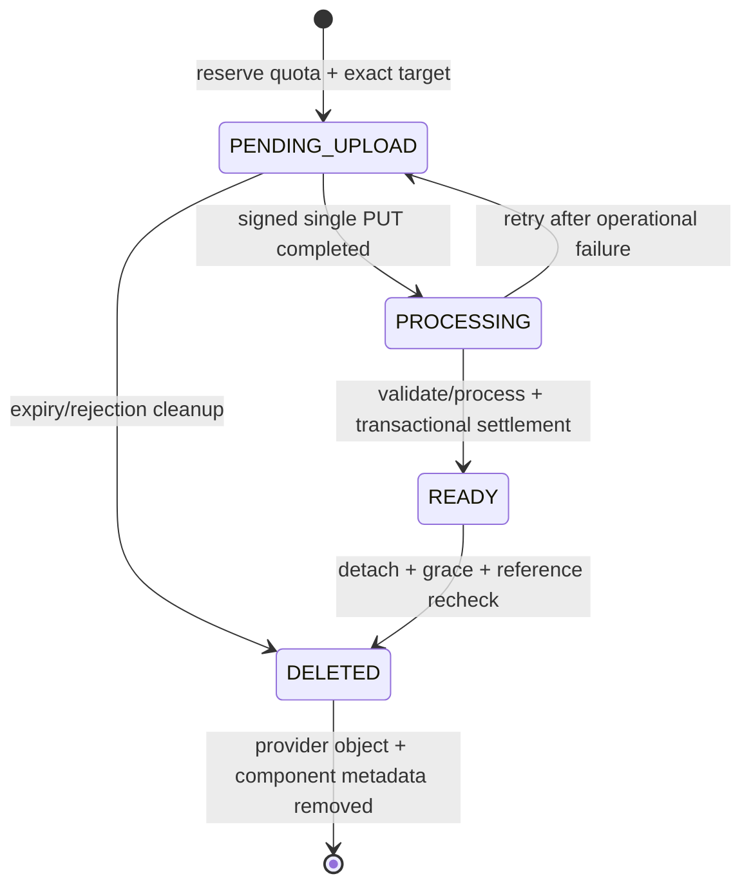
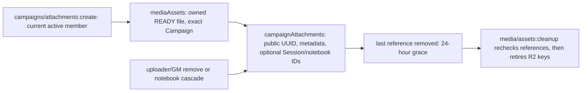
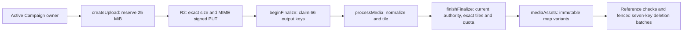
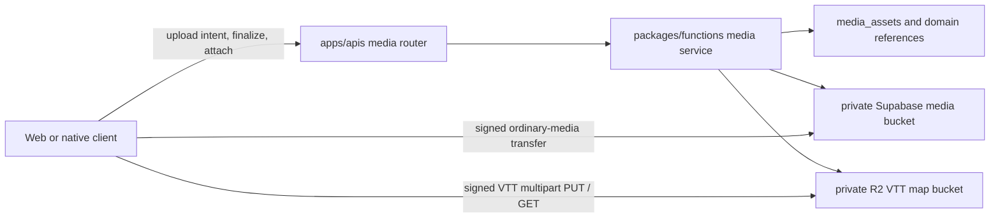
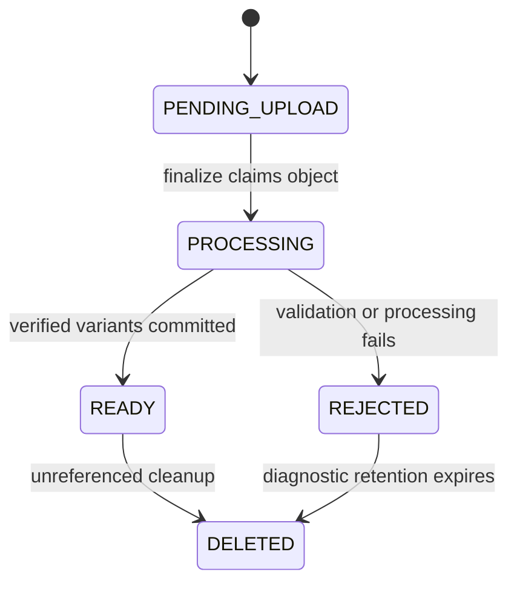

# Media lifecycle and delivery

> Status: canonical current Phase 8.2 boundary
>
> Scope: private media identity, upload, processing, references, quota, delivery, retention, and deletion
>
> Update when: profiles, storage configuration, signed upload/delivery, ownership, processing, or cleanup changes
>
> Verification: `apps/apis/convex/media`, media schemas/tests, `@convex-dev/r2`, and the shared web media adapters

Convex owns media authorization, metadata, quota, lifecycle state, domain references and cleanup.
Private R2 stores bytes through the official component. Browser clients receive only short-lived signed
URLs for an already-authorized object operation.

The signed upload binds the object key, declared byte length and MIME type. Account avatar, Character
portrait, authored artwork, Campaign file/handout and VTT map profiles retain their domain-specific
authorization and references; there is no public bucket/key API. Processing actions recheck identity,
target revision, current references and quota before their internal mutation commits metadata.

Delivery queries/actions reauthorize the current viewer, expose no object key, and return a short-lived
signed URL. Campaign media may be retained by the Campaign owner when a departing/deleted user supplied
bytes still referenced by shared Campaign content. Personal unreferenced media is retired. Cleanup uses
fenced, idempotent scheduler continuations and does not drop its obligation until provider deletion and
component metadata deletion succeed.

Local correctness uses `MEDIA_STORAGE_MODE=local`, loopback `CONVEX_SITE_URL` and
`LOCAL_R2_ENDPOINT`. Managed deployments use `MEDIA_STORAGE_MODE=r2`, HTTPS `R2_ENDPOINT`, private
`R2_BUCKET`, `R2_ACCESS_KEY_ID` and `R2_SECRET_ACCESS_KEY`. The browser receives only
`VITE_MEDIA_STORAGE_ORIGIN` for CSP. See the [R2 runbook](../runbooks/vtt-map-r2.md).

## Historical implementation record

The remainder of this file preserves the transitional storage and multipart implementation record. It
is not current deployment guidance or acceptance status.

### Original media guide

> **Status:** canonical
> **Scope:** image and restricted Campaign-file asset identity, processing, domain references, and private delivery
> **Update when:** asset profiles, lifecycle states, variants, storage provider, or attachment ownership changes
> **Verification:** `packages/schema/src/api/media.ts`, `packages/functions/src/services/media`, `packages/db/src/domains/subjects/repositories/media.ts`, and the Phase 02 media tests

### Boundary

#### Phase 8.2 target and current cutover boundary

Convex will own asset metadata and domain references; all media bytes move to private R2 via
`@convex-dev/r2`. The approved transport is a signed single PUT, including VTT maps; custom
multipart support below describes the transitional implementation, not the target. Account,
Character, authored-content, and Campaign permissions remain domain-owned. No generic bucket
listing, client-selected key, or unauthenticated media mutation is exposed by the component.

Account avatars, Character portraits, and all eight authored artwork domains now use
`apps/apis/convex/media` and the shared web media adapter. VTT media remains transitional. Convex
`userProfiles.avatarAssetId` owns the current avatar;
`mediaAssets` retains its upload intent, immutable variants, processing operation, and quota charge.
Upload permission signs the exact declared byte length and MIME type, not just the object key.
The Node save action normalizes/crops, then rechecks current identity and avatar revision before
attaching. A failed replacement keeps the prior avatar. Signed delivery is owner-only and expires
after five minutes; reactive metadata contains only the public asset UUID and revision.

Character portraits use `characters.portraitAssetId` and `portraitRevision`; Builder commits
preserve both. Upload/save/remove require the Character owner, and the upload intent binds the
exact Character UUID. Direct foreign or missing Character reads return no portrait. Campaign/VTT
portrait projection is still pending and does not gain access through this direct owner endpoint.
Settlement rechecks ownership and portrait revision, so concurrent replacement or removal rejects
stale processing. Failed replacements preserve the current binding. Removal schedules the existing
24-hour grace; cleanup rechecks Character references. Account purge clears matching owned portrait
bindings before retiring keys, and isolated fixture deletion schedules its bound portrait for cleanup.

Authored artwork uses domain-owned `authoredImageSlots`, indexed by subject UUID/scope and asset
UUID. The first saved draft inherits ACTIVE once; an explicit null DRAFT never falls back to
ACTIVE. Publication promotes the slot atomically, discard drops only DRAFT, and active deletion
preserves an existing draft slot. Read permission comes from current authored source/owner access;
write permission requires a saved owned draft. Master content remains locked. The asset's upload
intent is bound to the exact authored subject, so an avatar or another subject's asset cannot attach.

Authored target, lookup and slot identities share the existing PostgreSQL-shaped UUID validator,
including deterministic SRD IDs without RFC version bits, and normalize case before lookup.
Asset, Character and Campaign runtime identities retain their strict UUID validation.

The Node action shares the avatar's byte-processing helper but keeps authored authority separate.
Settlement rechecks the draft instance and slot revision, preventing a discarded/recreated draft,
removal, or another attachment from accepting stale processing. Authored recrops create a new asset,
copy verified SOURCE/DISPLAY bytes exactly, and generate only a new thumbnail; neither published
artwork nor image quality changes while editing its draft. Cleanup checks every current slot before
deleting bytes and preserves the existing grace/fence. Artwork is decorative; delivery URLs expire
after five minutes. Other authored frontend adapters migrate only with their own draft persistence.

Deletion uses native scheduled mutations/actions, not another queue table. A mutation atomically
schedules the provider-delete action and a follow-up mutation carrying the exact keys and action
ID. The follow-up stops only after provider-confirmed success; failed/missing attempts retry every
15 minutes. Keys survive account metadata deletion in those durable scheduler arguments. Cleanup
waits until issued PUTs expire plus the 15-minute settling fence; failed processing does not shorten
that fence. Recropping uses new immutable thumbnail keys and retires the prior key through the same
path. Detached assets keep the existing 24-hour recovery grace.

#### Native Campaign attachment metadata — partial local implementation

Native attachment create/list/remove now preserve the transitional member, uploader and GM
boundaries. Writes require an ACTIVE Campaign; current members may list archived Campaigns.
Listing pages the Campaign/created-time/UUID index descending with 48-row/one-MiB read targets,
without a total attachment cap. The DTO remains unchanged and never includes object keys or URLs.
Metadata retains its original text. Optional Session/notebook IDs must belong to the Campaign;
the existing association contract does not grant notebook access or reveal its private text.
Internal `campaigns/attachments:readDelivery` now resolves an exact Campaign/attachment pair for
current members, including archived reads and members other than the uploader. It rechecks the
READY file's Campaign/profile/uploader binding and returns only verified SOURCE metadata to the
`media/fileActions:getDelivery` signing action. Removed attachments cannot authorize downloads even while another reference
keeps the same asset alive. This internal object-key projection is never a public/reactive DTO;
raw upload keys, preview variants and notebook content are not returned. The action signs a five-minute
SOURCE download with the verified MIME type and an encoded attachment filename in the signed response
headers. It reuses the configured R2 client and returns the unchanged file delivery DTO, not storage
metadata. Each request rechecks current membership; an already-issued URL remains valid until expiry.

Campaign files share the native `mediaAssets` table without weakening the existing image contract:
their separate stored schema supports normalized WebP variants or SOURCE-only UTF-8 text with
null dimensions. Files are Campaign-bound; handout maps reject text and have no VTT behavior.
Duplicate attachments to one asset remain allowed. Explicit removal and notebook deletion start
grace only after the last reference; reattachment cancels retirement. Cleanup rechecks current
attachment references. After account-profile deletion, bounded account purge removes attachment
references before retiring that asset's keys; surviving accounts are untouched.

`media/fileAssets:createUpload` now requires current Campaign membership and uses the same native
reservation/signer as avatars and authored artwork. The exact target/profile and declared file
metadata bind owner-scoped replay. It reserves 6 MiB once and issues a private single PUT bound to
the declared byte length and MIME type; permission renewal moves cleanup past the new expiry plus
the existing settling fence. Uploads remain PENDING and cannot attach before content verification.
Archived Campaign membership still permits upload, matching the transitional service; attachment
creation separately rejects archived Campaigns. Invalid intents, quota exhaustion and signing
configuration failures leave no partial reservation or asset row.

`media/fileActions:finalize` now orchestrates the internal file finalization mutations and Node byte
processor. It accepts only the asset UUID, returns the current READY result on an authorized retry,
returns REJECTED for validation/quota rejection, and sanitizes operational errors without discarding
retryable uploads. Internal file finalization claims immutable output keys before any storage writes. The shared
bounded reader and processor verify actual byte count and normalize strict UTF-8 text (SOURCE only,
BOM removed) or metadata-free WebP images (SOURCE/DISPLAY/THUMBNAIL), without a crop. Settlement
rechecks the current owner and Campaign membership, the unexpired operation ID, and the exact
output keys/kinds before atomically charging actual bytes and marking READY. A detached READY file
keeps 24-hour grace; attachment creation cancels that retirement.

Validation or quota rejection retains the preclaimed keys until the existing write fence retires
them. Operational failure or an abandoned action retains its raw upload and reservation; after the
15-minute operation fence, expiry returns that same asset to PENDING_UPLOAD with 24-hour grace.
Retry then claims fresh immutable keys. Unlike the transitional immediate reset, retry cannot start
before that fence: a failed action is not proof that its provider PUT stopped. Old callbacks cannot
settle or reject a replacement operation. No additional retry queue or failure-state field is used.
The shared reader treats explicit missing objects (404/410) as invalid uploads; storage authorization,
throttling, timeout and server failures remain operational errors, not proof of invalid file content.

The Campaign file web surface now calls these generated Convex functions directly. Uploads transfer
bytes with the issued signed PUT before finalization and attachment creation. Listing uses the native
reactive 48-row pagination result with explicit load-more behavior; delivery and removal use the
native action/mutation and need no query invalidation. The unused attachment query key and browser
tRPC facade were removed. Session and notebook selectors still use their owning transitional Campaign
readers until those domains migrate; they do not transport file or attachment data.

This is partial local implementation, not complete media or cutover acceptance. Attachment tests
seed READY metadata; upload tests transfer real loopback bytes and prove abandoned-upload cleanup.
Finalization tests run internal claims, real loopback normalization/writes, settlement and public
attachment creation, including rollback, revocation and partial-write recovery. Public finalization
and signed delivery are locally implemented; generated bindings are refreshed without deploying.
Hosted signing enforcement, other frontend media profiles, Campaign deletion/copy and the complete
real-backend lifecycle remain pending. No cloud push is claimed.

Configuration and proof boundaries are documented in
[the API workspace](../../apps/apis/README.md#convex-media-foundation--in-progress).
The existing implementation below remains authoritative for profiles not yet replaced.

#### Native VTT map upload — partial implementation

`media/vttMapAssets` and `media/vttMapActions` implement upload/finalization using the existing VTT
processor. `schema/projections/vttMapPersistence` adds a discriminated VTT_MAP member to mediaAssets;
image and Campaign-file profiles retain their contracts. Upload intent replay is scoped to the same
owner, Campaign and exact metadata, and reserves 25 MiB once. Every upload/finalization transaction
requires the current active Campaign owner and an active Campaign.

The Node operation claims display, thumbnail and all 64 possible tile keys before writing. Existing
25 MiB, 8192-pixel-side and 64 MP limits remain. Processing writes sequentially; settlement verifies
complete tile coverage and edge dimensions, replaces the reservation with actual stored bytes, and
retires unused keys. The 15-minute operation fence covers late writes; operational failures retain the
original upload for retry after that fence. Rejection and abandoned uploads release quota through the
existing cleanup lifecycle. Larger key sets fan out into existing retry-safe seven-key deletion jobs.

Normal grace cleanup checks both native Scene definitions and initial live Scene map references.
Campaign transfer changes delivery authority; the uploader retains asset ownership and storage charge.
The auth deletion transaction rejects before any account writes while an uploader's map has either
reference kind. `hasSceneReferences` is an indexed derived flag maintained by publication, replacement,
removal and fixture cleanup. Missing flags fail closed until the internal eight-row paginated backfill
recomputes them; backfill reports referenced maps whose uploader profile is missing and never invents
replacement ownership. Account media purge retains its actual-reference guard as well. This preserves
the original cascading-account-delete rollback contract; F12 still owns the complete product deletion
flow and all-domain reconciliation. Publication and delivery also require the uploader profile, fencing
new references against deletion before asynchronous media purge.
Native `getDelivery` issues the existing five-minute signed overview/tile URLs after current Campaign
membership authorization. Owners can read any READY map in their Campaign; players require an open
Session presenting that exact map. The indexed `activeMapAssetId` is server-derived when selecting a
Scene and cleared atomically when finishing its Session; multiple open Sessions may present the same
Scene. Delivery also verifies the selected live Scene and open Session before signing.

Definition begin/publication require a READY map in the same Campaign with matching verified
dimensions; native maps embed their tiles and require `tileManifestAssetId: null`. Map UUIDs are
canonicalized for reference indexes. Replacing/removing the last definition reference starts a fresh
24-hour recovery grace; surviving live Scene references still protect the bytes.

Owner Scene preparation now uses native upload, finalization and delivery. The browser sends the
whole file in one signed PUT and retains its successful upload asset ID so an interrupted finalization
can retry without uploading again. Clearing or replacing the file explicitly starts a new attempt.
The personal-development owner browser proof now exercises the signed PUT, finalization, decoded
overview/tile reads, Scene save/reload and private-read denials. Fixture cleanup removes Scene
references before Campaign/account cleanup and invokes existing account media purge. Physical object
absence must be proved after the existing deletion fence using unexpired provider authority;
successful purge invocation alone is insufficient. Evidence:
`.codex/validation/phase82-scene-owner-live/integration.md`.
The two earlier owner fixtures are now physically absent after the unchanged provider fence; see
`.codex/validation/phase82-scene-provider/integration.md`. The final V04 retention packet is
`.codex/validation/phase82-v04-retention/acceptance-checklist.md`. All 152 native tests and the actual
transfer/trigger/cleanup proof pass, including unchanged uploader charge and live-only protection.
The final fixture's exact provider prefixes were empty at 2026-09-11T04:01:44.707Z, after the unchanged
fence. V04 is accepted at LOCAL_INTEGRATION; ordered evidence is
`.codex/validation/phase82-v04-retention/acceptance.md`. Remaining live Scene and product account
deletion work retain their own cases.

#### Transitional implementation

Supabase Postgres owns asset metadata, storage-provider identity, and product references. Private Supabase Storage owns ordinary media bytes; private Cloudflare R2 owns new `VTT_MAP` originals, variants, and tiles. `apps/apis` is the control plane: it authorizes upload, completion, finalization, attachment, removal, and delivery. Web and later native clients may transfer bytes directly only through an exact, short-lived signed permission issued by that control plane.

Signed URLs and upload tokens are credentials, never persisted domain truth. Domain rows store stable asset IDs; asset and variant rows store opaque object keys.

### Current profiles

Phase 02 enables `ACCOUNT_AVATAR`, `CHARACTER_PORTRAIT`, and `AUTHORED_IMAGE`. Each accepted upload is normalized once and produces immutable source, display, and thumbnail variants. Account avatars, Character portraits, and authored artwork store normalized square thumbnail framing; authored detail pages and Character Sheet inspectors use the uncropped display variant. Originals are temporary and are removed after successful normalization. Clients cannot choose a bucket, object key, visibility, or output variant path.

Phase 06 adds `CAMPAIGN_FILE` and `CAMPAIGN_HANDOUT_MAP`. Campaign files accept normalized JPEG/PNG/WebP or strict UTF-8 `text/plain`, and handout maps accept normalized images only. Both remain private, limited to 6 MiB, and require fresh Campaign membership before attachment listing or signed delivery. Handout maps are ordinary Campaign assets and have no VTT behavior. PDF, office, archive, executable, SVG/HTML, resumable upload, and external malware-scanning support remain deferred rather than being represented as accepted safe formats.

Phase 08 adds `VTT_MAP` for Campaign owners. Maps are JPEG, PNG, or WebP up to 25 MiB, 8,192 px per side, and 64 MP. New maps use private R2 multipart upload with exact 6 MiB parts (at most five); the browser receives only part-specific two-hour URLs and returns exact ETags to the completion command. Finalization verifies the source dimensions, produces immutable display and thumbnail variants, and generates 1,024 px renderer tiles (at most 64) in the same persisted provider. Delivery returns five-minute signed overview and tile URLs only after current Campaign authorization. Existing Supabase-backed map rows remain readable through their persisted `storage_provider`; they are not copied during this cutover. A scene definition continues to reference the stable asset ID, and database triggers prevent deleting or changing an asset while any scene definition or Encounter snapshot references it.

`yarn test:vtt-map:integration` is the local proof for this seam. It creates disposable local Supabase Auth/Campaign fixtures and an in-process loopback R2 substitute, then exercises interrupted/resumed multipart upload, idempotent completion, finalization, signed delivery, scene reference protection, oversized-map rejection, and exact cleanup. It refuses non-loopback Supabase URLs and is never a managed-data operation.

### Lifecycle

Only `READY` assets may be attached. Each upload intent persists its exact authorized target, so an avatar or portrait crop cannot be reused by another domain record. Finalization is idempotent, replacements use new immutable keys, and the last detached reference starts a 24-hour recovery grace period.

Object-store writes cannot share a transaction with Postgres. Every queued deletion therefore retains both `storage_provider` and `object_key` until its live metadata commits or that provider confirms removal. Queue entries mature for 15 minutes before cleanup may claim them so an in-flight upload cannot race the cleaner. Abandoned R2 multipart uploads are explicitly aborted when their pending asset is claimed; R2's default seven-day incomplete-upload lifecycle is only a fallback. Account deletion cascades media metadata and queues its object keys in the same database transaction as the Auth user deletion; scheduled cleanup removes those objects after the maturity window and retries when the selected provider is unavailable.

### Domain ownership

- `profiles.avatar_asset_id` owns the current account avatar reference.
- `characters.portrait_asset_id` owns Character presentation independently of Builder aggregate replacement.
- `authored_image_slots` owns one `DRAFT` and one `ACTIVE` artwork slot per authored route identity.
- `campaign_attachments` owns Campaign file and handout references, including uploader identity and optional Session or Campaign-note association.

Saving an authored draft initializes its draft slot from active artwork once. Editing artwork changes only the draft slot. Activation promotes that slot in the same transaction that replaces the active aggregate and removes the draft. Discarding a draft removes only its draft slot. This follows [ADR 0011](../adr/0011-active-authored-content-and-json-drafts.md); media does not recreate authored revision history.

### Security and portability

Declared filename, MIME type, and size are hints. Finalization verifies decoded type, byte size, dimensions, pixel count, animation state, and actual processed quota under the account lock before creating variants. Normalization applies orientation and removes metadata including EXIF/GPS. Private delivery reuses the owning domain's read authorization.

The transport contract contains verified dimensions, accessibility metadata, expiry, and a signed delivery URL without browser-specific types. Image purpose owns that accessibility metadata: current domain artwork is decorative, while future mechanical diagrams and maps require descriptions through their own purpose-specific controls. Native clients reuse the same control plane with platform-native pickers and progress UI.

R2 credentials are server-only: `R2_ACCOUNT_ID`, `R2_ACCESS_KEY_ID`, `R2_SECRET_ACCESS_KEY`, and `R2_VTT_MAP_BUCKET`. `R2_S3_ENDPOINT` is used only by the local substitute or another explicitly selected S3-compatible endpoint. Browser uploads require bucket CORS to allow the application origins and `PUT`/`GET`, and to expose `ETag`. See the [VTT map R2 runbook](../runbooks/vtt-map-r2.md).

#### Account deletion and retained Campaign assets — local implementation, verification pending

[ADR 0030](../adr/0030-owner-deletion-and-retained-dependencies.md) replaces uploader-deletion vetoes.
The native account transaction enumerates all owned assets and actual indexed Scene/attachment
references. Referenced READY VTT maps, Campaign files and handout maps move to the current canonical
Campaign owner, preserving variants, keys, public UUID and original attachment uploader. The recipient's
charge increases atomically; existing shared media retention does not use the new-upload quota to veto
deletion. New uploads/finalization keep their existing quota checks. A fresh server upload idempotency
key avoids a collision in the destination owner's namespace.

The optional stored `retainedFromUserId` provenance is server-created and never accepted by upload or
attachment public inputs. Delivery still requires current Campaign authority, asset profile/status and
an exact original-uploader or retained-uploader link. Unreferenced and private media remains under the
existing deferred account purge and provider write fence. The earlier purge description applies only
after this retention transaction has detached the deleting user from surviving shared media. A failed
parent transaction preserves all media, attachment attribution, recipient charges and scheduled work.
