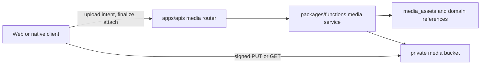
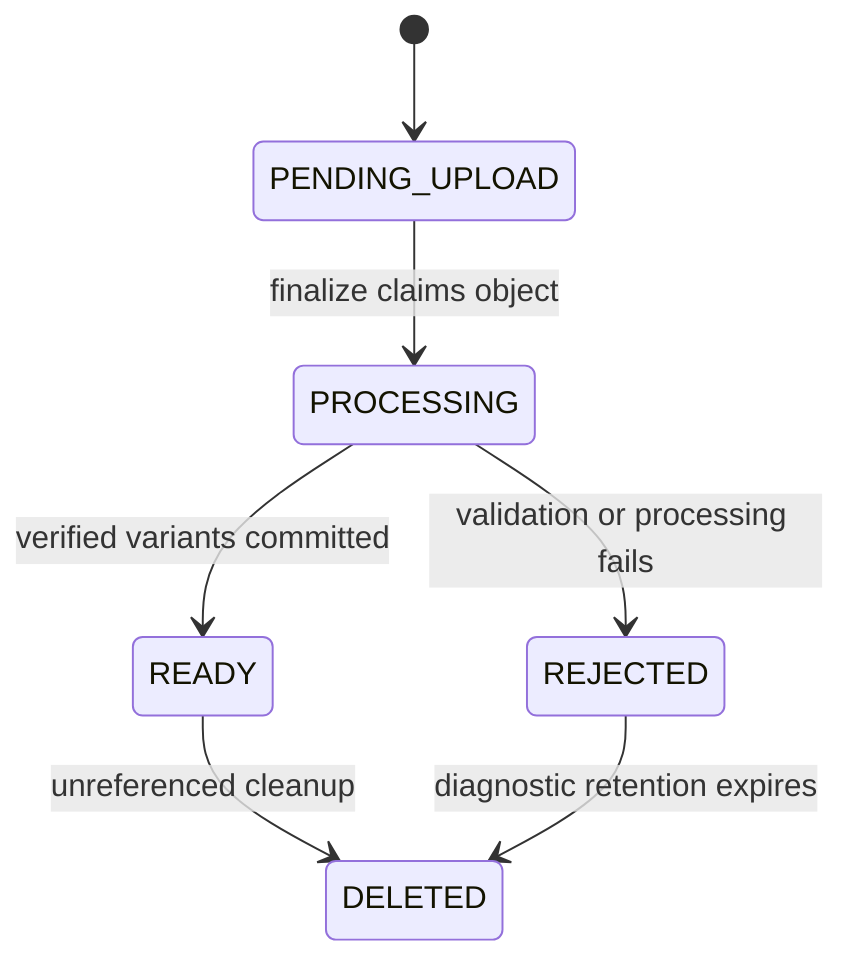

# Media lifecycle and delivery

> **Status:** canonical
> **Scope:** image and restricted Campaign-file asset identity, processing, domain references, and private delivery
> **Update when:** asset profiles, lifecycle states, variants, storage provider, or attachment ownership changes
> **Verification:** `packages/schema/src/api/media.ts`, `packages/functions/src/services/media`, `packages/db/src/domains/subjects/repositories/media.ts`, and the Phase 02 media tests

## Boundary

Supabase Postgres owns asset metadata and product references. A private Supabase Storage bucket owns bytes. `apps/apis` is the control plane: it authorizes an upload intent, finalization, attachment, removal, and delivery. Web and later native clients may transfer bytes directly only through an exact, short-lived signed permission issued by that control plane.

Signed URLs and upload tokens are credentials, never persisted domain truth. Domain rows store stable asset IDs; asset and variant rows store opaque object keys.

## Current profiles

Phase 02 enables `ACCOUNT_AVATAR`, `CHARACTER_PORTRAIT`, and `AUTHORED_IMAGE`. Each accepted upload is normalized once and produces immutable source, display, and thumbnail variants. Account avatars, Character portraits, and authored artwork store normalized square thumbnail framing; authored detail pages and Character Sheet inspectors use the uncropped display variant. Originals are temporary and are removed after successful normalization. Clients cannot choose a bucket, object key, visibility, or output variant path.

Phase 06 adds `CAMPAIGN_FILE` and `CAMPAIGN_HANDOUT_MAP`. Campaign files accept normalized JPEG/PNG/WebP or strict UTF-8 `text/plain`, and handout maps accept normalized images only. Both remain private, limited to 6 MiB, and require fresh Campaign membership before attachment listing or signed delivery. Handout maps are ordinary Campaign assets and have no VTT behavior. PDF, office, archive, executable, SVG/HTML, resumable upload, and external malware-scanning support remain deferred rather than being represented as accepted safe formats.

Phase 08 adds `VTT_MAP` for Campaign owners. Maps are JPEG, PNG, or WebP up to 25 MiB, 8,192 px per side, and 64 MP. They use Supabase's signed TUS endpoint (`/storage/v1/upload/resumable/sign`) with the issued `x-signature` token and an exact 6 MiB chunk size; the sibling endpoint without `/sign` is the user-JWT flow and must not receive a signed-upload token. Finalization verifies the source dimensions, produces immutable display and thumbnail variants, and generates 1,024 px renderer tiles (at most 64). Delivery returns a signed overview plus signed tile URLs only after current Campaign authorization. A scene definition must reference a ready same-Campaign map with its verified dimensions; database triggers prevent deleting or changing an asset while any scene definition or Encounter snapshot references it.

`yarn test:vtt-map:integration` is the local-Supabase proof for this seam. It creates disposable Auth/Campaign fixtures, exercises an interrupted and resumed signed TUS upload, finalization, signed delivery, scene reference protection, and oversized-map rejection, then removes all fixture rows and Storage objects. It refuses non-loopback URLs and is never a production-data operation.

## Lifecycle

Only `READY` assets may be attached. Each upload intent persists its exact authorized target, so an avatar or portrait crop cannot be reused by another domain record. Finalization is idempotent, replacements use new immutable keys, and the last detached reference starts a 24-hour recovery grace period.

Storage writes cannot share a transaction with Postgres. Every new or replaced object key therefore remains in `media_object_deletions` until its live metadata commits or Storage confirms removal. Queue entries mature for 15 minutes before cleanup may claim them so an in-flight upload cannot race the cleaner. Account deletion cascades media metadata and queues its object keys in the same database transaction as the Auth user deletion; scheduled cleanup removes those objects after the maturity window and retries when Storage is unavailable.

## Domain ownership

- `profiles.avatar_asset_id` owns the current account avatar reference.
- `characters.portrait_asset_id` owns Character presentation independently of Builder aggregate replacement.
- `authored_image_slots` owns one `DRAFT` and one `ACTIVE` artwork slot per authored route identity.
- `campaign_attachments` owns Campaign file and handout references, including uploader identity and optional Session or Campaign-note association.

Saving an authored draft initializes its draft slot from active artwork once. Editing artwork changes only the draft slot. Activation promotes that slot in the same transaction that replaces the active aggregate and removes the draft. Discarding a draft removes only its draft slot. This follows [ADR 0011](../adr/0011-active-authored-content-and-json-drafts.md); media does not recreate authored revision history.

## Security and portability

Declared filename, MIME type, and size are hints. Finalization verifies decoded type, byte size, dimensions, pixel count, animation state, and actual processed quota under the account lock before creating variants. Normalization applies orientation and removes metadata including EXIF/GPS. Private delivery reuses the owning domain's read authorization.

The transport contract contains verified dimensions, accessibility metadata, expiry, and a signed delivery URL without browser-specific types. Image purpose owns that accessibility metadata: current domain artwork is decorative, while future mechanical diagrams and maps require descriptions through their own purpose-specific controls. Native clients reuse the same control plane with platform-native pickers and progress UI.
