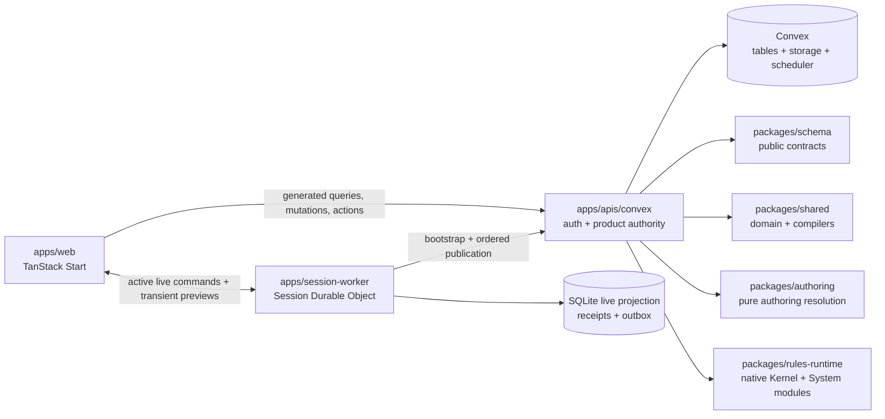

# Architecture overview

> Status: canonical current Phase 8.2 boundary
>
> Scope: package ownership and the product-data path
>
> Update when: package dependencies, Convex functions, authentication, live-session authority, or shared contracts change
>
> Verification: `apps/web/src/data`, `apps/apis/convex`, `apps/session-worker/src/nativeLiveSessionRoom.ts`, and [ADR 0029](../adr/0029-convex-backend-cutover.md)

Artificer Toolkit is a tabletop-content authoring product and play surface. Reusable authored content
uses the Authoring Schema platform. Character Builder and Sheet, Campaigns, Encounters, and the VTT
use their own domain workflows over the same native Convex authority.

## Ownership

- `apps/web` owns route composition, generated Convex adapters, UI state, authoring, Builder, Sheet,
  Campaign, Encounter, and VTT presentation. It does not own product persistence or gameplay authority.
  It deploys as its own Cloudflare Worker (SSR, server functions and the `/api/auth` proxy) with
  Static Assets, separate from the session Worker ([ADR 0037](../adr/0037-web-app-on-cloudflare-workers.md)).
- `apps/apis/convex` owns Better Auth integration, the Convex schema, queries, mutations, actions,
  scheduled cleanup, object-storage coordination, authorization, ordinary atomic product writes and
  replay, Session DO publication revalidation, and reactive durable state.
- `apps/session-worker` owns short-lived ticket admission, hibernatable WebSockets, the active
  Session's minimum live projection, supported command execution, replay receipts, ordered Convex
  publication, recipient-filtered transient previews, and transport security state. It does not own
  cross-session product persistence or all Encounter rule commands.
- `packages/schema` owns shared public DTOs and validation contracts.
- `packages/shared` owns domain vocabulary, node maps, compilers, and normalized Character and rules facts.
- `packages/authoring` owns pure Authoring Schema resolution, import preparation, and publication validation.
- `packages/rules-runtime` owns installed System compilers and policies, native Kernel execution, and
  continuation integrity. Convex application transactions own authorization and persistence around it.
- `packages/source-data` owns the version-controlled canonical source corpus used by native seed and audit flows.
- `packages/emails` owns portable email templates; Convex owns delivery orchestration.

The dependency direction is web → generated Convex boundary → native Convex functions → shared pure
packages. `packages/schema` is shared at the wire seam. Shared packages never open persistence or
network connections.

## Product and live-session paths

Product reads, writes and SSR hydration use Convex. Outside active room authority, durable commands use
their owning Convex functions. During an active live Session, its Durable Object is the single authority
for the supported Door and standalone token move/undo paths. Direct overlapping Scene writes in
Convex reject until that authority drains and releases. All Character Sheet and Encounter rule
commands stay in their owning Convex mutations throughout the Session.

The room commits its minimum SQLite live projection, replay receipt, and ordered publication outbox in
one transaction before broadcasting success. Convex independently revalidates ordered publications,
commits durable cross-session/system state, drives subscriptions, and bootstraps recovery after release
or eviction. The same room relays recipient-filtered ephemeral previews. See
[Live-session coordination](live-sessions.md).

[ADR 0033](../adr/0033-campaign-owned-play-and-session-log.md) is implemented locally: the live table is
one room per Campaign and Encounter Runs are Campaign-owned, with Sessions reduced to an optional log.
It supersedes any Session-keyed room description above.

## Read this next

- [Data lifecycle](data-lifecycle.md) for authored, persisted, and execution representations.
- [Transport](transport.md) for the generated Convex boundary and DTO validation.
- [Persistence](persistence.md) for native tables, indexes, transactions, replay, and cleanup.
- [Authoring Schema](authoring-schema.md) for the node-map and renderer contract.
- [Character workflow](character.md) for Builder, reconciliation, Sheet, and engine assembly.
- [Rules runtime](rules-runtime.md) for native Kernel execution and installed System ownership.
- [Live-session coordination](live-sessions.md) for Session DO authority, publication, recovery, and private fanout.

## Historical boundary

The former tRPC → application-services → Kysely → Supabase path, local Node session host, GoRules
runtime, and Netlify durable-command executor are retired under ADR 0029. Their runtime source has been removed. Exact before copies and explicitly historical documentation
remain as validation and migration records, not supported product paths.
