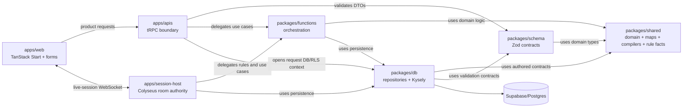

# Architecture overview

> Status: canonical (current working-tree baseline)
>
> Scope: package boundaries and the product-data path
>
> Update when: package dependencies, API seams, or ownership rules change
>
> Verification: `package.json` manifests, `apps/apis/src/trpc/router.ts`, and the three lifecycle guides linked below

Artificer Toolkit is a tabletop-content authoring product and a play surface. The repository has two related but different workflows:

- authored content (Background, Class, Creature, Equipment, Feat, Race, Spell, and Vehicle) is edited through the Authoring Schema platform;
- characters are domain workflows that assemble authored content into a playable sheet. The Builder is intentionally **not** a generic Authoring Schema form.

## Ownership

- `apps/web` owns route composition, query adapters, form state, authoring layout, and presentation. Product data enters through the tRPC client; server-only Supabase helpers and the API handler are infrastructure, not a second product-data path.
- `apps/apis` owns the tRPC router and request context. It validates input/output with shared schemas, applies authentication/RLS context, and delegates work.
- `apps/session-host` owns long-lived local and remote live-session rooms, ordered commands, compact synchronized state, and reconnect. It delegates mechanics and persistence through the same backend packages; it is not a second rules implementation.
- `packages/schema` owns transport DTOs and Zod contracts. It is the API wire shape, not the domain model or database row model.
- `packages/functions` owns application services and orchestration: authoring use cases, character Builder/Sheet services, and node-runtime execution.
- `packages/shared` owns domain vocabulary, authored models, maps, compilers, and mechanics-neutral rule-fact contracts. It should not load from the database during pure assembly work.
- `packages/db` owns Kysely access, repositories, row-to-authored hydration, writes/upserts, seed/source data, and generated Supabase database types.
- `supabase` owns SQL migrations, RLS policies, and database bootstrap. SQL defines relational truth; Kysely maps application behavior onto it.

The intended dependency direction is web → APIs → functions → (shared, db), with schema shared at the transport seam. The eight authored roots own nested features, options, grants, effects, and outcomes; those children are not separate product endpoints or revision roots.

## Read this next

- [Data lifecycle](data-lifecycle.md) explains vocabulary, authored, compiled, persisted, and engine representations.
- [Transport and tRPC](transport.md) explains the API seam and DTO validation.
- [Persistence and Kysely](persistence.md) explains transactions, RLS, repositories, and replacement upserts.
- [Authoring Schema](authoring-schema.md) explains the authoring DSL and renderer contract.
- [Character workflow](character.md) explains Builder, reconciliation, Sheet, and engine assembly.
- [Engine](engine.md) explains normalized Character facts, exact rule-revision pins, the embedded Zen evaluator, and deterministic typed output.
- [Live-session host](live-sessions.md) explains the separate Colyseus deployment shared by local and managed remote VTT play.

## Current versus target

**Current.** The router is a thin transport layer over functions-owned authored-domain orchestration. Normalized authored roots are canonical active aggregates, with complete JSON drafts stored separately. The engine consumes the canonical build snapshot directly.

**Target.** Keep product data behind the API boundary; keep orchestration in functions; keep repositories authored-shaped; and keep engine/resolution pure. When changing a boundary, update the relevant guide and ADR rather than introducing a second path.
