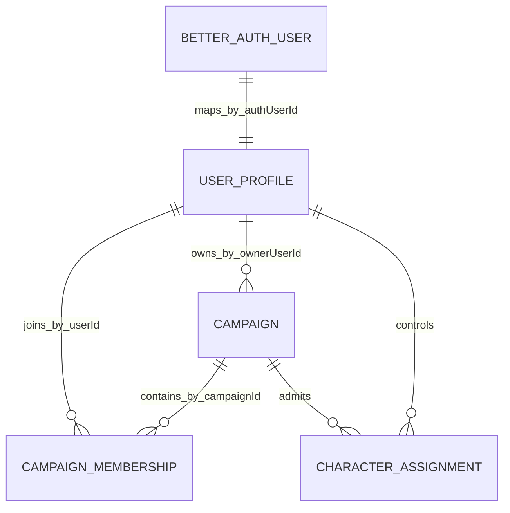

# Persistence and Convex

> Status: canonical current persistence guide. Target and decision-record material is labeled.
>
> Scope: Convex documents, indexed ownership, authenticated authority, transactions, the room checkpoint path, receipt ledgers, durable cleanup and content snapshot bookkeeping
>
> Update when: `apps/apis/convex/schema.ts` or a table module, Session authority or checkpoint semantics, authorization, transaction boundaries, cleanup jobs or crons, or content snapshot storage changes
>
> Verification: `apps/apis/convex/schema.ts` and the `schema` modules beside it, `apps/apis/convex/lib/identity.ts`, `apps/apis/convex/liveSessions/`, `apps/apis/convex/contentSnapshots/`, `apps/apis/convex/crons.ts`, `packages/encounter-persistence` and the validators under `packages/schema`

Convex is the durable cross-session product store. Public handlers derive the application user UUID from the
current Better Auth identity through `userProfiles.by_authUserId`; callers cannot choose another user.
Domain authorization then reads indexed ownership and membership documents. Validators protect every public
and persisted boundary, and each mutation enforces relationships, cleanup order, optimistic versions,
checksums and replay behavior. Convex has no foreign keys or cascades, so a mutation either commits a
complete valid result or leaves prior state unchanged. Work that cannot fit one transaction uses a durable,
fenced, resumable job (see [Durable jobs and crons](#durable-jobs-and-crons)).

`userProfiles.userId` is the public application identity; Better Auth component IDs stay private.
`campaigns.ownerUserId` and `campaignMemberships` are the Campaign authority records. A downstream document
never widens access merely because it contains a public UUID. The Session Durable Object room owns live play
state while it holds authority; live room, authority and replay semantics are in
[live sessions](live-sessions.md), and rules execution in [rules runtime](rules-runtime.md).

## Live room and checkpoints

While a Campaign has a live authority epoch, the room commits every live command in its own SQLite
journal. Convex receives fenced checkpoints. The per-command Convex Encounter and Scene write path is
deleted ([ADR 0035](../adr/0035-room-authoritative-live-encounters.md), [ADR 0033](../adr/0033-campaign-owned-play-and-session-log.md)).
No Convex function executes an Encounter command, including outside a live session, so the room is the
only writer of command receipts (`apps/apis/convex/encounters/commandBoundary.test.ts` guards this).

**Authority.** `campaignLiveAuthorities` holds one row per Campaign: the phase (`ACTIVATING`, `DO_ACTIVE`,
`DRAINING`), `persistedSequence`, `persistedStateChecksum`, `lastCheckpoint`, `checkpointedAt` and, while
draining, `finalSequence` and `finalStateChecksum`. `liveCharacterHolds` pins a Character to its active Run
and room epoch (D81); direct Convex play, preference and rest writers reject a held Character, and the
central Character writer preserves the held play row across structural edits. Holds are reconciled when a
checkpoint changes Runs or actors and are deleted at final authority release.

**Checkpoint request.** A checkpoint reaches Convex in one request, whatever its size: Convex accepts
function arguments up to 16 MiB, and nothing is staged (ADR 0035 Amendment 31). `checkpoint.ts` validates
the payload against `LIVE_SESSION_CHECKPOINT_MAX_BYTES` (1 MiB) and its checksum.

**Checkpoint size (REL-5).** Convex validates and applies one checkpoint in one mutation under its 1 s
user-code limit, and that work grows with the payload. Geometry saves once cost the most per byte, because
the commit re-read their retained movement evidence: about 720 KB of them timed out locally. Movement
evidence now stays in the room, and the commit reads each record once before it writes (ADR 0035
Amendments 26 and 27). The room folds commands into one checkpoint up to the 1 MiB bound
(`roomCheckpoints.ts`). Commands that approach it alone are fog-heavy: a
fog layer has one cell per map pixel, up to 512 on the long side, so a full layer is 256 chunks and a
per-player vision move rewrites one layer and save per player (about 110 KB each). The room refuses a
command whose write set exceeds three quarters of the bound (`RoomWriteSetTooLargeError`), which leaves
room for record keys and checksums. Journal reads for a checkpoint use separate 4 MiB pages
(`LIVE_SESSION_CHECKPOINT_JOURNAL_MAX_BYTES`), because write sets hold whole documents that fold into
much smaller deltas (about 16:1 in REL-5 combat, about 35 KB of write set per command). The room
streams consecutive pages into one fold, so a page bounds memory for one read, never a checkpoint: a
checkpoint is the longest prefix whose folded records fit 1 MiB, so a save folds the whole unsaved
journal in one checkpoint wherever the folded records fit, and rows a Run creates and drops within it
never reach Convex (ADR 0035 Amendments 29 and 31). The room builds a checkpoint synchronously, so
`buildRoomCheckpointRecords` validates and decodes only the base rows a page touches: the base is the
store's acknowledged snapshot, validated at hydration or replay and checksummed at rest, and it grows
with the Run's retained history. Revalidating all of it per page took about as long as the page itself
and stalled previews in REL-5.

**When the room saves (ADR 0035 Amendment 25).** No timer saves it. The room checkpoints at save points
(a Run's START and COMPLETE, removing a Character actor, a Scene presentation, a departure reconcile that
removes Characters, admission, drain and close; see [live-sessions.md](live-sessions.md), "Timing") and at
a backlog bound: when the unsaved log holds as many chat entries and roll cards as the chat push window
(`LIVE_SESSION_PUSHED_CHAT_ENTRY_LIMIT`, 200). `RoomEncounterStore.unsavedChatEntries` keeps that as a
running count, so the check costs no storage read. The bound exists so Convex chat paging never has a
gap. There is no bytes bound: a checkpoint splits into pages, so one save never exceeds a page however
large the backlog, and a raw sum of write sets overcounts the coalesced state a checkpoint carries
(about 5:1 in REL-5 combat), which fired about every 8 combat commands and recreated an interval.

**Trigger and metrics (D85).** The transport request (`liveSessionCheckpointRequestSchema`) carries a required
`reason` naming what triggered the send. It is measurement only: Convex discards it before the fence,
and the room's retained retry input
never stores it. The response carries `io`, the mutation's own `ctx.meta.getTransactionMetrics()`
(bytes and documents read and written), split by section with `liveSessions/checkpointIo.ts`
(`fence`, `records`, `scopes`, `holds`, `scenes`, `history`, `privateRolls`, `remainder`). See [live-sessions.md](live-sessions.md#checkpoint-triggers-and-the-room-meter-d85).

**Fence.** `commitCampaignLiveCheckpoint` (`liveSessions/authority.ts`) requires a non-empty sequence range and
a non-`ACTIVATING` authority, answers an exact repeat of `lastCheckpoint` as `REPLAYED`, and otherwise requires
`fromSequence` and `fromChecksum` to continue the persisted sequence and checksum. A `DRAINING` epoch cannot
pass `finalSequence`. It applies the records and patches the authority row in the same mutation.

**Records** (`liveSessions/checkpointRecords.ts`, `checkpointScenes.ts`, `checkpointPrivateRolls.ts`):

- Mutable `changes` are JSON deltas with previous and next checksums, keyed by a complete existing index
  (`liveSessionCheckpointKeyFields`; a checkpoint never scans a table). Tables: the `encounter*` Run, actor,
  projection-fact, binding, initiative, occurrence, pending-snapshot, movement and skip tables,
  `characterActiveRuleEffects`, `encounterActiveRuleEffects`, `encounterMaintainedEffectStates`,
  `encounterSpatialRuleEffects`, `characterPlayStates`, and the four `campaignConversation*` tables.
  Ownership fields are immutable, `characterPlayStates.streamVersion` must advance, conversation history cannot
  be deleted, a Campaign has at most one ACTIVE Run, and a departed controller is rejected (D74).
  Validation reads only what the delta names (Amendment 18): the Campaign once and lazily, an assignment
  per Character and an active membership per controller by point read, and each Run it touches. It
  never loads `characters` (assignment fixes owner and System), validates the written rows in memory, and
  reconciles holds only when a Run status or a Character actor's frozen state changes. A new ACTIVE Run
  is checked for a second one. The response's `adopted` returns the PLAY and delta-Character revisions
  the write bumped when the room held them before it, and no authorization is read.
- Append-only `history` entries are only Sheet `characterCommandReceipts`, packed into one `CHARACTER`
  `receiptLedgers` row per Character per checkpoint. Encounter history never reaches Convex by checkpoint
  (ADR 0035 Amendment 22, D88; see [Encounter Run storage](#encounter-run-storage)); the contract rejects it.
- `encounterReplayIndex` rows are insert-only `changes`, one per room Encounter command. A checkpoint that
  completes a Run deletes that Run's index rows, any Convex-held Encounter history and every other Run
  child row a finished Run no longer reads (`encounters/campaignDeletion.ts` `removeFinishedRunRows`;
  ADR 0035 Amendment 30). A Run that completes in the same
  page as its commands writes no index rows at all: `buildRoomCheckpointRecords` folds an insert and its
  later delete in one page to no change. A save before COMPLETE (a backlog, Scene presentation or
  departure save) still inserts the rows, and COMPLETE then deletes them. The same checkpoint carries the
  completed Run's Character grants onto the Campaign clock (`encounters/runGrantCarryOver.ts`, D99): it
  rewrites their lifecycles after the room released the Characters and leaves those Characters out of the
  revisions the room may adopt, so the room reloads them instead of adopting a revision it did not write.
- Scene rows (`sceneLiveStates`, `sceneLiveEntities`, `sceneFogLayers`, `sceneFogSaves`, `sceneFogChunks`)
  are written only by the checkpoint, plus Scene definition, presentation and deletion flows. Scene command
  receipts and geometry saves are not Convex rows: the room keeps them (below).
- **No post-write re-reads (ADR 0035 Amendment 27).** `checkpointScenes.ts` and `checkpointRecords.ts` read
  each record once before they write it, for the checksum fence (Amendment 18) and append-only checks, and
  never read it back afterwards. Invariants that used to run on the stored row run on the incoming `next`
  value before the write: ordinal uniqueness is checked on the final state (a claim set within the batch plus a
  holder check that ignores rows the batch rewrites), and fog saves and chunks written in the same checkpoint
  are validated from the batch, with only earlier-checkpoint rows read from the database.
- `retainedRolls` merge into the owner's `userRollHistory`, and into a Campaign member's own history for
  a hidden creature that member controls (ATTACK-17.5); the member's copy has `gmCampaignRoll: null`.

**Receipt ledgers** (D70, D71; `lib/receiptLedgers.ts`, `lib/receiptLedgerSchema.ts`,
`packages/schema/src/projections/receiptLedgerPersistence.ts`). Immutable history payloads are packed once
per checkpoint; small indexed per-command headers keep the command-ID collision checks, public UUID cursors
and replay, and point into the ledger as `{ledgerId, entryIndex, entryChecksum}`. `receiptLedgers` holds the
metadata (scope `CAMPAIGN` or `CHARACTER`; `scopeId`; `epoch` and `checkpointId`, both null or both
set; `createdAt`; `entryCount`; `byteLength`; `checksum`; `partCount`) and an inline `payload` or, above the
inline size, `receiptLedgerParts`. A ledger is at most 4 MiB, 16,000 entries and 18 parts. Cleanup tombstones
selected entries without renumbering and deletes the body when the last header goes. Each Character's private
receipts are packed separately from shared Campaign and Encounter receipts, so account cleanup never reads
shared history. On account deletion the Character state and private receipt headers are deleted with a durable
`characterReceiptPurgeJobs` row, and unreachable private payloads are purged in bounded retryable mutations
(D71). Receipt pages validate summed distinct-ledger bytes against the 4 MiB read budget before hydrating.

**Scene command evidence (ADR 0035 Amendment 26).** Scene command receipts and geometry saves live only in
the room's SQLite, as opaque `SCENE_EVIDENCE_ROW` records (`sceneLiveCommands`, `sceneGeometrySaves`,
`sceneConcealmentPrunes`, the observers a bound token move dropped from concealments, keyed by Scene and move command so the GM's
undo of that move restores them) stamped
with their write time in `revision`. They survive reloads, release and new epochs: `RoomInputs.hydrate` carries
them across like the held Encounter history, across every Scene. Undo and replay by command ID read only this
copy. The room enforces the 30 day retention (`SCENE_COMMAND_RETENTION_MS`) without an alarm: a hydrate drops
evidence older than the cutoff, so the purge happens at the next load. `buildRoomCheckpointRecords` ignores the
kind, so no checkpoint, journal delta or Convex row carries it, and it is never a chat entry, so it never counts toward the backlog bound. A fog save keeps
`geometrySaveId` as an opaque back-reference to a save the room may have dropped; Convex never resolves it.
A geometry command an Encounter action wrote (a push or pull, D139) names that action in `actionOrigin`
(`{encounterId, commandId}`; `null` for a user's move, the parse default for older records). It is the one
record of the move: the action's `RESOLVE_ACTION` receipt keeps only references (`forcedMovements`:
`{sceneId, sceneCommandId}[]`, default `[]`), the GM's `UNDO_LAST_SCENE_MOVE` refuses a latest move whose
origin is an action, and the action's `REVERT_LAST_ACTION` undoes each referenced move through
`publishSceneUndo`, refused (`REVERT_UNAVAILABLE`) once the token has moved since.
A creature an action conjures (D187b, SUMMON) is a Scene token created in the cast's own room transaction, so the
Scene rows and the Encounter commit or roll back together (Option A). `persistRoomSceneTokenCreate` writes it
directly, the sibling of the forced-movement write and not the staged geometry publication: a token without
vision derives no fog, so the direct write needs no staged preparation, and it carries the same `actionOrigin`.
The cast's `RESOLVE_ACTION` receipt keeps `summonedTokens` (`{sceneId, sceneCommandId, tokenId, actorId}[]`,
default `[]`) and the Encounter binds the token to the actor in `encounterActorTokenBindings`. Current
(SPELLS-4.T2v2a2c1): the area planner builds the owned actor with the token (`buildEncounterSummon`), the persister
inserts the actor (`insertRunActor`) and appends its id to the Run's `actorIds` before the Scene write, and the
receipt carries the actor id. `REVERT_LAST_ACTION` of a summoning cast refuses (`summonedTokens` non-empty) until
the removal exists. Target (a2c2): the actor, binding and Scene token leave at expiry, Concentration end, recast,
dispel and revert.
A drag (D105) writes the mover's and each dragged token's live row at the move's version; publication refuses it
unless every dragged token still stands at its recorded `from` and moves by the mover's displacement.
`publishSceneUndo` restores the mover and every token in the preparation's `draggedTokens`, refusing when any of
them has moved since.

## Encounter persistence package

`packages/encounter-persistence` holds the Encounter code that reads and writes Run state, so Convex and the
room run the same code. It depends on `packages/schema`, `packages/shared` and `packages/rules-runtime` and
only takes the `IndexRange` type from `convex`. Its README documents the store surface. Convex binds it
through `encounters/encounterPorts.ts` and `lib/convexEncounterStore.ts`; the room store is `RoomEncounterStore`
(`apps/session-worker/src/roomEncounterStore.ts`).
Document derivations (Zod parse plus checksum verification) go through `deriveOnce` (`transactionReads.ts`).
A Convex query caches them per transaction through `memoizeTransactionReads`. The room's in-memory store is
created with `sharedReads`: it serves its stored documents deeply frozen instead of copying them, and never
changes one in place, so a derivation lasts as long as the document is unchanged across commands and pushes.
The room's records follow the same rule: `recordValue` parses a record's JSON once per stored record and serves
it frozen, so a Scene row's derivations (`readRoomSceneRow`, `parseGeometrySave` and the movement evidence it
verifies) are not repeated on every movement admission and publication.
Derivations shared by identity are dropped at every commit to bound them. Callers never mutate a read document
or a derived value. Without this the room re-parsed every document on every read, which saturated its CPU
under the V15 workload (REL-5). `rejectDomain` throws `EncounterDomainRejection`, which
`lib/domainRejectionTransport.ts` rethrows as a `ConvexError` with the same data for the builders in
`lib/queries.ts` and `lib/mutations.ts`. `characterRulesCapture` (`liveSessions/roomInputs.ts`), `actionChoices`
and the action-preparation helpers stay in Convex because they assemble Character and System content the room
receives as hydrated input. `encounters/runs` exposes `create` and `deletePrepared`.
`encounters/encounterStoreConformance.test.ts` runs one corpus against Convex and the in-memory store.
The session read model (`sessionReads.ts`: the presented Run, session state, prepared pending decisions,
GM actor sides and decision settlement; `timelinePages.ts`: one timeline page) lives here too. Convex's
`activeReads` and `projectionReads` and the room's pushed `ENCOUNTER_SESSION` frame
([Held Encounter session](live-sessions.md#held-encounter-session)) call the same readers, so they cannot
drift; Convex keeps authorization, receipt-ledger loading and read budgets.

### Rule-raised (SYSTEM) action admission (current, SPELLS-33.T6e1, D161 candidate)

A rule, not a player, can raise an action: a defeated creature's passive `HP_ZERO` area (Balor Death Throes).
The room raises it as a `RESOLVE_ACTION` carrying `systemTrigger: { parentCommandId }` right after the
command that defeated the holder commits. `readNativeEncounterActionAdmission` admits it through
`requireSystemTriggerAdmission` (`systemTriggerAdmission.ts`) instead of the player checks, and proves it
from the stored record alone: the command id must equal `systemTriggerCommandId(parent, holder, actionId)`
(uuidv5, `rules-runtime/encounterSystemTrigger`), the target must be `CASTER_CENTERED`, the parent must be a
committed Run command or rule receipt of the same Encounter, and a fresh root must name the parent's version
and a defeated holder. A replay of the same id returns the stored result. The SYSTEM root skips the
current-actor and control checks (the holder is defeated and it is nobody's turn), and every other check, the
save requests and the settlement run unchanged.

Undo and void. The parent and its system root are one change to the GM: `REVERT_LAST_ACTION` of the
system root reads the parent's group from the stored `systemTrigger` link and inverts both in one commit
(system group first, then the parent, shared actor and Character accumulators). A pending manual save on
the death area refuses the undo like any pending decision; the GM voids it, then undoes.

### Encounter record shapes (ADR 0035 Amendment 12)

- **Character play state.** A Character is a `characters` row (structure, clocked by `updatedAt`) and a
  `characterPlayStates` row (hit points, resources, slots, conditions, exhaustion, inspiration, item-use state,
  party visibility, `maximumHitPoints`, `speeds`, clocked by `streamVersion`). `writeCharacterRecord` is
  the only writer and rewrites only the record whose checksum changed, so a play change never writes the
  document. See [Character play state](character.md#character-play-state-adr-0035-amendment-12--local-implementation).
- **No stored projection.** `encounterRuns` holds Run state only. Projections are built on read
  (`readEncounterGmProjection` in `nativeProjection.ts`) from the Run, the actors' stored records
  (`readRunProjectionFacts`), the current initiative round and each Character. Creature stat blocks shared by
  identical Creatures are held once per checksum in `encounterSourceProjectionFacts`.
- **Spell pins (D163).** `encounterSpellPins` holds one row per Spell a Run's Creatures name, keyed by
  `(encounterId, spellId)`: the stored compilation of the version read when the Run first needed it (run
  creation, reinforcement or entering a Creature form; `ensureEncounterSpellPins`). A pinned Spell is never
  read or recompiled again, so editing or deleting the source cannot change what the Run's actors cast.
  Actors hold Spell ids only. Pins live for the whole Run and are deleted with it (completion, Campaign
  deletion, development removal). `readEncounterSpellPins` hydrates them and fails closed on a superseded
  compiler version or a stale or corrupt compilation. Current: written and released on every path, and
  every discovery caller reads them: Convex through `readEncounterSpellPins`, the room through the
  `SPELL_PINS` capture (`readNativeLiveSpellPins` hydrates the stored rows with `hydrateSpellPins`; no
  compile, no source read). `spells` is required on `discoverEncounterFeatureActions`; a caller that needs
  no casts passes an explicit `new Map()`, and a pinned Run whose pins omit a Spell its Creature names
  throws instead of dropping the cast.
- **Actor storage (ADR 0035 Amendment 29).** An actor's source `snapshot` is static, so it is stored apart from
  its play state. `encounterRunActors.stateJson` holds the play state, the projection facts evaluated when the
  actor was written, and `snapshotChecksum`, which names an immutable, content-addressed
  `encounterActorSnapshots` row of the Run (`encounterId` + `checksum`). `stateChecksum` covers the actor
  without its snapshot, so a guard never hashes the snapshot. A snapshot row is written once when an actor
  names it, deleted with the last actor that names it, and never mutated: a command that changes a snapshot
  (equipment replacement, disarm) writes a new row and repoints the actor. The one function that rebuilds the
  full actor is `composeRunActorState` (`rules-runtime/encounterActorStorage`); `readRunActors` and
  `readRunActorWithRow` call it. Every actor write goes through `insertRunActor`, `writeRunActor` or
  `deleteRunActor`, which keep the snapshot and source rows in step in the same transaction. Convex validates
  an actor change from the stored record and does not read the snapshot row. The finished-Encounter GM view
  reads only the actor rows' stored records and the source rows.
- **Character actors** keep no hit point or condition copy. Reads load the current Character while it is assigned
  to the Campaign; `frozenState` holds hit points and conditions for a Character the Run stops reading (the
  COMPLETE command and assignment removal freeze it).
- **Replay receipts.** A Run command's ledger entry stores `replayReceiptJson`, a few hundred bytes. Exact replay
  rebuilds the projection from current records and adds the receipt.
- **Pending snapshots.** An occurrence keeps only `pendingSnapshotChecksum`; the sealed snapshot lives in
  `encounterPendingSnapshotParts` as a base plus structural deltas (a delta at least half the base, or a chain of
  128 parts, starts a new base).
- **Changed fields only.** Round, participant, side and occurrence updates patch only changed fields, which is
  what a checkpoint carries.
- Byte costs are recorded in the [record-shapes evidence](../validation/phase-08-2/adr-0035-s1b-record-shapes-2026-09-28.md).

### Encounter Run storage

`encounterRuns`, `encounterRunActors` (one document per actor with its validated snapshot and `kind`-discriminated
state), `encounterSceneBindings`, `encounterActorTokenBindings`, `encounterInitiativeRounds`,
`encounterInitiativeParticipants`, `encounterInitiativeSides`, `encounterRuleOccurrences`,
`encounterTurnMovements` (also the once-per-turn record, `usedOncePerTurn`, D119 f; a capped granted-action offer counts its uses there as `granted:<effectId>:<offerIndex>:<use>`, spent by the commit and restored by an undo, SPELLS-4.T2lb; and the start-of-turn marker, `startedByCommandId`, the first command that began the turn, so a GM Previous Turn then Next does not raise its start-of-turn stages again: Recharge, the death save, effects, zones and grant ticks, SPELLS-33.T4i1c, T4i1e), `encounterDecisionSkips`, `encounterRunCommands`, `encounterRuleReceipts`
and `encounterReplayIndex` carry Run state and history in Convex. The Convex `encounterEvidenceRolls`
table is removed (current): evidence rolls are room-only since D88, written and read only in the room's
store.

**Encounter history lives in the room for the Run (ADR 0035 Amendment 22, D85, D88).**

- **Why the room keeps it whole:** command rows, rule receipts and evidence rolls are live rules state, not
  only a timeline. Pending decisions (Concentration chains, Cleaving, movement reactions, turn responses),
  the GM's void, undo and replay read them.
- **Carry-over:** the room keeps them in its SQLite store for the whole Run. Every hydrate, a same-epoch
  reload or a new epoch after release, carries the store's rows for every Run it holds, bound to the
  presented Scene or not, and unions them with the rows Convex holds, deduplicated by ledger key
  (`apps/session-worker/src/roomInputs.ts`). A Run loaded lazily later does not restore a row the store
  already holds.
- **What Convex holds:**
  - only the history its own writers record while no room holds the Run: Run creation, and the
    departure, release and account reconciles. `encounterRunCommands` and `encounterRuleReceipts` remain
    as this Convex-side inbox (Run CREATE and REMOVE_ACTOR departure writes) that the room merges at
    hydrate; Convex has no evidence-roll table;
  - `encounterReplayIndex`: one row per room command (Campaign, Run, command ID, actor, fingerprint,
    resulting version, roll card ID).
- **Storage recovery** carries nothing. A retry the index knows answers "applied at version V" with the
  current projection and no roll (the roll card stays in chat); a reused ID with other input is refused.
  Undo of earlier actions is refused, and the timeline restarts. Open decisions stay resolvable or voidable,
  and COMPLETE still needs them settled.
- **Run end (ADR 0035 Amendment 30):** COMPLETE keeps only `encounterRuns`, `encounterRunActors` and the
  `encounterSourceProjectionFacts` rows those actors name, which is all the finished GM view reads
  (stored actor records, Character `frozenState`, Run state). It deletes every other child row in the
  same save, in the room and, through the checkpoint, in Convex: snapshots, Spell pins, Scene and token bindings,
  initiative rounds, participants and sides, rule occurrences, pending snapshot parts, replay index,
  turn movements, decision skips, effect and maintained-effect rows, spatial effects, and the command,
  rule receipt and evidence histories (`removeFinishedRunRowsPage` in `packages/encounter-persistence`).
  It also deletes the Character effects the Run sourced (`endCompletedRunCharacterEffects`, D99); a
  Character's own timed grants stay and carry over to the Campaign clock. A Concentration grant a
  Character holds is detached from the Run's maintained state (both Run links nulled) and stamped with its
  caster in `lifecycle.concentrationCasterCharacterId` rather than deleted (SPELLS-5.7). The caster's
  next Concentration ends such grants on Run Characters in the room (maintenance receipt
  `endedCarriedGrants`). For Characters outside the Run, the room appends each Character that starts a
  Concentration to the Run row's `concentrationCasterCharacterIds` (append-only, at most
  `MAX_ENCOUNTER_ACTORS`; Convex creates it empty and only the room adds to it). The one exception is the
  GM's undo of the command that added the id: that `RESOLVE_ACTION` row stores
  `addedConcentrationCasterId` (null when the Character was already in the set), and its undo removes
  exactly that id, so an undone Concentration never ends outside grants. Every checkpoint
  (`checkpointRecords`) compares the previous and next Run row and `endOutsideCarriedGrants` ends the
  stamped grants of the newly added ids on Characters outside any ACTIVE Run (D99).
  A placed zone records the maintained state it depends on (`maintainedEffectStateId`, index
  `by_state_encounter`) and counts as a dependent: ending, dropping or replacing the state deletes its zones
  in the same transaction (`maintainedStateZones.ts`; the Concentration cleanup carries `removedZoneIds`),
  and `deleteMaintainedStateCas` refuses a state a zone still depends on (D135).
  The caster stamp is also a top-level column of `characterActiveRuleEffects`
  (`concentrationCasterCharacterId`, index `by_concentrationCaster`), written with the lifecycle and
  checked against it on read, so a caster's carried grants are found without scanning Characters
  (SPELLS-5.11, D101). A carried grant relinked to its caster's reinstated Concentration (D151,
  SPELLS-5.12) stores the later Run as `sourceEncounterId` beside its `maintainedEffectStateId`, while its
  definition keeps the earlier Run's origin; `readCharacterEffect` accepts that pair only on a stamped row.
  A maintained state's descriptor names its `provenance` (`ACTION` with the creating action and
  occurrence, or `CARRIED` with the caster); `rules/maintainedProvenanceMigration:run` moved stored
  descriptors' top-level action ids into it. `endCarriedGrantsOfConcentratingCasters` is the one ending path for both the
  checkpoint and the caster's own `END_CONCENTRATION`; `listCarriedActiveRuleEffects` is bounded by
  `.take(64 + 1)` and throws beyond it. A caster outside an ACTIVE Run ends in one user action that
  sends Convex `END_CONCENTRATION` (the caster's own and every holder outside an ACTIVE Run; a held
  holder is skipped) and then the room's `endOutsideCasterConcentration` (the held holders; same
  command id, both idempotent). The room end also writes the Run command row
  `RETURNED_TO_PLAY` (room-authored, GM-only: a creature came back from `REMOVE_FROM_PLAY` onto an occupied space, `RETURN_SPACE_OCCUPIED`, D184; written by `appendSystemRunEntry` like the next one),
  `CONCENTRATION_DROPPED_OUTSIDE` (stored input `encounterConcentrationDroppedOutsideInputSchema`,
  `label` the GM notice "<caster> dropped Concentration: <label> ends on <holders>", Run version +1).
  Like every Run command except a public enemy roll it is `PRIVATE`, so `readEncounterTimelinePage`
  gives it to the GM only. The checkpoint remains the safety net for the caster set.
  A completed Run has no Scene binding, so bind commands on it are refused with `ENCOUNTER_NOT_ACTIVE`
  and lookups by Scene never resolve it. Several PREPARED or ACTIVE Runs may bind one Scene, so the
  binding table has no Scene index and no lookup ranks Runs: the fight played on a Scene is the
  Campaign's single ACTIVE Run (`by_campaignId_status`) when its binding names that Scene
  (`readActiveSceneEncounter`, `packages/encounter-persistence`); a PREPARED Run never plays or lends
  Scene vision. `encounterRuns` carries the creation key (`createCommandId`,
  `createCommandFingerprint`, index `by_campaignId_createCommandId`) so a `runs.create` retry returns
  the same Run after COMPLETE. Run deletion and Campaign deletion delete the remaining rows too.
- **Contest commands (D152):** every contest commits through the one contest path
  (`contestPersistence.ts`). A Disarm or basic action contest is a `RESOLVE_ACTION` row rooted in its
  `RULE_OCCURRENCE`; a contested escape keeps the existing `ESCAPE` row, whose `receipt.checkOccurrenceId`
  is the contest occurrence and whose rule receipt's `commandType` is `ESCAPE`. Replay and resume
  (`actionContestReplay.ts`, `contestAdmission.ts`) read either root through `ContestRootCommand`.
- **Ended grants and undo (D113):** state-bound grants the engine ends (incapacitation or defeat for `ON_INCAPACITATED` grants, a named Condition for `endOnConditionIds`) are deleted in
  the same commit. A `RESOLVE_ACTION`, area or cleaving root keeps them in `consumedGrants` (`receiptConsumedGrants`,
  `addResponseChangesToRoot`), so `REVERT_LAST_ACTION` restores them with the consumed grants. The commit validates every
  `endedGrants` record against the stored effect and the holder's state, not the client's claim
  (`concentrationChildrenPersistence.ts`: `damagedActorIds` names the holders the commit damaged, and a commit that omits a grant such a
  holder's state ends is refused). A grant ended by a movement pass or an actor or Sheet edit is deleted without a receipt
  (`endHolderStateGrants`, `endConcentrationAfterEdit`; D99: no undo of an ended grant), and every path posts a chat notice per grant
  (`postGrantEndMessages`, entry id `grantEndNoticeId(occurrence, grant)`, so a replay adds nothing; a private GM holder posts none). A turn advance is not an undo root, so its
  ended grants carry no receipt. An `ON_IDLE_TURN` grant is ended by that turn commit (`persistEncounterIdleTurnCheck`); its
  `idleTurnMark` lives in the actor's `resources` (hashed with the actor state), and the `RESOLVE_ACTION` root's `idleTurnMarkChanges`
  lists each actor whose mark that action changed with its previous value so `REVERT_LAST_ACTION` restores exactly those (`rules-runtime.md`, Idle turns). A moved effect (D160) is the stored Run command `MOVE_HELD_EFFECT`: its receipt keeps `{ actorId, actionEconomy, effectId, fromActorId, toActorId, before, afterVersion }`, where `before` is the whole record as the old holder kept it and `afterVersion` the version the new holder's copy was created with. `REVERT_LAST_ACTION` deletes the new holder's copy only while its version is still `afterVersion` and recreates `before` at the old holder with `restoredFrom` (exact ordinal, version and timestamps); it is a root command, so anything committed after it makes the undo unavailable. A holder-ended grant is the stored Run command `END_HELD_GRANT`; like any costed
  Run command it blocks undo of the prior action (D99). A repeat offer (D166, `REPEAT_SOURCE_PATH`) is stored on the carrier's `MODIFIER_GRANT` contribution (`storedEffectOffer.ts`): the frozen authored Effect (`effectDtoSchema`) with a `FIXED_DC` save and a sibling `castLevel`; the carrier is bound to the item and ends through the shared release seam, and its repeat is a plain `RESOLVE_ACTION` (no new pending kind). The Sheet end of a holder-end grant is free in a MANUAL Run
  (`economyEnforced: false`).
- **Creature rest:** `CREATURE_REST { restKind: SHORT | LONG, actorIds }` (GM only, ACTIVE Run) is one undoable stored Run command. For
  each creature actor it resets the `actor.resources.featureCharges` entries whose feature charge or spell slot table `resetKind` the
  rest recovers (SHORT recovers `SHORT_REST`; LONG also `LONG_REST`; the trigger set is `getRestRecoveryTriggers`, shared with the
  Character Sheet rest), keyed by feature id and slot `levels[].id`. A Character id, a duplicate id, or a rest that recovers nothing is
  refused; a Character rests through its Sheet. The receipt keeps `{ restKind, actors: [{ actorId, resets: [{ key, beforeUsed }] }] }`
  for exactly the rows it touched, and `REVERT_LAST_ACTION` spends them again only while each row is still `0` (root command, as
  `MOVE_HELD_EFFECT`). Not yet: hit point and hit dice recovery on a long rest.
- **No Convex timeline:** the timeline and latest evidence roll are read only from the room. Encounter
  commands write no Character receipts, and the Character history API is removed.

A Run retains its exact Blueprint version and checksum,
Campaign policy snapshots and ordered sides. Catalogue removal checks the initiative and optional-combat source
pins held by PREPARED and ACTIVE Runs and rejects with the Run UUID. `encounterBlueprints` and
`encounterBlueprintUpdates` store owned Blueprints (setup plus a receipt per update); creation checks the owned
count against tier capacity, and snapshots pin Creature and Equipment revisions and checksums. Run creation
(`encounters/runs:create`) requires the Campaign owner and an open Session and stores a Campaign-scoped command
receipt; a matching replay returns the stored projection before loading sources. Effects are stored in
`characterActiveRuleEffects`, `encounterActiveRuleEffects`, `encounterMaintainedEffectStates` and
`encounterSpatialRuleEffects` (`rules/schema.ts`) through the same Encounter store port.

A placed zone (SPELLS-17) is one `encounterSpatialRuleEffects` row written by the area commit
(`persistEncounterAreaCommit` takes it as `placedZone` on its input). Its `placement` carries `label` (one shared
rule, `spatialZoneLabelSchema`), `visibility`, `activation`, `movementKinds`, `triggerModes` and
`bypassAtHalfSpeed` (the zone may be crossed carefully at double cost) and, when the caster designated creatures at cast (SPELLS-20 T4c), `unaffectedActorIds` (a non-empty Encounter actor list the zone never catches; omitted when empty, immutable with the placement checksum) and, when authored (SPELLS-20 T4b1), `maxApplicationsPerTurn` (a positive integer; also immutable). The count of applications lives on the Encounter run state, never on the placement: `zoneApplications` (optional, keyed `effectId:actorId`, each entry `{ turnSequence, count }`, bounded by `MAX_ENCOUNTER_ACTORS * MAX_SPATIAL_RULE_EFFECTS_PER_SCENE`). An entry whose `turnSequence` differs from the run's current `turnSequence` counts as unspent; no step clears it on a turn change, and `recordZoneApplications` prunes stale entries whenever it writes the map. The terminal movement publications (`publishSpatialTerminal`, the movement-response terminal) write it from the settled executions; `recurrence.endOnEvents` stays empty, and a
creature's lingering grant takes its end events from the grant template. The area receipt names the row as
`placedSpatialEffectIds` (one per zone component), so GM undo deletes them with the commit. The Scene holds at most
`MAX_SPATIAL_RULE_EFFECTS_PER_SCENE` rows; the next placement is refused with `TARGET_UNAVAILABLE`.

A zone that depends on a Concentration (SPELLS-20.T2a, D135) records `maintainedEffectStateId` on its row. A cast
whose only Concentration holder is the zone has no creature outcome to carry the state: the area root carries
`maintenanceTransition` instead, and the area commit replaces the caster's prior state and creates the new one
(`prepareMaintenanceReplacement`, `applyMaintenanceReplacement`) before it writes the zone. GM undo deletes the
created state with the zone; undoing a cast that replaced a state stays unsupported. Ending the Concentration
removes the zone in the same transaction in T2b (current: the link exists, cleanup does not yet act on it).

Initiative restores (current, SPELLS-31.T5o). When a turn commit settles initiative (`root.initiative` is non-null:
encounter start, or an EACH_ROUND re-roll), `persistEncounterInitiativeRestores` runs once after the START zones and
grant ticks and before the Run state is written. For each Character in `orderedActorIds` it reads the Character's
rule evaluation through the same `readCharacterRules` callback as passive zones, plans the restores
(`planCharacterInitiativeRestores`) and, when there are any, applies one Character mechanics batch with event phase
`INITIATIVE_RESTORE` and `forceVersionAdvance: false`. The batch's command id comes from the occurrence, the root
command, the phase and the actor's place in the order, so a replayed commit applies nothing twice. It runs after the
sealed turn plans because it bumps the Character's stream version. `actionRevert` does not undo it: a turn commit is
not reverted.

Zones act at turn boundaries (SPELLS-20.T4b2b, ADR 0034). The room plans each boundary's zone batch against the
live Scene (`prepareEncounterTurnZoneEffects`) and keeps it in the turn result (`outgoingZoneTurn` on the root,
`incomingZoneTurn` on the commit input; absent when no zone caught the creature). The terminal transaction
(`persistEncounterTurnCommit`) runs, per boundary, the active-effect batch and then
`persistEncounterTurnZoneEffects`, the only zone-specific persistence function: it reads the Encounter's Scene
binding and the creature's token binding, derives the contacts and the per-turn counter again with the shared
`selectTurnZoneContacts` (the same function the room used) from the locked effect rows and the room's Scene
tokens, and refuses a plan whose selection checksum (which covers each zone's version and placement, D138: a placed
zone is fixed at placement) or Character target pin differs. It applies one `TURN_ZONE_EFFECT` mechanics batch and returns the zone phase evidence
that `completeNativeInitiativeOccurrence` stores as `outgoingZoneEffects` / `incomingZoneEffects` on
`INITIATIVE_COMPLETE`, `BATCH_COMPLETE (ENCOUNTER_TURN_ACTIVE_EFFECTS)` and `TURN_LIFECYCLE_COMPLETE` results; a turn
without zones stores a result without those fields. The new turn's catches are recorded in the Run state's
`zoneApplications` (`recordZoneApplications`, keyed by effect and actor, kept for the current turn sequence
only). Turn zones neither consume nor reveal a spatial effect, so persistence applies no spatial lifecycle
transition. The pending kind `ENCOUNTER_TURN_ZONE_EFFECTS` rides the same pending, admission, owner and
replay seams as the other turn kinds.

### Owned Run actors (current, SPELLS-4.T2v2a1)

An actor may carry `owner: { ownerActorId, sourceEffectId? }`: the Run actor that commands it (a summon, pet,
companion or minion), and the effect that created it when one did. Control of an owned actor is never copied onto
it: `controllerUserIds` stays the GM's per-Run grant. One walk, `actorOwnerChain`
(`packages/shared/src/domains/campaign/actorOwnership.ts`: nearest owner first, stopping at a missing owner, a
repeat or depth 4), finds the actors whose control counts, and each reader applies the same rule to it: the
persistence reads (`actorController.ts`) load the owner rows of the same Encounter by `by_encounterId_id`; the
player projection (`playerControlsActor`, `playerSeesActor`) and the room's authorization cache
(`roomBoundTokenControl`) walk the Encounter's actor list they already hold. The cache's actor pick therefore
carries `owner`. A departed owner's player stops controlling the owned actor because they stop controlling the
owner; nothing is rewritten. A summoning cast sets `owner` on the actor it creates (SPELLS-4.T2v2a2c1).

## Scene storage

`sceneDefinitions` holds the current settings and save ID of a Scene definition. An owner save uploads typed
entities through begin, append and publish (`sceneDefinitionSaves`, immutable `sceneDefinitionEntities`) and
publication installs the header atomically and creates one initial `campaignScenes` live snapshot reference.
Token and Barrier IDs (every Scene entity ID, `sceneEntityIdSchema` in
`packages/schema/src/api/vttScenes.ts`) must be lowercase UUIDs; uppercase IDs are rejected.
Abandoned uploads expire after 24 hours and scheduled cleanup removes unreferenced entities. Owner reads page a
definition pinned to its save ID. `campaignScenePresentations` stores one versioned Scene selection per
Campaign, with exact replay through the Campaign event receipt; finishing a Session clears the derived active
map reference but not the selection.

`lootTables` holds one GM-only row per loot owner (a discriminated `owner` union: `SCENE`, or `ENCOUNTER_ACTOR` for a non-Character actor of an Encounter Run, never an authored creature), indexed `by_scene`, `by_actor` and `by_campaignId`. An actor's loot goes with the actor: the live checkpoint that deletes an `encounterRunActors` row deletes its loot (the room removes actors, so Convex cannot do it in the command), and `removeEncounterRunChildren` deletes a Run's loot with its actors; the row is a versioned list of loot tables (name, optional
System skill id, exclusive inclusive-integer roll ranges whose top range may be open, and per-range item, coin
and note entries). It sits outside the definition save protocol on purpose, because the definition seeds the
player-readable live Scene; `loot/tables.ts` (`get`, `save`, `live`) serves only the Campaign `OWNER`. `live` is the reactive read behind the GM-only live Loot panel and the token loot marker: the live Scene's document plus the rows of the Encounter's creatures that have tables; the web asks for it only in the GM's own full view, and the panel matches a typed roll with `findLootRangeForRoll`. Overlap and
`min > max` refusal is `findLootRangeRefusal` in `packages/shared/src/domains/vtt/lootTable.ts`, and saves check
the skill, coin denomination and `EQUIPMENT` item references against the Campaign's System and the owner's
catalogue. The tables are reference only: the app never resolves a check against them or grants an item.
Deleting the Scene definition or the Campaign removes the row.

Live Scene rows (see [Live room and checkpoints](#live-room-and-checkpoints)) are checkpoint-written.
`sceneLiveStates` holds the version, settings (including the versioned `fogMode` of `OFF`, `SHARED_PARTY` or
`PER_PLAYER`, ADR 0034), counts and ordinals; `sceneLiveEntities` holds collection-qualified overrides and
tombstones over the immutable base. Fog layers reference immutable `sceneFogChunks` through `sceneFogSaves`
manifests; superseded chunks are retained because layers reference them. Staging uploads for fog never reach
Convex. The room's Scene command receipts and geometry saves are described under Scene command evidence. Recipient
reads (`scenes/recipientReads`, `recipientActions`) and `fogReads` page current entities and fog pinned to one
Scene version and filter to the viewer's layers.

`sceneVisionRevisions` stores one marker per scope and UUID. Database triggers in `lib/mutations.ts` advance
the affected System, Campaign, Session or Character marker in the same transaction as the relevant write, once
per transaction. Draft and play-only Character writes leave unrelated markers unchanged. Markers never replace
authorization or exact Scene, Run and Character version checks. All native mutation builders import from
`lib/mutations`; lint rejects raw builder imports elsewhere. A Map's `hasSceneReferences` flag on `mediaAssets`
is updated with definition and live Scene references and is checked by account deletion (see
[media](media.md#native-vtt-map-upload--partial-implementation)).

## Characters

### Character operational records

Mutable Character data is split by the reads and writes that use it, and a complete Character is assembled at
Builder, rules, import and capture boundaries (`characters/stateDocuments.ts`). Heads store identity and clocks only;
Build and play values are typed and each owned collection has one checksummed row per instance with its array
position. The complete structure and Sheet-state checksums are derived when the records are assembled
(`assembleCharacterStructure`, `packages/schema/src/projections/characterOperationalState.ts`), so a write that
changes one collection never rewrites an aggregate hash on the head.

| Table                                                                           | Contents                                                                                                                                |
| ------------------------------------------------------------------------------- | --------------------------------------------------------------------------------------------------------------------------------------- |
| `characters`                                                                    | UUID, owner, System, status, label, portrait metadata and the structure clock                                                           |
| `characterBuildStates`                                                          | Profile and Builder intent, with per-family counts that prove collection completeness                                                   |
| `characterPlayStates`                                                           | HP, hit dice, inspiration, resources, slots, conditions, exhaustion, equipped and attuned IDs, usage, party visibility, `streamVersion` |
| `characterInventoryItems`, `characterCurrencyGroups`, `characterExtraEquipment` | One row per item, currency group or extra-equipment link                                                                                |
| `characterClassSpellStates`, `characterSpellCustomizations`                     | Class spell selections and source-specific customizations                                                                               |
| `characterCreatureInstances`, `characterVehicleInstances`                       | One Creature or Vehicle instance with its state and equipment links                                                                     |
| `characterNotes`, `characterNoteGroups`                                         | One note or group, preserving owner privacy and order                                                                                   |
| `characterCommandReceipts`                                                      | Private Character command receipt headers (bodies are in ledgers)                                                                       |

Campaign adjustments and conditions stay Campaign-scoped (`campaignCharacterStates`). Authored versions, drafts,
snapshots and capture artifacts may keep validated checksummed JSON; normalization does not apply to authored
mechanics. Sheet command responses are compact acknowledgements and subscribed queries deliver state. Validation
lives in `packages/schema`, independent of the full mechanics graph.

### Stored maximum hit points and speeds

`characters/characterWrites.ts` owns every Character record write. `writeCharacterRecord` writes a complete
Character; `writeCharacterNoteRecords` writes a note edit through only the note and note-group rows, the Build
counts, the structure clock and, outside live play, the play clock (SHEET-7). A note never changes rules
inputs, so it keeps the stored stats. In the same transaction `writeCharacterRecord` evaluates the written
Character (`resolveCharacterRecordStats`, `packages/rules-runtime/src/character/characterRecordStats.ts`) and
stores on the play record `maximumHitPoints` (the Sheet's effective maximum before Encounter reductions) and
`speeds` (every typed speed in feet, `{speedId, amount, unit: FEET}`, the Encounter movement allowances, D38 and SPELLS-5.6; the room and Convex compare them structurally). Callers keep authority, replay, receipts and the one-stream-advance rule. A DRAFT Character keeps
its last stored stats. Campaign-owned inputs (GM adjustments, attunement override, assignment, departure) refresh
the stats without advancing the stream. Rules never read the stored values; projections display them. A
published-content change reaches a Character's stored stats on its next write while the Sheet always shows the
live value.

### Character draft payloads (ADR 0036 S8)

A draft is a head (`characterDrafts`: owner, System, mode, generation `id`, base revision, label, checksum,
`payloadId`, `payloadDocumentId`) and one payload document (`characterDraftPayloads`). Payload JSON stays inline
up to `CHARACTER_DRAFT_PAYLOAD_INLINE_MAX_BYTES` (960 KiB, under the 1 MiB document limit); above it the document
holds chunk metadata and `characterDraftPayloadChunks` hold 240 KiB chunks. Create inserts the payload then the
head. Save replaces the payload document in place under a new `payloadId` (`replaceCharacterDraftPayload`) and
deletes old chunks only when the old payload was chunked. Reads, commit, discard and account deletion load the
document by `payloadDocumentId` and verify its identity and checksum against the head. Draft tables are not Scene
vision dependencies. See [Character](character.md#draft-autosave-adr-0036-s8--local-implementation).

### Held Character authority

See [Live room and checkpoints](#live-room-and-checkpoints) for `liveCharacterHolds`. `sheetSlices.liveAuthority`
reads head, holds and typed play only, exposing routing metadata to the owner and GM and null to party readers;
`campaigns/queries.liveAuthority` serves Campaign-level pages. `checkpointedAt` records the last acknowledged
checkpoint. Membership, controller and account-deletion departures reconcile in the room (D74).

### Oversized inventory cleanup

Inventory and Vehicle cargo are uncapped. Ordinary transfers and cleanup are atomic. Oversized deletion,
departure and source-loss cleanup use a durable job under [ADR 0031](../adr/0031-oversized-inventory-cleanup.md):
`campaignVehicleCleanupJobs`, `campaignVehicleCleanupTotals` and `campaignVehicleCleanupSegments` record a grant
and per-segment markers, and the affected bag, cargo, currency group or destination slice is locked while the
scheduled continuation converges. Unrelated inventory stays usable; continuation rechecks the grant, authority
capture, checksums and markers and is idempotent.

## Authored content

`authoredRoots` is the stable identity of an authored item and points at its current version
(`currentVersionId` and the denormalized `currentVersionPublicId`). `authoredVersions` holds each published
version's document (`documentJson`, or `documentChunkCount` and `documentByteLength` with
`authoredVersionPayloadChunks` when large). `authoredDrafts`, `authoredDraftPayloads` and
`authoredDraftPayloadChunks` hold working drafts; `reusableDefinitions` and `reusableDefinitionDrafts` hold
reusable definitions; `authoredRouteIds` and `authoredRouteSequence` reserve public route handles;
`authoredImageSlots`, `authoredImportRefs`, `contentSources`, `rulesCatalogues` and `systems` hold sources,
catalogues and Systems; `systemVocabularySnapshots` holds an immutable, checksummed System vocabulary snapshot
created at canonical bootstrap and reused on replay, which Encounter compilation checks for provenance.

**Public version identity (D42).** Persisted contracts and checksums pin a version by its public `versionId`
UUID, never a Convex `_id`. Every writer that moves the current version sets `currentVersionId` and
`currentVersionPublicId` together.

**Compilations (D84).** A version's compilation lives in `authoredVersionCompilations` (one row per version,
`by_versionId`, fields `subjectId`, `systemId`, `versionId`, `compilation`) and not on `authoredVersions`, so
readers that do not compile, such as Builder commit, do not pay for it. Deleting a version deletes its
compilation. Parent publication refreshes descendant projections and compilations in the same transaction.
The compiler version is `subject-compiler-v2` (PLATFORM-21.T1a, D163): it carries every rules field and label
the Builder reads, stores Equipment in its resolved shape (variant parents applied, `parentEquipmentIds`), and
carries no prose; views read prose from the authored payload by id. `content/compilationMigration` recompiles a
superseded row from its version's stored document (Race and Equipment against their current parents), and
`readAuthoredVersionCompilation` refuses a superseded row. Import stores the compilation of base Equipment
(with its builder facts) and of a base Race at once; a variant, a subrace and every Class compile in the seed's
derived step (`syncEquipmentDerived`, `raceRelationships.syncDerived`, `syncClassDerived`) once their parents exist.
Tests import canonical subjects the same way through `importSeededSubjects` (`tests/fixtures/publication.ts`). The seed's derived
syncs replace a superseded compilation of a canonical row (`syncCanonicalCompilation`), because the seed is the
source of truth for canonical content; an authored row's superseded compilation is left to the migration. The table
validator still admits `subject-compiler-v1` rows so the migration can read them; readers reject them as stale.
Read paths never compile (PLATFORM-21.T1b, D163): Convex Builder and Sheet preparation, commit, the browser Builder
(format 3 snapshot `compilations`) and the room hydrate the stored row, checked against the root checksum. Only
publish, import, the seed and the migration call a subject compiler (`readPathCompilation.test.ts`), and publish
compiles before it stores, so a compile failure stores no version or compilation.

**Equipment projection.** `authoredRoots.equipmentOptions.builder` is an optional checksum-bound projection of
the Equipment selector fields. Builder reads preserve the complete authorized set and validate the parent graph;
a missing or stale projection is rejected; there is no payload fallback. Spell selector facts live in
`authoredRoots.catalogue.spell` (`selectionVersion: 1`); current readers reject an absent marker or stale checksum.

**Root catalogue facts (D163).** Every root's `catalogue.publishedActive` is true unless its current payload's
status is `DRAFT` (canonical documents carry no status and are active; publication always writes `ACTIVE`); every write that stores a version sets it (`rootCatalogueFacts.test.ts` walks import,
replacement and publication). RACE, CLASS and BACKGROUND roots also hold `catalogue.race`, `.class` or
`.background`: the picker facts `toContentSnapshotIndexEntry` derives once at publish; EQUIPMENT roots hold
`catalogue.equipment.quote`. Share and parent-chain authorization, the subclass and Spell witnesses, commit and the
held-item capture (`captureAcquiredEquipmentRules`, prose from the root label and catalogue) read these root rows
alone, so commit loads no authored payload (`commitReadBudget.test.ts` makes every payload unreadable before it commits). `compilationMigration:run`
backfills both on older roots.

**Normal publication** replaces and deletes the previous version atomically. Custody, Encounter snapshots and
receipts carry embedded JSON, checksums and external version provenance and do not pin the `authoredVersions`
row. Account cleanup deletes remaining versions under the validated USER content-source index only when the
stored owner, identity, System, label, kind and checksum match.

**Catalogue projection.** `authoredRoots` also carries `catalogueMetadata`, name and search indexes, and
`authoredCatalogueCounts` and `authoredCatalogueOwnerCounts` keep counters. Browser list pages no longer read
them; `catalogueItem.ts` still serves the Campaign and Character option readers and import and publication code
still writes them, with `content/catalogueSearchBackfill.ts`. Whether the remaining reads justify the write
cost is an open cleanup (see [Known gaps](#known-gaps)).

### Content snapshots

[ADR 0036](../adr/0036-versioned-content-snapshots-and-browser-builder.md) publishes content as immutable R2
objects; Convex owns only the bookkeeping (`apps/apis/convex/contentSnapshots`). The Builder and the authored
list pages read these snapshots in the browser. Delivery is in
[media](media.md#content-snapshot-delivery-adr-0036-s3--local-implementation).

#### Content snapshot heads and objects (ADR 0036 S2)

SOURCE and CAMPAIGN objects use format 2 and `v2/` keys; the document part keeps ordered original publication
identities, numeric versions and stored parent metadata, and original storage checksums stay the source pins
(object hashes do not replace them). Format 1 development rows are reset, not read.

- **Scopes.** Each content source (PLATFORM or USER) is one `SOURCE` scope holding its readable roots by the
  Builder's source rules. A `CAMPAIGN` scope holds the shares that pass `readCampaignSharedRootPublication`
  and the Builder's parent rule; a shared child whose parent is neither shared nor an enabled official root is
  excluded, not failed. No `SYSTEM` head exists yet (D67); System and vocabulary keep their room-input path.
- **`contentSnapshotHeads`** (`by_scope_scopeId`): the contract head (`revision`, `builtRevision`, per-kind
  `index`, `list` and `documents` refs) plus `buildScheduledAt`, a build lease (15 minutes) and `failedBuilds`
  to bound automatic retries.
- **`contentSnapshotObjects`** (`by_key`, `by_supersededAt`): `createdAt`, `supersededAt` once no head references
  the key, and `deletingAt` while cleanup deletes it.
- **Dirty marking.** Triggers in `lib/mutations.ts` mark a scope once per transaction, bump `revision` and
  schedule `contentSnapshots/actions:build` 2 seconds later unless a lease is live. Marking sources:
  `authoredRoots` (the root's source and every Campaign sharing it), `authoredVersions`, `campaignContentShares`,
  import completion (`importJobs`), and, for existing heads only, `contentSources`, `campaigns` (System, owner,
  catalogue) and `campaignMemberships` (status, role).
- **Build.** The Node action reads `revision`, then each kind in pages of 100 roots (a write between pages bumps
  `revision` and triggers another build), builds the `index`, `list` and `documents` parts and uploads gzipped
  objects only for keys without a row. Unchanged kinds keep their keys.
- **`commitBuild`** is a compare-and-set that writes only when `revisionBuiltFrom > builtRevision`, inserts or
  revives referenced rows and supersedes the previous head's other keys. A referenced key that is being deleted
  or has vanished returns `RETRY` and reschedules after a minute. A deleted source or Campaign deletes its head
  and supersedes its objects.
- **Cleanup.** A daily cron (09:30 UTC) claims rows superseded for more than 7 days (`deletingAt`), deletes the
  objects with provider confirmation, then the rows, in batches of 100. A claimed key is never reused, a claim
  older than an hour is retried, and automatic retries stop after 5.
- **Storage.** `CONTENT_SNAPSHOT_R2_BUCKET` names a separate private bucket reached with the media endpoint and
  credentials; a missing configuration fails the build without retries. The build marks PLATFORM objects public.
- `contentSnapshots/migrations:rebuild` marks every source and every Campaign with shares; run it after an
  object-format change with `{"reset": true}`, after deleting the old head and object rows.

#### Content snapshot manifest (ADR 0036 S4)

`contentSnapshots/manifest:manifest({systemId, characterId?})` is the reactive query a Builder uses to find its
snapshots. Its scopes are exactly the Builder's: for a Character assigned to a Campaign, the Campaign's enabled
catalogue sources, the caller's USER sources and the Campaign share scope; otherwise every System catalogue
source and the caller's USER sources. It returns each source's `kind` and head, and for a Campaign its
`contentMaturity` and head. A null head has no built content; `revision > builtRevision` means a build is pending
and the head still names the previous objects. Build bookkeeping never leaves Convex. Tests assert that the roots
each scope's build reads equal `readCharacterSourceRoots`.

#### Authored-content list snapshots (ADR 0036 S11)

The eight authored list pages (Spells, Classes, Races, Equipment, Creatures, Feats, Backgrounds, Vehicles),
Guided existing-source choices, Campaign shared-content candidates and the Encounter Creature pickers read the
`list` part in the browser; Convex serves only the manifest subscription. `contentSnapshots/manifest:catalogue`
(no arguments) returns every PLATFORM source and the caller's own USER sources across Systems, at most 100
(`MAX_TOKEN_SCOPES`), without Campaign shares. Search and filters run in the browser over loaded entries. A head
with `revision > builtRevision` keeps serving its previous build. Detail pages keep one bounded document read
(`content/details`). A Spell entry carries a School label denormalized at build time, which should be removed
when the `SYSTEM` scope lands (D67); a School rename appears after the next build.

#### Builder commit budget

Builder commit database I/O (read plus write) is budgeted at 450 KB for one Class plus 200 KB for each further
distinct Class (D84, [ADR 0036](../adr/0036-versioned-content-snapshots-and-browser-builder.md)); the
single-Class budget is asserted in `characters/commitReadBudget.test.ts`.

## Campaigns

Campaign roots are `campaigns`, with `campaignMemberships` (role, status, access epoch),
`campaignCharacterAssignments` (one Character per player, one Campaign per Character), `campaignPlaySettings`
and a reserved route in `authoredRouteIds`. `shared/campaign/capabilities` is the single capability policy:
OWNER never gains PARTY access and archived Campaigns expose only read capabilities. Mutations derive authority
from the current identity and indexed ownership; roster reads use the tier maximum of twelve players plus one
owner with a sentinel row to reject overflow. Standard maturity is a presentation policy applied server-side
(masking does not rewrite stored text); see [media](media.md) and [transport](transport.md) for presentation
and wire formats.

### Campaign records

`campaigns/create` writes the root, ACTIVE OWNER membership, default play settings and route in one mutation,
reading the indexed active-owned count against the entitlement (archived Campaigns do not consume host
capacity). `campaigns/archive:archive` checks OWNER authority and the expected version, closes the listing,
expires SUBMITTED applications and PENDING invitations and cancels their notifications in the same transaction;
there is no restore command. `campaigns/update:update` replaces the root, validates catalogue changes against
assigned Characters, saved drafts, shared parents, party and Vehicle Equipment (rejecting, never pruning),
evaluates assigned ACTIVE Sheets for attunement changes dynamically, and updates Social listing versions.
`campaigns/playSettings:save` validates the initiative policies and optional-combat selections against the
Campaign's enabled same-System catalogues and advances only the settings document. `campaigns/copy:copy` starts a
`campaignCopyJobs` job that stages at most eight notebook rows per transaction against a captured
`campaigns.notebookRevision`, then publishes the destination atomically (ADR 0015); source changes abort the
copy and failure, cancellation or deadline cleans only validated unpublished staging.

### Campaign read gates for players — current (D87)

Campaign content is hidden from players until the GM reveals it. Two gates enforce it on Convex reads; GM
reads are never gated, and a refused read is indistinguishable from a missing one.

- **Encounters.** `encounters/readAccess.readMemberEncounter` is the one gate for reading an Encounter by ID
  (projection, timeline, pending, evidence, action choices, scene binding and similar). It reuses
  `requireCampaignAuthority` and `canMemberReadRun` (`packages/encounter-persistence/src/sessionReads.ts`):
  a player reads only the Campaign's ACTIVE Run, or a PREPARED Run paused on a START decision addressed
  to them (the pending read returns a decision only to the member it is addressed to). Prepared, completed and other
  Campaigns' Runs are refused. Actors stay player-visible once the Run is ACTIVE, with the existing
  redaction unchanged.
- **Scenes.** `scenes/liveDocuments.readSceneReveal` returns `PRESENTED`, `SHOWN` or null for a player, and
  the owner always reads everything. `PRESENTED` (the Campaign's presented Scene,
  `campaignScenePresentations`) grants every Scene read. `SHOWN` (see below) grants only the `VIEWER` scope:
  the header (never its compact snapshot), the fog layers and chunks, and the map asset. Entity reads
  (`capture`, `currentEntities`, `recipientActions`) and the transient host stay `MEMBER` scope and refuse a
  shown Scene.
- **Showing a Scene (PLT-8, current).** `campaignSceneShowings` holds at most one row per Campaign
  (`scenes/showings.ts`): the GM `show`s a live Scene as a view-only image or `stop`s it, and any member reads
  `current`. Showing the presented Scene is refused. They are plain Convex writes outside the live room, so
  the presented Scene is untouched. Deleting the Scene definition or the Campaign removes the row, and
  `media/vttMapAssets.readsCampaignMap` grants a player the map while the Campaign presents or shows a Scene
  using it. The player surface is a dismissible read-only viewer in the Tabletop window.

### Campaign content usage

`campaignContentUsage` holds one row per Campaign with `entries` and `scenes` counters (Q18). Triggers in
`lib/mutations.ts` update it on every insert and delete of `campaignNotebookSections` and
`campaignVehicles` (entries) and `sceneDefinitions` (Scenes); the row is removed when both reach zero.
`campaigns/contentUsage.assertCampaignContentAllowed` checks the hosting owner's tier before those inserts and
before a Scene begins and publishes. Copy jobs fail with the same refusal. Unlimited tiers use hidden safety
caps. Content over the limit after a downgrade stays readable and editable. Sessions, notes, chat, Encounters
and shares are not counted, and there is no backfill.

### Sessions

`campaignSessions` (UUID plus an immutable Campaign `sessionNumber`), `campaignSessionAttendance`,
`campaignSessionRsvps`, `campaignSessionNotes` and `campaignSessionReferences`. Creation reads the latest number
and inserts the next with initial attendance atomically; multiple OPEN Sessions are allowed and history is
uncapped. Metadata updates need the exact Session version; RSVP and attendance writes need an OPEN Session and an
ACTIVE Campaign and do not advance the metadata version. Finish (`sessionFinish:finish`) transitions OPEN to
FINISHED and stores a result in `campaignCommands` (Campaign-scoped command UUID with a canonical input
fingerprint, shared with the Clock commands); replay rechecks current authority first. Notes follow the
[note visibility rule](#note-visibility-d87); edits use exact versions, and the GM-only structured kinds
(everything except `NOTE`) are created by the owner and stay `PRIVATE`.
Reference pins are navigation references, not snapshots or access grants. Lists use indexed pages with
continuation cursors and no history cap.

### Campaign clock

`campaignClocks`, `campaignClockSegments`, `campaignClockRecoveries` and `campaignClockRecoveryPrompts`. One
mutation writes the clock and segments, Campaign-scoped Character recovery, history, TABLE audit events in
`campaignEvents`, once-only recovery rows and the `campaignCommands` receipt; a failed boundary rolls back the
whole command. The clock stays a GM-owned Convex record outside the room. An `encounterRuns` trigger in
`lib/mutations.ts` pauses a running clock when a Campaign's set of ACTIVE Runs changes (from a command,
checkpoint or deletion) and sets `pausedForCombat`; once no Run is ACTIVE it resumes only a clock combat paused,
and an explicit GM start or pause clears the flag. The system pause and resume write no receipt and leave the
recovery watermark alone. The resume never adds the fight's time. Right after COMPLETE, the GM's Encounter view
instead offers an ordinary `ADVANCE_CLOCK` by the elapsed rounds at ten a minute (`campaignMinutesForRounds`,
D151), and the GM may decline it. Characters in a fight are not recovered automatically when a boundary passes;
one `campaignClockRecoveryPrompts` row per Campaign, boundary and Character asks the GM, and prompts are removed
when the Character leaves or the Campaign is deleted (`campaigns/clockSegments.ts`, `clockRecovery.ts`).
The same mutation then ends the carried-over grants the new clock minute has reached (D99,
`campaigns/clockGrantExpiry.ts`) on every assigned Character not in a fight, one GM `END_ACTIVE_EFFECT` Sheet
command each, inside the clock's transaction; a fighting Character's are checked on the next advance.

### Campaign notebooks

`campaignNotebookSections` (UUID, text, `visibility`, version, `authorUserId`, `updatedBy`). Updates need the
exact version. Removal (`noteRemoval.ts`) deletes matching Session reference pins and associated attachments
(starting the media grace for the last reference, see
[media](media.md#native-campaign-attachment-metadata--partial-local-implementation)).

### Note visibility (D87)

One required field, `visibility: PRIVATE | SHARED` (`campaignNoteVisibilitySchema`), covers notebook entries and
Session notes; new notes are `PRIVATE`. There is no GM-only notebook gate any more.

- **Who:** any active member creates. Only the author edits an entry or changes its visibility. The author or the
  GM deletes. An archived Campaign is read-only for every write.
- **Reads:** a `PRIVATE` note is visible to its author and the GM, a `SHARED` note to every active member. The
  rule lives in `campaigns/noteVisibility.ts` (`canViewNote`); a by-ID read, update or delete of a hidden note
  throws the same not-found error as a missing one. Player lists page the sort-order index with a visibility or
  author filter, so a page can come back short or empty while `isDone` is false; the UI loads more.
- **Attribution:** DTOs carry `authorUserId` and `authorLabel`, resolved server-side by
  `readCampaignAuthorLabels`, so a deleted account reads `Deleted user`. The web shows the author on shared notes
  and to the GM on every note.
- **Version contention** is unchanged: exact `expectedVersion`, and a stale writer gets a conflict.
- **Departure:** a leaving member's notes stay. Private ones are then readable only by the GM, and shared ones
  stay shared.
- **Account deletion** (`removeAccountCampaignMemberships`; D91 amends D87): notes the GM can read are Campaign
  history, so private and shared entries and Session notes all stay, attributed to `Deleted user` by the same
  label resolver. Nothing is purged. The GM still reads the private ones; players never do. Entries count
  against the Campaign owner's `campaignEntriesPerCampaign` cap.
- **Copy:** a Campaign copy carries only the copying owner's own entries, keeping their visibility
  (`by_campaignId_authorUserId_category_id`). Other members' entries are never copied.
- **Live room:** there is no live-room path for notebook or Session notes; the Session Durable Object neither
  reads nor writes them, so no room-side filter exists.

### Conversations and chat

`campaignConversations` (TABLE, PARTY, DIRECT), `campaignConversationMembers` (access epoch, monotonic
`lastReadAt`), `campaignConversationEntries` (header: identity, time, `kind`, nullable `rollNonceFingerprint`)
and `campaignConversationEntryPayloads` (text or roll plus identity snapshots). The two entry parts are
authoritative halves inserted together by `insertConversationEntry` (`packages/encounter-persistence/src/conversationEntryRecords.ts`),
used by Convex and the room. `conversations:open`
is an explicit mutation; queries only read existing rooms. History is unbounded and paged (D69): `chat:list`
reads one page through `by_conversationId_createdAt_id` (newest first, UUID cursor) and hydrates only that page.
`unreadCount = min(50, |visible entries newer than lastReadAt|)` is derived from the member row's `lastReadAt`
with no stored counter; 50 means "50 or more". The room commits chat and public rolls while it holds authority
and checkpoints both parts; checkpoints never delete conversation history. The nonce key is Campaign, author and
nonce: same-conversation, same-kind retries return the original entry. Edits expire after fifteen minutes and
unsend after five (a tombstone stays); roll payloads are immutable.

### Campaign rolls

Public rolls enter the TABLE (or a GM-to-player DIRECT) conversation only. Private rolls live in
`userRollHistory` (indexed `by_userId_createdAt_id`), trimmed to the caller's latest 20 on write
(`rollDocuments.ts`); Character-bound private rolls store `gmCampaignRoll` data. `consumedAt` marks hit-die
evidence consumed by a rest. Scoped rest preview and completion read the caller's exact unconsumed HIT_DIE record
from its one stored place (the TABLE or To-GM payload by `roll.id`, or the GM's retained roll). The GM can reveal
a retained roll once (FULL or NOTICE). Private GM calls carry no nonce.

### Announcements

`campaignAnnouncements` are immutable UUID rows, published with bounded `notificationDeliveryIntents` for
eligible recipients in one transaction (Campaign-scoped command UUID plus a canonical fingerprint). Notification
payloads carry fixed safe copy, never announcement text. TABLE reaches active members other than the publisher;
PARTY additionally needs player conversation membership. There is no edit or delete mutation.

### Assignment, departure and ownership

`campaignCharacterAssignments` enforces one Character per player and one Campaign per Character through indexed
reads. The row also stores the GM's Character control grants as an optional `controllerUserIds` (SCENE-5.1, D162): other
active Campaign players the GM lets act for the assigned Character. The grants are the only source for Campaign
grants, read live (never copied into a Run actor), and the assigned player always keeps control. Grant and revoke are
GM-only (`campaigns/characterControllers:setControllers`), bump the CAMPAIGN and PLAY revisions and take effect in
open rooms with the next authorization read; a departing member is stripped from every grant. Departure (`characterDeparture`, one atomic mutation) returns Campaign coins to loose party custody with an
OWNER audit, deletes the assignment and the `campaignCharacterStates` overlay, reconciles personal source access,
repairs a saved draft and clamps HP. D81: departure also ends everything the Campaign or its Runs own on the
Character (`settleDepartedCharacters`: effects, emptied maintained states in Runs the room does not hold,
attunement trimmed to the System limit, HP clamp, stat refresh); a held Character settles when the hold drops.
Member departure (`membershipDeparture:leave` and `removeMember`) is one mutation: it runs the assignment
departure, removes the member's direct shares and descendants, repairs remaining Characters, evacuates Vehicle
cargo, advances the Campaign version once and writes an OWNER receipt binding actor, target, expected version and
epoch; the membership becomes LEFT and history is retained ([ADR 0013](../adr/0013-campaign-authority-and-collaboration.md)).
Ownership transfer keeps one `campaignOwnershipTransfers` row per Campaign (seven-day offer); acceptance moves the
root owner and both roles in one version with a shared access epoch later than every active membership epoch,
detaches the incoming owner's assignment, closes the listing and expires pending applications and invitations.

### Campaign content sharing

`campaignContentShares` holds Campaign, kind, root, author and timestamps; no document, label or version pin is
stored. Shares require current active membership, a writable Campaign, owned USER-source Homebrew in the
Campaign System and a current publication; Homebrew children need every Homebrew parent shared or an official
parent in an enabled catalogue. Lists recheck author membership and the current publication, omit missing roots
and fail closed on corrupt published data. Unshare is one active-Campaign, expected-version mutation with an
actor-bound command fingerprint: it removes the share and dependent children, prunes lost selections from assigned
Characters and drafts (an Active Character that can no longer be prepared becomes a repair DRAFT), and evacuates
Vehicle cargo to party custody. Deleting an authored root runs the same per-Campaign finalization. Acquired
Equipment keeps working through server-owned `retainedRulesJson` on held items, so source loss never removes held items;
new copies need current access. It is a pinned record (D163 ruling C, `acquiredEquipmentRulesSchema`): one
EQUIPMENT source for the held leaf and up to 500 SPELL sources its grants name or open, each with its version
identity, a copy of that version's stored compilation (resolved Equipment with no variant chain, or a `CompiledSpell`)
and a small `presentation` block (label, description, quote, materialDescription). The engine hydrates the
compilations as they are, with no compile call, after checking both checksums; views read the pinned prose, so a
held item keeps its description after its source is deleted, and the Sheet lists a Spell only the pinned record
supplies with its pinned prose (view only; it is never a picker option). Equipment Feature prose is not pinned.
`content/compilationMigration` repins rows stored in the earlier raw-document shape from the stored compilation of
the same pinned version.
Parsed retained rules and parsed published Equipment are memoized per module (`createContentMemo`, shared
`contentMemo`) keyed by their exact stored JSON, so only immutable content is memoized; every authorization,
catalogue-binding and scope check still runs on each read, and correctness never depends on a hit.

### Party inventory and currency

`campaignPartyInventories` (version per owner), `campaignPartyItems`, `campaignPartyCurrencyGroups` and
`campaignPartyCurrencies`; these rows optionally carry `vehicleId`, and absence means party ownership. Metadata is
created on the first write and an empty inventory reads as version zero. Owner commands
(`campaigns/partyInventoryCommands:mutate`) require OWNER authority, an ACTIVE Campaign, the expected inventory
version and an actor-bound idempotency key; rows, version and an OWNER `campaignEvents` audit commit together.
Custody transfers move a whole container with its nested items, groups and balances, advancing both owner
versions atomically; replay returns the original event after current authority checks. Currency arithmetic is
exact integer (BigInt where rescaling) across complete indexed batches and fails whole rather than partially.
`campaignCurrencySystems` and `campaignCurrencyDenominations` hold Campaign currency (at most five denominations,
exactly one scale-one base); definition changes rescale every party, Vehicle and assigned Character balance in
the same mutation. The inventory audit read is limited to the latest 180 days; stored events and replay are not
pruned.

### Campaign Vehicles

`campaignVehicles` holds Campaign, authored Vehicle definition ID, nullable label, version and timestamps; cargo
reuses the party tables filtered by `vehicleId` with an independent inventory version. The definition is a
current-source reference, not a snapshot. The owner creates, renames and removes Vehicles; populated Vehicles use
`REMOVE_RETURN_CARGO`, `REMOVE_DESTROY_CARGO` or `MAKE_UNAVAILABLE` (hidden from players, restorable), each with a
replay receipt and the relevant version checks.

### GM Character state and audit

`campaignCharacterStates` stores one Campaign and Character document with the complete adjustment and condition
set and a checksum; missing state means empty and reads never create it. `campaigns/gmWrites`
(`saveAdjustment`, `deleteAdjustment`, `saveCondition`, `deleteCondition`) requires the active Campaign owner and
an exact assignment, uses per-record versions, and writes an immutable `campaignEvents` audit event in the same
transaction (VISIBLE records emit SUBJECT events, SECRET records OWNER events). The Sheet merges Campaign slots
over player slots on every load; no overlay projection is persisted. `campaigns/events:list` checks scope before
using a UUID cursor and uses indexed, visibility-filtered history with a derived `visibleInHistory` flag; payloads
use validated JSON text (see [transport](transport.md#native-campaign-audit-transport)).

### Campaign deletion

[ADR 0032](../adr/0032-campaign-deletion-lifecycle.md). The current owner confirms DELETE against the displayed
version; one transaction validates ownership, ACTIVE OWNER membership and moderation restrictions and creates a
`campaignDeletionJobs` row. From that commit, Campaign reads, writes, admission and new activation reject. The
captured room first drains its outbox and releases authority; only publication from that exact room and epoch may
pass the fence. The job then reconciles Characters (CAMPAIGN_DELETED, assigned Characters in UUID order,
retaining personal data) and admission, removes the root and purges descendants (including `liveCharacterHolds`)
in bounded idempotent steps. The job sends the room a distinct `DELETE_ROOM` control operation, which closes the
room and then deletes its alarm and all its storage (Scene command evidence and Encounter history included);
`CLOSE_ROOM`, which archive also sends, keeps storage. `DELETE_ROOM` is idempotent. A scheduled mutation
reschedules a stalled Deleting job even if the initiating account is gone. Failed cleanup stays inaccessible and retryable. Personal Characters, authored roots, versions
and drafts, owned Blueprints and immutable Social invalidation events remain.

## Accounts

**Identity reads.** `lib/authUserReads` reads the current Better Auth session and user for query handlers;
`lib/identity` adds the stored ban, role and profile checks. `lib/authClient.helper.ts` and
`lib/authTriggers.helper.ts` own the full client and lifecycle triggers. Invitation redemption runs the password hash in a Node action and then one atomic mutation
(account, credential, profile, token consumption).

### Account deletion

The HTTP handler passes only its server-derived session token to the private mutation; the mutation rechecks the
session, user, profile, email and password, then the SDK `deleteUser` runs inside one transaction with the app
hook (`lib/authTriggers.helper.ts`): media and Social retention, Campaign departure, private Characters, authored
sources, user-keyed rate-limit counters, usage and bounded scheduled purges. A late failure rolls everything back,
and cookies expire only after commit. An owned ACTIVE or ARCHIVED Campaign blocks deletion until it is
transferred or deleted. Shared Campaign messages, rolls, Sessions and history remain with the author shown as
`Deleted user` (`readCampaignAuthorLabels`), and retained history grants no access. Account deletion removes the
account's Character actors from ongoing Encounters, retaining past turns and history; audit attribution is the
deleting user, except Runs a live room holds (D74), where removal receipts name the Campaign owner. Under
[ADR 0030](../adr/0030-owner-deletion-and-retained-dependencies.md) no other user's content, reference, pending
decision or retained audit can veto an owner's deletion. FINISHED Sessions never require live private Character
sources. Private Character receipt headers and state are deleted with durable purge intent (see
[Live room and checkpoints](#live-room-and-checkpoints)). Retained uploaded media transfers to the current
Campaign owner with its charge; submitted applications become withdrawn.

### Account usage and entitlements

`accountEntitlements` (server-owned tier, `by_userId`; `setTier` is an internal operator mutation) and
`accountUsageEntries` (resource plus source to owner) with five counters in `userProfiles.entitlementUsage`
and `userProfiles.mediaBytes`. Each source mutation updates its entry and counter atomically through
`syncAccountUsage`. Character and homebrew usage count the distinct union of records and drafts; Campaigns count
active owned Campaigns; public listings count OPEN PUBLIC listings of an active Campaign with the same owner,
including hidden ones; Blueprints count owned Blueprints. `userProfiles.entitlementUsageReady` gates account
reads against incomplete totals. `accountUsageBackfill.run` processes the source tables through the Migrations
component for any deployment with existing profiles (expand, backfill, tighten).

## Social Hub

Tables: `socialProfiles` (private account UUID, independent public Social UUID, adult attestation, viewing
preference, moderation status, version), `socialListings` (one per Campaign; draft, open and closed states, with
`search_discovery`), `socialApplications`, `campaignInvites`, `socialBlocks` (directional pair), `socialReports`,
`socialModerationActions` and the immutable `socialProfileInvalidations`, `socialListingInvalidations` and
`socialBlockInvalidations`. Social DTOs carry no Campaign or account IDs, email or roster; Standard prose is
always masked, and Mature originals reach only the owner or an adult-attested viewer who chose Mature.

### Social rate limits

`SOCIAL_RATE_LIMITS` (`packages/shared/src/domains/social/rateLimitPolicy.ts`) allows applications 10/hour and
30/day, invitations 20/hour, reports 5/hour and 20/day, and block/unblock 30/hour. `lib/rateLimits.ts` maps each
onto a `@convex-dev/rate-limiter` fixed UTC window keyed by user ID and consumes it inside the authorized source
mutation, so a rejected attempt consumes nothing. The same module owns the non-Social user limits (see
[live sessions](live-sessions.md#security-and-limits)); account deletion resets every user-keyed counter.

### Listings and discovery

Draft, open, close and edit mutations (`social/listingDrafts`, `social/listings`, `social/listingEdits`) require
the current Campaign OWNER and an active Social profile. Open checks the live seat tier and, for PUBLIC listings,
the owner's public-slot count over an indexed range; archival and ownership transfer close listings atomically.
Material edits (audience, System, play mode, schedule, location, expectations) expire pending admission and
cancel notifications; harmless edits refresh versions. Editing a CLOSED listing returns it to DRAFT. Discovery
(`social/discovery`, `social/discoveryLists`) reauthorizes every read against current host, symmetric blocks and
Campaign authority; search uses Convex text search over a derived `search: { version: 1, text }` that mutations
maintain, rejects an incomplete cohort until `social/searchBackfill:backfill` completes, and returns the native
split cursor for an oversized reactive range. Keywords are capped at 200 characters and 16 terms.

### Social admission

Applications require OPEN PUBLIC VISIBLE listings on ACTIVE Campaigns; invitations also reach PRIVATE listings
and default to seven days (at most thirty). Acceptance is one mutation that rechecks Campaign ownership,
participant eligibility, both block directions, listing and source versions, publication and moderation, the
invite deadline, PLAYER capacity and the owner's entitlement; it creates or reactivates PLAYER membership with a
strictly newer access epoch and assigns no Character. The four `social/admissionLists` queries page PENDING and
HISTORY groups by indexed participant, status and time; invitation reads take an ISO `asOf` horizon so due
invitations present as EXPIRED without writes (the dispatcher owns those writes). Pair, listing and profile
invalidation events (`socialBlockInvalidations`, `socialListingInvalidations`, `socialProfileInvalidations`)
snapshot a generation on pending requests; the earliest later BLOCK, HIDE or SUSPEND in Convex commit order
(`ctx.db.vars.commitTs`) logically ends the request before decisions, inbox grouping or notification handoff.
Scheduled cleanup (`blockCleanup`, `listingModerationCleanup`, `profileModerationCleanup`) pages 20 requests at a
time, cancels notifications and reschedules. Reversal never revives an invalidated request, and accepted
membership is unchanged.

### Reports and moderation

`social/reports:create` captures bounded server-side evidence and consumes the REPORT allowance in one mutation.
`social/moderation` lists a metadata-only queue by derived priority, and `open` and `review` are mutations that
append a `socialModerationActions` audit row (including a VIEWED audit on every evidence read) with optimistic
version checks. `social/listingModeration` (hide and restore) and `social/profileModeration` (suspend and
restore) change visibility, versions, audit and cleanup scheduling in one transaction. Account cleanup
(`social/accountCleanup:run`) deletes blocks and invitations in bounded pages. Retention (`social/retention`,
internal `preview` and `apply`, operator command `social:retention:convex`) scans at most eight source rows per
page, requires explicit purge confirmation and rechecks eligibility; see the
[retention runbook](../runbooks/social-retention.md).

### Notification delivery

`notificationDeliveryIntents` (one per recipient, workflow and source; the first event is preserved on replay,
and cancellation can create a tombstone before a delayed trigger) and `notificationFeedItems` (latest 25 per
user). Source mutations call enqueue and cancel helpers; intents store the recipient UUID and safe event data,
never email, rendered HTML, announcement text or application messages. The internal dispatcher
(`notifications/delivery:dispatch`, every minute) claims at most ten due intents under a five-minute lease with
at most ten action attempts and bounded backoff, writes the preference-enabled feed item in the claim
transaction, rechecks source eligibility, and renders in a Node action. An atomic mutation enqueues through the
Resend component (intent UUID as idempotency key) and saves the provider ID. `DISPATCHED` means provider
acceptance, not inbox delivery; loss of eligibility before enqueue cancels the intent, while already enqueued
email may finish after a block. Account deletion cancels queued provider messages and schedules intent cleanup.

## Durable jobs and crons

`apps/apis/convex/crons.ts` registers three crons: notification dispatch (every minute), purge of expired Scene
command receipts (daily 09:00 UTC) and deletion of superseded content snapshot objects (daily 09:30 UTC).
Everything else is a scheduled mutation owned by its table: checkpoint upload cleanup (at expiry), Campaign
deletion, Campaign copy, Vehicle cleanup, Character receipt purge, Social cleanup pages, notification intent
cleanup and account purges. Each job rechecks its grant or fence and is safe to run twice.

## Table inventory

Every table in `apps/apis/convex/schema.ts` belongs to a section above.

| Area                                                  | Tables                                                                                                                                                                                                                                                                                                                                                                                                                                                                                                                                                                                                                                                                                                                                                                                                                                                                                                                                                                      |
| ----------------------------------------------------- | --------------------------------------------------------------------------------------------------------------------------------------------------------------------------------------------------------------------------------------------------------------------------------------------------------------------------------------------------------------------------------------------------------------------------------------------------------------------------------------------------------------------------------------------------------------------------------------------------------------------------------------------------------------------------------------------------------------------------------------------------------------------------------------------------------------------------------------------------------------------------------------------------------------------------------------------------------------------------- |
| Account (inline in `schema.ts`)                       | `accountEntitlements`, `userProfiles`, `accountUsageEntries`, `notificationFeedItems`, `notificationDeliveryIntents`, `userRollHistory`, `mediaAssets`                                                                                                                                                                                                                                                                                                                                                                                                                                                                                                                                                                                                                                                                                                                                                                                                                      |
| Authored content (`content/schema.ts`)                | `systemVocabularySnapshots`, `authoredImportRefs`, `authoredImageSlots`, `systems`, `contentSources`, `rulesCatalogues`, `authoredRoots`, `authoredSpellClasses`, `authoredCatalogueCounts`, `authoredCatalogueOwnerCounts`, `authoredDrafts`, `authoredDraftPayloads`, `authoredDraftPayloadChunks`, `authoredRouteIds`, `authoredRouteSequence`, `authoredVersions`, `authoredVersionCompilations`, `authoredVersionPayloadChunks`, `reusableDefinitions`, `reusableDefinitionDrafts`                                                                                                                                                                                                                                                                                                                                                                                                                                                                                     |
| Content snapshots                                     | `contentSnapshotHeads`, `contentSnapshotObjects`                                                                                                                                                                                                                                                                                                                                                                                                                                                                                                                                                                                                                                                                                                                                                                                                                                                                                                                            |
| Imports (`imports/schema.ts`)                         | `importUploadClaims`, `importPreviewSessions`, `importJobs`, `importJobStages`, `importJobResults`                                                                                                                                                                                                                                                                                                                                                                                                                                                                                                                                                                                                                                                                                                                                                                                                                                                                          |
| Characters (`characters/schema.ts`)                   | `characters`, `characterPlayStates`, `characterBuildStates`, `characterInventoryItems`, `characterCurrencyGroups`, `characterClassSpellStates`, `characterSpellCustomizations`, `characterCreatureInstances`, `characterVehicleInstances`, `characterNotes`, `characterNoteGroups`, `characterExtraEquipment`, `characterDrafts`, `characterDraftPayloads`, `characterDraftPayloadChunks`, `characterCommandReceipts`                                                                                                                                                                                                                                                                                                                                                                                                                                                                                                                                                       |
| Campaigns (`campaigns/schema.ts`)                     | `campaigns`, `campaignMemberships`, `campaignCharacterAssignments`, `campaignPlaySettings`, `campaignInvites`, `campaignOwnershipTransfers`, `campaignDeletionJobs`, `campaignCopyJobs`, `campaignContentUsage`, `campaignContentShares`, `campaignVehicles`, `campaignCurrencySystems`, `campaignCurrencyDenominations`, `campaignPartyInventories`, `campaignPartyItems`, `campaignPartyCurrencyGroups`, `campaignPartyCurrencies`, `campaignEvents`, `campaignCharacterStates`, `campaignCommands`, `campaignClocks`, `campaignClockSegments`, `campaignClockRecoveries`, `campaignClockRecoveryPrompts`, `campaignSessions`, `campaignSessionAttendance`, `campaignSessionRsvps`, `campaignSessionNotes`, `campaignSessionReferences`, `campaignNotebookSections`, `campaignConversations`, `campaignConversationMembers`, `campaignConversationEntries`, `campaignConversationEntryPayloads`, `campaignAnnouncements`, `liveCharacterHolds`, `campaignLiveAuthorities` |
| Vehicle cleanup (`campaigns/vehicleCleanupSchema.ts`) | `campaignVehicleCleanupJobs`, `campaignVehicleCleanupTotals`, `campaignVehicleCleanupSegments`                                                                                                                                                                                                                                                                                                                                                                                                                                                                                                                                                                                                                                                                                                                                                                                                                                                                              |
| Encounters (`encounters/schema.ts`)                   | `encounterRuns`, `encounterRunActors`, `encounterActorSnapshots`, `encounterSourceProjectionFacts`, `encounterSpellPins`, `encounterSceneBindings`, `encounterActorTokenBindings`, `encounterInitiativeRounds`, `encounterInitiativeParticipants`, `encounterInitiativeSides`, `encounterRunCommands`, `encounterRuleOccurrences`, `encounterPendingSnapshotParts`, `encounterRuleReceipts`, `encounterTurnMovements`, `encounterDecisionSkips`, `encounterBlueprints`, `encounterBlueprintUpdates`                                                                                                                                                                                                                                                                                                                                                                                                                                                                         |
| Rule effects (`rules/schema.ts`)                      | `characterActiveRuleEffects`, `encounterActiveRuleEffects`, `encounterMaintainedEffectStates`, `encounterSpatialRuleEffects`                                                                                                                                                                                                                                                                                                                                                                                                                                                                                                                                                                                                                                                                                                                                                                                                                                                |
| Scenes (`scenes/schema.ts`)                           | `sceneDefinitions`, `sceneDefinitionSaves`, `sceneDefinitionEntities`, `campaignScenes`, `campaignScenePresentations`, `sceneLiveStates`, `sceneLiveEntities`, `sceneFogLayers`, `sceneFogSaves`, `sceneFogChunks`, `sceneVisionRevisions`                                                                                                                                                                                                                                                                                                                                                                                                                                                                                                                                                                                                                                                                                                                                  |
| Receipt ledgers (`lib/receiptLedgerSchema.ts`)        | `receiptLedgers`, `receiptLedgerParts`, `characterReceiptPurgeJobs`                                                                                                                                                                                                                                                                                                                                                                                                                                                                                                                                                                                                                                                                                                                                                                                                                                                                                                         |
| Checkpoints (`liveSessions/checkpointSchema.ts`)      | `liveSessionCheckpointUploads`, `liveSessionCheckpointUploadParts`                                                                                                                                                                                                                                                                                                                                                                                                                                                                                                                                                                                                                                                                                                                                                                                                                                                                                                          |
| Social (`social/schema.ts`)                           | `socialProfiles`, `socialListings`, `socialApplications`, `socialBlocks`, `socialReports`, `socialModerationActions`, `socialProfileInvalidations`, `socialListingInvalidations`, `socialBlockInvalidations`                                                                                                                                                                                                                                                                                                                                                                                                                                                                                                                                                                                                                                                                                                                                                                |

Better Auth tables belong to the component schema (`apps/apis/convex/betterAuth/schema.ts`), not this guide.

## Known gaps

- Catalogue projection cleanup: see [Authored content](#authored-content).
- Chat edit, unsend, GM reveal and recovery lifecycle in the room are unfinished
  ([live sessions](live-sessions.md)).
- Content snapshot `SYSTEM` scope is not built (D67).
- A published-content change reaches a Character's stored stats on its next write; a publish-time recompute is a
  follow-up.
- The decisions behind this guide are recorded in [Phase 8.2 decisions](../handoffs/phase-08-2-decisions.md) and
  the ADRs above; plan slices S9 of [ADR 0035](../handoffs/adr-0035-implementation-plan.md) and
  [ADR 0036](../handoffs/adr-0036-implementation-plan.md) own this guide.
