# Persistence and Convex

> Status: canonical current Convex persistence; accepted product gates are identified below, release lifecycle and managed promotion pending
>
> Scope: Convex documents, Session DO SQLite live state, indexed ownership, authenticated authority, transactions, replay/outbox publication, durable cleanup, and source data
>
> Update when: Convex schema ownership, Session authority/fencing, SQLite receipt/outbox semantics, authorization, transaction semantics, cleanup state, or seed data changes
>
> Verification: `apps/apis/convex/schema.ts`, `apps/apis/convex/lib/identity.ts`, `apps/apis/convex/liveSessions/{authority,state,bootstrap}.ts`, `apps/session-worker/src/{nativeLiveSessionRoom,durableCommandJournal}.ts`, domain schemas and functions under `apps/apis/convex`, and shared validators under `packages/schema`

Convex is the sole durable cross-session/system product persistence authority. Public handlers derive the app user UUID from the
current Better Auth identity through `userProfiles.by_authUserId`; callers cannot choose another user.
Domain authorization then reads indexed ownership and membership documents. Validators protect every
public and persisted boundary, and the application transaction enforces relationships, cleanup order,
optimistic versions, checksums, and replay behavior.

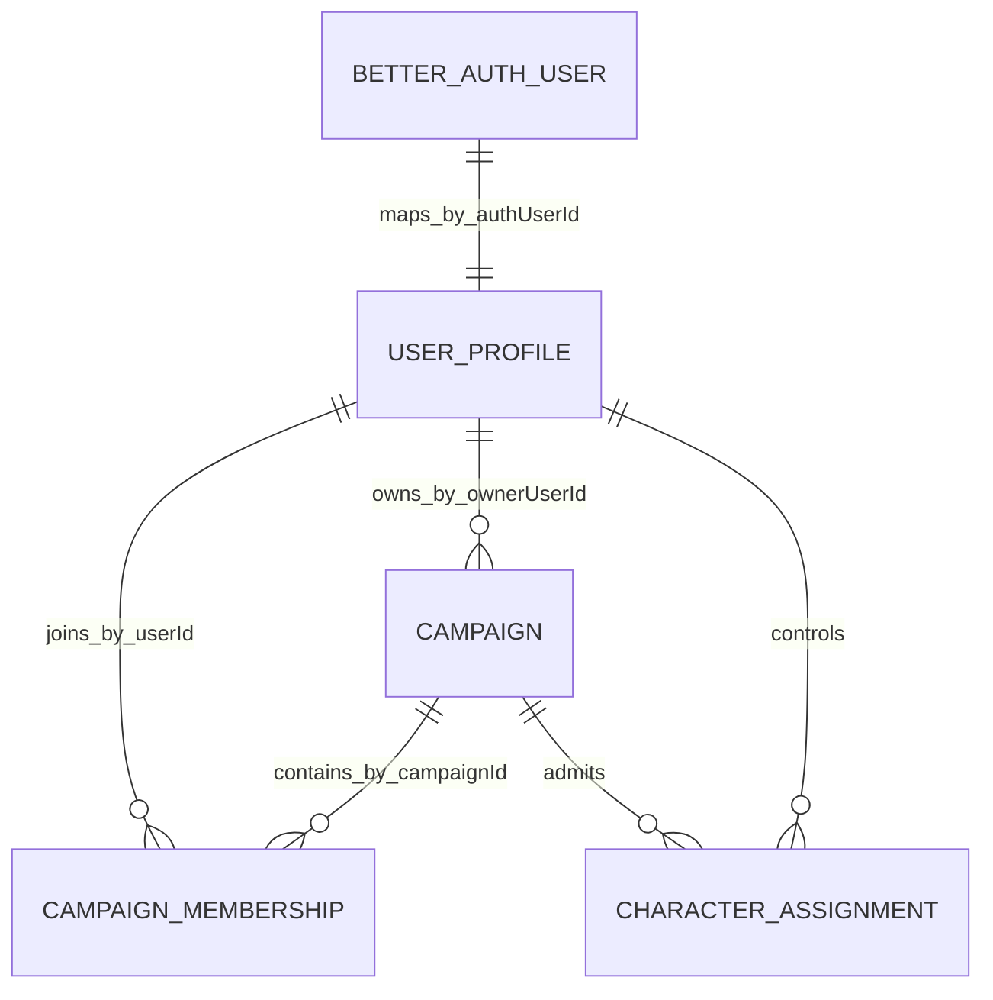

`userProfiles.userId` is the public application identity. Better Auth component IDs remain private
authentication identifiers. `campaigns.ownerUserId` and `campaignMemberships` are the Campaign authority
records; downstream documents do not widen access merely because they contain a public UUID.

Convex has no SQL foreign-key or cascade layer. Each mutation validates the complete relationship it
uses and commits its writes atomically. Ordinary departure, custody transfer, and source-loss cleanup
therefore either commit a complete valid result or leave prior state unchanged. Campaign deletion uses
the fenced, resumable lifecycle below for every size.

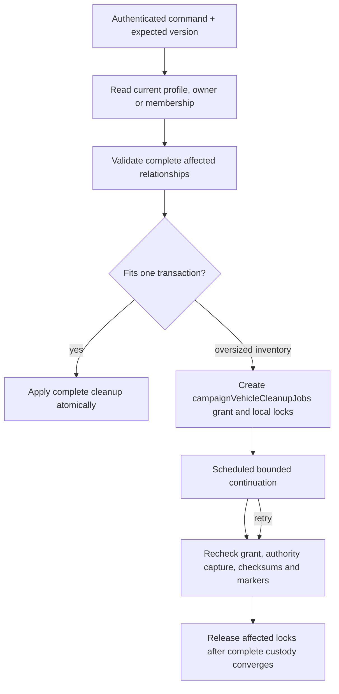

Oversized inventory cleanup locks only the affected Vehicle cargo, bag, currency group, or marked
destination slice. Public reads and edits reject that slice while it is updating; unrelated inventory
remains available. The durable job, segment, total, and row markers make continuation idempotent and
replay-safe and prevent partial custody from becoming user-visible.

## Campaign deletion — approved 2026-09-23

The current owner confirms DELETE against the displayed Campaign version. In one transaction, the
native command validates current ownership, ACTIVE OWNER membership and moderation restrictions, then
creates a durable **Deleting** job. From that commit, ordinary Campaign reads, writes, admission and
new live-room activation reject access. The owner can see Deleting or Failed and retry a failed job.
This single lifecycle applies to active and archived Campaigns of every size under
[ADR 0032](../adr/0032-campaign-deletion-lifecycle.md).

The captured live Session room first drains its committed SQLite outbox and releases authority while
the root, membership, assignments and live projection still exist. Only publication from that exact
captured room and epoch may pass the deletion fence during this stage. The job then reconciles
Characters and admission, removes the root, and purges descendants in bounded, idempotent steps.
Closure reaches existing sockets asynchronously and can be delayed by a process outage; committed
entries under the captured epoch drain before authority release.
Failed cleanup stays inaccessible and recoverable; no partial Campaign result is exposed. Physical
removal may finish after the owner's Delete command succeeds. Existing P09 deletion evidence needs
affected revalidation against this changed lifecycle before final release acceptance.
An exactly-once scheduled mutation checks for a stalled Deleting revision and reschedules its
at-most-once cleanup action, including after the initiating account disappears.

Account deletion validates identity, credentials, owned-Campaign restrictions, and all immediate
private-state cleanup in the Better Auth deletion transaction. Shared Campaign messages, rolls,
Sessions, and completed history remain with deleted-user presentation. After the app profile is gone,
bounded scheduled purges remove private delivery, usage, media, invitation, block, and copy-job residue;
they cannot restore authority or expose a partial account.

## Active live-session authority — accepted 2026-09-22

> [ADR 0033](../adr/0033-campaign-owned-play-and-session-log.md) (implemented locally) re-keys room
> identity, authority, presentation and Encounter Runs from the Campaign Session to the Campaign and
> removes their Session fields. Where this section describes Session-keyed rows or gates, ADR 0033
> supersedes it; `campaigns/playMigrations.ts` migrates existing development rows.

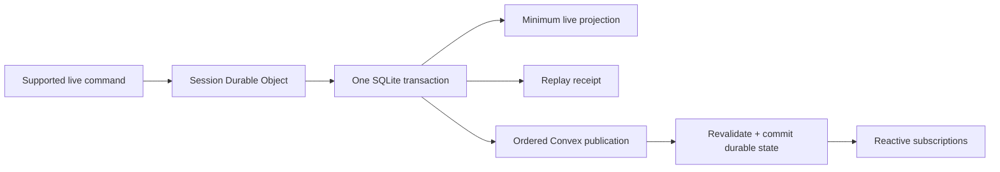

One Session Durable Object is authoritative only while its Campaign Session authority epoch is active.
For Door state and standalone token movement/undo, it executes against
the minimum Scene projection and atomically stores the next state, replay receipt, and ordered outbox
entry before broadcasting success. Command-ID replay is exact; reuse with different input rejects.
Recipient-filtered pointer, measurement, drag, and fog previews remain ephemeral.

Convex independently validates the current authority epoch, Campaign membership/role, publication
sequence, prior checksum, command versions, and result semantics before applying each outbox entry. It
advances durable product state and the persisted live sequence in the same mutation, then drives
subscriptions. Public Convex mutations that could overlap the Scene projection require no active room
authority and fail closed while the Session DO owns it. The room drains every committed outbox entry
before release. After release or eviction, a fresh epoch bootstraps from Convex; stale epochs cannot
publish. All Character Sheet and Encounter rule commands remain in their owning Convex transactions,
including while Scene authority is active or draining. The room holds no Character snapshot or version.

The remainder of this guide retains detailed implementation history needed to understand the cutover.
Sections headed **Native** or **approved** describe current behavior. Any Supabase, PostgreSQL, SQL,
Kysely, RLS, Edge Function, Netlify executor, GoRules pack, or relational-repository paragraph is a
historical record and is not current persistence authority. Current rules/content persistence follows
[Shared rules runtime](rules-runtime.md) and [Rules runtime ERDs](rules-runtime-erd.md).

## Encounter persistence package

> Status: current local implementation of [ADR 0035](../adr/0035-room-authoritative-live-encounters.md)
> slice S1 (no behavior change). The room store, checkpoint and authority switch are later slices.

`packages/encounter-persistence` holds the Encounter code that reads and writes live Encounter state,
so the Session room can later run the same code against its own store. It depends on
`packages/schema`, `packages/shared` and `packages/rules-runtime`, plus two things from `convex`:
the `IndexRange` type and the `ConvexError` domain-rejection transport. It has no Convex runtime
database dependency.

- **Store.** `EncounterStore` (`store.ts`) is the subset of Convex's transaction database handle the
  Encounter code uses: `get`, `query().withIndex()` with `order`, `collect`, `take`, `first`, `unique`
  and async iteration, then `insert`, `patch`, `replace` and `delete`, over the same table and index
  names. `storeTables.ts` lists its tables with their `packages/schema` stored schemas and indexes:
  the Encounter Run tables, the active, maintained and spatial rule-effect tables, `campaigns`,
  `campaignMemberships`, `campaignCharacterAssignments`, `characters` and
  `characterCommandReceipts`. Methods are typed per table and index, so Convex's `ctx.db` satisfies
  the interface without a cast and any drift from the Convex schema is a compile error.
- **Contexts.** Pure store code takes `{ db }` (`EncounterReadContext`, `EncounterWriteContext`),
  which a Convex `QueryCtx` or `MutationCtx` already is. Code that also needs something outside the
  store takes a transaction with `ports` (`EncounterReadTransaction`, `EncounterWriteTransaction`).
- **Ports** (`ports.ts`) name everything the Encounter code needs from other domains: identity, live
  authority, Campaign and Character authority, System and definition content, content labels and
  Blueprint sources, Character record readers and the single Character writer, Sheet commands,
  movement targets, action Scene geometry, initiative rolls, optional-combat snapshots, and table
  chat and roll logging. Convex binds each to its transaction in
  `apps/apis/convex/encounters/encounterPorts.ts` (`encounterReadTransaction`,
  `encounterWriteTransaction`, one per Convex context). The room will implement them from its
  hydrated inputs and authorization cache (S2, S4).
- **Moved code.** Run document readers, pending snapshots, the command timeline, command replay,
  the transaction read memo, domain rejections, the rule-effect stores, command admission (action,
  resume, basic action, Cleaving, Concentration, Disarm), actor control, the persistence writers
  (mechanics batch, action children, action economy, initiative store and correction, occurrence
  void, actor removal, revert, reinforcement, reorder, evidence rolls, turn movement, ally
  advantage and `recordEncounterCommand`) and the projection code (`resultPresentation`,
  `pendingReads`, roll-mode reasons, health viewer, Character projection state).
- **Convex keeps** its public and internal function registrations (`encounters/commands:execute`,
  `encounters/pendingReads:*`, `encounters/evidenceRolls:latest`), which resolve their guards and
  call the package. The live commit handlers under `liveSessions/` keep their fences (live
  admission, rules revisions) and write through the moved writers; they are deleted in S6. The
  capture builders (`encounterRulesCapture`, `characterRulesCapture`), `actionChoices` and its
  action-preparation helpers (`actionMechanicsPreparation`, `actionEconomy`, `actionSources`,
  `actionRelationshipFacts`, `actionSceneContext`, `actionDisarmSelection`) stay in Convex: they page
  with Convex cursors or assemble Character and System content that the room receives as hydrated
  inputs and plans with in the Worker, and their Encounter state reads already go through the
  package. The live-session guard `requireLiveEncounterRun` stays too.
- **Nested calls.** The Encounter GM tool's Character Sheet command runs in the same transaction
  through `executeEncounterCharacterCommand` instead of a nested internal mutation.
- **Conformance.** `apps/apis/convex/encounters/encounterStoreConformance.test.ts` runs the same
  operations against Convex and the in-memory reference store (`memoryEncounterStore.ts`) and
  compares their results and store changes with golden snapshots.

## Oversized inventory cleanup — approved 2026-09-18

**Accepted local implementation.** Inventory and Vehicle cargo remain
uncapped. Ordinary transfers and ordinary cleanup retain their existing atomic behavior. Oversized
deletion, departure and source-loss inventory cleanup use bounded durable native scheduling under
[ADR 0031](../adr/0031-oversized-inventory-cleanup.md).

The user approved a temporary spinner and read/write restriction on the affected bag, Vehicle cargo
or currency group only. Unrelated inventory must remain usable. Affected contents cannot expose an
incomplete custody result; authorized scope, integrity, containment, acquired mechanics, safe currency
arithmetic, versions, exact replay and recoverable completion remain required. Trusted continuations
must survive the initiating account/source disappearing without granting new authority.

This supersedes statements below that every uncapped inventory cleanup must complete in one atomic
mutation. Existing atomic implementations remain current for ordinary workloads and transitional for
oversized workloads. No arbitrary aggregate product cap, truncated catalogue, partial-result display,
whole-Campaign inventory freeze or acceptance credit is introduced. The affected Phase 8.2 scenarios
proved ordinary atomic rollback plus oversized localized locking, continuation/retry, privacy,
convergence and complete final custody. The fixed denominator and proof tiers remain unchanged.

## Native authentication reads — local implementation

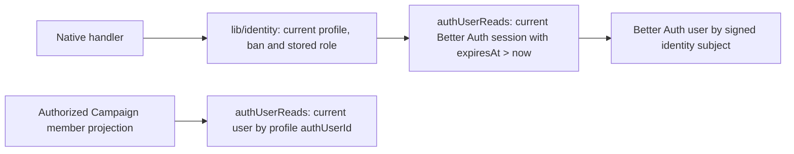

`lib/authUserReads` uses the native component adapter for the same session and user lookups as the
installed Better Auth client. Read handlers do not initialize the client, its adapter construction or
auth triggers. Missing, expired and revoked sessions still refuse identity; `lib/identity` retains
current stored ban, role and profile validation. Each invocation re-reads the current component state.
Campaign member presentation resolves the current account only after its existing membership and
profile checks. The full client and lifecycle triggers remain owned by `lib/authComponent`.
Account session/profile reads do not import HTTP authentication or profile-edit dependencies. Public
profile edits call an internal mutation in the same transaction, preserving current identity, Better
Auth username normalization/uniqueness hooks, complete input/output validation and atomic bio updates.

Root SSR session reads retain their fresh cookie-verified HTTP client and no-store response.
Browser root refreshes query the same native account.session projection through the per-router
authenticated Convex client already shared by hooks and loaders. AuthSessionGate resolves confirmed
guest startup at the provider level before a root read can finish; authenticated provider tokens remain
unchanged. Identity revocation still clears private query data immediately, and route convergence
waits until any current navigation finishes.

The local Better Auth component adapter derives complete table metadata from the shared
betterAuth/options plugin configuration without importing HTTP auth handlers or application triggers.
HTTP auth reuses that configuration with its original delivery callback. The official adapter handlers,
uniqueness checks and caller-provided write triggers remain unchanged. Live Session ticket admission
imports the existing identity contracts without loading the complete play-command catalogue.

## Native invitation computation — local implementation

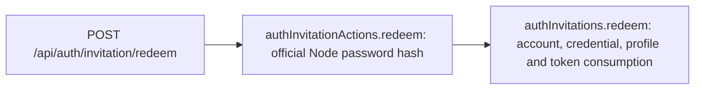

The private Node action validates the unchanged public invitation input and computes Better Auth's
unchanged password hash before the native mutation. The mutation rechecks the current token, expiry,
recipient and account absence, and retains Better Auth's password/username policies and user hooks.
Account, credential, profile, email verification and one-use token consumption remain one atomic transaction;
failed computation creates no records, and a late transaction abort preserves the invitation.
Only the server preparation contract accepts the credential hash. Public signup remains closed and
invitation completion still issues no session.

## Owner deletion cannot be vetoed by another user — approved 2026-09-18

[ADR 0030](../adr/0030-owner-deletion-and-retained-dependencies.md) governs deletion of owned content,
Characters and accounts. Another user's content, reference, pending decision or retained audit must
never make the owner ineligible to delete. Cleanup repairs or detaches live dependencies and preserves
the dependent owner's content, acquired mechanics and shared history. Authorization, current identity,
strict validation and atomic rollback remain required. A malformed stored record is a functional defect
to repair, not a supported third-party veto.

This supersedes the deletion-only published-child/Spell-reference restrictions, referenced-map and
Social report/application/audit account restrictions, and pending-decision restrictions in trusted
owner-deletion cleanup described below. Those paragraphs describe transitional implementation until
their replacements pass; they do not justify refusing an owner's deletion. Ordinary publication and
public Encounter editing retain their separate validation and pending-decision rules. An owned ACTIVE
or ARCHIVED Campaign still requires its owner's explicit transfer or deletion before account deletion,
as previously approved.

A FINISHED Session is past, read-only shared history even if its Run remains ACTIVE or SETUP.
Trusted deletion skips those Runs before reading live Character sources and preserves their stored
actors, turns, receipts and snapshots. Current private Character data is still removed; past Session
history must not require a surviving Character or account to remain readable by authorized members.

## Account deletion and Rule Studio retirement — approved cutover policy

Account deletion keeps messages, rolls and Session history in shared Campaigns, with the deleted
account's author shown as `Deleted user`. Shared Session notes and Campaign handouts likewise name
their author or uploader. Records store only the opaque account id; every read resolves the label
through `readCampaignAuthorLabels` (`apps/apis/convex/campaigns/authorLabels.ts`), which chat also
uses, so a deleted account reads as `Deleted user`. Private Characters and personal data are removed through
the native lifecycle cleanup. Retained history does not grant access to a deleted account or bypass
current Campaign authority and visibility. F12 still requires the complete native deletion transaction
and its cleanup, rollback, privacy and account-settings proofs.

Account deletion also removes the account's Character actors from ongoing Encounters, retaining
past turns, rolls and shared Campaign/Session history. The trusted server lifecycle uses the existing
actor-removal initiative, binding, maintained-effect and receipt pipeline. Audit attribution remains
the actual deleting app user; it does not impersonate the Campaign owner. Existing actor-removal
snapshot/checksum/version checks remain in force. Trusted cleanup completes valid pending decisions
invalidated by owner deletion; ordinary public actor removal keeps its existing pending-decision rules. Completed Run history
is retained. Ordinary public OWNER commands and archived read-only restrictions remain unchanged.

The old superadmin Rule Studio and its GoRules pack-management code are retired. Native System
authoring, catalogue and rules-kernel contracts remain authoritative. Local source removal is approved;
external service retirement and staging/production promotion retain their separate authorization gates.

## Native account deletion transaction — accepted local implementation

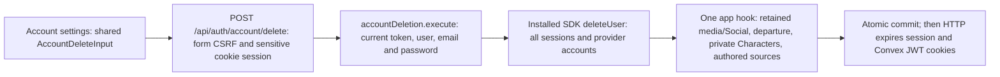

The HTTP handler supplies only its server-derived session token to the private mutation; public input
cannot choose an actor or another account. The mutation rechecks current session ownership/expiry and
stored user/profile/email, then verifies the unchanged SDK password hash. Provider cascade, app writes
and deferred cleanup scheduling share one native transaction. A late failure rolls them all back;
HTTP cookies expire only after successful commit. The native client replaces the retired privileged
deletion and extra password sign-in path. Managed promotion remains part of R09 and R10.

Campaign media retention validates actual complete references and canonical current owner membership
before transferring the stored asset and its charge. Original attachment uploader attribution remains;
only server-created retained provenance permits its link after transfer. Submitted Social applications
become withdrawn with retained terminal history; reports/audits keep existing authority and masking.

Private Character cleanup follows Campaign departure, deletes strictly validated private targets through
the existing effect CAS store, and preserves retained Encounter actors/receipts/state and foreign effects.
FINISHED Sessions never require live private Character sources. Current authored deletion retains dependent
documents, compilation and drafts, adding server-only exact source-kind/UUID/label catalogue provenance.
Same-document backfill preserves these labels; republishing still requires a live valid chosen source.

Normal native publication replaces and deletes its previous database version atomically. Custody,
Encounter snapshots and receipts carry immutable embedded JSON/checksums and external version provenance;
they do not pin the `authoredVersions` database row. After owned roots are removed, account cleanup deletes
remaining versions under its validated USER content-source index only when stored document owner, identity,
System, label, kind and checksum match. Shared immutable copies and other owners' sources remain.

## Native Account usage — local implementation

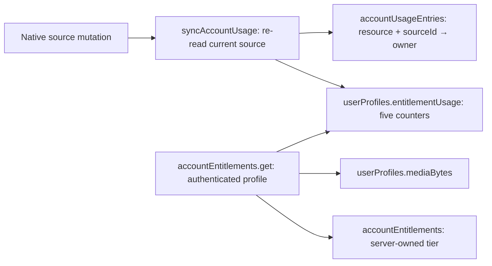

Each source mutation updates its usage entry and profile counter atomically. Character and homebrew
usage count the distinct union of active records and drafts by public identity; editing, publishing
and replay preserve one unit. Campaign usage counts active owned Campaigns. Public listing usage
counts OPEN/PUBLIC listings of an active Campaign with the same owner, including hidden listings.
Saved Encounter usage counts owned Blueprints. Media keeps its existing `mediaBytes` authority.
Existing indexed capacity enforcement still uses the shared tier policy; these counters provide the
bounded Account summary and do not change product limits.

`accountUsageBackfill.run` uses the installed Migrations component to process the seven source tables
serially, then mark profiles ready. The same synchronization function makes source replay and live
writes converge. Account reads reject incomplete totals. New profiles start ready with zero usage;
the personal-development backfill is verified and both profile fields are now required in source.
The expand/backfill/tighten sequence remains mandatory for any other deployment with existing profiles.
Missing owner profiles leave sources untracked; existing-profile underflow, invalid integer counters
and source ownership conflicts reject the transaction. Account deletion removes the profile and
schedules bounded usage-entry cleanup; full owned-source deletion remains F12 work.

Per-Campaign content limits (Q18) use one `campaignContentUsage` row per Campaign with `entries`
and `scenes` counters. Triggers in `lib/mutations.ts` update the row on every insert and delete of
`campaignNotebookSections`, `campaignAttachments` and `campaignVehicles` (entries) and
`sceneDefinitions` (Scenes), so cascades and cleanup jobs need no bookkeeping; the row is removed
when both counters reach zero. `campaigns/contentUsage.assertCampaignContentAllowed` checks the
hosting owner's tier, never the contributor's, before notebook, attachment, Vehicle and copy-job
section inserts and before a new Scene begins and publishes. Unlimited tiers use the hidden
`CAMPAIGN_CONTENT_SAFETY_CAPS`, which the entitlement DTO does not carry. Over-limit content after a
downgrade stays readable and editable; only new records are refused. Sessions, session notes, chat,
Encounters and content shares are not counted. There is no backfill:
the product is pre-launch, so deployments that predate the counters are reset and reseeded.

`accountEntitlements.setTier` is an internal deployment-operator mutation that validates the target
profile and existing shared tier enum. The public read accepts no account ID or tier override. Account
settings subscribe to this native projection. Customer-facing billing remains Phase 09 work.

## Character stored effective maximum hit points and walking speed — local implementation

Every write of a `characters` row goes through `characters/characterWrites.writeCharacterRecord`.
It stores the caller's document, Sheet state, status and stream version, then evaluates the written
Character with the existing Sheet evaluation and stores `maximumHitPoints` (the Sheet's effective
maximum, before Encounter effect reductions) and `walkingSpeed` (the effective `WALK` speed in feet,
the Encounter movement budget, D38) in the same transaction, both through
`resolveCharacterRecordStats` (`packages/rules-runtime/src/character/characterRecordStats.ts`).
Callers keep authority, replay, receipts and the one-stream-advance-per-transaction invariant. A
caller that already evaluated the written Character passes those stats (source-loss reconciliation)
or reuses the returned facts for its own response (Sheet commands); others pass their loaded authored
sources to avoid catalogue reloads. A DRAFT Character has no readable Sheet and keeps its last stored
stats.

Writers: Builder commit (creation sets the field), Sheet commands, source-loss reconciliation, the
Encounter mechanics batch, Disarm, maintenance-owner cleanup, actor-removal cleanup, Campaign
currency rewrites and inventory custody. Campaign-owned inputs refresh it through the same helper
without advancing the stream: GM Campaign adjustments (`campaigns/gmWrites`), a Campaign attunement
override change (`campaigns/updateDependencies`), Campaign assignment and Character departure.

Rules never read the stored values; Encounter projections display the maximum and the tabletop's
movement readout reads the walking speed. Known lag: a published-content change (for example a
homebrew republish) reaches a Character's stored stats on that Character's
next write, while the Sheet always shows the live value. Follow-up: a publish-time background
recompute for Characters that use the republished source.

## Content snapshot heads and objects (ADR 0036 S2) — local implementation

[ADR 0036](../adr/0036-versioned-content-snapshots-and-browser-builder.md) publishes content as
immutable R2 objects; Convex owns only their bookkeeping (`apps/apis/convex/contentSnapshots`).

- **Scopes.** Each content source, PLATFORM or USER, is one `SOURCE` scope: its readable roots by
  the Builder's source rules (`readCharacterSourceRoots` plus `canReadAuthoredRoot`, so hidden
  import rows are excluded). A `CAMPAIGN` scope holds the shares that pass
  `readCampaignSharedRootPublication` and the Builder's parent rule; a shared child whose parent is
  neither shared nor an enabled official root is excluded (`hasCampaignContentParents`) instead of
  failing the build. No `SYSTEM` head is built yet: it will hold only System-level data, with its own object format (D67).
- **`contentSnapshotHeads`** (one row per scope): the contract head (`revision`, `builtRevision`,
  per-kind `index`/`documents` refs) plus bookkeeping: `buildScheduledAt`, a build lease that
  expires after 15 minutes, and `failedBuilds`, which bounds automatic retries.
- **`contentSnapshotObjects`** (one row per uploaded key): `createdAt`, `supersededAt` once no head
  references the key, and `deletingAt` while cleanup deletes it.
- **Dirty marking.** Triggers in `lib/mutations.ts` mark a scope once per transaction, bump
  `revision` and schedule `contentSnapshots/actions:build` 2 s later unless a lease is live:
  - `authoredRoots`: the root's source, plus every Campaign sharing an owned root (existing
    `campaignContentShares.by_subjectKind_subjectId_campaignId` index);
  - `authoredVersions`: the version's source;
  - `campaignContentShares`: the Campaign;
  - import visibility (`importJobs` crossing `COMPLETED`): as for each root of the job;
  - existing heads only, never creating one: `contentSources` updates and deletes, `campaigns`
    System, owner or catalogue changes and deletes, and `campaignMemberships` status or role changes.
    Rules catalogues change only at canonical bootstrap and mark nothing.
- **Build.** The Node action reads `revision` first, then each kind in pages of 100 roots per query (no
  per-kind cap; a write between pages bumps `revision` and triggers another build), builds both parts with the S1 functions and uploads, gzipped, only
  keys without an object row. Equipment index facts use the stored `equipmentOptions.builder` when
  its checksum is current and otherwise the Builder's projection (`compileCurrentEquipment` plus
  `equipmentOptionFacts`), so a missing backfill never drops a root. Every kind is rebuilt each
  time; unchanged kinds keep their keys and upload nothing.
- **`commitBuild`** is a compare-and-set: it writes only when `revisionBuiltFrom > builtRevision`,
  inserts or revives referenced rows, supersedes the previous head's other keys and records any
  other uploaded key as superseded, so a rejected build's objects age out too. A referenced key that
  is being deleted, or that vanished after the build saw it, returns `RETRY` and reschedules after
  a minute. If the scope went dirty during the build, it schedules the next one. A deleted source
  or Campaign deletes its head and supersedes its objects.
- **Cleanup.** A daily cron claims rows superseded for more than seven days (`deletingAt`), deletes
  their objects with provider confirmation, then deletes the rows. A claimed key is never reused,
  so an upload can't race the delete; a claim older than an hour is retried.
- **Storage.** `CONTENT_SNAPSHOT_R2_BUCKET` names the private bucket, reached with the media
  endpoint and credentials; local mode uses the local R2 fixture's `artificer-local-content-snapshots`
  bucket. Missing storage configuration fails the build without retries. The build marks PLATFORM
  source objects public for [delivery](media.md#content-snapshot-delivery-adr-0036-s3--local-implementation).

### Content snapshot manifest (ADR 0036 S4) — local implementation

`contentSnapshots/manifest:manifest({systemId, characterId?})` is the reactive query a Builder uses
to find its snapshots. It calls `readCharacterSources` itself, so the manifest's scopes are exactly
the Builder's: for a Character assigned to a Campaign, the Campaign's enabled catalogue sources, the
caller's own USER sources and the Campaign's share scope; otherwise, or without `characterId`
(`readSystemCharacterSources`, the same non-Campaign branch), every System catalogue source and the
caller's own USER sources. The Character must be the caller's, active or draft, in `systemId`.

It returns each source's `kind` and contract head, and for a Campaign its `contentMaturity` and
head. A null head has no built content yet; `revision > builtRevision` means a build is pending and
the head still names the previous objects. Build bookkeeping never leaves Convex. Reads: the
Character, assignment and Campaign authority, the sources and catalogues, and one head per scope.

Tests assert parity: the union of the roots each manifest scope's build reads equals
`readCharacterSourceRoots` for every kind, without a Campaign, with a restricted catalogue and with
shares. The S2 exclusion of a shared child whose parent share is gone still applies.

## Native System vocabulary snapshots — local implementation

Native canonical bootstrap creates an immutable `systemVocabularySnapshots` row alongside each
System, using the shared snapshot contract and the existing canonical checksum format. Replaying
bootstrap, including for Systems imported before this table existed, reuses or initializes the
snapshot transactionally. The indexed System/version lookup checks stored checksum, identity and
agreement with the current System before returning provenance to Encounter compilation.
Current System imports remain immutable: a changed document is rejected, not silently assigned a
new snapshot. A future System publication flow must explicitly own version advancement. This is
local implementation, not deployed or end-to-end Encounter acceptance evidence.

The native Encounter Blueprint snapshot builder reads Creature and loadout Equipment through the
same ownership/source authorization and authored-document checksum checks as Library. It pins
their public revision identities and System-compiled rule facts into independent JSON snapshots,
enforces the existing snapshot byte limit, and does not acquire Campaign-shared content rights.
Native Blueprint create/update mutations derive ownership from the authenticated account. Creation
checks the indexed owned count against tier capacity in the same transaction; paid unlimited tiers
do not scan ownership. Creation replay returns the current Blueprint, while update replay returns
the original stored result, preserving the existing command semantics. Updates check ownership
before receipts, reject stale versions, and atomically replace setup plus append a receipt. Invalid
source snapshots leave both setup and receipt unchanged. Native listing uses the owner/System index
with descending creation order and cursor pagination, bounded to eight rows and a 1 MiB read budget.
Blueprint storage and public DTOs compose the same scalar metadata contract from
`schema/shared/encounterBlueprint`; the database schema never imports the full Encounter API module
and its spatial execution dependencies.
Each returned snapshot is checksum-validated and excludes storage metadata. Web wiring and end-to-end
integration remain unfinished. The current Campaign web consumers also instantiate Runs through SQL;
switching their Blueprint writes alone would strand saved Blueprints outside that Run-creation path.
The web storage switch must therefore accompany native Run creation using the same Blueprint store.

### Native Run creation — partial local implementation

> **Historical wording (ADR 0034):** "Automatic" in the Encounter proof notes below names the removed
> automation mode. Those server-rolled paths now run in Assisted mode when the roller's auto-roll
> preference is on; "Assisted" pauses there mean the roller's preference is off.

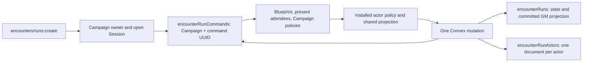

The creation mutation normalizes UUIDs before lookup and fingerprinting, authorizes the current GM,
and requires an active Campaign and the exact open Session. A matching Campaign command returns
the checksum-validated current GM projection before loading the Blueprint or current sources.
New creation uses the same verified Blueprint reader as listing/update, checks System identity,
and reads present attendees through an indexed bounded range. Campaign-aware native Sheet evaluation
supplies each attending Character's maximum hit points. Missing or unauthorized attendees reject the
entire command. New actors start with zero resource usage; native policy evaluation,
reconciliation and fact binding must succeed before state and the receipt are committed.

The Run retains its exact Blueprint version/checksum, current Campaign policy snapshots, UUID sides
and canonical ordered side relationships. Each actor has a separate indexed document containing its
validated snapshot and state. Actor state is a discriminated union on `kind`: Creature and custom
actors own their current/temporary hit points, conditions and source revision in the Run, while a
Character actor keeps no hit point, maximum, condition or stream-version copy
([ADR 0034](../adr/0034-player-control-rules-assistance-and-roll-prompts.md) decision 4). Encounter
reads load the current Character; Convex-native paths read it in the writing transaction, and Session
room commits are fenced by the Character revision their capture recorded. Rules evaluate a
Character's effective maximum live. Every GM projection build reads current Character hit points,
Sheet conditions and the Character's stored effective maximum (`encounters/characterStates`); a
detached Character grants no Sheet access and keeps its last projected values. Live Encounter reads
replace the stored projection's Character hit points, temporary hit points, maximum, health band and
conditions with current Character values; the health band uses current hit points over the stored
maximum. Recursive state and the committed GM projection use validated JSON
encoding with canonical checksums, preserving the existing authored nesting. The public projection
keeps its existing shape and has a null legacy rule-pack revision. No GoRules revision is invented.
The owner-only, version-checked actor-side query exposes all Run sides, including an empty side,
alongside current actor bindings so the GM can make a valid prospective side correction.
Create receipts are separate Campaign-scoped documents; new Run and actor UUIDs are generated inside
the mutation, so transaction retry cannot publish duplicate state.

Catalogue removal now checks the exact initiative and optional-combat source pins retained by
PREPARED and ACTIVE Run state. It validates the stored state and policy checksums and rejects removal
with the Run UUID in the same Campaign update transaction, even after current settings stop selecting
those definitions. COMPLETED Runs do not retain this policy-source restriction. Indexed iteration
selects only the two relevant statuses; no product limit on saved Runs is added.

Native Manual, Automatic, and Assisted activation, turn advancement, initiative edits, enemy Feature
resource adjustment and rolls, optional-combat snapshot replacement, completion, and owner reads now
use the normalized Run documents locally. Lifecycle command receipts retain the optional-combat
snapshot checksum used at execution, so later replacement does not invalidate historical replay.
Remaining structural and action mutations, player reads, remaining source-change dependency checks,
browser wiring, deployment limits and the complete local lifecycle remain pending. This producer has
not been deployed or accepted. The browser continues to use the existing Run path until those
integration requirements are met.

Read-path investigation found that both legacy and native creation copy GM-visible Character
conditions, including SECRET Campaign conditions, without their visibility provenance. The legacy
player projector returns those conditions unchanged. The user resolved the native representation on
2026-09-14: live Encounter reads derive current Sheet conditions and current Campaign overlays;
players receive only VISIBLE overlays, while the GM receives all overlays. Stored Run conditions
are not authoritative for these reads. Condition presentation reads the current checksummed Character, Campaign overlay
and System vocabulary through current assignment authority; it does not rebuild the Character
or evaluate unrelated Sheet rules. Character status and private Sheet integrity remain checked.
For visible Creature and custom actors, live reads resolve stored condition UUIDs against the same
System vocabulary and include their labels and descriptions. Existing condition metadata and
recipient visibility remain intact; this presentation does not rewrite Run state or command receipts.
Each condition type has at most one editable manual DM
Campaign entry. The user explicitly approved coexistence with independently tracked Sheet, spell
and feature sources: neither source rejects the other, and ending one preserves the others. Rule
outcomes change raw Sheet condition state; effective mechanics use the union with Campaign conditions.
An ownership change advances the Character stream even when that effective union is unchanged.
Player reads never inherit SECRET notes from another source of the same condition. Completed GM
reads retain their stored projection after Character unassignment. Other reads retain an unassigned
actor's Run identity with an empty condition list: the old Campaign cannot read its private Sheet or
conditions from a later Campaign assignment, and stored GM conditions cannot supply a safe fallback.
Native public journeys verify
independent DM/rule removal, overlapping rule lifetimes, same-type Sheet baselines, stale responses,
exact replay and player redaction. Split-party and simultaneous
Encounter changes were explicitly deferred; existing lifecycle rules remain in scope. Creation replay
now also verifies the stored Run's Session and System against its authorized Campaign/request,
in addition to the stored projection identity and checksum.

Character mechanics settlement may reuse the complete authored-source context prepared earlier in
the same mutation. It still rereads mutable Character state, current authority, assignment, overlays,
readiness and receipts before applying the batch. The internal context remains bound to its Character,
owner, System and Campaign; it is never persisted or reused across mutations.

### Native active effects — partial local implementation

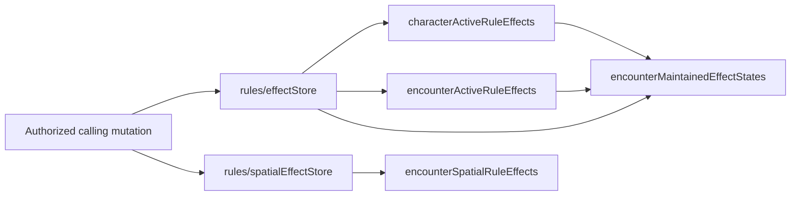

The internal store shares schema-owned effect records with the transitional SQL repository.
It has no public endpoint or independent transaction: callers authorize the owning aggregate and
compose effect changes with the command's other writes. Indexed owner reads retain the existing
64-effect, 64-maintained-state and 64-dependent limits, deterministic creation ordinals and exact
UUID ownership. Lifecycle updates and deletes compare the current version; immutable definitions
and maintained descriptors use validated JSON and canonical checksums, while lifecycle fields remain
typed. Source occurrence provenance remains an immutable snapshot rather than a cross-aggregate
foreign key.

Spatial effects retain their exact Encounter/Scene binding, immutable definition and placement,
typed lifecycle and reveal state, and four independently verified checksums. The scoped native store
preserves the existing Scene limit and deterministic ordinal allocation. Updates and deletion use
exact version checks within the calling mutation; no spatial helper opens a separate transaction.

`encounters/movementTargets` reads only selected actors and their current effects under caller,
Campaign and Run-version authority. Character hit points and effective maximum come from the current
Character's evaluation; System conditions are checked; UUID scalar reductions feed the installed Character/actor policies.
These private facts stay inside the movement coordinator. The loader performs no writes; the
parent still owns current Session/Scene authority, initiator control, occurrence/replay and atomic
target, spatial-effect, Run, token and fog publication. Character currentness pins are computed
from the current document, evaluated facts/policy, Campaign adjustments and ordered effect versions;
they do not introduce stored SQL-style projections.

The internal `encounters/spatialMovement` adapter now evaluates frozen spatial graphs through the
shared coordinator and publishes terminal target mechanics plus spatial deletion/reveal CAS in its
caller's mutation. It uses `rules/runtime`, also used by Encounter commands. Its proposed receipt
versions are not writes: the parent must still publish the Run, Scene/token/fog and occurrence receipt
atomically. Its internal `PREVIEW` mode performs the same terminal mechanics fold and predicts
transitions without target/effect writes. Automatic preview evidence must be retained by the parent
and reconstructed through the frozen terminal input when committing; executing a fresh
automatic movement again would roll new evidence. Assisted preview retains the entered evidence.
First-terminal reconstruction collects the full current contact set and checks its selection and
target/effect currentness against preview, then reconstructs the retained execution prefix. New
contacting effects must invalidate preparation even if Run and Scene versions did not advance.
The separate frozen reaction remainder retains its existing continuation semantics. Normal reaction
commit verifies the previously issued action request and the prepared pending/terminal evidence in
one replay traversal, requiring exact continuation, d20, phase and final receipt comparisons. Legendary
Resistance retains its separate issued-request verification and resistance reconstruction.
Movement response publication checks the complete save, current authority, pending evidence and token
control once before any staging or gameplay writes, then passes that checked response to the private
commit helper in the same mutation. It cannot be reused across mutations; retained outcome reconstruction,
next-choice currentness, exact receipts and atomic rollback remain required.
Query and geometry-begin return metadata keep the complete shared schema and are converted at
metadata export through the existing getter pattern. Geometry begin applies the same Scene-vision
tracked context in its handler. Recipient readers import the focused Encounter
read/response contracts and player projection rather than initializing unrelated Sheet-command or
GM actor helpers. Campaign membership authority and the complete bounded active-member check live in
`campaigns/authority.ts` without importing assigned-Character documents or their authoring schemas.
Consumers that need only those checks import that leaf; the document module retains the same exports.
Movement reaction facts pass their freshly verified Run state and Campaign authority to target loading
before writes in the same transaction. The read context checks transaction identity and exact Run/Campaign
scope; standalone target loading retains full identity, state and membership reads. Both paths retain
version checks, complete actor membership, current Character preparation, source validation and effects.
Scene reaction perception can likewise reuse the Run, complete actor set and live Scene header freshly
validated by the Scene movement read phase. Its context is bound to the identical native transaction;
Run/Scene scope checks, complete effect reads and pinned Sense definition checks remain mandatory.
Standalone perception callers retain the full identity, Run, actor and MEMBER Scene reads.
Encounter Feature references reuse the exact authored identity, text, section and roll
fields through a focused shared contract, avoiding initialization of unrelated authored effects and grants.
Public Encounter queries route projections, pending decisions and timeline decoding to separate internal
readers so unrelated query handlers do not share their initialization work.
Their complete validators, authority/privacy checks and paging behavior remain unchanged, and child
queries share the caller's read snapshot. Prepared-run discovery projects each Run before reading its
pending decision through the same full-authority internal pending query.
The staged geometry save can now retain a typed terminal or pending preparation as checksummed JSON.
Its internal writer requires current save ownership/expiry, Scene/Session capture and an active Run
with the exact Scene binding. The first preparation precedes fog staging; identical retries retain it,
and replacement evidence is refused. All geometry-save reads validate paired fields and preparation
identity. The existing save lifecycle owns cleanup; no additional table or queue is introduced.
The internal preparation mutation now reads authoritative token/binding sources, verifies current
control and the path origin, excludes pending/root occurrences, and freezes preview evidence without
changing gameplay state. Identical retries reuse that evidence. The finish mutation reconstructs it
against current facts; prepared commands cannot rebase onto a different Scene snapshot. Public geometry responses omit this
private preparation. The internal terminal commit helper revalidates that save and token control,
excludes pending occurrences and root replay, reconstructs mechanics in its caller's transaction,
and rolls back if the result differs from retained evidence. Its parent supplies authoritative Scene
geometry and actor bindings. The internal terminal publication helper now advances the Run once,
rebuilds its projection from current actors, and stores the completed occurrence, rule receipt and
private MOVE_SCENE_TOKEN timeline entry in that same transaction. Exact historical replay checks
receipt/result/occurrence linkage and returns the retained response without reapplying mechanics.
The existing geometry finish mutation now composes terminal mechanics, Run/occurrence/receipt and
Scene/token/fog publication after the captured Character/Session checks. It re-reads only the mover,
all current actor-bound tokens and all effect anchors, using compact ordinal hints as verified lookup
hints rather than token data. The union is bounded by 100 actors plus 64 effect anchors; the action
still owns full paginated Scene/barrier validation and fog computation. Whole-Scene transaction
capacity is not assumed. Replay links the Scene version/delta and occurrence to retained evidence.
A terminal may leave the token unchanged; fog alone advances the Scene once and the published
rule receipt records that final Scene version without replacing frozen mechanics. Null-delta
results require an occurrence. Prepared saves cannot rebase their snapshot or Character observations.
The public geometry action now admits bound movement with its required Session context. It uses
the same authoritative preparation and atomic finish path, including no-candidate movement and
path-clipped fog. Local public-action proof covers a bound current actor, missing Session and stale
Encounter refusal, competing moves with one winner, unchanged Run state and exact replay.
Run selection uses the exact Campaign/Session/status index; an ACTIVE Run retained by a finished
Session cannot make a later Session ambiguous. Standalone token movement checks indexed token
bindings and their authoritative Run/Session at staging and publication. An ACTIVE Run in an OPEN
Session requires the Encounter version; finished-Session bindings do not block ordinary Scene edits.
Scene undo walks movement history with opaque database continuation cursors so equal-version rows
cannot hide an older movement. It skips only null-delta/no-fog receipts; a latest fog-only event
refuses token undo, preserving the existing reversal boundary.
Encounter-bound moves and movement decisions are planned only by the Session room on its presented
Scene and committed through the private movement routes (D42, D43, superseding D29); Convex has no
other bound-movement staging path and evaluates no movement rule. Public staging refuses every bound
move with `SCENE_NOT_PRESENTED`, whether no room is live or a live room presents another Scene;
unbound moves and door changes still stage natively while no room owns the Scene.
The server classifies movement decisions and retains the exact response plus prior pending snapshot
in the existing private geometry save. The original path remains immutable; Node derives its
remaining segment from the stored boundary, including a one-point segment at the final boundary.
The current decision controller or GM authorizes continuation independently of mover ownership.
Preparation resolves sealed evidence without publishing mechanics. The final geometry mutation
rechecks the original occurrence, authority, Scene/Run/Session and token position before publishing
response receipts, occurrence, mechanics, Run, token and fog atomically. Pending responses advance
only the occurrence and any changed Scene; terminal responses advance the Run once and retain a
private `RESOLVE_RULE_OCCURRENCE` timeline entry with its frozen policy checksum. Fog-only changes
adjust the published pending Scene version after verification without replacing preparation.
Exact root and response retries retain the original geometry receipt and project the current
occurrence for current membership and assignment.
Before a response issues the next controller choice, preparation and final publication revalidate
its exact retained options against current Character/Creature sources, usage, relationships and
perception. Declined historical options stay frozen. Response perception capture uses the retained
contact footprints at the current Scene version; it does not rediscover a path from the old origin
after the token has moved. A source change between preparation and fresh vision observation must
still refuse publication without gameplay writes.
Initial spatial evidence pauses retain the server-discovered future reaction timeline in the
existing reaction-owned SPATIAL_EVIDENCE snapshot. Empty timelines retain standalone spatial
pending behavior; later choices become current only after the spatial evidence resolves.

This local response slice covers declined choices and spatial evidence without applied reaction
mechanics. Used reactions, applied prefixes and passage handling still require
the complete parent coordinator. Native spatial-first journeys retain their combined acceptance
proof. Unsupported paths fail before gameplay publication. V07, V11, V13 and V14 remain open
pending their full required proofs.

Native movement actions now share their mechanics calculation with a write-free planner. The
planner retains the complete current Run target map, predicts source resources, reaction allowance,
Character authored/Sheet state and stream advances, and rebuilds rule facts for each subsequent
reaction. These facts exist only inside one server preparation; they are never client input or
persisted snapshots. Final settlement uses the same batch/event identities and receipt calculation,
while its native writer retains current authority, mirror/resource checks, receipt creation and
transactional writes. Native spatial terminal publication now uses the same mechanics planner for
ordered target batches and validates each complete before/after transition, including scalar values.
Scene preparation and publication may pass their current or projected target map into native spatial
evaluation within the same mutation. This avoids hydrating the Character catalogue again and makes
later evaluation see already planned outcomes; the map is never retained across requests. Spatial
prefix projection remains guarded at Scene reaction boundaries until the complete coordinator is proven.
Scene preparation's pending transport uses only spatial movement, movement reaction, passage choice,
and an optional combat contest with a movement continuation. The shared schemas narrow the structural
union with `z.safeExtend`, preserving the generic snapshot integrity checks and the existing Scene
refinement. This avoids expanding unrelated action, turn and initiative branches into Convex's return
validator; accepted persisted values and their checksum/replay semantics are unchanged.
The local Scene response implementation uses this seam for selected reactions: OPTION and actual
Assisted TEST/OUTCOME evidence share one occurrence, including integer outcome command history.
Preparation retains sealed evidence and predicted receipts; final publication reconstructs it from
current facts without fresh rolls before settling mechanics. A response that completes an action
and reaches another choice advances the Run once and records only its own Character transitions;
a pure evidence pause keeps the Run version. Terminal movement advances once more, and an authored
STOP preserves the issued contact and original path. The TEST template emits the authored path's
boolean STOP authorization; native binding reads the verified TEST receipt while preserving the
terminal OUTCOME execution and both phase receipts. Receipt replay uses its recorded Run transition
and projects the current occurrence for the recipient without writing. Every eligible reaction is a
controller Use/Decline choice; no reaction executes without that choice. Spatial prefixes and passages still
require the complete coordinator; this local implementation does not constitute
acceptance of the frozen movement cases.
The local Scene coordinator now pauses a failed SAVE at the real Legendary Resistance choice,
before OUTCOME. Used reactions retain the original sealed TEST and recorded
d20; USE changes only the effective outcome path and proposes one target charge, while DECLINE
keeps the failed path. Authored STOP follows that verified effective path. Assisted OUTCOME uses
the kernel's actual integer requests. Preparation and publication reconstruct current TEST policy,
candidate, pool and choice pins, then bind retained outcome evidence to the issued USE or DECLINE
command. Exact replay consumes retained dice without rolling again. Target charge, reaction
mechanics, Run, occurrence, Scene and fog publication share the enclosing mutation; preparation
does not publish gameplay state. These local paths remain subject to the complete movement gates.
The required pending movement receipt summarizes mutations committed by that command. Each
reaction retains its own Character event and exactly one stream increment. When several reactions
affect the same Character before a pause, the pending command receipt contains one canonically
ordered entry spanning the first before-version through the final after-version. That span can
exceed one; it is not another Character event. The summary includes only this command's reactions,
and its distinct Character count is bounded by the existing Encounter actor limit. Initial and
response publication use the same contiguous-transition aggregation as terminal movement. The
local automatic coordinator and this pending summary correction pass native Character preparation,
two-event aggregation, enclosing rollback and exact replay checks. These proofs do not close the
frozen movement acceptance cases.
Internal reaction preparation captures exact observer and contact-point subject footprints from
current Run sources and authoritative token bindings. A Node action pages current barriers, doors,
lights and darkness zones at the captured Scene version, then sends compact perception environments
to the preparation mutation. The mutation reloads sources, capability usage, relationships, effects
and Character sense definitions, and matches each environment against the current Scene version,
effective System grid and exact footprints. Full Scene geometry never enters the mutation payload;
the public movement command cannot supply perception evidence. Controller-choice boundaries retain
their sealed timeline and contact position without consuming reaction resources. Clipped fog still
requires the complete parent coordinator.

Native pending-occurrence queries reuse the neutral movement summary presenter. The current
Campaign owner sees movement decisions; a player sees only choices assigned to their current
Campaign Character. Pending snapshot checksums and occurrence/root identities are verified before
projection. Initiative scoring and ordering retain their GM audience. Declaration choices also admit
the current controller of the requested Character; another actor's declaration remains private.
Opening the next reaction choice retains already completed reaction receipts in the same continuation.
Turn pending projections and deterministic Concentration identities live in read-only modules shared
by queries and command handlers. Query presentation must not import turn settlement or Concentration
mechanics solely to access those helpers; projection validation and child identities stay identical.
Character state readers likewise live separately from Builder drafts and receipt history. Campaign
identity checks and Encounter presentation import the state readers directly; stored Character and
Sheet validation, checksums and ownership checks are unchanged.
Live Session join, membership and ticket contracts share a leaf identity module. Transient capture
imports those identities without constructing command contracts; the existing public exports and
native validator shapes are preserved.

The native action lane reuses the existing neutral System capability registry,
feature-mechanic normalization and compiled target policy. Automatic single-graph and TEST/OUTCOME
plans execute through the sealed kernel, retaining TEST and selected OUTCOME receipts and exact
d20 evidence. SELF, unrestricted single-target and Scene-bound distance targeting use the same
neutral target policy. The distance path reads the exact bound Scene, actor/token bindings and
current base or live token geometry by index inside the action transaction. Removed tokens cannot
fall back to their base definition. Only mechanical token geometry and the effective System grid
enter targeting and the pending currentness checksum. A paused response requires that same Scene
version and geometry; a verified terminal receipt can replay after subsequent Scene movement.
Optional combat intents and remaining controller decisions remain unavailable until their
coordinators are complete. Spatial directives are inspected and refused before settlement, so an
unsupported pull cannot silently disappear from a completed action. A failed save requiring Legendary
Resistance stops before OUTCOME. `encounters/commands:execute` routes `RESOLVE_ACTION` to this
coordinator, including its authority checks and historical replay validation.
Native action settlement now creates bounded state and recurring effects in the same mutation as
mechanics, resources and the receipt. The shared `encounterActionEffectPlans` module prepares immutable
definitions without persistence access. Frozen graphs use the shared compiler, retaining their fact
contracts and operation bindings for later ticks. Ordinary recurring conditions require a matching
original kernel application; successful saves and immunity create no effect. Non-condition recurring
healing, damage and temporary hit points require a matching executed outcome node, including healing
at full HP. Relationship creation uses the compiler's
authored path retained in adapter facts, including critical-only outcomes, and inherits existing condition
ownership baselines. Character effects use the existing Character receipt fields and advance the target
stream once even when the effect changes no HP or flat condition state; exact replay adds no version.
Native START and ADVANCE_TURN now stage recurring effects in rules order: outgoing effects precede
Legendary choices and new-round initiative; incoming effects follow action refresh and Recharge.
Pending decisions retain verified evidence and the committed projection. A terminal mutation publishes
effect lifecycles, Character/actor mechanics, initiative, Run state and private receipts together.
Exact response retries remain valid across later initiative and effect pauses, with currentness and
command-fingerprint checks. Repeated saves retain shared condition ownership baselines on expiration.
Character condition settlement now uses current Sheet plus Campaign conditions while preserving
independent source ownership; its native local journeys and scoped checks pass. Maintenance
coordination remains incomplete.
Current authority, Session, turn, pending-occurrence and version checks precede settlement.
Relationship facts include effects attached to every Run actor, preserving restrictions on actions
whose relationship target is a third actor. Target mechanics, authored Feature charges, turn allowance,
Run projection, completed occurrence and private receipt commit together using the same authoritative
scalar facts as graph execution. The stored COMPLETE receipt includes canonical mechanics applications
and target transitions; replay verifies occurrence/source/target, command and result checksums,
the TEST receipt's bound-input checksum, terminal evidence and metadata before returning the historical response.
Kernel evidence retains only consumed facts; it is not rehashed as the full bound input. A failed
transaction rolls back mechanics and both resource counters.
At the incoming `START_OF_TURN`, System-declared action, bonus-action and reaction usage refreshes
are staged with the turn root and rechecked after any pending decision. Only terminal turn settlement
persists the refreshed actor resources.
Assisted single-target actions use the same coordinator through `RESOLVE_RULE_OCCURRENCE`.
The existing occurrence stores an `ENCOUNTER_ACTION` kernel snapshot containing the root command,
initiator, source/target currentness checksum, d20 policy and completed TEST evidence. Public pending
reads expose only the GM's bounded dice or integer request. A continuation revalidates the exact
occurrence version and current source/target facts before execution. Loader-only `characterFacts`
objects are excluded from the checksum, while Character stream/projection/mechanical-context
identities and effective rule, binding, resource and Scene facts remain included. Pending phases change neither
HP, charges, allowance nor Run version. Each response has an immutable `ACTION_EVIDENCE` receipt;
the terminal transaction advances the occurrence and Run, writes the root receipt, and settles all
mechanics once. Exact response retries return the current pending or terminal root result. The
action's initiator must remain the current GM; controller reassignment is still outside this lane.
Evidence response IDs reserve the same Campaign-wide command namespace as Run commands and pending
roots. Other commands cannot reuse those IDs, including commands for another Run in that Campaign.
Creature actions may also target current Characters for hit-point and condition outcomes: the
Character document, stream version and history settle in the same transaction. Condition
outcomes update raw Sheet state and preserve separately owned Campaign records. Active-effect
baselines use raw Sheet conditions so a DM entry cannot become a permanent Sheet condition.
Each mechanics batch names the Character stream version its applications were planned against;
planning and persistence refuse a Character at any other version, so one Character version and
receipt still settle per transaction.
Character action facts use the effective policy after active scalar reductions, including derived
values, defenses and condition immunities. Internal Character action resource preflight checks the
sealed compiled binding against current policy and stored usage. Mechanics settlement can merge that
consumption with HP and spell-slot changes in one Character stream advance, preserving unrelated
Sheet state. The owning action coordinator retains root receipt/replay
and resource-only history ownership. The same public coordinator accepts sealed Character actions;
optional-combat, spatial-effect and controller-decision paths remain unfinished.
Movement reactions now use the same completed-action effect planner. Before later contacts are
evaluated, preparation constructs deterministic effect records from the command, occurrence, contact
ordinal, target and effect kind, and includes them in projected target and relationship facts.
Scene settlement creates those records through the native store in its existing atomic mutation and
checks exact forecast parity. Character effect creation advances the target stream once, including
when an independent Sheet or DM source already supplies the same effective condition. Pending
reaction evidence does not publish that reaction's effects; already-completed contact prefixes retain
their existing publication semantics. Exact response replay retains the original effect identities.
Nested saving-throw outcomes bind path-specific condition immunity and interpret both damage and
condition proposals from validated save evidence. Successful saves suppress failure outcomes;
condition immunity does not suppress separately authored damage. Public native Creature and Character
journeys, sibling contact ordinals, rollback and turn expiry are recorded in
`.codex/validation/movement-reaction-effects-20260914/integration-evidence.json`.
Maintained state retains the exact source actor and maintenance definition. Dependent creation
checks that binding and the source actor's total dependents across maintained states. Character
dependents prevent maintained-state deletion; Encounter actor dependents are removed atomically
with their maintained state, preserving the respective SQL restrict and cascade behavior. Calling
cleanup flows still own Character reconciliation and terminal empty-state policy.

Native direct actions now preflight the current typed `rule-maintenance` definition, prior slot, dependents and
affected Character versions into pending currentness. Terminal settlement replaces the same-definition
slot and its dependents within the action mutation. The shared D&D compiler preserves the authored
maintenance policy for supported activated and recurring saving-throw effects, so both paths validate
the current definition before start and resume. Cleanup discovers Character owners from dependent
records even after their Run actor is removed, advances each affected stream once including any base
action change, and preserves baseline conditions, independent effects and Campaign-owned DM records.
Descriptors retain the exact bounded action identity, including native composite action IDs.
Actor and Character receipts share the maintained replacement contract; actor receipts with maintenance
also retain the immutable nullable source Character ID so unrelated owner cleanup cannot masquerade as
a source mutation. Optional receipt additions preserve historical receipt shapes.
Native turn recurrence validates the maintained source before preparation and settlement. Expiring the
last dependent deletes version-1 and `TERMINATE_WHEN_EMPTY` states, while `RETAIN_UNTIL_TERMINAL` and
states with surviving dependents remain. Final START and ADVANCE_TURN receipts retain canonically ordered
terminated-state identities and checksums without publishing descriptors or graphs.
Scoped public action, turn, contract, compiler and preservation checks pass; commands and source
identities are retained in `.codex/validation/maintenance-integration-20260915/integration-evidence.json`.
Character-originated maintenance now has native Automatic resource-consuming self replacement and
Assisted dice-heal resume/replacement proof, including source-owner cleanup, one stream increment,
mirror identity, stale refusal, rollback and replay.

Movement preparation carries exact uncommitted maintained slots and owner effects into later contacts,
including passage continuation and Character owners absent from the Run. Publication verifies
deterministic state/effect records, actor mirrors, Character rows and receipts in the same transaction.
Each affected Character advances once per contact, sharing any base mechanics increment. ACTION_EVIDENCE
and LEGENDARY_RESISTANCE_CHOICE phases bind maintenance preflight currentness before evidence resume.
Movement receipts retain optional `maintenanceOwnerTransitions` after the main mechanics transition;
the spatial timeline checks exact cleanup state and Character version continuity before later contacts.
These raw receipts remain internal; public results return role projections and strict occurrence summaries.
The shared D&D recurring-save compiler uses its existing validated movement-reaction activation policy.
Native Automatic/Assisted Scene mutation proofs cover Encounter actor replacement, ordered condition
cleanup, independent causes, pending stale state/owner refusal, rollback and replay. Evidence is retained
in `.codex/validation/movement-maintenance-20260915/integration-evidence.json`.
Native Scene proofs also cover present and detached Character owners: cleanup shares a mechanics
increment, each subsequent contact observes the new stream, actor/snapshot mirrors remain current, and
independent Character effects survive. A detached owner shared by two source slots advances twice across
a non-pausing passage; omitting the passage forecast argument makes that regression fail. Exact source
restoration and the combined checks are recorded in
`.codex/validation/movement-maintenance-owners-20260915/integration-evidence.json`.
These checks are local implementation evidence, not whole-case or release evidence.

Native direct Concentration damage checks now use canonical published c3 maintenance and its linked c2
graph. The parent persists only its base damage receipt; deterministic child receipts retain save evidence
and exact cleanup transitions. Automatic checks settle atomically with the parent; Assisted children
admit the current GM or assigned target controller. Success preserves the Run version, failure advances
it once, and cleanup advances each dependent Character from its post-damage revision. Pending checks
bind current publication, vocabulary, Character, contributor and exact parent-damage evidence before
dice. Parent replay verifies Automatic child cleanup revisions instead of conflating them with base damage.
One optional sealed Cleaving context may wait on these checks; pre-cleanup validation permits only this
transaction's cleanup to change the subsequent choice's pins. The raw context and receipts remain private.
Scoped evidence is retained under `.codex/validation/concentration-integration-20260915/`.

Terminal turn damage now feeds that coordinator after outgoing then incoming effects, within the
existing mutation. Phase receipts retain their original damage and Character transitions; child
receipts own subsequent Concentration cleanup. A failed child skips only the ended maintained-state
ID and continues other owners. Assisted continuation admits intervening Run versions only when
verified same-parent response receipts account for every advance. Completed responses for turns with
positive finalized damage return the stored terminal command projection after later child cleanup.
Turns without positive damage retain their existing current-projection response replay.
The local implementation and proof are retained under
`.codex/validation/turn-concentration-20260915/integration/`.

**TRANSITIONAL / scoped native movement contract verified:** an Assisted movement
Concentration check uses the existing pending movement row. Its sealed c2 continuation retains a child
identity; the pending context binds the movement parent. Completed children retain their response
command, damage envelope and cleanup evidence. Each cleanup Character advances exactly once, including
detached Characters without an Encounter actor; Encounter-owned effects retain actor transitions with
no Character identity. Actor transitions and Character version evidence are validated separately.
No new transaction boundary is introduced. Native rollback, replay, controller privacy and shared
hazard continuation pass the scoped gate recorded in
`.codex/validation/movement-concentration-20260915/integration/integration-evidence.json`.
Complete local release gates and the required public/browser and hosted proofs remain open.

The private applied spatial prefix may retain `consumedSpatialEffects` for deleted one-use roots whose
frozen contacts still need execution or settlement. Each complete original record binds the executed
root's pin, DELETE transition, Encounter/Scene and recomputed body checksums. Resumption requires the
live root to remain absent; reveal updates instead require the exact recorded after-version/state.
Each lifecycle CAS occurs once. Terminal results omit consumed records. This preserves first-contact
deletion while allowing the already-issued multi-target movement to finish.
At a spatial dice pause, `completedSpatialExecutions` may also contain evaluated contacts awaiting
settlement. `appliedSpatialPrefix.executions` must match its exact leading subset; other movement
phases require the full completed spatial history to be covered by the applied prefix.
Native movement reaction receipts supply the optional `targetCharacterId` for Character targets.
It binds the moving actor to the exact Character mechanics span even when only a different Character
appears in spatial pins. Conflicting actor/Character bindings are rejected. Older receipts may omit the
field when their existing spatial evidence already establishes the binding; versions alone do not
identify a Character.

Native actor-removal cleanup, ordinary action/reaction effect producers and recurrence execution are
integrated locally. Complete Character deletion and Encounter
completion cleanup remain pending. These scoped implementations do
not establish a deployed or accepted complete lifecycle.

**TRANSITIONAL / native Disarm backend locally verified:** one `ENCOUNTER_ACTION` pending context
retains the original command and initiator plus the existing typed contest context. Each response is
authorized against the current sealed participant and current Campaign Character assignment. Pending
evidence spends no ACTION and changes no item. Terminal settlement uses the existing Character
UNEQUIP reducer or Creature HELD-to-CARRIED applicator and existing action allowance, with native
version, history and receipt writes in the enclosing Encounter mutation. The Character actor's stored
maximum HP is recomputed after unequipping through the same calculation used by movement target reads.

`ACTION_EVIDENCE` metadata may retain `commandResult` JSON and checksum, parsed by the owning Encounter
API schema, for exact retries of an already-authorized response after later contest progress. The root
initiator and responding user are distinct receipt identities. Existing receipts may omit this field;
the native Disarm reader requires it for its own evidence commands. This adds no table or transaction
boundary. Automatic/Assisted public-command and enclosing transaction proofs pass in the scoped
85-test gate recorded by `.codex/validation/native-disarm-20260915/integration-evidence.json`.

`encounters/actionChoices:get` exposes the active Run's action catalogue to its Campaign OWNER;
`encounters/actionChoices:optional` returns the existing published Disarm descriptor with display
labels for its exact held-item and System-check choices. Both use shared `encounterActionChoices`
API contracts and verify Campaign, Session, Run version and current actor. The reactive catalogue returns
null when its requested Run version or current actor has been superseded, or the Run no longer allows
automated actions. Campaign/Session authority failures still reject. Optional selection discovery and
all commands retain strict stale-input refusal. Character entries reuse
Sheet projection and compiled entry points; Creature entries reuse capability discovery. Optional
discovery shares the command's authoritative preparation reads. Active-effect reads accept QueryCtx;
item, ACTION and receipt writes remain in the existing mutation transaction. These reads add no table
or persisted selection record. The tabletop binds choices to the current Run/actor/action/target/rule/
Scene identity and submits the issued descriptor unchanged with the selected IDs. Native public-query
and Chromium drawer proof is retained in `.codex/validation/disarm-client-20260915/integration-evidence.json`.
Generated contracts, actual backend/browser/reconnect/contention and complete release lifecycle
evidence remain pending.

Assignment-only readers use the focused Campaign assigned-Character module. It preserves full Character checksum, route, ownership, membership, System, and unique-assignment validation without initializing Campaign presentation text policy. The original Campaign documents export remains available for presentation callers.

Retained pending-command replay compares the original geometry occurrence with the same caller projection of the verified original pending snapshot. The full owner receipt and current occurrence remain independently validated; another controller's pending choice stays private.

Geometry begin answers an already-published command with its stored result as a replay; the room's
own journal answers a bound move's retry, and its commit route replays the pending or terminal
publication with the complete stored comparisons (D43).
The parent still parses the complete begin result, and an unhandled nested failure aborts the parent.

### Public authored version identity (CURRENT, D42)

Persisted contracts and checksums pin an authored version by its public `versionId` UUID, never by a
Convex document `_id`, which changes across import and export and leaks storage identity.
`authoredRoots.currentVersionPublicId` denormalizes the current version's public `versionId` beside
`currentVersionId` (the internal pointer); every writer that moves the current version sets both.
Character source identities (`recordCharacterSourceIdentity`) and acquired Equipment rules read the
public field.

### Complete Character selector catalogues — locally validated

`authoredRoots.equipmentOptions.builder` is an optional, checksum-bound projection of the effective
Equipment selector fields: category, properties, container status, maximum stack and attunement.
The root supplies its identity and label; the projection also records its direct authored parent.
The existing Equipment resolver and shared Builder mapper derive these fields. Full held/selected
Equipment documents still supply mechanical rules through `loadCharacterRuleContext`.

Publication writes the projection with the source version. Parent publication refreshes descendant
projections in the same transaction as their derived compilations. Canonical import completes the
projection after all parent roots exist; exact replay and audit compare the derived value. Existing
catalogue backfill validates the original source and only fills a missing projection.

Builder reads preserve the complete authorized Equipment set and validate the current parent graph,
including missing parents, cycles and root/projection identity. Shared sources retain current Campaign
authority. During backfill, a missing projection keeps the complete existing full-publication path for
that catalogue; corrupt projection data is rejected. Nothing is cached across mutations or omitted
from the catalogue. Validation and real-operation evidence belong to
`.codex/validation/equipment-builder-catalogue-20260915/`; local canonical seed/audit and native checks
pass. The combined movement browser journey remains in progress.

Feat selectors use the authorized current root identity and label, the only two fields consumed by
the Builder catalogue mapper. Direct sources recheck current source authority; Campaign shares retain
the current publication validation path. Full selected Feat documents and mechanics continue through
`loadCharacterRuleContext` with checksum validation. This adds no stored projection. Local checks are
recorded in `.codex/validation/feat-catalogue-roots-20260916/`.

### Native Run commands — partial local implementation

The internal `encounters/commands:execute`, reached only through the Session room's
[single Encounter command door](live-sessions.md), accepts the shared Encounter command wrapper and currently implements
reminder writes, actor updates/removal, initiative edits, Manual/Automatic/Assisted start, Assisted
continuation, turn advancement, completion and the Automatic action scope described above. It requires
the current Campaign owner, except for an initiative declaration assigned to the caller's current
Campaign Character. Current membership, an active Campaign and the Run's exact open Session are checked
before command lookup, including on replay. New commands
require the current Run version and reject completed Runs. Actor references are scoped to the Run,
and reminders are ordered by explicit order then UUID.

The mutation validates stored state, frozen policy checksums, committed GM projection and matching
metadata/actor identities before changing reminders. It atomically replaces the Run state/projection
and appends a command receipt under the existing Campaign/command UUID index. The CREATE receipt
variant remains valid; reminder receipts additionally retain an event UUID, committed version,
normalized command JSON and the original result with its checksum. A matching retry returns that
original result after later commands; changing the input, including expected version, conflicts.
Reminder edits preserve committed actor mechanics and do not evaluate rules or advance initiative.

REMOVE_ACTOR deletes the actor, its reminders and token binding while retaining the Scene and token.
The same mutation removes its maintained states and dependent effects, applies the existing terminal
empty-state policy to foreign maintained states, and advances each affected Character stream and
surviving Run mirror once. Character documents, Sheet state and history are retained. Current
initiative order compacts without rerolling; a removed current actor clears the cursor, empty sides
drop from the normalized round, and an empty Run remains valid. Historical participant rows for the
actor are removed while immutable receipts retain their original evidence. Only a pending initiative
cohort containing that actor or its exact concentration target may be superseded by a checksummed
MAINTENANCE_COMPLETE receipt. Other pending occurrences block removal. Authority, replay, affected
state validation, cleanup and publication commit or roll back together. Native local proofs pass;
complete structural lifecycle acceptance still requires REORDER and reinforcement behavior.

Approved V09 timing (2026-09-17): manual REORDER takes effect immediately for remaining turns while preserving the turn in progress and completed history. An improvised Creature/custom reinforcement can take its first turn this round when its initiative places it after the current actor; otherwise its first turn is next round. Preplanned hidden enemies remain existing initiative participants; revealing one does not create or reroll an actor. The new REORDER and reinforcement commands require any pending initiative/action decision to finish first. The existing approved actor-removal maintenance behavior is unchanged. Reinforcement reuses the existing Blueprint enemy input and current-authorized immutable Creature/equipment snapshot pipeline. The GM-only current actor-side query is fenced by the displayed Run version; player reads refuse it, stale versions return no bindings, and historical projection/receipt shapes remain unchanged. Side-roll reorder controls preserve settled side groups. GM and player actor lists follow the current normalized participant ordinals, including settled side-roll ties; setup ordering is used only before a settled round or by historical in-memory inputs without normalized state. Gameplay projection rebuilds read and validate that same current cursor so an action cannot restore the setup order. An omitted side selects the existing Opposition side created with the Run; an explicit side must belong to that Run. The GM supplies the initiative entry as with existing actor initiative edits; populated SIDE_ROLL sides retain their score and append the enemy within that side. A newly populated side requires an initiative entry. Insertion preserves the current actor, existing relative order, scores and historical rounds, and records the full checksummed projection and initiative snapshot for exact historical replay. Producers and full native lifecycle evidence remain required before V09 acceptance.

Native manual PREVIOUS_TURN, SET_CURRENT_ACTOR and SET_ROUND corrections update the Run pointer and
normalized initiative cursor atomically. They carry current settled order, scores, side assignments
and evaluation pointers into the selected round, deliberately replacing a previously visited mutable
round projection. Earlier command and rule receipts remain immutable. Clearing the current actor
leaves all participants ready; ordinary advance requires an explicit current actor. Corrections do
not reroll or undo effects. Their command receipts retain a checksummed initiative snapshot so later
replay uses historical actor and side identities. ENCOUNTER_START wrapping can continue through a
previously visited round. Native EACH_ROUND advancement stages reevaluation from the frozen policy.
Pending score or ordering choices retain the source cursor and Run version; terminal resolution
rechecks the source state checksum, version and actor cohort before publishing the next round,
source advancement and receipts atomically. Revisiting a target preserves its creation timestamps
and increments its versions. Settled participant and side arrays use canonical identity order;
their ordinal fields retain turn order. These paths have local tests; complete native lifecycle
proof and activation remain pending.

Native DECLARED_ACTION_ROLL stages one declaration per participant before scoring or ordering.
The neutral declaration compiler owns issued options and exact authored source checksums; native
source reads supply current Character mechanics and authorized Spell publication versions. Each Spell
option seals its exact version ID, version and checksum, so republication invalidates a pending choice.
Aggregate scoring reads all assigned Characters under current server-derived Campaign owner authority;
the personal Character query keeps the authenticated caller's authority. INITIAL_START
retains PREPARED status and EACH_ROUND retains the previous round until terminal completion. Responses
recheck the current actor cohort, side identities, frozen policy, declaration options and source round.
Terminal completion publishes normalized initiative rows, Run state, occurrence and root receipts in
one transaction. Historical response retries use retained command identity and current authority,
without rerolling or publishing another result; player responses use the player projection.

Native turn completion also coordinates Feature-bound Creature Recharge. The neutral lifecycle
algorithm discovers only explicit current Recharge definitions for the entering actor and seals the
Feature, resource usage, maximum and definition versions. Automatic mode supplies a server d6;
Assisted mode retains `ENCOUNTER_TURN_RECHARGE` and exposes owner-only `RECHARGE_EVIDENCE`.

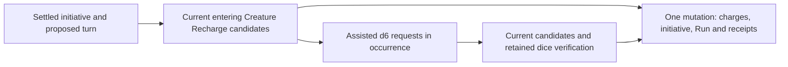

All four initial/continued initiative paths use the same turn completion boundary. Pending Recharge
does not publish normalized initiative or actor mechanics. Each response validates current authority,
Run/occurrence identity, the normalized source cursor and the exact rediscovered candidate sequence.
Previously completed candidate executions are reconstructed with their retained dice before the
next response settles. Native evaluation uses the installed actor rules and signed kernel continuation;
the former SQL actor-rule revision fields remain null. Unrelated Character Sheet revisions do not
invalidate already settled initiative or Creature Recharge.

Terminal `INITIATIVE_COMPLETE` receipts optionally retain `rechargeExecutions`, including each die,
policy/Feature pin and before/after usage. The field is absent on older or non-Recharge receipts, so
reading them adds no default and preserves their checksums. Exact root, initiative-response and
Recharge-response retries use retained command identity and current authority before new evidence
checks. A synchronous turn without retained turn evidence preserves its existing `occurrence: null`
response. Manual mode does not execute Recharge or Legendary Actions.

Native ADVANCE_TURN stages one Legendary Action choice per eligible other Creature owner, in
deterministic owner order. The choice offers only the options the System can execute; an option whose
authored shape it cannot execute yet (such as the SRD dragons' Tail Attack and Wing Attack, D50) is
left out rather than failing the turn, and an owner with none gets no choice. Decline, selected execution and Assisted d20 evidence remain occurrence-owned.
Every continuation reconstructs completed actions against current sources using the retained dice.
The outgoing owner queue finishes before EACH_ROUND initiative starts. Incoming Legendary pool
refresh and Recharge wait for the actual new current actor; actor changes, normalized initiative,
Run state and receipts publish together in the terminal mutation. Optional `legendaryActions` and
`legendaryActionRefreshes` fields retain this evidence in `INITIATIVE_COMPLETE` without changing
older receipt checksums. Active-effect and spatial Legendary actions still require their remaining
coordinators. These local implementations do not accept V10/V11 or a release gate.

Native Cleaving creates a deterministic child occurrence in the qualifying action's terminal
transaction. Each child retains the original attack and damage receipt, visited targets and exact
issued candidates. The current acting Character controller or GM may choose; player summaries omit
private targets. OPTION revalidates source, target and Scene facts before applying only retained
excess damage, without another attack roll, source charge or rider. DECLINE preserves authority,
occurrence and receipt checks but permits changed geometry to close the choice. Target damage, child
completion, any next child, Run version and response receipt publish atomically; retries bind the
original responder and exact command payload.

`encounters/projectionReads:pendingPrepared` exposes only PREPARED Runs with an initiative or Recharge decision visible to
the current recipient. It reuses the same private pending-decision reader as `pendingRuleOccurrence`;
ordinary player Run lists remain ACTIVE-only. The GM workspace, player Session list and tabletop use
the existing decision drawer to resolve these prepared choices. Generated API and native/browser
verification for this local integration remain separate from full V10/V11 acceptance.

Actor updates validate the indexed actor document against its checksum, Run, System and committed
projection. Side corrections must select a side of that Run and apply prospectively. Creature and
custom actors accept direct HP, temporary HP and condition edits; Character actors require the
existing Campaign-authorized Sheet command helper in the same mutation. The bridge copies current
HP, maximum HP, temporary HP and conditions from the resulting Sheet. It retains the actor's source
revision, snapshot, resources and initiative fields. Notes and public visibility remain GM edits.
These fields do not change actor-rule facts, so the mutation preserves committed features and the
initiative cursor, updates the actor fields and derives the health band with the shared projector.

UPDATE_ACTOR receipts retain the original Character receipt UUID when a Sheet command is supplied,
or null otherwise. This internal link replaces the legacy SQL event correlation rewrite; no public
DTO changes. Encounter replay returns its original committed result. A new Encounter command that
reuses an existing Sheet command retains that Sheet receipt and copies the current Sheet, matching
the Sheet helper's replay behavior. Actor, Sheet, Run and receipt writes share one Convex transaction.
Nested Sheet input retains its existing fingerprint semantics; outer Run, command, actor and side
UUIDs are normalized before the Encounter fingerprint is computed.

The internal `encounters/mechanicsBatch` helper is a local prerequisite for terminal rule outcomes.
It reads the current actor and Campaign-authorized Character facts, folds trusted kernel applications,
and writes Character state and compact Character history in the enclosing mutation. The parent supplies
the Character stream version it planned against and the current effect-adjusted maximum HP, which must
match the actor's stored maximum; the helper does not substitute the unreduced Sheet maximum.
Native Character policy remains computed from current sources and Campaign state. Full application
evidence belongs to the owning Encounter receipt. Root replay, initiator control, effect transitions,
Run projection/version and Scene/fog publication remain the terminal coordinator's responsibility;
the helper is not a public endpoint or a completed native movement path.

Other native Run commands remain unavailable. Start is the current pending-occurrence producer;
while its Assisted initiative choice is pending, unrelated commands are rejected. Generated
client/browser integration and actual backend transaction proof remain unfinished. No command
endpoint in this slice is deployed or accepted.

Native Run policy snapshot preparation reuses `resolvePlaySettingsSources` from Campaign settings.
That internal resolver returns the authorized current initiative graphs and optional-combat definitions
as well as enabled source IDs; Campaign save and catalogue-change validation use the same checks.
`encounters/policySnapshots.ts` captures exact definition/source/version/checksum/document tuples,
snapshot checksums, and current automation/reminder settings. The eventual Run command owns Campaign
authorization and atomic persistence; this reader neither writes a Run nor invents a GoRules revision.

## Historical: PostgreSQL connection and RLS

This section records the retired relational execution model and is not current guidance.

`createDb` builds a Postgres Kysely instance from `DATABASE_CONNECTION_STRING` and a bounded `pg` pool. `withUserContext(db, userId, fn)` starts a transaction, sets `request.jwt.claim.sub` with `set_config(..., true)`, and invokes `fn` with the transaction handle. This is how ordinary API calls execute under the caller’s Supabase RLS identity. Campaign procedures instead use explicit service authorization with the top-level server handle so their service-owned transaction commits before Broadcast; direct browser access to those product tables remains revoked.

Set `ARTIFICER_DB_QUERY_TRACE=1` to emit structured `artificer-db-pool`, `artificer-db-query`, and `artificer-db-transaction` timing records. Live commands attach the command ID and aggregate kind so pool acquisition, SQL duration/count, result row/byte counts, application time between statements, and total transaction time can be correlated without logging SQL text, parameters, user IDs, or row values. Local VTT integration enables this trace automatically. Netlify staging must set the variable with Functions scope; production leaves it unset.

Do not call repository writes outside the context selected by the API/service layer. A transaction can be passed as `DBLike` (`Kysely<Database> | Transaction<Database>`). Transactional repository operations reuse an incoming transaction and open one only for a top-level Kysely instance.

## Historical: SQL repository boundary

`user_roll_history` stores the latest 20 private roll records per user, including the character label and ruleset snapshot needed to interpret old evidence after source changes. Inserts and trimming share a transaction and user-scoped advisory lock. A hit-die roll is marked consumed atomically with the completed rest so its evidence cannot be replayed; it remains visible in history. RLS permits authenticated users to read only their own rows; application writes remain service-owned.

Repository contracts expose authored-shaped operations: `findById`, `findByIds`, `findAll`, and `upsert`. `createAuthoredContentRepository` owns cross-domain active metadata, immutable document-version reads, JSON draft storage, and timestamp-conflict locking. The authored-version repository returns validated immutable documents and compiled projections without exposing table topology. During the reset cutover, domain repositories still hydrate/write normalized aggregates for authoring mutation support; finalized mechanics and operational reads use version documents/projections instead. A repository may issue many SQL statements, but callers receive domain contracts and never raw Kysely builders.

`createAccountProfileRepository` exposes the signed-in account's username and bio. Username is the one public account name: new accounts require it, account creation claims it, and a user may rename it immediately from Profile. Dashboard invitations temporarily create a private profile with a null username; invitation completion claims the username before marking the account complete, and pending invite sessions cannot use product-data procedures. Usernames preserve display casing and contain 3–30 characters. Validation, moderation, lookup, and uniqueness compare them case-insensitively; `profiles_username_key` is a unique `lower(username)` index, so old names become immediately reusable and concurrent rename races return a conflict. Profile SELECT, INSERT, and UPDATE policies require `auth.uid() = profiles.id`; profile rows are not a public directory. Hard-deleting `auth.users` cascades through the profile, owned authored content, classes, drafts, characters, and current Sheet state only after any owned Campaigns have been transferred or explicitly deleted through reconciliation. Campaign authority and audit use Campaign-owned records rather than widening Character-owner RLS.

## Campaign foundation

### Native Session scheduling and attendance — partial local implementation

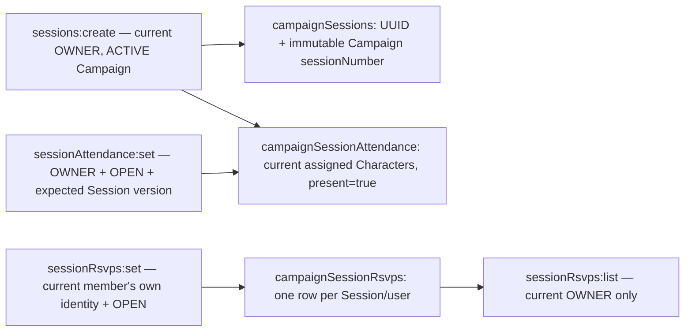

Session creation reads the latest Campaign-scoped number and inserts the next number plus initial
attendance atomically. Convex's indexed range conflict tracking serializes competing creators;
the existing maximum active roster bounds assignment validation. Multiple OPEN Sessions are
allowed. The Campaign clock is not part of this operation. No schema, handler, or public list
places a cap on total Session history.

Current active members can read Sessions and historical Character attendance, including in archived
Campaigns. Owner-only metadata updates require the exact Session version, validate the merged
schedule through the shared creation validator, and increment once. Omitted fields are retained;
clearing a schedule requires all three nullable fields. FINISHED Session metadata remains editable,
but RSVP and actual-attendance writes require OPEN Sessions and an ACTIVE Campaign. Attendance
also requires the expected Session version and a currently valid assigned Character belonging to
an active player. RSVP/attendance writes do not increment the Session metadata version, preserving
the existing contract. Creation and attendance changes never grant Character or membership access.

STANDARD titles are masked for all viewers, including the owner; original stored text remains
unchanged. `campaignSessionLists` adds native pagination beside the unchanged legacy array
contracts. Session order is descending session number, attendance is ascending Character UUID,
and RSVPs are descending update time with a stable user-UUID tie-breaker. Reads are indexed with
32-row/one-MiB page targets and continuation metadata, not roster/history truncation. RSVP players
receive a completed empty page without reading response rows or exposing page counts; Campaign
and Session access is still checked first. Returning a saved RSVP does not permit impersonation.

The native web Session workspace, notes, references, attendance, RSVP and pickers now use these
subscriptions and mutations, with explicit continuation controls. The tabletop launcher reads
`sessions.latestOpen` through the Campaign/status/Session-number index so a newer finished Session
cannot hide an older open Session. P15 concurrency and control proof is accepted; complete
membership/account/Campaign lifecycle cleanup remains with P09/F12 and release proof with R08–R10.
The 2026-09-18 owner ruling adds selectable background Campaign copying to P09.
Metadata/settings retain the existing copy contract; notebooks are selected explicitly by GENERAL,
PEOPLE or PLACES category and default to none. The personal Encounter Library is already reusable;
prior Session/player notes, Runs, membership grants and play history are excluded. Notebook storage
remains uncapped. This implementation is in progress; focused source edits are not acceptance proof.

`campaignCopyJobs` owns an actor-bound command fingerprint, checksummed metadata snapshot,
reserved destination UUID, selected categories, continuation state, copied-section count and terminal
status. Native scheduled mutations stage at most eight indexed notebook rows per transaction with a
one-MiB read target. An optional server-owned `campaigns.notebookRevision` UUID changes through the
shared mutation trigger on every notebook write; it does not change the public metadata version.
Each batch/publication rechecks the live initiating owner/account, expected Campaign version and
captured notebook revision. Source changes abort the unpublished copy rather than combining versions.
No root, route or membership exists for the reserved destination until final publication atomically
creates them with entitlement usage and the private copy receipt. Owner-only progress survives reload;
completed destination access is checked again before returning its detail. Cancel/failure/deadline
cleanup removes only validated unpublished staging in bounded continuations. Source/account deletion
schedules complete job cleanup without a copy veto; completed destination aggregates are preserved.
Normal failed/cancelled job status remains available to its owner until source/account cleanup.
See ADR 0015. Complete native/backend/browser lifecycle evidence remains pending.

### Native Session finish and collaborative notes — partial local implementation

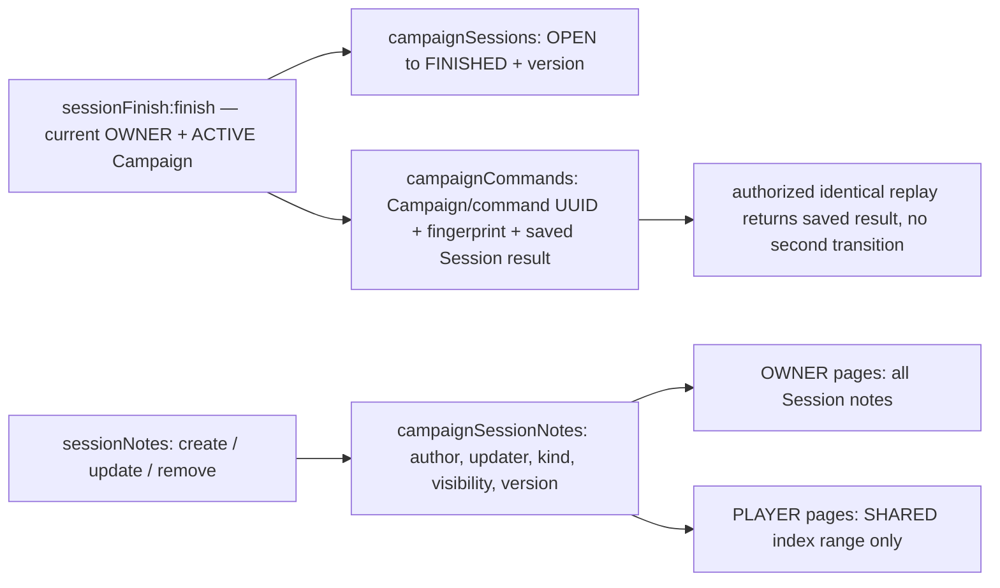

The finish transition requires the exact current Session version and OPEN status. Its saved result
and lifecycle update commit in one transaction. Command UUIDs are Campaign-scoped; the command type
and canonical-JSON input fingerprint reject conflicting reuse. Replay first rechecks current owner
and writable-Campaign authority, then returns the original validated result, even if subsequent
metadata edits changed the Session. This preserves the SQL command contract: the receipt captures
the presentation at the time of finishing, not a newly rendered live Session. Stored result identity,
status and resulting version must match the original request. FINISH_SESSION and the eight native
Clock commands share this closed command contract and UUID namespace. Finishing a Session does not
reset the Campaign clock.

Notes remain Session-owned and editable after finish. Any current active member may create or edit
a SHARED_NOTE; only its original author or the current owner may delete it. GM_PRIVATE notes and
transitions into/out of private visibility require the owner. Kind and visibility are validated as a
pair, including on merged partial updates: SHARED_NOTE is shared, every preparation/closeout kind
is private. Exact optimistic versions guard edits; original author attribution is retained while
updater attribution records the current actor. Delete retains the existing no-version contract.

Session-note DTOs keep public UUID identities, author and sort order while omitting internal updater
and Convex fields. Private text remains original; shared STANDARD title/body presentation is masked.
Reads use Campaign/Session/sort-order/UUID indexes, with SHARED included before ordering for players,
so private rows cannot affect their pages or pagination metadata. Eight-row/one-MiB targets bound
each page without capping history. Archived reads remain available to active members, but every
write is denied; removed members lose all access. Cleanup remains pending.

### Native Session reference pins — partial local implementation

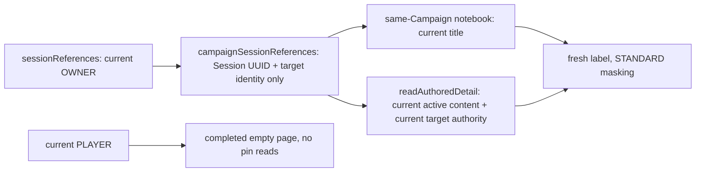

Pins are navigation references, not content snapshots or access grants. Creation validates the
current target and stores the identity in the same mutation. Notebook targets must belong to the
Campaign; the owner may pin private notebook sections. Authored targets use the existing active
detail reader, including route kind, ownership, content-source authority and document validation.
There is no additional Campaign-System restriction. All labels, including private notebook titles,
use Campaign maturity presentation; original target text is unchanged. Duplicate targets remain
permitted, matching the existing SQL behavior.

Owner reads resolve targets again, omit missing/inaccessible targets without deleting stored pins,
and retain the candidate-page continuation even when no visible pins remain on that page. Reads use
Campaign/Session/created-time/UUID order with four-row/one-MiB candidate targets and no total history
cap. Active players receive a completed empty page before Session lookup, preserving the existing
owner-only reference-list boundary. Removed/anonymous users receive no access. Create/remove require
an ACTIVE Campaign; archived reads remain available and FINISHED Sessions still allow pin changes.
Removal scopes the pin to the Campaign and Session but does not require access to its former target.
Explicit notebook removal deletes that section's pins across Sessions atomically; read-time omission
does not perform cleanup. Native web bindings are implemented; Campaign/account cleanup and complete
backend concurrency/privacy/E2E acceptance remain pending.

### Native Campaign clock — partial local implementation

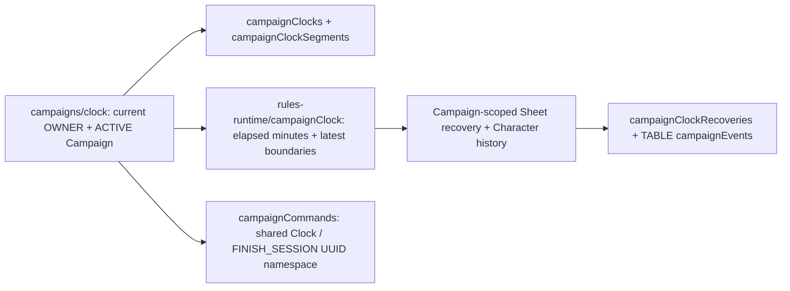

Pure day/minute conversion, timestamp-based derivation and latest DAILY/DAWN/DUSK selection now
have one platform-neutral implementation shared with the transitional service. A large forward jump
selects at most the latest occurrence of each boundary kind, ordered by absolute minute with
DAILY/DAWN/DUSK tie order; repeated recovery within one atomic command cannot observe intervening
resource use. Derivation retains one real minute per game minute, preserving the fractional elapsed
remainder in `runningSince` across reconciliation. It leaves the durable version and processed-boundary
watermark unchanged. Segment timestamps record actual command boundaries; the running anchor records
the last accounted whole minute. Absolute targets and boundary arithmetic stay within safe integers.

Initialize, configure, start, pause, advance, rewind, reset and reconcile use the authorized canonical
Campaign UUID. One Convex mutation writes clock/segments, Campaign-scoped Character resource changes,
Character history, TABLE audit events, once-only recovery rows and the command receipt. Each resource
uses the Sheet version returned by the preceding recovery. Rewinds and backward resets retain the
processed watermark; correction commands retain their reason. Current authority precedes replay,
which returns the original result and rejects command UUID reuse with different input or type.
Clock reads do not load Character recovery dependencies. The public clock mutation calls the validated
internal recovery mutation in the same Convex transaction; each boundary rechecks current identity and
OWNER authority, and a failure rolls back the complete clock command. Share removal uses the same
internal mutation boundary so share reads do not load reconciliation or Vehicle evacuation code.
Within one mutation, resource recovery reuses the Character-bound authored source context while
rereading current Character state, authority and Campaign overlays for each Sheet evaluation.
Resource/Spell slot counters, Spell casting and GM adjustment overlays do not change authored source
selection; their post-write validation can reuse those source reads. Known/prepared Spell changes
reuse the complete authorized Spell document set and reevaluate the new selection. The context never
crosses mutation invocations, and Convex retries repeat the initial reads. Commands requiring sources
outside the loaded set continue loading fresh sources. The immutable authored context is compiled
once into a context-bound Character assembly registry for these repeated passes. Every pass still
assembles the current Character snapshot, runs full Builder reconciliation and eligibility, and
validates current policy facts and output. The registry is rebuilt when finalization loads newly
materialized Equipment sources; it is never persisted or shared between requests.
Member reads derive elapsed time without writes; only an active owner reconciles from the web.
Native Clock/Session web bindings and transactional tests are implemented. P15 managed concurrency,
replay, privacy and once-only recovery proof is accepted. The frozen workload performance gate and
complete same-source release proof remain V15 and R08–R10.

### Native Campaign notebooks — partial local implementation

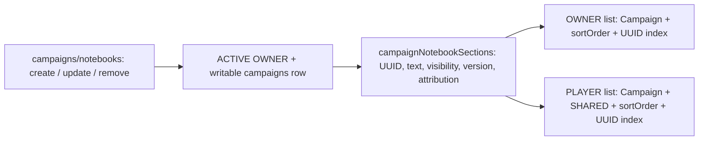

Notebook sections remain Campaign-owned preparation. Mutations use current Better Auth identity
and the canonical Campaign authority check. Creation defaults to GM_PRIVATE / GENERAL, sort order
zero and version zero. Updates require the exact current version, retain omitted fields and
increment once; removal retains the existing owner-only, no-version delete contract. Exact section
lookups include the Campaign UUID, preventing cross-Campaign writes. UUID lookup/storage uses
canonical lowercase. Internal creator/updater attribution and sort order are retained but not
exposed in the unchanged note DTO.

Removal deletes all matching Session reference pins through the Campaign/notebook index in the
same mutation, preserving the former SQL foreign-key cascade. Indexed batches impose no total pin
cap; exceeding transaction limits fails the entire removal without partial cleanup. Other notes,
authored-target pins and Sessions remain unchanged.
The same removal also cascades Campaign attachments associated with the section, retaining assets
referenced elsewhere and starting normal media grace for the last reference. See
[native attachment metadata](media.md#native-campaign-attachment-metadata--partial-local-implementation).

Native list pages replace the legacy all-notes array at the Convex boundary. Pages read at most
eight rows, with a one-MiB read target and continuation metadata; they impose no total note limit.
Ordering remains sort order then UUID ascending. Player reads query only the SHARED index range,
so private notes do not affect page contents or metadata. Active members may read archived
Campaigns; departed members cannot. GM_PRIVATE text stays original, and STANDARD SHARED titles
and rich text are masked even in owner mutation responses, preserving the existing policy. Convex
reactivity replaces notebook Broadcast invalidation without a second transport or dual write.

This is partial local P14 implementation, not full collaboration acceptance. Attachment processing/delivery,
Campaign copy/deletion and account cleanup and the full
real-backend concurrency/privacy/E2E lifecycle remain pending. Notebook editors and note pickers now
use the [native collaboration transport](transport.md#native-campaign-collaboration-transport).
The old SQL adapter remains only on
the unmigrated transport.

### Native conversations and text chat — partial local implementation

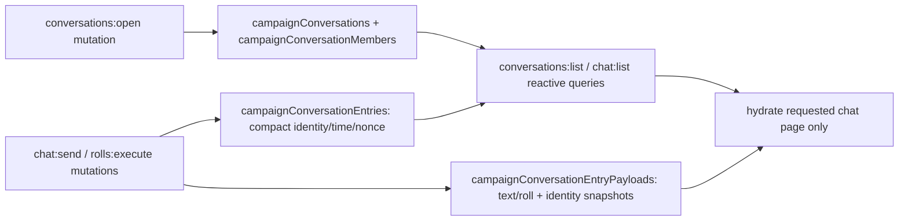

`campaigns/conversations:open` replaces legacy query-side room creation with an explicit mutation.
The client opens TABLE (and PARTY for a player) when entering communication, and opens a DIRECT pair
when selected; queries only read existing rooms. Opening restores the caller's current membership
epoch, preserving the monotonic last-read timestamp. DIRECT opening checks and refreshes both active
participants. TABLE permits active members; PARTY permits active players only; DIRECT permits its
two active participants only. Read, unread, mark-read, replay and edit/unsend predicates share current
room authority and the member's access-start cutoff. Announcement history retains its separate
current-membership predicate below. Opening/read bookkeeping is allowed on archived Campaigns, but
send/edit/unsend is not.

Conversation lists derive possible DIRECT pairs from the bounded active roster rather than scanning
historical peer memberships. At most fourteen visible rooms each read at most 500 compact headers;
counts never load message/roll bodies. The two row parts are authoritative halves of one entry, not
a cache: insert and retention deletion commit together. Payload hydration is restricted to the
requested visible page. Retention keeps the newest 500 CHAT/ROLL/tombstone entries per conversation,
ordered by timestamp and UUID descending. Unread includes the actor's own retained entries after
the current cutoff and strictly after the last-read timestamp; equal-time entries share read state.

Text sends retain the 2,000-character limit. Text and public rolls share the
thirty-retained-sends-per-actor/Campaign/rolling-minute policy.
The nonce key is Campaign plus author plus nonce: same-conversation, same-kind retries return the original
entry, while a different conversation or entry kind conflicts. A replay cannot expose pre-cutoff
history. UUID storage and lookup keys are canonical lowercase. Current assigned-Character authority
is required for ROLEPLAY; OOC uses the authenticated username. Message-time account/Character snapshots
remain unchanged by later account renames or assignment removal. STANDARD text is masked for every
chat viewer, including the GM. Author-only edits expire after fifteen minutes; unsend expires after
five minutes and retains a tombstone. Roll payloads are immutable.
Masking may expand short words. The shared entry presenter bounds displayed bodies, roll-source labels
and Character labels to their existing DTO limits, preserving readable history after a MATURE-to-STANDARD
change without altering stored text or evidence.

Native text-room opening now supplies the PARTY prerequisite used by the announcement source tests.
Actual admission/removal lifecycle, Campaign/account
deletion cleanup and complete multi-client/local acceptance remain
unfinished. No old Broadcast or SQL adapter is called by these native endpoints.
The frontend now opens selected rooms explicitly and subscribes to requested history pages through
the [native collaboration transport](transport.md#native-campaign-collaboration-transport).

### Native Campaign rolls — partial local implementation

```mermaid
sequenceDiagram
    participant Actor as Current GM or assigned player
    participant Public as campaigns/rolls:execute
    participant Sheet as Current scoped Character Sheet
    participant Table as TABLE entry header + roll payload
    participant Private as campaigns/rolls:executePrivate
    participant CharacterRoll as campaigns/characterSheet:executeRoll
    participant History as Caller userRollHistory (latest 20)
    participant Rest as Scoped rest preview + COMPLETE_REST
    Actor->>Public: TABLE or GM destination + nonce + structured roll request
    Public->>Sheet: Validate assignment and current non-manual source
    Public->>Table: Generate evidence and insert/trim atomically (GM: player-owner DIRECT room)
    Public-->>Actor: Original stored roll, shared-text presentation
    Actor->>Private: GM-only manual or Character request + blind flag
    Private->>History: Generate evidence and insert/trim atomically, bound to the Campaign
    Private-->>Actor: Private roll (blind: evidence withheld); no conversation write
    Actor->>Public: reveal(roll id), GM only
    Public->>Table: Post once with revealedByGm (roll id is the nonce); mark revealedAt
    Actor->>CharacterRoll: Campaign + assigned Character + structured private roll
    CharacterRoll->>Sheet: Validate current assignment and roll source
    CharacterRoll->>History: Generate Character-bound private evidence
    Actor->>Rest: Roll UUID/evidence + current preview fingerprint
    Rest->>Table: Consume caller's exact GM-visible hit-die evidence with state + receipt
```

Public generation accepts only TABLE. Players may roll for their own current assigned Character;
the GM may roll for any currently assigned active player's Character. Both use the same source
resolver and unbiased mutation-local Web Crypto evaluator as personal rolls. Non-manual requests
match current scoped Sheet mechanics, including secret Campaign adjustments, against the actor's
displayed labels while retaining authoritative original snapshots. Manual Character rolls normalize
their label to `Manual roll` and do not require Builder readiness. Public evidence enters only the
TABLE timeline, never personal history, and remains immutable through chat edit/unsend APIs.

GM manual requests without a Character retain the existing prerequisite of at least one valid
assigned player Character. The Campaign's current System supplies ruleset metadata. Private GM
generation accepts only this manual form and writes only the caller's twenty-record history; it
does not open a room or alter unread counts. Its user-entered private label remains original.
Public responses and later history reads apply STANDARD masking without rewriting stored snapshots.

Character-bound private generation is the separate `campaigns/characterSheet:executeRoll` mutation.
It accepts the shared refined roll request plus explicit Campaign/Character UUID scope. The current
assigned player may roll for their own Character; the active GM may roll for any valid assigned
player Character. Archived Campaigns reject generation. The same evaluator validates mechanics and
displayed source labels, stores raw evidence only in the caller's latest-twenty history and applies
current Campaign presentation to the returned snapshot. History remains caller-only and applies the
current Character Campaign's maturity even when the caller is the GM rather than the Character owner.
That metadata lookup grants no Character action or source read authority; old caller-owned snapshots
do not become inaccessible merely because the caller no longer has GM action authority.

Rolls that change Character state stay visible to the GM. Scoped rest preview and completion read
the caller's exact unconsumed HIT_DIE record for the assigned Character from its one stored place:
the caller's TABLE or To GM chat payload in this Campaign (looked up by the `roll.id` payload index),
or the GM's own non-blind retained Campaign roll. A player's retained "Just me" roll is refused for a
Campaign rest; a personal Character outside a Campaign still settles from retained history.
No-Character manual records cannot substitute. Completion atomically updates Character HP/hit
dice/recoveries, sets `consumedAt` on that stored roll record and stores the actor-bound receipt. Exact replay returns stored rest
evidence after history clearing but still rechecks current scope. No new table, receipt or rest
algorithm is introduced; resetting the player's private maximum-HP modifier remains forbidden to GMs.

Current Campaign/Character authority and the room access epoch precede public replay. The existing
nonce contract returns the original same-room/same-kind entry, even when a retry supplies another
valid expression; it is not an exact-payload command receipt. Deduplication lasts only while the entry
is retained; no permanent secondary receipt is added. Replayed entries do not reroll, consume
rate capacity or change retention. Revocation, archive, changed assignment and pre-cutoff history
reject; a CHAT or other-room nonce conflicts. Public rolls share text retention and rate accounting
through the same native helpers. The personal roll endpoint remains owner-only and gains no implicit
GM access. Private GM calls have no nonce: a new explicit invocation generates a new roll.

This is native backend integration, not complete P06/P14 acceptance. Campaign browser bindings,
Encounter/clock roll production, managed concurrent replay and full affected journeys remain pending.
Public TABLE evidence is not inserted into the private history used by rest completion.

### Native announcements — local implementation

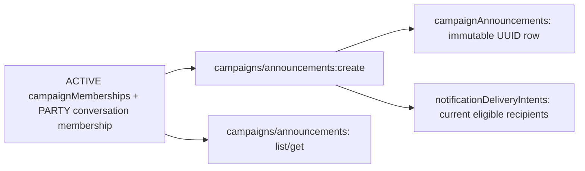

The native source mutation authenticates the current owner, rejects archived writes, and commits the
announcement and bounded recipient intents together. Campaign/command uniqueness plus a canonical
input fingerprint makes identical replay read-only and rejects changed input. Shared UUID contracts
remain platform-neutral. Notification payloads contain the fixed safe summary, never announcement
text. TABLE includes active members other than the publisher; PARTY additionally requires an existing
player conversation membership. The mutation derives the PARTY room from the Campaign and rejects a
foreign supplied room ID. Departure closes subsequent destination reads even if an old feed item
remains. Standard player reads mask text; owner publication responses retain the owner's text.

Native lists paginate the complete visible history, ordered by timestamp and UUID. Owner lists query
only the TABLE index range, so private PARTY rows cannot affect counts, page boundaries or cursors.
PARTY reads require the current Campaign's unique PARTY room and active player membership; OWNER
status is never an override. There is no public announcement edit/delete mutation. Conversation
records use shared storage contracts; native room opening refreshes membership epochs as described
above. The Campaign page uses native reactive list pagination, direct authorized deep-link reads and
native publication. An unavailable deep link displays generic unavailable state without replacing the
Campaign workspace. Campaign admission/removal and deletion cleanup remain with their owning cases.

### Native Campaign creation and reads — local implementation

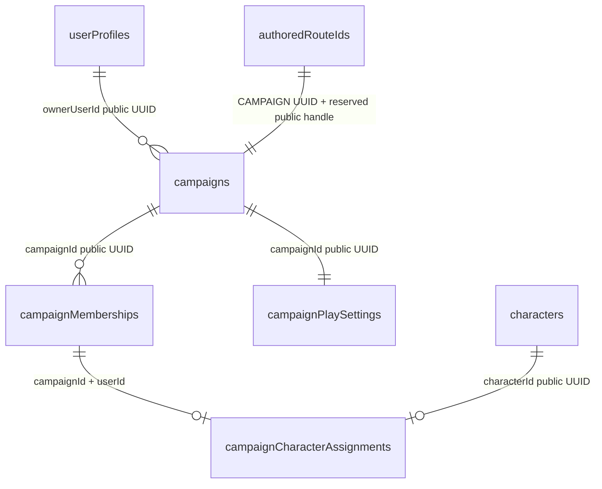

`apps/apis/convex/campaigns/create` writes the root, active OWNER membership, default play settings
and route identity in one mutation. The authenticated owner comes from Better Auth, never the input.
An indexed active-owned count and the current entitlement are read in that transaction; archived
Campaigns do not consume the existing active-host limit. Root and play-setting versions start at zero,
matching the current contract. Campaign `content/catalogueBinding` requires primary and additional
catalogues to belong to the chosen System and contain only valid platform sources. Character creation
and rolls use the shared verified System reader, not a Character-level catalogue binding. Personal
Character content reads use explicit platform catalogue inclusion plus owned Homebrew; future Campaign
admission must restrict actual content dependencies. No SQL adapter or dual write is involved.

`campaigns/queries` exposes member-only detail, owner-only unmasked settings and paginated current
membership summaries. UUID and reserved-handle reads resolve to the same root. Role, owner and active
membership must agree; there is no superadmin membership bypass. Current usernames come from Better
Auth and are projected without email or provider IDs. Assigned Character output contains only its
public identity/label/System and verifies member ownership, route ownership, System and the unique
assignment. These reads do not evaluate or repair current Character rules sources.

Roster reads use the existing maximum tier capacity of twelve players plus one owner, with an extra
sentinel row to reject overflow rather than truncate. This preserves readable rosters after a tier
downgrade. List pages bound membership rows to eight before joining assigned Character documents;
the cursor walks membership join time descending and has no total-history cap. Browser integration
must preserve the existing active-first/creation-time display order when consuming all pages.
`shared/campaign/capabilities` is the single capability policy used by native and transitional code:
OWNER never gains PARTY access, and archived Campaigns expose only their existing read capabilities.

`campaigns/archive:archive` checks current active OWNER authority and the expected root version, then
atomically changes status to `ARCHIVED` and increments the version. It preserves membership, settings,
assignments and route identity, and returns the shared read-only detail. A failed final projection
rolls back the write. Archived roots no longer consume active-host capacity. There is no restore
command. Archival advances the root timestamp monotonically, including immediately after a
same-millisecond ownership transfer. Before committing archival, the shared native admission-closure operation closes the
Campaign's listing, expires only SUBMITTED applications and PENDING invitations, and cancels their
associated notifications in the same transaction. Accepted admission history, memberships and pending
ownership-transfer records remain intact; archived write authority prevents accepting those offers.
Already CLOSED listings do not advance their version again. Public listing publication/admission
writers, migration population and real-backend/browser lifecycle acceptance remain unfinished.

`campaigns/copy:copy` requires current source OWNER authority and the expected root version,
including for archived sources. It starts the actor-bound bounded job described above. Metadata,
settings and attunement copy automatically; GENERAL, PEOPLE and PLACES notebook categories copy only
when selected and default to none. Membership, shares, Characters, inventory, Sessions, chat, prior
Runs/player notes and admission state are excluded. The destination UUID is reserved while bounded
pages stage selected notes, but no root, route, membership, usage or receipt becomes visible until
final atomic publication creates the fresh active aggregate. Exact replay requires current destination
access. Cancellation, expiry, source/account loss and failed publication use bounded staging cleanup.
Native create, archive and copy have browser bindings; complete lifecycle acceptance remains pending.

#### Native Campaign play settings — local implementation

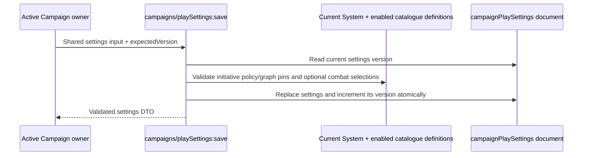

The mutation derives current OWNER authority from Better Auth and active Campaign membership, rejects
archived Campaigns and stale settings versions, and validates every selected policy/graph against the
Campaign's enabled same-System platform catalogue sources. The existing System-wide 100-source bound
also bounds merged Campaign catalogue reads; sources shared by enabled catalogues are read once.
Current v3 and v4 System initiative defaults are respected. A missing default means no automatic
initiative policy; an explicitly configured but unavailable policy fails closed. Optional selections
retain their existing bounded UUID, capability, current vocabulary, duplicate-kind and exclusion checks.
The native mutation and transitional SQL services reuse the neutral rules-runtime validators.

Only the settings document advances; the Campaign root version and existing Character/Encounter state
or frozen policy snapshots do not change. Native creation always supplies settings, so missing/corrupt
settings reject rather than creating a parallel implicit lifecycle. `campaigns/playSettings:get` allows
active members to read even archived Campaigns. Owners retain original policy text; STANDARD member
views use the existing shared text policy without rewriting stored text. Reads never repair data.
`campaigns/playSettings:options` uses the same active-member read authority and enabled catalogue
binding. The shared indexed current-definition reader excludes unpublished drafts and verifies source,
System, publication metadata and checksum integrity before projecting compact labels. It shares the
authoring inline ceiling of 500 current definitions across the selected sources and fails rather than
truncating. Duplicate catalogue inclusions are read once. The neutral projection preserves current
SQL discovery semantics: policies with unavailable tie definitions and unsupported optional-combat
modules are omitted; exact policy pins and optional-rule vocabulary are revalidated when saving.
The web Campaign settings and table-settings panels use the native settings, options and update
functions. Reactive query results replace the prior settings caches; the still-transitional Campaign
detail/list surfaces are invalidated after structural updates. Archive/delete remain on their lifecycle
owner until P09.

Complete member admission, copy/delete, reconciliation, Encounter authority and other Campaign browser
acceptance remain cutover work. Active Campaign deletion is now implemented locally through
[the native deletion command](#native-campaign-deletion--unified-local-lifecycle); its complete
live lifecycle remains pending. Account deletion still requires the native orchestrator and full
owned-data cleanup; it cannot skip these dependencies.

#### Native Campaign update — partial local implementation

```mermaid
flowchart LR
    Owner["Current ACTIVE OWNER + expected Campaign version"] --> Update["campaigns/update:update"]
    Update --> Binding["Proposed same-System catalogues + selected rule definitions"]
    Binding --> Root["Replace Campaign root in one transaction"]
    Root --> Dependencies["Validate assigned Characters/drafts, shared parents, Equipment and Vehicles"]
    Root --> Sheet["Changed attunement: evaluate every assigned ACTIVE Sheet"]
    Root --> Social["Name: refresh pending admission versions; material metadata: expire/cancel"]
    Dependencies --> Result["Validated shared Campaign detail; failure rolls back all writes"]
    Sheet --> Result
    Social --> Result
```

Updates preserve the immutable System, owner and route, retain omitted fields, support contract-defined
null clearing and increment the root version even for a no-op. Shared return text uses current Campaign
maturity; owner settings retain originals. Timestamps advance beyond both stored Campaign and listing
timestamps. OPEN recurring listings prevent a One-shot format change; DRAFT/CLOSED listings do not.

Catalogue changes reuse the play-settings source validator for effective System/default or selected
initiative policy, every pinned graph and optional combat definitions. Actual source removal—not an
equivalent catalogue alias change—checks assigned canonical Characters and saved drafts under the
proposed Campaign policy. It rejects source loss or structural pruning, naming the dependent Character.
Shared content rechecks current official or explicitly shared Homebrew parent chains. Party and Vehicle
inventory Equipment and Vehicle definitions must remain readable. New or rejoined Character assignment
may carry validated held acquired Equipment without current author sharing, while structural and new
authored choices still require current sources. Catalogue-removal validation retains its rejecting
current-source dependency checks even for held Equipment with retained rules. These are rejecting validations,
not source-removal reconciliation writes: no Character choices, drafts, custody or shares are pruned.

Native attunement mechanics are evaluated dynamically from Campaign state. The mutation validates
every assigned ACTIVE Sheet in the same transaction, without introducing a durable mechanics overlay
or rewriting Character streams. Repair-state DRAFT Characters have no active Sheet to evaluate.

A name change advances the linked listing and pending admission versions without cancelling
notifications. Format, ordered tone tags, tone details or maturity changes expire pending admission
and cancel its pending notifications. Accepted admissions and memberships remain unchanged.
Description/catalogue/attunement-only changes leave Social versions alone. Unlike direct listing edits,
Campaign updates retain CLOSED listing status. The listing projection joins current Campaign metadata;
there are no duplicated search fields to synchronize.

Native Blueprint and Run creation now have local storage and writers. The rejection transaction
protects initiative and optional-combat source pins in prepared/active Runs, independently of current
Campaign settings. Remaining authored Encounter source dependencies must join their native command
and reconciliation paths before those producers activate, per ADR 0025.
Full indexed Campaign-content traversal has no invented product cap; managed transaction headroom,
real contention/privacy, generated client/browser wiring and the complete same-source local lifecycle
remain pending. Focused mutation tests are implementation evidence, not acceptance or promotion.

#### Native Character assignment and departure — partial local implementation

```mermaid
flowchart LR
    actor["ACTIVE Campaign player or owner"] --> assign["assignments:assign"]
    assign --> binding["campaignCharacterAssignments: one Character per player; one Campaign per Character"]
    assign --> validate["Current Campaign sources + Builder readiness; no intent rewrite"]
    actor --> unassign["assignments:unassign or replacement"]
    unassign --> depart["characterDeparture: one atomic mutation"]
    depart --> currency["Campaign coins to loose party custody + OWNER audit"]
    depart --> remove["Delete assignment and campaignCharacterStates overlay"]
    remove --> reconcile["Personal source access + saved draft repair + HP clamp"]
```

Players assign only their own active, same-System Character. Owners may assign an active player's
Character but never their own. Existing coherent bindings are no-ops, including a Character already
in repair. Indexed reads enforce both uniqueness invariants through Convex transaction conflicts.
Replacement validates the proposed binding inside the transaction; failure also rolls back departure
currency, Character/draft updates, overlay removal and events. Assignment does not commit changed
Builder choices or accept a Character merely because its obsolete primary-catalogue field matches.

Player unassignment defaults to their current Character; an explicit different ID is denied. Owners
must name a currently assigned player's Character. Departure resolves actual authored references
against personal access after removing the assignment, preserving owned and available official content.
Access discovery and source removal qualify each reference by authored kind. Chosen grant targets
use existing Builder grant-owner definitions and exact grant/source/progression identity. System
vocabulary choices and embedded feature-option IDs are not authored roots, even when their UUID
matches an unrelated private root. Canonical and saved-draft grant kinds are resolved separately;
the shared pure pruner requires this map from both native and retiring SQL callers.
The existing source-loss repair path prunes unavailable references in both canonical state and saved
draft, retains private Sheet state/history, and creates a repair draft when required sources are lost.
It also re-evaluates after overlay removal with no authored source loss, clamping current HP to the
personal maximum. Only changed canonical documents advance the Character stream. Currency returned
from canonical state is also removed from the saved draft without overwriting its other private fields.

These handlers are local implementation, not P10 acceptance: generated client references/native web,
complete real-backend concurrency/privacy journeys, Campaign/account departure producers,
and custom Character currency identity integration remain unfinished.

#### Native member departure — partial local implementation

```mermaid
flowchart LR
    command["membershipDeparture:leave or removeMember"] --> authority["Actor + ACTIVE PLAYER target + Campaign version + access epoch"]
    authority --> assignment["Character assignment, overlay and currency departure"]
    assignment --> shares["Author's direct shares + shared descendants"]
    shares --> dependents["Remaining Character repair + Vehicle cargo evacuation"]
    dependents --> receipt["One Campaign version + OWNER receipt with target epoch"]
    receipt --> left["Membership LEFT; history retained"]
```

All writes occur in one native mutation. Players leave only themselves; the current owner may
remove an active player but cannot remove or leave their owner membership. Archived Campaigns reject
new departures. The existing assignment-departure helper runs before membership revocation, so it
can validate the binding and return Campaign currency, then reconcile the departing Character
against personal source access. Owned content remains available to its author. Indexed author-share
selection feeds the same descendant expansion, remaining-Character repair and Vehicle evacuation
used by explicit unshare. The Campaign version advances once, including when there are no shares.

The OWNER receipt records the target user and access epoch. Its command fingerprint binds operation,
actor, target, expected Campaign version and expected membership epoch. Exact replay returns only
the unchanged public `{ ok: true }` acknowledgement, even after access revocation, without granting
Campaign reads or removing a rejoined membership. Explicit unshare likewise checks the original
actor/input-bound receipt before current Campaign authority, so a lost response can be recovered after
leave, removal or archival; new unshare commands still require current write authority.
A new departure command with a stale epoch rejects. Chat,
conversation membership, RSVP and attendance history are retained; existing current-membership
and access-epoch predicates revoke reads and later traffic. No departure notification is introduced.

This is focused local implementation, not P10 acceptance. The approved source-loss policy preserves
already acquired Equipment and its usable rules in Character, party and Vehicle custody when its
authored source is unshared, deleted, or lost through author departure. The removed source must not
supply new copies. This contract was approved on 2026-09-15 and is now implemented locally through
server-owned `retainedRulesJson` on held item instances. It contains exact raw Equipment ancestry and
required Spell documents with public UUID, immutable version identity, version, and checksum pins.
Strict shared schemas reject duplicate, missing, unrelated, corrupt, wrong-System, or over-limit
dependencies; the rules runtime resolves usable mechanics from these raw documents. No flattened
compiled rule cache is persisted. Current authorized publication remains authoritative while readable;
source loss captures its last current raw rules before removing authority. Already inaccessible held
items use only their validated retained rules. New-copy pickers and quantity increases require current
source access. Acquisition, transfer, departure, unshare, deletion, and Character draft repair retain
these fields inside their existing atomic mutation boundaries. Complete local and real-backend
lifecycle proof remain required for P10/P12/P13 acceptance. Atomic fan-out remains subject to Convex
transaction limits; maximum-workload and real-backend OCC/privacy proof, admission,
generated client/native web integration and the complete final-source lifecycle remain pending.

#### Native ownership transfer — partial local implementation

```mermaid
flowchart LR
    offer["ownership:request — current OWNER → active PLAYER, seven days"] --> accept["ownership:accept — exact recipient + current authority + hosting capacity"]
    accept --> detach["Incoming owner's Character assignment/overlay/currency departure"]
    detach --> admission["Listing CLOSED; pending applications/invites EXPIRED; notifications cancelled"]
    admission --> roles["Root owner + both roles/access epochs + consumed offer"]
```

One indexed `campaignOwnershipTransfers` row per Campaign is replaced by a renewed request.
Acceptance is one native mutation; the offer must remain unexpired, its sender must still own an
ACTIVE Campaign and its recipient must remain an ACTIVE PLAYER with hosting capacity. Existing
assignment departure removes the incoming owner's Character binding and reconciles personal source
access. Both users remain members, so their authored shares are retained. The Campaign advances one
version; the offer is deleted, and a repeated acceptance rejects rather than creating a new receipt.

The listing's derived owner changes even when already CLOSED. Indexed SUBMITTED
`socialApplications` and PENDING `campaignInvites` expire in the same transaction. Application
notification cancellation targets the former owner; invitation cancellation targets each recipient.
Historical accepted admissions remain unchanged. These new storage schemas retain neutral UUIDs;
public admission writers and migration population are separate unfinished work.

Both role changes share an access epoch strictly later than the current clock and every active
membership epoch. Text-chat and public-roll entry timestamps use the maximum of the current clock
and those epochs, so pre-transfer same-millisecond PARTY history stays private while subsequent
traffic remains visible. Current-role and membership-epoch checks still gate every conversation.
This is local implementation, not P10 acceptance: real-backend OCC/privacy, maximum atomic workload,
generated client/browser integration and the complete final-source lifecycle remain required.

#### Native Campaign deletion — unified local lifecycle

```mermaid
flowchart LR
  Request["deletion:remove — ID/version/DELETE"] --> Fence["Owner and moderation checks; persist Deleting fence"]
  Fence --> Drain["Drain captured Session DO outbox and release authority"]
  Drain --> Depart["Close admission; reconcile Character assignments"]
  Depart --> Root["Remove root and route; release hosted usage"]
  Root --> Children["Bounded Campaign, Run, Scene and Social child cleanup"]
  Children --> Done["Deleted; failure remains fenced and retryable"]
```

The native command retains the existing shared deletion input and { ok: true } result. Its public
facade delegates to a strictly validated internal mutation; the writer derives current identity and
authority in the fence transaction. Permanent deletion of active or archived Campaigns requires the
canonical current owner with an ACTIVE OWNER membership. The literal DELETE confirmation, displayed
root version and moderation restrictions apply to both statuses. Physical cleanup follows the single
resumable lifecycle in [ADR 0032](../adr/0032-campaign-deletion-lifecycle.md). Archived Campaigns
otherwise retain their read-only capabilities.

Before the fence, indexed listing/report, listing/moderation-audit and application/report lookups preserve
the transitional SQL RESTRICT references, including terminal history. Assigned Characters are reconciled
in sorted UUID order with CAMPAIGN_DELETED, retaining acquired Equipment and personal source/draft/HP
state through the existing departure kernel before Campaign shares disappear. Campaign-owned children,
including indirect conversation, Run and Scene descendants, are removed completely. Personal Characters,
authored roots/versions/drafts, owned Encounter Blueprints and immutable Social invalidation events remain.

Scene saves have an indexed settings.campaignId lookup so receiving, expired and old-owner saves are
included without an owner-wide scan. Source/workflow lookup cancels existing announcement delivery intents
without inventing recipients or erasing durable user feed history. Attachment and map removal reuse the
normal last-reference grace and uploader billing rules. Map reference flags change with their owning
bounded cleanup page. Vision-tracked deletion writes run through the existing native wrapper; Campaign
and Session markers are removed only after the last parent writes, which otherwise refresh those markers.

The earlier atomic implementation passed 34 focused cases across both statuses; its evidence is
retained but no longer proves this lifecycle. The affected Native and live/browser cases must be rerun.
Active Campaign Settings retain separate Archive (preserve read-only data) and Delete (permanent
cleanup) actions; archived owners retain Delete.

This is implementation and focused proof, not P09 acceptance. Official local activation, the complete
actual-backend lifecycle, independent-client browser, maximum-workload and final-source release evidence
remain required.

#### Native Campaign content sharing — local implementation

```mermaid
flowchart LR
    Member[Active Campaign member] --> Share[campaigns/contentShares:share]
    Share --> Authority[Current Campaign + membership + owned USER source]
    Authority --> Root[authoredRoots + current authoredVersions]
    Root --> Identity[campaignContentShares: Campaign/kind/root/author/timestamps]
    Identity --> List[campaigns/contentShares:list]
    List --> Current[Recheck author membership and current owned publication]
    Current --> View[Campaign maturity text projection]
    Identity --> Character[Assigned Character source access]
    Character --> Choices[Builder selectors + Sheet source reads and extra-add commands]
    Member --> Unshare[campaigns/contentShares:unshare]
    Unshare --> Cascade[Direct share + dependent shared children]
    Cascade --> Repair[Assigned Character repair]
    Cascade --> Evacuate[Vehicle cargo to party custody]
    Repair --> Receipt[Campaign version + immutable events + replay receipt]
    Evacuate --> Receipt
```

The share mutation checks current active member authority, writable Campaign status, exact subject
kind, owned USER-source/System binding and current published document identity/checksum/schema.
Only Active owned homebrew may be shared; master records and drafts are not eligible. Validation,
identity insertion and result validation are one transaction. Existing shares retain timestamps;
a different recorded author is a conflict. The private share response preserves original authored
text even in STANDARD Campaigns. No source-wide or global authored-reader permission is granted.

List reads require active membership, including for archived Campaigns. The indexed Campaign/kind/root
candidate page targets four rows and one MiB before source hydration; it does not impose a total share
cap. Each candidate rechecks the sharing author's active membership and current root/source ownership,
then resolves the current Active publication. Missing or inaccessible roots are omitted; corrupt
published identity/checksum/schema fails closed. Candidate continuation survives empty filtered pages.
STANDARD reads mask node-map display text for every viewer, preserving structural identifiers,
optional-group absence, and original stored text. No document, label snapshot or version pin is stored.

The [2026-09-07 ruling](../adr/0025-game-system-catalogues-and-encounter-blueprints.md#campaign-shared-parent-clarification--2026-09-07)
requires shared roots to belong to the Campaign Game System, including reference material. Older
cross-System shares are not surfaced. A Homebrew child requires every Homebrew parent to be explicitly
shared, or its official parent to belong to an enabled catalogue. Share writes and reads reuse the
current Class/Race/Equipment parent validators; the author being able to read a private parent is not
a substitute for sharing it. A missing/revoked parent rejects the child read, never grants implicit
parent or sibling access. These rules intentionally supersede the old permissive System/dependency behavior.

Assigned Character source access now checks the current active player, unique assignment, owned
Character/route and matching System before selecting enabled official sources, owned Homebrew and
exact current shared roots. Builder selectors, selected mechanics, feature/Spell discovery, Sheet
extras and extra-add commands share that access boundary. Complete inline discovery fails above the
existing 500-root-per-kind ceiling; it never returns partial mechanics or expands the author's source
grant. All assigned extra labels are masked before search/order/cursor construction. This grants no global
authored access or GM access to personal Character APIs, and reads write no reconciliation state.

Native unshare is one active-Campaign, expected-version mutation with a normalized actor-bound command
fingerprint. Exact replay returns the original receipt; conflicting command reuse rejects. It removes
the direct share plus shared Class/Race children and the complete shared Equipment descendant tree.
No bare-delete endpoint is exposed. Every assigned Character is checked against current personal and
remaining Campaign authority. Directly lost selections are pruned from canonical state and any saved
working draft. An Active Character is prepared again from current sources: ready state remains Active
and clamps stored HP to the newly evaluated maximum, while incomplete state becomes canonical repair
`DRAFT`. Identity, route, Sheet state and command receipts are preserved; saved builder intent is not
reconstructed. Characters that still own an unshared root are unchanged.

Unshared Vehicle definitions select all matching Campaign instances before the share rows are removed.
Each Vehicle's complete item forest moves to party custody without flattening containment. Explicit
currency groups remain distinct; only loose balances with the same currency identity merge. The source
inventory's terminal logical version, the destination version and correlated evacuation event are
recorded before the Vehicle and its owner row are deleted. Any invalid owner/tree/group, unsafe merged
amount or transaction failure rolls back shares, Character changes, custody and events together.
Because no product count ceiling is specified for shares, descendants, Vehicles or cargo, the mutation
uses complete indexed reads and relies on the Convex atomic transaction limits rather than silently
truncating or inventing a quota.

Deleting a current owned authored root now invokes the same private per-Campaign finalization after
the root and its current version leave visibility. Complete UUID-keyset ranges discover same-owner,
same-System Characters and drafts plus every exact Campaign share and its assigned Characters. The
root owner remains the only deletion authority. This trusted lifecycle cleanup accepts archived
Campaigns and the deleting author's retained `LEFT` membership, but does not widen ordinary Campaign
writes or Character ownership. Personal, assigned and create-only Character drafts are reconciled
once; Campaigns with a removed share or changed assigned Character advance once. A changed assigned
owner Character without a share receives a SUBJECT reconciliation event but no invented share-removal
receipt. Vehicle custody uses the same lossless evacuation/failure behavior as unshare. The authored
working draft/image/route behavior and the existing master, foreign-root and published-child
guards remain unchanged. Held Equipment no longer blocks deletion when its complete acquired raw
rules can be retained atomically. Any cleanup inconsistency or overflow rolls back the entire root deletion.

Party and Vehicle inventory keep acquired Equipment after direct or transitive unshare. The producer
retains complete raw ancestry and Spell dependencies before deleting shares; it changes only cargo
that depends on the removed rule source and preserves unrelated owner revisions. Invalid or incomplete
retention rejects the whole mutation before authority or custody can be lost. Owner-facing Character DTOs continue to apply maturity only at
presentation boundaries. The web Campaign content panel uses the native paginated list/share/unshare
functions and loads active owned candidates from the native authored catalogue. Member removal and
Campaign/account cleanup producers remain with their owning cases. P11 acceptance does not authorize
managed promotion.

The public inventory transfer mutation validates its shared input/output and current identity, Campaign
membership, active status and Vehicle-source role before loading custody mechanics. It calls a validated
internal mutation in the same transaction; the internal command rechecks current authority and retains
normalization, actor-bound replay, both owner fences, custody writes and the audit together. Both
mutations use the existing Scene vision revision tracking wrapper.

#### Native party inventory — partial local implementation

```mermaid
flowchart LR
    Member[Active Campaign member] --> Read[campaigns/partyInventory: items and currencies]
    Read --> Rows[campaignPartyItems and campaignPartyCurrencies]
    Read --> Sources[Current enabled official or explicitly shared Equipment]
    GM[Active Campaign owner] --> Command[campaigns/partyInventoryCommands:mutate]
    Command --> Atomic[One transaction: rows + inventory version + OWNER event]
    Atomic --> Version[campaignPartyInventories]
    Atomic --> Audit[campaignEvents with actor-bound command fingerprint]
    Audit --> History[Owner audit and Character-scoped Campaign history]
```

The native party owner uses its Campaign UUID; provider document IDs remain private. Metadata is
created on the first successful write, while an empty inventory reads as version zero. Items and
System and Campaign denomination balances use separate indexed rows and continuation pages, not a bounded
whole-inventory document. Item reads resolve current same-System Equipment with enabled official
sources or explicit current Campaign shares, including parent access. Stored item identities and
quantities retain public Equipment identity; optional server-owned acquired raw rules carry validated
source/version/checksum pins. Display labels are resolved at the read boundary rather than persisted
as separate label snapshots. Each item page resolves current authorized Equipment once per public
Equipment identity in that query snapshot, while validating every item's own retained rules. The
resolution is never shared across requests. Party and Vehicle public inventory reads authorize current
membership before delegating to validated internal queries, which repeat identity and authority in the
same native query snapshot before invoking the unchanged inventory projector. Shared-content listing
uses that same read boundary; its current publication, complete pagination and maturity presentation
remain in the internal query. Sharing delegates to a validated internal mutation with the existing
capability, current-publication, System, parent and owner checks in one native transaction. These public
query modules do not import the authoring/rule compiler or shared-content write body. Vehicle presentation and cargo authorization do not load
definition selection or lifecycle writers. Public Vehicle writes delegate to validated internal mutations
in the same transaction; official Equipment and Vehicle selectors use internal queries with unchanged
complete pagination, current source checks, catalogue metadata checks and maturity presentation.
Inventory-version readers validate the original Vehicle metadata, inventory row and orphan-custody checks in a leaf that does not import Equipment projection or compilation. The inventory document module retains its existing re-export for other callers. Currency-system listing delegates to an unchanged validated internal page in the same native query snapshot; save and remove delegate to unchanged internal commands in one transaction. The internal command keeps the original scene-vision tracked database writer, while the public delegate performs no writes. Currency readers do not initialize Character currency rewrites or inventory write helpers. Authored draft list/get delegate to their unchanged strict internal query bodies; save/discard/duplicate delegate to their unchanged tracked internal mutation bodies. Public delegates and internal pages retain their original input and return validation; read modules do not initialize draft publication, cloning, quota or write helpers. Pure Character record readers validate the complete authored document, checksum and stored identity in a leaf independent of Sheet-state schemas and helpers. Sheet readers retain the unchanged ownership, identity, adjustment-slot, resource-owner and spell-source validation in their own module; existing document readers re-export that Sheet contract. Published-content and System readers import checksum functions directly without initializing the rules compiler. The shared catalogue presenter does not import the registered catalogue query module. Equipment option
facts also live in a leaf independent of registered authoring queries. Inventory presentation reads
validated acquired rules without importing rule capture; complete Spell selection and acquired-rule
capture remain in the authorized write/source-loss transaction.

An explicitly removed or fully consumed empty container leaves any empty currency-group rows intact
with their placement cleared to loose inventory. Every such group is strictly validated and its complete
indexed balance scope must be empty; child items or any remaining balance refuse the operation. Group
placement, item removal, one owner fence and the actor receipt commit or roll back together.

Direct item add/update/consume/remove, qualified currency adjustments, and currency placement moves
require current OWNER authority, an active Campaign, the expected inventory version and an actor-bound
idempotency key. The shared mutation input optionally selects a current Campaign Vehicle; owner fences,
items, balances and the audit custody identity use that exact owner. DM commands remain available for
unavailable Vehicle cargo. Item add/update and currency adjustment support an explicit nullable
container identity. Destinations must be same-owner top-level containers; self-containment and newly
nested containers reject. Omitted item placement preserves its current placement. Omitted adjustment
placement preserves the existing complete-owner debit and loose credit contract; explicit placement
limits both to that location. CURRENCY_MOVE debits every matching qualified source balance across
complete indexed batches and credits an ungrouped destination balance while retaining unrelated rows
and group identities. Moving currency to its existing placement changes no holding rows and follows
the normal one-version, one-receipt path. Old requests with absent placement fields keep their receipt
fingerprints. The retiring SQL endpoint rejects these Native-only selectors before opening a transaction. Exact replay
returns the original event identity only after current authority checks. Balances are summed and
debited with exact integer arithmetic across complete indexed batches; transaction limits fail the
whole command rather than accepting partial balances. Individual persisted amounts remain safe
integers. Removing or fully consuming a container with child items or currency is rejected. Item or
balance writes, version increment and the original OWNER audit event commit or roll back together.

Native party/Vehicle custody transfers move a whole container together with every nested item,
currency group (including empty groups), and balance in one transaction. Only the transferred root
is detached from its former container; descendant IDs, quantities, group membership and container
relationships remain intact. Both inventory versions and one actor-bound custody audit advance
atomically. Exact replay returns the original event after current authority checks, even after a
later transfer. Cycles, duplicate item identities and inconsistent currency placement fail without
writes. Partial empty stacks may split. Approved physical-container behavior (2026-09-17): every
item or coin assigned to the container being transferred goes with it; unrelated containers and
their contents stay with the original owner. A populated container needs its own instance identity.
The shared physical-item transfer planner now keeps the existing populated container ID and its
complete contents on one unit. Remaining source units and additional transferred units become empty
spares with new IDs; populated descendants likewise retain one filled identity and split empty spares.
The planner conserves quantity and internal placement across Character, party, and Vehicle custody.

The native mixed-owner producer validates both current owner scopes and captured versions before
settlement. Character item transfers preserve names and notes, carry complete nested currency groups,
and clear equip, attune, and roster references only for items that actually leave their owner. Shared
currency groups retain their IDs; a Shared direct balance becomes a Character group with that balance
ID. Currency transfers use the complete namespace identity and exact integer totals, preserve unrelated
historical holdings, and reject ambiguous legacy identities or unsafe amounts. Canonical Character
documents/checksums and both owner versions publish with the custody receipt and OWNER audit in the
same mutation. Focused currency transaction/replay/rollback proof passes; complete item, native
integration and real-backend lifecycle evidence remain required for P12/P13 acceptance.

The native inventoryOwners:version and transferVersions queries return only current owner versions.
A player can read or debit only their assigned Character; a GIVE destination grants its version
fence without exposing another player's inventory. Current membership, assignment, route, System,
and canonical checksums remain authoritative. Archived inventories remain readable; transfer fences
reject archived Campaigns. Unavailable Vehicle cargo remains DM-accessible and restorable, while
player reads and destination fences reject. The native web inventory, official-source equipment
picker, party actions, and currency-system editor now use these query/command boundaries. Campaign
metadata and inventory updates use the connected Convex subscriptions; the retired Supabase broadcast
invalidation hook is removed from the Campaign page. Inventory activity decodes native audit pages
through the shared schema helper, subscribes to each requested UUID-cursor page, and drains native
party item/currency pages for current labels. It no longer calls legacy inventory get/audit endpoints.
Available Vehicle cargo is selectable for players
as a read-only owner; unavailable Vehicles disappear from their authorized owner options. Pickers
exhaust all current authorized pages; in-flight controls prevent draft changes and transfer retries
retain the issued command. Acquired Equipment retention is implemented locally; complete source-loss
coverage and real-backend lifecycle evidence remain required. Native party/Vehicle placement controls
now use the same commands, preserve qualified currencies by location, and capture exact retry input.

Approved Vehicle lifecycle behavior (2026-09-17), implementation in progress: the current Campaign
owner chooses among returning all cargo and currency to party inventory, permanently destroying the
Vehicle and its complete cargo, or keeping the Vehicle in the Campaign but marking it unavailable.
The unavailable Vehicle and cargo are hidden from players and reject player writes. The owner retains
cargo access and can restore availability. Availability changes version only Vehicle metadata;
removal checks the Vehicle metadata and cargo versions, and return also checks party inventory.
Each action, complete cargo disposition and one actor-bound OWNER audit event commit atomically.
Exact replay requires current owner authority and returns the original event even after removal.
Automatic source-loss evacuation remains lossless for available and unavailable Vehicles.

Current members may read archived inventories; only the owner reads the inventory audit. Each audit
query limits indexed reads to the latest 180 elapsed days (inclusive cutoff), including cursor pages;
an expired cursor returns an empty page. This is a read projection: stored events, exact command replay
and the separate Character-scoped Campaign history are not pruned. Audit reads use stable time/UUID
continuation and share the existing JSON wire codec pattern. Both inventory audit
and general Campaign history mask known inventory display labels in STANDARD Campaigns; original
stored payloads and identifiers remain unchanged, and receipt fingerprints are never public.

Native `campaigns/currencySystems:list/save/remove` now owns Campaign-defined systems and their
at-most-five denomination rows. The first system is automatically the reference; promoting another
demotes and versions the old reference in the same transaction. Direct demotion requires first selecting
another reference; reference deletion requires no other systems to remain. Denomination UUIDs, labels, abbreviations and scales
are unique within a system, with exactly one scale-one base denomination. System currency is immutable.
Member list and save responses apply STANDARD display masking while stored definitions retain originals.

The existing `campaignPartyInventories`, `campaignPartyItems` and `campaignPartyCurrencies` storage
rows now optionally carry `vehicleId`; absence retains party ownership with no required-field backfill.
The physical tables are reused rather than introducing a second inventory implementation. Party reads,
item mutations, container guards and currency adjustments explicitly select the absent Vehicle owner.
A Vehicle's inventory version is separate from its metadata version, and reads of that owner require
the same-Campaign Vehicle metadata to exist. A missing inventory-owner row is an empty version-zero
inventory only when neither scoped items nor currency exist; otherwise the shared reader rejects both
reads and mutations, including requests for an empty page or the other cargo type. Native Vehicle
custody population and transfer producers remain pending; current tests seed that state to prove the
shared transaction boundary.

Balances optionally store `campaignCurrencySystemId`; its absence preserves existing System
balances without a backfill. Definition lookup and balance indexes include the authorized Campaign and
currency kind, so a foreign Campaign's custom UUID cannot shadow System currency. A same-Campaign
custom UUID retains the existing command precedence without coalescing previously held System balances.
Definition changes validate and rescale every party and Vehicle-scoped balance in complete indexed
batches with exact BigInt arithmetic before committing definitions, amounts and each affected inventory
version together. Replacement uniqueness is per owner/container/denomination, not across all Vehicles.
Every affected Vehicle and inventory owner must exist; inconsistent ownership rejects the whole transaction.
Positive balances prohibit denomination/system removal; fractions, unsafe results and duplicate
replacement slots reject atomically. Removed zero denominations retain the existing first-denomination
fallback. Deleting zero balances also advances each affected inventory version. These definition commands have their
existing expected-version contract, not invented idempotency keys or custody events.

Native party/Vehicle and Vehicle/Vehicle transfers preserve container descendants, support partial
empty stacks and currency, and atomically update both inventory versions with an OWNER audit event.
Exact replay returns the stored event; changed input or stale versions reject. Character custody
transfers, remaining lifecycle producers, native web integration and complete backend/lifecycle
proofs remain pending.
The local `developmentDrafts.ts --campaign-inventory` driver exercises the existing public
party/Vehicle commands, including every transfer's replay, audit and version changes, complete
player-visible reads, and exact currency conversion. Its native adapter test also proves bounded
fixture-cleanup refusal and composition with Campaign cleanup while preserving another Campaign's
inventory. The driver now also duplicates/publishes/shares a Cart, transfers cargo into it, and
unshares its source through the public command. It verifies evacuation to party custody, retained
unrelated Vehicle custody, currency merging and exact receipt replay. Fixture cleanup validates the
correlated source-loss receipts before deleting its bounded state; publication cleanup follows
Campaign cleanup. Current local evidence is in the turn integration packet; the earlier transfer-only
checkpoint is `.codex/validation/campaign-inventory-proof-20260915/`.
Personal-development activation remains pending after automatic review rejected the prior command;
no authenticated HTTP inventory run has occurred.
The selected-development run and complete P12 lifecycle acceptance remain required.
The internal `campaigns/currencyDeparture` helper returns Campaign-owned denominations to loose
party custody using exact aggregation, validates safe amounts, and records positive returns in OWNER
inventory audit history. Zero balances are removed without an audit event, version increment, or
creation of empty party inventory records.
It preserves other currency and Character group metadata. `characterDeparture` now persists the
returned Character state in the assignment-removal transaction with source/overlay repair. Other
Campaign/account departure producers remain pending; native member departure now calls the same helper.
Local tests prove rollback, overflow,
and replay of already-pruned state, not real-backend concurrency or complete lifecycle acceptance.
Character balances now optionally carry RULESET or CAMPAIGN kind and, for CAMPAIGN,
campaignCurrencySystemId. New Sheet adjustments and moves persist the full identity; existing bare
currency IDs remain readable. A legacy identity resolves only when the complete current System and
Campaign options identify one namespace. Ambiguous legacy writes and departure reject atomically;
they never turn System coins into Campaign money. Explicit historical holdings remain readable
and movable, while acquisition requires a current definition.

Campaign currency definition save/remove includes the complete current assigned-Character cohort
in the same mutation as party/Vehicle balances. Exact BigInt conversion preserves group IDs and
placement, advances each affected Character stream once, and leaves unrelated holdings and state
literal. Positive Character balances prohibit denomination/system deletion; zero target balances
can be removed. Lossy conversion, overflow, duplicate replacement identities, invalid assignments
or later presentation failure roll back definitions and every owner together.

Party/Vehicle currency producer inputs optionally select campaignCurrencySystemId: null selects
RULESET, a UUID selects that Campaign system, and omission preserves the existing custom-first
lookup. New custom balance projections include that system ID. Fingerprints normalize explicit
UUIDs while retaining omitted fields, so historical command receipts keep their exact replay contract.

Source-loss reconciliation refreshes Builder-draft currency from current canonical Sheet state.
Builder does not own currency; stale draft state cannot resurrect returned Campaign money.
Builder ignores submitted play state, preserving canonical state or server-created initial state.
Owned Equipment deletion now preserves validated acquired raw rules in party and Vehicle custody
inside the source-loss transaction; new acquisition still requires current definitions. Complete
real-backend deletion/departure matrices and final release evidence remain pending acceptance.

#### Native Campaign Vehicle instances — partial local implementation

```mermaid
flowchart LR
    Owner["Current Campaign owner"] --> Write["vehicles:create/update/remove"]
    Source["Enabled official or currently shared Vehicle root"] -->|create/update only| Write
    Write --> Instances["campaignVehicles metadata rows"]
    Instances --> List["vehicles:list: authorized member pages"]
    Instances --> Cargo["vehicleInventory:items/currencies: member pages"]
    Cargo --> Shared["Shared inventory reader and text presentation"]
    Shared --> Rows["campaignParty* rows filtered by campaignId and vehicleId"]
```

Campaign Vehicle instances retain the existing UUID-backed metadata contract: Campaign ID, authored
Vehicle definition ID, nullable display label, version and timestamps. They are separate from personal
Character Vehicle state and Builder aggregate replacement. The authored reference follows current
source authority under ADR 0013; it is not a new revision snapshot or duplicated authored document.

Create and rename require the current owner, an active Campaign and an enabled same-System official
Vehicle or a current explicit Homebrew share from an active author. Owner access to unshared Homebrew
does not substitute for Campaign sharing. Rename and removal require the instance's expected version;
rename advances its version and timestamp atomically. Current members can read paginated metadata,
including archived Campaigns, subject to instance availability. STANDARD labels are masked in responses
while storage keeps originals. An unavailable authored definition does not hide existing instance
metadata; it blocks definition-dependent updates but not explicit version-checked removal. The empty
Remove command rejects any cargo and deletes only that Vehicle's inventory-owner row and metadata.
For populated Vehicles the DM chooses REMOVE_RETURN_CARGO, which atomically moves complete physical
contents and qualified currency groups to party inventory, or REMOVE_DESTROY_CARGO, which removes
that Vehicle and all its cargo. Alternatively MAKE_UNAVAILABLE keeps the instance and cargo under DM
access, excludes it from Player metadata/cargo access and destinations, and permits later RESTORE.
Each lifecycle command seals an actor-bound exact replay receipt and requires the current metadata
version; removal also requires its inventory version and return requires the party inventory version.

`campaigns/vehicleInventory:items` and `currencies` expose member-authorized cargo pages, including
archived Campaigns, with unavailable instances accessible only to the current DM. They reuse party
inventory hydration and STANDARD presentation, select only the
requested same-Campaign Vehicle, and return its independent inventory version and UUID owner. Item
pages retain the eight-row hydration read budget; currency pages use 48 rows, both with opaque cursor
continuation and the existing at-most-48 response contract. Missing authored Vehicle definitions do
not block cargo reads, but current Equipment and currency source validation still applies. Queries
never create an inventory-owner row or mutate cargo. Public cargo queries check current identity, Campaign
membership and Vehicle availability before delegating allowed hydration to internal queries. The
internal boundary validates the same contracts and rechecks current authority in the same snapshot;
unavailable Player refusals do not initialize Equipment hydration.

Native Vehicle item/currency writers and mixed-owner physical transfers use the same complete custody
validation and independent owner fences as party inventory. Unshare and owned authored deletion
provide the source-loss evacuation path described above; member departure/removal calls the same
evacuation finalizer, including unavailable Vehicles. Public native manual lifecycle proof is retained;
complete source-loss/departure matrices, browser journeys and the final local release lifecycle remain
pending acceptance.

#### Native GM Character state and audit — partial local implementation

```mermaid
flowchart LR
    Viewer[Better Auth viewer] --> Authority[Current Campaign membership + exact Character assignment]
    Authority --> Identity[Active assigned player + Character owner/System/route validation]
    Identity --> State[campaignCharacterStates: one Campaign/Character JSON + checksum]
    State --> Validation[Shared DTOs + exact scope + unique identities and semantic slots]
    Validation --> Owner[Owner: all adjustments and conditions]
    Validation --> Player[Assigned player: VISIBLE records only]
```

`campaigns/gmReads:adjustments` and `conditions` preserve the existing list DTOs and deterministic
family/slot/identity ordering. They require current active membership, exact Campaign assignment,
and an active assigned player whose Character owner, System and public route agree. A Campaign
owner cannot use a stale or duplicate assignment. Archived reads are permitted. Internal creator
attribution is removed from both projections; players do not receive secret entries or counts.
This does not grant global Character Sheet access. Native Sheet preparation now uses the same
validated state reader after current Character/Campaign authority has been established.

The Campaign-owned supplemental state follows the native personal Sheet's aggregate pattern, not
SQL's per-slot rows. Scalar metadata/schema evaluation stays separate from decoded mechanics DTOs.
One indexed document contains the complete current adjustment/condition set and checksum. Missing
state means an empty set; reads never create it. Decoded rows must match the enclosing Campaign and
Character and have unique IDs, adjustment slots and condition types. Validation covers hidden rows
before privacy projection, so corrupt state cannot silently remove an authoritative mechanical input.
The platform document-size ceiling applies; no count quota or silent truncation is introduced.

Native source-aware Sheet evaluation now merges Campaign slots over stored player slots and applies
the Campaign attunement setting on every load. No overlay projection or content pin is persisted.
`campaigns/characterSheet` establishes explicit Campaign/Character access for GM reads and play
commands without widening the owner-only personal APIs. GM command authority is rechecked before
receipt replay; archived GM writes reject. State, current source reads, Character changes and command
receipts share the authoritative mutation's read/write set. The actual actor remains on the receipt;
the new Character/actor/time/ID index excludes GM events from owner history before pagination.
Shared custom names remain GM-visible/editable, private notes do not; see
[Campaign-aware Sheet authority](character.md#campaign-aware-sheet-evaluation-and-authority--local-implementation).

```mermaid
sequenceDiagram
    participant GM as Authenticated Campaign owner
    participant M as campaigns/gmWrites mutation
    participant S as campaignCharacterStates
    participant E as campaignEvents
    GM->>M: save/delete with expected record version
    M->>M: active Campaign + exact assignment authority
    M->>S: validate checksum, slot and record version
    M->>S: write complete next state (delete if empty)
    M->>E: insert immutable actor-attributed audit event
    M->>M: re-evaluate Sheet for adjustment changes
    M-->>GM: DTO / ok; failure rolls back state and event
```

`campaigns/gmWrites` exposes `saveAdjustment`, `deleteAdjustment`, `saveCondition` and
`deleteCondition`. Each requires the current active Campaign owner and the same exact assigned-player,
Character/System/route checks as reads. Adjustment targets use current native Sheet resolution;
Spell adjustments additionally require an available Sheet spell source. Condition saves require
the current System condition vocabulary; condition deletion does not require source hydration.
No automatic condition mechanics are introduced.

New slots require expected version zero and receive server UUIDs and version zero. Updates match the
semantic slot and expected version, retaining UUID, creator and creation time while incrementing
version. Client adjustment IDs are discarded. Deletion matches the selected record UUID and version;
the final removal deletes the empty aggregate. Sibling state is preserved. This existing contract has
no command ID or replay receipt: saving an existing version-zero slot with expected zero updates it,
then a repeated expected-zero request conflicts. These mutations do not change Character stream,
timestamps, stored HP or personal adjustments. Current Sheet recomputation clamps presentation as usual.

Audit events retain the authenticated actor UUID privately and the existing action/record/slot/version
payloads, without note text or mechanical values. VISIBLE records emit SUBJECT events and SECRET
records emit OWNER events. The legacy history projections are explicit: owners see TABLE and OWNER
events across the Campaign, not SUBJECT events; assigned players see TABLE and their own SUBJECT
events. `campaigns/events:list` checks current scope before using a UUID cursor; an invisible, foreign,
copied or missing cursor returns an empty page. Archived reads remain available; revocation denies them.

History indexes apply Campaign, visibility, subject and the derived `visibleInHistory` flag before
bounded reads. That flag excludes `CAMPAIGN_COPIED` without scanning discarded events. Two visibility
branches merge in descending creation-time/UUID order; cursor pages read at most four sets of
`limit + 1` candidates (limit 1–100, default 50), with no total-history quota or truncation. Event
payloads use validated JSON text in storage and native transport because recursive JSON cannot be
expanded by the Convex validator converter. The shared codec restores the existing domain DTO; see
[native audit transport](transport.md#native-campaign-audit-transport).

Assignment/deletion cleanup, migration, non-GM event producers, native browser binding and the complete
same-source lifecycle remain unfinished. Focused tests do not accept the Campaign cases. The superseded
SQL committed projection/pin lifecycle is behavioral history, not a new Convex persistence requirement.

### Historical: transitional SQL Campaign lifecycle

`account_entitlements` is a protected account projection with a Free default. Application services lock it while enforcing character, homebrew, media, hosted-Campaign, seat, and open public Social-listing limits; browser code receives only the schema-validated plan, usage, pricing, limits, and capabilities projection.

Campaign lifecycle is normalized across `campaigns`, memberships, ownership transfers, and Character assignments. Campaigns are uniformly private aggregates. Database constraints enforce one owner, one membership per user, one assigned Character per Campaign member, and at most one active Campaign assignment per Character. The owner foreign key is restrictive: account deletion must first transfer or explicitly delete owned Campaigns through reconciliation rather than cascading through other users' assignments and party custody.

Every Campaign is explicitly `ONE_SHOT` or `ONGOING`, has one to three tone tags plus optional tone details, and is `STANDARD` or `MATURE`. Both formats use the same Campaign tools. Owner-only copying creates a fresh Campaign with metadata, attunement overrides, and Campaign-level notebook note sections; it does not copy memberships, direct content shares or third-party authored authority, Characters or assignments, Vehicles or inventory, sessions, session notes, chat, attendance, invitations, applications, or Social listings. The source Campaign is unchanged. An internal idempotency receipt makes transport retries converge on one destination and is excluded from the public Campaign timeline.

Standard maturity is a presentation policy, not a storage rewrite. Known shared/public display fields are masked server-side before transport or SSR serialization, including Campaign collaboration, Social projections and host-visible applications, Campaign-backed Character Sheet display text, and party inventory. Mature Social reads are masked by default and become original only for the Campaign owner or an adult-attested viewer with the Mature preference. Private authoring/edit reads, author-owned private notes, and audited moderator evidence retain originals. Authored snapshots use their Node Map metadata so IDs, enums, formulas, URLs, cursors, and arbitrary JSON are never rewritten. Realtime carries identifiers for invalidation only.

## Native Scene definition saves — partial local implementation

```mermaid
flowchart LR
  Owner["Current Campaign owner"] --> Begin["begin: private save receipt"]
  Begin --> Append["append: up to eight typed entities"]
  Append --> Rows["sceneDefinitionEntities: immutable individual rows"]
  Rows --> Publish["publish: complete counts and expected version"]
  Publish --> Header["sceneDefinitions: current settings and save ID"]
  Publish --> Initial["campaignScenes: initial version-zero snapshot reference"]
```

The existing Scene entity limits are unchanged. `schema/api/sceneDefinitionSave` separates small
settings/count headers from typed annotation, barrier, darkness-zone, light and token pages.
Every write rechecks current owner authority and active Campaign state. Command fingerprints and
batch offsets make exact retries safe; incomplete uploads never become visible definitions.
Publication installs the new header atomically and creates one initial live Scene for a new definition.
Later definition updates and deletion retain that initial immutable snapshot.

Owner-only reads page at most eight entities, pinning the current save ID so clients cannot combine
different definition versions. Abandoned uploads expire after 24 hours. Scheduled cleanup removes
at most 32 unreferenced entities per transaction and retains the small command receipt; current
definition and live-snapshot references protect their saves. Scene/spatial constants are exported
through `shared/vtt/scene`, allowing schema evaluation without loading executable geometry.

Native `scenes/liveReads:header` and `entities` read a live instance's immutable base through its pinned
definition save, even after that definition is edited or deleted. Both queries recheck current
Campaign ownership; a transferred owner can read the original snapshot. They validate the save's
live-instance identity, materialization command, definition version, settings and publication state.
Entity pages require the header's save ID and live version, contain at most eight rows, and verify
stored checksums and ordinal bounds. A complete consumer must additionally check consecutive
ordinals and final counts across all base pages. The header's `counts` describe that immutable base;
`currentCounts` and `version` describe current live state. No full Scene is copied into one Convex
response. Initial proof: `.codex/validation/phase82-v03-hydration/integration.md`.

```mermaid
flowchart LR
  Owner["Current active Campaign owner"] --> Edit["scenes/commands:execute"]
  Player["Current active Campaign player"] -->|"Own measurements"| Edit
  Edit --> Atomic["One mutation transaction"]
  Atomic --> Head["sceneLiveStates: current version, settings and counts"]
  Atomic --> Entities["sceneLiveEntities: collection-qualified overrides and deletions"]
  Atomic --> Receipt["sceneLiveCommands: immutable input and result"]
```

Native annotation, light and mechanical-darkness upsert/remove reads only its target override or original entity. The mutation checks
current ownership and writable Campaign state before exact replay. A stale command may change an
untouched entity; the same collection/ID target's later write rejects it. Command IDs are Scene-wide,
so reuse with a different entity command rejects. Head, entity and receipt commit
atomically. Existing per-collection limits are unchanged. Deleting and re-adding an entity appends it,
matching the shared reducer; tombstones retain conflict evidence without changing the definition.
The head retains per-collection next ordinals without a history cap. Fresh legacy-marked visual-only
darkness writes reject. Lighting edits do not derive fog patches, matching the existing service;
persisted lights and zones feed the shared illumination/obscurement kernel.

The same writer handles ambient illumination and vision reveal mode. The head stores each setting's
current value and last-write version, initialized from the immutable definition at version zero.
Stale writes conflict only with a later write to the same setting, matching the shared reducer's
independent conflict keys. Entity edits preserve both settings. Public headers retain their existing
top-level fields and expose current values; storage-only conflict versions remain internal. These
settings commands produce no derived fog writes in the existing service.

Saved measurements use the same live entity table, counts, ordinals, tombstones and receipt registry.
They start empty and preserve the 500-record and 256-point limits. Definition collections/counts remain
unchanged; only live collections/current counts include measurements. Players may save their own
measurements and remove an existing own measurement. Upsert also checks the current stored creator,
closing the legacy incoming-creator-only check that allowed ID takeover. Owners retain full editing
authority. Player replays require the original command actor and current membership/writable Campaign,
so a successful removal can replay after its target becomes a tombstone.

`scenes/measurements:list` lets current Campaign members read all saved measurements, matching the shared
viewer projector, while private headers/base/override readers remain owner-only. It returns only Scene
version, measurement count, ordinals and measurement values. The initial null-cursor page may acquire
the current version; continuations must supply that version. Reads scan at most eight rows/512 KiB,
filter tombstones and may return an empty nonfinal page. Consumers follow `isDone`, preserve the version,
sort by ordinal and check the final measurement count. Measurement edits derive no fog patches.

```mermaid
flowchart LR
  Owner["Current Campaign owner"] --> Begin["fogCommands:begin — ordered chunk manifest"]
  Begin --> Append["fogCommands:append — at most eight chunks"]
  Append --> Chunks["sceneFogChunks: immutable payload rows"]
  Append --> Publish["fogCommands:publish — one transaction"]
  Publish --> Layer["sceneFogLayers: current chunk references"]
  Publish --> Head["sceneLiveStates: version and fog layer count"]
  Publish --> Receipt["sceneLiveCommands: FOG_PATCH receipt"]
```

Native fog patches preserve the existing 101-layer, 256-chunk and 512-cell-per-side limits. A valid
layer may exceed one document, so `sceneFogSaves` records its recipient, dimensions and ordered
index/checksum manifest. Append validates batches against that manifest and the shared chunk/layer
schemas, permits exact received-batch replay and advances a contiguous received count. Unpublished
uploads do not appear in current reads. Publish merges references without loading payloads and
atomically commits the layer, head, published save and receipt. The first patch preserves input order;
later patches merge by chunk index and sort, matching the shared reducer. Dimensions cannot change.
Stale writes to the same layer reject; unrelated Scene writes may rebase. Existing inline commands
use the `INLINE` receipt encoding; both encodings share the Scene-wide command-ID registry.

Every fog write rechecks current owner authority and an active Campaign. Receiving uploads also
require their original actor; a current owner may replay a committed patch. Incomplete uploads expire
after 24 hours and internal cleanup removes at most eight chunks per transaction, retaining an expired
save marker. Published chunks remain immutable, including chunks superseded by later patches, because
their original command history still references them.

`fogReads:layers` pages headers after filtering to the current member's own/shared layers; owners see
all layers. Clients sort headers by ordinal and pin the Scene version across header/chunk pages.
`fogReads:chunks` uses offsets into the current reference order, returning at most eight chunks and
rejecting a changed version. Each referenced source must be published and match the Scene, recipient,
dimensions, ordinal, index and checksum. `fogReads:commandChunks` is owner-only and pages the original
immutable patch, independent of later edits. Archived Campaign members retain read access; membership
is checked on every page. This transport replaces inline fog command/result payloads only for the
native prototype; shared reducer contracts remain unchanged.

Fog of war is opt-in per Scene (ADR 0034). The Scene definition's `fogMode` (`OFF`, `SHARED_PARTY`
or `PER_PLAYER`) seeds the live Scene, and new Scenes default to `OFF`. The live value is a versioned
entry in `sceneLiveStates.settings.fogMode`, changed only by the owner-only `SET_SCENE_FOG_MODE`
command. `fogCommands` refuses new manual fog saves and publication while fog is `OFF`; replays stay
idempotent. Stored fog layers are kept while fog is `OFF` and apply again when fog is turned back on.
A DM preview may calculate one recipient's view without publishing that preview as Campaign fog.

The shared `SceneExplorationState` input contains only map/grid, tokens, barriers, door states, fog
mode and fog layers. Exploration and pinned Character vision can therefore run without loading
annotations, lights, darkness polygons, measurements or Scene history. The existing service's pure
command exploration logic now lives in `deriveSceneCommandExplorationDeltas` under Shared and all
three service paths use it. This changes composition only: affected barriers/tokens, recipient
selection, explicit vision precedence, pinned vision and cumulative movement behavior are preserved.
`planSceneCommandExploration` selects affected tokens and recipients from geometry before any fog is
loaded. It selects no recipients while fog is `OFF`, selects the shared layer for `SHARED_PARTY`, and
selects each controlling player's layer for `PER_PLAYER`, keeping unrelated fog out of that
calculation. The existing whole-state service uses the same plan.
`applySceneGeometryDelta` applies the existing token/barrier/door reducer to those collections alone;
the full Scene reducer delegates to it and retains aggregate-limit validation. A native caller must
validate current counts and publish the primary change together with all derived fog. Door state and
barrier edits share the existing `BARRIER:<id>` conflict key.
Native barrier/token publication uses this shared calculation and commits its derived fog with the
primary entity change as described below. Exact Session/Character composition remains pending.
For native derived Character vision, ADR 0024 requires current published sources and exact frozen facts
only for issued occurrences. The retiring SQL pinned-projection loader documents capability/range
semantics; it is not a requirement to restore long-lived consumer pins or a SQL compatibility path.

`scenes/geometryReads:entities` is an internal owner-authorized current-geometry query. It reads only
tokens or barriers, pins the Scene version and immutable save on every page, and returns at most eight
entities, reading one additional ordinal as lookahead. Its BASE phase resolves each immutable entity against its canonical current override;
tombstones and entities re-added at appended ordinals are omitted there. Its APPENDED phase uses
`by_sceneId_collection_ordinal` from the immutable collection count onward, excluding null-ordinal
tombstones without scanning deletion history. An empty page can retain continuation; callers must
follow `next` until null, then verify global unique IDs/ordinals and the header's current counts.
Continuation uses the phase and last scanned ordinal. The pinned version makes these indexed keyset
pages stable; reactive end-cursor ranges are not accepted. Duplicate ordinals, including the lookahead
row, reject before continuation could skip a row. Only bounded token/segment records enter this read;
large decoration polygons and fog chunks use their separate transports.
Geometry IDs and token controller/asset UUIDs are normalized after checking the original stored
checksum, preserving authored source data. Controller UUID case aliases collapse to one controller.
Native token/barrier override keys must be lowercase.

Live entity changes have an optional `doorState` field so existing non-door rows remain valid. A
current DOOR override must carry a nonnull state; other entities and tombstones cannot carry one.
The current state is separate from the barrier's authored `initialState`, and both use the same
barrier row/version for conflicts. A base door with no override uses its initial state. This does
not add a second door table or change immutable definitions.

```mermaid
flowchart LR
  Owner["Current Campaign owner"] --> Action["geometryActions:execute"]
  Action --> Geometry["Version-pinned token/barrier pages"]
  Geometry --> Fog["One selected fog layer at a time"]
  Fog --> Stage["Hidden geometry parent and immutable child chunks"]
  Stage --> Finish["geometryCommands:finish — one transaction"]
  Finish --> Entity["Primary entity and door state"]
  Finish --> Layers["Selected shared or recipient fog references"]
  Finish --> Receipt["Scene head and GEOMETRY receipt"]
```

The native owner-editing action implements token/barrier upsert/removal and door state changes.
It validates complete geometry counts and unique IDs/ordinals, applies the shared reducer, then
derives fog using only the selected current layer. The default selected layer is shared; DM preview
does not publish, and a future explicit per-player mode may select a recipient layer. The action does
not load decorations or all recipient fog together. Current owner and active Campaign authority
precede every write and replay.
The original expected version fences the primary target; unrelated changes may rebase to the captured
current version. Every hydration page and final publication must retain that captured version.

The native action also accepts standalone `MOVE_SCENE_TOKEN` through the separate
`sceneNativeGeometryCommandInputSchema`; the existing five-command geometry classifier stays unchanged.
Movement requires `expectedEncounterVersion = null`. Current members may submit it; final publication
requires an unlocked canonical token controlled by that member, or current owner authority. The action
uses the shared path validator and derives exploration at every supplied authoritative path sample.
Raw geometry and fog hydration stay internal, and the final transaction publishes the token position
and all derived fog references together under the captured Scene/Session/Character fences. Immutable
token and controller UUIDs are normalized after integrity verification. The tabletop now submits
movement through this native action, including the exact Encounter version for bound movement.
The bound spatial coordinator and its remaining reaction continuations are described above.

Initial bound movement reuses the verified Scene save and authoritative token geometry during the
read-only phase of one prepare or finish mutation. Each mutation reads them afresh; the in-memory
context must not cross a mutation boundary or a write. This retains the transaction's conflict reads,
token authority, checksums and currentness checks without repeating the same storage validation.
Passage options likewise share their current System and action-allowance reads within that phase.
Selecting or settling an option still reloads its allowance in the new transaction. Pending publication
validates the existing preparation and current binding without re-entering preparation persistence.
Perception capture for a pending reaction or Passage uses its sealed remaining reaction contacts
and fresh Scene geometry. Initial capture discovers contacts from current reaction facts. Response
evaluation always reloads those facts before validating and resolving the retained contacts.
Passage evidence loads complete current mechanics for its mover and blocker. A successful contest
loads the remaining actors before resuming movement, preserving the mover's staged allowance use.
Both loads include Character reaction sources, whose actor also retains that staged allowance.
Initial reaction discovery uses the complete movement-target actor read, including the Run membership
and snapshot checks, without reading and parsing every actor again.
Successful Passage evaluation retains its original current targets separately from projected allowance
and effect changes. Next-choice revalidation uses those same transaction-local facts. Final publication
loads them afresh in its own transaction before replay comparison and settlement; they are never persisted.

Native undo selects the latest non-undone committed movement segment through bounded indexed pages. Current
owner authority and any supplied open Session presentation are checked before replay; exact Scene
counters fence new publication. For a resumed bound movement, the validated retained response snapshot
supplies the segment origin; the original command path still starts at the whole movement origin.
Standalone and initial segments use their path origin. The transaction restores that position and prior fog references,
then appends an undo receipt atomically. A later change to the moved token or an affected fog layer
rejects undo rather than selecting an older move. Only movement fog saves retain prior layer metadata;
published backing chunks remain retained. Historical movement saves without that metadata fail closed.
The tabletop calls `scenes/undo:execute` with the current Scene and Session presentation fences.

`sceneGeometrySaves` owns the canonical command, actor, captured version and child save references.
Only internal mutations can create or finish it. A receiving retry requires the original actor and
same input; if an unrelated edit changed the captured version, the same row receives a new public save
ID and empty child references. Prior children remain invisible and expire independently. Receiving
parents and children expire after 24 hours; published parents/chunks remain immutable for history.
Manual fog begin/append/publish reject children carrying `geometrySaveId`. Final publication commits
the primary entity, all child references, the head version, published statuses and one `GEOMETRY`
receipt atomically. A failure in any recipient rolls back the complete publication.

Geometry-derived fog is an explicit complete-layer replacement (`fogPatches[].mode = REPLACE`).
The action ORs the explored cells from existing arbitrary manual chunks and the derived patch, then
uses `canonicalizeSceneFogLayer` to emit complete 32-cell tiles (at most 256). This preserves cells
outside a replaced chunk's old bounds and avoids index collisions between manual and canonical layouts.
Only live references are replaced; original published chunks remain available to owner-only history.
Manual `FOG_PATCH` commands retain their existing merge-by-index behavior. The retiring shared inline
derived-patch path still has the inherited noncanonical-index collision; native replacement deliberately
preserves exploration rather than reproducing that loss. `geometryReads:commandChunks` checks exact
parent/child/receipt links and pages the original replacement independent of later edits.

This native geometry path currently covers ordinary owner editing. The internal
`characters/sceneVision:read` query derives a scalar vision range from current published Sense
capabilities and current evaluated Character ranges. It uses the existing Campaign assignment/owner
authority, checks the supplied Character stream and System, and admits only unique System vocabulary
Sense IDs through the existing current-definition ownership and integrity reader. It returns no private
Character mechanics. The pure range/capability algorithm lives in `rules-runtime/character/characterSceneVision`;
the retiring functions service reuses it. Future reads follow ADR 0024 current-source semantics rather
than retained consumer pins. Campaign sharing does not introduce transitive access to private reusable
definitions.

`scenes/sessionVision:character` admits one explicit Campaign/OPEN Session/presentation/Scene/Run/actor/
token binding and present Character in one query snapshot. It checks supplied Scene, Session,
presentation, Run and current Character versions, then calls the internal Character vision query in
that same snapshot. `readRunActor` validates just the requested actor rather than hydrating unrelated
actor snapshots. Character actors keep no stream version, so passive vision uses the current Character
stream. The returned checksum identifies the observed binding and scalar facts; it is not a
lease or a standalone publication-time freshness guarantee. Callers still select actual current Scene
tokens and must validate dependencies when committing derived geometry.

`scenes/sessionVision:runs` pages the exact Session's Runs through its Campaign/Session index,
returning only those bound to the presented Scene. `scenes/sessionVision:bindings` then pages one
Run's actor-token bindings, validates each targeted actor, and selects present Characters with current
assignment authority. Each result supplies the current Character stream to the scalar query. Non-Character
actors and absent Characters contribute no vision input. Native continuation metadata is preserved even
when a page has no matching result; callers continue until `isDone`. Four-row read targets bound each
call without capping Session history. Every page rechecks the owner, OPEN Session, presentation and
Scene version; binding pages also require the supplied Run version. Actual-token selection and duplicate
token binding resolution remain responsibilities of the geometry composition path.

`scenes/sessionVision:capture` captures compact System, Campaign and Session revision markers alongside
the admitted Scene/presentation versions. Every discovery page and scalar query requires those same
markers; a changed dependency rejects the request and requires a fresh capture. Scalar results also
include the current Character revision in the same query snapshot. These markers make relevant changes
observable across pages without repeatedly loading every Character or published source document.
The geometry publication transaction validates those markers before committing derived results.

`sceneVisionRevisions` stores one marker per scope/UUID. All native mutation builders and migration
builders use `lib/mutations`; lint rejects direct raw-builder imports outside that module. Its database
triggers advance each affected marker in the same transaction as the relevant writes, including both
old and new scopes when an entity moves. A marker is observable only once its transaction commits, so
it advances once per transaction, at the first relevant write; Run child writes also resolve their
Run's Campaign once per transaction instead of re-reading the whole Run per row (a 100-actor Run
creation otherwise exceeds the read limit). An aborted write also rolls back its markers. System markers
cover current source/vocabulary/definition state; Campaign markers cover authority, assignments,
sharing and configuration; Session markers cover attendance, presentation, Runs, actors and bindings;
Character markers cover the Character, draft, Campaign overlay and Character route identity. Ordinary
Character play writes therefore leave unrelated Session and System markers unchanged. A missing marker
is the initial `null` revision, so existing data needs no backfill. Markers do not replace current
authorization, integrity checks, or the exact Scene, Run and Character versions.

`scenes/geometryActions:execute` stages owner edits, door changes and unbound moves only; it refuses
an Encounter-bound move with `SCENE_NOT_PRESENTED` (D43). It accepts the existing `{ input }`
envelope plus an optional `session`
containing Session ID, expected Session version and expected presentation version. Ordinary owner edits
need no Session. Session edits require current owner/OPEN/presented authority, including on replay;
omitting or switching the original optional Session identity cannot replay a retained command. Old
freshness/version observations do not invalidate an otherwise authorized historical receipt.

The action selects only actual resulting tokens without explicit vision, exhausts bounded discovery
pages and resolves duplicate token bindings by greatest Encounter UUID, preserving the retiring sorted
Run/last-binding precedence. It evaluates each selected Character once. Explicit token vision wins,
including disabled vision; no direct Character-token fallback or Session history cap is introduced.
The resulting token set bounds the stored Character revision list by the existing Scene token capacity.
`geometryStaging:observe` binds those observations to the hidden save before fog staging. Changed
Character observations replace the attempt ID and clear staged fog; changed Scene or scope snapshots
reset the attempt at begin. Old children remain hidden until normal expiry cleanup. Final publication
rechecks the saved scope and Character revisions in the entity/fog/head/receipt transaction. Observation
fields are optional for ordinary and older geometry saves, so their persisted contract remains readable.

The existing Session lifecycle proves publication, stale Character/source rejection, retry, historical
replay and explicit overrides through the native action. Recipient geometry/privacy facts have local
proof below; authenticated integration and full V03 acceptance remain open.

The subsequent local recipient implementation exposes `scenes/recipientReads:header` and
`scenes/recipientActions:entities` to current Campaign members. Headers omit private base/live counts,
fog-layer counts and save IDs. `currentEntities.ts` shares the existing BASE/APPENDED resolution with
owner geometry hydration; raw pages remain internal. The action loads complete own/shared fog through
the existing paged reads and filters only the requested collection with the same shared predicate as
`projectSceneForViewer`. Shared fog is the current product default; recipient-owned layers support
DM preview and the future explicit remote setting. Explicit door state travels only with a visible door. Measurements preserve
their existing recipient visibility. Character mechanics are not loaded or returned by this seam.

Every page pins the exact Scene version. A final internal capture rechecks identity, role, complete
header and Campaign revision after all reads, rejecting intervening authority/fog/entity changes.
Public continuation is the last returned visible entity UUID, and is emitted only when another visible
entity exists. Invalid or hidden cursor identities fail identically. Internal empty continuations and
raw ordinals never cross that boundary. The stateless implementation rescans one current collection
to locate a visible cursor; indexed cursor resolution is a later optimization if paging latency requires
it, not a new Scene or history limit. Complete polygons and existing fog capacities are preserved.
Shared segment visibility keeps its existing sample lattice but clips iteration to the map/probe bounds;
single-cell fog tests decode only the containing Base64 block. Local evidence is in
`.codex/validation/phase82-v03-recipient-facts/`; authenticated integration and V03 acceptance remain open.

Session discovery scans pass only cursor and capped four-item count, so reactive end cursors cannot
expand the internal action batch. Indexed runs/bindings have no database filter; native pagination
bounds their document count. Fog member filtering may scan the Scene's complete set of at most 101
headers, each containing at most 256 fixed references (about 3.83 MiB total), without loading chunk
payloads. Artificial scan ceilings must not reject supported four-run/eight-layer continuations;
callers still reject incomplete pages. The shared local/authenticated development verifier and
fixture-only post-publication rollback proof are recorded in `.codex/validation/phase82-v03-development/`.

`scenes/liveReads:changes` pages one collection's current overrides and tombstones, rechecking authority and
the same live version/save on every page. Consumers merge them by exact entity ID with that collection's base,
remove tombstones, sort by ordinal and validate unique ordinals and final current counts. Live Scene
summaries report the current version. Fixture-only cleanup permits at most sixteen live commands
per Scene and removes children before their source; this bound does not restrict product history.
Nonowner fixture command actors must have measurement commands, reserved fixture accounts and a
membership in that exact Campaign; departed membership still permits cleanup. All checks precede deletion.
Fog fixture cleanup validates owner actors and published references before deleting any child. It
allows at most sixteen fog saves/layers and 256 chunks in total, with sixteen definition entities and
live commands across the selected fixture; these cleanup bounds do not restrict product capacity.
The earlier annotation-only prototype was never activated; these generalized tables/endpoints replace
it before first activation and require no migration of deployed annotation data.
Local proof: `.codex/validation/phase82-v03-geometry/integration.md`. Other live entity commands,
geometry, player projection and development activation remain pending.

Native Session presentation stores one versioned Scene selection per Campaign/Session, with exact
command replay recorded in the existing TABLE-visible Campaign event receipt. Only the current owner
of an active Campaign may select a Scene for an open Session. Selection uses the expected presentation
version without advancing the Session version. Multiple open Sessions may select the same Scene.
Members may read historical selections after finish; finishing clears the derived active map reference
in the same transaction, preserving the selection and its version. Map access and recovery grace follow
[the native media lifecycle](media.md#native-vtt-map-upload--partial-implementation).

Publication, replacement, removal and fixture cleanup update the map's indexed `hasSceneReferences`
flag from definition and live Scene references in the same transaction. Account deletion checks that
flag before removing the uploader profile; missing flags also restrict deletion until bounded backfill.
Publication reads the uploader profile, so deletion and a new reference cannot both commit unnoticed.
Campaign ownership transfer preserves uploader identity and storage charge. Delivery requires the
uploader profile in addition to current Campaign authority. These rules retain the original account
deletion rollback contract; the full product deletion flow remains F12-owned.

Owner Scene preparation now pages native definition headers and hydrates only the selected definition.
The web adapter pins the save ID across entity pages and validates collection ordinals and final counts.
Editor saves use begin/append/publish, retain the command ID for unchanged retries, and resume at the
server's received offsets. A dirty draft and its map remain selected during reactive list changes or
background definition refreshes.

The authenticated owner browser proof now creates a mapped Scene, publishes a wall edit and reloads
version 2 while the initial live snapshot stays at version 0. The Session owner's Encounter list also
uses the existing native owner query. A development-only Scene cleanup mutation validates exact
fixture ownership and bounded references before atomically deleting fixture Scene state; Campaign
and account teardown follow. Evidence: `.codex/validation/phase82-scene-owner-live/integration.md`.

Live annotation edits now have local native proof. Other live entity edits, player hydration and
complete V02 proof remain pending; play changes remain separate from the immutable authoring save.

## Social Hub

### Native Social rate limits — local implementation

```mermaid
flowchart LR
    Source[Authorized Social source transaction] --> Policy[Shared fixed UTC hour/day limits]
    Policy --> Counter[rate-limiter component: fixed window keyed by user ID]
    Counter --> Commit[Commit source and counters together]
    Failure[Rejected source or exhausted limit] --> Rollback[Roll back all writes]
```

The neutral `@artificer-toolkit/shared/social/rateLimits` policy (`SOCIAL_RATE_LIMITS`) sets the
allowances: applications 10/hour and 30/day, invitations 20/hour, reports 5/hour and 20/day, and
block/unblock 30/hour. Current: `apps/apis/convex/lib/rateLimits.ts` maps each action/window onto a
`@convex-dev/rate-limiter` (0.4.0) fixed window aligned to UTC (`start: 0`), keyed by the
authenticated user ID. Application, invitation, report and block writers consume it inside the
authorized mutation before writing; a failed source transaction or an exhausted window rolls back
every counter and source write, so rejected attempts consume no allowance. The helper is internal
code, not a callable client mutation. This is separate from authentication's rejected-attempt
throttling.

The same module owns the non-Social user limits (live-session tickets, Scene writes and Campaign
conversation); see [live sessions](live-sessions.md#security-and-limits). Account deletion
(`lib/authTriggers.helper.ts`) resets every user-keyed counter in its transaction; no historical
usage audit is promised. The former `socialActionRateLimits` table and its Social retention phase
are deleted.

Social block invalidation is not implemented by this helper. Pro GM's unlimited hosted Campaigns mean
a pair may have unbounded pending-admission fanout. The architect's 2026-09-08
[safety fanout amendment](../adr/0029-convex-backend-cutover.md) approves immediate authoritative Social
denial with bounded background request/notification cleanup, without new product caps. Reversal must
not revive previously invalidated requests, and accepted Campaign membership remains unchanged.
The native block path below implements this separation; moderation fanout and complete P17
acceptance proofs remain pending.

### Native private eligibility and preferences — local implementation

```mermaid
flowchart LR
    Account[Authenticated account] --> Read[social/profiles:getEligibility]
    Account --> Initialize[social/profiles:initialize]
    Account --> Preference[social/profiles:updatePreference]
    Read --> Profile[(socialProfiles document by userId)]
    Initialize --> Profile
    Preference --> Age[Shared UTC age check; discard birth date]
    Age --> Profile
    Profile --> Own[Private eligibility DTO only]
```

The native profile stores one private account UUID, an independent random public Social UUID,
adult-attestation timestamp, viewing preference, moderation status, version and timestamps. It does
not duplicate username, bio, email or birth date. Reads never create records; concurrent initialization
converges on one profile without resetting preference, status or version. A preference write creates
the default profile if absent, otherwise increments its version atomically. The first adult-attestation
timestamp is retained when switching preferences; suspended users may change their private viewing
preference but remain suspended and ineligible. Invalid stored Mature/attestation combinations fail
closed. The existing account-deletion hook removes only that account's Social profile.

The shared age helper is reused by native and transitional SQL services. It compares UTC birthday
components, avoiding a February 29 cutoff rolling forward into March 1; February 29 birthdays qualify
on March 1 in a non-leap year. This is the existing 18+ self-attestation policy, not identity verification.

The settings content-visibility control reads native eligibility and calls `updatePreference` with
the shared input wrapper. It caches the returned private DTO at the same native key. First-time Mature
selection requires the existing date-of-birth confirmation; subsequent toggles reuse the retained
attestation. Cancel and success clear the local date, and rejected writes retain the existing selection
and display the error. Reactive Social readers observe the changed profile without legacy invalidation.
Shared profile/detail reads and admission/block integration are documented below. Native moderation
safety actions, cleanup/migration completeness and full Social lifecycle proof remain pending.

### Native listing drafts — local implementation

```mermaid
flowchart LR
    Owner[Better Auth actor + active Social profile] --> Drafts[social/listingDrafts: create/get/list/update/remove]
    Drafts --> Authority[Campaign owner membership + current Campaign owner]
    Authority --> Writes[Active Campaign + seat entitlement + active PLAYER count]
    Writes --> Listing[(socialListings: one indexed document per Campaign)]
    Listing --> Edit[Private owner SocialListingDto]
    Campaign[(Current Campaign metadata)] --> Edit
```

The draft namespace is deliberately separate from publication and admission. Create atomically checks
the Campaign index for an existing listing; update/delete require the current version and DRAFT state.
Create/update reject archived Campaigns, recurring one-shots, invalid location/schedule inputs and
capacity outside the current active-player count/tier limit. Archived drafts remain owner-readable
and deletable. Updates preserve moderation and publication fields; clients cannot set them or identity.

Storage reuses the shared nested schedule, location and expectation contracts, with private Campaign
and owner UUIDs for indexed access. Every read reauthorizes against current Campaign authority rather
than trusting that owner index. Title, format, tone and maturity are read from Campaign; username is
read from Better Auth. The private edit DTO retains original text but excludes Campaign/account IDs,
email and roster. The draft list uses descending `(updatedAt, id)` pagination, with bounded joins;
the all-status owner list uses the same pagination contract but a separate owner index. Neither
endpoint provides public discovery access. Draft creation stores the resolved canonical Campaign
UUID and owner lookup normalizes listing UUID case, so casing cannot bypass one-listing identity
or Campaign lifecycle cleanup.

System input currently retains the existing independent-selection contract and must resolve to a
valid stored System. Whether to constrain it to the Campaign System is awaiting explicit product
confirmation. No independent mechanics conversion is performed. Admission closure validates ownership
without imposing a Campaign-System equality rule. Discovery/search indexes, symmetric blocking,
application/invitation writers, Campaign projection version
synchronization and deletion cleanup remain pending. `social/listingDrafts.test.ts` supplies focused
transaction/authorization/validation proofs; P17 remains unaccepted and web remains on the old path.

### Native listing publication — local implementation

```mermaid
flowchart LR
    Open["social/listings:open — current owner + DRAFT/version"] --> Gates["Active profile/Campaign + visible moderation + live seat tier"]
    Gates --> Usage["PUBLIC: indexed OPEN PUBLIC owner count; PRIVATE: no public-slot charge"]
    Usage --> Published["OPEN + first publishedAt + next version"]
    Close["social/listings:close — current owner + OPEN/version"] --> Expiry["Shared admission closure + notification cancellation"]
    Expiry --> Closed["CLOSED + next version; accepted members/history retained"]
    Published --> Owned["getOwned — private owner DTO, current System/host/Campaign metadata"]
    Closed --> Owned
```

Publication reuses the draft authority, live capacity/schedule validation and private projection helpers
in `social/listingDocuments.ts`; draft APIs retain their DRAFT-only contract. Opening requires an active
Social profile/current Campaign owner, current listing version, ACTIVE Campaign, VISIBLE moderation,
valid System, and current PLAYER count/tier capacity. Paid publication remains unavailable by the
shared free-only storage/DTO contract. Public publication reads the exact indexed owner/audience/status
range, bounded by the current tier's public-listing limit; PRIVATE listings are exempt, while hidden
OPEN public listings still consume capacity. Unlimited tiers skip that count. Concurrent publications
conflict on this indexed range. Archival and ownership transfer close listings atomically, keeping the
owner/status index consistent and releasing public slots.

Closing uses the same transaction as archival/ownership transfer for pending admission expiration and
notification cancellation. It preserves first publication time and accepted members/history. Only
DRAFT listings may open and only OPEN listings may close; CLOSED listings cannot open directly.
Editing a CLOSED listing returns it to DRAFT, requiring an explicit, fully guarded publication. Status
transitions advance listing versions and timestamps; final System/projection failure rolls back all
writes. `getOwned` reauthorizes every read and supports all statuses, including archived Campaigns,
without adding shared discovery access or exposing Campaign/account IDs, roster or email.

This is focused local implementation, not P17 acceptance. Discovery and moderation/block predicates,
public admission writers, migration population, generated
client/native web, real-backend contention/privacy/load proof and the full local lifecycle remain pending.

### Native owner listing management — local implementation

```mermaid
flowchart LR
    Owner["Active Social actor + current Campaign OWNER"] --> Edit["social/listings:update — DRAFT/OPEN/CLOSED + expectedVersion"]
    Edit --> Validate["ACTIVE Campaign + live seats/tier/schedule + valid System"]
    Validate --> Changed["Replace listing; CLOSED becomes DRAFT; advance version and timestamp"]
    Changed --> Material["Audience/System/play mode/schedule/location/expectations changed"]
    Material --> Expire["Expire pending admission + cancel pending notifications"]
    Changed --> Harmless["Summary/capacity only, or equivalent input"]
    Harmless --> Refresh["Refresh admission listingVersion + own version; retain notifications"]
```

All-status edits share `saveListingEdit` with DRAFT-only edits. Both preserve identity, ownership,
moderation and first publication time. DRAFT/OPEN status is retained; editing CLOSED returns DRAFT,
matching the existing SQL update contract. Reopening after that edit rechecks current publication
gates, including PUBLIC quota, without replacing the first publication timestamp.
OPEN PRIVATE-to-PUBLIC edits use the same live public
slot check as publication; already PUBLIC edits do not consume a new slot. Material changes and
harmless version refreshes use the same indexed pending-admission traversal as closure. Accepted
applications/invitations, memberships and Campaign metadata are unchanged. The listing write,
pending admission changes and cancellation are atomic; final private projection failure rolls back
the entire mutation. No-op saves still advance optimistic versions, matching the existing contract.

`social/listings:listOwned` returns all owned statuses using descending `(updatedAt, id)` indexed
pagination and the shared `socialListingList` page contract. Each result rechecks current Campaign
authority and uses the private owner projection; archived Campaigns remain readable but not editable.
The web editor reads `social/listings:getOwned`, creates through `social/listingDrafts:create`,
updates through `social/listings:update`, and uses native open/close/remove operations. Its Campaign
selector continues native pages of eight, filtering to active owned Campaigns. The hydrated or last
successfully saved listing supplies the optimistic version; live query updates neither overwrite
unsaved fields nor advance that baseline. Failed saves and deletes retain the draft and display the
error. Concurrent lifecycle actions are disabled, and opening requires saved fields.
Applicant review independently pages PENDING/HISTORY in batches of 24, retaining empty-page
continuation and preferring pending duplicates. Native decisions carry the displayed application
version, show row-specific progress and errors, and refresh the remaining legacy Campaign summaries
after acceptance. These bindings have local fixtures; live Social lifecycle acceptance remains separate.
Focused local edit/closure and authorization tests do not establish full P17 acceptance or resolve
the outstanding pending-admission transaction fanout limit.

### Native shared Social detail reads — local implementation

```mermaid
flowchart LR
    Viewer["Better Auth identity + ACTIVE Social profile"] --> Profile["social/discovery:getProfile"]
    Viewer --> Listing["social/discovery:getListing"]
    Profile --> Block["Exact directional socialBlocks pairs checked both ways"]
    Listing --> Block
    Block --> Identity["ACTIVE host/profile + current Better Auth username"]
    Identity --> PublicProfile["SocialProfileDto: profile UUID + username only"]
    Identity --> Authority["Current Campaign OWNER + active owner membership"]
    Authority --> Visible["Non-owner: OPEN + PUBLIC + VISIBLE + ACTIVE Campaign"]
    Visible --> Text["Standard always masked; Mature original only for owner or attested Mature viewer"]
    Authority --> Owner["Owner may read private/draft/closed/hidden/archived detail"]
    Owner --> Text
    Text --> Result["SocialListingDto: no Campaign/account IDs, roster, email, bio or exact venue"]
```

Both shared endpoints require an authenticated ACTIVE Social viewer. Profile reads resolve the public
UUID, require an ACTIVE target and consult both directional block pairs. Listing reads additionally
recheck current Campaign ownership and active OWNER membership; stored listing ownership is not an
access grant. Nonowners must satisfy every publication/host/Campaign predicate. A Campaign member
without OWNER authority gets no exception. Owner historical access matches the existing shared read
contract, but does not turn it into a private edit projection. Reads do not grant or alter membership.

`presentListing` is shared with owner administration and requires an explicit original-text choice.
Shared Standard title, summary, tone details, schedule summary and expectation prose are masked even
for the owner. Mature prose is original only for the owner or an adult-attested viewer currently
choosing Mature. Missing/corrupt attestation fails closed. Private owner-edit endpoints explicitly
retain original text. System metadata, schedule structure, coarse location and safety-practice IDs
retain their existing contract. Host username and PLAYER seat counts come from current records.

`socialBlocks` stores only canonical directional profile UUIDs and creation time, indexed by the exact
pair. The shared persistence parser rejects self-blocks. Reads enforce either direction without an
unbounded scan; there is no public block-writing endpoint in this packet. Block lifecycle, account
cleanup and native migration population still require completion before activation. Search/filter
pagination, moderation, notification read-through enforcement, native web
and the full local E2E/privacy/contention lifecycle remain pending; P17 is unaccepted.

### Native Social discovery pages — local implementation

```mermaid
flowchart LR
    Viewer["ACTIVE authenticated Social viewer"] --> Browse["social/discoveryLists:browse"]
    Viewer --> Search["social/discoveryLists:search"]
    Browse --> Newest["OPEN/PUBLIC/VISIBLE index: publishedAt + UUID descending"]
    Search --> Complete["Indexed search.version completeness check"]
    Complete --> Relevance["Convex search.text relevance order"]
    Newest --> Page["At most 8 candidates enriched per page"]
    Relevance --> Range["Oversized reactive range: native split or explicit restart"]
    Range --> Page
    Page --> Current["Current host, symmetric blocks, Campaign owner, filters and seats"]
    Current --> DTO["Masked SocialListingDto page + unchanged native cursor metadata"]
```

The architect-approved [native search amendment](../adr/0029-convex-backend-cutover.md) applies:
keywords use Convex token/prefix matching and relevance, without SQL grammar emulation or resorting
hits. Empty-keyword clients use browse. Shared `socialDiscovery` contracts keep existing structured
filters, cap keyword input at 200 characters and 16 terms, and use native pagination rather than the
SQL timestamp/UUID cursor. Search requests at most eight candidates; browse requests at most 48 with
an eight-row/1-MiB server read limit. Convex ignores row/byte limits for text search, so its raw search
scan uses native platform limits, not this browse budget. Before enriching results, search detects a
reactive range larger than eight: it returns an empty `SplitRequired` page with the native split cursor,
or an explicit restart-search error if Convex supplies no split cursor. Clients must honor native
splits and offer restart on that error; the server never truncates a range or fabricates cursors.
Search pushes the three publication predicates and at most five optional
equalities into the index; remaining predicates run only on each bounded candidate page. Tone tags
match any, safety practices match all, city comparison is case-insensitive, and seats use the current
active PLAYER roster. Campaign format/tone/maturity and System ruleset fields use current records.

Postfiltering may return an empty page with `isDone: false`; consumers must continue using its cursor
and preserve split metadata. There is no total-result cap or in-memory global collection. Both reads
apply the shared detail privacy/masking rules, but owners get no private/closed/hidden browse exception.

Listings store optional derived `search: { version: 1, text }` for Campaign name plus listing summary.
Draft creation, edits, publication and Campaign name/material changes maintain it atomically. The
small version marker has a separate completeness index; full text is not duplicated in a normal index.
`social/searchBackfill:backfill` is internal, accepts at most eight records per native cursor page,
validates current source ownership and the Campaign persistence contract, and rejects mismatching
existing metadata. It fills missing search
data without changing business versions, timestamps, admission or notifications. Search rejects an
incomplete OPEN/PUBLIC/VISIBLE cohort until this exact backfill completes; browse remains available.
The web discovery view uses native `usePaginatedQuery` for browse or trimmed nonempty-keyword search,
requesting eight items per page. Structured filters remain shared-contract inputs. Native pagination
owns split handling and query changes; empty nonterminal pages retain a load-more action, and only
exhaustion shows no matches. A localized error boundary leaves search/filter controls available and
offers retry to restart pagination, including an oversized search range without a split cursor.
Hosting uses `social/listings:listOwned` with the same eight-item client batch, preserving listing
edit, application-review and native invitation actions across pages. These are local bindings;
managed search/index behavior, migration execution and the complete same-source lifecycle remain
required before P17 acceptance.

### Native Social application and invitation admission — local implementation

```mermaid
flowchart LR
    Applicant["social/applications:submit, withdraw"] --> Source["UUID source + immutable expectations + optimistic version"]
    Owner["social/applications:decide; social/invitations:create, revoke"] --> Source
    Recipient["social/invitations:accept, decline"] --> Source
    Source --> Admit["One acceptance mutation: current owner, recipient, active profiles, both block directions"]
    Admit --> Capacity["Current listing/version + active PLAYER range + owner tier"]
    Capacity --> Commit["ACTIVE PLAYER membership + ACCEPTED source + notification cancellation/decision"]
    Cron["Existing notification dispatcher"] --> Expiry["Expire at most 10 due invitations; cancel received intents"]
```

Applications require OPEN PUBLIC VISIBLE listings on ACTIVE Campaigns. Invitations also support
PRIVATE listings, resolve the canonical Better Auth username to an active Social recipient, and
default to seven days with an explicit future deadline no more than thirty days away. UUIDs select
records but grant no authority. Exact indexed source checks preserve SUBMITTED/ACCEPTED application
uniqueness and one pending invitation per listing/recipient. Creating a replacement first expires an
overdue invitation in the same mutation. Successful source creation consumes the existing rate
allowance; failed transactions preserve all counters, sources and notification state.

Both acceptance paths share current Campaign ownership/OWNER membership, participant identity,
active Social eligibility and symmetric block checks. Pending acceptance additionally checks source
and listing versions, publication/moderation, Campaign activity, invite deadline, current PLAYER
capacity and owner entitlement. Convex transaction reads cover those exact records and the active
membership range. Admission creates or reactivates PLAYER membership with a strictly newer access
epoch, without assigning a Character or changing the Campaign root version. An already-active PLAYER
can accept another pending source without consuming a seat or resetting its epoch. Accepted replay
ignores stale source versions only while participant authority/eligibility/block clearance and active
PLAYER membership still hold; it writes nothing and cannot reactivate a LEFT member.

Only applicants receive their original application message; shared Standard prose remains masked.
Expectations are immutable source snapshots. Social result DTOs contain no Campaign/account IDs;
successful invite acceptance alone returns the now-authorized Campaign detail. Notification payloads
never include application messages. Withdrawal and revocation cancel their source workflows;
decisions cancel the pending workflow and enqueue a safe participant decision atomically. Expiry uses
the existing dispatcher, with a separate payload-deadline check preventing delivery from a backlog
beyond the ten-source expiry batch. Email preparation/enqueue recheck that deadline too.

This is focused local implementation, not P09/P10/P17/P18 acceptance. Discovery
search, block/moderation lifecycle, complete notification source revalidation, native client wiring,
real-backend contention/privacy and the full same-source release lifecycle remain pending.

### Native Social reporting and audited review — local implementation

```mermaid
flowchart LR
    Reporter["ACTIVE Social reporter"] --> Capture["social/reports:create"]
    Capture --> Scope["Profile / listing / application reporting authority"]
    Scope --> Commit["REPORT allowance + immutable bounded evidence snapshot"]
    Commit --> Receipt["Report UUID, SUBMITTED, createdAt only"]
    Moderator["Verified Better Auth superadmin + ACTIVE Social profile"] --> Queue["social/moderation:list: metadata-only cursor page"]
    Moderator --> Open["social/moderation:open mutation"]
    Moderator --> Review["social/moderation:review mutation"]
    Open --> Audit["Append socialModerationActions before returning original evidence"]
    Review --> Audit
```

Report creation captures bounded original server-side evidence, never caller-supplied snapshots.
Profile reporting excludes self, allows active targets and permits reporting a suspended target while
either directional block exists. Listing reporting permits its current owner, any historical applicant
or invitation recipient, or an otherwise visible open/public listing with active Campaign/host and no
block. Application reporting permits only its applicant or current Campaign owner. Historical safety
reporting is intentionally distinct from current Social discovery/admission visibility; the caller
receives only a receipt, not hidden source evidence. The existing 5/hour and 20/day REPORT allowance
and report insertion share the mutation. Invalid targets or failed capture roll back the allowance.

`socialModerationPersistence` owns bounded profile/listing/application evidence shapes, exactly one
matching target UUID, report lifecycle timestamps and audit records. Native evidence DTOs narrow the
legacy JSON field to these server-owned shapes; no recursive generic JSON validator enters Convex.
Private Campaign/account IDs, email, bio and roster fields are not captured. User-written report text
and source prose remain original for audited review; they are not included in notifications.

Queue pagination reads an index of derived priority (SUBMITTED=0, UNDER_REVIEW=1, both terminal
statuses=2), then creation timestamp and UUID ascending, preserving the existing queue order. The
priority is validated against status on reads/writes. Pages read at most eight report rows / 1 MiB;
queue DTOs contain no reporter, target UUID, details or evidence. `open` is a mutation, not a query:
each successful read appends a VIEWED audit without changing the report version. `review` accepts
START_REVIEW only from SUBMITTED, and RESOLVE/DISMISS only from UNDER_REVIEW, with optimistic version
checks, monotonic update timestamps and before/after audit state. Terminal reports cannot reopen.
Evidence snapshots remain immutable; the reporter username in the report envelope is current.
Audit insertion, report transition and final DTO validation are atomic, including presentation failures.

The account-deletion hook preserves existing SQL RESTRICT semantics for report reporters, reported
profiles, moderation-audit actors and affected profiles, checking indexed references before deleting anything or scheduling
cleanup. Any retained Social application also restricts deletion of its applicant account, across all
six application statuses and whether or not it was reported. The existing applicant/status index is
read for one reference; auth-user deletion, profile/counter/feed changes and scheduling roll back together.
This restriction disappears when the existing source-retention lifecycle has removed the reference;
it does not introduce a new retention period. Any owned Campaign, including archived Campaigns, also
restricts account deletion. Listing/application/report deletion paths
must separately preserve their report/audit references before activation.

After these restrictions pass, account deletion atomically schedules `social/accountCleanup:run` to
preserve the source SQL cascades for incoming/outgoing blocks and created/received invitations. Each
transaction deletes at most eight rows from each of four indexes and schedules continuation when a
page is full. Jobs refuse deletion while either the account or its Social profile survives; interrupted
cleanup and duplicate delivery safely resume from remaining rows. Immutable invalidation events stay.
Block status immediately returns false for missing profiles. Shared invitation reads also require the
original creator's account, so ownership transfer cannot expose deleted creators' invitation history
while physical cleanup is pending. The broader account-deletion product flow remains tracked in F12.

Historical evidence uses non-transforming validation: captured text, report details and audit reasons
retain their original whitespace; existing text criteria and raw-length bounds still apply. Evidence
timestamps accept original ISO offsets and fractional precision without converting to UTC or passing
through JavaScript Date. Local-time evidence accepts native HH:MM and SQL seconds/microseconds,
including SQL's 24:00:00 endpoint. These evidence-only formats do not widen authoring inputs or normalize
captured snapshots. Historical System UUIDs likewise validate without case normalization. Focused
contract and audited read/review tests prove preservation of supported original values. The complete
source inventory/import/diff proof remains required: oversized or otherwise incompatible historical
records must stop migration for explicit resolution, never be truncated, silently transformed, omitted
or replaced with recaptured current evidence. Native hide/restore/suspend actions, bounded safety fanout,
web wiring and complete same-source lifecycle/managed proofs remain pending. P17 is not accepted.

### Native Social blocks — local implementation

```mermaid
flowchart LR
    Actor["ACTIVE Social viewer"] --> Block["social/blocks:create"]
    Block --> Pair["socialBlockInvalidations: immutable pair/generation events"]
    Block --> Direction["socialBlocks: directional block + BLOCK allowance"]
    Pair --> Read["Pending request generation check before decisions and inbox pagination"]
    Pair --> Mail["Stop future submitted/received notification handoffs"]
    Block --> Cleanup["Scheduled internal mutation: indexed pages of 20 requests"]
    Cleanup --> History["BLOCKED applications / REVOKED invitations + cancellation"]
    Actor --> Remove["social/blocks:remove; retain pair invalidation"]
```

Creation resolves an ACTIVE target by its public profile UUID, rejects self and either existing
block direction, and atomically consumes the existing BLOCK allowance, records the directional block,
appends the sorted pair's next generation event and schedules cleanup. Pending applications/invitations
snapshot the latest generation when created; missing legacy generations mean zero. A lower generation
logically becomes BLOCKED/REVOKED with one version advance before decisions, inbox group filtering
or future notification handoff. Terminal requests and accepted Campaign membership/access retain
their existing behavior. The internal cleanup uses bounded indexed pages, native scheduler retry and
atomic cancellation plus continuation scheduling; it does not require a surviving active profile.
The first later event owns each request's invalidation timestamp, regardless of reblocking or cleanup
order. Events retain both public profile and user IDs; direct indexed lookups preserve this reason and
time through profile deletion, including competing expiry and closure. Events must not be overwritten
or pruned while corresponding request history can survive.

Removal consumes the same allowance and deletes only the ACTIVE actor's exact direction. Suspension
of the target does not prevent removal. The pair invalidation remains, so unblocking cannot revive
pending requests. An unmarked legacy block establishes invalidation and schedules cleanup before
removal while the counterpart exists; an orphan direction remains removable. Marked blocks require
their exact retained generation even when the target profile is gone. New submissions/invitations atomically finalize a stale pending uniqueness
conflict before replacement. Expiry, harmless/material listing edits, closure, archive and transfer
preserve block invalidation ahead of ordinary expiry or version refresh; transfer uses the old owner.

`social/blockLists:list` returns only the caller's outgoing blocks, ordered by descending creation
time and blocked profile UUID. The shared `schema/api/socialBlockLists` contract preserves existing
profile/createdAt DTOs and the cursor/split-page envelope: 1–48 requested items, eight-row traversal
target and 1 MiB budget, with no total block cap. Suspended targets remain listed; deleted profiles
or accounts are omitted. Consumers must continue empty pages while `isDone` is false.

The native web block panel uses Convex pagination and retains its own error boundary alongside the
application inbox. `social/blocks:getStatus` reads only the ACTIVE actor's exact outgoing direction:
missing targets and reverse-only blocks return false without target hydration or existence disclosure.
The profile page waits for this status before discovery. Its blocked state shows a generic card with
unblock/report actions, including when discovery cannot return the target. Create/remove and report
submission use native mutations; remaining legacy sibling queries are invalidated after block changes.

The application view independently pages PENDING and HISTORY and continues empty nonterminal pages.
`social/applications:getOwn` supplies a direct-linked record absent from the loaded pages, requiring
the ACTIVE applicant, current pair safety and current Mature-content masking. The view normalizes the
public UUID before querying, grouping, highlighting and focusing the row. Native withdrawal uses the
shared versioned input; a failed application query leaves outgoing block controls available.
Social eligibility initialization and report evidence capture also use native bindings. These are
local UI and authorization changes; remaining native Social surfaces, moderation safety actions,
migration/account cleanup and full same-source P17 proof remain pending.

### Native listing moderation — local implementation

```mermaid
flowchart LR
    Moderator["Verified superadmin + ACTIVE Social profile"] --> Action["social/listingModeration:action"]
    Action --> Audit["Versioned report + listing visibility + moderation audit"]
    Action --> Event["socialListingInvalidations: listing generation + commit timestamp"]
    Event --> Reads["Admission and notification eligibility resolve first safety event"]
    Action --> Cleanup["listingModerationCleanup: indexed pages of 20 requests"]
    Cleanup --> History["EXPIRED requests + notification cancellation"]
```

HIDE_LISTING and RESTORE_LISTING use the shared closed safety-action input and report version fence.
They preserve listing lifecycle and accepted Campaign membership. Hiding appends an immutable listing
generation in the same transaction as visibility, report version, audit and cleanup scheduling.
Pending requests snapshot that generation; missing legacy values mean zero. Restoring visibility
retains the event, so old requests remain expired before cleanup and new requests can proceed.
Restoring an unmarked legacy hidden listing first establishes an event at enforcement time.

Admission reads, uniqueness replacement, listing transitions, invitation expiry and notification
eligibility share the same invalidation resolver. The earliest committed BLOCK or HIDE owns the
terminal reason and event time, independent of cleanup timing. New events use Convex's native
`ctx.db.vars.commitTs`; legacy block events without this metadata precede new listing events.
Committed events precede placeholders written in the current transaction; equal transaction commits
select BLOCK. Wall-clock timestamps remain display/cancellation data and do not order these events.
Listing events require commit metadata; block metadata remains optional for existing stored history.

Cleanup uses indexed pending-status pages, retains the pre-transition owner, cancels notifications
atomically and schedules continuation. New-generation requests and terminal history are untouched.
Events must survive while request history can refer to them. Historical migration/deletion
completeness and full managed P17 proof remain pending.

### Native profile moderation — local implementation

```mermaid
flowchart LR
    Moderator["Verified superadmin + ACTIVE Social profile"] --> Action["social/profileModeration:action"]
    Action --> Event["Profile status/generation + socialProfileInvalidations + report audit"]
    Event --> Reads["CLOSED hosted listings; expired pending admission; deny notification handoff"]
    Action --> Cleanup["profileModerationCleanup: pages of 20 listings or requests"]
    Cleanup --> Listings["Persist CLOSED listing + usage; schedule listing request cleanup"]
    Cleanup --> Participant["Expire outgoing applications and received invitations"]
```

SUSPEND_PROFILE advances an immutable profile/user generation with the native commit timestamp.
The same transaction changes profile status/version, report version, audit and cleanup scheduling.
RESTORE_PROFILE restores eligibility while retaining that generation; an unmarked legacy suspended
profile establishes generation one before restoration. A missing or inconsistent retained generation
rejects the moderator write. Existing Campaign membership and Campaign access are unchanged.

Pending applications/invitations snapshot both owner and participant profile generations. Shared
invalidation resolves the first later BLOCK, HIDE or SUSPEND in commit order before maintenance,
admission reads and notification handoff. Profile events produce EXPIRED history. Earlier terminal
history remains unchanged, and restoring either side cannot revive an invalidated request.

Hosted listings retain `ownerProfileGeneration`. A first later suspension logically closes each
non-CLOSED listing once before physical cleanup; its event time and version are retained through
restoration. Owner reads, discovery, admission and Campaign metadata updates use this same resolution.
An explicit edit returns CLOSED to DRAFT with the latest generation before normal publication.
Public quota queries use owner/generation/audience/status, including absent legacy generation zero,
so logically closed listings cannot consume publication capacity while cleanup is pending.

Indexed cleanup closes hosted listings and synchronizes usage in bounded pages, then schedules the
existing per-listing request cleanup. It also pages the suspended participant's outgoing applications
and received invitations. A job that observes multiple later suspensions schedules through the latest
normalized generation. Reopened listings and newer requests survive old jobs; ownership transfer
finalizes old admission and rebases the listing generation to its new owner. Campaign updates that
materialize a logical closure synchronize usage in the same transaction. Durable events survive
profile deletion while request history remains. This is local implementation, not P17 acceptance.

### Native moderation web binding — local implementation

`SocialModerationPage` pages `social/moderation:list` in groups of eight, including empty continuing
pages. Queue summaries never open evidence implicitly: the Open report control calls the audited
`social/moderation:open` mutation. Review transitions use `social/moderation:review`; listing and
profile safety actions use their separate native action mutations. Each sends the shared flat
report ID, expected version, action and audit reason contract. Successful actions replace the opened
evidence/version, while native subscriptions refresh the queue. Failed actions retain the reason and
evidence; reopening refreshes the version and clears the prior action error. Pending operations
disable report switching to prevent an earlier response from replacing another report's evidence.
Queue failures expose retry, and open/action failures remain visible. Full real-backend Social
journeys, migration and account-retention/deletion completeness remain required for P17 acceptance.

### Native Social retention — local implementation

Native retention eligibility is exposed only through internal `social/retention:preview`. Each
read-only page scans at most eight source records and returns counts/cursor metadata for invitations,
applications, reports or rate windows. It reproduces the existing SQL dry-run predicates with a fixed
UTC cutoff, including membership departure and retained report protection. The existing unique
Campaign/user membership row provides the departure date; no membership history relation is added.
The report target/queue-priority/resolution index supports bounded reference checks. Timestamp range
splits preserve the accepted ISO timestamp precisions without changing retained metadata.
The architect approved retry-safe batches on 2026-09-10. Internal `social/retention:apply` requires
explicit purge confirmation and rechecks eligibility before deleting at most eight source rows in
one transaction. Application deletion retains any extant report reference, including expired reports;
operators finish the report phase before applications. Report deletion atomically schedules audit
cleanup, which deletes eight actions at a time, reschedules while needed, and refuses deletion if the
parent report exists. An interrupted run may leave earlier batches committed. Retention periods,
protected memberships, permanent blocks and invalidation records are unchanged. The explicit-target
`social:retention:convex` operator traverses all four phases with one fixed cutoff; dry run is the
default, and apply requires the existing purge confirmation. Actual backend proof remains pending.
The 2026-09-10 read-only legacy production/staging inventory found all eight Social tables empty.
There is no current Social population to import; recheck at cutover and migrate any newly created rows.
See the [retention runbook](../runbooks/social-retention.md).

### Native Social admission inboxes — local implementation

```mermaid
flowchart LR
    Actor["ACTIVE Social viewer"] --> Own["listOwnApplications / listReceivedInvitations"]
    Actor --> Owner["Current Campaign OWNER + owner membership"]
    Owner --> Listing["listListingApplications / listListingInvitations"]
    Own --> Index["Participant/status/time/UUID indexes"]
    Listing --> Index
    Index --> Page["PENDING or HISTORY; chronological status merge + cursor"]
    Page --> Guard["Current ACTIVE counterpart + both block directions"]
    Guard --> DTO["Existing closed Social application/invitation DTOs"]
```

The four `social/admissionLists` queries scope indexed candidates to the authenticated applicant,
invitation recipient or currently owned listing before pagination. Each request selects `PENDING`
or `HISTORY`; consumers render pending first and then the single cross-status chronological history.
Within each group, order is descending submission/creation timestamp then public UUID. The shared
`schema/api/socialAdmissionLists` contracts retain the existing cursor/split-page envelope, accept
1–48 requested items and impose no total history cap. An eight-row read target and 1 MiB budget
bound each traversal, with fixed status-stream prefetch overhead. Filtered pages may be empty with
continuation; consumers must honor `isDone`, `continueCursor`, `splitCursor` and `pageStatus`.

Invitation requests additionally require an ISO `asOf` timestamp. Keep it unchanged across both
groups and their page requests. Pending invitations due at or before that horizon appear as EXPIRED
in HISTORY without modifying source versions or notifications; the existing dispatcher owns those
writes. A client must refresh `asOf` and reset both groups at the next pending deadline and on resume:
wall-clock passage alone does not invalidate a Convex query. The horizon is presentation-only;
current authorization/block checks stay live and acceptance always checks the server clock.
Retained pair invalidation is projected before expiry and group filtering: after unblock, a physically
pending stale request appears only in HISTORY as BLOCKED/REVOKED while scheduled cleanup is pending.

Historical participant reads remain available after listing closure, privacy/moderation changes or
Campaign archival, but not after either participant becomes inactive or blocks the other. Missing
counterpart profiles/listings are omitted while cleanup is pending; corrupt ownership fails closed.
Only the applicant receives their original private message. Shared Standard prose is always masked;
Mature originals require current owner authority or an attested Mature preference. No Campaign/account
IDs, bearer credentials or membership grants are added.

`social/invitationReads:getReceived` requires the current recipient; `getForListing` requires current
OWNER membership and an invitation belonging to that exact listing. Both apply the same participant
safety, content masking and read-only `asOf` projection as inbox pages. The shared presenter applies
expiry only to PENDING records, preserving retained block invalidation and terminal outcomes.

Received and sent invitation views now use native pagination, exact deep links and mutations.
Both groups and the direct query share one horizon. A shared client expiry hook advances it at the
next loaded pending deadline and on focus/visible resume. A newly loaded already-expired row schedules
an immediate horizon refresh; its action controls are withheld during that render. The hook avoids
repeated zero-delay refreshes from stale responses and caps long browser timers before rearming.
Native listing details/application submission and username invitation creation also use the shared
contracts and generated references. Discovery, hosting/form administration, moderation safety actions,
historical migration and full E2E/privacy/contention acceptance remain pending.

### Native notification delivery — local implementation

```mermaid
flowchart LR
    Source[Authorized source mutation] --> Intent[notificationDeliveryIntents: enqueue/cancel helpers]
    Cron[Internal one-minute dispatcher] --> Intent
    Intent --> Feed[Current source eligibility + preferences + latest-25 feed transaction]
    Feed --> Render[Node action: React Email]
    Render --> Enqueue[Atomic mutation: Resend enqueue + provider ID]
    Enqueue --> Mail[Resend component: intent UUID idempotency key]
    Cron --> Status[Reconcile provider acceptance or terminal failure]
    Cancel[Source cancellation] --> Intent
    Cancel --> Unsent[Cancel queued, unsent component email]
```

The internal notification helpers serve native Campaign announcements and Social application/invitation
source writes and cancellation. They derive source/workflow/grouping metadata from the shared closed
payload union, mask Social listing titles and replace announcement prose with fixed safe copy.
One indexed intent per recipient/workflow/source preserves the first event on replay. Cancellation
can create a tombstone before a delayed trigger and never removes already-retained feed history.
Intent storage contains recipient UUID and safe public event data, never email addresses, rendered
HTML, application messages or credentials; the optional provider email ID is internal metadata only.

The internal cron claims at most ten due intents per minute's invocation, using a five-minute recovery
lease and at most ten action attempts with bounded exponential backoff. A claim writes preference-
enabled feed delivery and retention in its transaction, independently of subsequent email failure.
`feedRecorded` prevents a retry from resurrecting an item after latest-25 pruning. The Node action
rechecks current source eligibility and email preference and resolves the current Better Auth email
only for delivery. Resend delivery rechecks source eligibility, recipient, preferences and intent state in an
internal mutation that atomically enqueues with `NOTIFICATION_EMAIL_FROM` and saves the provider ID.
The stable intent UUID deduplicates Resend enqueue retries.

Source checks use current Social profiles, bilateral blocks and canonical Campaign authority.
Pending applications/invitations must still match the current eligible listing; invitation expiry
must match the payload. Decision notifications require the same current counterpart and stored decision,
and can describe a closed listing. Announcement delivery requires the stored announcement and scope,
current Campaign membership, and current PLAYER/party membership for PARTY scope. TABLE follows the
ordinary Campaign read contract, including archived Campaigns. Loss of eligibility before component
enqueue cancels the intent; retained feed history remains subject to its existing read policy.

`DISPATCHED` means channel processing/provider acceptance, not confirmed inbox delivery. Component
enqueue acknowledgement remains `PENDING`; the dispatcher polls its persisted ID without enqueueing
again or spending additional action attempts. The component owns ten provider retries. Failed,
cancelled or missing component records become generic delivery failures; provider-accepted states
(including a subsequent bounce) preserve the existing acceptance semantics. Cancellation checks
component status before attempting to cancel waiting/queued email. Under the 2026-09-09 architect
ruling, successful component enqueue counts as in flight: already-handed-off email may finish after
a block or source cancellation, while future handoffs must stop immediately. Notifications are
automatic; users do not submit cancellation commands. Atomic enqueue prevents cancellation/account
deletion from losing the provider handle. Only sanitized error classes
are retained. Enqueue normalizes event timestamps to canonical UTC milliseconds.
Account deletion schedules bounded recipient-intent cleanup and cancels queued provider messages;
the existing synchronous latest-25 feed cleanup remains. This is not complete F12 cleanup.

P18's native source-to-feed/email journey and managed cron proof passed on 2026-09-09: one replayed
announcement produced one feed item and one provider-accepted email, while disabled channels
suppressed the next event. Recipient privacy, read timestamps and exact synthetic cleanup passed.
The final same-source release lifecycle remains pending. No generic
workflow system, extra queue component or new dependency is introduced.

### Historical: transitional SQL baseline

`social_profiles` is the public identity boundary: a random UUID and the current username are the only public projection. Its internal user reference, optional Mature-viewing adult-attestation timestamp, default-Standard content preference, suspension state, and timestamps remain service-owned. Birth dates are accepted only for the Mature self-attestation, validated in memory, and never persisted. `social_listings` is a deliberate projection over one privately owned Campaign; listing reads never expose the Campaign ID, route, roster, account ID, email, or exact venue. Title, Campaign format, tone, and maturity are indexed projections synchronized from Campaign. English is the only launch language and is therefore not stored or filtered. Discovery reads only open public moderator-visible listings whose host profile is active and not blocked in either direction. PostgreSQL full-text and ordinary indexes serve bounded filters, with `(published_at, id)` as the stable descending cursor.

Applications retain an immutable expectations snapshot. Username invitations are authenticated inbox records keyed by a public UUID that grants no authority; no token digest, raw token, email target, or link-invite kind exists. Application and invitation acceptance share one functions-owned transaction that locks the listing, Campaign, source record, and owner entitlement row before deriving capacity from active player memberships and activating one membership. Repeated acceptance returns the existing membership, while competing acceptance paths serialize on the same listing lock.

Blocks are stored directionally but every Social read and mutation checks both directions. Reports capture authorized evidence server-side, and opening sensitive evidence appends a `VIEWED` moderation action before returning it. Moderation actions are append-only. All Social tables force RLS and revoke `anon` and `authenticated`; browser product access remains exclusively through the authenticated tRPC/service boundary.

Each private account profile retains a stable random `notification_recipient_id` used to address transactional delivery intents without copying an auth identifier into payloads.

`notification_delivery_intents` is the narrow transactional outbox for Social and Campaign notifications. The source service writes the authoritative status transition and its trigger or cancellation intent in the same transaction. An intent contains only its UUID, fixed workflow and operation, source kind and public ID, recipient notification ID, optional grouping key, schema-validated safe payload, event time, and bounded claim/retry outcome metadata. A uniqueness constraint makes the source operation replay-safe; a partial due index supports the scheduled dispatcher. The table forces RLS and revokes browser roles.

`notification_feed_items` stores at most the latest 25 durable items per recipient, and `notification_preferences` stores SOCIAL and CAMPAIGN in-app/email choices. Both force RLS and revoke browser roles; authenticated reads and engagement mutations pass through `apps/apis`. A private recipient-scoped Realtime trigger carries identifiers and an unseen-count hint only, then the browser refetches.

The Supabase Edge dispatcher first expires a bounded due-invitation batch and inserts cancellation intents transactionally. It claims at most 10 due intents per run with row locking, reclaims leases older than five minutes, writes enabled feed delivery idempotently, calls Resend for enabled email with the intent UUID as idempotency key, and marks each row delivered, retryable, or terminal. It stores an error class or status only, never provider bodies or notification content in logs. This remains notification-specific infrastructure, not an event bus or general queue. See the [Supabase notification delivery runbook](../runbooks/supabase-notification-delivery.md).

The monthly [Social retention runbook](../runbooks/social-retention.md) uses one idempotent operator command. No queue or scheduler is part of Phase 04.

`campaign_content_shares` is the only Campaign authored-content access relation. An ACTIVE member may directly share a current ACTIVE, non-Master root they own; there is no GM review state, approval version, or Character binding row. Draft/new-source selection uses the root's current active version. A finalized Character keeps its exact immutable version pin while the root remains authorized; a later activation does not make that pin stale. Unshare, member removal, and source deletion reconcile authorization/source loss atomically and fail closed before a stale share can authorize use.

Until Gate 4 dependent cleanup and copy semantics land, deletion of an exactly shared root, departure of its sharing author, and copying a Campaign with unresolved shares or share-dependent Vehicles fail closed at those narrow boundaries. These guards are transitional, not final product behavior. Campaign deletion is not blocked by shares, Character unassignment is not blocked by Campaign content, and unrelated member leave/removal remains available.

Inventory custody is first-class through `inventory_owners` for both Characters and Campaigns. Transfers lock both owners deterministically, require expected versions and an idempotency key, clear item equip/attune/container placement on custody change, and write correlated Campaign custody events in the same transaction. A player may mutate only the assigned Character's inventory; direct Campaign-owned inventory mutations remain owner-only, while the transfer policy may authorize a player to target a Campaign or assigned Character owner. The legacy inventory cutover aborts when one item has multiple creature or vehicle placements because the canonical Sheet model permits exactly one placement; those assignments must be reconciled before migration rather than silently discarded. Campaign currency systems have at most five denominations; row locks serialize denomination replacement and conversions reject any non-exact balance.

Campaign adjustments and conditions are separate overlays keyed by Campaign, Character, family, and slot, so GM precedence never overwrites the player's stored Sheet adjustment. Campaign events retain the actor UUID and visibility needed for owner, subject, and table audit projections.

TABLE, PARTY, and DIRECT conversation entries, Campaign notes, sessions, and session sections are durable Postgres history. TABLE admits the active owner and players; PARTY admits active players only and uses player-access cutoffs after leave, removal, or ownership changes. OWNER and USER are recipient-specific invalidation scopes rather than conversation scopes; USER is allowed only for the exact active membership. Chat insertion and newest-500 trimming share a conversation advisory lock. A Session has an immutable Campaign-scoped number, optional scheduled start/end plus IANA timezone, self-owned member RSVP rows, GM-recorded Character attendance, scoped rich-text sections, and identity-only reference pins. Session sections use optimistic versions; `GM_PRIVATE` sections never enter player projections, while shared collaborative sections remain editable after the Session is finished. Reference pins retain only an authorized target identity and fresh display label, so they cannot grant or freeze access to mutable content.

Encounter Blueprints contain bounded enemy setup only. A Blueprint is creator-owned and Game-System-bound; create receipts are owner-scoped and every versioned update writes a closed result receipt, so a matching replay remains stable after later edits. Campaign play settings own current `ASSISTED | MANUAL` automation (ADR 0034; auto-rolling is the per-user `userProfiles.autoRollDice` preference) and `OFF | SUBTLE` manual-reminder policy; their optimistic `version` is not rules-content identity. A Session-bound Run locks and snapshots one exact Blueprint version/checksum, present Characters, and the two effective Campaign policy values, then owns mutable initiative, current turn, round, enemy HP, resources, reminders, and GM notes. Composite foreign keys require the Run’s Campaign and Blueprint to share its immutable Game System. Blueprint setup or Campaign policy edits affect future Runs only. The transitional `rule_pack_revision_id` remains mechanics authority in this Gate 1 slice; Gate 2 changes mechanics execution.

`rule_packs` owns one ruleset code/version identity and its active-revision pointer. A rule pack may have at most one mutable draft. Activated `rule_pack_revisions` are immutable and retain their schema-validated JDM document, canonical checksum, creator, and activation actor/time. A new Encounter stores the exact compatible activated revision; the nullable column is a staged migration concession for preexisting Encounter rows, while services require a pin for new and startable runs. Rule tables force RLS and revoke browser roles; the former superadmin Rule Studio used application services rather than direct table access. Its page and pack-management operations are now retired and removed; these rule-pack records describe transitional compatibility consumers.

Campaign product tables enable RLS and revoke direct browser product access. The narrow private Realtime SELECT policy calls a locked-search-path `SECURITY DEFINER` predicate that returns only whether the authenticated user's exact topic is allowed; it does not grant table reads. Topics include the recipient user and membership access-start epoch; fan-out targets only current eligible memberships, so a removed player or promoted owner's cached old channel receives no later PARTY traffic. Broadcast contains committed identifiers only and never stores durable data.

Transitional authoring hydration loads the root and related rows, reorders dependent collections where necessary, and reconstructs authored intent/provenance before publishing a complete immutable version document. Operational readers load that validated document/projection directly. Keep DTO validation at the API seam; keep row mapping and temporary authoring hydration in DB.

Effect outcomes with dedicated relational query needs retain dedicated tables. Closed resolver rules, manual exceptions, and the other non-damage/non-condition outcomes use the generic JSON outcome row and are validated back into the shared authored union during hydration. This is the existing persistence seam for new values of a closed discriminant; a new payload field still requires explicit schema, hydration, copy, and compiler coverage.

Base equipment may omit weight when the SRD supplies no standalone weight, such as an item that appears only inside an equipment pack. Equipment variants still require their parent-derived weight. Repositories preserve the omission as `undefined`; they must not invent a zero-pound value.

Vehicles preserve SRD table weights independently from cost, and `vehicles.speed` is numeric rather than integer so fractional miles-per-hour values such as the rowboat's 1½ mph and warship's 2½ mph survive persistence and hydration.

Line width reuses the existing characteristic-dimension rows with `WIDTH`; it does not require a parallel shape table. Spell grants persist their optional six-value casting ability in `spell_grants.casting_ability_code` and validate it again during hydration.

Creature spell references use the same feature-to-spell-grant rows as every other authored feature. Persistence does not duplicate class spellcasting tables or add creature-only spell rows.

Authored charges use one relational aggregate for both owned pools and nested source consumption. Owned pools persist their reset and limit payload normally. A nested `SOURCE_CHARGES` record persists a positive integer `charge_limits.cost`, keeps `charges.reset_kind` null, and must not persist bonuses or scaling levels. Repositories permit that discriminator only while hydrating features and charge-capable grants; root authored subjects continue to hydrate owned pools only. Compilers preserve source consumption symbolically and never materialize it as a second runtime resource. For active equipment features, the engine binds that symbolic use to the parent equipment charge and exact owned item instance; the Sheet action spends the authored cost from that `ITEM_INSTANCE` resource. Source-charged grant categories without a current play action remain symbolic until their owning Sheet projection provides a consumer.

Ordered authored collections must persist their source order explicitly. For example, `creature_speeds.sort_order` preserves the authored `speeds` array, while spell-grant spell links preserve root and per-level `spellIds`; repositories must not rely on physical row order or vocabulary IDs to reconstruct them.

Character Sheet adjustment intent is stored outside `CharacterAuthored` in closed relational family tables. Each row has a constrained target/value shape, character ownership, optional `source_note`, actor IDs, and timestamps. `source_note` is the only manual adjustment metadata across every family; authored provenance remains derived in calculation breakdowns. Item and companion targets use owned-instance UUIDs; definition-owned repeated sources include their persisted acquisition/source-record identity. `createCharacterSheetAdjustmentRepository` validates hydrated rows through the shared transport schema, supports typed upsert/removal, and owns movement-display preferences. No generic path/value or derived-total table is permitted.

### Historical: SQL Character Extras (Branch 05 target)

Creature and vehicle records are character-owned Sheet instances. Hydration returns complete instance state rather than raw rows: immutable authored source identity and name, persisted `customName`/notes/active state, and the current instance-owned play state needed by the Sheet. For creatures, the persisted relationship role is limited to `COMPANION`, `MOUNT`, or `OWNED`; `origin_kind` is a separate constrained `WORLD`/`SUMMONED` column. The migration converts legacy `SUMMONED` roles to `COMPANION` plus `SUMMONED` origin and assigns `WORLD` to every other existing creature row before enforcing the new constraints.

`character_vehicles` persists current HP separately from immutable authored vehicle maximum/operational facts. Database checks reject negative creature current/temporary HP, negative vehicle current HP, and invalid creature hit-die rows (nonpositive die, negative totals/usage, or usage above total). Creature and vehicle equipment assignment rows remain instance-scoped. Sheet lifecycle removal runs in the existing command/event transaction and must remove every instance-scoped child (creature resources, companion adjustments, and creature/vehicle equipment assignments) while retaining the independently owned inventory records and the command/event history. RLS follows character ownership for every new or changed instance-state table; the hit-die table has an explicit deny policy in addition to RLS being enabled. Repositories preserve character-instance isolation during hydration and writes, and authored creature/vehicle source reads are constrained to the requested system plus master or current-user ownership.

Starting-equipment options exclusively own an optional character-eligibility facet through the unique `starting_equipment_options.eligibility_facet_id`. Upsert the facet before its option, hydrate it back into the authored option, and let the option update/delete cleanup triggers remove the prior owned facet. The facet is authored content, not a Builder-only row shape; it cannot be shared between options.

## Historical: SQL upsert and replacement semantics

Aggregate upserts use this sequence:

1. reuse the caller's transaction or open one, and lock the root row when concurrency matters;
2. insert or update the root with `onConflict` (for characters, `stream_version` can be checked/incremented);
3. delete owned child rows for the aggregate;
4. insert the current child collections in dependency order;
5. validate references such as equipment containers and feature-acquisition parents;
6. return from the transaction callback; the outermost owner commits or rolls back.

`upsertCharacter` is the clearest example: it replaces profile, intent, state, inventory, grant selections, spell selections, resources, ability-generation state, and starting-equipment sessions as one aggregate write. Replacement means omitted children are removed; callers must pass the complete authored aggregate, not a patch.

Character hit-point history is normalized in `character_hitpoint_levels`. Its `(character_id, char_level)` order is canonical, while `(character_id, class_id, class_level)` is unique and references the selected character class. The database therefore persists interleaved multiclass progression without reconstructing it from grouped `character_classes.class_level` totals.

The legacy `character_hitpoint_state.max_override` column is deprecated. The Phase 00 migration backfills non-null values idempotently into `character_hitpoint_adjustments`; current repositories hydrate and write maximum overrides only through typed adjustment storage while leaving the legacy column null. Column removal is a later deployment cleanup, not part of the backfill migration.

Chosen grant selections are unique by character, grant, provenance identity, and optional progression level. Acquisition timing and source class level remain metadata and do not create a second answer to the same grant choice. Schema and application preflight checks provide repairable errors, while the `NULLS NOT DISTINCT` database index prevents ambiguous first-record-wins state from being persisted.

For authored roots, normalized domain rows are canonical active content. `authored_drafts` stores complete JSON drafts separately; readable draft detail validates that payload while active detail hydrates the domain aggregate. Activation locks the draft, rejects a stale `base_active_updated_at`, replaces the active aggregate, and deletes the draft inside one transaction. Seed/source data follows the typed aggregate upsert path without creating parallel definition or revision records. Baseline synchronization is authoritative only for master roots in the target system: stale masters and their route identities are pruned transactionally, while owned records and other systems are untouched.

The committed SRD semantic ledger has exactly one entry per seeded root. It records the reviewed text/PDF source location, tracked-source hashes, canonical authored-data hash, prose/mechanics status, and exact manual-exception IDs. The retired SQL-era `yarn audit:srd` rejected missing, duplicate, unmatched, or stale entries before auditing the persisted corpus. There is intentionally no checked-in auto-update command: changed SRD or authored data requires a new human semantic review before the ledger hash is replaced.

Creation of a previously unseen owned root consumes the account's fixed UTC creation windows in the same transaction as its first draft: at most 25 per minute and 100 per hour across all eight domains. The minute window permits one maximum-size import batch without bypassing the shared limiter. The private authored-content creation-rate row is locked before increment, has RLS enabled with no client policies or grants, and is not deleted when an authored root is deleted. Existing-root saves and other lifecycle mutations do not consume it, and there is no lifetime authored-record quota.

## Historical: SQL concurrency and ownership

Character commit locks the active row, checks the draft’s `baseActiveUpdatedAt` (and/or expected stream version), then upserts and increments the stream version. Conflicts become a tRPC `CONFLICT`. Sheet adjustment/preference tables enforce owner/admin access through character-owner RLS and participate in the existing versioned command/event transaction. Master/seed records are protected by ownership/status checks in services and repositories; copies become user-owned drafts.

Copying an authored root regenerates the root ID and every nested owned entity identity, then rewrites references that point to those owned identities before the copy is saved as a draft. External vocabulary and authored-root references remain unchanged. Identity is scoped by the persisted entity type: different nested types may reuse the same replacement UUID text without sharing a row, ownership, or mutable object. Source and copy have independent active aggregates and drafts, so editing either cannot mutate the other. The SRD integration gate applies the ownership invariant path-for-path to the full corpus and rejects retained source identities, inconsistent internal remaps, cross-clone identity collisions, stale source references, shared mutable object structure, or persistence/hydration loss.

## Historical: SQL import identity

`authored_import_refs` stores exact user-scoped source identities for authored roots and characters. Its unique user/source/subject-kind/external-ID key prevents ambiguous matches without adding provider-specific columns to domain tables. Imports may match native owned IDs, exact external mappings, or exact seeded provenance; labels are display fallbacks only.

This section records the retired SQL import identity model. Convex schemas and shared validators are
the current schema authority.

## Concerns and expansions

### Historical: dedicated internal and Data API schemas

Current product tables remain in `public`. They are protected with RLS and explicit revocation from browser roles, while application access flows through repositories and services. This is sufficient for the current launch architecture.

A future persistence-hardening migration should consider moving product tables and internal helper routines to an unexposed `app` schema and exposing only intentionally client-callable views or RPCs through an `api` schema. Do not create one schema per product domain: Campaign, Character, Encounter, Rules, and content records intentionally share foreign keys, transactions, and repositories, so per-domain schemas would add migration and permission complexity without creating an effective isolation boundary.

Revisit this migration when direct Data API use expands, an external integration requires a stable database API, or a broader persistence migration already justifies touching most qualified table and routine references. The migration must inventory current Edge RPCs, Realtime authorization routines, Storage/Auth interactions, generated Supabase types, grants, RLS, `SECURITY DEFINER` search paths, and local/hosted exposed-schema configuration before moving any object.

Character receipt ownership follows the validated Character aggregate. `characterCommandReceipts.actorId`
is the audited command caller and can be the Campaign DM for outcomes applied to a player's Character.
Owner deletion validates each receipt's checksum and event/actor/time agreement; a different audit
actor never supplies another owner with a deletion veto. This local repair is pending completed Native
and actual-backend lifecycle verification.
