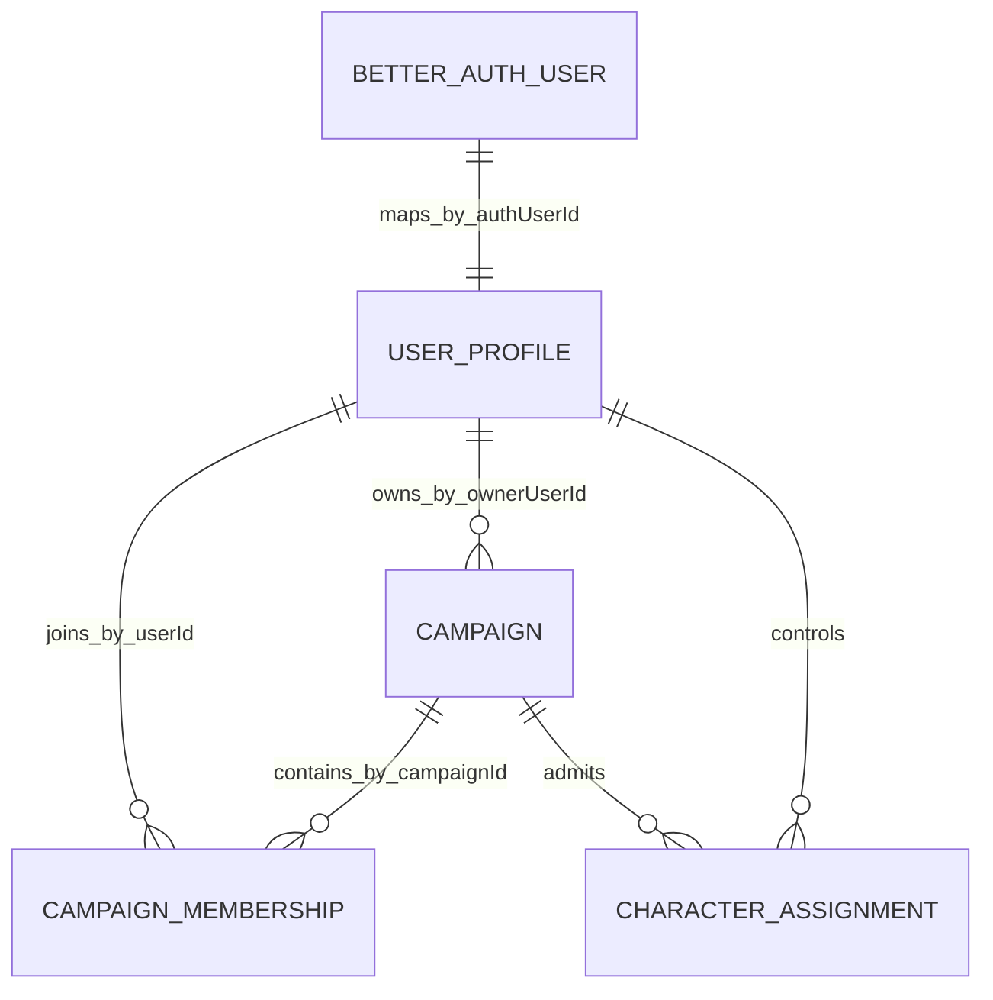
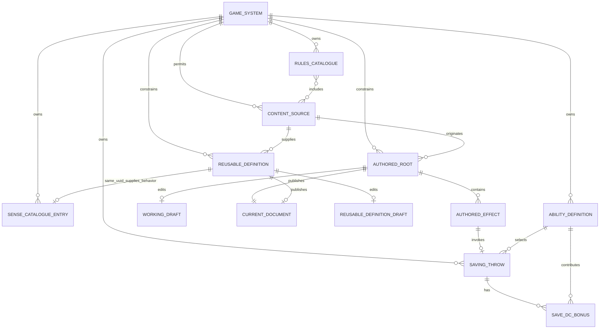
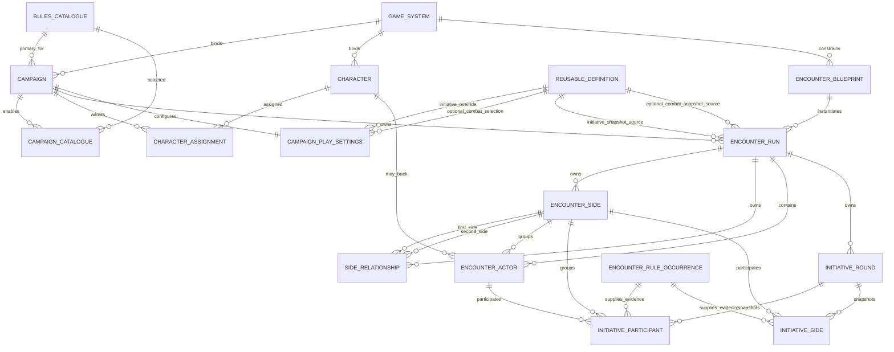
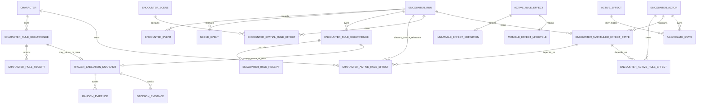
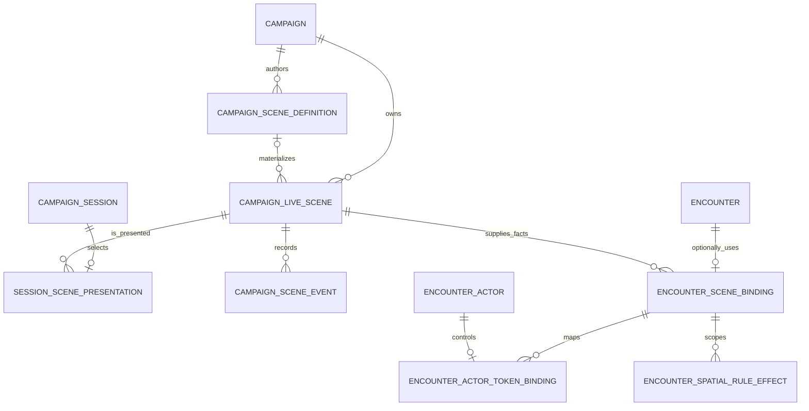
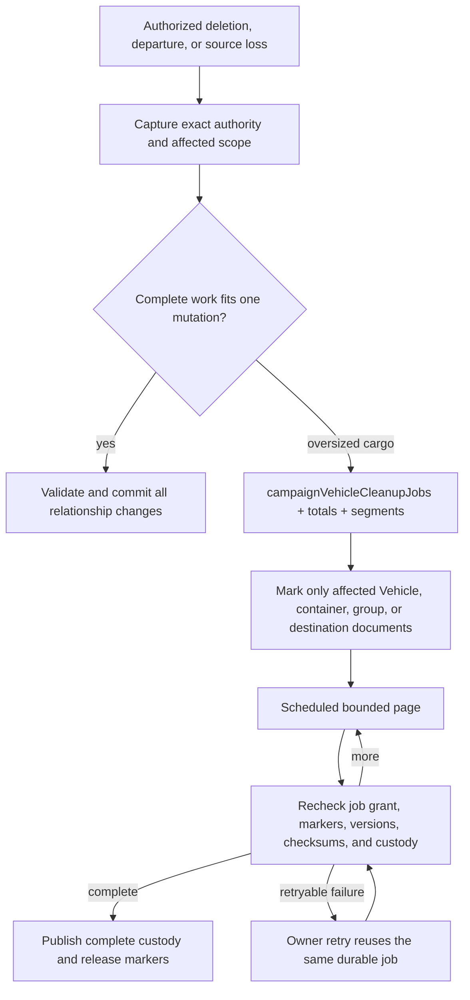

# Rules runtime domain ERDs

> **Status:** canonical current Convex domain model; managed promotion remains in Phase 8.2
>
> **Scope:** identity and ownership relationships for Systems, authored mechanics, Campaigns, Characters, Encounter Blueprints, Runs, frozen occurrences, and cleanup state
>
> **Update when:** ownership, indexed relationships, aggregate boundaries, occurrence persistence, or cleanup state changes
>
> **Verification:** `apps/apis/convex/schema.ts`, domain schemas/functions under `apps/apis/convex`, shared validators under `packages/schema`, and focused Convex tests

These diagrams show validated Convex document relationships rather than literal field lists. Convex
schemas and shared validators define stored shapes; application transactions enforce referential
integrity, authorization, cleanup order, atomicity, and replay.

## Identity, Campaign ownership, and membership

The authenticated Better Auth user resolves through `userProfiles.by_authUserId` to the public app
`userId`. Campaign functions derive authority from `campaigns.ownerUserId` and the exact indexed
`campaignMemberships` document. Public input never supplies the acting identity, and a downstream
document reference never grants authority by itself.

## System and authored content

The model is System-neutral. A `GAME_SYSTEM` row is imported data; what the System can do is the
rule capability its installed code declares (`systems/installedGameSystems/` in `packages/rules-runtime`,
read through `content/systems:capability`): its content kinds, authored root kinds, reusable-definition
families, facts and operations. Every relationship above keys by `gameSystemId`, and each write checks that
capability: the shell offers only declared content kinds, `content/definitions:create` refuses an undeclared
family, and publication compiles a graph against the System's own fact and operation contracts. Nothing in
the model names D&D 5e. Senses, abilities and saving throws are System lists that may be empty, and
D&D-only families such as `dnd5e-encounter-lifecycle` exist only because the dnd5e capability declares
them. A test-only second System, never seeded or built, proves this through the real Convex reads and
publication (D195; `apps/apis/convex/content/systemPortability.tracer.test.ts`).

For a typed reusable vocabulary family such as `sense`, the catalogue entry and reusable-definition
root share the exact `(id, gameSystemId)` identity. The catalogue entry is selectable metadata; the
published family document is mechanics. Grants keep their existing UUID reference, and no code/label
lookup selects behavior.

Ability definitions use the same stable System-owned UUID rule. Authored saving throws and
ability-modifier DC bonuses reference those UUIDs; parent-bound hydration validates the complete chain
against the authoritative authored root System. UUID ownership is immutable across Systems.

## Campaign, Character, and reusable preparation

Encounter-side UUIDs are aggregate content, not Rules Kernel primitives. A relationship document stores one
canonical unordered pair and one closed factual code (`ALLIED`, `NEUTRAL`, or `HOSTILE`); same-side
actors are implicitly allied. Targeting, reactions, and side-based initiative read the same locked
relationship. Game System policy interprets it, while actor kind and side labels remain non-mechanical.

Campaign initiative fields are nullable UUID selections into same-System reusable definitions. They are
current settings for future runs, not historical Campaign revisions. An Encounter copies the selected
initiative policy and exact evaluation/order-choice/tie graph documents into one checksum-protected
server snapshot. The policy names the numeric evaluation and tie score outputs, Boolean
automatic-availability outputs, ascending/descending order, the numeric bounded order-choice output,
the exact numeric minimum/maximum choice-index fact bindings, and a finite tie-attempt policy;
application services do not infer those ports or
invent an actor-ID tiebreak. The snapshot therefore retains the complete execution authority while
later System or Campaign publication cannot repin that run. Recipient projections expose only the
compact policy summary, never executable graph documents. The policy and every referenced graph retain
their Content Source identity; those sources must be present in the Campaign's enabled catalogues, and
current settings plus prepared/active Encounter snapshots block removal of a required catalogue.

Each initiative round is aggregate-owned current state, not a workflow or event log. Its header pins
the Encounter's initiative-policy checksum and owns the current procedure, cadence, lifecycle status,
version, and monotonic next-turn ordinal. Participant documents snapshot exact actor/side membership and
retain only current score, final turn ordinal, lifecycle status, and checksum-bound occurrence pointers.
An actor-side correction updates only the Encounter actor for future-round construction; it never
rewrites a non-completed round's participant side snapshot, side order, or pending side-order choice.
Side documents provide the equivalent normalized state for side-roll procedures. Exact rule receipts remain
the evidence and replay authority; round documents never embed executable graphs, continuations, or mutable
decision history. A new round either evaluates according to `EACH_ROUND` cadence or carries forward the
already-settled order under `ENCOUNTER_START`; it never rereads terminal receipt JSON as current state.

One Encounter-owned occurrence coordinates a pending initiative lifecycle. It may retain the exact
current evaluation, bounded tie/order-choice suffix, or subsequent turn-effect continuation, but never
duplicates normalized round state. `START_OF_TURN` is not selected until the normalized order is final;
at an `EACH_ROUND` wrap, the outgoing `END_OF_TURN` settles before the next round's initiative work.
Evaluated outgoing effects, proposed initiative state, incoming Feature-owned Recharge recovery, and
incoming effects remain occurrence-owned staged plans until one terminal transaction applies them in
that order. A pause leaves the Encounter, initiative documents, active effects, and Feature charges
unchanged. Advancing pauses retain separate command receipts with a public pending summary only; the
sealed execution and staged plans remain in the occurrence snapshot.

## Aggregate-owned occurrences

`CHARACTER_RULE_OCCURRENCE` and `ENCOUNTER_RULE_OCCURRENCE` are logical aggregate-owned contracts,
not a mandate for one polymorphic universal collection. Their separate receipt documents retain start/resume
receipts and enforce each aggregate's authorization, lock order, retention, and privacy.
Each advancing or re-pausing resume owns a command-specific receipt with its closed actor-filtered
occurrence result. Later advancement or completion cannot rewrite it, so lost-response retries resolve
by aggregate plus command identity before Scene access, Kernel execution, randomness, or settlement.
Movement receipts retain the exact sorted before/after version transitions committed by their own root
or resume command. Earlier receipts never derive changed roots from a later terminal occurrence result;
the latter remains complete audit evidence only. Live coordinator snapshots collapse those transitions
to each aggregate's current final version after atomic application.
Character outcome events emitted by movement reaction and spatial mechanics use phase- and
ordinal-scoped deterministic child command UUIDs. Their source command and occurrence remain audit
correlation; separate movement phases and resumes never share the Character event uniqueness key.
An Encounter has at most one pending occurrence, enforced by the Encounter command transaction
before fresh source or Kernel work. Matching
receipt replay precedes that gate. A terminal occurrence may be receipt-only when its pure applicator
intent declines an aggregate version advance; application and terminal receipt still commit together
at the unchanged aggregate version.
Previews and simulations remain ephemeral. A frozen execution snapshot exists only while an
occurrence can pause or recur and is removed or terminally closed with that occurrence.

Scene events own genuine Scene state changes. Encounter events own genuine Encounter state/projection
changes; rule receipts own mechanical evidence and replay state.
Transport journals coordinate delivery only and are never gameplay authority.

The Campaign live Scene is the physical aggregate. A Session presentation and an Encounter binding
both reference it without copying its projection. Scene-token UUIDs remain stable; temporary
Encounter actor identity exists only in `ENCOUNTER_ACTOR_TOKEN_BINDING`. Scene definitions are
versioned authoring sources and may be deleted without deleting a materialized live Scene, whose
source snapshot remains audit provenance.

`CHARACTER_ACTIVE_RULE_EFFECT` and `ENCOUNTER_ACTIVE_RULE_EFFECT` are separate current-state document families;
they do not reference an occurrence from another aggregate. Each persists separate immutable
`definition`/`definitionChecksum` and mutable `lifecycle`/`lifecycleChecksum` fields. The definition
contains one `SINGLE_GRAPH` graph/source/provenance/recurrence plan plus the UUID-backed result-block
identity and its local frozen-graph node binding, recorded as a one-to-one frozen graph source-entry
binding. The originating action selects that result block before creation; the effect document never retains an
action-level `TEST_OUTCOME` specialization plan. Lifecycle carries only remaining ticks. Character effect documents may retain a `sourceEncounterId` only for an Encounter-lifetime
definition. Its Encounter-first index locates distinct Character owners after actor removal. Cleanup
then validates and removes each affected effect through the owning Character or Encounter transaction;
document references never create an implicit cascade. Future tick and terminal transitions remain owned by their Character or Encounter root receipt
and use owner-scoped lifecycle-only CAS.
`ENCOUNTER_SPATIAL_RULE_EFFECT` is the third current-state surface for an untargeted spatial root.
It belongs to the locked Encounter and references its exact Campaign Scene binding, never to an actor
and never to an occurrence. It retains the same frozen active-effect definition/lifecycle contract plus separately
checksummed placement and mutable reveal state. Contact evaluation binds an actor only in the
Encounter occurrence that resolves the contact; no target actor is stored on the spatial root.
Scene-scoped ordinal allocation and current-state CAS are both exact `(encounter, bound scene)` operations.

Frozen active-effect evaluation is a pure application-service boundary: it reads the immutable
definition and mutable lifecycle, returns applications plus an `UPDATE` or `EXPIRE` proposal, and
does not directly own a stored write, projection, event, or receipt.
The immutable definition may also carry bounded typed perception contributions. They remain part of
the existing checksummed definition document rather than a new document family. A locked Encounter
application derives observer, subject, and local-area relation arrays from exact actor ownership and
spatial geometry, retaining effect identity/version/checksum; the relation itself is runtime-only.

## Durable cleanup continuation

Ordinary cleanup remains one atomic Convex mutation. Oversized inventory cleanup exposes an updating
state only for the affected slice; unrelated inventory stays readable and editable. Job grants and document
markers are trusted server state, so continuation can outlive the initiating source without acquiring
new authority. A retry resumes the same idempotent plan. Shared Campaign history survives account
deletion with deleted-user presentation, while private account state and active actor participation are
removed through validated application cleanup.

**Current native implementation:** `ENCOUNTER_MAINTAINED_EFFECT_STATE` is an Encounter-owned,
server-only current-state document with a UUID-backed System maintenance-definition identity and
immutable descriptor checksum. It is not a Rules Kernel primitive and it has no public projection.
A maintained document may own dependent Character or Encounter-actor active effects. Cleanup discovers
those dependents, validates their owner and checksums, applies owner-root CAS deletion first, and removes
the maintained state in the same application transaction. The direct-action replacement path records
only typed state/effect identity transitions in its terminal receipt.
