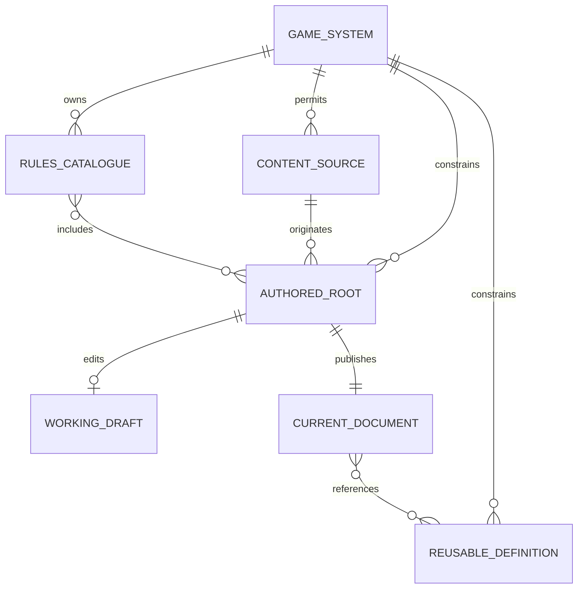
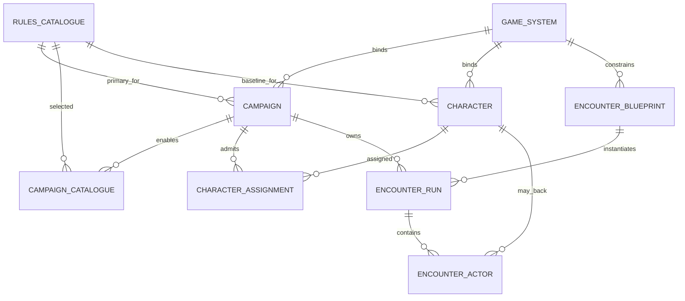
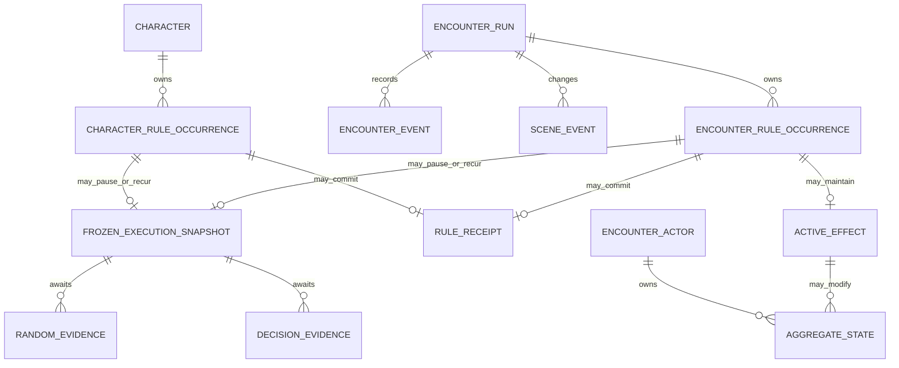

# Rules runtime domain ERDs

> **Status:** canonical target; implementation rebaseline in progress
>
> **Scope:** identity and ownership relationships for Systems, authored mechanics, Campaigns, Characters, Encounter Blueprints, Runs, and frozen occurrences
>
> **Update when:** ownership, foreign keys, aggregate boundaries, or occurrence persistence changes
>
> **Verification:** canonical SQL, migrations, repository contracts, and Gate 1/2 database tests

These diagrams show domain ownership, not literal table/column names. Canonical SQL remains the schema
authority.

## System and authored content

## Campaign, Character, and reusable preparation

## Aggregate-owned occurrences

`CHARACTER_RULE_OCCURRENCE` and `ENCOUNTER_RULE_OCCURRENCE` are logical aggregate-owned contracts,
not a mandate for one polymorphic universal table. A persistence implementation may use separate
tables/events that enforce each aggregate's authorization, lock order, retention, and privacy.
Previews and simulations remain ephemeral. A frozen execution snapshot exists only while an
occurrence can pause or recur and is removed or terminally closed with that occurrence.

Scene events own genuine Scene state changes. Encounter events and receipts own mechanical evidence.
Transport journals coordinate delivery only and are never gameplay authority.
