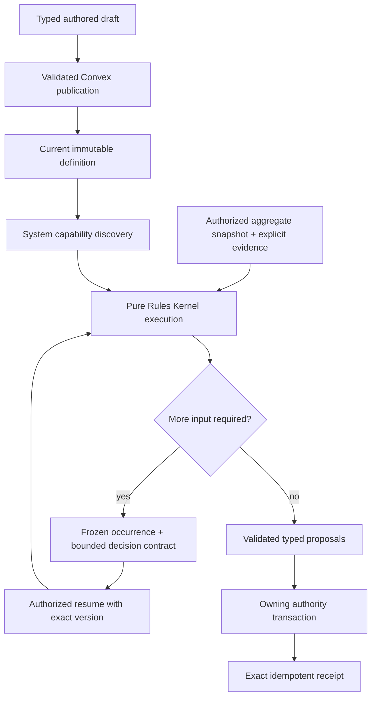
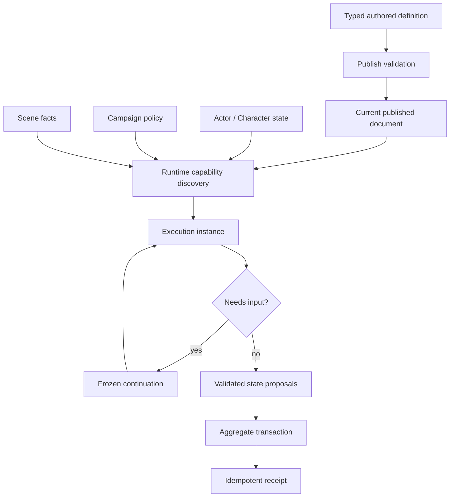
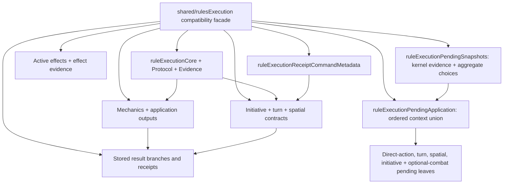
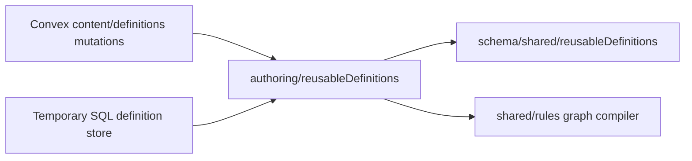
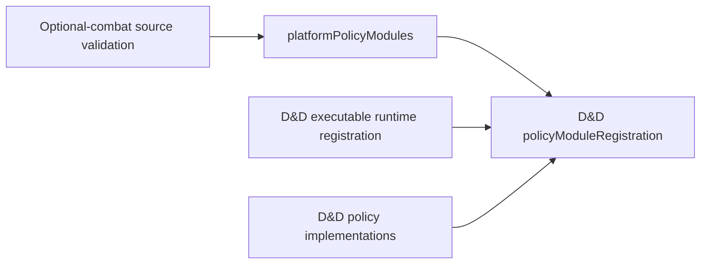
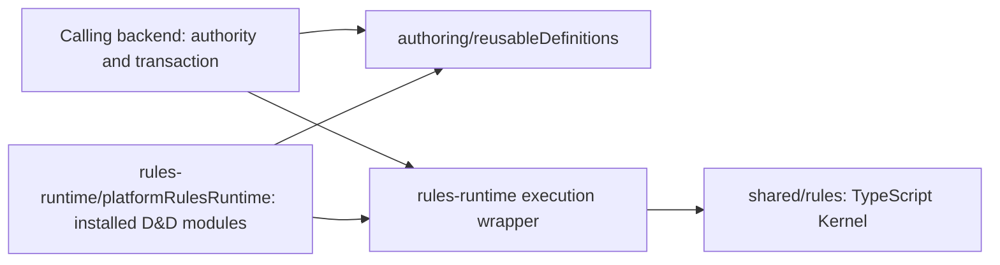
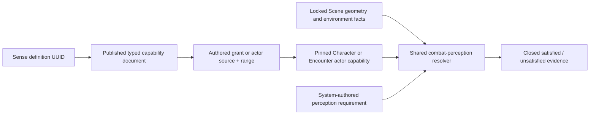
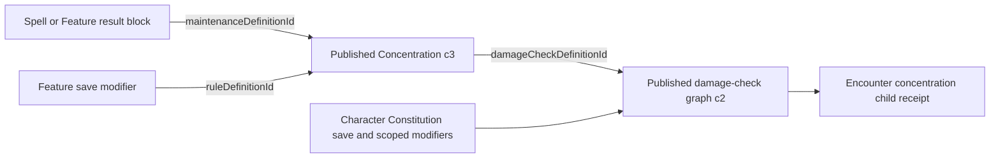

# Shared rules runtime

> **Status:** canonical current Convex implementation; managed promotion remains in Phase 8.2
>
> **Scope:** pure Rules Kernel, System capability contracts, published definitions, execution, frozen occurrences, decisions, receipts, and aggregate commit
>
> **Update when:** graph contracts, primitive ownership, System capabilities, publication, occurrence, replay, or receipt behavior changes
>
> **Verification:** `packages/rules-runtime`, authored publishers and readers under `apps/apis/convex/content`, Encounter and Character commands under `apps/apis/convex`, `apps/apis/convex/liveSessions/state.ts`, `apps/session-worker/src/nativeLiveSessionRoom.ts`, shared contracts under `packages/schema`, ADRs 0023-0025, and the Phase 8.2 acceptance ledger

The Rules Kernel is a pure execution library. It walks a validated bounded graph, accepts explicit facts,
random evidence, and decisions, and returns typed proposals and a trace. It does not authenticate users,
read persistence, generate randomness, mutate aggregates, or encode D&D-specific policy.



## Ownership and publication

Game System adapters own rules vocabulary and policy, including D&D 2014 behavior. Reusable mechanics
remain portable typed operations. Code-owned operation keys, versions, validators, and bounded graphs
prevent authored data from introducing executable code or unbounded work.

Published authored roots and reusable definitions keep stable UUID identity and immutable versions.
Current publication is the source for new invocations; issued occurrences retain their frozen
execution evidence, and acquired Equipment retains rules where its ownership lifecycle requires it.
The retired legacy authoring model is historical and
has no current product authority.

## Execution, decisions, and receipts

An authorized application command creates or resumes an aggregate-owned occurrence. A paused
occurrence stores its exact graph, evidence, decision contract, authority context, and aggregate
version. Resume rejects stale authority, an unexpected aggregate version, or a decision outside the
stored contract. Only one pending occurrence may own an Encounter command decision at a time.

A complete execution returns proposals. Character Sheet and Encounter writes use an owning Convex
mutation that validates and applies them with the aggregate's expected version, advances the
occurrence, and writes the receipt in one transaction, including during live Sessions. The approved
[live execution boundary](../adr/0029-convex-backend-cutover.md#live-rules-execution-clarification--2026-09-24)
places heavy live rule evaluation and fact preparation in the Session DO. Sheet write ownership does
not require that computation to run in Convex. This DO integration remains incomplete; current
Encounter coordinators still evaluate inside Convex. Any authority-transaction failure leaves the prior state visible. An
exact retry returns the stored receipt without rerunning randomness, rereading current authored
definitions, or applying state twice.

Encounter rules read Character state live ([ADR 0034](../adr/0034-player-control-rules-assistance-and-roll-prompts.md)
decision 4): hit points, conditions and the effective maximum come from the current Character's
evaluation, never from the Run. The Character row also stores its effective maximum for display
(see [persistence](persistence.md#character-stored-effective-maximum-hit-points--local-implementation));
rules never read it. Known lag: a published-content change reaches that stored value on the
Character's next write; a publish-time recompute is a follow-up.

### Assisted soft enforcement and GM undo (current, ADR 0034 decision 2)

`RESOLVE_ACTION` evaluates its overridable rule checks once, through
`rules-runtime/encounterActionRuleWarnings`, in the DO planner (`nativeEncounterRules.ts`); the
Convex action fallback was removed in S4-d:

- `prepareEncounterActionMechanics({ overridable: true })` reports an unequipped source
  (`SOURCE_NOT_EQUIPPED`) and an exhausted Character resource or Creature charge
  (`RESOURCE_UNAVAILABLE`) instead of refusing them;
- `evaluateEncounterActionEconomy` reports an exhausted or suppressed allowance
  (`ACTION_ECONOMY_UNAVAILABLE`);
- `evaluateEncounterActionTargetPolicy` reports range (`TARGET_OUT_OF_RANGE`, or
  `TARGET_RANGE_UNCHECKED` without both tokens) and target disposition (`TARGET_DISPOSITION`).
  Disposition compares the two actors' GM-set dispositions through `encounterActorRelationship`
  (neutral is neutral to everyone, equal dispositions are allied, friendly and hostile are hostile):
  a willing-target action warns only against a hostile target and a hostile-target action only
  against an ally. Unsupported policy shapes, excluded creature types and missing targets stay hard.
  Disposition is the one source of hostility (D13): movement reaction eligibility
  (`encounterMovementReactionFacts.ts`) and passage blockers (`encounterMovementPassageBoundary.ts`)
  use the same `encounterActorRelationship`, and Run state no longer stores side relationships.
  Actor sides remain only for initiative grouping and ordering, actor reorder, reinforcement and
  removal, and the workspace's side labels.

Encounter action choices (`encounters/actionChoices.ts`) carry the warnings that already apply before
a target is chosen (allowance via `encounterActionEconomyWarnings`, unequipped source, exhausted
resource), so the drawer can show those actions dimmed with their reasons.

The command proceeds only when `acknowledgedWarnings` (part of its fingerprint) covers every current
code; otherwise it is refused with `RULE_WARNINGS`. An override spends only what remains (the
warning message records the shortfall; a zero spend records no resource receipt) and lets the
allowance exceed its maximum (`consumeEncounterActionEconomy({ overridden: true })`). The
`RESOLVE_ACTION` run command stores the accepted warnings as `ruleOverrides`, and the timeline badges
each one. Hard checks (authorization, versions, the current actor, Manual mode, completed
Encounters) are never warnings. Reactions, legendary actions, Disarm and movement call the same
preparation with `overridable: false` and keep refusing. Spell slots are not spent by
`RESOLVE_ACTION` until Phase 8.3 spell casting.

`REVERT_LAST_ACTION` (`encounters/actionRevert.ts`, GM-only, `NATIVE`) undoes the Run's last
`RESOLVE_ACTION` and its committed child receipts, found through the
`encounterRuleReceipts.by_encounterId_encounterVersion` index. It requires that the newest Run
command is that action or one of its child decisions, that no decision is pending, and that every
affected Character's stream version equals the receipt's after-version. It inverts only from
recorded before-states: target hit points, temporary and maximum hit points, applied conditions,
Character resource usage, a stowed shield (verified against the recorded equipment checksum),
Creature feature charges, the action allowance (`actionEconomyTransition`, now on both mechanics
batch receipts), created active and state effects (deleted by their recorded version) and a newly
created maintained state. It refuses, naming the kind, a removed condition, a replaced maintained
effect, lost Concentration, Cleaving damage to a Character, Disarm and other contested actions. The
undo is its own `REVERT_LAST_ACTION` run command and timeline entry ("Undone by the GM"); a second
undo is refused. Unused counters restored to 0 may stay stored as 0 rather than absent.

## Initiative and live delivery

Encounter initiative, active reordering, actor removal, and reinforcement timing are application
policy built on typed rules evidence. Reordering applies immediately after any pending decision is
resolved. A newly improvised actor may act in the current round only when its rolled position is after
the current actor; otherwise it becomes eligible next round. Preplanned hidden actors already occupy
the order and reveal without being re-added.

The Session Durable Object owns live ordering, replay, and the minimum projection for its supported
Door and standalone token move/undo paths while its authority epoch is active.
It commits before broadcasting and publishes through an ordered outbox. Convex remains the current
membership authority, independently revalidates publications, drives subscriptions, and supplies
recovery state after release or eviction. Direct overlapping Scene writes in Convex are fenced during
active room authority. The remaining R06 integration must order heavy live commands through the room
and acknowledge them only after their required Convex transaction commits. Browser-visible receipts
and subscription payloads remain recipient-safe.

## Portable live preparation

`rules-runtime/character/builderPreparation` and `character/sheetPreparation` own the existing
reconciliation, readiness and Character evaluation over authorized inputs. The Convex
`characters/sheetInputs` loader owns record access, assignment checks and current-source loading;
it does not invoke Builder readiness or Character rule evaluation. `character/contextPreparation`
owns source selection, retained Equipment handling, inheritance resolution, feature collection and
the Spell catalogue decision. Its typed readers supply authorized current publications and parents;
the Convex adapter retains access checks, bounded catalogue reads and publication identities.
The current loader still returns an assembled context, so it is not a raw-document transport contract.

The private `liveSessionCharacterRules` contract now supplies stored Character/Sheet/System/Campaign
inputs, authorized source indexes and paged publication DTOs to Worker `nativeCharacterRules`.
Convex `liveSessions/characterRulesCapture` requires the authenticated GM, current DO epoch, open
Session and exact assignment and returns the current Character stream version under the CHARACTER
revision fence; source access remains the Character owner's.
It imports neither context preparation nor rules evaluation. The Worker reuses the same context,
active Builder catalogue and Sheet preparation functions, without serializing database contexts or Maps.
This preparation function is implemented separately from the still-incomplete live command/commit route.

Every capture returns a read checksum. The eventual commit must validate the corresponding authorized
current identities and complete read ranges in its transaction, together with the command's other
aggregate fences. Rehydrating every captured payload in that transaction would defeat paging and can
exceed Convex's aggregate read limit; a bounded currentness validator is still required. This includes
absent requested publications and complete relevant catalogue/feature membership, so an added source
cannot escape validation merely because no previously loaded root changed. Source identities refer to
stored publication checksums; publication DTO parsing can normalize JSON. Publication pages target
4 MiB, with one existing <=10 MiB publication allowed per page. Shared-publication authorization can
also read parent documents; the page target alone does not establish the aggregate Convex read limit.
Maximum-size shared inheritance still needs a real local backend proof before promotion.

The private `liveSessionEncounterRules` contract supplies stored Run/System inputs, individual actors
with their first four active effects, subsequent four-effect pages, and current reusable definitions.
It requires the authenticated GM, active DO epoch, open Session, exact Run version and current
Character assignment. Worker `nativeEncounterRules` captures actors in parallel, preserves the existing
effect order after paging, prepares only the selected source/target Character facts, and reuses the
existing action mechanics and relationship algorithms. Its read dependencies include empty effect
ranges, so effect additions and removals must participate in commit validation. Both preparation
paths have authenticated HTTP parity coverage; action dispatch, execution, and atomic commit remain
separate unfinished integration work.

Character source reads retain exact current publication identities, including selected inheritance
parents and catalogues reused during Builder materialization. Race and Equipment reads resolve their
authored relationships without compiling unused publication graphs. These identities describe the
current read; they do not pin future invocations or replace current assignment, membership, share and
catalogue authorization checks. They are not yet a complete cross-transaction capture contract.

`rules-runtime/encounterMovementTargets` owns existing target facts, effect reductions and reaction
source compilation. `encounterMechanicsBatchPlan` owns the existing Character/actor transition plan;
`encounterActionSources` and `encounterActionMechanicsPreparation` own action source resolution and
the existing target, resource, relationship and execution-plan preparation. Their Convex adapters
provide authorized source/effect reads and still own transactional validation and writes. These modules depend on
domain types rather than Convex contexts or database rows. Their current Convex callers remain in
place until authorized capture, DO evaluation and validated commit are connected. Extraction alone
does not prove the completed DO boundary or the V15 workload.

Convex `encounters/mechanicsBatchPersistence` owns authorized target reads and persistence of a trusted
mechanics plan, checking the current Run, actor and Character before writes. Its caller still owns
source/effect freshness and root-command replay; the helper is not an external plan authorization
boundary. The existing `mechanicsBatch` adapter continues to load fresh Sheet facts, plan and persist
within the same mutation, preserving the order of sequential movement settlements.

`encounterActionEffects` owns effect planning and receipt-transition projection;
`encounterActionEconomy` owns allowance preparation, refresh and consumption calculation. The latter
accepts current-definition and target readers, preserving the early return without reads for Manual
mode and actions without an allowance. Convex still owns effect storage and the actor checksum check
and write; these calculations perform no database writes.

## Historical implementation record

The material below records the earlier target design and implementation progress. References to SQL,
Supabase, GoRules packs, transitional repositories, or incomplete Phase 8 work are historical and do
not override the current contract above.

### Original rules runtime guide

> **Status:** canonical target; implementation rebaseline in progress
>
> **Scope:** Rules Kernel, Game System capability contracts, authored rule definitions, capability discovery, execution, and occurrence lifecycle
>
> **Update when:** graph contracts, primitive ownership, System capability declarations, publishing, continuation, or receipt behavior changes
>
> **Verification:** ADRs 0023-0025 and the Phase 08 fixed acceptance ledger

### Ownership



The Rules Kernel owns execution protocol only. It walks a validated bounded graph, passes typed facts
between ports, requests bounded evidence or decisions, and returns proposed results. It does not read
repositories, authorize users, generate random values, mutate aggregates, or know D&D vocabulary.

#### Execution contract modules



**CURRENT:** the Phase 8.2 split keeps the established `shared/rulesExecution` public
surface through explicit re-exports. Focused leaves import their concrete dependencies
directly and never import the facade. Backend modules that need one schema import its owning leaf so
Convex does not initialize every Rules execution contract for a narrow endpoint. Stored DTO shapes,
union order, refinements, defaults, continuation seals, and public facade names remain unchanged.
`ruleExecutionPendingApplication` composes the ordered pending-context union;
`ruleExecutionPendingSnapshots` owns kernel evidence snapshots and aggregate choices;
`ruleExecutionReceiptCommandMetadata` owns receipt command metadata. The facade has no local schema
construction. API correlation IDs use `ruleExecutionProtocol`; graph and UUID consumers use
`ruleExecutionCore` and `serverUuidIdentity` directly.

#### Creature authored equipment identity

Creature equipment is authored source data, not an Encounter inventory or a Scene object. An optional
Creature-owned `equipmentLoadout` document records one UUID-backed occurrence, its Equipment UUID,
quantity, carried/held/worn state, attunement state, and any Creature Feature UUIDs whose action source
depends on that occurrence. The document is strict and versioned with the Creature source; it does not
duplicate Equipment mechanics, derive availability from labels, or create automated loot transfer.
Natural weapons remain Creature Features. Runtime loadout replacement, Equipment resolution, and
Encounter actor snapshots are separate application responsibilities.

`rules-runtime/encounterFeatureActionCapabilityDiscovery` owns the shared pure compatibility and
capability checks for those frozen sources. Native Convex `REPLACE_CREATURE_EQUIPMENT` authorizes
the selected current Equipment through the same source reader as Blueprint admission, replaces one
Encounter-owned loadout/source overlay, and stores the pinned revision provenance with its command
receipt. The original Creature payload remains immutable. Replacement, final actor-policy projection
and receipt commit in one mutation; retry returns the historical result without rereading current
Equipment. This native command is under V09 validation; full actor and browser acceptance is pending.

#### Target-owned actor relationships

An `ACTOR_RELATIONSHIP` outcome compiles to one target-owned active effect. Its origin retains the
exact source actor, occurrence, action, and authored relationship UUID; its owner is the target actor.
The effect stores only ordered, bounded relationship modules. System adapters interpret size codes,
action restrictions, d20 influence, capability suppression, and movement costs; generic application
code does not rank sizes or branch on creature names, labels, or editions. Escape and release are
terminal relationship operations. Conditions, checks, and recurring damage remain their existing typed
documents, frozen with the active-effect graph rather than becoming relationship-specific prose.

An operation is `PURE`, `EVIDENCE`, or `PROPOSAL`. A proposal is a deterministic typed scalar
operation: the Kernel evaluates it once in graph order and retains its inputs and outputs in the
ordered trace, but never interprets it or applies state. For a COMPLETE execution with a registered
domain applicator that requires an advance, the owning application transaction first advances the aggregate with its
expected-version CAS, then transitions the aggregate-owned occurrence, runs that applicator
(including any genuine domain projection event), and finally writes the aggregate-owned rule receipt.
Any failure rolls back that single transaction. A pause, re-pause, or receipt-only COMPLETE does not
advance the aggregate: its occurrence and receipt retain the locked current aggregate version. The
applicator never runs for a pause or receipt replay.
The concrete locked Encounter command context alone may issue an opaque receipt-only child-occurrence
capability at its private effective version; that capability is bound to the same transaction, becomes
stale after a later parent version advance, and cannot reacquire roots or advance the Encounter.
An owning command coordinator may pass the context's transaction-bound root-occurrence capability to
a nested executor so the same Encounter is not reauthorized or rehydrated inside one transaction.

The reusable mechanics library owns typed operations whose meaning is portable: comparison, result
bands, opposed tests, dice-pool evidence, contributor aggregation, bounded choices, generic state
shapes, and spatial contact facts. Adding an operation requires a code-owned key, contract version,
bounded schemas, deterministic implementation, and conformance fixtures.

A platform-owned Game System module composes independently owned typed subcontracts into semantic
rules. The Rules Runtime sub-contract declares only:

- supported authored root adapters and reusable definition families;
- fact contracts; and
- code-owned operation contracts.

Authoring owns Guided and Advanced recipes; Campaign, Character, and Encounter own settings, state,
and reconciliation; VTT owns its semantic capabilities. Those later contracts compose with this one;
they are not fields in the Rules Kernel contract. Unsupported subcontracts and capabilities are absent,
and services and UI fail closed rather than assume D&D equivalents.

### Publish versus runtime

Publish validates graph bounds, cycles, ports, primitive contract versions, UUID references,
same-System compatibility, and transitive dependencies. It proves only that an invocation is
structurally executable.

The implemented Gate 1 catalogue foundation keeps source identity separate from execution policy:
`rules_catalogues` are System-owned metadata/policy lineages, `content_sources` are platform or
user provenance roots, and inclusion is an explicit same-System relation. A reusable definition is
one UUID-backed System/source/family root with at most one editable draft and zero-or-one current
published document. Publish revalidates the exact family, atomically replaces that one current
document/checksum/contract tuple, increments the root version, and removes the consumed draft. It
does not create historical published revisions or a consumer-selectable pin. The initial publisher
is the bounded neutral `rules-runtime-graph` family; it compiles against the exact Game System
capability contract at draft save and publish. Other families require their own typed publisher.
The ordinary service accepts only USER source-owner mutation; PLATFORM publication remains a future
internal/bootstrap composition, never a caller-provided authority flag.

**CURRENT / Phase 8.2 extraction:** `@artificer-toolkit/authoring/reusableDefinitions` owns the
single persistence-independent publisher for graph, sense, rule-capability, condition-rule-state, rule-maintenance,
initiative-policy, D&D encounter-lifecycle, and D&D optional-combat documents.



The publisher receives installed System capabilities, operation contracts, current vocabulary,
and a store implementing atomic draft/publication callbacks. Ownership checks, exact dependency
revalidation, checksums, and seven-family validation are shared rather than reimplemented by a
transport. The root-record contract lives in `schema`, not `db`. The temporary functions exports
forward to this same implementation. Native Convex `content/definitions` now composes this publisher
for create/save/publish; authenticated get/list queries serve the same UUID-backed workspace DTOs.
The System definition workspace uses these native queries and mutations. Managed lifecycle proof
and the complete same-source acceptance gates remain pending.

The native `reusableDefinitions` root has version zero before first publication, an optional
current document/checksum/contract/publication-metadata tuple, and an optional draft-version marker.
`reusableDefinitionDrafts` holds at most one draft per definition UUID. The first draft is version
zero. Every save checks both expected versions; publication rechecks source ownership, draft integrity,
the current base version and exact live dependency pins in one Convex transaction before replacing
the current tuple and deleting the draft. No historical revision table is introduced.

Indexed PLATFORM and caller-owned ranges provide bounded ten-row definition pages. Actual source
ownership is still checked on each admitted root; a denormalized owner is not authority. Published
source options use a source/version index so unpublished roots do not consume their existing
500-publication budget. Options and detail/dependency reads share one stored-root decoder, including
source ownership and publication integrity; normalization cannot admit a reference that this current
reader rejects. Untouched canonical PLATFORM version-one rows retain their original stored
shape for exact seed replay: absent publication metadata is decoded as contract one, creation time,
and the validated System document's metadata author. This fallback grants no mutation authority.
Installed compiler-generated Effect-action families remain executable but are not standalone
authoring choices; the seven publisher-family keys have one shared schema home.

The existing persistence checksum codec now lives at `@artificer-toolkit/shared/canonicalJson`;
the temporary DB export forwards to it. D&D flanking, facing, diagonal-movement, optional-action,
and optional-movement policies use that focused import to verify their persisted combat snapshots
without loading DB code. Canonical normalization and UTF-8 SHA-256 bytes are unchanged. In particular,
undefined object entries are omitted and undefined array entries become null; the separate strict
rules-document codec must not replace this protocol. No persisted checksum backfill is required.

**Phase 8.2 execution extraction:** the existing schema-aware execution wrapper lives in
`@artificer-toolkit/rules-runtime`, separate from form authoring, with schema and the shared
Kernel as its workspace dependencies. Its temporary functions facade preserves existing callers. Authentication,
authorized source reads, transaction boundaries, state application, and integrity-key provisioning
remain with the calling backend; the wrapper does not introduce a store or another engine.
`rules-runtime/systems/dnd5e/optionalCombatActionSelection` owns the existing pure selection contract
for optional actions. `rules-runtime/encounterActorOptionalContestContext` owns normalized Creature
contest facts and the exact selected HELD-to-CARRIED transition. Functions keeps the existing locked
target-map adapters. `rules-runtime/encounterDisarmPreparation` owns Disarm's contest preparation
(definition, selection facts, sealed contest), its success transition (`planEncounterDisarmSuccess`)
and receipt outputs; the Session room plans with them and the Convex commit re-derives the item and
ACTION changes with the same functions. Participant authority, persistence and replay stay in Convex.

`rules-runtime/encounterCreatureEquipmentSources` owns the unchanged Equipment snapshot pinning,
checksum validation and loadout binding checks. It accepts structural source/actor inputs without
database record types. The transitional functions facade reexports it; native Blueprint and Encounter
callers must authorize their sources before pinning them.
Continuation signing/verification uses the standard Web Crypto API, preserving canonical UTF-8
HMAC-SHA256, lowercase hexadecimal seals, and the defensively copied minimum-32-byte key contract.
The installed D&D compiler, operation implementations and policies now live in the same neutral
package. Its `platformRulesRuntime` subpath supplies the installed capabilities and operations to
both execution and publication composition; generated Effect actions are not duplicated into a
second compiler. UUID v5 identities still use the existing library and unchanged inputs. Action
entry points, initiative source facts and optional-combat policy facts are schema-owned server
contracts, not DB row dependencies. The aggregate reader still owns authoritative provenance and
transactional reads. Family-key constants have one home in `schema/shared/reusableDefinitionIdentity`.

Character source compilation exposes prepareCharacterRuleSources for repeated evaluation inside
one backend transaction. assembleCharacterRuleSnapshot and evaluateCharacterRules accept that
server-owned preparation only with the same immutable source-context object; a mismatched context
is refused. Current Character state, reconciliation, eligibility, Spell hydration and policy
fact/output validation still run on every pass. Standalone callers compile and validate their own
sources as before. Backend retries and later requests start with fresh authorized sources.



Policy registration checks read the same ordered descriptor array used by execution, without
initializing executable operations or Character preparation. `platformRulesRuntime` preserves
the lookup export. System identity, allowed policy keys, contract versions and rejection behavior
are unchanged; each installed System must supply both its descriptors and executable bindings.

Encounter actor policy uses the focused `platformEncounterPolicy` binding to the same D&D actor
policy and immutable System UUID as the full runtime registration. The existing
`platformRulesRuntime.evaluateInstalledEncounterActors` export remains available. Input/output
validation and unknown-System dispatch errors are unchanged; reading actor policy does not initialize
executable runtime operations.

The same package owns native D&D Character grant-fold, action-preparation and whole-Character
policies. `platformCharacterPolicy` binds these through the same D&D policy functions used by
the full registration, so Character preparation does not initialize executable operations and
Encounter policies. `platformRulesRuntime` preserves its existing exports. Both views use the
immutable System UUID; installing a System must supply its applicable policy and execution bindings.
`evaluateInstalledCharacterGrantFold`, `evaluateInstalledCharacterActions` and
`evaluateInstalledCharacterPolicy` select the installed System by immutable UUID, validate
existing schema facts/results, and reject unknown Systems. Grant-fold and whole-policy facts
must carry the selected System identity. Whole-policy composition resolves spell access before
the grant fold, then modifiers and derived stats, defenses/movement/senses/vitals, spell mechanics,
slots/resources, actions, eligibility and rest. These typed System functions neither widen the
generic scalar Kernel nor execute source strings. Existing Character tests compare complete
legacy/native output while retaining their behavior assertions, including provenance and overrides.

The installed System module also exposes `evaluateInstalledEncounterActors` for native Encounter
actor policy. It validates the existing actor facts/results and preserves initiative modifiers,
UUID-backed saving throws, target protection and supported feature-resource maximum calculations.
Usage reconciliation remains with the Encounter application; this policy retains raw usage and does
not clamp it early. The native D&D evaluator has complete-output GoRules parity checks for the retained
fixture and bounded-charge/protection cases. Native Run creation now uses the installed evaluator;
the browser still uses the transitional Run service until the complete native flow is integrated.

`rules-runtime/encounterActorState` and `rules-runtime/encounterActorRuleFacts` now own pure actor
snapshot/feature/usage reads, deterministic ordering and normalized non-Character facts. Their
structural inputs do not require database records, and legacy callers forward to these implementations.
The Node-based enemy dice executor and state writers remain outside the neutral package; extracting
the readers does not move random evidence generation or persistence into System policy.

`rules-runtime/encounterActorRuleOutput` owns the existing pure output identity checks, bounded
feature-usage reconciliation, rebinding to reconciled facts and actor/resource lookup. Both backends
can reuse these checks without a SQL record or GoRules revision. The transitional error export
forwards the same neutral `EncounterValidationError` class, preserving caller error identity.
Applying the reconciled usage and publishing its rebound output remain one backend transaction;
extracting the calculation does not establish native Run persistence or acceptance.

`rules-runtime/encounterLegendaryActionDiscovery` and `legendaryActionEligibilityRegistry` own
the shared current-definition eligibility and incoming Feature-pool refresh calculations. Native
Convex and transitional Functions callers use the same implementations. Owner choices, retained
dice, authority checks and atomic turn publication remain backend-owned.

`rules-runtime/encounterCharacterMechanicsBatch` owns the pure Character/actor outcome fold,
canonical condition-state reader and deterministic child-command identity derivation. Its inputs
and receipt applications retain the existing shared contracts, validation and error identity. SQL
batch writers import this implementation through their transitional facade; authority, current-state
fences, Character/Encounter publication and occurrence receipts remain in the owning transaction.
Native mechanics-bearing movement integration is still pending.

`rules-runtime/encounterScalarReductions` owns ordered active scalar reduction, scalar-map comparison
and reduction detection. Native movement target loading and transitional SQL callers reuse the same
algorithms and error identity; current effect reads and effective policy evaluation remain backend-owned.
Its Character fact composer maps policy ability codes through authoritative UUID definitions and
applies the already-reduced effective score as a temporary policy override. This includes existing
bonuses and manual overrides exactly once and leaves persisted/base facts unchanged.

Frozen target-bound effect execution and the Character action adapter registry also live in
`rules-runtime/targetBoundActiveRuleEffectExecutor` and `rules-runtime/characterRuleActionSystemAdapterRegistry`.
The unchanged executor validates frozen source/target/evidence bindings, seals pauses, and resumes
through the supplied Rules runtime. It performs no database reads or aggregate writes; transitional
Functions exports preserve existing callers and error identity.

Pure GM/player Encounter projection now lives in `rules-runtime/encounterProjection`, accepting
schema-owned structural inputs. SQL callers and native Run creation use the same health bands,
initiative cursor and snapshot presentation. Settled actor lists use normalized participant ordinals rather than setup initiative/manual order; the pure projector rejects an incomplete or duplicate normalized order. Native gameplay rebuilds compose the current validated initiative cursor before publishing their projection, so an action or turn cannot restore setup order. The legacy checksum envelope still belongs to the
SQL adapter. Native Run creation composes actor facts, installed policy, zero-usage reconciliation
and projection in its owning mutation; its persisted GM projection retains a null legacy revision.
Native owner `get`, active, Campaign-list, pending-occurrence and timeline queries validate the
persisted projection after current Campaign membership is authorized. Timeline reads derive entries
from the same immutable command receipts used for replay, so they do not introduce a second event
store. Player reads remain disabled until Character condition visibility has an authoritative source.
The [persistence guide](persistence.md#native-run-creation--partial-local-implementation) records the
new document ownership and remaining lifecycle integration.

Normalized initiative settlement and turn advancement now live in
`rules-runtime/encounterInitiativeStateSettlement`. The implementation consumes schema-owned round,
participant and side DTOs plus the three existing update operations. It preserves exact cohort/order
validation, side contiguity, versioned participant transitions and checksum-bound advance plans.
SQL and staged in-memory callers reuse it through the transitional functions facade; the backend
retains transaction and persistence ownership. Native Manual and Assisted `START` (auto-rolled or
prompted) now persist terminal normalized state and checksum-bound occurrence/command receipts atomically; an
Assisted pause retains the unchanged Run until its one occurrence settles. Native `ADVANCE_TURN`
updates the same normalized cursor and carries `ENCOUNTER_START` order into the next round. Native
`EACH_ROUND` reevaluation, active turn effects, the remaining Run commands, and browser integration
remain pending.

Initiative graph execution, score batches, tie/order resolution, entity construction, lifecycle
evaluation and occurrence snapshot serialization/restoration also live in `rules-runtime`.
They consume the existing initiative DTOs and schema-owned fact sources; supplied update methods
retain the backend transaction. Transitional functions facades preserve exported values, types and
error identity. This move preserves the existing staged lifecycle, including pending choices and
terminal settlement, but does not implement native authorized source loading, normalized storage,
occurrence persistence or atomic turn effects.

`rules-runtime/character/characterInitiativeFacts` also owns exact Character size, equipped-item
properties and System check totals. The transitional mechanics compiler calls it with its existing
snapshot, registry and output. Native consumers must supply those authoritative mechanical inputs;
displayed Sheet totals do not replace them. Historical compact snapshots still yield unavailable
declaration facts until freshly compiled.

**Drawn weapons (user ruling, 2026-09-24).** Players do not manage equip state for weapons: a declared
or used Character action on a carried weapon treats it as drawn and binds the candidate's own item
facts, unless that action's equipment facts say `requiresEquipped`. Equipped armor and shields still
govern armor class, and attunement stays a deliberate player choice. The initiative declaration
option generator and compiler share one rule, so options are always compilable; removing an item from
the inventory removes its candidate. The D&D grant fold applies the same ruling to modifiers: a
carried item's own Source-scoped `ATTACK_ROLL` and `DAMAGE` grants (roll modes such as Heavy
included) treat `WHILE_SOURCE_EQUIPPED` as met, so a drawn weapon attacks with its authored ability,
magic bonuses and roll modes. Attunement gates, Global scope and every other domain (armor class
included) still use the real equipped state.

**D&D modifier scope and combat math (S6c, 2026-09-24).** `systems/dnd5e/modifierApplicability`
holds the one scope rule every consumer applies: a `GLOBAL` modifier applies Character-wide and a
`SOURCE` modifier applies only while its own source is evaluated (attacks and damage with that item,
that item's armor class). Character-wide features (fighting styles, Unarmored Defense, Draconic
Resilience) are therefore authored `GLOBAL` with facets. The same predicate narrows by facet:
Equipment contexts in a modifier's restriction become attacking-item conditions (the grant fold
returns them as `itemRequirements`; a two-handed grip counts as `TWO_HANDED`), and Spell contexts
(`scopeSpellIds`) apply only to that spell's attack and damage. A Character-wide value (saves, skills,
initiative, spellcasting, defenses, speed) never meets an item or spell requirement. Restriction
conditions the fold cannot evaluate fail closed, whatever their constraint; ability-score facets see
the fixed score modifiers accepted from earlier sources (race before class and equipment).

`systems/dnd5e/attackKind` is the one classifier from trigger code to `MELEE | RANGED | UNARMED |
MELEE_SPELL | RANGED_SPELL` (S6g); melee, unarmed and melee spell attacks are melee for flanking and
Cleaving, and both spell kinds read `SPELL` modifier groups (`dnd5eAttackModifierDomain`), so
Character-wide roll-mode evidence stays keyed by modifier domain. Character action mechanics
carry `attackKind`; their attack bonus, damage and roll mode read the attack kind's modifier groups
through the scope predicate. Action candidates carry `equipment.otherWeaponEquipped` (another
weapon is equipped), which the `ITEM_SOLE_WEAPON` item condition reads for Dueling. Damage adds the attacking source's damage modifiers (ability, magic +N,
Dueling) and the item's manual damage adjustment to the first damage roll, so the Sheet and the
Encounter resolve the same expression. `rollContributorEvidence.attacks` holds Character-wide
contributors only; `dnd5eAttackRollContributors` adds a given action's own and item-faceted
contributors, and Encounter preparation and Disarm read it. Proficiency matches an item's variant
ancestry (`parentEquipmentIds`) and `*`. The fold input carries the Character's `size` for Size
facets. Penalties are negated once when modifiers resolve.

Armor class uses one calculation (S6g, PHB "you can use only one"): the worn armor's base plus its
own ability bonus (light and medium armor DEX), 10 + DEX unarmored, or an authored armor class
formula (`SET_VALUE` `amount` plus its listed ability modifiers, such as Barbarian 10 + DEX + CON,
Monk 10 + DEX + WIS and Draconic Resilience 13 + DEX). The best applicable one wins and they never
stack; a shield and flat bonuses then add. The armor class counts only its worn armor's and active
shield's own Source-scoped modifiers. A save definition may carry `conditionTypeId`: when an action
imposes that condition, the Encounter save merges that condition's scoped grants (Steel Will).
Creature "from nonmagical attacks" defenses are typed `qualifiedDamageDefenses` (with the attack
traits that bypass them) and apply only to attack damage from an attack lacking every bypassing
trait; a Character attack is magical when made with a magic item or as a spell attack. Creature
weapon attacks are treated as nonmagical (Magic Weapons traits are not modeled yet).

Modifier kinds without a consumer (`SET_VALUE` for maximum hit points and sense range, bonus dice,
damage-type replacement, movement mode/attribute/condition options, and spell-scoped modifiers outside
spell attack and damage) are rejected when a modifier grant is validated. S6g adds the kinds the SRD
does not use: save DC `SET_VALUE`, proficiency bonus, charge limit, range/duration/shape, spell slot,
known and prepared counts, action and bonus action counts and reaction count `BONUS` (see
[authoring schema](authoring-schema.md)). Reaction count `SET_VALUE` has no consumer yet but stays
authorable: SRD Shocking Grasp grants it through `APPLY_GRANT`, which Phase 8.3 applies. Speed
`SET_VALUE` replaces the base speed (Fly). The GM stat block carries a Creature's
`qualifiedDamageDefenses` and shows them after its plain defenses ("Psychic; bludgeoning, piercing,
and slashing from nonmagical attacks").

**Weapon grips.** Every authored Equipment effect has a required, nullable `grip`
(`ONE_HANDED`/`TWO_HANDED`): it is set exactly on non-passive melee and ranged weapon attack effects
and null otherwise, and a base weapon's grips must match its handedness (a `TWO_HANDED` weapon attacks
only two-handed; only `VERSATILE` or `TWO_HANDED` weapons attack two-handed). A versatile weapon
authors one effect per grip, each with its own damage, so each grip is its own Character action;
thrown effects follow the weapon's handedness. The compiler carries `grip` into
`CompiledEquipmentEffectGroup`, and action candidates carry it as `equipment.grip` (null for item
feature actions). Action choices expose `grip` with an `attackKey` shared by the grips of one attack,
and the tabletop drawer groups them into one action with a grip control.

`rules-runtime/encounterWieldConflict` is the pure evaluator for the other half of the drawn-weapon
ruling: when the chosen action's grip is `TWO_HANDED` and an active shield is equipped it returns
`STOW_SHIELD` with the armor-class delta from `resolveDnd5eShieldArmorClass`: the active shield's
base value plus the applied armor-class contributions it owns (a magic shield's +N), read from the
same armor-class computation. `evaluateEncounterCharacterActionWieldConflict` is shared by the action choices
query, which exposes `wieldConflict` per Character action, and
`prepareEncounterActionMechanics`, which enforces it for both the Session DO planner and the Convex
fallback. A directly resolved `RESOLVE_ACTION` is `PROMPTED`: its submitter (today the GM) must send
`acceptedWieldConflict` naming exactly the evaluated shield, and preparation rejects a missing, stale
or spurious acceptance. The accepted stow joins the source Character's mechanics batch
(`stowEquippedItemInstanceId`, applied through the Sheet `UNEQUIP_ITEM` transition), so the stow, any
resource use and the receipt share one Character version; the action receipt records it as
`sourceItemUseStateTransition` and armor class recomputes from equipment on the next load. Declining
sends nothing.

Open follow-ups: initiative-declared attacks, movement reactions, Legendary Actions, Cleaving
follow-ups and Disarm are `UNPROMPTED` and neither prompt nor stow (Disarm rejects an acceptance).
Player-driven action
submission, which would move the prompt to the player, is not built.

`rules-runtime/encounterInitiativeStaging` owns initial round assembly, timestamp-free occurrence
serialization/hydration and the in-memory versioned update port. The transitional coordinator
uses these same helpers to keep pending choices separate from committed initiative rows. Backend
terminal settlement still validates the before-pin and applies the staged result atomically with
turn effects, cursor and receipt; extraction does not establish native occurrence persistence.

Pure Character snapshot assembly, selection traversal, normalized fact composition and canonical
roll/saving-throw projection now live under `rules-runtime/character`. Their minimal authored
context has no repository, source-data, Builder service or revision-evaluator dependency. Legacy
consumers import the same implementations; native callers can supply current trusted records
without importing the legacy backend. Saving throws still require exact System ability codes
and project canonical UUIDs, never display labels or inferred aliases.

The same subpath owns pure spell-context decisions shared by native and transitional loaders.
Convex now has a server-only personal current-source context loader for selected roots, exact System
vocabulary, authorized inheritance and conditional Spell catalogues; see [Character context](character.md#native-current-source-context--campaign-sources-implemented-lifecycle-integration-pending).
Pure Builder catalogue/presentation, choice eligibility, structural reconciliation, readiness and view construction also live
under `rules-runtime/character`. Native Convex read-only Builder queries use these same algorithms
with current trusted records and the installed Character policy; see [native Builder resolution](character.md#native-builder-resolution--implemented-browser-integration-pending).
The native [structural preview](character.md#native-structural-preview--local-implementation-acceptance-pending)
uses authoritative Sheet state and current sources without persisting repairs or exposing legacy pins.
Native Campaign-aware Sheet preparation now supplies merged Campaign/player adjustments and the
Campaign attunement setting to the same policy. Secret-source and private-note projection remains
outside raw mechanical evaluation; shared custom names are GM-visible/editable. Supplemental-state
writers and complete source-loss/dependency reconciliation (ADR 0024) await their native owning-case
integration. Native Builder commit has local implementation evidence but awaits complete
acceptance; API proofs are not lifecycle acceptance.

The pure [Sheet command reducer and classifier](character.md#neutral-sheet-commands--extraction-native-persistence-pending)
also live under `rules-runtime/character`. Existing Sheet and Encounter callers import them directly;
SQL state-patch construction stays with the transitional adapter. This extraction neither changes
command semantics nor supplies native authorization, receipts, or Sheet persistence.

Adjustment slot identity, prospective adjustment transitions, panel targeting and pure command
validation now share that boundary. Legacy adapters import them directly and retain database condition
lookup. [Native personal commands](character.md#native-personal-sheet-commands--partial-local-implementation)
own authority, receipt replay and atomic persistence; the neutral helpers accept authoritative time
without importing database services.
Extra updates validate exclusive equipment assignment across Creature and Vehicle rosters in the
neutral reducer; storage adapters no longer need SQL placement validation to reject duplicate use.
Optional temporary HP is not a prerequisite for Creature display-only updates.
Pure rest preview/completion, roll-evidence comparison and structured Sheet-roll resolution now live
in `character/sheetRest` and `character/sheetRoll`. Native and transitional adapters share these
algorithms; authentication, current-source loading, randomness, history and atomic consumption remain
adapter-owned. Rest fingerprints use standard WebCrypto SHA-256 over the unchanged sorted JSON;
the optional transitional revision input preserves legacy bytes while native previews bind current
policy output without retired pins. See [native rolls and rests](character.md#native-personal-rolls-and-rests--local-implementation-integration-pending)
for transaction and remaining integration boundaries.
The pure inspector-panel resolver and affected-command target mapper now live in `character/sheetPanel`.
Their implementation body is unchanged; native personal queries and transitional services share the
same rule-projection/adjustment inputs. Native preparation retains its existing computed rule projection
for this consumer rather than evaluating policy twice. Campaign maturity/redaction stays adapter-owned.
Prospective resource usage and action-resource validation are likewise shared; current Sheet reads
supply raw persisted usage to the System policy without moving storage into the neutral package.
`campaignClock` also owns pure elapsed game time and bounded latest DAILY/DAWN/DUSK boundary
selection. The transitional service supplies timestamps and reuses these calculations; atomic
Campaign-authorized recovery and command replay remain backend-owned. Native clock recovery must
reuse the explicit Campaign-aware Sheet authority path, not impersonate a personal Sheet owner;
its recovery transaction is not implemented by the scoped Sheet endpoints.
See the [clock migration prerequisite](persistence.md#native-campaign-clock--partial-local-implementation).
Known/prepared spell eligibility also has one neutral implementation, driven by current policy facts
and output. Native and transitional adapters share it; transport callers still own source visibility.
The same module composes lightweight preparation options from adapter-authorized spell summaries,
preserving committed labels/levels, per-class prepared flags and level/name/id ordering.
Composite resource pool keys retain their existing encoded identity, with a shared 1,000-character
bound across pool/usage facts, charge calculation input/output, action/cast resource references,
compiled mechanics and settlement receipts. The action compiler uses that same schema for pool
normalization while keeping its raw charge ID validation unchanged.
A valid UUID-backed subclass spell key is 426 characters, so the previous generic 240-character
identity bound could reject real Characters. Raw definition/source ID bounds and key construction
are unchanged; this is compatible validator widening, not an identity migration or checksum rewrite.

The [Sheet projection and presentation helpers](character.md#neutral-sheet-projection--extraction-native-persistence-pending)
share that neutral boundary. They consume trusted maps and evaluated facts/output; only the
transitional adapter knows about SQL loading and revision checks. Native and transitional Sheet
adapters hydrate known/prepared spells plus additional policy-visible reference spells; the neutral
evaluator accepts explicit reference IDs and fails closed if a trusted document is missing.
The [native personal Sheet query](character.md#native-personal-sheet-read--locally-integrated-acceptance-pending)
now composes current-source preparation, the installed policy and that projector without legacy
bindings. It is read-only; native personal commands and browser subscriptions are now locally wired,
while complete Campaign and lifecycle acceptance remain separate work.



The same installed contracts and operation implementations serve both paths. The temporary
functions composition retains legacy secret-to-key derivation and the publisher factory;
neither is imported by the neutral package. The local authenticated Convex
`content/systems:capability` query now imports this registry directly and serves the shared
capability DTO to the System page and route loader; it does not execute operations or read SQL.
Native Encounter commands compose the same runtime with the authenticated definition store and
server-owned continuation key. Assisted `START` persists a sealed pending snapshot without changing
the Run; resume validates occurrence, request, policy and actor bindings before applying terminal
initiative state and receipts in one mutation. Definition and Kernel review evidence is recorded in
[C11 and C16](../roadmap/08-2-convex-cutover-acceptance.md); wider Encounter and release cases retain
their own acceptance gates.

Runtime capability discovery determines current entry points from actor sources, grants, equipment,
effects, overrides, Campaign policy, and Scene facts. An execution instance is created only when an
entry point is invoked. It then binds the actual actors, targets, selections, state, rolls, and Scene
facts and walks the relevant branches.

An authored Effect UUID is the stable definition identity for an effect-backed entry point. Repeated
Character or Encounter instances retain their separate source-instance/action identity; discovery does
not create a mirror reusable-definition row for every Effect. A reusable definition is referenced only
when authored mechanics are genuinely shared independently of the owning domain item. A code-owned
Game System adapter discovers typed entry points from the current authored source. The System UUID
selects that adapter; catalogue, edition, label, and legacy model keys do not.

For Effect-backed Character and Creature capabilities, the shared discovery boundary compiles the
exact immutable authored Effect before invoking the System adapter. The adapter may derive only
System-owned policy facts from that compiled value; it cannot replace or rewrite the compiled Effect.
Capability evidence retains separate authored-source and compiled-Effect checksums.

There is no persistent prepared-plan layer. A derived action list may accelerate presentation but is
never authority; every command repeats current capability and authorization checks.

#### Authored mechanics index

Publication, projection rebuild, and SRD source auditing call one compiler-owned subject seam for all
eight authored subject families. It returns the effective compiled projection and a reproducible
source mechanics index. The index is not persisted or runtime authority: it is an audit artifact keyed
by the authored document, resolved dependency vector, and compiler version. Its root node contains
only explicitly selected root-owned mechanics; UUID-owned Features, grants, charges, starting-
equipment structures, class resources, ancestry structures, and Effect groups retain separate typed
nodes. An unknown display field cannot become indexed mechanics by accident.

A variant is indexed from its own authored mechanics only. Its parent is independently indexed, while
the effective compiled projection resolves the exact current published parent. Parent changes reconcile
derived current projections under ADR 0024; only issued occurrences freeze their exact dependency facts.
This keeps inherited mechanics out of the child source audit without introducing historical source pins.

An already-authorized domain service may supply the exact current definition/source envelope directly
to the runtime. The runtime repeats the same identity, checksum, Game System, family, capability, and
graph validation used for repository-backed execution; it does not read a second source. A frozen
continuation remains source-independent on resume.

#### Typed reusable definition families



Reusable-definition identity, source ownership, current publication, checksum, and draft lifecycle are
shared. The document is family-owned. `rules-runtime-graph` stores the bounded executable graph already
used by the Kernel. `sense` stores a closed composition of code-owned perception primitives instead;
it is not converted into a second graph language. The publishing service dispatches only by an
approved family contract and rejects unknown families.

The current `senses` catalogue row and its reusable-definition root use the same `(id, game_system_id)`
identity. The catalogue row supplies selectable display/search metadata; the reusable root supplies
source ownership and current typed behavior. The coherent Gate 2 migration enforces that relation
instead of introducing a second sense-policy UUID or parsing the catalogue code.

New Character finalization resolves only the exact sense-definition UUIDs that remain after grants,
restrictions, scaling, and overrides. It reads each coherent current publication and persists the full
typed document, definition version, checksum, and effective range in the Character mechanics
projection as `pinnedSenseDefinitions`. A concurrent independent publication may affect a later
finalization; it does not invalidate or repin the complete document already observed and stored by the
current finalization. Sheet-state recompilation, structural reconciliation, Encounter admission, and
reconnect carry that field forward byte-faithfully and never reread current sense definitions.
Character contracts call the value `senseDefinitionId`; the historical `senseCode` name is removed
rather than retained as a behavioral alias.

The projection-schema v2 rebaseline explicitly rejects pre-pin projection rows after the migration adds
an empty storage column. Existing rows are retained for audit, but cannot be silently treated as pinned
or automatically repinned. Only explicit Builder finalization may read the narrowly validated legacy
source and publish a new v2 projection from authoritative Character, System, rule-revision, authored,
and Campaign-overlay inputs. Ordinary reads and structural reconciliation remain v2-only and fail
closed on pre-pin rows.

A sense document owns one or more bounded capabilities composed from code-owned channel, access,
requirement, illumination, obscurement, invisibility, and physical-constraint values. Its UUID is the
only behavioral identity. Code and label are catalogue metadata and never select mechanics. Range is
an inline typed parameter owned by the grant or actor source, so two grants may use the same sense
definition at different ranges without cloning it.

The shared combat-perception resolver is pure mechanics-library code. It evaluates pinned capability
data against authoritative distance, line-of-effect, shared-surface, illumination, obscurement,
invisibility, and channel-suppression facts. The selected Game System owns which closed perception
requirement an authored mechanic needs and how conditions/effects contribute those facts. Scene fog,
viewer projection, token-hidden state, and labels are never mechanics inputs. Unknown or unnormalized
definitions fail closed to Manual/Judgment; raw Creature sense prose is never parsed.

Scene JSON owns its factual environment: `ambientIllumination` and each darkness zone's optional
mechanical illumination/obscurement are authoritative Scene state, while lights remain geometric
factual sources. Fog and recipient-specific viewer projection never substitute for those mechanics.
Scene grid calibration and its authored diagonal policy remain factual Scene presentation state. At a
locked Encounter command boundary, the System adapter derives a separate effective mechanics grid from
the checksum-pinned optional-combat snapshot; range, reach, and perception receive that view without
mutating or repinning the authored Scene.
The current Gate 2 Scene resolver measures range between complete occupied rectangles, separates visual
obstruction from physical line of effect, applies barrier-aware lights before mechanical zone severity,
and requires `sharedSurface` as an explicit authoritative fact. Light cones and zones currently sample
the token anchor; only range uses the full footprint. Token vision remains presentation data and is not
an implicit combat rule.

Active-effect definitions may carry bounded typed perception contributions. Under locked aggregate and
Scene state, the Encounter application partitions exact current effects into observer, subject, and
local-area relations while retaining effect identity, version, definition checksum, and deterministic
order. The pure resolver combines those contributions with the Scene environment and pinned UUID-backed
sense capabilities. No relation discriminator is persisted and no effect changes Scene-owned facts.

**CURRENT / Gate 2 tracer:** UUID sense-grant references, pinned definition/checksum/range facts, Scene
environment resolution, and typed effect contribution resolution are implemented with focused proof.
The production reaction consumer, occurrence evidence, authorized projection, and bounded PostgreSQL
locking/replay/privacy schedules remain required before acceptance.

### Graph constraints

- Graphs are finite, bounded, acyclic, and typed.
- Node identifiers are local graph structure, not reusable authored identity.
- Primitive keys are code-owned; referenced definitions and domain items are UUID-backed.
- Rule-to-rule composition is an explicit validated reference, never arbitrary runtime discovery or
  user code.
- Unknown primitive versions, unbound ports, cross-System references, cycles, and incomplete branches
  reject Publish.
- Zen may implement a bounded pure operation; it is hidden behind the same typed port contract.

### Runtime state and evidence

The shared platform provides only demonstrated mutable shapes: counter, bounded track/clock, usage
marker, and keyed collection. A Game System definition owns meaning, bounds, costs, refresh, and
reconciliation. Character, item, and Encounter aggregates own state instances; there is no universal
economy table.

Initiative follows the same ownership rule. Campaign settings select an allowed UUID-backed policy and
tie resolver for future Encounters; Encounter admission freezes the exact policy and graph documents.
Each Encounter then owns normalized initiative-round, participant, and (for side procedures) side state.
The round header stores the procedure, cadence, policy-snapshot checksum, lifecycle status, version, and
monotonic next-turn ordinal. Participant and side rows store only current score/order/status plus exact
checksum-bound occurrence pointers. Randomness, choices, graph traces, and replay remain in Encounter
rule occurrences and receipts. Neither the legacy actor `initiative` scalar nor GM `manual_order` is an
authoritative substitute for policy-derived round state.

`ACTOR_ROLL`, `ACTOR_SCORE`, `SIDE_ROLL`, and `DECLARED_ACTION_ROLL` describe orchestration shape, not
game-specific arithmetic. The pinned System graphs and adapters supply facts and determine scores; the
application orders normalized results and invokes the selected pinned tie resolver. A no-policy legacy
Encounter uses an explicit `MANUAL` round and preserves the GM's settled ordering without pretending it
was System evaluation. `ENCOUNTER_START` cadence carries that settled order into later rounds, while
`EACH_ROUND` creates and settles a fresh normalized round. Assisted evidence pauses through the existing
single Encounter occurrence channel; no initiative-specific workflow or decision table exists.

The owning Encounter coordinator preserves one ordered lifecycle. `START` creates a `PREPARING`
initiative round, evaluates the pinned policy, resolves bounded ties or order choices, activates the
first participant, and only then enters that actor's `START_OF_TURN` boundary. A same-round advance
retains the settled order. At an `EACH_ROUND` wrap, the outgoing `END_OF_TURN` boundary settles before
the next `PREPARING` round is evaluated, and the new first actor's `START_OF_TURN` boundary follows only
after that order is final. An `ENCOUNTER_START` wrap copies the prior settled order into the new
normalized round instead of reevaluating it. While any evidence or choice is pending, the root command
retains the same Encounter-owned occurrence and unchanged Encounter version; its server-only
application context may advance from initiative evaluation to tie/order choice and then to turn effects.
It never creates a parallel pending occurrence or freezes a start-of-turn actor before initiative is
settled.

One Campaign has at most one `ACTIVE` Encounter Run, across all its Sessions. Native Convex
`START` settlement reads the Campaign's active-Run index in the same transaction that activates the
Run, so concurrent starts conflict and the retried loser is rejected. Pending initiative remains
`PREPARED`; its eventual settlement checks the same invariant before committing turn effects.
Completed command retries still return their original receipt.

The internal Encounter command mutation, reached only through the Session room's forwarded command
(see [live sessions](live-sessions.md)), verifies the current authenticated identity once and passes
that server-derived user ID through its internal action and response coordinators. Each coordinator
retains its Campaign, Session, controller, pending-initiator, and replay checks; no command input can
supply the acting user ID.

**CURRENT / Gate 2 execution:** every preterminal phase is staged inside that occurrence. At an
`EACH_ROUND` boundary, evaluated outgoing effects, the proposed normalized initiative round, and any
successful incoming Recharge executions remain non-mutating until the entire turn lifecycle can commit.
The terminal transaction re-locks and revalidates those staged plans, applies outgoing effects, writes
the normalized initiative state, applies Feature-owned Recharge state, runs incoming `START_OF_TURN`
effects, advances the Encounter cursor, and records the terminal receipt atomically. A pause at any
initiative, Recharge, or active-effect boundary therefore leaves aggregate state unchanged. Each
advancing Recharge response that re-pauses the occurrence also owns a command-specific
`TURN_EFFECTS_PENDING` receipt containing only its public pending summary; the sealed continuation and
staged plans remain occurrence-only.

Application services own random generation and persist exact evidence. **CURRENT (ADR 0034):**
there are two automation modes, Assisted and Manual. In Assisted mode, a rules step that needs dice
asks the roller's "Roll my dice automatically" preference (`userProfiles.autoRollDice`, default on):
when it is on the server rolls immediately and records the same app-roll evidence a `SYSTEM_ROLL`
records; when it is off the step pauses for system or physical input as before. Rules-runtime
functions take the preference per roller (`EncounterAutoRollByActorId`, and `{ SOURCE, TARGET }`
inside a native action graph), and lifecycle functions take an `EncounterEvidenceMode`
(`AUTO_ROLL | PROMPT | MANUAL`, see `encounterEvidenceMode.ts`). The roller is the actor whose roll it
is (S6b): its controllers answer, using the preference of its assigned player, else its first granted
controller, else the GM (`readEncounterAutoRollByActorId`); a turn-effect save is the turn actor's
roll (`prepareEncounterTurn` takes `autoRollByActorId` for it). The Campaign owner stays the roller
for the other turn-flow steps (initiative scoring, Recharge, Legendary Actions). Convex reads the preferences in the
transaction that would create the prompt, and the Session room receives them in the `ACTION_*`,
`TURN_COMMAND`, `CONCENTRATION_RESPONSE` and `MOVEMENT_INPUTS` captures. Answers reach the rules as
`EncounterEvidenceAnswer` (`encounterEvidenceAnswer.ts`): entered dice (with the chosen `rollMode`),
an entered integer, an app roll bound to its recorded faces by `withEncounterAppRoll`, or `AUTO_ROLL`.
`resolveEncounterD20Answer` and `resolveEncounterIntegerAnswer` are the only places that turn an answer
into faces; d20 evidence records both the chosen and the rules-derived roll mode. A D20 pending summary
names why the rules derived its mode (`request.derivedRollModeReasons`, D13): the pure summary
builders report the contributors behind the mode (`encounterRollModeReasons.ts`), and
`encounters/rollModeReasons.ts` labels them from their sources (authored content, rule definitions
such as Flanking, System conditions, or an active effect's authored effect) where `pendingReads`
builds the summary, so the web can show "Advantage: Flanking". A resumed action prompt keeps
prompting until that action settles; other flows apply the current preference at each new roll.
Manual mode applies no mechanical outcomes while optional sanitized reminders remain policy
controlled. Automation mode never changes whether authored mechanics are structurally complete.

For a recognized Manual command, the owning aggregate records a completed, idempotent receipt at its
unchanged version without invoking the Kernel, generating random evidence, or applying domain state.
`OFF` stores no reminder; `SUBTLE` stores only the generic `MANUAL_RULE_REVIEW` marker. That marker
contains no source, actor, target, geometry, provenance, fact, or count information. Unrecognized or
unavailable paths fail normally and do not create a Manual receipt.

System policy qualifies private d20 contributors; the trusted Character evaluation boundary derives the
scalar roll mode from that ordered evidence. The current Character model still emits a scalar `rollModes`
field for its transitional fixture contract, but that field is overwritten and is never authoritative.

Continuations persist only when execution pauses. The Kernel returns a serializable pause proposal;
the owning Character or Encounter application transaction persists it. The proposal contains a
non-user-addressable frozen execution snapshot: the validated reachable graph, operation keys and
contract versions, resolved reusable-definition inputs, source identities/checksums, current node and
port state, frozen occurrence facts, issued requests, authority, and redaction policy. It contains
exactly what the Kernel needs to resume even when the current published source is later replaced; it
is not an authored revision or a consumer-selectable version.

Character-owned commands and effects persist their occurrences with the Character aggregate.
Encounter/Scene commands and effects persist them with the Encounter Run. Each aggregate owns its
separate rule-receipt rows; receipts are not Character or Encounter domain events and one occurrence
may retain its start and resume receipts. Every resume command that advances or re-pauses an
occurrence writes one command-specific closed result before returning. That result retains only the
actor-filtered occurrence summary needed to replay the exact decision response; it never retains the
sealed continuation, executable graph, private facts, or a full aggregate projection. Later resumes
and terminal completion do not replace or invalidate those earlier command receipts. Each movement
receipt also records the exact aggregate version transitions committed by that command, including both
the before and after version. A replay returns only those command-scoped transitions; it never derives
delivery changes from the occurrence's later pending or terminal state. The terminal occurrence result
may retain the complete ordered reaction/spatial evidence and final versions for audit, but it is not a
substitute for an earlier command's delivery receipt. Coordinator snapshots retain only current final
versions, not historical before versions.
A pending occurrence remains anchored to the unchanged
aggregate version, so an intervening aggregate mutation makes resume stale. Each pending row stores
a canonical checksum of its complete sealed snapshot; repository reads recompute and verify that
binding before any resume. Pure previews and simulations do not persist an occurrence.
A movement occurrence may apply more than one reaction or spatial mechanics phase to the same
Character. Each resulting Character domain event therefore uses a deterministic child command UUID
derived from the occurrence, the executing root or resolution command, the closed mechanics phase, a
stable application ordinal, and the Character identity. The event retains the executing source
command and occurrence as audit correlation. Neither the occurrence UUID nor the raw source command
UUID is reused as the Character event idempotency key across separate movement phases or resumes.
An Encounter may have at most one pending occurrence. The locked Encounter root checks a matching
receipt before this pending gate, so a retry returns its stored result; a different fresh start is
rejected before source resolution, Kernel execution, randomness, or application. A terminal
application may explicitly be receipt-only: it still applies its aggregate-owned result and writes a
terminal occurrence/receipt at the unchanged version. That pure mutation-intent decision runs after
Kernel completion and before the aggregate CAS; it cannot acquire roots or write state itself.
Receipts retain the committed result/evidence required for retry and audit; completed receipts do not
retain a historical source document or executable graph.

Current active effects are not occurrences and are not a universal workflow table. Character-owned
effects live in `character_active_rule_effects`; Encounter-actor-owned effects live in
`encounter_active_rule_effects` under the exact `(actor_id, encounter_id)` ownership key. Each row
stores immutable `definition` and mutable `lifecycle` JSON documents with separate verified checksums.
The definition retains a strict origin snapshot, exact frozen compiled graph (including source and
capability-contract version), a distinct compiled result-block UUID, and its separate code-owned local
frozen-graph node ID. An active effect always freezes one `SINGLE_GRAPH` execution. The originating
action has already selected the exact result block before effect creation; any bounded per-tick test,
evidence pause, and resulting proposals are compiled into that one resumable graph. Active-effect
state never retains an action-level `TEST_OUTCOME` specialization plan. The frozen graph retains the
exact one-to-one source-entry binding between those identities; runtime evidence carries that binding
through pauses and completion. The definition also
retains bounded adapter facts, recurrence configuration, and typed perception contributions used only
through locked runtime relation partitioning. The lifecycle contains only current remaining ticks, so a CAS transition cannot rewrite
the frozen graph or recurrence. It intentionally has no foreign key to a source occurrence, so a
Character effect can outlive its Encounter or source deletion. Character effects whose immutable
lifetime is `ENCOUNTER` retain a nullable non-FK `source_encounter_id`, derived exactly from Encounter
origin and indexed Encounter-first for owner discovery after actor removal; the server first locates
sorted distinct Character owners, locks their roots canonically, then locks each owner's rows. Owner-lifetime effects retain null. Creation
is bounded to 64 effects per locked owner and ordered by persisted `created_ordinal`, then effect UUID. Future
lifecycle commands replay their owning receipt before taking the owner/effect locks and CAS-deleting a
terminal row; terminal evidence belongs to that command receipt, not the current-state row.
The pure active-effect executor parses that stored graph, binds only exact current target facts through
the selected System adapter, and executes it without current-definition lookup or recompilation. It
returns completed evidence, ordered System-interpreted applications, and a versioned lifecycle
`UPDATE` or terminal `EXPIRE` proposal; the owning Encounter/Character transaction alone applies the
proposal, writes projections/events, and records the receipt.
`rules-runtime/encounterSpatialMovementRuleService` owns deterministic spatial selection,
currentness, frozen continuation and terminal evaluation. Callers supply current target loading,
effect reads, random evidence and terminal publication callbacks. The legacy Functions adapter
retains SQL locking/publication; the native Convex adapter shares its caller's mutation. The neutral
coordinator imports neither persistence backend nor Node APIs. Pending contact and evidence-policy
comparisons use canonical document checksums: serialization may reorder object keys, while every
field value and array order must remain current.

The native Scene finish mutation publishes spatial-evidence pauses and movement-reaction choices.
It verifies current spatial selection, reconstructs retained completed evidence, and rebinds a paused
continuation through the pure active-effect preflight. An unfinished spatial segment remains staged;
completed segments and reactions publish in path order inside the same finish transaction as the
contact position, fog, occurrence and command receipt. The Run advances once when that transaction
publishes mechanics. Current reaction selection uses server-derived Scene perception evidence.

The cutover coordinator retains full spatial history separately from its already-applied prefix.
Native preparation produces private in-memory settlement plans; these contain mutation context and
projected targets and never cross the Convex serialization boundary. Finish reconstructs the exact
retained outcome before dispatching those plans. Only future contact pins may project through a
verified preceding settlement; issued evidence and historical receipts retain their original facts.
Pending currentness hashes baseline target state with no issued dice policy. Publication preserves
that hash when the Run is unchanged, or reseals the same baseline facts at the new Run version.
Spatial system rolls replay retained raw faces during finish, so a retry cannot obtain new dice.
Character command metadata records only this transaction's version spans; cumulative spatial receipts
may also contain earlier commands and intervening reaction transitions.
An earlier spatial STOP suppresses a later reaction contact. Replay validates the retained command
result and projects its compact pending summary using current membership and Character assignment.
The same native coordinator orders hostile Passage contacts with spatial contacts and reactions.
Overrun/Tumble choices seal the original path, blocker footprint, available allowance and optional
System rule pins. Assisted contests retain each participant's d20 evidence; only completion spends
the prepared allowance in the Scene finish transaction. A successful contest resumes to the sealed
next hostile stop. Decline, failure and ties stop at the current contact. Private terminal preparation
retains the exact path distance and completing command's contest receipt for fog and deterministic
finish replay. Publication reseals the complete movement dependency checksum after updating its
Scene version or spatial currentness. Current controller assignment governs evidence visibility and
responses; the Owner can resolve Creature participants.
Passage footprints overlap only when their interiors overlap; a shared edge or corner is permitted.
Crossings retain exact entry and exit distances even when the exit is the requested endpoint.
Discovery anchors its mover copy to the original path start while execution validates the actual
current token position, so earlier published pauses do not hide a later Passage contact.
The Node action retains server-derived perception through preparation and final recheck. It derives
fog from the sealed contact/STOP distance before staging recipient layers; the shared neutral
`encounterMovementPath` slicer preserves exact polyline distance even when the requested path loops
back to its origin. Character vision observations remain fenced against rebasing a prepared save.
An internal `UNINTERRUPTED` preparation records Manual automation or the absence of eligible reaction
and spatial candidates. Finish rechecks that reason with current Run/Scene bindings, token control,
pending occurrences and candidate discovery before committing the full requested move and fog.
Ordinary movement retains `occurrence: null` and does not advance the Run or settle mechanics. Its
Scene receipt replays the historical result even if effects are later added. A Character revision
change after preparation rejects both publication and replacement vision observations; callers must
start a new command instead of rebasing frozen movement.
This internal publication path is implemented during cutover; public bound movement still awaits
the complete reaction/resume coordinator and viewer-redacted begin replay.

Untargeted spatial roots in the legacy backend live in `encounter_spatial_rule_effects` under the exact
Encounter-to-Campaign-Scene binding. They share the same immutable active-effect definition/frozen graph
and mutable lifecycle executor contract, but persist immutable placement and mutable reveal state as
separate checksummed documents. A spatial root has no target actor; only its locked Scene-contact
execution binds a target actor. Spatial state remains current aggregate state, never an occurrence or
source-occurrence foreign key. The repository locks the Encounter root, its exact Scene binding, and
the Campaign live Scene before the
bounded, ordinal-ordered effect set; lifecycle and reveal-state changes share one versioned CAS.
The deferred Gate 2 PostgreSQL schedule proves that concurrent first roots in an empty Scene contend
on that exact Scene row before ordinal allocation; child-row locks alone are not sufficient evidence.
Raw Kernel facts and trace values are server-only. A domain application service must produce an
authorized, visibility-filtered result/receipt projection before any browser or live-session transport;
the generic runtime exposes no public raw-evidence DTO.

Encounter command responses carry the freshly authorized projection: GM responses retain the GM
projection, while a player-authorized rule-occurrence settlement returns the existing redacted player
projection. Its occurrence summary is limited to occurrence identity/version/state, an eligible
pending-decision indicator, and the controller-authorized outcome category. Frozen continuations,
source identities, contributor records, rule facts, cleanup ownership, and receipt metadata remain
server/audit evidence only. Physical concentration entry supplies only the issued request ID and its
exact one or two raw d20 faces; the frozen roll mode determines the face count and the server derives
the selected natural result.

**CURRENT / unrun Gate 2 migration:** Encounter-owned maintained-effect state lives in
`encounter_maintained_effect_states`. It is generic persistence keyed by a UUID-backed System
maintenance-definition identity; System policy decides whether a mechanic (such as D&D concentration)
uses it. The immutable descriptor/checksum records source action, occurrence, actor, definition, and
its frozen empty-dependent policy. `TERMINATE_WHEN_EMPTY` removes the maintained state after its final
dependent is terminally removed; `RETAIN_UNTIL_TERMINAL` preserves it until the System-defined terminal
lifecycle. Historical descriptor version 1 retains its prior terminate-when-empty behavior.
replacement policy. An active row occupies one `(encounter, owner actor, maintenance definition)` slot.
Dependent Character and Encounter-actor active effects reference that row. Character dependent rows use
`ON DELETE RESTRICT` and require explicit owner-authorized CAS deletion; Encounter-actor dependents use
database cascade only as an integrity backstop. Independent active effects remain unchanged. Replacement locks the
Encounter state slot and its dependent effects under the existing Encounter transaction; completed
receipts retain only typed state/effect identities and checksums, never the descriptor or graph.
Each source actor may own at most 64 maintained states and 64 total maintained dependents across
those states. Actor removal is an explicit integrity cleanup, not a cascade-driven lifecycle: it locks the removed
actor's maintained states and effects, discovers and locks affected Character owners before deleting
their exact versioned dependents, advances each affected Character projection once, and then removes
empty foreign maintained states. A source actor's independent effects remain active after removal.

The current Gate 1 tracer implements this boundary with a code-owned integer-range evidence operation.
A new execution receives a server-owned occurrence UUID; a pause freezes the compiled graph, source and
capability identity, consumed facts, completed node state, exact request, application-service authority,
and server-only redaction policy. The application service applies a secret-keyed integrity seal; resume
verifies that seal, the exact response, and the cursor before continuing without rereading the current
published source or rerunning completed nodes. Persisted pending snapshots are a strict union. A
`KERNEL_EVIDENCE` snapshot retains that sealed continuation plus a bounded server-only application
context. An `AGGREGATE_CHOICE` snapshot retains only one closed aggregate tactical choice and its
rehydration context; it cannot contain a graph, request, seal, or continuation. The owning application
service must narrow the arm, then re-lock and revalidate its exact application context before resume.
Character and Encounter application services now persist
aggregate-owned occurrences, enforce decision authority, replay idempotent receipts, and settle resume
and concurrent-command schedules under aggregate locks. Production Character action and immutable
Creature-feature discovery now resolve UUID-backed Effect entry points through code-owned Game System
adapters. Additional domain adapters remain later implementation work; none of those responsibilities
move into the Kernel.

### Initiative policy ownership

**CURRENT / Gate 2 foundation:** initiative policy is a System-owned reusable definition, not an
Encounter service branch. Its closed document selects one procedure and cadence, pins one exact
evaluation graph with named numeric score and Boolean automatic-availability outputs plus an explicit
ascending/descending order, one exact bounded-order choice graph with a named
numeric selection output plus exact numeric minimum/maximum index fact bindings, and a bounded set of
exact tie-resolution graphs. Each tie resolver names its
numeric score and automatic-availability outputs, its order direction, and whether ties repeat, with a
fixed maximum attempt count; unavailable automatic resolution or unresolved
equality after that bound proceeds through the pinned order-choice graph rather than an application
service tiebreak. Publication accepts only current same-System `rules-runtime-graph` pins. The publisher locks those referenced definition roots in
canonical UUID order and revalidates the exact current versions/checksums inside the same transaction
that replaces the policy document; a concurrent graph publication cannot leave a newly published
policy immediately stale.

Campaign play settings store optional policy and tie-definition UUID overrides. They are ordinary
current settings, not versioned Campaign snapshots, and owner changes affect only future Encounter
runs. At Encounter admission the server selects the Campaign override or the System v3/v4 default, verifies
the exact current policy/graph versions and canonical document checksums, requires every policy/graph
Content Source to be enabled by the Campaign Rules Catalogues, and freezes the complete policy,
evaluation, order-choice, and selected tie documents with one canonical snapshot checksum. Active Campaign settings
and prepared/active Encounter snapshots protect those source dependencies from catalogue removal.
Projections expose only compact labels,
procedure, cadence, and definition identities; executable graph documents remain server-only. A legacy
System document without a default and a Campaign without an override intentionally produces no
automatic initiative policy. Normalized round/participant/side state, bounded tie and order-choice
continuations, ascending or descending score ordering, and terminal application through the shared
Encounter occurrence are implemented. PostgreSQL concurrency/replay/rollback proof remains the
acceptance boundary.

During Phase 8.2, current initiative and optional-combat source validation lives once in
`packages/rules-runtime`; SQL adapters and native Campaign settings provide authorized current reads.
The effective initiative resolver recognizes both v3 and v4 System defaults. The native settings save
restricts the policy and every graph/optional-definition read to enabled Campaign catalogue sources,
then replaces only the settings document in the same Convex mutation. The compact options projection
is also shared by native and SQL Campaign reads; its bounded authorized source list is not a substitute
for save-time validation. Native web integration, Encounter admission/snapshot wiring and complete
native lifecycle proof remain separate work.

Campaign optional-combat settings use the same current-selection / frozen-run boundary. A Campaign stores
only a bounded sorted set of UUID-backed reusable-definition selections. System-owned definition families
provide labels and adapter documents; shared coordination sees only definition identity, exact
version/checksum, and closed capability/contract pins. Encounter admission resolves Campaign-enabled
sources from the Encounter Game System and freezes one checksum-protected optional-combat snapshot beside
the separate initiative snapshot. A GM owner may replace that snapshot only on a prepared or active
Encounter with no pending occurrence; the normal Encounter receipt records the replacement. Manual mode
keeps the stored snapshot for audit but exposes an empty effective selection to mechanics. Lifecycle
receipts retain the snapshot checksum used by that command, preserving exact replay after a later
replacement. Replacement resolves only optional-combat sources; changes to current initiative definitions
do not invalidate the Run's already-frozen initiative policy.

### D&D 2014 adapter

D&D 2014 supplies policy for abilities, skills, attacks, saves, damage, conditions, spellcasting,
concentration, reactions, initiative, legendary/recharge behavior, and approved optional combat
settings. Optional-combat definitions pin a code-owned policy module and a strict kind-matched
parameter arm; source labels and definition UUIDs never select behavior. Those concepts remain outside
the Rules Kernel. The checked-in 2014 SRD source must compile
through the same contracts as homebrew, and every mechanics-bearing path must be classified Automatic,
Assisted, or explicit Manual/Judgment.

**CURRENT / Gate 2 legendary and recharge policy ownership:** finite usage, bounded choices, lifecycle
boundaries, evidence, and receipts are shared runtime machinery. D&D policy documents in the
`dnd5e-encounter-lifecycle` reusable-definition family define legendary actions, legendary resistance,
and recharge; Feature-owned UUID charge identities retain their own state and costs. The immutable
definition source is installed through the same reusable-definition path as other pinned policy data.
The policy graph factories and immutable Creature Feature/option discovery are implemented. Recharge execution is
integrated into the shared turn occurrence for the incoming actor only. It enforces one pinned d6
evidence stage with a terminal Boolean result, supports auto-rolled and prompted evidence, stages
Feature-owned recovery until terminal turn commit, and records exact evidence in the terminal receipt.
Legendary Action owner-start recovery follows the same rule: the occurrence seals an ordered refresh
plan with owner/resource identity, lifecycle definition pin, actor currentness checksum, and before/after
usage. A paused occurrence retains that plan but leaves persisted actor resources unchanged; terminal
resolution revalidates and applies it exactly once before committing the receipt.
Legendary Action discovery and execution use the shared actor-neutral Encounter action executor; they
must not introduce a second bespoke action engine. At each `END_OF_OTHER_ACTOR_TURN` boundary, the
turn occurrence freezes a bounded, UUID-sorted owner queue. Each currently eligible owner receives at
most one window; pass consumes nothing, successful execution consumes only its exact fixed Feature
pool, and the next owner is revalidated under the same occurrence locks. The turn resumes only after
the queue is terminal. Terminal receipt evidence retains the ordered settled windows, while the queue
exists only in a pending occurrence snapshot. Legendary Resistance and normalized seed coverage remain
pending. Legendary Action discovery is current: an immutable Creature Feature binds one exact
Legendary lifecycle definition and eligibility graph, exact Feature-owned charge pool, and existing
Feature action capabilities. The D&D adapter maps the generic UUID-backed actor-action capability state,
completed-turn identity, remaining pool, and per-window usage through that pinned graph, which it reads
through the caller's authorized definitions and executes resolved (the room's runtime has no definition
source of its own). Candidate
selection never branches on a Feature, condition, or action label, and retains deterministic
actor/Feature/action order plus exact graph evidence.
The first actor-neutral tracer is current: one reaction-neutral settlement core revalidates either a
Character action or immutable Creature Feature source, compiles through the same System action adapter,
and applies outcomes to either Character or Encounter-actor target state. The movement-reaction wrapper
adds only movement target policy and successful reaction-allowance consumption. An immutable Feature
action may also bind its Effect's authored resource cost to the exact owner Feature charge identity. The
shared settlement core revalidates that binding against the locked Creature snapshot, checks the
System-resolved Feature pool, applies the outcome and aggregate-owned charge mutation atomically, and
retains a separate closed Feature-resource transition in terminal receipt evidence. Generalized action
transport and the durable `END_OF_OTHER_ACTOR_TURN` Legendary choice remain subsequent Gate 2 work.

The cutover's native automatic action command loads current compiled Character sources and effective
policy facts through the Campaign owner context. It uses the existing System plan and merges the
Character's attack contributors with current relationship contributors. A self-targeted resource
action combines resource and HP changes in one Character write and stream advance; a separate source
uses the existing derived resource event identity. Character targets retain the canonical Character
mechanics receipt, including any Creature source charge evidence. Replay checks retained projection
identities and committed stream transitions. Contextual outcomes, decisions, and Character condition
settlement still require their remaining native coordinators before public action dispatch is enabled.
Native completed action receipts also retain `initialFactsChecksum` inside their checksummed result.
It binds the full initial adapter input to START metadata; Kernel evidence continues to retain only
consumed graph facts. Phased actions additionally require agreement with the first phase's bound
checksum. The field is optional for existing receipts from other producers.

Native direct actions and movement reactions share current-source preparation and atomic resource /
target settlement in `actionMechanics`. The movement adapter revalidates the issued option, executes
the complete automatic TEST/OUTCOME plan, and checks its current initial binding, selected outcome and
terminal evidence before settlement. Source resources, target mechanics and one reaction allowance
share the caller's mutation. Character child-command identities include the reaction ordinal and
separate resource/outcome phases. Movement receipts optionally retain `initialFactsChecksum` and the
existing phase-receipt shape; absent fields remain absent for existing producers. Assisted evidence
pauses do not settle mechanics. The enclosing Scene/Run reaction resume and publication coordinator
remains incomplete, so this adapter does not enable public bound movement.

Authored D&D saving throws select an exact System-owned ability-definition UUID, including
ability-modifier DC components. The pinned System vocabulary snapshot supplies the UUID-to-D&D policy
fact mapping; authored codes and labels never select behavior. Persistence and hydration require the
same authoritative parent System and fail closed for unbound or cross-System saving throws and bonuses.

`FOLLOW_UP_SAVE` may carry one optional System-authored repeated-roll influence: a closed advantage or
disadvantage policy when the target perceives the source at one closed Combat Perception requirement.
It is valid only for a one-time target-turn-end repeat after failure. The shared Effect compiler
preserves that authored policy but does not evaluate perception; a System adapter may retain its closed
values in an active-effect plan without Scene reads.

**CURRENT / Gate 2 policy tracer:** the D&D concentration damage-check factory produces one
UUID-backed graph in the neutral `rules-runtime-graph` family. Its typed graph derives the D&D damage
DC, requests one bounded d20, and runs the D&D saving-throw operation using the exact
policy-selected saving-throw identity, target, and contributor-checksum facts. **DECISION / 2026-09-15:**
Concentration is reusable published System content, shared by spells and features. The canonical c3
`rule-maintenance` definition declares `REPLACE_SAME_DEFINITION`, `TERMINATE_WHEN_EMPTY`, and its c2
damage-check graph reference. The typed family also permits the existing `RETAIN_UNTIL_TERMINAL`
policy and a null damage-check reference for maintained rules without that check. Both c2 and c3 are
in the canonical SRD seed and pass the native publication contract. New native maintained slots require
this family and exact agreement between the published policy and compiled effect plan.



An optional UUID `ruleDefinitionId` on a saving-throw modifier scopes its bonus, penalty, advantage or
disadvantage to that rule. Character policy retains ordinary ability saves and adds records for the
referenced rule/ability pairs. Concentration selects the c3 Constitution record when present; otherwise
it uses the ordinary Constitution record. Ordinary saves exclude scoped modifiers. Contributor ordering,
stacking and advantage/disadvantage cancellation use the existing save policy. Conditional save
qualifiers still require their own applicable context; a rule reference does not remove that condition.
The shared modifier Authoring Schema exposes this optional rule through the existing same-System
reusable-definition selector. Native resolution and normalization retain the selected reference;
leaving it empty keeps an ordinary ability-save modifier.

The maintenance identity is separate from the Kernel and binds concentration state/replacement and
aggregate-owned application behavior. **CURRENT / auto-rolled and prompted
execution:** a completed Encounter action stages one deterministic receipt-only child
occurrence for each finalized positive damage application against an exact maintained concentration
state. The parent receipt retains only base action evidence. In Assisted mode, the first child pauses
and only the current Campaign GM or current assigned controller of the maintained Character may settle
it; success is receipt-only and may atomically hand off to the next deterministic pending child, while
failure records its own d20 and cleanup transition, advances the Encounter once, and publishes final
Character revisions. A compact authorized pending summary exposes only occurrence/version, issued d20
request bounds and frozen roll mode, and the two permitted response kinds. A reconnect query returns
that same summary under the same current authority; sealed context, source pins, contributor evidence,
and cleanup ownership remain server/audit-only. Unauthorized reconnect reads are indistinguishable from
absence, and unavailable occurrence mutations use one public unavailable category.

**CURRENT / native local integration:** direct finalized damage creates these children in the parent
mutation. Before Assisted dice, the coordinator checks the exact parent damage receipt, current c3
publication/descriptor, c2 graph, System vocabulary, Character facts and scoped save contributors.
Auto-rolled cleanup remains in the parent transaction; parent replay verifies the child's exact owner
revision transitions against its final projection. Assisted success retains the Run version; failure
advances it once. Native rollback, physical/system dice, stale refusal and exact replay have local proof.
One server-only `deferredCleaving` context can retain the sealed Cleaving choice during concentration
checks. It is checked before dice, carried through successive saves, and re-evaluated after this
transaction's cleanup before a single Cleaving decision is published. It does not add a Kernel phase.
Terminal START/ADVANCE_TURN damage now starts the same child coordinator after outgoing and incoming
effects commit, in that order. Global damage ordinals distinguish repeated graph-local applications.
A failed check skips only applications bound to that exact ended maintained state; other owners
reload their current facts before continuing. Assisted continuation validates every intervening
response against the immutable parent receipt and accounts for each failed sibling's Run version
advance. Responses to a completed turn containing positive damage replay its saved terminal projection,
even after child cleanup changes the current Run. Turns without positive damage retain their existing
current-view replay behavior. These changes add no persisted record or transaction
boundary. Local turn evidence is under `.codex/validation/turn-concentration-20260915/integration/`.
**TRANSITIONAL / scoped native integration verified:** movement damage now has a
per-contact Concentration coordinator. Preparation uses the existing c2 evaluator and c3 cleanup
forecast; publication replays recorded dice and verifies cleanup inside the existing Scene mutation.
An Assisted check retains the movement root as its public response address while the sealed Kernel
continuation keeps its separate deterministic child identity. Completed child evidence belongs beside
the damaging contact. Damage graphs and c2 independently retain their publication checksums; they need
not be the same graph. Cleanup precedes the next contact, including contacts at the same position.
Spatial lifecycle transitions apply once per movement root across these contact slices. A later slice
accepts a reveal update only when its exact version and after-state match the retained transition.
Deleted one-use roots needed by frozen later or completed-but-unapplied contacts retain their original
server-owned effect record in the private applied prefix; a recreated live root is refused. Terminal
publication drops this executable continuation material. It never rebuilds a graph from result traces.
When a later spatial save pauses, completed but unapplied contacts remain separate from the exact
committed prefix and are reconstructed before settlement on response.
Native Character reaction receipts also retain the mover's explicit `targetCharacterId`, so a reaction
can follow a spatial hit on a different Character. Mixed timelines validate that binding and its exact
version span; older receipts without the optional field still require an existing proved binding.
Native Scene journeys and the combined contract/maintenance regression pass. Public/browser,
reconnect/contention and the complete final-source lifecycle remain separate acceptance work.
Ordered local evidence and retained failures are under
`.codex/validation/movement-concentration-20260915/integration/`.

Movement integration proof, complete browser/controller/reconnect/contention journeys and the final
release lifecycle remain open. Earlier direct/Cleaving evidence is under
`.codex/validation/concentration-integration-20260915/`; neither packet accepts a whole cutover case.

#### Reaction decisions and interrupted commands

**TARGET / depends on the Combat Perception tracer.** The sequence below is the accepted application
shape; it is not yet a production reaction path.

```mermaid
sequenceDiagram
    participant Scene as Campaign Scene command
    participant System as Game System adapter
    participant Occurrence as Encounter rule occurrence
    participant Kernel as Shared Rules Kernel
    participant Actor as Encounter actor state

    Scene->>System: Frozen trigger and current actor/Scene facts
    System-->>Scene: Ordered eligible UUID-backed action candidates
    Scene->>Kernel: Start bounded-choice-index graph
    Kernel-->>Occurrence: PAUSED choice + sealed interrupted-command context
    Occurrence-->>Scene: Authorized compact choice projection
    Scene->>Kernel: Resume exact selected index
    Kernel-->>Scene: COMPLETE selected index
    Scene->>System: Execute exact selected compiled action
    alt selected action needs evidence
        System-->>Occurrence: Re-pause same occurrence in ACTION_EVIDENCE phase
    else selected action completes
        Scene->>Actor: Atomically consume System-defined usage and apply outcome
        Scene->>Scene: Resume frozen command remainder or stop
    end
```

The reusable `evidence.bounded-choice-index` operation records only a bounded numeric selection.
The owning application context retains the ordered UUID option identities, controller authority,
labels, source/currentness checksums, and privacy policy. A client therefore selects an exact issued
option identity; the application maps it to the frozen index before Kernel resume. Authored labels,
feature names, trigger prose, and controller IDs never become Kernel facts or operation behavior.

Reaction eligibility, suppression, perception requirements, trigger timing, range/reach, target
policy, resource requirements, and interruption outcomes are Game System policy over authoritative
actor and Scene facts. An authored reaction binds the ordinary UUID-backed published definition and
compiled graph contracts plus its aggregate-owned interruption context; there is no reaction-specific
graph format or compiled-entry schema. The application does not branch on a feature name, edition
label, or prose.

Actor relationships are authoritative Encounter facts shared by targeting, reactions, and initiative.
Each Encounter side is aggregate-owned UUID content; each actor belongs to one exact side, and each
distinct side pair may store one canonical `ALLIED`, `NEUTRAL`, or `HOSTILE` relationship. The
relationship code is a small engine fact, while the Game System policy decides whether and how that
fact affects a mechanic. Side labels, Character/Creature kind, source labels, and recipient projection
never imply hostility. Same-side actors are factually allied; a missing cross-side relationship fails
closed for mechanics that require hostility. The current Encounter admission path creates Party and
Opposition display sides from its existing attending-Character and Blueprint-enemy inputs and stores an
explicit hostile relationship; future authoring may rename or replace those UUID-backed sides without
changing the policy contract.

The authored movement binding is deliberately small and factual. A UUID-backed Effect invocation may
optionally bind `MOVEMENT` at `BEFORE_LEAVE_REACH` or `ENTER_REACH`, name a nullable closed Combat
Perception requirement, and reference one canonical UUID-backed eligibility definition. The binding is
valid only for an action invocation whose activation is `REACTION`; passive and ordinary action
invocations reject it. Unbound reactions remain valid authored content but normalize to an explicit
`null` binding and are unavailable to movement-reaction discovery. Reach, movement-kind
eligibility, suppression, allegiance, targeting, usage, and resource policy remain outputs/facts of the
referenced System graph rather than fields added to the authored binding. Character mechanics facts
retain the exact binding while the server-only compiled entry point retains the exact Effect graph;
neither recipient projections nor labels become behavior.

Movement contacts form one frozen path timeline ordered by path distance. At the same distance, the
complete deterministic spatial-effect group resolves first; only then does the application revalidate
the exact reach-reaction candidates at that contact. A typed spatial stop or terminal actor state closes
newly invalid reaction candidates without consuming them. A pending reaction retains the unprocessed
spatial/reaction suffix and exact path remainder in the same Encounter occurrence; there is no second
decision table and no candidate rediscovery from mutable Scene state.

An interrupted command and its reaction decision use one Encounter-owned occurrence. Its sealed
application context is a bounded state machine: `CHOICE` retains the frozen candidate list and
command remainder; `ACTION_EVIDENCE` additionally retains the exact selected compiled action while
the same occurrence awaits that action's evidence. Decline consumes nothing. Use consumes the
System-defined reaction allowance and any authored action resource only after the selected action
completes successfully. A typed stop result ends the frozen remainder; damage, labels, and feature
identity never imply a stop. Receipt replay precedes candidate discovery, randomness, consumption,
outcome application, and resumed movement.

Reaction allowance is not a universal table or a Character Sheet charge. Encounter actor state owns
a bounded UUID-keyed usage marker because the allowance exists only during the Encounter. The Game
System supplies its exact definition identity, maximum, suppression, and refresh boundary; the
application applies the existing generic bounded-usage primitive and resets only at the selected
authoritative lifecycle boundary. Separately authored feature/item charges remain owned by their
existing Character or Encounter-actor aggregate.

Assisted mode never uses a reaction on anyone's behalf: every eligible reaction, including one whose
System policy selects `AUTOMATIC`, is sealed into the timeline as a controller/GM Use/Decline choice
(`CONTROLLER_CHOICE`; there is no automatic timeline entry). A used reaction's dice follow the
roller's auto-roll preference. Manual mode performs no reaction mechanics or usage mutation. Reconnect returns the same compact authorized choice from the pending
occurrence. Other players receive no candidate-count, source, controller, or hidden-trigger side
channel.

The implemented neutral threshold and bounded integer-evidence fixtures prove compile, execute,
pause/resume, and live-fact binding without D&D or edition dispatch. Opposed-test,
dice-pool/result-band, and level-less-track fixtures remain target conformance work and are not current
Kernel capabilities.

### Bounded action-phase specialization

An authored action is compiled to an immutable, pinned template. Compilation validates the bounded
graph shape and declared fact ports, but it does not guess actor, target, cast, or scaling values.
After the owning application has locked and authorized those facts, it may specialize one exact phase
from the template. The specialization records the template identity/checksum, canonical bound-facts
checksum, and specialized graph checksum.

For the current D&D action contract there are at most two ordered phases:

1. `TEST` issues and resolves its one d20 evidence stage, selecting the authored hit/miss/critical or
   save result path.
2. `OUTCOME` exists only when that selected path has an executable outcome. It specializes exact
   authored dice/scaling values and issues only those exact evidence requests.

No unselected damage dice are requested. Each phase is independently acyclic and executes once with
one evidence stage. Resource consumption, aggregate mutations, events, and terminal receipt changes
remain deferred until the terminal phase succeeds. A paused occurrence may retain the sealed current
specialized plan. A terminal receipt retains only the ordered phase identities, checksums, evidence,
and committed result; it never retains an executable continuation.

### Architect escalation

The primary architect owns product behavior, public/persisted contracts, security, concurrency,
load-bearing ownership, and frozen acceptance. Implementers decide ordinary internal details. An
uncovered load-bearing conflict freezes only its affected slice and is escalated once with evidence,
options, and a recommendation. The complete routing rule is in the repository root `AGENTS.md`.
