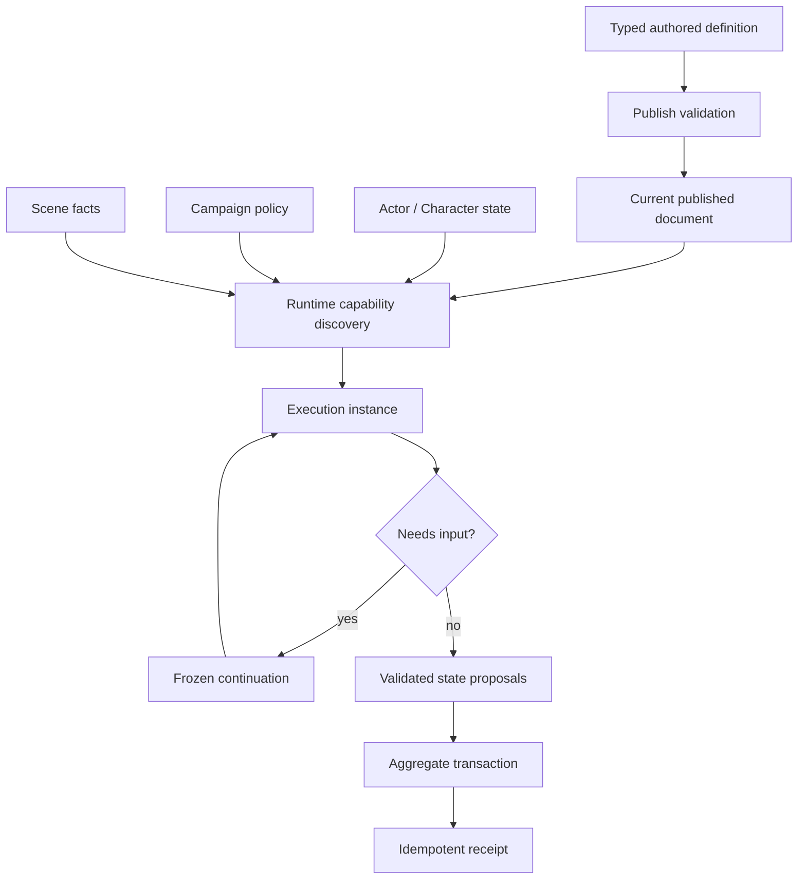

# Shared rules runtime

> **Status:** canonical target; implementation rebaseline in progress
>
> **Scope:** Rules Kernel, Game System capability contracts, authored rule definitions, capability discovery, execution, and occurrence lifecycle
>
> **Update when:** graph contracts, primitive ownership, System capability declarations, publishing, continuation, or receipt behavior changes
>
> **Verification:** ADRs 0023-0025 and the Phase 08 fixed acceptance ledger

## Ownership

The Rules Kernel owns execution protocol only. It walks a validated bounded graph, passes typed facts
between ports, requests bounded evidence or decisions, and returns proposed results. It does not read
repositories, authorize users, generate random values, mutate aggregates, or know D&D vocabulary.

The reusable mechanics library owns typed operations whose meaning is portable: comparison, result
bands, opposed tests, dice-pool evidence, contributor aggregation, bounded choices, generic state
shapes, and spatial contact facts. Adding an operation requires a code-owned key, contract version,
bounded schemas, deterministic implementation, and conformance fixtures.

A platform-owned Game System module composes those operations into semantic rules. Its capability
contract declares:

- supported authored root adapters and reusable definition families;
- Guided and Advanced authoring recipes;
- System policy definitions and rule entry points;
- supported aggregate state shapes and reconciliation behavior;
- Campaign settings and Rules Catalogue compatibility;
- Character/Encounter facts and VTT semantic capabilities.

Unsupported capabilities are absent. The UI and services must not display fake D&D-equivalent
controls for another System.

## Publish versus runtime

Publish validates graph bounds, cycles, ports, primitive contract versions, UUID references,
same-System compatibility, and transitive dependencies. It proves only that an invocation is
structurally executable.

Runtime capability discovery determines current entry points from actor sources, grants, equipment,
effects, overrides, Campaign policy, and Scene facts. An execution instance is created only when an
entry point is invoked. It then binds the actual actors, targets, selections, state, rolls, and Scene
facts and walks the relevant branches.

There is no persistent prepared-plan layer. A derived action list may accelerate presentation but is
never authority; every command repeats current capability and authorization checks.

## Graph constraints

- Graphs are finite, bounded, acyclic, and typed.
- Node identifiers are local graph structure, not reusable authored identity.
- Primitive keys are code-owned; referenced definitions and domain items are UUID-backed.
- Rule-to-rule composition is an explicit validated reference, never arbitrary runtime discovery or
  user code.
- Unknown primitive versions, unbound ports, cross-System references, cycles, and incomplete branches
  reject Publish.
- Zen may implement a bounded pure operation; it is hidden behind the same typed port contract.

## Runtime state and evidence

The shared platform provides only demonstrated mutable shapes: counter, bounded track/clock, usage
marker, and keyed collection. A Game System definition owns meaning, bounds, costs, refresh, and
reconciliation. Character, item, and Encounter aggregates own state instances; there is no universal
economy table.

Application services own random generation and persist exact evidence. Automatic mode may produce
server evidence, Assisted mode may pause for system or physical input, and Manual mode applies no
mechanical outcomes while optional sanitized reminders remain policy controlled. Automation mode never
changes whether authored mechanics are structurally complete.

Continuations persist only when execution pauses. The Kernel returns a serializable pause proposal;
the owning Character or Encounter application transaction persists it. The proposal contains a
non-user-addressable frozen execution snapshot: the validated reachable graph, operation keys and
contract versions, resolved reusable-definition inputs, source identities/checksums, current node and
port state, frozen occurrence facts, issued requests, authority, and redaction policy. It contains
exactly what the Kernel needs to resume even when the current published source is later replaced; it
is not an authored revision or a consumer-selectable version.

Character-owned commands and effects persist their occurrences with the Character aggregate.
Encounter/Scene commands and effects persist them with the Encounter Run. Pure previews and
simulations do not persist an occurrence. Receipts retain the committed result/evidence required for
retry and audit; completed receipts do not retain a historical source document or executable graph.
Raw Kernel facts and trace values are server-only. A domain application service must produce an
authorized, visibility-filtered result/receipt projection before any browser or live-session transport;
the generic runtime exposes no public raw-evidence DTO.

## D&D 2014 adapter

D&D 2014 supplies policy for abilities, skills, attacks, saves, damage, conditions, spellcasting,
concentration, reactions, initiative, legendary/recharge behavior, and approved optional combat
settings. Those concepts remain outside the Rules Kernel. The checked-in 2014 SRD source must compile
through the same contracts as homebrew, and every mechanics-bearing path must be classified Automatic,
Assisted, or explicit Manual/Judgment.

Neutral threshold, opposed-test, dice-pool/result-band, and level-less-track fixtures prove that the
kernel is not D&D-shaped without shipping a second product System.

## Architect escalation

The primary architect owns product behavior, public/persisted contracts, security, concurrency,
load-bearing ownership, and frozen acceptance. Implementers decide ordinary internal details. An
uncovered load-bearing conflict freezes only its affected slice and is escalated once with evidence,
options, and a recommendation. The complete routing rule is in the repository root `AGENTS.md`.
