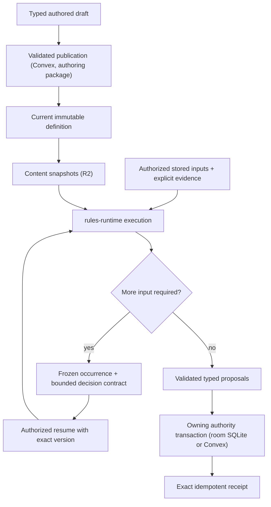

# Shared rules runtime

> **Status:** canonical current guide for `packages/rules-runtime` and its callers. Phase 8.3 rules scope is target and labeled as such.
>
> **Scope:** the pure Rules Kernel, System capability contracts, published definitions, execution, frozen occurrences, decisions, receipts, and who calls the runtime
>
> **Update when:** graph contracts, primitive ownership, System capabilities, publication, occurrence, replay or receipt behavior, the package export surface, or a caller changes
>
> **Verification:** `packages/rules-runtime`, `packages/encounter-persistence`, `apps/session-worker/src` (`native*`, `room*`), `apps/apis/convex/{content,characters,encounters}`, `apps/web/src/domains/characters/builder/evaluation`, ADRs 0023-0026, 0029, 0034-0036, and [the RUL-9 rules audit](../handoffs/rul-9-rules-audit.md)

The Rules Kernel (`packages/shared/src/domains/rules`) is a pure execution library. It walks a validated
bounded graph, accepts explicit facts, random evidence and decisions, and returns typed proposals and a
trace. It does not authenticate users, read persistence, generate randomness, mutate aggregates, or know
D&D vocabulary. `packages/rules-runtime` wraps the Kernel with schema validation, installed System
modules (D&D 2014 today), and the pure Encounter, Character and Sheet calculations that callers share.
It owns no store and no transaction.

## Callers

- **Session Durable Object** (`apps/session-worker`): the `native*` modules (`nativeEncounterRules`,
  `nativeEncounterTurn`, `nativeEncounterMovement`, `nativeCharacterRules`, `nativeBasicAction`,
  `nativeDisarm`, and the Concentration, Cleaving and maintenance modules) plan and execute Encounter,
  movement and Sheet-play rules from the room's SQLite inputs, and the `room*` modules commit the results
  there. Held Sheet play runs through `roomCharacterSheetCommands` and `roomCharacterWrites`. See
  [live sessions](live-sessions.md) for the room protocol, ordering and recovery.
- **Browser Builder** (`apps/web/.../builder/evaluation/builderEvaluator.ts`): evaluates a Character over
  the content snapshot objects of its manifest with `createLazySnapshotReaders`,
  `resolveSnapshotCharacterBuilderPayload` and `previewSnapshotCharacterBuilder` (ADR 0036).
- **Convex Builder commit** (`characters/commit`, `characters/referencedContext.ts`): re-evaluates the
  Character on the server from the referenced current publications through
  `assembleCharacterReferencedBuilderContext`. It is the authoritative check behind the browser's
  evaluation.
- **Other Convex use:** publication and reads that need pure rules code. `content/definitions` composes
  `@artificer-toolkit/authoring/reusableDefinitions`; `content/systems` serves System capabilities from
  `platformRulesRuntime`; Sheet and Campaign Sheet queries and commands use `rules-runtime/character/*`;
  `encounters/actionChoices` and the disarm selection read action sources, economy and wield conflict;
  projection reads use `encounterProjection` and `encounterPlayerProjection`. Convex no longer runs
  per-command Encounter rules: that path was deleted in A35-S6c3
  ([ADR 0035](../adr/0035-room-authoritative-live-encounters.md)).
- **`packages/encounter-persistence`:** admission, persistence writers, receipts and projections for
  Encounter state, over a store interface. It depends on this package, never the reverse; see
  [persistence](persistence.md).

## Package surface

`packages/rules-runtime/package.json` exports `"."` (the `rulesRuntimeService` module only:
`createRulesRuntimeService` and its error classes) and `"./*"`, which maps any module path under `src` to
`dist` (for example `rules-runtime/encounterActionSources`, `rules-runtime/character/sheetPreparation`,
`rules-runtime/systems/dnd5e/attackKind`). Consumers import focused subpaths, not the root. Build the
package before tests that import newly added modules.

| Area                          | Modules                                                                                                                                                                                             | Owns                                                                                                                                                                         |
| ----------------------------- | --------------------------------------------------------------------------------------------------------------------------------------------------------------------------------------------------- | ---------------------------------------------------------------------------------------------------------------------------------------------------------------------------- |
| Execution wrapper             | `rulesRuntimeService`, `platformRulesRuntime`, `platformPolicyModules`, `platformEncounterPolicy`, `platformCharacterPolicy`, `random`                                                              | Schema-aware Kernel execution, continuation sealing, installed System lookup by System UUID                                                                                  |
| Systems                       | `systems/dnd5e/*`                                                                                                                                                                                   | D&D 2014 policy, action compiler, grant fold, modifier scope, concentration, lifecycle and optional-combat policy                                                            |
| Character                     | `character/*`                                                                                                                                                                                       | Context and Sheet preparation, Builder catalogue/eligibility/reconciliation/readiness/payload, snapshot readers, Sheet commands, rest, roll, projection, rule-fact composers |
| Encounter actions             | `encounterAction*`, `encounterBasicActions`, `encounterDisarmPreparation`, `encounterWieldConflict`, `encounterCleaving*`, `encounterConcentration*`                                                | Source resolution, mechanics preparation, economy, target policy, effects, receipts, warnings                                                                                |
| Encounter turn and initiative | `encounterTurn*`, `encounterInitiative*`, `encounterRecharge*`, `encounterLegendary*`, `legendaryActionEligibility*`                                                                                | Initiative graphs and settlement, turn effects, Recharge, Legendary Actions                                                                                                  |
| Encounter movement            | `encounterMovement*`, `encounterSpatialMovement*`, `movementReaction*`                                                                                                                              | Path timeline, Passage contacts, reaction discovery, decision and settlement planning                                                                                        |
| Encounter state               | `encounterActor*`, `encounterMechanicsBatchPlan`, `encounterCharacterMechanicsBatch`, `encounterScalarReductions`, `encounterProjection`, `encounterPlayerProjection`, `encounterCombatPerception*` | Actor facts and state, outcome folds, projection, perception                                                                                                                 |
| Snapshots and misc            | `contentSnapshots`, `contentCatalogue`, `campaignClock`, `characterZeroHitPoints`, `sceneGridPolicy*`, `targetBoundActiveRuleEffectExecutor`, `characterRuleActionSystemAdapter*`                   | Content snapshot build/index shapes, clock boundaries, grid policy, frozen active-effect execution                                                                           |

Everything here takes structural inputs (domain types, injected readers, ports). None of it imports
Convex contexts, database rows, or Worker APIs, so the room and Convex run the same functions.

## Ownership and publication

Game System adapters own rules vocabulary and policy, including D&D 2014. Reusable mechanics remain
portable typed operations. Code-owned operation keys, versions, validators and bounded graphs keep
authored data from introducing executable code or unbounded work. The System UUID selects the adapter;
labels, editions and catalogue codes never do.

Published authored roots and reusable definitions keep stable UUID identity. A reusable definition has at
most one editable draft and zero or one current published document. Publication atomically replaces the
current document, checksum and contract tuple and removes the draft; there is no historical revision
table or consumer-selectable pin. Issued occurrences keep their frozen execution evidence
([ADR 0024](../adr/0024-current-published-authored-content.md)).

`@artificer-toolkit/authoring/reusableDefinitions` is the single persistence-independent publisher. It
receives installed System capabilities, operation contracts, vocabulary and a store with atomic draft and
publication callbacks; Convex `content/definitions` and `content/definitionStore` supply the store.
Family keys live in `schema/shared/reusableDefinitionIdentity`: `rules-runtime-graph`, `sense`,
`rule-capability`, `condition-rule-state`, `rule-maintenance`, `initiative-policy`,
`dnd5e-encounter-lifecycle` and `dnd5e-optional-combat`. A family stores its own typed document: the graph
family holds the executable graph, `sense` holds a closed composition of code-owned perception primitives.
Unknown families are rejected. The checksum codec is `@artificer-toolkit/shared/canonicalJson`.

Publication validates graph bounds, cycles, ports, operation versions, UUID references, same-System
compatibility and transitive dependencies. That proves an invocation is structurally executable, not that
a live command will succeed.

Graph constraints: graphs are finite, bounded, acyclic and typed; node IDs are local structure; primitive
keys are code-owned while referenced definitions and domain items are UUID-backed; rule-to-rule
composition is an explicit validated reference; unknown operation versions, unbound ports, cross-System
references, cycles and incomplete branches reject publication.

Capability discovery derives entry points from actor sources, grants, equipment, effects, Campaign policy
and Scene facts, and an execution instance exists only when an entry point is invoked. An authored Effect
UUID is the stable identity of an effect-backed entry point. The shared boundary compiles the exact
authored Effect before the System adapter runs; the adapter may derive System policy facts from it but
cannot rewrite it. Creature discovery isolates each action: one whose mechanics cannot compile or bind is
listed unavailable with its reason while the Creature's other actions still work. There is no persistent
prepared-plan layer; a derived action list is never authority and every command repeats capability and
authorization checks.

## Execution, decisions, and receipts

An authorized command creates or resumes an aggregate-owned occurrence. A paused occurrence stores its
sealed snapshot: the reachable graph, operation keys and versions, source identities and checksums,
frozen facts, issued requests, authority and redaction policy. Resume rejects stale authority, an
unexpected aggregate version, a bad seal, or a decision outside the stored contract. A pending snapshot is
either `KERNEL_EVIDENCE` (sealed continuation plus a bounded server-only context) or `AGGREGATE_CHOICE`
(one closed tactical choice, no graph). An Encounter has at most one pending occurrence, and a retry
matching a stored receipt returns it before that gate.

A complete execution returns proposals. The owning authority applies them with the aggregate's expected
version, advances the occurrence and writes the receipt in one transaction; any failure leaves prior state
visible, and an exact retry returns the stored receipt without new randomness, current-definition reads or
double application. For live Encounter, movement and held Sheet play the owning transaction is the room's
SQLite commit; Convex receives fenced checkpoints
([ADR 0035](../adr/0035-room-authoritative-live-encounters.md),
[ADR 0029](../adr/0029-convex-backend-cutover.md#live-rules-execution-clarification--2026-09-24)).
Convex still owns the Builder commit, personal Sheet commands and Run creation.

Receipts retain committed results and evidence for retry and audit, never an executable graph. A resume
that advances or re-pauses writes a closed command-specific result holding only the actor-filtered summary
needed to replay that response. Character events caused by one occurrence use deterministic child command
UUIDs derived from the occurrence, root command, phase, ordinal and Character, so repeated phases never
reuse an idempotency key. Raw Kernel facts and traces are server-only; browsers receive recipient-safe
projections.

**Automation modes (ADR 0034).** There are two: Assisted and Manual. In Assisted, a step needing dice asks
the roller's `userProfiles.autoRollDice` preference: on records app-roll evidence immediately, off pauses
for entered dice. The roller is the actor whose roll it is; its assigned player's preference applies, else
its first granted controller's, else the GM's (`readEncounterAutoRollByActorId`). Lifecycle functions take
an `EncounterEvidenceMode` (`AUTO_ROLL | PROMPT | MANUAL`); answers arrive as `EncounterEvidenceAnswer`
and only `resolveEncounterD20Answer` and `resolveEncounterIntegerAnswer` turn one into faces. D20
evidence records both the chosen and the rules-derived roll mode, and pending summaries name the
contributors behind the derived mode (`encounterRollModeReasons`, labeled for display by
`rollModeReasons` in `packages/encounter-persistence`). A player's prompt never names a contributor from an actor hidden from
players (it reads "Unseen source"); known limit: a contributor from the roller's own policy is never
redacted. Manual mode records an idempotent receipt at an unchanged version without invoking the Kernel or
applying state and carries no rules cue (ADR 0034). Actions in a Manual Encounter are refused with the
`ASSISTED_ONLY` domain rejection.

**Active effects and maintained state.** Current active effects are state, not occurrences. Each stores an
immutable definition (origin, one frozen `SINGLE_GRAPH`, adapter facts, recurrence, perception
contributions) and a mutable lifecycle (remaining ticks). The pure executor
(`targetBoundActiveRuleEffectExecutor`) executes the frozen graph without current-definition lookup and
returns a lifecycle `UPDATE` or `EXPIRE` proposal for the owner to apply. Maintained-effect state
(Concentration) is generic persistence keyed by a System maintenance-definition identity; the System
decides whether a mechanic uses it. Storage layout and limits are in [persistence](persistence.md).

## Assisted soft enforcement and GM undo (current, ADR 0034 decision 2)

`RESOLVE_ACTION` evaluates its overridable checks once, in the room planner (`nativeEncounterRules`),
through `encounterActionRuleWarnings`:

- `prepareEncounterActionMechanics({ overridable: true })` reports `SOURCE_NOT_EQUIPPED` and
  `RESOURCE_UNAVAILABLE` instead of refusing;
- `evaluateEncounterActionEconomy` reports `ACTION_ECONOMY_UNAVAILABLE`;
- `evaluateEncounterActionTargetPolicy` reports `TARGET_OUT_OF_RANGE` (or `TARGET_RANGE_UNCHECKED`
  without both tokens), `TARGET_DISPOSITION` and `TARGET_DEFEATED`. Disposition compares the GM-set
  dispositions through `encounterActorRelationship` (neutral is neutral to everyone, equal dispositions
  are allied, friendly and hostile are hostile). It is the one source of hostility: movement reaction
  eligibility and passage blockers use it, and Run state stores no side relationships. Actor sides remain
  only for initiative grouping, reorder, reinforcement and removal.

`USE_BASIC_ACTION` follows the same rule with `encounterActionEconomyWarnings` and `TARGET_DISPOSITION`.
Action choices carry the warnings that already apply before a target is chosen.

The command proceeds only when `acknowledgedWarnings` (part of its fingerprint) covers every current
code; otherwise it is refused with `RULE_WARNINGS`. An override spends only what remains and
`consumeEncounterActionEconomy({ overridden: true })` lets the allowance exceed its maximum. Accepted
warnings are stored as `ruleOverrides` and badged on the timeline. Authorization, versions, the current
actor, Manual mode and completed Encounters are hard checks, never warnings. Reactions, Legendary
Actions, Disarm and movement call preparation with `overridable: false` and keep refusing.

`REVERT_LAST_ACTION` (GM-only) undoes the Run's last `RESOLVE_ACTION` and its committed child receipts,
inverting only recorded before-states (hit points, conditions, resource usage, a stowed shield, charges,
the action allowance, created effects and maintained states). It refuses, naming the kind, removed
conditions, replaced maintained effects, lost Concentration, Cleaving damage to a Character, Disarm and
other contested actions; a second undo is refused. Its implementation is
`packages/encounter-persistence/src/actionRevert.ts`.

### 0 hit points (D63, current)

A Creature or custom Run actor stores `defeated`. `nextEncounterActorDefeated`
(`rules-runtime/encounterActorDefeat`) sets it when a change takes the actor from above 0 hit points to 0
and clears it once the actor has any; an actor at 0 of 0 (a lair or hazard) is never defeated. Every Run
hit-point write uses it: `planEncounterMechanicsBatch` (all damage and healing paths), the GM's
`UPDATE_ACTOR` edit and `REVERT_LAST_ACTION`.

A defeated actor takes no turns (initiative skips it but keeps its place), no reactions or opportunity
attacks (`encounterMovementReactionSources`), no Legendary Actions and is no Legendary target
(`encounterTurnLegendaryDiscovery`). It is never a Cleaving continuation target
(`buildEncounterCleavingCandidate`), has no action choices and cannot act (`ACTOR_DEFEATED`) nor, for a
player, move its token. Naming one as a `RESOLVE_ACTION` target is the overridable `TARGET_DEFEATED`
warning; Help and Disarm refuse it.

A Character at 0 hit points is never defeated. Dropping to 0 adds the System's 0 hit point condition
(`characterZeroHitPointsConditionId`; D&D: Unconscious), and regaining hit points removes it, in
`planEncounterMechanicsBatch` and the Sheet's hit point commands. `REVERT_LAST_ACTION` removes it with the
damage that caused it and refuses to undo a heal that woke the Character. Dying is being at 0 hit points;
death saving throws are Phase 8.3 scope (target), and a dying Character's turns are not skipped. Not
modeled for any condition: automatic failure of Strength and Dexterity saves, advantage on attacks
against the creature, and critical hits from melee attacks within 5 feet.

## Initiative

Initiative is application policy over typed rules evidence. Campaign settings select an allowed
UUID-backed policy and tie resolver for future Encounters; admission freezes the exact policy and graph
documents (System v3/v4 defaults, or a Campaign override whose sources the Campaign's Rules Catalogues
enable) with one snapshot checksum. A System without a default and a Campaign without an override
produce no automatic policy, and the Run uses an explicit `MANUAL` round. Optional-combat settings use the
same current-selection, frozen-run boundary with a separate checksummed snapshot; see
[D&D optional combat](dnd5e-optional-combat.md).

A policy document selects a procedure (`ACTOR_ROLL`, `ACTOR_SCORE`, `SIDE_ROLL`, `DECLARED_ACTION_ROLL`)
and cadence (`ENCOUNTER_START` carries the settled order into later rounds, `EACH_ROUND` evaluates a
fresh round), and pins an evaluation graph, a bounded order-choice graph and bounded tie resolvers.
Graphs supply facts and scores; the application orders results and invokes the pinned resolver.
Unresolved ties go through the order-choice graph, never an application tiebreak.

Lifecycle order: `START` creates a `PREPARING` round, evaluates the policy, resolves ties and choices,
activates the first participant, then enters that actor's `START_OF_TURN`. At an `EACH_ROUND` wrap the
outgoing `END_OF_TURN` settles before the next round is evaluated. While evidence or a choice is pending,
the root command keeps one Encounter occurrence at an unchanged version. Every preterminal phase
(outgoing effects, the proposed round, incoming Recharge) stays non-mutating until the terminal commit
re-validates and applies it atomically, so a pause leaves aggregate state unchanged. One Campaign has at
most one `ACTIVE` Encounter Run.

Reordering applies after any pending decision resolves. A newly improvised actor acts in the current round
only if its rolled position is after the current actor; preplanned hidden actors already occupy the order.
Modules: `encounterInitiative*` (graph execution, score batches, tie and order resolution, staging,
state settlement), `encounterTurn*`, `encounterRechargeLifecycle`. The room's ordering and delivery are in
[live sessions](live-sessions.md).

## Effective maximum hit points

Effective maximum hit points is one computation (`character/hitPointMaximumReductions`) that subtracts a
Character's active reductions, never below 0. Encounter Character targets, the Sheet projection and the
rest preview all use it. Hit points clamp to the reduced maximum. The Character row's stored
`maximumHitPoints` is the maximum before reductions; row readers subtract reductions through
`characterMaximumHitPoints` in `packages/encounter-persistence`. A reduction's `recoveryTags`
(`schema/effects/hitPointMaximumReduction`) always include `RESTORE_HIT_POINT_MAXIMUM` and may add
`LONG_REST`; a long `COMPLETE_REST` deletes the latter. The contribution freezes `sourceLabel` and
`sourceHidden`; only the GM's Sheet view shows a hidden source's label
(`projectCharacterSheetForViewer`). A Creature at a 0 maximum has 0 hit points and is defeated; a
Character only drops to unconscious.

## Portable live preparation

`rules-runtime/character/builderPreparation` and `character/sheetPreparation` own reconciliation,
readiness and Character evaluation over authorized inputs. `character/contextPreparation`
(`prepareCharacterRuleContext`) owns source selection, retained Equipment handling, inheritance
resolution, feature collection and the Spell catalogue decision, over injected typed readers.
`prepareCharacterRuleSources` compiles sources once for repeated evaluation; `evaluateCharacterRules`
accepts it only with the same immutable context object.

**Builder catalogue.** `assembleCharacterBuilderContext` builds the catalogue in `selectors` or
`resolution` scope. Its readers return each pool's picker facts in the content snapshot index shape (ADR
0036), a subrace already joined to its base Race. `selectors` takes `CharacterBuilderCatalogueReaders`
(every picker pool) and is the browser's, via `character/snapshotReaders` (`createSnapshotReaders`,
`createLazySnapshotReaders`) over the parsed snapshot objects of one Character's manifest, where a `SOURCE`
root shadows a Campaign share of the same root. `resolution` takes only
`CharacterBuilderResolutionCatalogueReaders` (Classes, Equipment, Feats) and serves the server's Sheet,
assignment and source-loss paths through `characters/builderContext`.
`assembleCharacterReferencedBuilderContext` serves the Convex Builder commit from referenced current
publications. `character/builderPayload` (`resolveCharacterBuilderPayload`) turns a context into the
Builder payload, and `character/snapshotBuilderEvaluation` wraps that over snapshot readers.
`characters/builderSnapshotParity.test.ts` proves the snapshot payload equals a full-pool evaluation.

**Room.** The room receives stored Character, Sheet, Campaign and Run inputs through `room-inputs` on
hydration; authored content comes from the room's verified content snapshot objects through
`createSnapshotReaders` (`roomContentSnapshots`, `nativeCharacterRules`). The `liveSessionCharacterRules`
contract shapes the Character rules scope. Source access remains the Character owner's, and Convex does not
evaluate Character rules for live play. The room uses the same context, Builder catalogue and Sheet
preparation functions, without serializing database contexts or Maps.

**Encounter preparation.** `encounterMovementTargets` owns target facts, effect reductions and reaction
source compilation; `encounterMechanicsBatchPlan` owns the Character/actor transition plan;
`encounterActionSources` and `encounterActionMechanicsPreparation` own action source resolution and
target, resource, relationship and execution-plan preparation; `encounterActionEffects` and
`encounterActionEconomy` own effect planning and allowance calculation (no reads for Manual mode or
actions without an allowance); `encounterCreatureEquipmentSources` owns Equipment snapshot pinning and
loadout binding checks. The room reads actors, effects and definitions through its read ports and commits
through its write ports (`roomEncounterReadPorts`, `roomEncounterWritePorts`). Convex adapters that
still call these modules authorize their reads first.

**Other pure helpers.** Sheet commands and projection (`sheetCommandReducer`, `sheetRest`, `sheetRoll`,
`sheetPanel`, `sheetProjection`), spell eligibility, `campaignClock` boundaries and the shared
1,000-character resource pool key bound live under `character/` and the package root. Authentication,
randomness, history and atomic consumption stay with the caller. See [character](character.md) for Sheet
and Builder ownership.

## D&D 2014 adapter

D&D 2014 supplies policy for abilities, skills, attacks, saves, damage, conditions, spellcasting,
Concentration, reactions, initiative, legendary and recharge behavior, and approved optional combat
settings, all outside the Kernel. The checked-in SRD must compile through the same contracts as homebrew,
and every mechanics-bearing path is classified Automatic, Assisted or explicit Manual/Judgment.

`platformRulesRuntime` supplies the installed capabilities and operations to execution and publication.
The focused `platformEncounterPolicy` and `platformCharacterPolicy` bindings use the same D&D policies and
System UUID without initializing the rest. `evaluateInstalledEncounterActors`,
`evaluateInstalledCharacterGrantFold`, `evaluateInstalledCharacterActions` and
`evaluateInstalledCharacterPolicy` select the System by UUID, validate schema facts and results, and
reject unknown Systems. Whole-policy composition resolves spell access before the grant fold, then
modifiers and derived stats, defenses, movement and senses, vitals, spell mechanics, slots and resources,
actions, eligibility and rest. Policy modules are looked up through `platformPolicyModules`; unsupported
policy keys and contract versions are rejected.

**Modifiers and combat math.** `systems/dnd5e/modifierApplicability` is the one scope rule: a `GLOBAL`
modifier applies Character-wide, a `SOURCE` modifier only while its own source is evaluated, narrowed by
Equipment and Spell facets. Restrictions the fold cannot evaluate fail closed. `systems/dnd5e/attackKind`
classifies `MELEE | RANGED | UNARMED | MELEE_SPELL | RANGED_SPELL`; `dnd5eAttackRollContributors` adds an
action's own contributors to the Character-wide `rollContributorEvidence`. Armor class uses one
calculation (best of worn armor, unarmored, or an authored formula; a shield and flat bonuses add).
Creature `qualifiedDamageDefenses` apply only to attacks lacking every bypassing trait. Modifier kinds
without a consumer are rejected at grant validation (see [authoring schema](authoring-schema.md)).

**Drawn weapons (user ruling, 2026-09-24).** A used Character action on a carried weapon treats it as
drawn unless its equipment facts say `requiresEquipped`; the grant fold applies the same rule to
Source-scoped `ATTACK_ROLL` and `DAMAGE` grants. Armor and shield still use real equipped state.
`encounterWieldConflict` returns `STOW_SHIELD` when a `TWO_HANDED` action meets an equipped shield, via
`resolveDnd5eShieldArmorClass`. A `RESOLVE_ACTION` is `PROMPTED`: the submitter must send
`acceptedWieldConflict` naming exactly the evaluated shield; the stow joins the source Character's batch
(`stowEquippedItemInstanceId`) and the receipt records `sourceItemUseStateTransition`. Initiative
declarations, movement reactions, Legendary Actions, Cleaving and Disarm are `UNPROMPTED`. Player-driven
action submission, which would move the prompt to the player, is not built.

**Action phases.** An authored action compiles to an immutable template; after the owner locks and
authorizes facts, at most two ordered phases specialize from it: `TEST` (one d20 stage selecting the hit,
miss, critical or save path) and `OUTCOME` (exact authored dice and scaling). Each phase is acyclic with
one evidence stage; resource use, mutations and receipts wait for the terminal phase.
`diceGraphDefinition` is the only place that doubles critical dice. The immediate follow-up save shapes the
adapter supports, ranged long range (`longAmount`, `encounterActionLongRangeContributor`), reach 0 swarm
attacks, timed conditions and multi-condition hits are defined by the compiler
(`systems/dnd5e/effectActionCompiler`) and fail closed outside those shapes. Range and reach use one
measure, `measureSceneTokenFootprintDistance`. The SRD attack sweep allowlist
(`__tests__/srdCreatureAttackSweepAllowlist.ts`) lists the attacks that remain unsupported, each with one
reason, and may only shrink. Versatile grips author one effect per grip.

**Legendary and Recharge.** Policy lives in `dnd5e-encounter-lifecycle` documents; usage state stays with
Feature-owned charge identities. Recharge runs for the incoming actor in the shared turn occurrence.
At each `END_OF_OTHER_ACTOR_TURN` boundary the occurrence freezes a UUID-sorted owner queue; each eligible
owner gets at most one window, and the turn resumes after the queue is terminal
(`encounterTurnLegendaryDiscovery`, `discoverTurnLegendaryWindows`). A Feature option may run another
action Feature of the same Creature through `actionReference: { featureId, chargeCost }`.

**Concentration.** The damage-check graph and the `rule-maintenance` definition are published System
content shared by spells and features. A completed action stages one receipt-only child occurrence per
damage source against a maintained state, with the DC from that source's total damage. Assisted mode
pauses on the first child; only the GM or the maintained Character's controller settles it. Movement
damage, turn effects and Cleaving use the same coordinators (`encounterConcentration*`,
`encounterCleaving*`); the room modules are `nativeEncounterConcentration`, `nativeEncounterCleaving` and
`nativeEncounterMovementConcentration`.

**Movement and reactions.** Contacts form one frozen path timeline ordered by distance
(`encounterMovementPath`); spatial effects resolve before reaction candidates at the same distance, and a
typed stop closes newly invalid reactions. A reaction decision uses one Encounter-owned occurrence whose
sealed context is `CHOICE` then `ACTION_EVIDENCE`. Decline consumes nothing; use consumes the reaction
allowance and any authored cost only after the action completes. Assisted mode never uses a reaction on
anyone's behalf (`CONTROLLER_CHOICE`). The reusable `evidence.bounded-choice-index` operation records
only a numeric selection; the application holds the issued option identities. Hostile Passage contacts
(Overrun, Tumble) are ordered with spatial contacts and reactions
(`encounterMovementPassage*`). Reaction policy, eligibility and perception are System policy over
authoritative actor and Scene facts.

**Combat Perception.** `encounterCombatPerception` is a pure resolver over pinned sense capabilities
(`pinnedSenseDefinitions` on the Character mechanics projection, `senseDefinitionId` identity), Scene
illumination and obscurement, line of effect, and typed active-effect contributions. Unknown definitions
fail closed to Manual/Judgment. Fog and viewer projection are never mechanics inputs.

## Target and open scope

These are not current behavior:

- Phase 8.3 "Player play parity" ([ADR 0034](../adr/0034-player-control-rules-assistance-and-roll-prompts.md)):
  spell casting and area targeting, death saves, Sheet-tabletop integration, map targeting, non-movement
  reactions. Spell slots are not spent by `RESOLVE_ACTION` until then. The gaps by area (grapple,
  conditions, `CLOSED_RULE` kinds with no resolver) are in
  [the RUL-9 audit](../handoffs/rul-9-rules-audit.md).
- Opposed-test, dice-pool and result-band, and level-less-track Kernel fixtures are conformance work, not
  current Kernel capabilities.
- Acceptance status of the room and Convex flows is tracked in the
  [Phase 8.2 acceptance ledger](../roadmap/08-2-convex-cutover-acceptance.md), not in this guide.

## Architect escalation

The architect owns product behavior, public and persisted contracts, security, concurrency, load-bearing
ownership and frozen acceptance. Implementers decide ordinary internal details. The complete routing rule
is in the repository root `AGENTS.md`.
