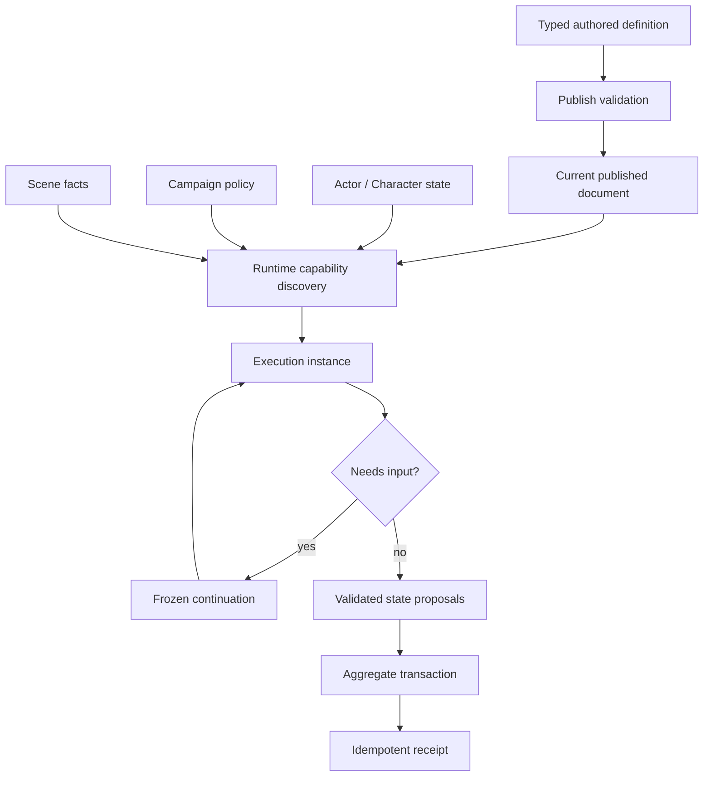
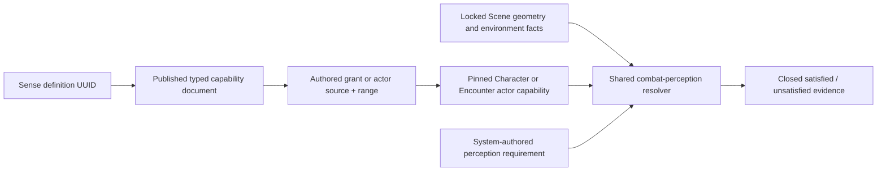

# Shared rules runtime

> **Status:** canonical target; implementation rebaseline in progress
>
> **Scope:** Rules Kernel, Game System capability contracts, authored rule definitions, capability discovery, execution, and occurrence lifecycle
>
> **Update when:** graph contracts, primitive ownership, System capability declarations, publishing, continuation, or receipt behavior changes
>
> **Verification:** ADRs 0023-0025 and the Phase 08 fixed acceptance ledger

## Ownership



The Rules Kernel owns execution protocol only. It walks a validated bounded graph, passes typed facts
between ports, requests bounded evidence or decisions, and returns proposed results. It does not read
repositories, authorize users, generate random values, mutate aggregates, or know D&D vocabulary.

An operation is `PURE`, `EVIDENCE`, or `PROPOSAL`. A proposal is a deterministic typed scalar
operation: the Kernel evaluates it once in graph order and retains its inputs and outputs in the
ordered trace, but never interprets it or applies state. For a COMPLETE execution with a registered
domain applicator that requires an advance, the owning application transaction first advances the aggregate with its
expected-version CAS, then transitions the aggregate-owned occurrence, runs that applicator
(including any genuine domain projection event), and finally writes the aggregate-owned rule receipt.
Any failure rolls back that single transaction. A pause, re-pause, or receipt-only COMPLETE does not
advance the aggregate: its occurrence and receipt retain the locked current aggregate version. The
applicator never runs for a pause or receipt replay.
The concrete locked Encounter command context alone may issue an opaque receipt-only child-occurrence
capability at its private effective version; that capability is bound to the same transaction, becomes
stale after a later parent version advance, and cannot reacquire roots or advance the Encounter.

The reusable mechanics library owns typed operations whose meaning is portable: comparison, result
bands, opposed tests, dice-pool evidence, contributor aggregation, bounded choices, generic state
shapes, and spatial contact facts. Adding an operation requires a code-owned key, contract version,
bounded schemas, deterministic implementation, and conformance fixtures.

A platform-owned Game System module composes independently owned typed subcontracts into semantic
rules. The Rules Runtime sub-contract declares only:

- supported authored root adapters and reusable definition families;
- fact contracts; and
- code-owned operation contracts.

Authoring owns Guided and Advanced recipes; Campaign, Character, and Encounter own settings, state,
and reconciliation; VTT owns its semantic capabilities. Those later contracts compose with this one;
they are not fields in the Rules Kernel contract. Unsupported subcontracts and capabilities are absent,
and services and UI fail closed rather than assume D&D equivalents.

## Publish versus runtime

Publish validates graph bounds, cycles, ports, primitive contract versions, UUID references,
same-System compatibility, and transitive dependencies. It proves only that an invocation is
structurally executable.

The implemented Gate 1 catalogue foundation keeps source identity separate from execution policy:
`rules_catalogues` are System-owned metadata/policy lineages, `content_sources` are platform or
user provenance roots, and inclusion is an explicit same-System relation. A reusable definition is
one UUID-backed System/source/family root with at most one editable draft and zero-or-one current
published document. Publish revalidates the exact family, atomically replaces that one current
document/checksum/contract tuple, increments the root version, and removes the consumed draft. It
does not create historical published revisions or a consumer-selectable pin. The initial publisher
is the bounded neutral `rules-runtime-graph` family; it compiles against the exact Game System
capability contract at draft save and publish. Other families require their own typed publisher.
The ordinary service accepts only USER source-owner mutation; PLATFORM publication remains a future
internal/bootstrap composition, never a caller-provided authority flag.

Runtime capability discovery determines current entry points from actor sources, grants, equipment,
effects, overrides, Campaign policy, and Scene facts. An execution instance is created only when an
entry point is invoked. It then binds the actual actors, targets, selections, state, rolls, and Scene
facts and walks the relevant branches.

An authored Effect UUID is the stable definition identity for an effect-backed entry point. Repeated
Character or Encounter instances retain their separate source-instance/action identity; discovery does
not create a mirror reusable-definition row for every Effect. A reusable definition is referenced only
when authored mechanics are genuinely shared independently of the owning domain item. A code-owned
Game System adapter discovers typed entry points from the current authored source. The System UUID
selects that adapter; catalogue, edition, label, and legacy model keys do not.

For Effect-backed Character and Creature capabilities, the shared discovery boundary compiles the
exact immutable authored Effect before invoking the System adapter. The adapter may derive only
System-owned policy facts from that compiled value; it cannot replace or rewrite the compiled Effect.
Capability evidence retains separate authored-source and compiled-Effect checksums.

There is no persistent prepared-plan layer. A derived action list may accelerate presentation but is
never authority; every command repeats current capability and authorization checks.

### Authored mechanics index

Publication, projection rebuild, and SRD source auditing call one compiler-owned subject seam for all
eight authored subject families. It returns the effective compiled projection and a reproducible
source mechanics index. The index is not persisted or runtime authority: it is an audit artifact keyed
by the authored document, resolved dependency vector, and compiler version. Its root node contains
only explicitly selected root-owned mechanics; UUID-owned Features, grants, charges, starting-
equipment structures, class resources, ancestry structures, and Effect groups retain separate typed
nodes. An unknown display field cannot become indexed mechanics by accident.

A variant is indexed from its own authored mechanics only. Its parent is independently indexed and
pinned, while the effective compiled projection resolves the exact pinned parent dependency. This
keeps inherited mechanics out of the child source audit without changing effective play projection.

An already-authorized domain service may supply the exact current definition/source envelope directly
to the runtime. The runtime repeats the same identity, checksum, Game System, family, capability, and
graph validation used for repository-backed execution; it does not read a second source. A frozen
continuation remains source-independent on resume.

### Typed reusable definition families



Reusable-definition identity, source ownership, current publication, checksum, and draft lifecycle are
shared. The document is family-owned. `rules-runtime-graph` stores the bounded executable graph already
used by the Kernel. `sense` stores a closed composition of code-owned perception primitives instead;
it is not converted into a second graph language. The publishing service dispatches only by an
approved family contract and rejects unknown families.

The current `senses` catalogue row and its reusable-definition root use the same `(id, game_system_id)`
identity. The catalogue row supplies selectable display/search metadata; the reusable root supplies
source ownership and current typed behavior. The coherent Gate 2 migration enforces that relation
instead of introducing a second sense-policy UUID or parsing the catalogue code.

New Character finalization resolves only the exact sense-definition UUIDs that remain after grants,
restrictions, scaling, and overrides. It reads each coherent current publication and persists the full
typed document, definition version, checksum, and effective range in the Character mechanics
projection as `pinnedSenseDefinitions`. A concurrent independent publication may affect a later
finalization; it does not invalidate or repin the complete document already observed and stored by the
current finalization. Sheet-state recompilation, structural reconciliation, Encounter admission, and
reconnect carry that field forward byte-faithfully and never reread current sense definitions.
Character contracts call the value `senseDefinitionId`; the historical `senseCode` name is removed
rather than retained as a behavioral alias.

The projection-schema v2 rebaseline explicitly rejects pre-pin projection rows after the migration adds
an empty storage column. Existing rows are retained for audit, but cannot be silently treated as pinned
or automatically repinned. Only explicit Builder finalization may read the narrowly validated legacy
source and publish a new v2 projection from authoritative Character, System, rule-revision, authored,
and Campaign-overlay inputs. Ordinary reads and structural reconciliation remain v2-only and fail
closed on pre-pin rows.

A sense document owns one or more bounded capabilities composed from code-owned channel, access,
requirement, illumination, obscurement, invisibility, and physical-constraint values. Its UUID is the
only behavioral identity. Code and label are catalogue metadata and never select mechanics. Range is
an inline typed parameter owned by the grant or actor source, so two grants may use the same sense
definition at different ranges without cloning it.

The shared combat-perception resolver is pure mechanics-library code. It evaluates pinned capability
data against authoritative distance, line-of-effect, shared-surface, illumination, obscurement,
invisibility, and channel-suppression facts. The selected Game System owns which closed perception
requirement an authored mechanic needs and how conditions/effects contribute those facts. Scene fog,
viewer projection, token-hidden state, and labels are never mechanics inputs. Unknown or unnormalized
definitions fail closed to Manual/Judgment; raw Creature sense prose is never parsed.

Scene JSON owns its factual environment: `ambientIllumination` and each darkness zone's optional
mechanical illumination/obscurement are authoritative Scene state, while lights remain geometric
factual sources. Fog and recipient-specific viewer projection never substitute for those mechanics.
Scene grid calibration and its authored diagonal policy remain factual Scene presentation state. At a
locked Encounter command boundary, the System adapter derives a separate effective mechanics grid from
the checksum-pinned optional-combat snapshot; range, reach, and perception receive that view without
mutating or repinning the authored Scene.
The current Gate 2 Scene resolver measures range between complete occupied rectangles, separates visual
obstruction from physical line of effect, applies barrier-aware lights before mechanical zone severity,
and requires `sharedSurface` as an explicit authoritative fact. Light cones and zones currently sample
the token anchor; only range uses the full footprint. Token vision remains presentation data and is not
an implicit combat rule.

Active-effect definitions may carry bounded typed perception contributions. Under locked aggregate and
Scene state, the Encounter application partitions exact current effects into observer, subject, and
local-area relations while retaining effect identity, version, definition checksum, and deterministic
order. The pure resolver combines those contributions with the Scene environment and pinned UUID-backed
sense capabilities. No relation discriminator is persisted and no effect changes Scene-owned facts.

**CURRENT / Gate 2 tracer:** UUID sense-grant references, pinned definition/checksum/range facts, Scene
environment resolution, and typed effect contribution resolution are implemented with focused proof.
The production reaction consumer, occurrence evidence, authorized projection, and bounded PostgreSQL
locking/replay/privacy schedules remain required before acceptance.

## Graph constraints

- Graphs are finite, bounded, acyclic, and typed.
- Node identifiers are local graph structure, not reusable authored identity.
- Primitive keys are code-owned; referenced definitions and domain items are UUID-backed.
- Rule-to-rule composition is an explicit validated reference, never arbitrary runtime discovery or
  user code.
- Unknown primitive versions, unbound ports, cross-System references, cycles, and incomplete branches
  reject Publish.
- Zen may implement a bounded pure operation; it is hidden behind the same typed port contract.

## Runtime state and evidence

The shared platform provides only demonstrated mutable shapes: counter, bounded track/clock, usage
marker, and keyed collection. A Game System definition owns meaning, bounds, costs, refresh, and
reconciliation. Character, item, and Encounter aggregates own state instances; there is no universal
economy table.

Initiative follows the same ownership rule. Campaign settings select an allowed UUID-backed policy and
tie resolver for future Encounters; Encounter admission freezes the exact policy and graph documents.
Each Encounter then owns normalized initiative-round, participant, and (for side procedures) side state.
The round header stores the procedure, cadence, policy-snapshot checksum, lifecycle status, version, and
monotonic next-turn ordinal. Participant and side rows store only current score/order/status plus exact
checksum-bound occurrence pointers. Randomness, choices, graph traces, and replay remain in Encounter
rule occurrences and receipts. Neither the legacy actor `initiative` scalar nor GM `manual_order` is an
authoritative substitute for policy-derived round state.

`ACTOR_ROLL`, `ACTOR_SCORE`, `SIDE_ROLL`, and `DECLARED_ACTION_ROLL` describe orchestration shape, not
game-specific arithmetic. The pinned System graphs and adapters supply facts and determine scores; the
application orders normalized results and invokes the selected pinned tie resolver. A no-policy legacy
Encounter uses an explicit `MANUAL` round and preserves the GM's settled ordering without pretending it
was System evaluation. `ENCOUNTER_START` cadence carries that settled order into later rounds, while
`EACH_ROUND` creates and settles a fresh normalized round. Assisted evidence pauses through the existing
single Encounter occurrence channel; no initiative-specific workflow or decision table exists.

The owning Encounter coordinator preserves one ordered lifecycle. `START` creates a `PREPARING`
initiative round, evaluates the pinned policy, resolves bounded ties or order choices, activates the
first participant, and only then enters that actor's `START_OF_TURN` boundary. A same-round advance
retains the settled order. At an `EACH_ROUND` wrap, the outgoing `END_OF_TURN` boundary settles before
the next `PREPARING` round is evaluated, and the new first actor's `START_OF_TURN` boundary follows only
after that order is final. An `ENCOUNTER_START` wrap copies the prior settled order into the new
normalized round instead of reevaluating it. While any evidence or choice is pending, the root command
retains the same Encounter-owned occurrence and unchanged Encounter version; its server-only
application context may advance from initiative evaluation to tie/order choice and then to turn effects.
It never creates a parallel pending occurrence or freezes a start-of-turn actor before initiative is
settled.

**CURRENT / Gate 2 execution:** every preterminal phase is staged inside that occurrence. At an
`EACH_ROUND` boundary, evaluated outgoing effects, the proposed normalized initiative round, and any
successful incoming Recharge executions remain non-mutating until the entire turn lifecycle can commit.
The terminal transaction re-locks and revalidates those staged plans, applies outgoing effects, writes
the normalized initiative state, applies Feature-owned Recharge state, runs incoming `START_OF_TURN`
effects, advances the Encounter cursor, and records the terminal receipt atomically. A pause at any
initiative, Recharge, or active-effect boundary therefore leaves aggregate state unchanged. Each
advancing Recharge response that re-pauses the occurrence also owns a command-specific
`TURN_EFFECTS_PENDING` receipt containing only its public pending summary; the sealed continuation and
staged plans remain occurrence-only.

Application services own random generation and persist exact evidence. Automatic mode may produce
server evidence, Assisted mode may pause for system or physical input, and Manual mode applies no
mechanical outcomes while optional sanitized reminders remain policy controlled. Automation mode never
changes whether authored mechanics are structurally complete.

For a recognized Manual command, the owning aggregate records a completed, idempotent receipt at its
unchanged version without invoking the Kernel, generating random evidence, or applying domain state.
`OFF` stores no reminder; `SUBTLE` stores only the generic `MANUAL_RULE_REVIEW` marker. That marker
contains no source, actor, target, geometry, provenance, fact, or count information. Unrecognized or
unavailable paths fail normally and do not create a Manual receipt.

System policy qualifies private d20 contributors; the trusted Character evaluation boundary derives the
scalar roll mode from that ordered evidence. The current Character model still emits a scalar `rollModes`
field for its transitional fixture contract, but that field is overwritten and is never authoritative.

Continuations persist only when execution pauses. The Kernel returns a serializable pause proposal;
the owning Character or Encounter application transaction persists it. The proposal contains a
non-user-addressable frozen execution snapshot: the validated reachable graph, operation keys and
contract versions, resolved reusable-definition inputs, source identities/checksums, current node and
port state, frozen occurrence facts, issued requests, authority, and redaction policy. It contains
exactly what the Kernel needs to resume even when the current published source is later replaced; it
is not an authored revision or a consumer-selectable version.

Character-owned commands and effects persist their occurrences with the Character aggregate.
Encounter/Scene commands and effects persist them with the Encounter Run. Each aggregate owns its
separate rule-receipt rows; receipts are not Character or Encounter domain events and one occurrence
may retain its start and resume receipts. Every resume command that advances or re-pauses an
occurrence writes one command-specific closed result before returning. That result retains only the
actor-filtered occurrence summary needed to replay the exact decision response; it never retains the
sealed continuation, executable graph, private facts, or a full aggregate projection. Later resumes
and terminal completion do not replace or invalidate those earlier command receipts. Each movement
receipt also records the exact aggregate version transitions committed by that command, including both
the before and after version. A replay returns only those command-scoped transitions; it never derives
delivery changes from the occurrence's later pending or terminal state. The terminal occurrence result
may retain the complete ordered reaction/spatial evidence and final versions for audit, but it is not a
substitute for an earlier command's delivery receipt. Coordinator snapshots retain only current final
versions, not historical before versions.
A pending occurrence remains anchored to the unchanged
aggregate version, so an intervening aggregate mutation makes resume stale. Each pending row stores
a canonical checksum of its complete sealed snapshot; repository reads recompute and verify that
binding before any resume. Pure previews and simulations do not persist an occurrence.
A movement occurrence may apply more than one reaction or spatial mechanics phase to the same
Character. Each resulting Character domain event therefore uses a deterministic child command UUID
derived from the occurrence, the executing root or resolution command, the closed mechanics phase, a
stable application ordinal, and the Character identity. The event retains the executing source
command and occurrence as audit correlation. Neither the occurrence UUID nor the raw source command
UUID is reused as the Character event idempotency key across separate movement phases or resumes.
An Encounter may have at most one pending occurrence. The locked Encounter root checks a matching
receipt before this pending gate, so a retry returns its stored result; a different fresh start is
rejected before source resolution, Kernel execution, randomness, or application. A terminal
application may explicitly be receipt-only: it still applies its aggregate-owned result and writes a
terminal occurrence/receipt at the unchanged version. That pure mutation-intent decision runs after
Kernel completion and before the aggregate CAS; it cannot acquire roots or write state itself.
Receipts retain the committed result/evidence required for retry and audit; completed receipts do not
retain a historical source document or executable graph.

Current active effects are not occurrences and are not a universal workflow table. Character-owned
effects live in `character_active_rule_effects`; Encounter-actor-owned effects live in
`encounter_active_rule_effects` under the exact `(actor_id, encounter_id)` ownership key. Each row
stores immutable `definition` and mutable `lifecycle` JSON documents with separate verified checksums.
The definition retains a strict origin snapshot, exact frozen compiled graph (including source and
capability-contract version), a distinct compiled result-block UUID, and its separate code-owned local
frozen-graph node ID. An active effect always freezes one `SINGLE_GRAPH` execution. The originating
action has already selected the exact result block before effect creation; any bounded per-tick test,
evidence pause, and resulting proposals are compiled into that one resumable graph. Active-effect
state never retains an action-level `TEST_OUTCOME` specialization plan. The frozen graph retains the
exact one-to-one source-entry binding between those identities; runtime evidence carries that binding
through pauses and completion. The definition also
retains bounded adapter facts, recurrence configuration, and typed perception contributions used only
through locked runtime relation partitioning. The lifecycle contains only current remaining ticks, so a CAS transition cannot rewrite
the frozen graph or recurrence. It intentionally has no foreign key to a source occurrence, so a
Character effect can outlive its Encounter or source deletion. Character effects whose immutable
lifetime is `ENCOUNTER` retain a nullable non-FK `source_encounter_id`, derived exactly from Encounter
origin and indexed Encounter-first for owner discovery after actor removal; the server first locates
sorted distinct Character owners, locks their roots canonically, then locks each owner's rows. Owner-lifetime effects retain null. Creation
is bounded to 64 effects per locked owner and ordered by persisted `created_ordinal`, then effect UUID. Future
lifecycle commands replay their owning receipt before taking the owner/effect locks and CAS-deleting a
terminal row; terminal evidence belongs to that command receipt, not the current-state row.
The pure active-effect executor parses that stored graph, binds only exact current target facts through
the selected System adapter, and executes it without current-definition lookup or recompilation. It
returns completed evidence, ordered System-interpreted applications, and a versioned lifecycle
`UPDATE` or terminal `EXPIRE` proposal; the owning Encounter/Character transaction alone applies the
proposal, writes projections/events, and records the receipt.
Untargeted spatial roots instead live in `encounter_spatial_rule_effects` under the exact
Encounter-to-Campaign-Scene binding. They share the same immutable active-effect definition/frozen graph
and mutable lifecycle executor contract, but persist immutable placement and mutable reveal state as
separate checksummed documents. A spatial root has no target actor; only its locked Scene-contact
execution binds a target actor. Spatial state remains current aggregate state, never an occurrence or
source-occurrence foreign key. The repository locks the Encounter root, its exact Scene binding, and
the Campaign live Scene before the
bounded, ordinal-ordered effect set; lifecycle and reveal-state changes share one versioned CAS.
The deferred Gate 2 PostgreSQL schedule proves that concurrent first roots in an empty Scene contend
on that exact Scene row before ordinal allocation; child-row locks alone are not sufficient evidence.
Raw Kernel facts and trace values are server-only. A domain application service must produce an
authorized, visibility-filtered result/receipt projection before any browser or live-session transport;
the generic runtime exposes no public raw-evidence DTO.

Encounter command responses carry the freshly authorized projection: GM responses retain the GM
projection, while a player-authorized rule-occurrence settlement returns the existing redacted player
projection. Its occurrence summary is limited to occurrence identity/version/state, an eligible
pending-decision indicator, and the controller-authorized outcome category. Frozen continuations,
source identities, contributor records, rule facts, cleanup ownership, and receipt metadata remain
server/audit evidence only. Physical concentration entry supplies only the issued request ID and its
exact one or two raw d20 faces; the frozen roll mode determines the face count and the server derives
the selected natural result.

**CURRENT / unrun Gate 2 migration:** Encounter-owned maintained-effect state lives in
`encounter_maintained_effect_states`. It is generic persistence keyed by a UUID-backed System
maintenance-definition identity; System policy decides whether a mechanic (such as D&D concentration)
uses it. The immutable descriptor/checksum records source action, occurrence, actor, definition, and
its frozen empty-dependent policy. `TERMINATE_WHEN_EMPTY` removes the maintained state after its final
dependent is terminally removed; `RETAIN_UNTIL_TERMINAL` preserves it until the System-defined terminal
lifecycle. Historical descriptor version 1 retains its prior terminate-when-empty behavior.
replacement policy. An active row occupies one `(encounter, owner actor, maintenance definition)` slot.
Dependent Character and Encounter-actor active effects reference that row. Character dependent rows use
`ON DELETE RESTRICT` and require explicit owner-authorized CAS deletion; Encounter-actor dependents use
database cascade only as an integrity backstop. Independent active effects remain unchanged. Replacement locks the
Encounter state slot and its dependent effects under the existing Encounter transaction; completed
receipts retain only typed state/effect identities and checksums, never the descriptor or graph.
Each source actor may own at most 64 maintained states and 64 total maintained dependents across
those states. Actor removal is an explicit integrity cleanup, not a cascade-driven lifecycle: it locks the removed
actor's maintained states and effects, discovers and locks affected Character owners before deleting
their exact versioned dependents, advances each affected Character projection once, and then removes
empty foreign maintained states. A source actor's independent effects remain active after removal.

The current Gate 1 tracer implements this boundary with a code-owned integer-range evidence operation.
A new execution receives a server-owned occurrence UUID; a pause freezes the compiled graph, source and
capability identity, consumed facts, completed node state, exact request, application-service authority,
and server-only redaction policy. The application service applies a secret-keyed integrity seal; resume
verifies that seal, the exact response, and the cursor before continuing without rereading the current
published source or rerunning completed nodes. Persisted pending snapshots are a strict union. A
`KERNEL_EVIDENCE` snapshot retains that sealed continuation plus a bounded server-only application
context. An `AGGREGATE_CHOICE` snapshot retains only one closed aggregate tactical choice and its
rehydration context; it cannot contain a graph, request, seal, or continuation. The owning application
service must narrow the arm, then re-lock and revalidate its exact application context before resume.
Character and Encounter application services now persist
aggregate-owned occurrences, enforce decision authority, replay idempotent receipts, and settle resume
and concurrent-command schedules under aggregate locks. Production Character action and immutable
Creature-feature discovery now resolve UUID-backed Effect entry points through code-owned Game System
adapters. Additional domain adapters remain later implementation work; none of those responsibilities
move into the Kernel.

## Initiative policy ownership

**CURRENT / Gate 2 foundation:** initiative policy is a System-owned reusable definition, not an
Encounter service branch. Its closed document selects one procedure and cadence, pins one exact
evaluation graph with named numeric score and Boolean automatic-availability outputs plus an explicit
ascending/descending order, one exact bounded-order choice graph with a named
numeric selection output plus exact numeric minimum/maximum index fact bindings, and a bounded set of
exact tie-resolution graphs. Each tie resolver names its
numeric score and automatic-availability outputs, its order direction, and whether ties repeat, with a
fixed maximum attempt count; unavailable automatic resolution or unresolved
equality after that bound proceeds through the pinned order-choice graph rather than an application
service tiebreak. Publication accepts only current same-System `rules-runtime-graph` pins. The publisher locks those referenced definition roots in
canonical UUID order and revalidates the exact current versions/checksums inside the same transaction
that replaces the policy document; a concurrent graph publication cannot leave a newly published
policy immediately stale.

Campaign play settings store optional policy and tie-definition UUID overrides. They are ordinary
current settings, not versioned Campaign snapshots, and owner changes affect only future Encounter
runs. At Encounter admission the server selects the Campaign override or the System v3 default, verifies
the exact current policy/graph versions and canonical document checksums, requires every policy/graph
Content Source to be enabled by the Campaign Rules Catalogues, and freezes the complete policy,
evaluation, order-choice, and selected tie documents with one canonical snapshot checksum. Active Campaign settings
and prepared/active Encounter snapshots protect those source dependencies from catalogue removal.
Projections expose only compact labels,
procedure, cadence, and definition identities; executable graph documents remain server-only. A legacy
System document without a default and a Campaign without an override intentionally produces no
automatic initiative policy. Normalized round/participant/side state, bounded tie and order-choice
continuations, ascending or descending score ordering, and terminal application through the shared
Encounter occurrence are implemented. PostgreSQL concurrency/replay/rollback proof remains the
acceptance boundary.

Campaign optional-combat settings use the same current-selection / frozen-run boundary. A Campaign stores
only a bounded sorted set of UUID-backed reusable-definition selections. System-owned definition families
provide labels and adapter documents; shared coordination sees only definition identity, exact
version/checksum, and closed capability/contract pins. Encounter admission resolves Campaign-enabled
sources from the Encounter Game System and freezes one checksum-protected optional-combat snapshot beside
the separate initiative snapshot. A GM owner may replace that snapshot only on a prepared or active
Encounter with no pending occurrence; the normal Encounter receipt records the replacement. Manual mode
keeps the stored snapshot for audit but exposes an empty effective selection to mechanics.

## D&D 2014 adapter

D&D 2014 supplies policy for abilities, skills, attacks, saves, damage, conditions, spellcasting,
concentration, reactions, initiative, legendary/recharge behavior, and approved optional combat
settings. Optional-combat definitions pin a code-owned policy module and a strict kind-matched
parameter arm; source labels and definition UUIDs never select behavior. Those concepts remain outside
the Rules Kernel. The checked-in 2014 SRD source must compile
through the same contracts as homebrew, and every mechanics-bearing path must be classified Automatic,
Assisted, or explicit Manual/Judgment.

**CURRENT / Gate 2 legendary and recharge policy ownership:** finite usage, bounded choices, lifecycle
boundaries, evidence, and receipts are shared runtime machinery. D&D policy documents in the
`dnd5e-encounter-lifecycle` reusable-definition family define legendary actions, legendary resistance,
and recharge; Feature-owned UUID charge identities retain their own state and costs. The immutable
definition source is installed through the same reusable-definition path as other pinned policy data.
The policy graph factories and immutable Creature Feature/option discovery are implemented. Recharge execution is
integrated into the shared turn occurrence for the incoming actor only. It enforces one pinned d6
evidence stage with a terminal Boolean result, supports Automatic and Assisted evidence, stages
Feature-owned recovery until terminal turn commit, and records exact evidence in the terminal receipt.
Legendary Action owner-start recovery follows the same rule: the occurrence seals an ordered refresh
plan with owner/resource identity, lifecycle definition pin, actor currentness checksum, and before/after
usage. A paused occurrence retains that plan but leaves persisted actor resources unchanged; terminal
resolution revalidates and applies it exactly once before committing the receipt.
Legendary Action discovery and execution use the shared actor-neutral Encounter action executor; they
must not introduce a second bespoke action engine. At each `END_OF_OTHER_ACTOR_TURN` boundary, the
turn occurrence freezes a bounded, UUID-sorted owner queue. Each currently eligible owner receives at
most one window; pass consumes nothing, successful execution consumes only its exact fixed Feature
pool, and the next owner is revalidated under the same occurrence locks. The turn resumes only after
the queue is terminal. Terminal receipt evidence retains the ordered settled windows, while the queue
exists only in a pending occurrence snapshot. Legendary Resistance and normalized seed coverage remain
pending. Legendary Action discovery is current: an immutable Creature Feature binds one exact
Legendary lifecycle definition and eligibility graph, exact Feature-owned charge pool, and existing
Feature action capabilities. The D&D adapter maps the generic UUID-backed actor-action capability state,
completed-turn identity, remaining pool, and per-window usage through that pinned graph. Candidate
selection never branches on a Feature, condition, or action label, and retains deterministic
actor/Feature/action order plus exact graph evidence.
The first actor-neutral tracer is current: one reaction-neutral settlement core revalidates either a
Character action or immutable Creature Feature source, compiles through the same System action adapter,
and applies outcomes to either Character or Encounter-actor target state. The movement-reaction wrapper
adds only movement target policy and successful reaction-allowance consumption. An immutable Feature
action may also bind its Effect's authored resource cost to the exact owner Feature charge identity. The
shared settlement core revalidates that binding against the locked Creature snapshot, checks the
System-resolved Feature pool, applies the outcome and aggregate-owned charge mutation atomically, and
retains a separate closed Feature-resource transition in terminal receipt evidence. Generalized action
transport and the durable `END_OF_OTHER_ACTOR_TURN` Legendary choice remain subsequent Gate 2 work.

Authored D&D saving throws select an exact System-owned ability-definition UUID, including
ability-modifier DC components. The pinned System vocabulary snapshot supplies the UUID-to-D&D policy
fact mapping; authored codes and labels never select behavior. Persistence and hydration require the
same authoritative parent System and fail closed for unbound or cross-System saving throws and bonuses.

**CURRENT / Gate 2 policy tracer:** the D&D concentration damage-check factory produces one
UUID-backed graph in the neutral `rules-runtime-graph` family. Its typed graph derives the D&D damage
DC, requests one bounded d20, and runs the D&D saving-throw operation using the exact
policy-selected saving-throw identity, target, and contributor-checksum facts. The platform
reusable-definition root/current publication and canonical
seed remain pending. The maintenance definition identity is separate from the Kernel and binds
concentration state/replacement and aggregate-owned application behavior. **CURRENT / Automatic and
Assisted execution:** a completed Encounter action stages one deterministic receipt-only child
occurrence for each finalized positive damage application against an exact maintained concentration
state. The parent receipt retains only base action evidence. In Assisted mode, the first child pauses
and only the current Campaign GM or current assigned controller of the maintained Character may settle
it; success is receipt-only and may atomically hand off to the next deterministic pending child, while
failure records its own d20 and cleanup transition, advances the Encounter once, and publishes final
Character revisions. A compact authorized pending summary exposes only occurrence/version, issued d20
request bounds and frozen roll mode, and the two permitted response kinds. A reconnect query returns
that same summary under the same current authority; sealed context, source pins, contributor evidence,
and cleanup ownership remain server/audit-only. Unauthorized reconnect reads are indistinguishable from
absence, and unavailable occurrence mutations use one public unavailable category. UI controls,
PostgreSQL race/rollback proofs, and
source-publication lifecycle evidence remain deferred.

### Reaction decisions and interrupted commands

**TARGET / depends on the Combat Perception tracer.** The sequence below is the accepted application
shape; it is not yet a production reaction path.

```mermaid
sequenceDiagram
    participant Scene as Campaign Scene command
    participant System as Game System adapter
    participant Occurrence as Encounter rule occurrence
    participant Kernel as Shared Rules Kernel
    participant Actor as Encounter actor state

    Scene->>System: Frozen trigger and current actor/Scene facts
    System-->>Scene: Ordered eligible UUID-backed action candidates
    Scene->>Kernel: Start bounded-choice-index graph
    Kernel-->>Occurrence: PAUSED choice + sealed interrupted-command context
    Occurrence-->>Scene: Authorized compact choice projection
    Scene->>Kernel: Resume exact selected index
    Kernel-->>Scene: COMPLETE selected index
    Scene->>System: Execute exact selected compiled action
    alt selected action needs evidence
        System-->>Occurrence: Re-pause same occurrence in ACTION_EVIDENCE phase
    else selected action completes
        Scene->>Actor: Atomically consume System-defined usage and apply outcome
        Scene->>Scene: Resume frozen command remainder or stop
    end
```

The reusable `evidence.bounded-choice-index` operation records only a bounded numeric selection.
The owning application context retains the ordered UUID option identities, controller authority,
labels, source/currentness checksums, and privacy policy. A client therefore selects an exact issued
option identity; the application maps it to the frozen index before Kernel resume. Authored labels,
feature names, trigger prose, and controller IDs never become Kernel facts or operation behavior.

Reaction eligibility, suppression, perception requirements, trigger timing, range/reach, target
policy, resource requirements, and interruption outcomes are Game System policy over authoritative
actor and Scene facts. An authored reaction binds the ordinary UUID-backed published definition and
compiled graph contracts plus its aggregate-owned interruption context; there is no reaction-specific
graph format or compiled-entry schema. The application does not branch on a feature name, edition
label, or prose.

Actor relationships are authoritative Encounter facts shared by targeting, reactions, and initiative.
Each Encounter side is aggregate-owned UUID content; each actor belongs to one exact side, and each
distinct side pair may store one canonical `ALLIED`, `NEUTRAL`, or `HOSTILE` relationship. The
relationship code is a small engine fact, while the Game System policy decides whether and how that
fact affects a mechanic. Side labels, Character/Creature kind, source labels, and recipient projection
never imply hostility. Same-side actors are factually allied; a missing cross-side relationship fails
closed for mechanics that require hostility. The current Encounter admission path creates Party and
Opposition display sides from its existing attending-Character and Blueprint-enemy inputs and stores an
explicit hostile relationship; future authoring may rename or replace those UUID-backed sides without
changing the policy contract.

The authored movement binding is deliberately small and factual. A UUID-backed Effect invocation may
optionally bind `MOVEMENT` at `BEFORE_LEAVE_REACH` or `ENTER_REACH`, name a nullable closed Combat
Perception requirement, and reference one canonical UUID-backed eligibility definition. The binding is
valid only for an action invocation whose activation is `REACTION`; passive and ordinary action
invocations reject it. Unbound reactions remain valid authored content but normalize to an explicit
`null` binding and are unavailable to automatic movement-reaction discovery. Reach, movement-kind
eligibility, suppression, allegiance, targeting, usage, and resource policy remain outputs/facts of the
referenced System graph rather than fields added to the authored binding. Character mechanics facts
retain the exact binding while the server-only compiled entry point retains the exact Effect graph;
neither recipient projections nor labels become behavior.

Movement contacts form one frozen path timeline ordered by path distance. At the same distance, the
complete deterministic spatial-effect group resolves first; only then does the application revalidate
the exact reach-reaction candidates at that contact. A typed spatial stop or terminal actor state closes
newly invalid reaction candidates without consuming them. A pending reaction retains the unprocessed
spatial/reaction suffix and exact path remainder in the same Encounter occurrence; there is no second
decision table and no candidate rediscovery from mutable Scene state.

An interrupted command and its reaction decision use one Encounter-owned occurrence. Its sealed
application context is a bounded state machine: `CHOICE` retains the frozen candidate list and
command remainder; `ACTION_EVIDENCE` additionally retains the exact selected compiled action while
the same occurrence awaits that action's evidence. Decline consumes nothing. Use consumes the
System-defined reaction allowance and any authored action resource only after the selected action
completes successfully. A typed stop result ends the frozen remainder; damage, labels, and feature
identity never imply a stop. Receipt replay precedes candidate discovery, randomness, consumption,
outcome application, and resumed movement.

Reaction allowance is not a universal table or a Character Sheet charge. Encounter actor state owns
a bounded UUID-keyed usage marker because the allowance exists only during the Encounter. The Game
System supplies its exact definition identity, maximum, suppression, and refresh boundary; the
application applies the existing generic bounded-usage primitive and resets only at the selected
authoritative lifecycle boundary. Separately authored feature/item charges remain owned by their
existing Character or Encounter-actor aggregate.

Automatic mode selects and resolves only System-authorized automatic policy; Assisted mode persists
the controller/GM choice and any subsequent evidence pause; Manual mode performs no reaction
mechanics or usage mutation. Reconnect returns the same compact authorized choice from the pending
occurrence. Other players receive no candidate-count, source, controller, or hidden-trigger side
channel.

The implemented neutral threshold and bounded integer-evidence fixtures prove compile, execute,
pause/resume, and live-fact binding without D&D or edition dispatch. Opposed-test,
dice-pool/result-band, and level-less-track fixtures remain target conformance work and are not current
Kernel capabilities.

## Bounded action-phase specialization

An authored action is compiled to an immutable, pinned template. Compilation validates the bounded
graph shape and declared fact ports, but it does not guess actor, target, cast, or scaling values.
After the owning application has locked and authorized those facts, it may specialize one exact phase
from the template. The specialization records the template identity/checksum, canonical bound-facts
checksum, and specialized graph checksum.

For the current D&D action contract there are at most two ordered phases:

1. `TEST` issues and resolves its one d20 evidence stage, selecting the authored hit/miss/critical or
   save result path.
2. `OUTCOME` exists only when that selected path has an executable outcome. It specializes exact
   authored dice/scaling values and issues only those exact evidence requests.

No unselected damage dice are requested. Each phase is independently acyclic and executes once with
one evidence stage. Resource consumption, aggregate mutations, events, and terminal receipt changes
remain deferred until the terminal phase succeeds. A paused occurrence may retain the sealed current
specialized plan. A terminal receipt retains only the ordered phase identities, checksums, evidence,
and committed result; it never retains an executable continuation.

## Architect escalation

The primary architect owns product behavior, public/persisted contracts, security, concurrency,
load-bearing ownership, and frozen acceptance. Implementers decide ordinary internal details. An
uncovered load-bearing conflict freezes only its affected slice and is escalated once with evidence,
options, and a recommendation. The complete routing rule is in the repository root `AGENTS.md`.
