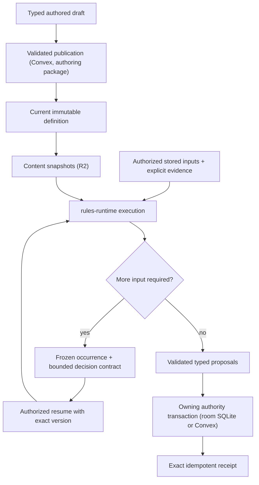

# Shared rules runtime

> **Status:** canonical current guide for `packages/rules-runtime` and its callers. Phase 8.3 rules scope is target and labeled as such.
>
> **Scope:** the pure Rules Kernel, System capability contracts, published definitions, execution, frozen occurrences, decisions, receipts, and who calls the runtime
>
> **Update when:** graph contracts, primitive ownership, System capabilities, publication, occurrence, replay or receipt behavior, the package export surface, or a caller changes
>
> **Verification:** `packages/rules-runtime`, `packages/encounter-persistence`, `apps/session-worker/src` (`native*`, `room*`), `apps/apis/convex/{content,characters,encounters}`, `apps/web/src/domains/characters/builder/evaluation`, ADRs 0023-0026, 0029, 0034-0036, and [the RUL-9 rules audit](../handoffs/rul-9-rules-audit.md)

The Rules Kernel (`packages/shared/src/domains/rules`) is a pure execution library. It walks a validated
bounded graph, accepts explicit facts, random evidence and decisions, and returns typed proposals and a
trace. It does not authenticate users, read persistence, generate randomness, mutate aggregates, or know
D&D vocabulary. `packages/rules-runtime` wraps the Kernel with schema validation, installed System
modules (D&D 2014 today), and the pure Encounter, Character and Sheet calculations that callers share.
It owns no store and no transaction.

## Callers

- **Session Durable Object** (`apps/session-worker`): the `native*` modules (`nativeEncounterRules`,
  `nativeEncounterTurn`, `nativeEncounterMovement`, `nativeCharacterRules`, `nativeCheckAction`,
  `nativeDisarm`, and the Concentration, Cleaving and maintenance modules) plan and execute Encounter,
  movement and Sheet-play rules from the room's SQLite inputs, and the `room*` modules commit the results
  there. Held Sheet play runs through `roomCharacterSheetCommands` and `roomCharacterWrites`. See
  [live sessions](live-sessions.md) for the room protocol, ordering and recovery.
- **Browser Builder** (`apps/web/.../builder/evaluation/builderEvaluator.ts`): evaluates a Character over
  the content snapshot objects of its manifest with `createLazySnapshotReaders`,
  `resolveSnapshotCharacterBuilderPayload` and `previewSnapshotCharacterBuilder` (ADR 0036).
- **Convex Builder commit** (`characters/commit`, `characters/referencedContext.ts`): re-evaluates the
  Character on the server from the referenced current publications through
  `assembleCharacterReferencedBuilderContext`. It is the authoritative check behind the browser's
  evaluation.
- **Other Convex use:** publication and reads that need pure rules code. `content/definitions` composes
  `@artificer-toolkit/authoring/reusableDefinitions`; `content/systems` serves System capabilities from
  `platformRulesRuntime`; Sheet and Campaign Sheet queries and commands use `rules-runtime/character/*`;
  `encounters/actionChoices` and the disarm selection read action sources, economy and wield conflict;
  projection reads use `encounterProjection` and `encounterPlayerProjection`. Convex no longer runs
  per-command Encounter rules: that path was deleted in A35-S6c3
  ([ADR 0035](../adr/0035-room-authoritative-live-encounters.md)).
- **`packages/encounter-persistence`:** admission, persistence writers, receipts and projections for
  Encounter state, over a store interface. It depends on this package, never the reverse; see
  [persistence](persistence.md).

## Package surface

`packages/rules-runtime/package.json` exports `"."` (the `rulesRuntimeService` module only:
`createRulesRuntimeService` and its error classes) and `"./*"`, which maps any module path under `src` to
`dist` (for example `rules-runtime/encounterActionSources`, `rules-runtime/character/sheetPreparation`,
`rules-runtime/systems/dnd5e/attackKind`). Consumers import focused subpaths, not the root. Build the
package before tests that import newly added modules.

| Area                          | Modules                                                                                                                                                                                             | Owns                                                                                                                                                                         |
| ----------------------------- | --------------------------------------------------------------------------------------------------------------------------------------------------------------------------------------------------- | ---------------------------------------------------------------------------------------------------------------------------------------------------------------------------- |
| Execution wrapper             | `rulesRuntimeService`, `platformRulesRuntime`, `platformPolicyModules`, `platformEncounterPolicy`, `platformCharacterPolicy`, `random`                                                              | Schema-aware Kernel execution, frozen-graph admission, installed System lookup by System UUID                                                                                |
| Systems                       | `systems/dnd5e/*`                                                                                                                                                                                   | D&D 2014 policy, action compiler, grant fold, modifier scope, concentration, lifecycle and optional-combat policy                                                            |
| Character                     | `character/*`                                                                                                                                                                                       | Context and Sheet preparation, Builder catalogue/eligibility/reconciliation/readiness/payload, snapshot readers, Sheet commands, rest, roll, projection, rule-fact composers |
| Encounter actions             | `encounterAction*`, `encounterBasicActions`, `encounterDisarmPreparation`, `encounterWieldConflict`, `encounterCleaving*`, `encounterConcentration*`                                                | Source resolution, mechanics preparation, economy, target policy, effects, receipts, warnings                                                                                |
| Encounter turn and initiative | `encounterTurn*`, `encounterInitiative*`, `encounterRecharge*`, `encounterLegendary*`, `legendaryActionEligibility*`                                                                                | Initiative graphs and settlement, turn effects, Recharge, Legendary Actions                                                                                                  |
| Encounter movement            | `encounterMovement*`, `encounterSpatialMovement*`, `movementReaction*`                                                                                                                              | Path timeline, Passage contacts, reaction discovery, decision and settlement planning                                                                                        |
| Encounter state               | `encounterActor*`, `encounterMechanicsBatchPlan`, `encounterCharacterMechanicsBatch`, `encounterScalarReductions`, `encounterProjection`, `encounterPlayerProjection`, `encounterCombatPerception*` | Actor facts and state, outcome folds, projection, perception                                                                                                                 |
| Snapshots and misc            | `contentSnapshots`, `contentCatalogue`, `campaignClock`, `characterZeroHitPoints`, `sceneGridPolicy*`, `targetBoundActiveRuleEffectExecutor`, `characterRuleActionSystemAdapter*`                   | Content snapshot build/index shapes, clock boundaries, grid policy, frozen active-effect execution                                                                           |

Everything here takes structural inputs (domain types, injected readers, ports). None of it imports
Convex contexts, database rows, or Worker APIs, so the room and Convex run the same functions.

**Installed-System classification (RELIABILITY-6.16, current).** Generic Worker, encounter-persistence
and rules-runtime code never imports the D&D Concentration maintenance id or melee classification. It
asks the installed System for the Run's `gameSystemId` through `platformRulesRuntime`:
`requireInstalledConcentrationMaintenanceDefinitionId` and `isInstalledMeleeAttackTrigger`, both
registered by the System module (`systems/dnd5e/characterActionRuntime`). An unknown System fails
closed.

## Ownership and publication

Game System adapters own rules vocabulary and policy, including D&D 2014. Reusable mechanics remain
portable typed operations. Code-owned operation keys, versions, validators and bounded graphs keep
authored data from introducing executable code or unbounded work. The System UUID selects the adapter;
labels, editions and catalogue codes never do.

Published authored roots and reusable definitions keep stable UUID identity. A reusable definition has at
most one editable draft and zero or one current published document. Publication atomically replaces the
current document, checksum and contract tuple and removes the draft; there is no historical revision
table or consumer-selectable pin. Issued occurrences keep their frozen execution evidence
([ADR 0024](../adr/0024-current-published-authored-content.md)).

`@artificer-toolkit/authoring/reusableDefinitions` is the single persistence-independent publisher. It
receives installed System capabilities, operation contracts, vocabulary and a store with atomic draft and
publication callbacks; Convex `content/definitions` and `content/definitionStore` supply the store.
Family keys live in `schema/shared/reusableDefinitionIdentity`: `rules-runtime-graph`, `sense`,
`rule-capability`, `condition-rule-state`, `rule-maintenance`, `initiative-policy`,
`dnd5e-encounter-lifecycle` and `dnd5e-optional-combat`. A family stores its own typed document: the graph
family holds the executable graph, `sense` holds a closed composition of code-owned perception primitives.
Unknown families are rejected. The checksum codec is `@artificer-toolkit/shared/canonicalJson`.

Publication validates graph bounds, cycles, ports, operation versions, UUID references, same-System
compatibility and transitive dependencies. That proves an invocation is structurally executable, not that
a live command will succeed.

Graph constraints: graphs are finite, bounded, acyclic and typed; node IDs are local structure; primitive
keys are code-owned while referenced definitions and domain items are UUID-backed; rule-to-rule
composition is an explicit validated reference; unknown operation versions, unbound ports, cross-System
references, cycles and incomplete branches reject publication.

Capability discovery derives entry points from actor sources, grants, equipment, effects, Campaign policy
and Scene facts, and an execution instance exists only when an entry point is invoked. An authored Effect
UUID is the stable identity of an effect-backed entry point. The shared boundary compiles the exact
authored Effect before the System adapter runs; the adapter may derive System policy facts from it but
cannot rewrite it. Creature discovery isolates each action: one whose mechanics cannot compile or bind is
listed unavailable with its reason while the Creature's other actions still work. There is no persistent
prepared-plan layer; a derived action list is never authority and every command repeats capability and
authorization checks.

## Execution, decisions, and receipts

An authorized command creates or resumes an aggregate-owned occurrence. A paused occurrence stores its
snapshot: the reachable graph, operation keys and versions, source identities and checksums,
frozen facts, issued requests, authority and redaction policy. Resume rejects stale authority, an
unexpected aggregate version, or a decision outside the stored contract. A continuation never leaves the
server and carries no seal (Q23, [ADR 0029 Amendment 1](../adr/0029-convex-backend-cutover.md#amendment-1-2026-10-17-unsealed-continuations)):
resume admits its graph exactly as frozen execution does (installed capability, matching contract
version, `validateCompiledRuleGraph`). A pending snapshot is
either `KERNEL_EVIDENCE` (the continuation plus a bounded server-only context) or `AGGREGATE_CHOICE`
(one closed tactical choice, no graph). An Encounter has at most one pending occurrence, and a retry
matching a stored receipt returns it before that gate.

A complete execution returns proposals. The owning authority applies them with the aggregate's expected
version, advances the occurrence and writes the receipt in one transaction; any failure leaves prior state
visible, and an exact retry returns the stored receipt without new randomness, current-definition reads or
double application. For live Encounter, movement and held Sheet play the owning transaction is the room's
SQLite commit; Convex receives fenced checkpoints
([ADR 0035](../adr/0035-room-authoritative-live-encounters.md),
[ADR 0029](../adr/0029-convex-backend-cutover.md#live-rules-execution-clarification--2026-09-24)).
Convex still owns the Builder commit, personal Sheet commands and Run creation.

Receipts retain committed results and evidence for retry and audit, never an executable graph. A resume
that advances or re-pauses writes a closed command-specific result holding only the actor-filtered summary
needed to replay that response. Character events caused by one occurrence use deterministic child command
UUIDs derived from the occurrence, root command, phase, ordinal and Character, so repeated phases never
reuse an idempotency key. Raw Kernel facts and traces are server-only; browsers receive recipient-safe
projections.

**Automation modes (ADR 0034).** There are two: Assisted and Manual. In Assisted, a step needing dice asks
the roller's `userProfiles.autoRollDice` preference: on records app-roll evidence immediately, off pauses
for entered dice. The roller is the actor whose roll it is; its assigned player's preference applies, else
its first granted controller's, else the GM's (`readEncounterAutoRollByActorId`). Lifecycle functions take
an `EncounterEvidenceMode` (`AUTO_ROLL | PROMPT | MANUAL`); answers arrive as `EncounterEvidenceAnswer`
and only `resolveEncounterD20Answer` and `resolveEncounterIntegerAnswer` turn one into faces. D20
evidence records both the chosen and the rules-derived roll mode, and pending summaries name the
contributors behind the derived mode (`encounterRollModeReasons`, labeled for display by
`rollModeReasons` in `packages/encounter-persistence`). **Typed contributor source (RELIABILITY-6.9,
current).** Every recorded d20 contributor (`D20Contributor`) carries a `source: { kind: ACTIVE_EFFECT
| CONDITION | AUTHORED | RULE, id, holderActorId }` beside its opaque `sourceId`, `grantId` and
`domainKey`; the checksum covers it. A reason label is a lookup by `rollModeSourceKey(source)`; no
consumer parses `sourceId` or `domainKey`. An active effect has one `sourceId`
(`createCharacterMechanicSourceKey`) and one typed source whichever holder, perception or relationship
path names it. Rules-owned contributors use kind `RULE` with an id from `ROLL_MODE_RULE_SOURCE_IDS`.
Attack-perception contributors are `rule:unseen-attacker`
("Unseen attacker", advantage) and `rule:unseen-target` ("Unseen target", disadvantage); see Combat Perception. A player's prompt never names a contributor from an actor hidden from
players (it reads "Unseen source"); known limit: a contributor from the roller's own policy is never
redacted. Manual mode records an idempotent receipt at an unchanged version without invoking the Kernel or
applying state and carries no rules cue (ADR 0034). **One card per die (ENCOUNTER-7, current).** Every
Encounter rule die posts exactly one roll card through `recordRuleRollCard`: an action's d20s and damage
totals, a Legendary Action's (`recordActionRollCards`), each Recharge d6 (source kind `RECHARGE`), the
turn-start death save and, under `DECLARED_ACTION_ROLL`, each declared actor's initiative die (ENCOUNTER-9,
the same `INITIATIVE` card `ROLL_ACTOR_INITIATIVE` posts, both built by the one `initiativeRollRecord`,
written by `persistEncounterInitiativeRollCards` in the terminal turn commit from the settled
`root.initiative` evidence; a flat score and tie-resolution dice post none, and a result of more than two
dice or a die that is not a logged `1dN` throws. **Declared advantage and disadvantage (ENCOUNTER-10,
current):** the declared graph's `d20-extra` node (`evidence.optional-integer-range`, which asks for its
die only while the `initiative.extra-d20` fact is true) and its `number.keep-by-roll-mode` node roll two
d20s and keep the higher or lower under the policy's resolved roll mode; the card replays both faces under
that mode, so it matches the GM-rolled card. A tie resolver pinned to the same graph rolls its attempts
the same way.) A die settled by a `SYSTEM_ROLL` answer already has its
"Rolled by the app" attempt card, so the commit skips it; an auto-rolled or entered die (including one
entered after an app roll) is carded at commit. `readAppCardedDice`
(`packages/encounter-persistence/src/appCardedDice.ts`) decides this
from journaled answers, never from die values: each `SYSTEM_ROLL` answer (an action's `ACTION_EVIDENCE`
receipts, a turn root's `resolutionCommands`, `LEGENDARY_SYSTEM_ROLL` for Legendary windows,
`INITIATIVE_SYSTEM_ROLL` for declared initiative) is joined to
its latest attempt and covers at most one settled die of the same request and value.
Known limit: an app-rolled single-die damage request also gets a commit total card.
Actions in a Manual Encounter are refused with the
`ASSISTED_ONLY` domain rejection.

**Active effects and maintained state.** Current active effects are state, not occurrences. Each stores an
immutable definition (origin, one frozen `SINGLE_GRAPH`, adapter facts, recurrence, perception
contributions) and a mutable lifecycle (remaining ticks). The pure executor
(`targetBoundActiveRuleEffectExecutor`) executes the frozen graph without current-definition lookup and
returns a lifecycle `UPDATE` or `EXPIRE` proposal for the owner to apply. Maintained-effect state
(Concentration) is generic persistence keyed by a System maintenance-definition identity; the System
decides whether a mechanic uses it. Storage layout and limits are in [persistence](persistence.md).

## Assisted soft enforcement and GM undo (current, ADR 0034 decision 2)

`RESOLVE_ACTION` evaluates its overridable checks once, in the room planner (`nativeEncounterRules`),
through `encounterActionRuleWarnings`:

- `prepareEncounterActionMechanics({ overridable: true })` reports `SOURCE_NOT_EQUIPPED` and
  `RESOURCE_UNAVAILABLE` instead of refusing;
- `evaluateEncounterActionEconomy` reports `ACTION_ECONOMY_UNAVAILABLE`;
- `evaluateEncounterActionTargetPolicy` reports `TARGET_OUT_OF_RANGE` (or `TARGET_RANGE_UNCHECKED`
  without both tokens), `TARGET_DISPOSITION` and `TARGET_DEFEATED`. Disposition compares the GM-set
  dispositions through `encounterActorRelationship` (neutral is neutral to everyone, equal dispositions
  are allied, friendly and hostile are hostile). It is the one source of hostility: movement reaction
  eligibility and passage blockers use it, and Run state stores no side relationships. Actor sides remain
  only for initiative grouping, reorder, reinforcement and removal.

**Targeting yourself (D99).** A user may target itself unless the action says otherwise: the policy raises
`TARGET_DISPOSITION` for a self target only when the target disposition is hostile, the action makes an
attack roll (`makesAttackRoll`, a required policy input) or the authored single-target `self` field is `WARN`
("another creature"). `self` is one authored field with three values: `ALLOWED` (the default), `WARN` (the
overridable warning above; SRD Bardic Inspiration, Healing Touch, Modify Memory and Protection) and `REFUSED`
(Help and First Aid: the policy refuses a self target outright as `UNSUPPORTED_TARGET`, not acknowledgeable). The
action choice DTO's `target` is the authored targeting, not a derived flag: `{ kind: 'SELF' }` for a `SELF`
selection (Dash, Dodge; no picker, resolves on the actor), `{ kind: 'ACTOR', self }` for a creature-choosing
selection (the schema's `ALLOWED | WARN | REFUSED`, `ALLOWED` where the selection has no `self` field) and
`{ kind: 'POINT', area }`. A client always asks for the creature of an `ACTOR` target; it lists the user unless
`self` is `REFUSED`, and the server keeps the `WARN` warning.

**Rule usage storage.** "Nothing used" has one stored form: no key. `withEncounterRuleUsageUsed` drops the
definition's entry for a usage of 0 and drops an empty `ruleUsage`, so a turn refresh, a spend and an undo
store the same row.

An authored basic action follows the same rule through `RESOLVE_ACTION`, with `encounterActionEconomyWarnings` and `TARGET_DISPOSITION`.
Action choices carry the warnings that already apply before a target is chosen.

### Attack action, Multiattack and Extra Attack (current, D93)

An Assisted weapon or unarmed attack made with one Action is part of the actor's Attack action
(`isAttackActionAttack`, owned by the System's action-economy adapter; spell attacks are not).
`evaluateEncounterAttackAction` wraps the Action evaluation: the first such attack of a turn spends the
Action and opens the Attack action, stored at actor `resources.attackAction` with the turn sequence, the
`total` attacks and the attacks made. The next attacks of that turn fill it without spending an Action or
warning. A Character's total is the dnd5e policy output `attacksPerAttackAction` (value domain
`ATTACKS_PER_ATTACK_ACTION`, SET_VALUE only, highest source wins, base 1; every class Extra Attack and
Thirsting Blade is a grant of it) and a Creature's is 1, because a Creature's Multiattack is its own
action. An attack that does not fit (full, stale turn) spends a new Action, warns when none is left, and
opens a new Attack action. Settlement commits the `attackActionTransition` `{ before, after }` in the
action's mechanics batch with the same compare-and-set as the allowance; `REVERT_LAST_ACTION` restores
`before` only while the actor still holds `after`, else it refuses with `REVERT_UNAVAILABLE`. Action
choices report `attackSlot` per action and the actor's `openAttackAction`. A filler attack spends nothing
but still honors suppression: `isActionEconomySuppressed` reuses the allowance capability resolution of
`evaluateEncounterActionEconomy`, and an actor that can't act (Incapacitated, a suppressing effect) gets
the overridable `ACTION_ECONOMY_UNAVAILABLE` warning and no `attackSlot`; a spent Action is not
suppression. Manual mode tracks nothing.

The command proceeds only when `acknowledgedWarnings` (part of its fingerprint) covers every current
code; otherwise it is refused with `RULE_WARNINGS`. An override spends only what remains and
`consumeEncounterActionEconomy({ overridden: true })` lets the allowance exceed its maximum. Accepted
warnings are stored as `ruleOverrides` and badged on the timeline. Authorization, versions, the current
actor, Manual mode and completed Encounters are hard checks, never warnings. Reactions, Legendary
Actions, Disarm and movement call preparation with `overridable: false` and keep refusing.

`REVERT_LAST_ACTION` (GM-only) undoes the Run's last `RESOLVE_ACTION` and its committed child receipts,
inverting only recorded before-states (hit points, conditions, resource usage, a stowed shield, a used-up single-use item (given back by lowering its `itemUsage`), charges,
the action allowance, created effects and maintained states). It refuses, naming the kind, removed
conditions, replaced maintained effects, lost Concentration, Cleaving damage to a Character, Disarm and
other contested actions; a second undo is refused. Its implementation is
`packages/encounter-persistence/src/actionRevert.ts`.

### Point-area actions (current, D103)

A POINT-target action over an area-contents plan opens one pending `ENCOUNTER_AREA_ACTION`
(`AGGREGATE_CHOICE`) occurrence. `catchEncounterAreaActorIds` picks the actors with a token overlapping the
area, once each, and `encounterAreaCaughtChecksum` seals the Scene version, the area and those creatures.
Each caught creature carries its own sealed single-target save under
`encounterAreaTargetOccurrenceId(area, actor)`; `prepareEncounterAreaTests` opens them all without rolling
damage and `answerEncounterAreaTest` answers one whatever the others have done. `removeEncounterAreaTarget`
(the GM's removal, SPELLS-7.1) refuses a creature that has answered and seals the caught set again.
An area's maintained state is bound to the area's occurrence, while each creature's effect is bound to its
own save occurrence. `requireTurnMaintainedStates` therefore accepts either, derived for the creature whose
turn it is.

Legendary Resistance on an area save is per creature and interstitial. After a failed Creature save
`afterTest` asks the creature's `discoverLegendaryResistance`, and `offerEncounterAreaLegendaryResistance`
seals the offer against the failed execution, the creature's facts, its d20 policy and the pinned resistance.
`decideEncounterAreaLegendaryResistance` re-checks all of them against the creature's pool as it is now
before it records `USE` or `DECLINE`; the charge is only proposed there and is spent by the area's commit.
`encounterLegendaryResistanceChoice.ts` holds the helpers shared with movement.

`settleEncounterAreaAction` runs only when every save is answered and every offer decided. It rolls damage
once through a frozen roll tape (the first creature that needs die n rolls it, later ones replay it, and a
different die is refused), then continues each creature's own plan, so resistance, immunity and
vulnerability stay per creature. The persistence side commits one root `AGGREGATE_CHOICE_COMPLETE` that
holds the source spend once and one mechanics-batch child per kept creature
(`packages/encounter-persistence/src/areaCommitPersistence.ts`); `REVERT_LAST_ACTION` reverts the children in
reverse, then the root. An outcome that leaves a condition, a lasting or recurring effect or a maintained
effect is refused whole until SPELLS-19.

Each action choice carries `target`: `{ kind: 'ACTOR' }`, `{ kind: 'POINT', area }` (the authored radius or
cube edge), `{ kind: 'DIRECTED', area }` (the authored cone length, line length and width, or the edge of a
cube that extends from the caster) or `{ kind: 'CASTER_CENTERED', area: { kind: 'RADIUS', radius } }` (a Self
sphere, cylinder or circle: no aim), built by `encounterActionChoiceTarget`. An action that places a zone (current,
D154, SPELLS-4.T1b) takes the target of its zone, from `encounterZoneChoiceTarget`: `POINT` or `CASTER_CENTERED`,
`{ kind: 'WALL', area: { maxLength, thickness } }` for an authored WALL shape (the client picks two ends; the
thickness is centered on the segment, stored as a polygon) or `{ kind: 'RING', area: { maxOuterRadius, thickness } }`
for a hollow round zone (the client picks the center and the outer radius; inner = outer − thickness). A cast-time
pick between zones is `{ kind: 'ZONE_OPTIONS', options: [{ id, label, target }] }`: the client picks an option, then
aims it as that option's target asks. `evaluateEncounterZoneTarget` refuses a target of another kind
(`UNSUPPORTED_AREA`), a wall or ring over its authored maximum (`AREA_TOO_LARGE`) and a wall of no length or a
ring no wider than its thickness (`AREA_TOO_SMALL`). A policy this path cannot resolve
(a dome, a wall that places no zone, or a cone or line whose range is not Self) stays an actor choice and is refused when resolved. The web converts the area to Scene coordinates with
`pointAreaInSceneCoordinates`, `directedAreaInSceneCoordinates` or `wallAreaBoundsInSceneCoordinates`
(`shared/vtt`), the same functions `compileEncounterPointArea`, `evaluateEncounterDirectedAreaTarget` and
`evaluateEncounterZoneTarget` use, to preview it and list the tokens the viewer sees inside; a wall or ring is
drawn by dragging from one end (or the center) to the other end (or the edge), clamped to its maximum
(`drawnAreaAim`). The room still decides who is caught.

### A list of chosen creatures (current, SPELLS-8.T12, D118)

An action whose targeting is `CHOSEN_CREATURES` with an authored `maxTargets` (Mass Healing Word, Prayer of
Healing, Mass Cure Wounds, Magic Missile, Acid Splash, Chain Lightning, Scorching Ray, Eldritch Blast) takes the fifth target, `{ kind: 'ACTORS', actorIds, scene }`, built from
`encounterActionTargetKind` and offered as `{ kind: 'ACTORS', maxTargets, area, allowRepeatedTargets? }` (`area` is the `RADIUS` the
spell names, or null). It is a reusable target kind, not a spell field: any chosen-creatures policy the compiler
accepts uses it. The compiler accepts one only when the outcome is a heal, unscaled dice damage, a per-creature save (an `ANY` disposition, a `SAVING_THROW` trigger and no repeated targets) or a per-ray attack (an attack trigger, repeated targets allowed, no shape), the cap is authored (fixed, or
scaled by the cast level or the Character's level and resolved first by `resolveChosenCreaturesTargeting`, which reads `spellCastLevel` and `characterLevel` from the descriptor; the Character's level is the sum of its class levels, set on the entry point by `buildCharacterSpellCastActions`), and the shape is absent or a sphere, cylinder or circle
whose range is a distance. One `RESOLVE_ACTION` carries the whole list (D118: one cast, one commit, one slot
spend, one undo; one action per creature is rejected because it breaks undo atomicity).

The room (`nativeEncounterActorsRules.ts`) refuses an over-cap list, and a creature named twice unless the
targeting allows repeated targets, then rolls: a list that names each creature once shares one frozen roll tape, so
every creature gets the same heal, and `executeEncounterActorsAction` builds one occurrence per entry
(`encounterChosenActorEntries`). **Projectiles (current, SPELLS-26):** when the targeting allows repeated targets, each
entry is one projectile (Magic Missile's dart): it rolls on its own tape, resolves as its own child with its own
occurrence, lands on the hit points the creature's earlier entries left (the executor and the room chain the
binding and the prepared facts per creature), and carries its own concentration check. The slot is spent with the
caster's first entry only; the transport allows a repeated id and leaves the rule to the action. `rollsPerTarget`
travels from the room to persistence so every projectile gets a roll card. A shaped list needs `scene.point`; the room prepares the point as a point area
(`prepareAreaScene`, so range and sight warnings are the area's) and refuses a chosen creature outside the
sphere (`catchEncounterAreaActorIds`). An unshaped list takes no point. Warnings are gathered across the list
and deduplicated (`evaluateEncounterActorsRuleWarnings`); a creature in a shaped list is not range-checked
itself, because the picked point carries the range. The commit reuses the `ENCOUNTER_AREA_ACTION` root and
children with a null `area`; `encounterChosenActorsChecksum(actorIds)` is the root's caught checksum, so the
persistence side (`areaCommitPersistence.ts`) checks every id belongs to the Encounter and commits each as
perceived by the caster. **Saves (current, SPELLS-26):** a list whose plan is not `SINGLE_GRAPH` (Acid Splash,
Chain Lightning) is not executed in place: `planNativeLiveEncounterActorsAction` hands it to `sealReachSaves`, the
point area's own open path, so the list pends on one sealed save per distinct creature and resumes through the
area's Answer, Legendary Resistance, GM removal and Commit planners. Damage is rolled once for the cast and
replayed per creature on one frozen tape (`createFrozenRollTape`), so a failed and a successful save share the
dice they have in common. **Rays (current, SPELLS-26):** a list whose trigger is an attack (Scorching Ray, Eldritch Blast) goes the same way, but each entry is one ray: the roller is the caster, not the creature, and a creature that several rays are aimed at has one entry (and one sealed attack roll) per ray. Every entry has its own occurrence (`encounterChosenActorEntries`; a creature's first entry keeps `encounterAreaTargetOccurrenceId`), `EncounterAreaTarget` and `EncounterAreaTargetTest` carry it, and the pending summary lists `{ actorId: roller, targetActorId, request }`. Settling rolls each hit's damage on its own tape (`rollsPerTarget`, decided by `makesAttackRoll`) and chains a creature's hit points between its rays (`bindingAfterHitPoints`, shared with `executeEncounterActorsAction`). The GM removing a creature removes every ray aimed at it. The pending context's `superRefine` allows a repeated creature only when the caster rolls. **Corpus guarantee (SPELLS-26.1):** every SRD `CHOSEN_CREATURES` spell with a cap either compiles as a list or is refused for the reason the same effect cast at a single target is refused; the corpus test derives this from the real compiler, so it needs no list of exceptions. The pending context (`EncounterAreaActionPendingContextDto`) seals a null `scene`
and `area` for a list read against no Scene or naming no area, and a null `token` for a creature with no token
on the Scene read; `requireAreaActionPendingRoot` then checks the sealed creatures plus the GM's removals equal
the named ones, and, when the list names an area, that each is still inside it (a point area instead requires
the caught set to equal the sealed one). An immediate list (heals, projectiles) still commits whole in the
room; `executeEncounterActorsAction` refuses an outcome that asks for evidence. A spell that takes a list is refused when sent at one creature
(`TARGET_UNAVAILABLE`).

### Caster-centered radius areas (current, SPELLS-22)

An `AREA_CONTENTS` action whose range is Self and whose shape is a sphere, cylinder or circle takes the fourth
target, `{ kind: 'CASTER_CENTERED', sceneId, expectedSceneVersion }`: it names no origin or direction. The
origin is the caster's own token (`evaluateEncounterCasterCenteredAreaTarget` returns the `RADIUS` shape; the room
reads the caster's token with the Scene and seals its position), and the sealed area is the same `RADIUS` shape a point area seals, so no persisted shape changes;
the caster-centered meaning lives in the persisted command's target kind. "Within N feet of you" is measured
from the edge of the caster's space (D114): `spatialTokensWithinSpaceRadius` catches a token whose footprint
shares positive area with the caster's footprint grown by the radius (a rounded rectangle, so a Large or
Huge caster reaches farther than a Medium one), by the same strict overlap rule as every area (D103), and never
catches the caster. `catchEncounterAreaActorIds` takes `fromCasterSpace` for it; the room and
`requireAreaActionPendingRoot` both set it from `command.target.kind`, and the latter also checks the sealed
origin is still the caster's token. The authored targeting has no "includes the caster" option, so the caster
is always excluded. Everything after the catch is the point-area pipeline; an outcome that leaves a condition or
lasting effect is refused whole until SPELLS-19, and a moving aura is SPELLS-20.

### Directed areas: cone, line and caster-origin cube (current, SPELLS-13)

An `AREA_CONTENTS` action whose range is Self and whose shape is a cone, line or cube takes the third target,
`{ kind: 'DIRECTED', origin, toward, sceneId, expectedSceneVersion }`. The origin must lie on the caster's token
footprint (`isDirectedAreaOriginOnToken`) and `toward` is the point the area is aimed at. `encounterAreaTargetKind`
is the one range × shape table (point, directed, caster-centered or unsupported) that the compiler, the choice target and the
evaluators share; a target of the wrong kind is `TARGET_UNAVAILABLE` (a direction for a point action, a point for a
directed action and anything else for a caster-centered one each say what the action takes), as is an origin off the
footprint, and each refusal has its own message (`UNSUPPORTED_AREA`, `ORIGIN_OFF_CASTER`). The caster's token is
read with the Scene, so the evaluators take it as given; a Scene without it makes the read throw
`Action Scene token context is stale.`, which the room answers as a generic `UNAVAILABLE` (not a
`TARGET_UNAVAILABLE` refusal).
`evaluateEncounterDirectedAreaTarget` returns the Scene-unit shape, and everything after it is the point-area
pipeline above: the same `ENCOUNTER_AREA_ACTION` occurrence, sealed saves, frozen damage, GM removal, commit and
undo. The pending guard (`requireAreaActionPendingRoot`) checks the sealed origin and direction against the command.
Catching (`spatialTokensInsideArea`, for every area) is strict positive-area overlap, so a creature the area
only touches along an edge or at a corner is not caught (D103, user ruling 2026-10-14). Lasting and moving zones use the same rule through the same predicate (`footprintOverlapsSpatialGeometry`): entry, start-of-turn effects (`encounterTurnEffectPerception`) and movement-reaction perception (`encounterMovementReactionPerception`) see a zone only when the footprint shares area with it, so touching its edge or a corner never catches (SPELLS-24); a directed shape needs the
caster's token among the Scene's tokens, which it excludes (it throws without it: the Scene read has already failed without the caster's token, so a missing caster here is an invariant failure). A cone is the triangle from the origin to a
far edge as wide as it is long; a line is a rectangle, 5 ft wide unless authored (a scaled or non-positive
authored width is refused at compile). A Self cube follows the 5e rule that its origin lies on a face of the
cube (`cubeFromSideOutline`; for a caster whose side is off the grid lines the picked place may not contain the pressed
point, a deferred edge case): the side faced is the dominant axis of `toward`, the face is flush against
that side and slides along it, snapped to the Scene's grid lines, according to where the origin lies along the
side, so a corner origin catches exactly the cube's squares (9 for a 15 ft cube). The places are the grid lines
whose cube shares positive length with the caster's side, and each place owns an equal share of the side, wherever
the caster stands on or off the grid. The sealed shape carries `cellSize` and `gridOrigin` (the Scene grid's origin;
a gridless Scene snaps to 5 ft squares from the Scene origin) for that snap. Token rotation is ignored: the footprint is axis-aligned. The stage aims the area with one
`VttAreaAim { origin, toward }` (`vttSceneRenderer.model.ts`): the player presses on their token's edge
(`nearestFootprintEdgePoint`) and drags the direction (the press, drag, release and cancel are
`createVttAreaAimGesture`, `vttAreaAimGesture.ts`, which the renderer's pointer handlers call), and the outline drawn is `directedAreaOutline` (a point cube
uses `pointCubeOutline`), the same geometry the room catches with.

**Placed zones (SPELLS-17, current).** An authored `MANIFEST` `ZONE` `PLACED_SPACE` outcome is a point-area action
that leaves a zone behind instead of catching creatures. The System compiler (`zonePlacementPlan`) turns the
outcome into a `zonePlacement` on the v4 `CHARACTER_ACTION` compiled entry: label, shape, trigger modes, the entry
graph (the authored save, `ON_SAVE_FAIL` damage and, when authored, a `STOP_CURRENT_MOVEMENT` that surfaces as the
graph's `movementInterruption` output; a made save may deal the same dice halved, as a second gated dice set (`damage-success-*`) behind a 0.5 multiplier, and a PER_LEVEL `SPELL_CAST_LEVEL` damage row is picked by the action's own cast level, so each slot level freezes its own graph) and an optional lingering modifier-grant template (its modifiers, senses and
`endOnEvents`). Only point shapes (`SPHERE`, `CYLINDER`, `CIRCLE`, a cube) compile; a directed zone (cone, line, a
Self cube) and any authored feature the System cannot honor in full (a second component, behavior or outcome, an
unmodeled field, a save DC other than fixed, an end event the System never reads) stay manual with
`NOT_NORMALIZED`. The component's `interactionKinds` (a non-empty list; there is no single-kind field) pick what catches a
creature (`zoneTriggers`): `ENTER_SPACE` is ENTER (the path ends inside), `MOVE_ACROSS` is CROSS, and
`ENTER_OR_PASS_THROUGH` is both (`triggerModes`); `START_TURN_IN_SPACE` and `END_TURN_IN_SPACE` are the
placement's `turnTriggers` `START_OF_TURN` and `END_OF_TURN`, and `START_OF_SOURCE_TURN` (D144) is the
`START_OF_SOURCE_TURN` turn trigger, in that order (`SPATIAL_TURN_TRIGGERS`). A zone may have either set or both;
a kind the System does not model keeps the whole zone manual. A zone outcome may have no save (D144, SPELLS-20
T6a): a behavior whose invocation is not `SAVING_THROW` and whose entries are `ON_USE` damage compiles, through
`unsavedZonePlacementPlan`, to one unmodified damage dice row dealt in full: a frozen graph of plain
`evidence.integer-range` dice and a `proposal-on_use` node, no d20 or `test` node, no adapter facts and no pinned
DC. It may act at turn boundaries and, since D154 (SPELLS-4.T1b), on a movement trigger; a halved or modified
roll, a stop or any other outcome is refused. Both the turn and the movement paths answer dice with no d20 policy:
`isDamageDieRequest` accepts a plain integer range, the executor resumes a damage die with `d20: null` when the
effect has no policy, `awaitsSpatialDamageDice` routes those dice to the zone's source as roller, and a paused
movement contact with no policy is summarized as `ACTION_OUTCOME_EVIDENCE`.
The turn stage (`selectTurnZoneContacts`) gathers contacts over every bound token: the boundary creature's own
zones at its boundary, and, at the start of its turn, each other creature standing in a zone it is the source of
that acts at `START_OF_SOURCE_TURN`. Contacts run in canonical zone turn order (`followsInZoneTurnOrder`: target
actor id, then effect id), each creature gets its own execution through the existing candidate, execution and
persistence path, and the stored zone phase holds one chained mechanics batch per caught creature (at most
`MAX_ENCOUNTER_ACTORS` transitions). `persistEncounterTurnZoneEffects` reads the Scene's token bindings through
`readEncounterActorTokenBindings` (the `ACTOR_TOKEN_BINDINGS` capture on the Worker) and settles caught creatures
in the order a spatial prefix does (`orderSpatialSettlementActors`: Characters by source id, then creatures by id). `collectSpatialTurnCandidates` (shared/vtt) is the
containment seam for turn triggers: it applies `spatialEffectAffects` and the per-turn limit, as movement does.
A Creature's passive zone (D144, SPELLS-20 T6b) is a PASSIVE feature Effect manifesting one zone that acts at its
source's turn; discovery returns it in `passiveZones`, never as an action. `planEncounterPassiveZones` plans one
TOKEN-anchored zone per such feature of each Creature bound to a token, with no maintained state and an id fixed by
the Encounter, actor and feature Effect. One persistence helper, `placeEncounterPassiveZones`, creates them: at the
START terminal before the incoming zone phase, and at a GM token bind in a PREPARED or ACTIVE Run (D147); the room's
turn preparation plans the same START records (`plannedSpatialEffectRecord`). Removing the Creature, or unbinding or
rebinding its token, deletes them first. While the source is defeated its passive zones stay stored and drawn but are
`suppressed`: `toSpatialInstances(effects, actors)` derives the flag from the Run's defeated actors for every
candidate seam (turn contacts, movement and forced movement), so a revived source has them again without a new
placement. The SRD Balor's Fire Aura (T6c) is the first SRD passive zone.
`MELEE_HIT_ON_SOURCE` (D153, SPELLS-20 T6d1) compiles to `retaliatesMeleeHits: true` on a SOURCE zone (refused on any
other attachment) and adds no movement or turn trigger. A placement may also carry `sourceGrant`, the one APPLY_GRANT
authored beside the zone manifest, compiled through `modifierGrantEntryPlan` as a timed grant counted on the
active-effect clock, independent of the zone's lifetime. Both are persisted (T6d2a): the area commit creates the
grant on the placer as `zoneSourceGrant`, recorded as the area root's `sourceGrantTransition`, and undo deletes it
before the zone. A melee hit (`isInstalledMeleeAttackTrigger` with a range) on a creature whose own retaliating zone
contains the attacker runs `selectMeleeRetaliationContacts` and `planEncounterMeleeRetaliation`: each zone executes
against the attacker with system-rolled dice, as one attacker mechanics batch carried on the action receipt's
`meleeRetaliation`, which persistence re-derives from the locked Scene and refuses when stale. Opportunity attacks
(T6d2b) run the same step in `planReaction` with the mover at the reaction's contact, carried on the reaction
application; Legendary Action attacks run it through `prepareTurnLegendaryActions`' `meleeRetaliation` port, carried
on the window's application. Both replay from that evidence (`retained`), so a staged response or a later window's
re-run rolls no fresh die.
A component that authors `requiresFullyWithin` (Stinking Cloud, SPELLS-20 T4b3a) is compiled onto the placement and
instance, and the turn seam then catches only a creature whose whole footprint lies inside the area (edges may touch
its boundary); the compiler refuses it on a zone with a movement trigger. A component's
`automaticSaveSuccessImmunityDamageTypeId` (D141: one optional authored damage type id, any type) pins that
damage type as an adapter fact on the zone entry; when the target holds an IMMUNITY defense to it, the dnd5e binder sets
the `SAVE_AUTO_SUCCESS` outcome rule (the mirror of D94's `SAVE_AUTO_FAIL`), so the made-save path runs whatever the
roll. A "does not breathe" rider has no creature fact and stays unauthored (a deferred edge case).
A zone's failed save is one composable outcome set (D142, SPELLS-20 T4b3b), not a list of shapes: damage rows, at
most one `STOP_CURRENT_MOVEMENT`, at most one `APPLY_GRANT`, at most one System-vocabulary `CONDITION` and at most
one `LOSE_ACTION`, with at least one outcome; a made save still only deals damage. The set holds one graph outcome
(damage or the condition) beside the stop, grant and lost Action, so damage plus a condition stays manual until
SPELLS-4.T1e. With no graph outcome the entry binds the save's `test` node, and the executor accepts the empty
applications of a path that has no proposal node. A `LOSE_ACTION` (D141) compiles only on a zone acting solely at
the start of a turn and sets `failedSaveLosesAction` on the compiled and stored placement. The turn stage
(`prepareEncounterTurnZoneEffects`, which now takes the reusable `definitions`) then evaluates the target's Action
through `evaluateEncounterActionEconomy` after the start-of-turn refresh and, when it is unspent, consumes it with
`consumeEncounterActionEconomy`; the spatial turn execution carries `actionEconomy` (the transition, or null when
the Action was already spent, a second zone at the same boundary included). `persistEncounterTurnZoneEffects`
refuses a transition on a zone that does not cost the Action or on a path other than `ON_SAVE_FAIL`, and settles it
through `consumeNativeActionEconomy`, which checks the stored actor's checksum.
The turn stage that runs them lands with SPELLS-20 T4b2b. SRD text
that says a creature "enters the area" (Caltrops, Ball Bearings) authors `ENTER_OR_PASS_THROUGH`, so a drag that
ends beyond the field still triggers the save and, on a failure, stops at the first field square it entered. The System, not the authored zone, owns the placement defaults: `planEncounterPlacedZone` sets
`movementKinds` to voluntary, forced and teleport movement, `activation` to `REPEATABLE` and `visibility` to
`PUBLIC`. The compiled zone stores only the grant contribution the planner reads: the zone row's own
`recurrence.endOnEvents` stays empty, and the creature's grant takes its end events from the grant template. The
action opens no area occurrence (`placesZone` on the pending root): it commits the spend and a
`liveSessionPlacedSpatialEffect` per zone component (see the bands below) in the same transaction as every other
area commit. The zone is
built by `planEncounterPlacedZone` (FIXED, `SCENE_ABSOLUTE`, a cube as a polygon via `pointCubeOutline`), stored
through `createPlacedSpatialEffect` (refused with `TARGET_UNAVAILABLE` at `MAX_SPATIAL_RULE_EFFECTS_PER_SCENE`), named
on the area root in `placedSpatialEffectIds`, and deleted by GM undo (`actionRevert.ts`) like a D99 grant. A concentration
zone compiles `zonePlacement.maintenance` (the same policy shape as `activeEffectPlan.maintenance`);
`prepareEncounterActionMaintenance` selects it, so a zone-only cast opens Concentration and the zone depends on that
state (`maintainedEffectStateId`, D135). When a
creature fails the zone's entry save, `persistLiveMovementSpatial` copies the zone's grant template under the
movement's origin onto that creature (`planSpatialEntryGrant`, built from the grant entry; it does not stack per
authored zone entry). The grant's frozen graph is provenance only (`actionEffectPersistence.ts`,
`encounterActionEffectReceipts.ts` read its source identity and checksums), so it reuses the zone's. A grant
whose `recurrence.endOnEvents` names `ON_HIT_POINTS_REGAINED` ends in `persistEncounterMechanicsBatchPlan` when any
application heals at least 1 hit point (`effectsEndedBy`). A zone whose component authors `choosesUnaffected` (Spirit Guardians, SPELLS-20 T4c) lets the caster designate creatures at cast: the choice
DTO advertises `choosesUnaffected` on its zone target (`POINT`, `CASTER_CENTERED`, `WALL`, `RING` or `ZONE_OPTIONS`), the cast command carries optional
`unaffectedActorIds` on the zone's target (the Worker refuses it for an action whose zone does not offer it, or for an id
that is not an Encounter actor), `planEncounterPlacedZone` stores it on the placement, and `collectSpatialMovementCandidates`
never catches a listed creature. An ON_USE `CHOICE` path whose every option places one zone (Spirit Guardians'
radiant or necrotic damage, SPELLS-20 T4e, D140) compiles to a cast-time pick, `compilation.zonePlacement =
{ options: [{ optionId, label, zone }] }`, each option freezing its own zone graph; the options must share
attachment, spared-creature choice, Concentration and any save at the caster's DC, or the action goes manual
(`zoneChoicePlan`); each may have its own area (D154: Wall of Fire's straight wall or ring). The action's facts
read that shared save from every option (`zoneEntrySavingThrow`). The choice DTO lists them as a `ZONE_OPTIONS`
target, each option with its own target; the cast command names one as `choiceOptionId` on the target it aims, and
the Worker places that option's zone (`chosenZonePlacement`), refusing a missing or unknown pick and a target kind
the picked option does not take (`prepareCasterSource`); later triggers run the stored definition. A zone with no
save (Wall of Fire) authors a PASSIVE `ACTIVATED` behavior whose ON_USE path deals the damage, so its trigger rolls
the dice with no d20; the caster's controller rolls them. A `CHOICE` path whose options place no zone (Protection from
Energy's damage type, Blindness/Deafness's condition, SPELLS-30, D148) compiles to `compilation.choice =
{ options: [{ optionId, label, activeEffectPlan, executionPlan }] }`, exclusive with `zonePlacement`. Both pickers
narrow the action to one option with `castChoiceOptions`, which restores each option's own result kind from the
compiled entry's `optionGroupKind`. The options must share their test and maintenance graphs, or the action goes
manual. The top-level plans hold the first option. The choice DTO lists the options as `choiceOptions` on the
`ACTOR` / `ACTORS` target, and the cast command names one as `choiceOptionId`; an action whose target is any other
kind cannot carry the pick and goes manual. A read that shows only the shared test before any pick (the target
modifiers) passes `readsSharedTest` and reads the top-level option.
`prepareEncounterActionSource` is the one place the picked option's plans replace the top-level ones. It refuses
a missing or unknown pick (`CastChoiceUnavailableError`, `TARGET_UNAVAILABLE`) before any roll. A zone whose component authors `maxApplicationsPerTurn` (Spirit Guardians "first time on a turn", SPELLS-20 T4b1) is compiled onto the placement and instance, and `collectSpatialMovementCandidates` drops a candidate whose `effectId:actorId` entry in the run's `zoneApplications` already holds the limit for the current `turnSequence`; the terminal movement publications record the settled executions with `recordZoneApplications` (see persistence.md). A zone whose component authors `bypassAtHalfSpeed`
(SRD "through the area at half speed") can be crossed carefully (decision Q2): the voluntary `MOVE_SCENE_TOKEN`
command carries an optional `carefully` flag, the movement cost doubles for the path's footprint share inside that
zone, and the flag reaches candidate evaluation so that
zone's save is skipped (`collectSpatialMovementCandidates`; forced and teleport movement ignore it). Both the
bypass and the doubled cost apply only to zones the mover can see (`isVisibleHalfSpeedField`: `PUBLIC`, or
`spatialState.revealed`), so a hidden zone triggers whatever `carefully` says. The tabletop
learns which fields offer the choice from `halfSpeedFields` on the Encounter session state (visible, scene-absolute
placements only through the same predicate, read once by `readHalfSpeedFields` for both the Convex read and the room push); the stage's drag
preview offers "Move carefully" and "Move normally" before sending. A zone's authored `movementCostMultiplier`
(D154: more than 1, up to 100) and `blockingRules` (including the new `BLOCKS_SIGHT`) compile onto the placement.
A zone may author more than one component (D154 amendment): the first covers the zone's shape, and each later one
authors `region: { kind: 'SIDE_BAND', distance }` and compiles to `zonePlacement.regionComponents` (at most one
today), each with its own label, triggers and frozen entry, sharing the zone's Concentration and never sparing
designated creatures. A band is only beside a `WALL` or `RING`: its target offers `sideBand`, the command must name
`side` (`LEFT`/`RIGHT` of travel from `from` to `to`, or `INSIDE`/`OUTSIDE` a ring) and a command for a zone with
no band must not (`evaluateEncounterZoneTarget`: `SIDE_REQUIRED`, `SIDE_NOT_OFFERED`). The Worker places the
band as its own FIXED record (`planEncounterZoneBands`, geometry from `wallSideBandGeometry`: the wall plus the
distance on that side), so every record a cast places is named on its root, removed by undo and ended with its
Concentration together.
A zone-placing cast may also author an ON_USE `SAVING_THROW` behavior beside the zone manifest (D154 amendment,
SPELLS-4.T1g): the save each creature in the area makes once as the zone appears. The entry-point compiler runs it
as the cast's `TEST_OUTCOME` plan against the zone's aimed area (the wall or ring itself, never its band; its compiler
source carries `zoneAppearSave`, the only test whose area may be a `WALL`), and the
Worker catches the area's creatures as for any area save, so answers, D100 perception, GM removal, Legendary
Resistance, settlement and undo are the area occurrence's own (`prepareCasterSource` sets `appearSave`; the pending
snapshot's `zoneAppearSave` keeps the catch on refresh). A zone with no component is placed with no triggers, one no
creature interacts with (Wind Wall). Its appear save may hold its failed condition (`heldBySource`, Entangle): the
zone carries the `heldCondition`, the cast's own timed condition plan is dropped, and `prepareNativeActionEffectsPlan`
plans the hold (`planSpatialHeldCondition`) under the zone's Concentration; a zone with components cannot, and an
appear save that holds its condition may contribute nothing else.
The multiplier applies to every mover for the footprint share of the walk inside the zone: `preparedMovementCost`
gives `measureScenePathMovementCost` a segment multiplier (`spatialSegmentMovementMultiplier`), so each stretch of
a segment costs the highest of the terrain multiplier, the multipliers of the zones the footprint is inside, and
careful doubling, with no stacking. Blocking rules are only projected: cover from them belongs to SPELLS-14, and
zones blocking vision is a future enhancement. Every path that raises a holder's hit points ends its
`ON_HIT_POINTS_REGAINED` grants through one helper, `endGrantsOnHitPointsRegained` (`consumedGrantPersistence.ts`): the
Encounter mechanics batch (a heal, or a death save's natural 20, keyed on the target's hit points rising),
a Character's Sheet command that raises hit points (Convex `executeCharacterSheetCommand` and the room's Sheet command path), and
a GM `UPDATE_ACTOR` edit that raises a creature's hit points. A batch run by an action or area command hands the ended
records to the root's `consumedGrants` receipt, so GM undo restores them with the same id and version; the Sheet, death
save and GM edit paths have no undoable root, so their endings are not undone. The other mechanics-batch callers need no
receipt: basic action check settlement applies only `STABILIZE` and Cleaving only `DAMAGE`, neither of which raises hit points,
and movement reactions and spatial effects run under `MOVE_SCENE_TOKEN`, which is not an undoable root: `REVERT_LAST_ACTION` refuses it, and the Scene undo (`UNDO_LAST_SCENE_MOVE`) refuses a move that recorded rule receipts, because it restores only the token's position. Not yet: hidden or unnoticed zones (MOVE-3.3 to 3.5).

**Placed-zone damage dice (SPELLS-20 T1, D133, current).** A zone whose failed entry save deals authored dice
(`valueKind: 'DICE'`, a plain `NdM`) compiles those dice into the zone's one frozen entry graph: `damage-enabled`
(the movement-interruption authorization) gates one `evidence.optional-integer-range` node per die, sum nodes add
them, and `proposal-on_save_fail` takes the last sum as its amount. A die is therefore an ordinary roll request
(`isDamageDieRequest`), not a second graph. A flat modifier, bonus, scaling or half damage on a zone is refused
(`unsupported`; half damage is SPELLS-20 T4). Each spatial candidate runs the d20 stage and then its die stages: the
pending candidate carries `diceStage` (the resolved d20) while the dice are answered, and every answer is one
`resolutionCommands` entry (`ENTER_INTEGER` or `SYSTEM_ROLL` for a die). The d20 belongs to the contacted creature;
the dice belong to the zone source's controller (`spatialPendingRollerActorId`: the source actor, the target when the
zone has no source), honoring that controller's auto-roll, and the GM may answer for anyone. The recorded dice stay in
the stored execution trace, which settlement reconstructs from (`reconstructTargetBoundActiveRuleEffectCompletion`), so a
settled entry never rerolls. `retainedSpatialReplayFaces` also replays the dice, but no caller passes `retained`
today. The movement that triggers an entry is not an undoable root (above); GM undo of a dice zone
removes the zone with its spreading Action, as for every placed zone.

**Source zones (SPELLS-20 T1b, current).** An authored `MANIFEST` `ZONE` with `attachmentKind: 'SOURCE'` compiles
through the same `zonePlacementPlan` as a placed space (`PlacedSpaceZone.attachment` becomes
`zonePlacement.attachment`); no aura-specific zone logic exists. It must be centered on its user (range `SELF` with a
sphere, so `CASTER_CENTERED`). `planEncounterPlacedZone` anchors it to the user's token (`anchorKind: 'TOKEN'`,
`TOKEN_LOCAL` circle at the token center), so `collectSpatialMovementCandidates` already handles the caster moving onto a
creature (`sourceMoved`) and a creature entering the aura. The circle's radius is the authored radius plus half the
token's width, which equals "from the edge of the caster's space" on-axis and is smaller on diagonals for a square
token (approximation, recorded in the SPELLS-20 handoff). The caster's spell save DC is known only at the cast and a
zone cast has no cast d20, so the zone's entering save is exposed in the action facts (`zoneEntrySavingThrow`), the
sheet resolves `actionMechanic.save.dc`, and the Worker pins it on the zone's `adapterFacts` under
`DND5E_SAVE_DC_FACT_KEY` when the zone is placed (`castSaveDcFactKey` on the zone entry). Zone limits are refused, never
partly honored: half damage, bonuses, scaling, per-turn caps and turn-based interactions stay SPELLS-20 T4.

Each choice also carries `range` when its compiled target policy has a measurable one, the range the evaluator that
handles the policy measures. A single-target policy that `singleTargetMeasure` accepts advertises `SELF`, `WITHIN` (Touch
is 5 ft; a distance without a long range, including the 0 ft swarm space), `RANGED` (normal and long) or `UNLIMITED`. A
point-area policy advertises its origin range, which `evaluateEncounterAreaTargetPolicy` measures
(`pointAreaOriginRange`): `WITHIN` the distance (never `RANGED`, the area evaluator ignores a long range) or `UNLIMITED`.
A policy neither evaluator measures leaves it off: a sight or special range, targeting that is not a single target with a
disposition (creature type restrictions only warn: `allowedCreatureTypeIds` names the only types the action affects and `excludedCreatureTypeIds` the types it does not, and `targetingExcludesCreatureType` reads both. Neither the compiler nor the single-target action evaluators refuse a single-target policy for them (movement reactions and area saves still do), the room raises the one overridable `TARGET_CREATURE_TYPE_EXCLUDED` warning for either list, only for a Creature target, since a Character's facts carry no creature type. The compiler refuses an area restriction, so an area spell has no per-target type gate), an area with no supported shape, a path override, or no policy.
`encounterActionChoiceRange` (`encounterActionRange.ts`) is the one mapping. `rangeLabel` is not derived from `range`:
it words the authored range with `rangeLabel` (`rangeLabel.ts`), the formatter the Sheet uses, so Touch reads "Touch"
(its 5 ft geometry stays in `range`) and a ranged weapon reads "150/600 ft" on both surfaces. Only a choice without a
policy keeps the label of its action mechanic.

Per-role visibility and the command flow are in
[live-sessions.md](live-sessions.md#encounter-commands); the decision is
[D103](../handoffs/phase-08-2-decisions.md).

### Legendary Resistance on single-target saves (current, D104)

A failed Creature save on a single-target `RESOLVE_ACTION` TEST that ends `ON_SAVE_FAIL` holds the action
before its OUTCOME runs. The `ENCOUNTER_ACTION` pending context keeps a sealed `legendaryResistance` offer
with the creature as roller, and nothing is spent while it waits. The answer is the existing `DECLINE` or
`OPTION` resolution, read as the `LEGENDARY_RESISTANCE_CHOICE` summary; the room rebuilds the TEST from the
retained faces without rolling, re-checks the offer against the creature's current pool, and continues the
OUTCOME on the success branch for USE or the failure branch for DECLINE. On USE the charge is written into the
action receipt as `targetFeatureResourceConsumption`, and GM undo returns it. Area, movement and single-target
paths share `decideEncounterLegendaryResistance`. The decision is [D104](../handoffs/phase-08-2-decisions.md).

### Reaction to a hit (current, REACTION-4.T1)

A reaction authored with `reactionTrigger: { kind: 'ATTACKED_SELF' }` (Shield) is offered to the attacked
Character when a single-target `RESOLVE_ACTION` TEST resolves `ON_HIT` or `ON_CRIT`, before the OUTCOME. The
`ENCOUNTER_ACTION` pending context keeps a sealed `reactionChoice` offer (a sibling of `legendaryResistance`,
a stack so Counterspell chains can nest later) with the Character as roller; nothing is spent while it
waits and the Scene is held (D26, text "Waiting on a reaction decision"). The answer is `DECLINE` or
`OPTION`, read as the `REACTION_CHOICE` summary; the room re-opens the choice graph by occurrence id, as
Legendary Resistance does.

DECLINE continues the OUTCOME unchanged. USE runs the reaction's own plan (`applyNativeReactionEffect`),
prices the reaction through the action economy and the slot through Character mechanics, builds the effect
it creates on its reactor, and re-evaluates the TEST: `reconstructNativeActionTest` rebinds the recorded
dice to the attack's defense as the effect leaves it. That rebinding is a sealed `adjustment`
(`defenseBefore`, `defenseAfter`, adjusted-facts checksum) in the OUTCOME's `reaction` audit and the
receipt; the "TEST evidence is stale" guard stays intact for everything else. The batch receipt's `reaction`
carries the spend and the effect; GM undo returns the slot and the allowance and deletes the effect.

Order on one attack: TEST, then the reaction choice (`ON_HIT`/`ON_CRIT` only), then the OUTCOME. It cannot
meet Legendary Resistance on the same TEST: that choice exists only for `ON_SAVE_FAIL` and a TEST has
either an attack path or a save path, and `continueNativeActionAfterTest` rejects an audit carrying both.
A defeated reactor (D63), a spent allowance, an Unconscious Character and a `REACTION_COUNT SET_VALUE 0`
grant (D99) all drop the offer through the same discovery as an action. Every eligible reaction is offered
as a menu (a Character has one reaction a round, so one choice), only Character reactors, and a reaction taken as an action is refused (`REACTION_TRIGGER_ONLY`) on
every action path (single-target and area) through `refuseActionOutsideItsWindow`, the one admission point it
shares with `LEGENDARY_WINDOW_ONLY`. Resume admission accepts any option the offer carries
(`offeredDecisionOptionIds`) and refuses one it does not as stale. Settlement answers the reaction whose use
option was chosen (`chosenEncounterReaction`; a decline answers the innermost), and the Worker re-discovers
that reaction by its `actionId`, so a non-first offered reaction is the one settled. The pending summary lists every offered option (`REACTION_CHOICE.options`, 1 to 8) and the Decision drawer shows a
button for each; every pin names the same reactor. The reaction's effect id is derived from the command and occurrence ids
(`encounterReactionEffectId`, rules-runtime), so replaying the answer mints the same id. A reaction that needs rolls or does not
create exactly one effect on its reactor is refused as `REACTION_UNSUPPORTED`.
Decision: D26 is extended to hold the Scene for a pending reaction decision.

#### `SPELL_CAST` (current, REACTION-4.T3b-2; D126)

`reactionTrigger: { kind: 'SPELL_CAST' }` binds a reaction to a creature casting a spell (Counterspell). The
`CANCEL_TRIGGERING_EVENT` outcome compiles to `dnd5e.cancel-triggering-event-proposal`, a target-only proposal
that stores nothing; `executionCancelsTriggeringEvent` reads it from the committed trace, as
`executionAddsSpeedToMovement` does.

Before a Character's single-target spell cast runs its graph, the Worker (`nativeEncounterCastReaction.ts`) asks
`discoverCastReactionActions` which other Characters hold a reaction for it, keeps those whose own invocation range
reaches the caster on the Scene and that the reactor can afford, and
holds the cast in a `castReaction` pending offer (`REACTION_CHOICE` to the reactor). Declining records the reactor
and the cast proceeds; using the reaction commits a countered cast (`persistEncounterCounteredCastCommit`): the
caster's slot and action and the reactor's slot and reaction are spent, nothing else is applied, and no
Concentration starts. Undo restores both creatures. Character ACTORS-target and area casts hold the same
`CAST_REACTION` pause (REACTION-4.T3e-a): the pause is a KERNEL_EVIDENCE `ENCOUNTER_ACTION` occurrence on the area root,
each answer replays the root command, and the next transition (area pending, area commit or countered cast) continues
that occurrence; the area commit input carries `failedCounters` and spends them like the single-target commit.
A Creature capability is offered a counter only when its Feature action effect sets `spellCast` (D136); a spell attack without it is never counterable. Casts made without the Scene offer no reaction. The chain is described
below (T3d).

**Higher-level check (current, REACTION-4.T3c; D127).** `reactionTrigger.higherLevelCheck` (`{ ability, baseDc }`)
makes a reaction cast below the triggering cast's level owe an ability check at DC `baseDc` + the cast's level
(`castReactionCheckRequirement`). The offer carries `check` (the sealed choice, trigger level, check definition, DC
and the reactor's d20 context) while the cast waits on the reactor's roll; the roll settles through the held-die rules
(`ENTER_DICE`/`SYSTEM_ROLL`, or the app roll for an auto-rolling player). A pass is a countered cast whose
`counter.check` seals the d20. A fail is a _failed counter_ (`failedCounters` on the pending context): the reactor
joins the declined set and is not offered again, and the cast's terminal commit (normal or countered) spends every
failed reactor's slot and reaction atomically with the cast (`failedCounterSpend.ts`), so one undo reverses them all.
Spend receipts are planned at the terminal against the reactor as it stands, not when the check fails. A reactor that
is the cast's target spends through the target's own mechanics call.

**Counterspell chain (current, REACTION-4.T3d).** A counter that stands (its check passed or none was owed) is
itself a cast: the offer's `chain` (`counters`, `castDeclinedReactorActorIds`, `castLevel`) holds the standing counters
in order, and the next level offers the other Characters, except the creature whose cast it answers and any reactor that
already used a counter in this cast, a counter to the last one. The original caster is therefore offered a counter to a
Counterspell cast against its spell (never to its own cast), planned against the slots its cast leaves. Range, check level and target are measured against that counter's
caster (`discoverNativeCastReactions` `against`). Each answer adds one counter, so depth needs no cap in code. When a
level has nobody left to ask the chain resolves by parity (`advanceNativeCastReactions`): odd, the first counter stands
and the cast is countered; even, the chain is spent without effect and the cast is offered again at its own level with
its declines restored. `failedCounters` holds every counter used that did not counter the cast (a failed check, or
itself countered; `againstActorId` records the cast it answered), all spent with the cast's terminal commit. The
persistence validators (`actionPending.ts`) check this bookkeeping by set equality.

A creature that makes several spell spends in one terminal commit (the cast's caster: the cast, then its counter)
commits them as one mechanics batch: `EncounterMechanicsBatchInput.characterSpellConsumptions` is an ordered list, each
entry fenced by the same `expectedStreamVersion`, its own `beforeUsed` and `afterUsed = beforeUsed + 1`, applied in order
with one stream bump (`planEncounterMechanicsBatch`). Discovery prepares the caster's counter against a target with the
cast's slot already spent (`projectSpellSlotSpend`), on the same Character version, so the offer matches what commits.

#### `DAMAGE_TAKEN` (current, REACTION-4.T2)

`reactionTrigger: { kind: 'DAMAGE_TAKEN', damageTypeIds }` (a user-authored Absorb Elements) rides the same
pause as `ATTACKED_SELF`: discovery (`discoverAttackReactionActions`) offers it when one of `damageTypeIds`
is a damage type of the hit attack's `ON_HIT`/`ON_CRIT` outcomes (`attackHitDamageTypeIds`). The candidate and
the sealed pin carry their `trigger`, so a changed trigger is a different offer. The reaction's effect carries
a `DAMAGE_RESISTANCE` grant, which `encounterActiveGrants` turns into a defense of the reactor; the
re-evaluated binding hands that defense to the OUTCOME, so the damage is resisted before it applies. The TEST
is unchanged (`defenseBefore === defenseAfter`), so "the reaction changed the attack" compares the binding's
defenses as well as the bound facts. The follow-up benefit is an ordinary grant in the same effect (a melee
`DAMAGE` bonus until the end of the caster's next turn, scaled by the slot level the reaction was cast with).

The resistance names the triggering damage type rather than a fixed one (`damageTypeSource: 'TRIGGER'` on a
`DAMAGE_RESISTANCE` payload). Discovery returns the authored types the hit dealt (`triggerDamageTypeIds`), and
`prepareEncounterActionEffectPlans` binds the resistance to each, so a hit of cold resists cold only, though the
spell names fire and cold. An ON_CRIT type counts only on a critical hit (`attackHitDamageTypeIds`). A grant
amount that scales by slot level (`SPELL_SLOT_LEVEL`: Absorb Elements' bonus per slot level, Aid) is fixed by the cast level when the compiler builds the effect plan (`modifierGrantEntryPlan`, from the entry point's `spellCastLevel`; a plan without a cast level stays manual). The follow-up
bonus is consumed by the first attack roll (`ON_ATTACK_ROLL`). Limits: only the attack-hit path pauses
(save-based and area damage do not offer it), and the follow-up is spent by any attack roll of its holder, not
only a melee hit (see future enhancements).

### 0 hit points (D63, current)

A Creature or custom Run actor stores `defeated`. `nextEncounterActorDefeated`
(`rules-runtime/encounterActorDefeat`) sets it when a change takes the actor from above 0 hit points to 0
and clears it once the actor has any; an actor at 0 of 0 (a lair or hazard) is never defeated. Every Run
hit-point write uses it: `planEncounterMechanicsBatch` (all damage and healing paths), the GM's
`UPDATE_ACTOR` edit and `REVERT_LAST_ACTION`.

A defeated actor takes no turns (initiative skips it but keeps its place), no reactions or opportunity
attacks (`encounterMovementReactionSources`), no Legendary Actions and is no Legendary target
(`encounterTurnLegendaryDiscovery`). It is never a Cleaving continuation target
(`buildEncounterCleavingCandidate`), has no action choices and cannot act (`ACTOR_DEFEATED`) nor, for a
player, move its token. Naming one as a `RESOLVE_ACTION` target is the overridable `TARGET_DEFEATED`
warning; Disarm refuses it.

A Character at 0 hit points is never defeated; it is dying (D96). Dropping to 0 adds the System's 0 hit
point condition (`characterZeroHitPointsConditionId`; D&D: Unconscious), and regaining hit points removes
it, in `planEncounterMechanicsBatch` and the Sheet's hit point commands. `REVERT_LAST_ACTION` removes it
with the damage that caused it and refuses to undo a heal that woke the Character.

A Character's play state carries `hitpoints.deathSaves` (`successes`, `failures` and `stable`; every
creator writes zeros). The pure rules live in one module, `schema/shared/characterDeathSaves`, because the
receipt replay in `schema` must apply the same arithmetic as the writers: the Encounter mechanics fold
(`encounterCharacterMechanicsBatch`), the Sheet reducer (`sheetCommandReducer`) and Undo
(`actionRevert`, which restores the previous `deathSaves` exactly).

- Damage that drops a Character to 0 and overflows by at least its maximum is massive damage: dead.
- Damage at 0 adds a failure (two for a critical hit, `DAMAGE.critical`), clears `stable`, and is dead
  when the damage is at least the maximum.
- Three failures is dead; there is no separate flag.
- Regaining hit points from 0 resets the saves. A dead Character ignores healing (`HEAL`).
- A Sheet hit point edit above 0 revives a dead Character; the Sheet applies the damage rules with
  `critical` false.

A dead Character is treated like a defeated Creature wherever the Run reads defeat
(`isEncounterActorDefeated`, `skippedEncounterActorIds`, `defeatedEncounterActorIds`), but the Run
keeps no copy of it (ADR 0034 decision 4): the death fact is read from the live Character play record as a
`DeadCharacterIds` set (`readDeadCharacterIds` in persistence, the `characterDead` flag of the room's
`ACTOR` capture, and `deadCharacterIdsOfTargets` for state staged inside one turn or batch). Everyone
sees a dead Character as "Dead" through the Defeated presentation. A frozen actor (a completed Run, or a
departed Character) no longer reads its Character and reads as not dead. In an ASSISTED Run a dying
Character (0 HP, not stable, not dead) makes a death save as its turn starts (D96, current): a d20 with
no modifiers, rolled by the actor's controller through the roll prompt (`DEATH_SAVE` trigger) or by the
auto-roll preference. 10 or more is a success, 2-9 a failure, a 1 two failures, a 20 regains 1 HP (resets
the saves and removes the 0-HP condition through the heal rules); three successes stabilize, three
failures kill. `deathSavesAfterRoll` (schema) owns the rule. The stage runs after Recharge and before
incoming `START_OF_TURN` effects and is not undoable; a MANUAL Run prompts nothing.

First Aid (D98, D106 slice D, current) is an authored basic action on the reusable `CHECK` action test: the
actor makes one authored check (`invocation.check`: `checks` plus a `FIXED` dc; a `CONTEST` dc is in the schema
and refused by the compiler until ATTACK-7 slice C) and the `ON_CHECK_SUCCESS` path runs only on success. The
dnd5e compiler supports exactly one check and a `STABILIZE` outcome; the planner admits `CHECK` only on the
`BASIC_ACTION` source. The SRD authors First Aid as an Action with Wisdom (Medicine), DC 10, a touch-range single
target. It resolves through `RESOLVE_ACTION`, and the stored root carries the check occurrence receipt
(`checkReceipt`). The target comes from the command (a custom actor is refused and a MANUAL Run refuses it as `ASSISTED_ONLY`). A target
that is not dying gives the overridable `TARGET_NOT_DYING` warning and, once overridden, spends the
Action with no roll. Touch range reuses the Healer's Kit warnings. The root command always commits and
spends the Action and the helper's one-roll `ON_ABILITY_CHECK` grants (a Help) are consumed with it. A prompted roll writes a PENDING occurrence
(`ENCOUNTER_BASIC_ACTION_CHECK`) answered by a separate `RESOLVE_RULE_OCCURRENCE`; an auto-roll
settles at once. The roll card is credited to the helper, never hidden from the GM, and de-duplicated
by the app-roll attempt identity. GM undo restores the Action, the used Help and the target's death
saves, restores the consumed grants and keeps the roll on the record; it is refused while the check is pending
(`packages/encounter-persistence/src/basicActionCheck*.ts`, `packages/rules-runtime/src/encounterBasicActionCheck.ts`).
Spare the Dying and Sheet tracking of death saves are not built (target).

Hide and Search (ATTACK-10.T1, current) are authored `SELF` check actions with per-observer outcomes, built from generic
options (ADR 0038); nothing in code names Hide.

- **Authored shape.** Hide checks Dexterity (Stealth) against `dc: { kind: 'PASSIVE', passiveDefinitionId }` (the System passive,
  for example Passive Perception, whose skill is the passive's authored `skillDefinitionId` in the System) and applies `CONCEAL_FROM_OBSERVERS
  { observers: 'NON_ALLIES' }` for an `UNTIL_DISPELLED` duration that is consumed by `ON_ATTACK_ROLL`. Search checks Wisdom
  (Perception) against `dc: { kind: 'CONCEALMENT' }` and applies `DETECT_CONCEALED`. Both compile to the existing check
  pipeline with a `resolution` discriminant on `BASIC_ACTION_CHECK` (`CONCEAL` or `DETECT`); Escape keeps its own command.
- **Per-observer DCs freeze at creation.** The pending check context holds each observer's passive score, or each concealment the
  actor can search, so the settle needs no further loads and the player's pending read keeps `dc: null`.
- **State.** The stored effect is a `schemaVersion 2` active rule effect whose immutable definition carries
  `LOCATION_CONCEALMENT { concealmentTotal }`; the observers it still hides the holder from live in the mutable lifecycle
  (`concealedFromActorIds`, sorted, unique). Search, the GM command and the movement prune change that set through
  `updateLifecycleCas`. A set that would become empty ends the effect in that same write (`deleteCas`), whichever of Search, the
  movement prune or the GM command emptied it, and the receipt (root `consumedGrants`, the prune entry, the observer receipt's
  `endedEffect`) keeps the record so undo re-creates it exactly. A settled Hide replaces the roller's existing concealment the
  same way: the old effect is deleted in the settlement and recorded in the root receipt, so undoing the Hide restores it.
- **Ties go to the observer.** An observer notices when its score (passive, or Search total) is at least the Stealth total; the
  hider is hidden from observers whose score is strictly lower. One rule for both (`encounterConcealment.ts`).
- **Scene gating.** On a Scene an observer that really sees the hider has noticed it, so a Hide never freezes such an observer
  into the set (`resolveEncounterObserversSeeing`, read by the Worker per observer on the action's locked Scene) and the Scene's
  sight decides at attack time. Without a Scene (the neutral environment, where everyone sees everyone, D94) the GM decides the
  circumstances: the persisted observer set is authoritative.
- **Attacks.** Off a Scene, `resolveAttackSight` treats a subject as `UNSEEN` by an observer its concealment still hides it from,
  whatever the observer's Senses (D100); on a Scene the Scene decides. The attack-roll caption and advantage follow the existing
  unseen-attacker path. The believed
  mode must not reveal which observers failed, so it treats the hider as hidden from any non-allied target while a concealment
  exists; the true mode uses the set and may cancel it ("Advantage cancelled: the target can sense you"). The first attack
  roll consumes the concealment for everyone (`effectsEndedBy`, SPELLS-27: any v2 effect that lists the event in `consumeOnFirstEvents` or
  `endOnEvents`, so Invisibility ends the same way).
- **Redaction.** The observer ids are GM knowledge. They live only in the stored effect and receipt; no player projection,
  timeline line, pending read or roll card carries them, so the hider's and other players' views never name the observers.
- **Movement prune.** Committing an Encounter-bound token move on a Scene drops from each concealment the observers that now
  see the hider, when the hider's or an observer's token moved (`planConcealmentPrune` plans it from the predicted Scene and the
  movement plan's targets; `applyConcealmentPrune` writes it through `updateLifecycleCas`). The dropped ids are recorded in the
  room's `sceneConcealmentPrunes` evidence row keyed by the move command, and the GM's `UNDO_LAST_SCENE_MOVE` of that move
  gives them back (`restoreConcealmentPrune`) to a concealment that still exists, and re-creates one the prune ended unless the holder has a newer concealment.
  A standalone move (no Encounter version) cannot move a token bound to an active Run, so it has no prune. Automation MANUAL
  plans no movement targets, so it prunes nothing; the GM command is the override there.
- **GM command.** `SET_CONCEALMENT_OBSERVERS` adds or removes observer ids on an existing concealment (GM only, recorded in the
  receipt, undone by `REVERT_LAST_ACTION`). It is the override for lighting and other circumstances the engine does not
  derive.
- **GM projection (D116, AC 10.6).** The GM's actor projection carries `concealment` (`listConcealment` in `encounterConcealment.ts`,
  filled by `withActiveGrants` in `encounter-persistence/nativeProjection.ts`): the effect id the command targets, the frozen
  `concealmentTotal` and `observerActorIds`, or `null` when the actor hides from no one. It is `omit`ted from the stored Run actor
  state (`encounterRunState.ts`) and absent from the player actor contract (`encounterPlayerActorDtoSchema`), whose projector copies
  fields one by one, so no projection read or room frame to a player names an observer or the effect. The turn-order drawer lists every other actor as "Hidden from" (button: Stop hiding) or
  "Noticed by" (button: Hide) and sends the command; the set members are the observers the creature is hidden from. Proofs: the
  per-viewer unit test in `encounterPlayerProjection.test.ts`, the room test in `nativeRoomHideAction.test.ts` (the GM's commit delta
  has it, a player's messages never do) and the live journey `apps/web/tests/live-backend/encounterHide.ts`.

### Condition mechanics (D94, current)

A System's condition-rule-state definition authors what a condition does as data, in its `mechanics`
list (`packages/schema/src/shared/ruleState.ts`); the SRD seeds them in
`packages/source-data/src/srd/ruleState.ts`, and a homebrew condition authors its own the same way. There
is no condition-specific code. Each mechanic is one of:

- `D20_ROLL_MODE`: advantage or disadvantage on attacks by the holder, attacks against it (any, within or
  beyond a distance), its saving throws (some abilities or all) or its ability checks;
- `SAVE_AUTO_FAIL`: the holder fails saves of the listed abilities;
- `SPEED`: the holder's speed times `numerator / denominator`, rounded down (0 sets it to 0);
- `HITS_AGAINST_CRITICAL`: a hit against the holder within a distance is a critical hit;
- `APPROACH_SOURCE_FORBIDDEN`: a willing move of the holder that ends closer to the condition's source
  is a rule warning (ADR 0034 soft enforcement).

A `D20_ROLL_MODE` on attacks or checks may set `requiresHolderSeesSource`: it then applies only while the
holder sees one of the condition's recorded sources (a save mode cannot, since saves fold in at load).

**Condition sources (SPELLS-29, D134).** A condition outcome authored with `recordsSource`
(the authoring toggle "The Acting Creature Is Its Source", a core option) records the acting creature on
the `CONDITION_OWNERSHIP` contribution of the effect that owns it (`sourceActorId`). The SRD Fear spell and
every SRD Creature action that frightens author it. `encounterConditionSources` reads a held condition's
sources; a condition held before its effect, applied by hand, or owned by any effect without a source is
unsourced, and an unsourced condition's sight-gated modes always apply. Action preparation
(`prepareEncounterActionMechanics`) filters the attacker's and target's mechanics by sight through the
injected `loadSourcesSeen` (the Worker's `readNativeLiveSourcesSeen`, the attack-perception rules). Any
Encounter actor can be a source, not only the action's actor and target; a source no longer in the
Encounter, or with no token beside the holder's on the Scene, is unseen. A flow that injects none keeps
the modes always on. The room's initial voluntary or teleport move (`prepareNativeLiveMovement`; forced
moves never warn) refuses an unacknowledged approach with `RULE_WARNINGS` (`CONDITION_SOURCE_APPROACH`),
which `MOVE_SCENE_TOKEN.acknowledgedWarnings` overrides; the tabletop shows "Do it anyway". The move
receipt records no override yet. Undoing the action that applied the condition removes its effect and so
its source.

**Fleeing a condition's source (SPELLS-29.T2, D134).** A condition outcome authored with `fleesSource`
(the toggle "The Holder Must Dash Away From Its Source", shown only with `recordsSource`) adds `fleesSource`
to the effect's `CONDITION_OWNERSHIP` contribution. `encounterConditionFleeSources` lists the recorded
sources of the held, sourced, fleeing owners. An Action other than Dash taken by such a creature
(`RESOLVE_ACTION` and area actions; `encounterFleeActionWarnings`) raises the overridable
`CONDITION_SOURCE_FLEE` warning, and the turn movement projection (`turnMovement[].fleeSourceActorIds`,
read by `readTurnMovementView`) drives the tabletop's "Dash away from the source" prompt. Shown and
softly enforced, never blocked. SRD Fear authors it.

**Failure-margin rider (SPELLS-27.T11, D149).** An immediate `FOLLOW_UP_SAVE` whose failed outcomes are
timed conditions may author `failureMarginRider { id, failedBy, outcomes, lifecycle { endOnTriggers } }`:
one more condition applied when the save fails by `failedBy` or more. The compiler adds a
`nested-save-margin` threshold node (`dc - failedBy + 1`) and a margin-gated condition proposal, and the
plan carries `marginRider` (required, nullable) with its own `rider-condition-duration` node. The
encounter planner then creates a second active effect, the rider's, with the parent's duration and the
rider's own end triggers, so waking (`DAMAGE_TAKEN`, `ACTION_USED_ON_HOLDER`) ends it and leaves the
parent condition. A receipt may therefore carry two active-effect transitions. The rider is not linked to
the parent: ending the parent early leaves the rider for the GM to end. Only a follow-up save takes a rider. SRD Drow Hand Crossbow, Pseudodragon Sting and Sprite Shortbow author it.

**Repeat attempt gate (SPELLS-29.T1a, D134).** A `FOLLOW_UP_SAVE` repeated at the end of the
target's turn may author `repeatAttemptGate` (`allow: WHEN_MET | WHEN_UNMET` over the same target→source
`PERCEPTION` as `repeatRollInfluence`; the schema refuses the two together). The compiler pins it as adapter
facts and makes the frozen graph's `repeat-save-d20` an `evidence.optional-integer-range` enabled by the
bound fact `dnd5e.repeat-save-attempt-allowed`. When the gate refuses the attempt, the binding requests no
roll and the effect continues unchanged, or expires on its last tick; the save-test node still runs on
the settled minimum, so a refused attempt's graph outputs are not a save result and only the interpreted
`ATTEMPT_REFUSED` counts. Perception the room cannot resolve (no Scene, or a source with no token) is
unmet, as for `repeatRollInfluence`. SRD Fear authors `WHEN_UNMET` `SEE` (the save is made only out of the
caster's sight). The schema accepts a gate only on a save first made at the end of the target's turn, since
the plan for a save made at once on application carries none.

A mechanic with `minimumLevel` applies from that level of a leveled condition: a Character's exhaustion
level is a level of the System's Exhaustion condition, a Creature's condition row may record a level, and
any other held condition is at level 1.

`rules-runtime/encounterConditionMechanics` evaluates them. `withEncounterConditionMechanics` pins the
held conditions' current definitions on a movement target (`conditionDefinitions`) when the Worker loads
it (`nativeEncounterTargets`), and `applyEncounterConditionMechanics` derives `conditionMechanics` and
folds save contributors into the save rows; a flow that rebuilds a target re-applies it from the pins, so a
removed condition stops applying at once and a condition gained after the load applies from the next load.
Action preparation adds the attack contributors (attacker and target, measured on the Scene, or melee
within and ranged beyond without one) and the `conditionOutcomeRules` binding: the D&D compiler binds
`dnd5e.test-outcome-rule` (`NONE`, `SAVE_AUTO_FAIL`, `HIT_IS_CRITICAL`) into the v2 attack and save test
operations. Single-graph verification recomputes the result path from it, and a two-phase save seals it
in its TEST-phase bound-facts checksum (`requireNativeTestBoundary`). The d20 is still rolled on an
automatic failure. Contests (Grapple, Shove escape) and Disarm add the ability-check contributors, Dodge is
suspended at condition speed 0 (the `SPEED_ABOVE_ZERO` predicate), and the tabletop movement allowances (`readTurnMovementView`, one per speed type) apply the
speed mechanics before Dash. A condition contributor's derived-mode reason names the condition, and is
generic for players when the holder is hidden.

Not modeled (registered in the phase ledger): Unconscious falling Prone, Petrified damage
resistance, Exhaustion 4 and 6, concentration saves under conditions, and conditions on Convex-side
action preparation reads (the room owns resolution).

### Authored basic actions (ATTACK-18 slices A to E, current; D106)

A `BASIC_ACTION` System definition carries `rulesText`, `restrictions` (a nullable Facet, evaluated live: see Restrictions below), `actionCost` and `effects` (the same authored effect list a
Feature carries). Every entry is authored: Dash, Disengage, Dodge, First Aid, Help, Hide, Ready, Search and Use an Object. They are compiled by
the dnd5e effect compiler and run through `RESOLVE_ACTION` as the third action source, `BASIC_ACTION`
(`encounterBasicActionCapabilityDiscovery.ts`, `encounterActionSources.ts`), for Characters and Creatures. Their action id is
`${actor.id}:BASIC_ACTION:${definitionId}:EFFECT:${effectId}`, and the action choices read lists them in the separate
`basicActionChoices` group as ordinary `encounterActionChoiceDtoSchema` entries.

- **Manual adjudication.** The `MANUAL_ADJUDICATION` outcome compiles to the stored-state-free proposal
  `dnd5e.manual-adjudication-proposal`: the Action is spent and nothing is applied, so the GM rules the result. Every stored `RESOLVE_ACTION`
  command carries the resolved action's display label (`encounterActionSourceLabel` of the prepared source, for Character, Creature
  feature and `BASIC_ACTION` sources), and the timeline entry returns it.
- **Dodge** is an `APPLY_GRANT` until the start of the holder's next turn with an `ATTACKS_AGAINST` disadvantage modifier
  (`requiresHolderSeesAttacker`) and a Dexterity `SAVING_THROW_MODIFIER` advantage, both under the facet predicates `CAN_ACT` and
  `SPEED_ABOVE_ZERO` (unknown contexts fail closed). `withEncounterHolderDefense` (`encounterHolderDefense.ts`) applies the grants
  to the target facts for attack and save resolution; the D100 sight rule drops the attack contributor only when the holder
  definitively can't see the attacker (`UNSEEN`). GM undo removes the grant and refunds the Action like any authored action.
- **Dash** carries the `MOVEMENT_RULE` kind `ADD_SPEED_TO_MOVEMENT`, compiled to `dnd5e.add-speed-to-movement-proposal`. The
  `RESOLVE_ACTION` commit reads it from the execution trace (`executionAddsSpeedToMovement`), calls `recordTurnSpeedBonus` and stores
  `speedBonusTurn` on the command; GM undo calls `removeTurnSpeedBonus`. The movement budget stays condition-adjusted speed × (1 + bonuses).
- **In-Scene teleport (SPELLS-28.2, Misty Step, Dimension Door).** A SELF `TELEPORT` outcome with a `VISIBLE` or `SPECIFIED_POINT`
  destination and a positive DISTANCE invocation range compiles to `dnd5e.teleport-allowance-proposal` (Dash pattern: no applications,
  the commit reads the stored trace via `executionTeleportAllowance`). The commit records a one-shot allowance (`castCommandId`, `maxFeet`,
  `destinationKind`, `consumedByCommandId`) in `encounterTurnMovements.teleportAllowances` and stores `teleportAllowanceTurn` on the command.
  It expires with the caster's turn row. A `MOVE_SCENE_TOKEN` `TELEPORT` spends it: the room selects the allowance
  (`selectTeleportAllowance`: smallest range that covers the distance, free footprint, `VISIBLE` needs an explored destination) and
  refuses a player's teleport that none admits (`TELEPORT_UNAVAILABLE`, or `MOVEMENT_BLOCKED` for range, occupancy or sight), while the GM's
  stays ungated and spends any unspent allowance. Publication marks it spent (`finish.teleportCastCommandId`). Undo order is the move first
  (`UNDO_LAST_SCENE_MOVE` restores the allowance in the same transaction), then the cast (`REVERT_LAST_ACTION` removes an unspent allowance
  and is refused once a move spent it). This is the one enforced movement exception in ADR 0034: the spell grants the move.
- **Pushes and pulls (ATTACK-7.T5a, D139).** A `FORCED_MOVEMENT` outcome with `AWAY_FROM_SOURCE` or `TOWARD_SOURCE` and an exact
  `FIXED_DISTANCE` compiles to `dnd5e.forced-movement-proposal` on its result path (no applications; the Balor's Whip and the Bronze
  Repulsion Breath use it, nothing creature-specific). `interpretSpatial` turns an authorized proposal into a `FORCED_MOVEMENT` directive,
  which the single-target and area room planners pass to the commit as `forcedMovements`. In the action's transaction the room's
  `applyRoomForcedMovements` moves each target along the straight square-grid ray from the source's token
  (`deriveSquareGridForcedMovementDestination`, `packages/shared/src/domains/vtt/optionalCombatGeometry.ts`), farthest target first (ties by
  actor ID), stopping before the first barrier or occupied square, as a `FORCED` Scene move: no opportunity attack, no movement spent.
  It fails closed on a non-square grid and on a path through a spatial effect (`collectSpatialMovementCandidates` non-empty). Undo is the
  action's (see persistence, Scene command evidence). Not yet: fog derivation, concealment pruning and grapple breaking on a forced move;
  legendary and reaction actions still refuse spatial directives; `ASIDE`, `ANY` and `UP_TO` stay with ATTACK-7.T5.
- **Disengage** is an `APPLY_GRANT` on SELF for one `TURN` with an `OPPORTUNITY_ATTACK_IMMUNITY` modifier of the flag kind `ENABLE`
  (empty domain, no payload), anchored to the holder's `END_OF_TURN`. The room reads it with `encounterGrantsEnabledDomain(effects, 'OPPORTUNITY_ATTACK_IMMUNITY')`.
  A `TURN` duration counts the turn in progress (`includesCurrentTurn`, no own-turn +1); `ROUND` and longer keep the +1. Like every
  grant it ends only at a real turn end (START or ADVANCE_TURN); GM cursor corrections do not tick grants (product-owner ruling, ATTACK-18.2).
- **Two-weapon fighting damage (ATTACK-9.T5b, D-pending-attack-9-t5)** adds no feature-specific kind. The damage ability modifier of an
  off-hand bonus attack is the existing `min`/`max` clamp on `resolveAbilityModifierBonus` (`max: 0` keeps a modifier only while negative,
  `min: 0` only while positive; the optional finesse kind accepts the same fields), and the `ATTACK_ACTIVATION` facet predicate (folded to
  `ITEM_ACTIVATION`, read from `Dnd5eModifierTarget.activation`) lets one weapon's damage grant differ between its Action and bonus-action
  attacks. The Two-Weapon Fighting style (Fighter, Ranger, Champion) is a pair of GLOBAL melee-damage `min: 0` grants, one per ability,
  gated on a Light weapon, the bonus action and that attack ability (`twoWeaponFightingGrants`); there is no closed rule.
  ATTACK-9.T5c authors the weapons: `withOffHandAttack` and `withOffHandDamage` (shared equipment builders) give each SRD Light melee
  weapon a `BONUS_ACTION` melee attack gated by the `ATTACK_ACTION_OTHER_WEAPON` requirement and split its melee damage ability
  modifier into an Action grant (`ATTACK_ACTIVATION` EXCLUDE) and a `max: 0` bonus-action grant (INCLUDE). Item attack choices carry
  `actionCost`, so the offer names which activation each attack uses.
- **Rage (ATTACK-9.T1, D113)** is authored data on the compiled path, with no Barbarian executor: a bonus action that spends the
  `rageCharge` binding and applies a 1-minute SELF grant. Four generic shapes carry it. (1) An attack records the ability it used
  (`usedAttackAbility`: the highest ability modifier of the attacking item's own `SOURCE`-scoped modifiers, so a finesse weapon records
  the chosen one and a Character-wide ability bonus from another source adds to the roll without changing the ability) and the `ATTACK_ABILITY` facet predicate gates a modifier on it, so
  Rage's damage bonus applies to Strength weapon attacks only; level steps are three `CLASS_LEVEL`-gated fixed bonuses. (2) A grant is
  state-bound by two lifecycle fields: the end event `ON_INCAPACITATED` in `recurrence.endOnEvents` (grants only; the turn-effect
  kernel still rejects it) and `recurrence.endOnConditionIds`, the Conditions that end it (Rage names Unconscious, the SRD's "knocked
  unconscious", so Stunned or Paralyzed keep it). A grant that ends on `ON_INCAPACITATED` also ends when its holder is defeated. The holder-end option
  `recurrence.holderEnd` `{ activation }` lets the holder end the grant at that activation cost. These are found by the D95 detection
  point (`encounterConcentrationEndReason` via `planNativeLiveConcentration`; `grantsEndedByHolderState` picks the grants),
  which returns `endedGrants` beside `concentrationEnds`; the commit validates and deletes them, and a `RESOLVE_ACTION` root keeps
  them in `consumedGrants` so GM undo restores them. `holderEnd` lets the Character's own player end that grant (in an Encounter through the end-grant command, which spends its
  activation; outside one through `END_ACTIVE_EFFECT`/`endCharacterActiveEffect` for a FREE end; every other effect stays Campaign-owner-only, D99). (3) The `SPELLCASTING_LOCK`
  `ENABLE` domain bars every spell cast (`spellcastingLocked` on the action model, reason `SPELLCASTING_LOCKED`), ends the holder's
  Concentration when the grant arrives (end reason `SPELLCASTING_LOCKED`), and `prepareEncounterActionMaintenance` refuses a new
  Concentration with an `EncounterValidationError`. An actor or Sheet edit ends the grant through `endConcentrationAfterEdit`, and damage taken during a
  movement pass (opportunity attack, hazard) through `endHolderStateGrants`, which `persistMovementSettlements` calls for each Run
  actor after its settlement steps have committed (the movement planner does not plan the end, so it lands after the pass, not between
  contacts). Both read the committed holder state (`readHolderEndState`), delete the grants and post a chat notice per grant
  (`postGrantEndMessages`), as the action and turn commits do. A commit that omits a grant its damaged holder's state ends is refused
  ("grant end is missing"); the planner and persistence share one end rule (`grantsEndedByHolderState`). Rage's heavy-armor restriction is an `EXCLUDE`
  `EQUIPMENT_EQUIPPED` condition (category `ARMOR`, property `HEAVY`) on each Rage benefit's facets, the same predicate Monk's Unarmored
  Movement uses. A Rage that ends Concentration (`SPELLCASTING_LOCKED`) adds a Concentration-end child that undo cannot restore, so GM
  undo of that action is refused with that reason (a full restore is a proposed follow-up).
  **Idle turns (ATTACK-9.T6b, SRD Rage "ends early").** The end event `ON_IDLE_TURN` ends a grant at the end of its holder's turn
  unless the holder was engaged since their previous turn. The mark is `idleTurnMark` in the actor's free-form `resources`
  (`encounterActorIdleTurnMark` / `withEncounterActorIdleTurnMark`), hashed in the actor state checksum so it replays with the Run.
  It is tri-state: absent for an actor that holds no idle-bound grant, `ARMED` while it holds one and has not engaged, `ENGAGED` once
  it has. The armed marker is what keeps the damage path free of reads: only a marked actor ever has its effects listed. A grant
  created by an action effect (`persistEncounterActionEffects` through `armIdleTurnActor`) arms its holder, or marks it `ENGAGED` when
  the holder is the current turn actor, so the first check is the end of its next turn (a lenient, recorded deviation from SRD 5.1 on
  every activation path). Engaged means an attack roll (d20 result `ON_HIT`/`ON_MISS`/`ON_CRIT`) against a hostile creature
  (`attackedHostileCreature`) or damage after reductions, and every such site marks through the one `engageIdleTurnActor`:
  action commits, opportunity attacks, Disarm, Grapple and Shove, spell and area attack rolls, reaction attacks, the damage choke
  point, Sheet HP decreases and GM HP edits. `planIdleTurnCheck`, run by `persistEncounterIdleTurnCheck` at the end of the turn commit,
  after the outgoing turn's Legendary Action damage so that damage counts, ends the idle-bound grants of an `ARMED` holder and clears
  its mark, and arms an `ENGAGED` one again. Skipped-turn ticks run no check for an actor that had no turn. GM undo restores the marks
  an action changed (`idleTurnMarkChanges` on the `RESOLVE_ACTION` root, diffed before and after the commit); Disarm, GM HP edits,
  Sheet HP changes and movement reactions are not undoable. A mark left by a grant that ended another way is reconciled at the next
  END_OF_TURN.
- **Gone with slice B:** the mechanic codes `SPEED_MOVEMENT_BONUS` and `NO_OPPORTUNITY_ATTACKS`, `suppressesEncounterOpportunityAttacks`,
  the `speedMovementBonus` DTO field and `speedBonusTurn` on `USE_BASIC_ACTION`.
- **Gone with slice D:** `USE_BASIC_ACTION`, `UseEncounterBasicActionInputDto`, the catalogue `check` and `mechanics`
  fields, `STABILIZE_TARGET` and `BASIC_ACTION_MECHANIC_CODE`, and `nativeBasicAction.ts` (slice E's deletions, pulled forward).
  Undo restores the actor row exactly: a returned allowance of zero removes its `ruleUsage` entry rather than writing `0`.
- **Restrictions (slice E).** An actor is offered a basic action, and may take it, only when its facet `restrictions` hold; no
  restriction means every actor, Characters and Creatures alike. The check is `encounterBasicActionRestrictionsHold`
  (`encounterBasicActionRestrictions.ts`): it normalizes the facet with the grant-fold restriction normalizer and decides the holder-state
  predicates (`CAN_ACT`, `SPEED_ABOVE_ZERO`, `FREE_HAND`) against `EncounterHolderState` (`encounterHolderDefense.ts`), the same live
  decision grant restrictions use; any other predicate fails closed. `FREE_HAND` is true while either hand is empty and reads
  `resolveHandOccupancy` (D107): a Creature's hands come from its equipment loadout snapshot, a Character's from the `handFacts` rule
  input (`characterHandRuleFacts.ts`, built from the equipped slots and the TWO_HANDED property). The capability descriptor carries the
  document's `restrictions`. The choices read (`actionChoiceReads.ts`) drops actions whose restrictions do not hold, and the Session Worker
  (`refuseUnmetBasicActionRestrictions`, after `prepareEncounterActionMechanics`) refuses an unmet one as `SOURCE_REQUIREMENTS_NOT_MET`
  before anything is planned. A homebrew copy of the catalogue keeps its `restrictions`, since they are part of the document.
- **Gone with slice E:** nothing further; the closed basic-action codes were all deleted by slices A to D (verified by search).
- **Gone with slice A:** `withEncounterBasicActionDefense`, the `dodgeContributors` plumbing, the Dodge Run-resource effect kinds,
  the mechanic codes `DISADVANTAGE_ON_ATTACKS_AGAINST` and `SAVE_ADVANTAGE`, `saveAbilityIds` and
  `suspendedWhileUnableToActOrMove`.
- **Storage.** A reusable definition's document is stored as canonical JSON text (`documentJson`, `definitionDocumentJson.ts`): an
  authored action's effects nest deeper than Convex's 16-level value limit (Dodge is 19 deep), as ADR 0029 already does for authored
  versions. Readers and checksums still see the typed document.

### Spell casting in an Encounter (current, SPELLS-8.T1)

A Character casts a spell through `RESOLVE_ACTION` like a Feature action. The choice is built from the same
`spellCastCandidates` entry the Sheet and the initiative declarations read (`characterSpellCastActions.ts`):
one action choice per offered candidate, so upcasting is choosing the higher-level candidate and the command
has no cast-level field. The action id is `spell-cast:<uuid v5 of the candidate id>`, a fixed length however
long the candidate id grows. The choices travel beside the Character's other actions as
`characterSpellCast` on the Encounter source facts (`encounterMovementTargets.ts`), so the Sheet's own
actions and the movement reactions never see spells. Attack reactions do read them (a spell with a REACTION
activation and an attack or damage trigger is offered like a Feature reaction).

A candidate is offered through the Sheet's own logic, not a copy of it: the spell must come from an active
source (`isActiveSpellSource`: prepared per preparing class, learned for the others, always prepared and
granted spells included) and the candidate must be one of the cast levels the Sheet lists
(`getSpellCastLevels`): the spell's own level, plus every higher level for which the Character owns a slot
(standard or Pact Magic) when the spell reads its cast level. A spell reads it when its authored effects scale by
it (damage or healing `SPELL_CAST_LEVEL` scaling, a `SPELL_CAST_LEVEL` target count, a granted amount of
`SPELL_SLOT_LEVEL`) anywhere in the Effect, including follow-up save/check branches and manifest behaviors, components and proximity rules or compare with it (`CANCEL_TRIGGERING_EVENT`, Counterspell's slot-versus-spell check).
`effectReadsSpellCastLevel` derives that flag from the compiled Effects into `readsCastLevel` on the spell's
action facts and reference mechanics; nothing names a spell. Any other spell is cast at its own level only.
A Warlock's pact slot also pays a cast at the spell's own level and is spent whatever its level. A candidate is
dropped when its decision is not `AVAILABLE` or it is a ritual. A leveled cast paid from a spell-source pool (`LIMITED_USE`, or a `FIXED_LEVEL` grant with `charges`,
SPELLS-8.T8) carries a `resourceUse` of one use of that pool and spends no slot, as on the Sheet
(`sheetResourceUsage.ts`); a cantrip is free, and so is a `FIXED_LEVEL` grant without charges. The pool spend
is the ordinary `resourceBinding` of the compiled entry and GM undo restores it by the pool's owner key. A
`CAST_AT_LEVEL` grant casts at its `castAtLevel` even when it is also `LIMITED_USE`. The Worker does not offer
an attack reaction whose prepared state spends a pool, because the reaction receipt carries no pool spend. A spell is offered only with exactly one active
Effect (a PASSIVE Effect is ignored): one cast is one action and the compiler executes one Effect group per
action. A cast is offered only when the System adapter compiles its entry (`COMPILED`), since choosing one that
stays `MANUAL` could only be refused as stale. The dnd5e Effect-action compiler does not yet execute a group that
needs several entries, so those are not offered. A heal that scales per cast level selects its dice row at compile
time: `healDiceConfiguration` reads the entry point's `spellCastLevel` and picks the row with `selectScalingRow`
(`scalingRowSelection.ts`), the one selector the compiler and the Sheet's `selectValue` share, so the published
graph rolls that many dice (a heal's dice count is structural, unlike a damage upcast, which specializes an
outcome graph from the bound `dnd5e.spell-cast-level` fact). The selector takes rows keyed by a minimum value of
a bound level fact, so a class-level key reuses it. A heal that targets several chosen creatures (Mass Cure
Wounds, Mass Healing Word, Prayer of Healing) is offered with the list target above. Labels read "Cure Wounds (2nd level)"; a cantrip reads its name.

The cast level is a fact of the action. `prepareNativeCharacterActionState` copies the policy's `castLevel`
onto the action mechanic as `spellCastLevel`, the dnd5e adapter binds it as the declared fact
`dnd5e.spell-cast-level` (a Game System `factContracts` entry), and the
authored scaling reads it (`dndScalingFactsFromRuleValues`), for damage and non-damage spells alike. Each
spell compiles once per document (`activeSpellEffects`).

The slot is spent in the same Character version as the outcome. `prepareNativeCharacterActionState` returns
`spellConsumption` (`characterId`, `spellId`, `candidateId`, `slotKey`, `beforeUsed`, `afterUsed`) for the slot
the decision names (`readSpellCastSlot`), and none in Manual automation. The batch plan writes
`state.spellSlots` through the Sheet's `updateSpellSlotUsage` and refuses a stale spend (`Encounter Character
spell slot consumption is stale.`), and the receipt carries it as `spellCastConsumption` (batch for a single
target, the area root for a point area, once). `REVERT_LAST_ACTION` restores the slot through the same
function, and only while the Character's Sheet stream is unchanged since the cast (a later Sheet write makes
the undo unavailable, like any Character state change). A Concentration spell starts Concentration through
`prepareEncounterActionMaintenance` (D99), so the undo restore rules there apply. Components, hands and
silence have no Sheet rule yet, so an Encounter applies none either.

## Initiative

Initiative is application policy over typed rules evidence. Campaign settings select an allowed
UUID-backed policy and tie resolver for future Encounters; admission freezes the exact policy and graph
documents (System v3/v4 defaults, or a Campaign override whose sources the Campaign's Rules Catalogues
enable) with one snapshot checksum. A System without a default and a Campaign without an override
produce no automatic policy, and the Run uses an explicit `MANUAL` round. Optional-combat settings use the
same current-selection, frozen-run boundary with a separate checksummed snapshot; see
[D&D optional combat](dnd5e-optional-combat.md).

A policy document selects a procedure (`ACTOR_ROLL`, `ACTOR_SCORE`, `SIDE_ROLL`, `DECLARED_ACTION_ROLL`)
and cadence (`ENCOUNTER_START` carries the settled order into later rounds, `EACH_ROUND` evaluates a
fresh round), and pins an evaluation graph, a bounded order-choice graph and bounded tie resolvers.
Graphs supply facts and scores; the application orders results and invokes the pinned resolver.
Unresolved ties go through the order-choice graph, never an application tiebreak.

Lifecycle order: `START` creates a `PREPARING` round, evaluates the policy, resolves ties and choices,
activates the first participant, then enters that actor's `START_OF_TURN`. At an `EACH_ROUND` wrap the
outgoing `END_OF_TURN` settles before the next round is evaluated. While evidence or a choice is pending,
the root command keeps one Encounter occurrence at an unchanged version. Every preterminal phase
(outgoing effects, the proposed round, incoming Recharge, the incoming Character's death save) stays non-mutating until the terminal commit
re-validates and applies it atomically, so a pause leaves aggregate state unchanged. One Campaign has at
most one `ACTIVE` Encounter Run.

Reordering applies after any pending decision resolves. A newly improvised actor acts in the current round
only if its rolled position is after the current actor; preplanned hidden actors already occupy the order.
Modules: `encounterInitiative*` (graph execution, score batches, tie and order resolution, staging,
state settlement), `encounterTurn*`, `encounterRechargeLifecycle`. The room's ordering and delivery are in
[live sessions](live-sessions.md).

## Effective maximum hit points

Effective maximum hit points is one computation (`character/hitPointMaximumReductions`) that subtracts a
Character's active reductions, never below 0. Encounter Character targets, the Sheet projection and the
rest preview all use it. Hit points clamp to the reduced maximum. The Character row's stored
`maximumHitPoints` is the maximum before reductions; row readers subtract reductions through
`characterMaximumHitPoints` in `packages/encounter-persistence`. A reduction's `recoveryTags`
(`schema/effects/hitPointMaximumReduction`) always include `RESTORE_HIT_POINT_MAXIMUM` and may add
`LONG_REST`; a long `COMPLETE_REST` deletes the latter. The contribution freezes `sourceLabel` and
`sourceHidden`; only the GM's Sheet view shows a hidden source's label
(`projectCharacterSheetForViewer`). A Creature at a 0 maximum has 0 hit points and is defeated; a
Character only drops to unconscious.

## Portable live preparation

`rules-runtime/character/builderPreparation` and `character/sheetPreparation` own reconciliation,
readiness and Character evaluation over authorized inputs. `character/contextPreparation`
(`prepareCharacterRuleContext`) owns source selection, retained Equipment handling, inheritance
resolution, feature collection and the Spell catalogue decision, over injected typed readers.
`prepareCharacterRuleSources` compiles sources once for repeated evaluation; `evaluateCharacterRules`
accepts it only with the same immutable context object.

**Builder catalogue.** `assembleCharacterBuilderContext` builds the catalogue in `selectors` or
`resolution` scope. Its readers return each pool's picker facts in the content snapshot index shape (ADR
0036), a subrace already joined to its base Race. `selectors` takes `CharacterBuilderCatalogueReaders`
(every picker pool) and is the browser's, via `character/snapshotReaders` (`createSnapshotReaders`,
`createLazySnapshotReaders`) over the parsed snapshot objects of one Character's manifest, where a `SOURCE`
root shadows a Campaign share of the same root. `resolution` takes only
`CharacterBuilderResolutionCatalogueReaders` (Classes, Equipment, Feats) and serves the server's Sheet,
assignment and source-loss paths through `characters/builderContext`.
`assembleCharacterReferencedBuilderContext` serves the Convex Builder commit from referenced current
publications. `character/builderPayload` (`resolveCharacterBuilderPayload`) turns a context into the
Builder payload, and `character/snapshotBuilderEvaluation` wraps that over snapshot readers.
`characters/builderSnapshotParity.test.ts` proves the snapshot payload equals a full-pool evaluation.

**Room.** The room receives stored Character, Sheet, Campaign and Run inputs through `room-inputs` on
hydration; authored content comes from the room's verified content snapshot objects through
`createSnapshotReaders` (`roomContentSnapshots`, `nativeCharacterRules`). The `liveSessionCharacterRules`
contract shapes the Character rules scope. Source access remains the Character owner's, and Convex does not
evaluate Character rules for live play. The room uses the same context, Builder catalogue and Sheet
preparation functions, without serializing database contexts or Maps.

**Encounter preparation.** `encounterMovementTargets` owns target facts, effect reductions and reaction
source compilation; `encounterMechanicsBatchPlan` owns the Character/actor transition plan;
`encounterActionSources` and `encounterActionMechanicsPreparation` own action source resolution and
target, resource, relationship and execution-plan preparation; `encounterActionEffects` and
`encounterActionEconomy` own effect planning and allowance calculation (no reads for Manual mode or
actions without an allowance); `encounterCreatureEquipmentSources` owns Equipment snapshot pinning and
loadout binding checks. The room reads actors, effects and definitions through its read ports and commits
through its write ports (`roomEncounterReadPorts`, `roomEncounterWritePorts`). Convex adapters that
still call these modules authorize their reads first.

**Other pure helpers.** Sheet commands and projection (`sheetCommandReducer`, `sheetRest`, `sheetRoll`,
`sheetPanel`, `sheetProjection`), spell eligibility, `campaignClock` boundaries and the shared
1,000-character resource pool key bound live under `character/` and the package root. Authentication,
randomness, history and atomic consumption stay with the caller. See [character](character.md) for Sheet
and Builder ownership.

## D&D 2014 adapter

D&D 2014 supplies policy for abilities, skills, attacks, saves, damage, conditions, spellcasting,
Concentration, reactions, initiative, legendary and recharge behavior, and approved optional combat
settings, all outside the Kernel. The checked-in SRD must compile through the same contracts as homebrew,
and every mechanics-bearing path is classified Automatic, Assisted or explicit Manual/Judgment.

`platformRulesRuntime` supplies the installed capabilities and operations to execution and publication.
The focused `platformEncounterPolicy` and `platformCharacterPolicy` bindings use the same D&D policies and
System UUID without initializing the rest. `evaluateInstalledEncounterActors` and
`evaluateInstalledCharacterPolicy` select the System by UUID, validate schema facts and results, and
reject unknown Systems. Whole-policy composition resolves spell access before the grant fold, then
modifiers and derived stats, defenses, movement and senses, vitals, spell mechanics, slots and resources,
actions, eligibility and rest. Policy modules are looked up through `platformPolicyModules`; unsupported
policy keys and contract versions are rejected.

**Modifiers and combat math.** `systems/dnd5e/modifierApplicability` is the one scope rule: a `GLOBAL`
modifier applies Character-wide, a `SOURCE` modifier only while its own source is evaluated, narrowed by
Equipment and Spell facets. Restrictions the fold cannot evaluate fail closed. `systems/dnd5e/attackKind`
classifies `MELEE | RANGED | UNARMED | MELEE_SPELL | RANGED_SPELL`; `dnd5eAttackRollContributors` adds an
action's own contributors to the Character-wide `rollContributorEvidence`. Armor class uses one
calculation (best of worn armor, unarmored, or an authored formula; a shield and flat bonuses add).
Creature `qualifiedDamageDefenses` apply only to attacks lacking every bypassing trait. Modifier kinds
without a consumer are rejected at grant validation (see [authoring schema](authoring-schema.md)).

**Creature equipment hands (D107).** A Creature's authored `equipmentLoadout` places each item in
`MAIN_HAND`, `OFF_HAND`, `CARRIED` or `WORN` (`EQUIPMENT_SLOT_CODES`, `packages/shared` core). One
function, `resolveHandOccupancy`, decides hand legality for the schema (two items in one hand), the
shared compiler, Creature publication (`apps/apis/convex/content/creatureLoadoutHands.ts`), Encounter
admission (`pinCreatureEquipmentSources`) and the GM's per-instance `replaceActorEquipment`, which
also read the Equipment's `TWO_HANDED` property because a two-handed main-hand item blocks the off
hand and a two-handed item cannot sit in the off hand. Disarm moves an item from either hand to
`CARRIED` and records the hand in the transition's `fromState`. ATTACK-18 and ATTACK-19 reuse the
function for Characters.

**Character equipment hands (SHEET-8, D107).** `state.equipment.equipped` is
`{ itemId, slot: MAIN_HAND | OFF_HAND | WORN }[]`; an unequipped item is carried. `nextEquipSlot`,
`swapHeldItems` and `promotesOffHandItem` (`packages/shared` core, beside `resolveHandOccupancy`) are the
only assignment rules: the Sheet reducer (`EQUIP_ITEM`, `SWAP_HELD_ITEMS`, `UNEQUIP_ITEM`) and the web
optimistic projection both call them. Held categories are WEAPON and SHIELD; the rest is worn. Only the
Sheet unequip promotes an off-hand weapon into an emptied main hand; `unequipCharacterItem`, shield stow and
Disarm only empty the slot, and the stow undo finds the exact entry by the recorded equipment checksum. In
the rule snapshot `EquippedState` is `{ slot }`. Armor class counts armor only when `WORN` and a shield
only in a hand; with two held shields the one with the best total (base plus its own applied modifiers)
counts, the main hand winning a tie. `encounterWieldConflict` picks the same shield.

**Drawn weapons (user ruling, 2026-09-24).** A used Character action on a carried weapon treats it as
drawn unless its equipment facts say `requiresEquipped`; the grant fold applies the same rule to
Source-scoped `ATTACK_ROLL` and `DAMAGE` grants. Armor and shield still use real equipped state.
`encounterWieldConflict` returns `STOW_SHIELD` when a `TWO_HANDED` action meets an equipped shield, via
`resolveDnd5eShieldArmorClass`. A `RESOLVE_ACTION` is `PROMPTED`: the submitter must send
`acceptedWieldConflict` naming exactly the evaluated shield; the stow joins the source Character's batch
(`stowEquippedItemInstanceId`) and the receipt records `sourceItemUseStateTransition`. Initiative
declarations, movement reactions, Legendary Actions, Cleaving and Disarm are `UNPROMPTED`. Player-driven
action submission, which would move the prompt to the player, is not built.

**Action phases.** An authored action compiles to an immutable template; after the owner locks and
authorizes facts, at most two ordered phases specialize from it: `TEST` (one d20 stage selecting the hit,
miss, critical or save path) and `OUTCOME` (exact authored dice and scaling). Each phase is acyclic with
one evidence stage; resource use, mutations and receipts wait for the terminal phase.
`diceGraphDefinition` is the only place that doubles critical dice.

**On-hit riders (D119).** A passive Feature's trigger-matched `ON_HIT` `DAMAGE` outcomes merge into the
weapon action's compiled effect when `buildCharacterActionRuleFacts` builds the action
(`character/characterOnHitRiders`), so the rider is one more part of the same hit: resistance and critical
doubling apply unchanged. A rider with `usesTriggeringWeaponDamageType` takes the damage type of the attack's
first `ON_HIT` damage; an unmerged one fails closed. A rider whose dice grow with class level lists `CLASS_LEVEL`
rows with a `classId`; `bindFacts` supplies the actor's class levels (`dnd5e.class-levels`) and
`exactDiceConfiguration` picks the highest row at or below that level. It is the shared row selector that
other level-keyed dice (T12) reuse. Riders are collected from class, subclass, race and feat Features only.
`ADD_BONUS_DIE` stays non-executable.

**Optional on-hit riders (D123, current).** A rider authored with `optionalOnHit: { kind: 'SPELL_SLOT' }` on a
passive weapon-attack invocation is merged into the weapon's compiled effect like any rider but stamped
`optionalRider`, and the OUTCOME specialization keeps it only when its effect id is in the bound fact
`dnd5e.selected-optional-riders`; its level-keyed rows read the paid slot from `dnd5e.spell-cast-level`
(`selectScalingRow` clamps above the authored rows, which is how Divine Smite caps at 5d8). After a hit, and after
any `reactionChoice` has resolved, the attacker's riders it can still pay for hold the occurrence with a sealed
`onHitChoice` offer (a third sibling of `legendaryResistance` and `reactionChoice`, mutually exclusive with them,
`ON_HIT_CHOICE` summary, the attacker's controller answers per D19). Option 0 is a decline; each other option pins
a rider and a slot level. Answering rebuilds the OUTCOME under the chosen binding (`onHitOutcomeBinding`); the slot
spend rides in the attack's own character-mechanics batch with a spell-less receipt (`spellId` and `candidateId`
are null together), so GM undo restores it. Nothing names a feature: the SRD Divine Smite and Improved Divine
Smite (`source-data/srd/classes/paladin`) are authored from core options only. Improved Divine Smite has no
`optionalOnHit`, so it is a mandatory rider.

**Path restrictions (D119).** An Effect path may carry `restrictions`, a facet (OR-ed groups of AND-ed
conditions) that gates whether its result is owed. The compiler copies it onto each entry. Two stages settle it:
`buildCharacterActionRuleFacts` resolves the weapon checks (`EQUIPMENT` contexts: `EQUIPMENT_PROPERTY`, item
identity, through the same `dnd5eItemRequirementsMet` the Rage restrictions use) against the attacking item and
leaves only circumstance checks, `ATTACK_ROLL_MODE`, `ENEMY_NEAR_TARGET` and (against a `CREATURE` context) `CREATURE_TYPE` (`reduceEffectRestrictions`, `systems/dnd5e/attackRestrictions`); an entry
that can never be owed is dropped, one whose group has nothing left to decide is unrestricted. The attack's roll
mode is known only after the d20, so `specializeDnd5eEffectActionOutcomeBody` filters the remaining
restricted groups then (`attackRestrictionsMet`). It reads the mode the TEST d20 was settled in (D124): the
evidence `rollMode`, which `resolveEncounterActionPhaseExecution` passes to the adapter as `testRollMode`, not
the mode the rules derived from roll contributors. A hand-rolled advantage unlocks the rider, a flattened
derived advantage forgoes it, and a sight-governed d20 (D100) settles in the true mode, so the check follows that.
A `CREATURE_TYPE` check reads the target's creature type from `dnd5e.target-creature-type`, which the attack
TEST binds from the target's derived facts (a `CREATURE` context is `authoringModeKind: ALL` or `SELECTED` over
`creatureTypeIds`). The sealed OUTCOME template checksum hashes the authored groups, restricted or not,
so it is the same whichever the roll owes; the published graph is what differs. Only `EQUIPMENT`- and `CREATURE`-context
checks are evaluated; any other subject fails its group. A path whose every group is restricted away
produces no OUTCOME graph, which the phase resolver rejects for a template that exists (see Deferred
edge cases in `docs/roadmap/future-enhancements.md`).

**Enemy near the target (D119 e).** `ENEMY_NEAR_TARGET {feet}` is the second circumstance check: another
creature hostile to the target, able to act (not defeated, not incapacitated), within `feet` of the target,
measured by `measureSceneTokenFootprintDistance` between the target's token and the candidate's and converted
to feet (`encounterEnemyProximity`, `nearestAbleEnemyProximity`). The attacker and the target never count;
a NEUTRAL actor is never hostile. `prepareEncounterActionMechanics` asks its optional `loadEnemyProximity`
supplier only for an attack whose compiled Effect reads the predicate (`effectReadsEnemyProximity`), and puts
the answer in the binding's `sourceDerivedFacts.attackEnemyProximity`; `bindFacts` emits it as the TEXT fact
`dnd5e.attack-enemy-proximity` (`{"nearestFeet": number | null}`). An attack without the fact (no Scene
context, or a path that supplies no loader) leaves the check unanswerable, so
the group fails whether the constraint is INCLUDE or EXCLUDE. The Session Worker's supplier
(`nativeAttackEnemyProximity`) re-reads the locked Scene through `ACTION_AREA_SCENE` and loads every actor it
consults through `loadTarget`, so the room's existing fences are what refuse a mismatch: the capture refuses a
moved Scene version (`Action Scene context is stale.`) while planning, the commit's read fence covers the
consulted actors' revisions and the Encounter version, and the currentness and bound-facts checksums over the
binding refuse a resumed paused attack whose fact changed. The capture reads every bound actor's token, so an
unavailable token refuses the attack, as for an area action. Persistence never
re-runs rules (ADR 0035); this is the room-authoritative reading of "persistence re-verifies". A movement
opportunity attack supplies the same fact: the Session Worker places the mover at the contact point of its
planned path and measures the Scene with the same helper (`measureNativeEnemyProximity`).

**Once per turn (D119 f).** `usage: ONCE_PER_TURN` on a path limits it to one hit per turn of any creature
(Sneak Attack can land on a reaction). The usage key is the compiled effect id for a path in the attack's own
Effect and the Feature id for a passive Feature rider merged onto the attack (`oncePerTurnUsageKey`; a
compiled Effect has one entry per scaling row, so keys are deduplicated). The record is the D38 row
`encounterTurnMovements`, keyed (Encounter, round, turn actor, actor), extended with `usedOncePerTurn`
(sorted key ids); there is no second table. `loadTurnUses` (`encounterActionMechanicsPreparation`) reads it
only for an attack whose Effect reads it (`effectReadsTurnUses`), and `bindFacts` emits it as the
`dnd5e.attack-turn-uses` TEXT fact; `pathOwed` refuses a limited entry whose key is spent. After the roll
`spentTurnUses` derives the spent keys from the final evidence `sourceEntryBindings`. The commit writes
them in the same transaction (`spendTurnUses`; spending an already spent key throws), the command record keeps
`turnUses {round, turnActorId, keys}`, a replayed command returns the stored result before any spend (so it
never spends twice), and `REVERT_LAST_ACTION` gives them back (`restoreTurnUses`). A movement opportunity attack carries `turnUses` on
its reaction settlement and spends them for the reactor. ATTACK-9.T6 reads the same row. Character on-hit
riders merge only onto equipment-sourced attacks (`collectOnHitRiders`), so a Feature-sourced attack, such as
a creature-style Bite Feature, gets no rider.

The immediate follow-up save shapes the
adapter supports, ranged long range (`longAmount`, `encounterActionLongRangeContributor`), reach 0 swarm
attacks, timed conditions (one effect owning several conditions and, beside them, a speed grant:
`conditionContributions` and the plan-level `lifecycle`, SPELLS-27.T9) and multi-condition hits are defined by the compiler
(`systems/dnd5e/effectActionCompiler`) and fail closed outside those shapes. Range and reach use one
measure, `measureSceneTokenFootprintDistance`. The SRD attack sweep allowlist
(`__tests__/srdCreatureAttackSweepAllowlist.ts`) lists the attacks that remain unsupported, each with one
reason, and may only shrink. Versatile grips author one effect per grip.

**Legendary and Recharge.** Policy lives in `dnd5e-encounter-lifecycle` documents; usage state stays with
Feature-owned charge identities. Recharge runs for the incoming actor in the shared turn occurrence.
At each `END_OF_OTHER_ACTOR_TURN` boundary the occurrence freezes a UUID-sorted owner queue; each eligible
owner gets at most one window, and the turn resumes after the queue is terminal
(`encounterTurnLegendaryDiscovery`, `discoverTurnLegendaryWindows`). A Feature option may run another
action Feature of the same Creature through `actionReference: { featureId, chargeCost }`. An option may
also create active effects (a `FREE` activation with a Feature charge, e.g. Unicorn Shimmering Shield, may
target any creature including its owner under D99). `execute()` prepares the effects plan before the
mechanics plan, records the created effects on the EXECUTED evidence (`createdEffects`, an opaque record
array parsed with `activeRuleEffectRecordSchema` at use) and `persistEncounterTurnResources` stores them
through `persistEncounterActionEffects` in the turn commit. Range is not enforced here: discovery has no
Scene geometry, so every actor the policy allows is offered.

**Grant lifetimes (D99).** A timed `APPLY_GRANT` of modifiers compiles to a `MODIFIER_GRANT` active
effect (`modifierGrantPlan`). Its authored `lifecycle.turnAnchor` names whose turn counts it down and at
which boundary (`TARGET`, i.e. the holder, at `END_OF_TURN` when absent); the plan carries it as the
contribution's `tickAnchor` and the stored expiration's `anchor`/`decrementStage`. A grant made on its
anchor actor's own turn with an `END_OF_TURN` boundary counts one more turn, so "until the end of its next
turn" outlasts the current one. Grants are stored with `recurrenceStage: 'NONE'`, so the turn-effect kernel
never selects them; `planEncounterGrantTicks` (`encounterGrantLifetimes`) counts down or expires every grant
anchored to the boundary actor, whoever holds it, and `persistEncounterGrantTicks` writes it in the turn
commit's transaction. A grant's `consumeOnFirstEvents` (`ON_ATTACK_ROLL`, `ON_ABILITY_CHECK`) lists the events that use it up: it is deleted by its holder's next
attack-roll action (not a save action) or ability check and stored on the command as `consumedGrants`, which GM undo
restores (`effectsEndedBy` in `encounterGrantLifetimes`, `consumedGrantPersistence` in encounter-persistence). Help is the
grant that carries both events. First Aid and Escape consume at the first commit, so their pending check context freezes the used grants as `consumedGrants` and the pending read names them from it. A Creature's check grants resolve the check's governing ability from the System skill (`checkAbilityCode`). Every
attack path consumes: ordinary actions, movement reaction attacks and Disarm record `consumedGrants` on
their command, and a Legendary Action window deletes its owner's grants at the turn commit when the option
rolled an attack (`attackRoll` on the EXECUTED evidence); only ordinary actions have GM undo. A
grant made at another creature's turn end has no extra tick and ends at the end of the holder's next turn.
An event that ends a condition-owning effect (Invisibility on its holder's attack roll, SPELLS-27.T2, D125) also releases the condition: the planner adds `CONDITION_REMOVE` to the action's source batch (`sourceApplications`, required on both mechanics batch receipts; `endedEffectConditionReleases`), and the root receipt's `endedMaintainedStates` and `restoredConditionIds` give the Concentration and the condition back on GM undo, fenced by the source stream version. Every attack-roll or cast root calls `actionEndedEffects` (`makesAttackRoll`, `castsSpell`; `effectsEndedBy` takes several events and ends an effect once): the action, the movement opportunity attack (applied in `liveMovementReactionPersistence`), the Legendary window (applied in `persistEncounterTurnResources` from the evidence's `attackRoll` and `castsSpell`) and Disarm (a required `sourceApplications` on the `CONTESTED_ACTION` output, applied before settlement from the initiator's held effects); only the action has GM undo. **Cast (SPELLS-27.T3):** `ON_CAST_SPELL` is raised when the source's prepared action casts a spell (`preparedCastsSpell`: a Character's spell or cantrip, or a Creature or Legendary action triggered by a spell attack; only Character casts have a counter level, `preparedSpellCastLevel`). The release rides the batch that carries the caster's own spend: the target batch when the caster is the target (the releases come first), else the source batch (`sourceApplications`). An area or chosen-creature cast carries it on the area root's `sourceApplications` (or on the caster's child batch when the caster is caught), and a countered cast on its root; both roots and their commit inputs also carry `consumedGrants`, so the effects end in the same transaction and GM undo gives them back (`restoreReleasedConditions`). **Reactor casts (SPELLS-27.T3b):** a reaction that casts a spell ends the reactor's own cast-ended effects too. A Shield-style reaction (the reactor is the host action's target) puts its releases on the host's target batch (`targetReleases`) and its grants in the host's `consumedGrants`; a Counterspell puts them on the reactor's spend and records them in the countered root's required `counter.applications`, restored by GM undo with the reactor's slot. `NON_RELEASING_EFFECT_EVENTS` keeps authoring from listing an event whose consumer does not release.

A structured end trigger (`recurrence.endOnTriggers`, SPELLS-27.T4) ends an effect on an event that needs a qualifier. Today the one event is `DAMAGE_TAKEN` with `by` (`ANYONE` or `SOURCE_SIDE`, the effect source and its allies) and the same damage-type filter the reaction trigger uses (`damageTypeFilterDtoSchema`). `damageTakenEndedEffects` reads the action's `DAMAGE` applications on the holder (`resolvedAmount > 0`) and returns the ended effects and their condition releases; the single-action path passes the releases to the holder's batch after the outcome (`damageReleases`, beside the Shield-style `targetReleases` that go first) and the effects through `consumedGrants`, so GM undo restores both by receipt: `actionRevert` gives back the target's `CONDITION_REMOVE` applications named `active-effect.ended` (`restoreReleasedConditions`) and refuses (`REVERT_UNAVAILABLE`) any other removed condition. Only the timed-condition plan can author a trigger.

SPELLS-27.T4b wires every other damage root and adds the actions that end an effect against an enemy. `{ event: 'ATTACK_ROLL' | 'SPELL_CAST', against: 'ENEMY' }` joins `endOnTriggers` (Sanctuary): `actionEndedEffects` takes a required `againstEnemy` (`actsAgainstEnemy`: any target in a `HOSTILE` relationship to the actor, never `NEUTRAL`) and ends the holder's effect when the action makes an attack roll, or casts a spell (the T3 cast fact), against an enemy; an ally or a neutral target ends nothing. `damageTakenEndedEffects` is called by the area commit (per target, deduped across a creature named twice; `consumedGrants` carries the ended effects, so GM undo restores them), the Legendary window (the planner computes it; `turnResourcesPersistence` recomputes it from live effects and refuses a stored receipt that lacks a planned release), the movement reaction (the mover's ended effects ride the REACTION step's `consumedGrants`) and turn effects (`turnEffectDamageEnded`: an execution's own damage ends the holder's other effects, a later candidate of the same turn expires at its own execution, an earlier one is not ended retroactively; the releases are `active-effect.ended` `CONDITION_REMOVE` applications on that execution, which `turnEffectsPersistence` recomputes and deletes the effects for). Death-save damage is an ordinary `DAMAGE` application folded by `encounterCharacterMechanicsBatch`, so the roots above already cover it. Legendary, movement reaction and turn effects have no GM undo, so they are proved without it.
SPELLS-27.T12 adds `{ event: 'ACTION_USED_ON_HOLDER', actionDefinitionIds }` (Sleep, authored with the SRD Rouse basic action): `actionUsedOnHolderEndedEffects` ends, on the target of a basic action another creature uses, the effects whose trigger names that action's definition, and releases the conditions only they held in the target's own mechanics batch, beside the damage ends in the same receipt. Only the single-target action path (`nativeEncounterRules`) consumes it today; the area, legendary, movement-reaction and turn-resource paths do not.
An `ARMOR_CLASS` grant on a Creature raises its AC through `withCreatureActiveGrantArmorClass`, applied
where movement targets and Cleaving facts are built. A
SOURCE-anchored grant ends when its source is removed from the Run (`planDepartedSourceGrantRemovals`,
applied in `cleanupRemovedActorEffects` and listed in `removedEffects`). A skipped (defeated or
absent (`absence`) actor's turn still ticks both boundaries in the turn commit that skips it, so a
Character removed from an active Run, which only leaves initiative (D82), has its SOURCE grants end
through its skipped turns.

**Departure (D128, SPELLS-28.T1).** A TELEPORT outcome with an off-Scene destination (`LINKED_LOCATION` or
`SPECIAL`) compiles to a target-only `dnd5e.depart-proposal`. Its `DEPART` application sets the chosen actor's
`absence` to `DEPARTED` (any Run actor kind) in the action commit; revert restores it by the before-state. The
skip set and the Tabletop stage read `absence`, so initiative skips the actor and its bound token is hidden
without a Scene write. The GM clears it with `UPDATE_ACTOR returnToInitiative`. Spatial occupancy and targeting of
an absent token are not modeled (a defeated token behaves the same). In-Scene destinations are T1b.

**Carry-over (D99 Q1 A, SPELLS-5.9).** COMPLETE ends the effects a Run sourced on its Characters
(`endCompletedRunCharacterEffects`: Encounter-scoped grants), alongside the Creature effects ADR 0035
Amendment 30 drops. A Character's own (`OWNER`-scoped) timed grants outlast the Run, and so does a
Concentration grant the Character holds (SPELLS-5.7): COMPLETE detaches it from the Run's maintained state
(`detachMaintainedCas` nulls `maintainedEffectStateId` and `sourceEncounterId`) and stamps
`lifecycle.concentrationCasterCharacterId` with the caster's Character id (`null` for a Creature caster).
`planCarriedOverEffects` keeps the stamp. Then: `planCarriedOverEffects` turns each remaining count into `lifecycle.expiresAtCampaignMinute`, the
Campaign clock's absolute minute at completion plus 6 seconds per remaining round rounded up to whole
minutes, with `remainingTicks: null` so later Runs never tick it. Without a Campaign clock the grant gets no
expiry and lasts until the GM ends it. A timed condition-owning effect on a Character (Hold Person's
Paralyzed, Invisibility) is carried the same way (SPELLS-5.14): its plan takes the target's lifetime scope
like a grant's, `planCarriedOverEffects` selects it, and the turn-effect kernel skips it once it carries
an expiry (`isTurnEffectEligible`). A Creature's condition effect keeps `ENCOUNTER` scope and ends with the
Run. The condition leaves the Character's Sheet when the carried effect ends: the GM-only
`END_ACTIVE_EFFECT` and the caster's `END_CONCENTRATION` Sheet commands strip the conditions only the ended
effects held (`endedMaintenanceConditions`), and the Concentration-caster end paths reach the same helper
through `reconcileNativeMaintenanceOwners`. `expiredCarriedOverGrants` lists the grants a clock minute has
reached. The room has no Campaign clock, so Convex converts them (see
[persistence](persistence.md#encounter-run-storage)). Advancing the Campaign clock ends the carried grants
it reaches on Characters that are not fighting, through the GM-only `END_ACTIVE_EFFECT` Sheet command;
a fighting Character's are checked on the next advance.

**Resume in a later Run (D151, SPELLS-5.13).** A Run's START resumes its Characters' carried effects in the
START's own transaction, before the opening turn is planned (`persistCarriedEffectResumes`, called by the
room's `executeRoomEncounterTurn`). Only a `PREPARED` Run resumes, so a replayed START changes nothing.
The room reads the clock through the `CAMPAIGN_CLOCK` room input, and only when an effect carries an
expiry. `planResumedCarriedEffects` gives each carried `TICKS` grant or condition-owning effect
`remainingTicks = min(initialRemaining, (expiresAtCampaignMinute - now) x 10)` and drops the expiry, so
the turn kernels count it again from the next turn boundary; a result of zero or less ends it like an
expired grant. A grant carried with no expiry (no clock at completion) stays untimed, and no clock now
resumes nothing. A carried grant's `SOURCE` anchor names an actor of the earlier Run, so it counts on its
holder's turns instead (`grantAnchorActorId`), and the departed-source removal skips it. Tick writes
spread the stored lifecycle, so the caster stamp survives every count. Not resumed: a Character that joins
an already `ACTIVE` Run, and a carried effect held only through a worn form.

**Reinstated Concentration (D151, SPELLS-5.12).** After the resume, the same START gives a carried caster
who is a Character actor of the Run back the Concentration their surviving carried grants are stamped
with. `planReinstatedConcentrations` groups the Run's Character-owned, unlinked, stamped effects by caster,
keeps the casters in the Run, and builds one maintained-state descriptor each from the System
Concentration definition (`requireInstalledConcentrationMaintenanceDefinitionId`, read only when a caster
reinstates) with `provenance: { kind: 'CARRIED', casterCharacterId }`. `persistCarriedEffectResumes`
creates the state on the caster's actor and relinks each grant (`relinkCarriedCas`), so damage stages a
Concentration check and every loss path (failed check, incapacitation, edit or chosen end) ends the grants
as dependents through `applyLiveConcentrationCleanup`, which also records the caster in
`concentrationCasterCharacterIds` when the ended state is `CARRIED`. At COMPLETE the relinked grants carry
over again through the usual detach. A turn effect under a `CARRIED` state binds by its caster stamp, not
its origin (`requireTurnMaintainedStates`). An `ACTION` provenance names the creating action and
occurrence; the receipt's `priorState` names neither (its checksum pins the prior descriptor). Not
reinstated: a caster whose stamped grants all sit on Characters outside the Run.

**Listing and ending (D99 Q2 A, SPELLS-5.8).** `listActiveGrantListings` lists a holder's grants (label,
whether the source was hidden, rounds left or the carried expiry minute, and its polarity);
`hideActiveGrantSources` nulls a hidden source's label for everyone but the GM and keeps the polarity (D110).
Polarity is BENEFICIAL or HARMFUL only when every piece of the grant reads that way for its holder, otherwise
NEUTRAL; it is derived from the frozen modifiers and senses, never authored, and the VTT status ring colours by it. Encounter actors carry them as `activeGrants`
(none on a COMPLETED Run, which reads no effects), shown on the token, the turn tracker and the drawer; the
Sheet overview carries them too. The Campaign owner ends one by hand: a Character's through
`END_ACTIVE_EFFECT` (gated on Campaign ownership, not on the Sheet viewer, so it works on the GM's own
Character per D92; a maintained grant is refused, end its Concentration instead) and a Creature's through
`UPDATE_ACTOR.endActiveEffectId`. Ending a grant has no GM undo.

**Hit grants and reactions (D99).** An attack's `ON_HIT` or `ON_CRIT` `APPLY_GRANT` stays out of the
two-phase TEST/OUTCOME graphs, like an on-hit relationship: `modifierGrantPlan` makes it the attack's one
active-effect plan (more than one hit grant, or a grant beside a relationship, is unsupported) and records
`dnd5e.grant-authored-path`, and `prepareRecurringActiveEffect` applies it only when the TEST's result path
reaches that path (a critical hit reaches both). A TEST/OUTCOME action accepts grant plans only. A
`REACTION_COUNT SET_VALUE 0` grant suppresses the reaction-allowance capability
(`encounterActiveGrantCapabilitySuppressions`, read by `resolveEncounterRuleCapabilityStates` beside
relationship suppressions), so its holder is offered no movement reaction while the grant lasts.

**Granted extra Actions (ATTACK-9.3).** Action Surge is a core-authored free self action that spends its
charge and applies a `TURN` / `END_OF_TURN` `ACTION_COUNT SET_VALUE {amount: 2}` grant. The System's ACTION
binding names `grantedCountDomain: 'ACTION_COUNT'`, and `resolveActionAllowance` takes
`max(allowance usage.maximum, activeSetValueGrantMaximum(holder effects, 'ACTION_COUNT'))`, so the economy
offers exactly one more Action while the grant lasts. `SET_VALUE` is idempotent: a second Surge on the same
turn adds no third Action. The next turn's refresh may reset a `used` above the base maximum
(`turnResourcesPersistence` validates the equality of `encounterRuleUsageUsed`, not an upper bound).

**Actor links (D129, SPELLS-28.T3).** A `TELEPATHIC_LINK` outcome compiles to `dnd5e.actor-link-proposal`
and an `actorLinkContribution` on the active-effect plan (link kind, outcome id, Intelligence floor, duration
counted at the end of the target's turn). The plan has no members of its own: the chosen-creature commit
(`completeAreaCommit`) supplies the creatures the cast reached, and `prepareEncounterActionEffectPlans` writes
one `ACTOR_LINK` state contribution (members sorted) per target, or none when fewer than two were reached. The
effects are persisted per child in `areaCommitPersistence.ts` and deleted with it on revert. The contribution
has no gameplay effect; it is provenance that ends at the duration.

**Creature forms (D130, SPELLS-28.T2).** A `MANIFEST` / `CREATURE` outcome with `forms` compiles to
`dnd5e.creature-form-proposal` and a `creatureFormContribution` on the active-effect plan (forms with a per-form
`maxTargets`, the duration, `excessDamageCarriesOver`). The chosen target is `{ kind: 'ACTORS', actorIds, formId }`;
the room (`readChosenFormCreature`) refuses a missing form, a Character and more creatures than the form allows, and
reads the form Creature (the Worker through `LiveCaptureReads.readFormCreature`, persistence re-reading the created
effect's `creatureId`, both via `actorFormEntry`). `enterActorForm` swaps the form's snapshot, `sourceId`,
`sourceRevision` and hit points into the actor and keeps the origin in `form`; `revertActorForm` is the one,
idempotent way back. A form ends when its hit points reach 0 (the pure plan in `planEncounterMechanicsBatch`, the
excess carried per `excessDamageCarriesOver`), when its effect is deleted (the `effectStore` delete hook reverts the
actor: duration end, dismissal), and on cast undo (`actionRevert` deletes the form effect before it restores hit
points). `writeRunActor` deletes the form effect of an actor that has left its form. The origin snapshot is kept by
checksum (`formOriginSnapshotChecksum`); `form` is required and nullable, and `actorFormMigration` migrates dev rows.
A Concentration that deletes the effect directly must route through the same delete (T4).

**Grappled outcomes (D105).** An `ACTOR_RELATIONSHIP` outcome carries a required `heldAtOnce` and optional
`ESCAPE_CHECK` (allowed skill or ability checks; a `FIXED` or `CONTEST` DC) and `TARGET_SIZE_MAXIMUM`
modules. Holds are counted per `relationshipOutcomeId`: planning refuses a new hold when the source already
holds `heldAtOnce` other actors through that outcome. The effect planner applies the relationship's
conditions from its frozen `relationship-state` graph, which is not part of the action trace, so a
Character target's `CHARACTER_MECHANICS_BATCH` binds each of those `CONDITION_APPLY` applications to the
batch's own active-effect CREATE receipt (`frozenGraphNodeId`) and the TEST's result path rather than to a
kernel trace.

**Escape against a fixed DC (D105, ATTACK-7.3).** A holder whose own Encounter effect carries an
`ESCAPE_CHECK` module (`dc.kind === 'FIXED'`, `actorKinds` including `TARGET`; the authoring schema and node map offer an Escape only `FIXED` and `CONTEST`) can spend the module's
authored `activation` to try to break the hold (`findEncounterHolderEscape`). `prepareEncounterEscapeCheck`
freezes the check for one allowed `skillIds` or `abilityDefinitionIds` entry: a Creature holder's total
comes from its `checkTotals` or, for an ability check, its score through the shared `abilityModifier`
(`actorContestFacts` reads both); a Character's from its rules. It then runs the same d20 core as First Aid
(`encounterBasicActionCheck.ts`, trigger `BASIC_ACTION_CHECK`, so the roll prompt reads "Escape: <check>
DC n"), with the pending context `ENCOUNTER_ESCAPE_CHECK` and the output `ESCAPE_CHECK` (`ESCAPED`, `FAILED`
or `ALREADY_ENDED` when a prompted roll settles after the effect ended). A total at or above the DC ends the
effect: `encounterEscapeEndedConditionIds` names the conditions only that effect owned (the effect's
`CONDITION_OWNERSHIP` contributions through `endedMaintenanceConditions`, so a condition another remaining
effect retains stays), and `encounterActorsAfterEscape` strips them from a Creature holder. A Character's
conditions live on its Sheet, so the room's plan does not carry them; persistence removes them with the
effect (`endEncounterEscapedEffect` reconciles the maintenance owners on the Character's stream). The
commit re-derives the escape from the holder's stored effect (`escapeEffectVerification.ts`) and refuses a
plan whose DC, check, module or spent allowance the effect does not carry. A failure only spends the
activation.
`CONTEST` DCs, rescuers and release sweeps belong to later ATTACK-7 slices. A Help on the escaper applies to the
escape check and is used up with it.

**Speed, hit point and sense grants (D99).** A `MODIFIER_GRANT` contribution carries modifier
operations and granted senses (`senses`, required; the SRD Darkvision spell is a 60-foot sense with no
modifier). A Character holder folds both through `withCharacterActiveGrants`; the room's scene vision folds
them before it draws the Character's senses. A Creature holder's speeds read `withActiveGrantSpeeds`, and
its maximum and every Character's read `effectiveHitPointMaximum`: the stored maximum plus `HIT_POINTS_MAX`
grants, then D79 reductions. When a grant ends, `planEncounterMaintenanceOwner` clamps current hit points to
the new maximum, and room Character reconciliation and Sheet rests bound hit points by the same maximum, so a
held grant's hit points survive them. The tabletop movement readout gives each speed type its own allowance and follows
speed grants. The speed type a move names (`MOVE_SCENE_TOKEN.speedId`, stored on the turn movement row) selects the allowance shown; `used` is the single total, so remaining feet at a type is that allowance minus `used` (SRD Using Different Speeds). Slot-scaled amounts (Aid's `SPELL_SLOT_LEVEL`) need cast-time resolution, so
`modifierGrantPlan` leaves them manual until spell casting (SPELLS-8) supplies it.

**Length modifiers (D112).** `SPEED` and `SENSE_RANGE` modifier payloads are typed lengths (`modifierLength.ts` parses
them; anything else throws). `evaluateDnd5eCharacterModifiers` turns each into feet, and
`characterMovementAndSenses` and `withActiveGrantSpeeds` convert the net back into the base's unit through the shared
`feetInLengthUnit`, floor it at 0, and pick the winning `SET_VALUE` speed through the one `widestLengthByKey` fold; a
speed with no base takes that modifier's unit. `resolveSpeedsFeet` reads speeds strictly against the System speed
vocabulary: Character record stats pass `registry.system.speeds`, and `encounterHolderState` takes the same list as
`speedDefinitions` (the worker's `INPUTS` capture, persistence's `requireSystem`). Publication owns the refusal, so a
malformed or out-of-vocabulary speed at read is an invariant failure. Displayed lengths round through the shared
`roundLengthForDisplay` (three decimals); stored and computed amounts never do.

The Sheet `MOVEMENT` `SPEED_OVERRIDE` adjustment is the same typed length, like the sense `RANGE_OVERRIDE`.
`buildCharacterMovementRuleFacts` hands the policy each speed as `base` (a length, or `null` when the Character holds
none) and `override`; a speed with neither is never listed, and `characterMovementAndSenses` throws on a fact with
neither. The override is converted into the base's unit, or kept in its own unit when there is no base. The Movement
panel marks a System speed the Character does not hold `NOT_HELD` (its editor still adds it) and carries the held
unit as the editor's `defaultUnit`, so the Sheet input offers an amount and a unit starting in the speed's own unit.

**Concentration grants (D99).** A grant whose result block names a `maintenanceDefinitionId` plans the
same `SOURCE_ACTOR` maintenance policy as a maintained recurring effect (`maintenancePlan`), so it is a
dependent of its source's maintained state and ends with it on a failed check, D95 incapacitation or a
replacing Concentration, through the generic dependent removal. A maintained grant on a
Character holder is `OWNER`-scoped from creation yet keeps its `sourceEncounterId` and
`maintainedEffectStateId` while the Run lives; a Creature holder's stays Encounter-scoped. When the Run
completes the link is detached and the grant carries over (see Carry-over). A carried grant ends when its
stamped caster starts another Concentration: `planConcentrationCarriedGrantEnds` picks the Character-owned
effects stamped with the caster (a null stamp is never ended); `prepareEncounterActionMaintenance` takes them
through `readCarried` and adds them to `removed`, and the receipt lists them as `endedCarriedGrants`
(CHARACTER-only, included in `characterOwnerTransitions` so the hit-point clamp and stream bump still run).
The room (`loadCarriedHolder`) loads each holder as a fenced target, on both the action and the
movement-reaction paths. `actionRevert` refuses a receipt with ended carried grants as a replaced
maintained effect. The same seam records the caster in the Run row's `concentrationCasterCharacterIds`
(`recordConcentrationCaster`; the stored command keeps `addedConcentrationCasterId` so the GM's undo
removes only an id that command added), which the checkpoint reads to end the caster's carried grants on Characters
outside the Run (see [persistence](persistence.md#encounter-run-storage)). The movement-reaction receipt
accepts an owner transition for a holder whose carried grant ends.

**Concentration is derived from the spell (SPELLS-8.T5).** A spell with the `CONCENTRATION` attribute marks each
compiled Effect group `requiresConcentration` (`compileSpell`), so an authored Concentration spell needs no
`maintenanceDefinitionId`: `maintenancePlan` plans the D&D Concentration maintenance
(`DND5E_CONCENTRATION_MAINTENANCE_DEFINITION_ID`) for every active-effect plan the action ends up with. An
explicit `maintenanceDefinitionId` on a result block still overrides the derived one. A Concentration spell
whose action compiles to no maintained plan is not compiled (MANUAL on the Sheet), so a cast never skips the
Concentration it would start. Fly, Heroism, Protection from Energy, Shield of Faith and Hold Person rely on
the attribute alone.

**Repeated saves against the caster's DC.** The repeat-save plans (`repeatingDirectFollowUpSavePlan`,
`repeatingImmediateFollowUpSavePlan`, the recurring save of `supportedRecurringPlan`) pin their DC through one
helper, `pinnedSaveDc`: a fixed DC is stored in the plan's `dnd5e.save-dc` fact, and `SOURCE_SAVE_DC` sets
`castSaveDcFactKey`, so `prepareRecurringActiveEffect` stores the cast's own save DC (`d20.defenseOrDc`, from the
same `resolveSave` path every save-trigger plan uses) under that fact when the active effect is created. The repeat
graph's threshold reads the fact either way. Hold Person authors the SRD repeat save as a `FOLLOW_UP_SAVE`
after its Paralyzed condition, and its condition lasts the `conditionDurationTurns` of its duration.

`repeatingDirectFollowUpSavePlan` takes a `CONDITION` or an `APPLY_GRANT` as its lead entry. A grant lead plans
its contribution through `modifierGrantEntryPlan` and marks it `countedByTurnEffects`: the repeat-save kernel
rolls, counts and ends it, so the grant tick planner neither adds its extra tick nor sets a recurrence stage. In
either case the lead applies only on `ON_SAVE_FAIL` (`reachesAuthoredPath`), so an area breath leaves nothing on a
creature that passes. Gold Dragon Weakening Breath is the grant-led case: Strength check, Strength save and
Strength attack disadvantage, ended by the repeated Strength save.

**Ability-scoped and fractional grants (SPELLS-19.T3b).** `ATTACK_ROLL` may name an `ability`; a grant naming one
covers only attacks made with it. A Character folds it through `dnd5eAttackRollContributors` (the action's
`attackAbility`); a Creature reads `creatureAttackAbility` (the first damage outcome's `ABILITY_BONUS`). Plain
`SAVING_THROW_MODIFIER` advantage and disadvantage naming an ability join every save row of that ability for a
Creature holder (`withCreatureActiveGrantSaves`). `SPEED` takes a `MULTIPLY` fraction payload (`n/d`), optionally
for one speed: `speedAfterFractions` multiplies the fractions and rounds down once (D94) after bonuses, for both
the Creature (`withActiveGrantSpeeds`) and Character (`characterMovementAndSenses`) folds.

**Chosen end (D101, SPELLS-5.11).** The caster ends their own Concentration at any time with no action
and no check. A Character uses the Sheet command `END_CONCENTRATION`: in a live table the room runs it
(`endChosenConcentration` in `packages/encounter-persistence`, a `CONCENTRATION_END` child receipt with
reason `CHOSEN`, keyed on the command id, plus a chat line); otherwise Convex ends the grants a finished
Run carried (`apps/apis/convex/characters/sheetConcentration.ts`, found through the
`by_concentrationCaster` index). When a holder of the caster's carried grant is in an ACTIVE Run, the web
asks `characters.sheetSlices.concentrationRoomRoute` and sends the command to Convex (the caster's own
and every outside holder; a holder an ACTIVE Run holds is skipped) and then through the room under the
same command id, even though the caster is not held; the room authorizes the caller, runs
`endOutsideCasterConcentration`, ends the held holders' grants at once, records the caster and writes the
GM-only history entry `CONCENTRATION_DROPPED_OUTSIDE`; the checkpoint stays the safety net. A Creature
or custom actor uses Encounter `UPDATE_ACTOR { endConcentration: true }` (GM only). The Sheet reads
`overview.concentration` (caster and GM only; label null for a hidden source); the Encounter actor
projection carries it for the actor's controllers and the GM.

**Concentration.** The damage-check graph and the `rule-maintenance` definition are published System
content shared by spells and features. A completed action stages one receipt-only child occurrence per
damage source against a maintained state, with the DC from that source's total damage. Assisted mode
pauses on the first child; only the GM or the holder's controller settles it. A Creature or custom actor holder makes the same check (SPELLS-9.2): `dnd5eConcentrationHolderSaves` reads its save rows from the Run actor's derived facts (ability modifier, the Creature's authored save proficiency bonus from the pinned `saveProficiencyBonuses` rule fact, and condition contributors), its pinned `targetCharacter` evidence is null, and a GM-controlled holder rolls under the GM's roll preference. Movement
damage, turn effects and Cleaving use the same coordinators (`encounterConcentration*`,
`encounterCleaving*`); the room modules are `nativeEncounterConcentration`, `nativeEncounterCleaving` and
`nativeEncounterMovementConcentration`.
A holder that is defeated or can't act after the commit's mechanics (`encounterActorCannotAct`: the
System actor-action capability, not Speed) loses Concentration with no check (D95). The planner returns
`concentrationEnds`; persistence re-derives each reason (`concentrationEnd.ts`), applies the lost-check
cleanup and writes a `CONCENTRATION_END` child receipt, which undo treats as lost Concentration.
Direct actions, turn effects, Cleaving, movement, GM actor edits and Sheet edits end it today. An edit's end (`endConcentrationAfterEdit`) is a child receipt of the edit's command id, and a Sheet edit shares its stream-version increment with the cleanup.
A movement contact that defeats or incapacitates the holder (a damaging spatial effect or condition, or a
movement reaction) ends it in `prepareEncounterMovementConcentration` before any check is planned, so the
cumulative projection rolls no check for that holder and later contacts observe the lost slot. The end
rides on the contact execution as `concentrationEnd` (one per contact, beside `concentrationChecks`),
settles as a `CONCENTRATION_END` movement settlement and persists through
`persistLiveMovementConcentrationEnd`, which re-derives the reason (`encounterConcentrationEndReason`,
shared with the direct planner). Known limit: a spatial effect that incapacitates only through a non-condition
active effect, and a reaction that affects a creature other than the batch target, are not detected.

**Movement and reactions.** Contacts form one frozen path timeline ordered by distance
(`encounterMovementPath`); spatial effects resolve before reaction candidates at the same distance, and a
typed stop closes newly invalid reactions. A reaction decision uses one Encounter-owned occurrence whose
sealed context is `CHOICE` then `ACTION_EVIDENCE`. Decline consumes nothing; use consumes the reaction
allowance and any authored cost only after the action completes. Assisted mode never uses a reaction on
anyone's behalf (`CONTROLLER_CHOICE`). The reusable `evidence.bounded-choice-index` operation records
only a numeric selection; the application holds the issued option identities. Hostile Passage contacts
(Overrun, Tumble) are ordered with spatial contacts and reactions
(`encounterMovementPassage*`). Reaction policy, eligibility and perception are System policy over
authoritative actor and Scene facts.

**Combat Perception.** `encounterCombatPerception` is a pure resolver over pinned sense capabilities
(`pinnedSenseDefinitions` on the Character mechanics projection, `senseDefinitionId` identity), Scene
illumination and obscurement, line of effect, and typed active-effect contributions. Unknown definitions
fail closed to Manual/Judgment. Fog and viewer projection are never mechanics inputs.

Attack-roll perception (current, D100): the room's `RESOLVE_ACTION` passes an optional
`loadAttackPerception` to `prepareEncounterActionMechanics`
(`packages/rules-runtime/src/encounterAttackPerception.ts`). For attack rolls it resolves requirement SEE both
ways (`SEES | UNSEEN`): a target that can't see the attacker gives advantage, an attacker that can't
see the target gets disadvantage, and Dodge's disadvantage is dropped only when the dodger definitively can't
see the attacker. Inputs are the ordinary-sight baseline, pinned senses, active effects, pinned condition
definitions (Invisible suppresses VISUAL emission unless a perceives-invisible sense such as truesight
bypasses it; Blinded suppresses VISUAL sensing) and, with a Scene whose id and version match the action's
lock, tokens, grid, lighting, darkness, barriers and spatial effects; without a Scene the environment is
neutral (bright, unobscured, line of effect). A Creature observer's senses are its structured stat-block
senses (D111), carried on the perception actor as `perceptionSenses` like a Character's; `createActorSensePinner` (`actorSenses.ts`) pins and validates them once per sense definition for the Worker and both movement perception paths. Not wired: Convex action preparation, Disarm,
opportunity attacks (movement-owned; movement reaction perception also omits condition contributions).

Believed vs true attack mode (current, D100): `encounterAttackBelief.ts` derives the roller's _believed_
contributors. These come from the attacker's own facts only, on the neutral environment
(`resolveEncounterBelievedAttackPerception`), with the true sight contributors swapped for the believed ones.
The pending action context stores the belief, and players' prompts show it; the GM sees the true mode. At
commit, a sight-governed d20 settles in the true mode whatever mode was chosen. `reconcileEncounterD20Faces`
cancels a die, changes which die is kept, or adds one: the app rolls it for an app roll, and the action
re-pends with `heldD20` for entered dice. The evidence's `modeAdjustment` carries the dice and the captions.
The card's `D20_MODE_ADJUSTED` rule check shows the generic player caption on the table, and the GM's history
copy shows the specific reason.

## Target and open scope

These are not current behavior:

- Phase 8.3 "Player play parity" ([ADR 0034](../adr/0034-player-control-rules-assistance-and-roll-prompts.md)):
  spell casting and area targeting, death saves, Sheet-tabletop integration, map targeting, non-movement
  reactions. Core spell casting and the slot spend are current (SPELLS-8.T1); the Fireball journey, Spare the Dying and `APPLY_GRANT` spells are SPELLS-8.T2 to T4. The gaps by area (grapple,
  conditions, `CLOSED_RULE` kinds with no resolver) are in
  [the RUL-9 audit](../handoffs/rul-9-rules-audit.md).
- Opposed-test, dice-pool and result-band, and level-less-track Kernel fixtures are conformance work, not
  current Kernel capabilities.
- Acceptance status of the room and Convex flows is tracked in the
  [Phase 8.2 acceptance ledger](../roadmap/08-2-convex-cutover-acceptance.md), not in this guide.

## Architect escalation

The architect owns product behavior, public and persisted contracts, security, concurrency, load-bearing
ownership and frozen acceptance. Implementers decide ordinary internal details. The complete routing rule
is in the repository root `AGENTS.md`.
