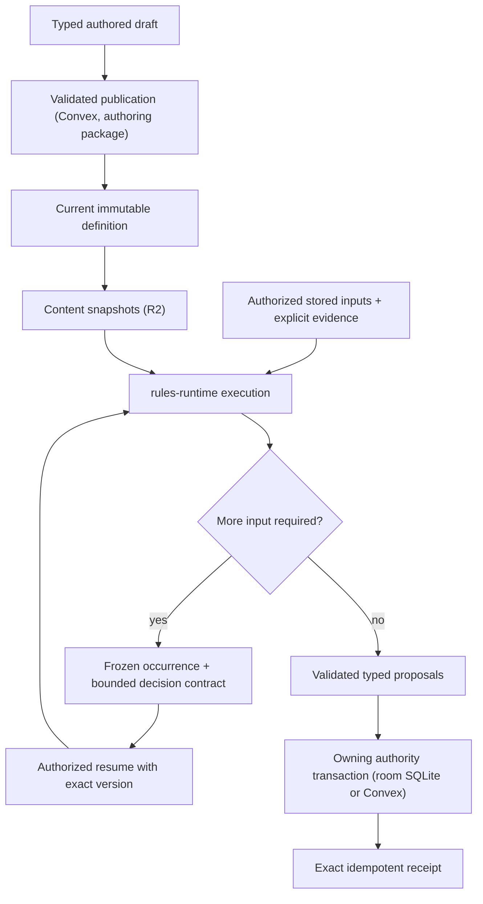

# Shared rules runtime

> **Status:** canonical current guide for `packages/rules-runtime` and its callers. Phase 8.3 rules scope is target and labeled as such.
>
> **Scope:** the pure Rules Kernel, System capability contracts, published definitions, execution, frozen occurrences, decisions, receipts, and who calls the runtime
>
> **Update when:** graph contracts, primitive ownership, System capabilities, publication, occurrence, replay or receipt behavior, the package export surface, or a caller changes
>
> **Verification:** `packages/rules-runtime`, `packages/encounter-persistence`, `apps/session-worker/src` (`native*`, `room*`), `apps/apis/convex/{content,characters,encounters}`, `apps/web/src/domains/characters/builder/evaluation`, ADRs 0023-0026, 0029, 0034-0036, and [the RUL-9 rules audit](../handoffs/rul-9-rules-audit.md)

The Rules Kernel (`packages/shared/src/domains/rules`) is a pure execution library. It walks a validated
bounded graph, accepts explicit facts, random evidence and decisions, and returns typed proposals and a
trace. It does not authenticate users, read persistence, generate randomness, mutate aggregates, or know
D&D vocabulary. `packages/rules-runtime` wraps the Kernel with schema validation, installed System
modules (D&D 2014 today), and the pure Encounter, Character and Sheet calculations that callers share.
It owns no store and no transaction.

## Callers

- **Session Durable Object** (`apps/session-worker`): the `native*` modules (`nativeEncounterRules`,
  `nativeEncounterTurn`, `nativeEncounterMovement`, `nativeCharacterRules`, `nativeCheckAction`,
  `nativeDisarm`, and the Concentration, Cleaving and maintenance modules) plan and execute Encounter,
  movement and Sheet-play rules from the room's SQLite inputs, and the `room*` modules commit the results
  there. Held Sheet play runs through `roomCharacterSheetCommands` and `roomCharacterWrites`. See
  [live sessions](live-sessions.md) for the room protocol, ordering and recovery.
- **Browser Builder** (`apps/web/.../builder/evaluation/builderEvaluator.ts`): evaluates a Character over
  the content snapshot objects of its manifest with `createLazySnapshotReaders`,
  `resolveSnapshotCharacterBuilderPayload` and `previewSnapshotCharacterBuilder` (ADR 0036).
- **Convex Builder commit** (`characters/commit`, `characters/referencedContext.ts`): re-evaluates the
  Character on the server from the referenced current publications through
  `assembleCharacterReferencedBuilderContext`. It is the authoritative check behind the browser's
  evaluation.
- **Other Convex use:** publication and reads that need pure rules code. `content/definitions` composes
  `@artificer-toolkit/authoring/reusableDefinitions`; `content/systems` serves System capabilities from
  `platformRulesRuntime`; Sheet and Campaign Sheet queries and commands use `rules-runtime/character/*`;
  `encounters/actionChoices` and the disarm selection read action sources, economy and wield conflict;
  projection reads use `encounterProjection` and `encounterPlayerProjection`. Convex no longer runs
  per-command Encounter rules: that path was deleted in A35-S6c3
  ([ADR 0035](../adr/0035-room-authoritative-live-encounters.md)).
- **`packages/encounter-persistence`:** admission, persistence writers, receipts and projections for
  Encounter state, over a store interface. It depends on this package, never the reverse; see
  [persistence](persistence.md).

## Package surface

`packages/rules-runtime/package.json` exports `"."` (the `rulesRuntimeService` module only:
`createRulesRuntimeService` and its error classes) and `"./*"`, which maps any module path under `src` to
`dist` (for example `rules-runtime/encounterActionSources`, `rules-runtime/character/sheetPreparation`,
`rules-runtime/systems/dnd5e/attackKind`). Consumers import focused subpaths, not the root. Build the
package before tests that import newly added modules.

| Area                          | Modules                                                                                                                                                                                             | Owns                                                                                                                                                                         |
| ----------------------------- | --------------------------------------------------------------------------------------------------------------------------------------------------------------------------------------------------- | ---------------------------------------------------------------------------------------------------------------------------------------------------------------------------- |
| Execution wrapper             | `rulesRuntimeService`, `platformRulesRuntime`, `platformPolicyModules`, `platformEncounterPolicy`, `platformCharacterPolicy`, `random`                                                              | Schema-aware Kernel execution, continuation sealing, installed System lookup by System UUID                                                                                  |
| Systems                       | `systems/dnd5e/*`                                                                                                                                                                                   | D&D 2014 policy, action compiler, grant fold, modifier scope, concentration, lifecycle and optional-combat policy                                                            |
| Character                     | `character/*`                                                                                                                                                                                       | Context and Sheet preparation, Builder catalogue/eligibility/reconciliation/readiness/payload, snapshot readers, Sheet commands, rest, roll, projection, rule-fact composers |
| Encounter actions             | `encounterAction*`, `encounterBasicActions`, `encounterDisarmPreparation`, `encounterWieldConflict`, `encounterCleaving*`, `encounterConcentration*`                                                | Source resolution, mechanics preparation, economy, target policy, effects, receipts, warnings                                                                                |
| Encounter turn and initiative | `encounterTurn*`, `encounterInitiative*`, `encounterRecharge*`, `encounterLegendary*`, `legendaryActionEligibility*`                                                                                | Initiative graphs and settlement, turn effects, Recharge, Legendary Actions                                                                                                  |
| Encounter movement            | `encounterMovement*`, `encounterSpatialMovement*`, `movementReaction*`                                                                                                                              | Path timeline, Passage contacts, reaction discovery, decision and settlement planning                                                                                        |
| Encounter state               | `encounterActor*`, `encounterMechanicsBatchPlan`, `encounterCharacterMechanicsBatch`, `encounterScalarReductions`, `encounterProjection`, `encounterPlayerProjection`, `encounterCombatPerception*` | Actor facts and state, outcome folds, projection, perception                                                                                                                 |
| Snapshots and misc            | `contentSnapshots`, `contentCatalogue`, `campaignClock`, `characterZeroHitPoints`, `sceneGridPolicy*`, `targetBoundActiveRuleEffectExecutor`, `characterRuleActionSystemAdapter*`                   | Content snapshot build/index shapes, clock boundaries, grid policy, frozen active-effect execution                                                                           |

Everything here takes structural inputs (domain types, injected readers, ports). None of it imports
Convex contexts, database rows, or Worker APIs, so the room and Convex run the same functions.

## Ownership and publication

Game System adapters own rules vocabulary and policy, including D&D 2014. Reusable mechanics remain
portable typed operations. Code-owned operation keys, versions, validators and bounded graphs keep
authored data from introducing executable code or unbounded work. The System UUID selects the adapter;
labels, editions and catalogue codes never do.

Published authored roots and reusable definitions keep stable UUID identity. A reusable definition has at
most one editable draft and zero or one current published document. Publication atomically replaces the
current document, checksum and contract tuple and removes the draft; there is no historical revision
table or consumer-selectable pin. Issued occurrences keep their frozen execution evidence
([ADR 0024](../adr/0024-current-published-authored-content.md)).

`@artificer-toolkit/authoring/reusableDefinitions` is the single persistence-independent publisher. It
receives installed System capabilities, operation contracts, vocabulary and a store with atomic draft and
publication callbacks; Convex `content/definitions` and `content/definitionStore` supply the store.
Family keys live in `schema/shared/reusableDefinitionIdentity`: `rules-runtime-graph`, `sense`,
`rule-capability`, `condition-rule-state`, `rule-maintenance`, `initiative-policy`,
`dnd5e-encounter-lifecycle` and `dnd5e-optional-combat`. A family stores its own typed document: the graph
family holds the executable graph, `sense` holds a closed composition of code-owned perception primitives.
Unknown families are rejected. The checksum codec is `@artificer-toolkit/shared/canonicalJson`.

Publication validates graph bounds, cycles, ports, operation versions, UUID references, same-System
compatibility and transitive dependencies. That proves an invocation is structurally executable, not that
a live command will succeed.

Graph constraints: graphs are finite, bounded, acyclic and typed; node IDs are local structure; primitive
keys are code-owned while referenced definitions and domain items are UUID-backed; rule-to-rule
composition is an explicit validated reference; unknown operation versions, unbound ports, cross-System
references, cycles and incomplete branches reject publication.

Capability discovery derives entry points from actor sources, grants, equipment, effects, Campaign policy
and Scene facts, and an execution instance exists only when an entry point is invoked. An authored Effect
UUID is the stable identity of an effect-backed entry point. The shared boundary compiles the exact
authored Effect before the System adapter runs; the adapter may derive System policy facts from it but
cannot rewrite it. Creature discovery isolates each action: one whose mechanics cannot compile or bind is
listed unavailable with its reason while the Creature's other actions still work. There is no persistent
prepared-plan layer; a derived action list is never authority and every command repeats capability and
authorization checks.

## Execution, decisions, and receipts

An authorized command creates or resumes an aggregate-owned occurrence. A paused occurrence stores its
sealed snapshot: the reachable graph, operation keys and versions, source identities and checksums,
frozen facts, issued requests, authority and redaction policy. Resume rejects stale authority, an
unexpected aggregate version, a bad seal, or a decision outside the stored contract. A pending snapshot is
either `KERNEL_EVIDENCE` (sealed continuation plus a bounded server-only context) or `AGGREGATE_CHOICE`
(one closed tactical choice, no graph). An Encounter has at most one pending occurrence, and a retry
matching a stored receipt returns it before that gate.

A complete execution returns proposals. The owning authority applies them with the aggregate's expected
version, advances the occurrence and writes the receipt in one transaction; any failure leaves prior state
visible, and an exact retry returns the stored receipt without new randomness, current-definition reads or
double application. For live Encounter, movement and held Sheet play the owning transaction is the room's
SQLite commit; Convex receives fenced checkpoints
([ADR 0035](../adr/0035-room-authoritative-live-encounters.md),
[ADR 0029](../adr/0029-convex-backend-cutover.md#live-rules-execution-clarification--2026-09-24)).
Convex still owns the Builder commit, personal Sheet commands and Run creation.

Receipts retain committed results and evidence for retry and audit, never an executable graph. A resume
that advances or re-pauses writes a closed command-specific result holding only the actor-filtered summary
needed to replay that response. Character events caused by one occurrence use deterministic child command
UUIDs derived from the occurrence, root command, phase, ordinal and Character, so repeated phases never
reuse an idempotency key. Raw Kernel facts and traces are server-only; browsers receive recipient-safe
projections.

**Automation modes (ADR 0034).** There are two: Assisted and Manual. In Assisted, a step needing dice asks
the roller's `userProfiles.autoRollDice` preference: on records app-roll evidence immediately, off pauses
for entered dice. The roller is the actor whose roll it is; its assigned player's preference applies, else
its first granted controller's, else the GM's (`readEncounterAutoRollByActorId`). Lifecycle functions take
an `EncounterEvidenceMode` (`AUTO_ROLL | PROMPT | MANUAL`); answers arrive as `EncounterEvidenceAnswer`
and only `resolveEncounterD20Answer` and `resolveEncounterIntegerAnswer` turn one into faces. D20
evidence records both the chosen and the rules-derived roll mode, and pending summaries name the
contributors behind the derived mode (`encounterRollModeReasons`, labeled for display by
`rollModeReasons` in `packages/encounter-persistence`). Attack-perception contributors are `rule:unseen-attacker`
("Unseen attacker", advantage) and `rule:unseen-target` ("Unseen target", disadvantage); see Combat Perception. A player's prompt never names a contributor from an actor hidden from
players (it reads "Unseen source"); known limit: a contributor from the roller's own policy is never
redacted. Manual mode records an idempotent receipt at an unchanged version without invoking the Kernel or
applying state and carries no rules cue (ADR 0034). **One card per die (ENCOUNTER-7, current).** Every
Encounter rule die posts exactly one roll card through `recordRuleRollCard`: an action's d20s and damage
totals, a Legendary Action's (`recordActionRollCards`), each Recharge d6 (source kind `RECHARGE`), the
turn-start death save and, under `DECLARED_ACTION_ROLL`, each declared actor's initiative die (ENCOUNTER-9,
the same `INITIATIVE` card `ROLL_ACTOR_INITIATIVE` posts, both built by the one `initiativeRollRecord`,
written by `persistEncounterInitiativeRollCards` in the terminal turn commit from the settled
`root.initiative` evidence; a flat score and tie-resolution dice post none, and a result of more than two
dice or a die that is not a logged `1dN` throws. **Declared advantage and disadvantage (ENCOUNTER-10,
current):** the declared graph's `d20-extra` node (`evidence.optional-integer-range`, which asks for its
die only while the `initiative.extra-d20` fact is true) and its `number.keep-by-roll-mode` node roll two
d20s and keep the higher or lower under the policy's resolved roll mode; the card replays both faces under
that mode, so it matches the GM-rolled card. A tie resolver pinned to the same graph rolls its attempts
the same way.) A die settled by a `SYSTEM_ROLL` answer already has its
"Rolled by the app" attempt card, so the commit skips it; an auto-rolled or entered die (including one
entered after an app roll) is carded at commit. `readAppCardedDice`
(`packages/encounter-persistence/src/appCardedDice.ts`) decides this
from journaled answers, never from die values: each `SYSTEM_ROLL` answer (an action's `ACTION_EVIDENCE`
receipts, a turn root's `resolutionCommands`, `LEGENDARY_SYSTEM_ROLL` for Legendary windows,
`INITIATIVE_SYSTEM_ROLL` for declared initiative) is joined to
its latest attempt and covers at most one settled die of the same request and value.
Known limit: an app-rolled single-die damage request also gets a commit total card.
Actions in a Manual Encounter are refused with the
`ASSISTED_ONLY` domain rejection.

**Active effects and maintained state.** Current active effects are state, not occurrences. Each stores an
immutable definition (origin, one frozen `SINGLE_GRAPH`, adapter facts, recurrence, perception
contributions) and a mutable lifecycle (remaining ticks). The pure executor
(`targetBoundActiveRuleEffectExecutor`) executes the frozen graph without current-definition lookup and
returns a lifecycle `UPDATE` or `EXPIRE` proposal for the owner to apply. Maintained-effect state
(Concentration) is generic persistence keyed by a System maintenance-definition identity; the System
decides whether a mechanic uses it. Storage layout and limits are in [persistence](persistence.md).

## Assisted soft enforcement and GM undo (current, ADR 0034 decision 2)

`RESOLVE_ACTION` evaluates its overridable checks once, in the room planner (`nativeEncounterRules`),
through `encounterActionRuleWarnings`:

- `prepareEncounterActionMechanics({ overridable: true })` reports `SOURCE_NOT_EQUIPPED` and
  `RESOURCE_UNAVAILABLE` instead of refusing;
- `evaluateEncounterActionEconomy` reports `ACTION_ECONOMY_UNAVAILABLE`;
- `evaluateEncounterActionTargetPolicy` reports `TARGET_OUT_OF_RANGE` (or `TARGET_RANGE_UNCHECKED`
  without both tokens), `TARGET_DISPOSITION` and `TARGET_DEFEATED`. Disposition compares the GM-set
  dispositions through `encounterActorRelationship` (neutral is neutral to everyone, equal dispositions
  are allied, friendly and hostile are hostile). It is the one source of hostility: movement reaction
  eligibility and passage blockers use it, and Run state stores no side relationships. Actor sides remain
  only for initiative grouping, reorder, reinforcement and removal.

**Targeting yourself (D99).** A user may target itself unless the action says otherwise: the policy raises
`TARGET_DISPOSITION` for a self target only when the target disposition is hostile, the action makes an
attack roll (`makesAttackRoll`, a required policy input) or the authored single-target `self` field is `WARN`
("another creature"). `self` is one authored field with three values: `ALLOWED` (the default), `WARN` (the
overridable warning above; SRD Bardic Inspiration, Healing Touch, Modify Memory and Protection) and `REFUSED`
(Help and First Aid: the policy refuses a self target outright as `UNSUPPORTED_TARGET`, not acknowledgeable). The
action choice DTO's `target` is the authored targeting, not a derived flag: `{ kind: 'SELF' }` for a `SELF`
selection (Dash, Dodge; no picker, resolves on the actor), `{ kind: 'ACTOR', self }` for a creature-choosing
selection (the schema's `ALLOWED | WARN | REFUSED`, `ALLOWED` where the selection has no `self` field) and
`{ kind: 'POINT', area }`. A client always asks for the creature of an `ACTOR` target; it lists the user unless
`self` is `REFUSED`, and the server keeps the `WARN` warning.

**Rule usage storage.** "Nothing used" has one stored form: no key. `withEncounterRuleUsageUsed` drops the
definition's entry for a usage of 0 and drops an empty `ruleUsage`, so a turn refresh, a spend and an undo
store the same row.

An authored basic action follows the same rule through `RESOLVE_ACTION`, with `encounterActionEconomyWarnings` and `TARGET_DISPOSITION`.
Action choices carry the warnings that already apply before a target is chosen.

### Attack action, Multiattack and Extra Attack (current, D93)

An Assisted weapon or unarmed attack made with one Action is part of the actor's Attack action
(`isAttackActionAttack`, owned by the System's action-economy adapter; spell attacks are not).
`evaluateEncounterAttackAction` wraps the Action evaluation: the first such attack of a turn spends the
Action and opens the Attack action, stored at actor `resources.attackAction` with the turn sequence, the
`total` attacks and the attacks made. The next attacks of that turn fill it without spending an Action or
warning. A Character's total is the dnd5e policy output `attacksPerAttackAction` (value domain
`ATTACKS_PER_ATTACK_ACTION`, SET_VALUE only, highest source wins, base 1; every class Extra Attack and
Thirsting Blade is a grant of it) and a Creature's is 1, because a Creature's Multiattack is its own
action. An attack that does not fit (full, stale turn) spends a new Action, warns when none is left, and
opens a new Attack action. Settlement commits the `attackActionTransition` `{ before, after }` in the
action's mechanics batch with the same compare-and-set as the allowance; `REVERT_LAST_ACTION` restores
`before` only while the actor still holds `after`, else it refuses with `REVERT_UNAVAILABLE`. Action
choices report `attackSlot` per action and the actor's `openAttackAction`. A filler attack spends nothing
but still honors suppression: `isActionEconomySuppressed` reuses the allowance capability resolution of
`evaluateEncounterActionEconomy`, and an actor that can't act (Incapacitated, a suppressing effect) gets
the overridable `ACTION_ECONOMY_UNAVAILABLE` warning and no `attackSlot`; a spent Action is not
suppression. Manual mode tracks nothing.

The command proceeds only when `acknowledgedWarnings` (part of its fingerprint) covers every current
code; otherwise it is refused with `RULE_WARNINGS`. An override spends only what remains and
`consumeEncounterActionEconomy({ overridden: true })` lets the allowance exceed its maximum. Accepted
warnings are stored as `ruleOverrides` and badged on the timeline. Authorization, versions, the current
actor, Manual mode and completed Encounters are hard checks, never warnings. Reactions, Legendary
Actions, Disarm and movement call preparation with `overridable: false` and keep refusing.

`REVERT_LAST_ACTION` (GM-only) undoes the Run's last `RESOLVE_ACTION` and its committed child receipts,
inverting only recorded before-states (hit points, conditions, resource usage, a stowed shield, a used-up single-use item (given back by lowering its `itemUsage`), charges,
the action allowance, created effects and maintained states). It refuses, naming the kind, removed
conditions, replaced maintained effects, lost Concentration, Cleaving damage to a Character, Disarm and
other contested actions; a second undo is refused. Its implementation is
`packages/encounter-persistence/src/actionRevert.ts`.

### Point-area actions (current, D103)

A POINT-target action over an area-contents plan opens one pending `ENCOUNTER_AREA_ACTION`
(`AGGREGATE_CHOICE`) occurrence. `catchEncounterAreaActorIds` picks the actors with a token overlapping the
area, once each, and `encounterAreaCaughtChecksum` seals the Scene version, the area and those creatures.
Each caught creature carries its own sealed single-target save under
`encounterAreaTargetOccurrenceId(area, actor)`; `prepareEncounterAreaTests` opens them all without rolling
damage and `answerEncounterAreaTest` answers one whatever the others have done. `removeEncounterAreaTarget`
(the GM's removal, SPELLS-7.1) refuses a creature that has answered and seals the caught set again.

Legendary Resistance on an area save is per creature and interstitial. After a failed Creature save
`afterTest` asks the creature's `discoverLegendaryResistance`, and `offerEncounterAreaLegendaryResistance`
seals the offer against the failed execution, the creature's facts, its d20 policy and the pinned resistance.
`decideEncounterAreaLegendaryResistance` re-checks all of them against the creature's pool as it is now
before it records `USE` or `DECLINE`; the charge is only proposed there and is spent by the area's commit.
`encounterLegendaryResistanceChoice.ts` holds the helpers shared with movement.

`settleEncounterAreaAction` runs only when every save is answered and every offer decided. It rolls damage
once through a frozen roll tape (the first creature that needs die n rolls it, later ones replay it, and a
different die is refused), then continues each creature's own plan, so resistance, immunity and
vulnerability stay per creature. The persistence side commits one root `AGGREGATE_CHOICE_COMPLETE` that
holds the source spend once and one mechanics-batch child per kept creature
(`packages/encounter-persistence/src/areaCommitPersistence.ts`); `REVERT_LAST_ACTION` reverts the children in
reverse, then the root. An outcome that leaves a condition, a lasting or recurring effect or a maintained
effect is refused whole until SPELLS-19.

Each action choice carries `target`: `{ kind: 'ACTOR' }`, `{ kind: 'POINT', area }` (the authored radius or
cube edge), `{ kind: 'DIRECTED', area }` (the authored cone length, line length and width, or the edge of a
cube that extends from the caster) or `{ kind: 'CASTER_CENTERED', area: { kind: 'RADIUS', radius } }` (a Self
sphere, cylinder or circle: no aim), built by `encounterActionChoiceTarget`. A policy this path cannot resolve
(a wall, dome, or a cone or line whose range is not Self) stays an actor choice and is refused when resolved. The web converts the area to Scene coordinates with
`pointAreaInSceneCoordinates` or `directedAreaInSceneCoordinates` (`shared/vtt`), the same functions
`compileEncounterPointArea` and `evaluateEncounterDirectedAreaTarget` use, to preview it and list the tokens
the viewer sees inside; the room still decides who is caught.

### Caster-centered radius areas (current, SPELLS-22)

An `AREA_CONTENTS` action whose range is Self and whose shape is a sphere, cylinder or circle takes the fourth
target, `{ kind: 'CASTER_CENTERED', sceneId, expectedSceneVersion }`: it names no origin or direction. The
origin is the caster's own token (`evaluateEncounterCasterCenteredAreaTarget` returns the `RADIUS` shape and
refuses `NO_CASTER_TOKEN` without one; the room seals the token's position), and the sealed area is the same `RADIUS` shape a point area seals, so no persisted shape changes;
the caster-centered meaning lives in the persisted command's target kind. "Within N feet of you" is measured
from the edge of the caster's space (D114): `spatialTokensWithinSpaceRadius` catches a token whose footprint
shares positive area with the caster's footprint grown by the radius (a rounded rectangle, so a Large or
Huge caster reaches farther than a Medium one), by the same strict overlap rule as every area (D103), and never
catches the caster. `catchEncounterAreaActorIds` takes `fromCasterSpace` for it; the room and
`requireAreaActionPendingRoot` both set it from `command.target.kind`, and the latter also checks the sealed
origin is still the caster's token. The authored targeting has no "includes the caster" option, so the caster
is always excluded. Everything after the catch is the point-area pipeline; an outcome that leaves a condition or
lasting effect is refused whole until SPELLS-19, and a moving aura is SPELLS-20.

### Directed areas: cone, line and caster-origin cube (current, SPELLS-13)

An `AREA_CONTENTS` action whose range is Self and whose shape is a cone, line or cube takes the third target,
`{ kind: 'DIRECTED', origin, toward, sceneId, expectedSceneVersion }`. The origin must lie on the caster's token
footprint (`isDirectedAreaOriginOnToken`) and `toward` is the point the area is aimed at. `encounterAreaTargetKind`
is the one range × shape table (point, directed, caster-centered or unsupported) that the compiler, the choice target and the
evaluators share; a target of the wrong kind is `TARGET_UNAVAILABLE`, as is an origin off the footprint, and each
refusal has its own message (`UNSUPPORTED_AREA`, `NO_CASTER_TOKEN`, `ORIGIN_OFF_CASTER`).
`evaluateEncounterDirectedAreaTarget` returns the Scene-unit shape, and everything after it is the point-area
pipeline above: the same `ENCOUNTER_AREA_ACTION` occurrence, sealed saves, frozen damage, GM removal, commit and
undo. The pending guard (`requireAreaActionPendingRoot`) checks the sealed origin and direction against the command.
Catching (`spatialTokensInsideArea`, for every area) is strict positive-area overlap, so a creature the area
only touches along an edge or at a corner is not caught (D103, user ruling 2026-10-14). Lasting and moving zones use the same rule through the same predicate (`footprintOverlapsSpatialGeometry`): entry, start-of-turn effects (`encounterTurnEffectPerception`) and movement-reaction perception (`encounterMovementReactionPerception`) see a zone only when the footprint shares area with it, so touching its edge or a corner never catches (SPELLS-24); a directed shape needs the
caster's token among the Scene's tokens, which it excludes (it throws without it: the room has already refused `NO_CASTER_TOKEN`, so a missing caster here is an invariant failure). A cone is the triangle from the origin to a
far edge as wide as it is long; a line is a rectangle, 5 ft wide unless authored (a scaled or non-positive
authored width is refused at compile). A Self cube follows the 5e rule that its origin lies anywhere on a face
of the cube (`cubeFromSideOutline`): the side faced is the dominant axis of `toward`, the face is flush against
that side and slides along it, snapped to the grid, according to where the origin lies along the side, so a
corner origin catches exactly the cube's squares (9 for a 15 ft cube). The sealed shape carries `cellSize` for
that snap. Token rotation is ignored: the footprint is axis-aligned. The stage aims the area with one
`VttAreaAim { origin, toward }` (`vttSceneRenderer.model.ts`): the player presses on their token's edge
(`nearestFootprintEdgePoint`) and drags the direction, and the outline drawn is `directedAreaOutline` (a point cube
uses `pointCubeOutline`), the same geometry the room catches with.

**Placed zones (SPELLS-17, current).** An authored `MANIFEST` `ZONE` `PLACED_SPACE` outcome is a point-area action
that leaves a zone behind instead of catching creatures. The System compiler (`zonePlacementPlan`) turns the
outcome into a `zonePlacement` on the v4 `CHARACTER_ACTION` compiled entry: label, shape, trigger modes, the entry
graph (the authored save, `ON_SAVE_FAIL` damage and, when authored, a `STOP_CURRENT_MOVEMENT` that surfaces as the
graph's `movementInterruption` output) and an optional lingering modifier-grant template (its modifiers, senses and
`endOnEvents`). Only point shapes (`SPHERE`, `CYLINDER`, `CIRCLE`, a cube) compile; a directed zone (cone, line, a
Self cube) and any authored feature the System cannot honor in full (a second component, behavior or outcome, an
unmodeled field, a save DC other than fixed, an end event the System never reads) stay manual with
`NOT_NORMALIZED`. The component's `interactionKind` picks the trigger modes (`ZONE_INTERACTION_TRIGGER_MODES`):
`ENTER_SPACE` is ENTER (the path ends inside), `MOVE_ACROSS` is CROSS, and `ENTER_OR_PASS_THROUGH` is both. SRD text
that says a creature "enters the area" (Caltrops, Ball Bearings) authors `ENTER_OR_PASS_THROUGH`, so a drag that
ends beyond the field still triggers the save and, on a failure, stops at the first field square it entered. The System, not the authored zone, owns the placement defaults: `planEncounterPlacedZone` sets
`movementKinds` to voluntary, forced and teleport movement, `activation` to `REPEATABLE` and `visibility` to
`PUBLIC`. The compiled zone stores only the grant contribution the planner reads: the zone row's own
`recurrence.endOnEvents` stays empty, and the creature's grant takes its end events from the grant template. The
action opens no area occurrence (`placesZone` on the pending root): it commits the spend and one
`liveSessionPlacedSpatialEffect` in the same transaction as every other area commit. The zone is
built by `planEncounterPlacedZone` (FIXED, `SCENE_ABSOLUTE`, a cube as a polygon via `pointCubeOutline`), stored
through `createPlacedSpatialEffect` (refused with `TARGET_UNAVAILABLE` at `MAX_SPATIAL_RULE_EFFECTS_PER_SCENE`), named
on the area root as `placedSpatialEffectId`, and deleted by GM undo (`actionRevert.ts`) like a D99 grant. When a
creature fails the zone's entry save, `persistLiveMovementSpatial` copies the zone's grant template under the
movement's origin onto that creature (`planSpatialEntryGrant`, built from the grant entry; it does not stack per
authored zone entry). The grant's frozen graph is provenance only (`actionEffectPersistence.ts`,
`encounterActionEffectReceipts.ts` read its source identity and checksums), so it reuses the zone's. A grant
whose `recurrence.endOnEvents` names `ON_HIT_POINTS_REGAINED` ends in `persistEncounterMechanicsBatchPlan` when any
application heals at least 1 hit point (`grantsEndedBy`). A zone whose component authors `bypassAtHalfSpeed`
(SRD "through the area at half speed") can be crossed carefully (decision Q2): the voluntary `MOVE_SCENE_TOKEN`
command carries an optional `carefully` flag, the movement cost doubles for the path's footprint share inside that
zone (`spatialSegmentShareInside` through `preparedMovementCost`), and the flag reaches candidate evaluation so that
zone's save is skipped (`collectSpatialMovementCandidates`; forced and teleport movement ignore it). Both the
bypass and the doubled cost apply only to zones the mover can see (`isVisibleHalfSpeedField`: `PUBLIC`, or
`spatialState.revealed`), so a hidden zone triggers whatever `carefully` says. The tabletop
learns which fields offer the choice from `halfSpeedFields` on the Encounter session state (visible, scene-absolute
placements only through the same predicate, read once by `readHalfSpeedFields` for both the Convex read and the room push); the stage's drag
preview offers "Move carefully" and "Move normally" before sending. Not yet: undo of a healing action restores the
ended grant, healing outside Encounter mechanics batches (Sheet) ends the grant, and hidden or unnoticed zones
(MOVE-3.3 to 3.5).

Each choice also carries `range` when its compiled target policy has a measurable one, the range the evaluator that
handles the policy measures. A single-target policy that `singleTargetMeasure` accepts advertises `SELF`, `WITHIN` (Touch
is 5 ft; a distance without a long range, including the 0 ft swarm space), `RANGED` (normal and long) or `UNLIMITED`. A
point-area policy advertises its origin range, which `evaluateEncounterAreaTargetPolicy` measures
(`pointAreaOriginRange`): `WITHIN` the distance (never `RANGED`, the area evaluator ignores a long range) or `UNLIMITED`.
A policy neither evaluator measures leaves it off: a sight or special range, targeting that is not a single target with a
disposition (excluded creature types only warn), an area with no supported shape, a path override, or no policy.
`encounterActionChoiceRange` (`encounterActionRange.ts`) is the one mapping. `rangeLabel` is not derived from `range`:
it words the authored range with `rangeLabel` (`rangeLabel.ts`), the formatter the Sheet uses, so Touch reads "Touch"
(its 5 ft geometry stays in `range`) and a ranged weapon reads "150/600 ft" on both surfaces. Only a choice without a
policy keeps the label of its action mechanic.

Per-role visibility and the command flow are in
[live-sessions.md](live-sessions.md#encounter-commands); the decision is
[D103](../handoffs/phase-08-2-decisions.md).

### Legendary Resistance on single-target saves (current, D104)

A failed Creature save on a single-target `RESOLVE_ACTION` TEST that ends `ON_SAVE_FAIL` holds the action
before its OUTCOME runs. The `ENCOUNTER_ACTION` pending context keeps a sealed `legendaryResistance` offer
with the creature as roller, and nothing is spent while it waits. The answer is the existing `DECLINE` or
`OPTION` resolution, read as the `LEGENDARY_RESISTANCE_CHOICE` summary; the room rebuilds the TEST from the
retained faces without rolling, re-checks the offer against the creature's current pool, and continues the
OUTCOME on the success branch for USE or the failure branch for DECLINE. On USE the charge is written into the
action receipt as `targetFeatureResourceConsumption`, and GM undo returns it. Area, movement and single-target
paths share `decideEncounterLegendaryResistance`. The decision is [D104](../handoffs/phase-08-2-decisions.md).

### Reaction to a hit (current, REACTION-4.T1)

A reaction authored with `reactionTrigger: { kind: 'ATTACKED_SELF' }` (Shield) is offered to the attacked
Character when a single-target `RESOLVE_ACTION` TEST resolves `ON_HIT` or `ON_CRIT`, before the OUTCOME. The
`ENCOUNTER_ACTION` pending context keeps a sealed `reactionChoice` offer (a sibling of `legendaryResistance`,
a stack so Counterspell chains can nest later) with the Character as roller; nothing is spent while it
waits and the Scene is held (D26, text "Waiting on a reaction decision"). The answer is `DECLINE` or
`OPTION`, read as the `REACTION_CHOICE` summary; the room re-opens the choice graph by occurrence id, as
Legendary Resistance does.

DECLINE continues the OUTCOME unchanged. USE runs the reaction's own plan (`applyNativeAttackReaction`),
prices the reaction through the action economy and the slot through Character mechanics, builds the effect
it creates on its reactor, and re-evaluates the TEST: `reconstructNativeActionTest` rebinds the recorded
dice to the attack's defense as the effect leaves it. That rebinding is a sealed `adjustment`
(`defenseBefore`, `defenseAfter`, adjusted-facts checksum) in the OUTCOME's `reaction` audit and the
receipt; the "TEST evidence is stale" guard stays intact for everything else. The batch receipt's `reaction`
carries the spend and the effect; GM undo returns the slot and the allowance and deletes the effect.

Order on one attack: TEST, then the reaction choice (`ON_HIT`/`ON_CRIT` only), then the OUTCOME. It cannot
meet Legendary Resistance on the same TEST: that choice exists only for `ON_SAVE_FAIL` and a TEST has
either an attack path or a save path, and `continueNativeActionAfterTest` rejects an audit carrying both.
A defeated reactor (D63), a spent allowance, an Unconscious Character and a `REACTION_COUNT SET_VALUE 0`
grant (D99) all drop the offer through the same discovery as an action. Only the first eligible reaction
is offered, only Character reactors, and a reaction taken as an action is refused (`REACTION_TRIGGER_ONLY`) on
every action path (single-target and area) through `refuseActionOutsideItsWindow`, the one admission point it
shares with `LEGENDARY_WINDOW_ONLY`. Resume admission accepts any option the offer carries
(`offeredDecisionOptionIds`) and refuses one it does not as stale; the pending summary and Decision drawer still
show only the first reaction (transport contract and UI widening belong to the SPELL_CAST chain, REACTION-4.T3). The reaction's effect id is derived from the command and occurrence ids
(`nativeReactionEffectId`), so replaying the answer mints the same id. A reaction that needs rolls or does not
create exactly one effect on its reactor is refused as `REACTION_UNSUPPORTED`.
Decision: D26 is extended to hold the Scene for a pending reaction decision.

#### `DAMAGE_TAKEN` (current, REACTION-4.T2)

`reactionTrigger: { kind: 'DAMAGE_TAKEN', damageTypeIds }` (a user-authored Absorb Elements) rides the same
pause as `ATTACKED_SELF`: discovery (`discoverAttackReactionActions`) offers it when one of `damageTypeIds`
is a damage type of the hit attack's `ON_HIT`/`ON_CRIT` outcomes (`attackHitDamageTypeIds`). The candidate and
the sealed pin carry their `trigger`, so a changed trigger is a different offer. The reaction's effect carries
a `DAMAGE_RESISTANCE` grant, which `encounterActiveGrants` turns into a defense of the reactor; the
re-evaluated binding hands that defense to the OUTCOME, so the damage is resisted before it applies. The TEST
is unchanged (`defenseBefore === defenseAfter`), so "the reaction changed the attack" compares the binding's
defenses as well as the bound facts. The follow-up benefit is an ordinary grant in the same effect (a melee
`DAMAGE` bonus until the start of the caster's next turn). Limits: only the attack-hit path pauses (save-based
and area damage do not offer it), a bonus grant applies to every melee hit while it lasts rather than the next
one only, and only the first eligible reaction is offered.

### 0 hit points (D63, current)

A Creature or custom Run actor stores `defeated`. `nextEncounterActorDefeated`
(`rules-runtime/encounterActorDefeat`) sets it when a change takes the actor from above 0 hit points to 0
and clears it once the actor has any; an actor at 0 of 0 (a lair or hazard) is never defeated. Every Run
hit-point write uses it: `planEncounterMechanicsBatch` (all damage and healing paths), the GM's
`UPDATE_ACTOR` edit and `REVERT_LAST_ACTION`.

A defeated actor takes no turns (initiative skips it but keeps its place), no reactions or opportunity
attacks (`encounterMovementReactionSources`), no Legendary Actions and is no Legendary target
(`encounterTurnLegendaryDiscovery`). It is never a Cleaving continuation target
(`buildEncounterCleavingCandidate`), has no action choices and cannot act (`ACTOR_DEFEATED`) nor, for a
player, move its token. Naming one as a `RESOLVE_ACTION` target is the overridable `TARGET_DEFEATED`
warning; Disarm refuses it.

A Character at 0 hit points is never defeated; it is dying (D96). Dropping to 0 adds the System's 0 hit
point condition (`characterZeroHitPointsConditionId`; D&D: Unconscious), and regaining hit points removes
it, in `planEncounterMechanicsBatch` and the Sheet's hit point commands. `REVERT_LAST_ACTION` removes it
with the damage that caused it and refuses to undo a heal that woke the Character.

A Character's play state carries `hitpoints.deathSaves` (`successes`, `failures` and `stable`; every
creator writes zeros). The pure rules live in one module, `schema/shared/characterDeathSaves`, because the
receipt replay in `schema` must apply the same arithmetic as the writers: the Encounter mechanics fold
(`encounterCharacterMechanicsBatch`), the Sheet reducer (`sheetCommandReducer`) and Undo
(`actionRevert`, which restores the previous `deathSaves` exactly).

- Damage that drops a Character to 0 and overflows by at least its maximum is massive damage: dead.
- Damage at 0 adds a failure (two for a critical hit, `DAMAGE.critical`), clears `stable`, and is dead
  when the damage is at least the maximum.
- Three failures is dead; there is no separate flag.
- Regaining hit points from 0 resets the saves. A dead Character ignores healing (`HEAL`).
- A Sheet hit point edit above 0 revives a dead Character; the Sheet applies the damage rules with
  `critical` false.

A dead Character is treated like a defeated Creature wherever the Run reads defeat
(`isEncounterActorDefeated`, `skippedEncounterActorIds`, `defeatedEncounterActorIds`), but the Run
keeps no copy of it (ADR 0034 decision 4): the death fact is read from the live Character play record as a
`DeadCharacterIds` set (`readDeadCharacterIds` in persistence, the `characterDead` flag of the room's
`ACTOR` capture, and `deadCharacterIdsOfTargets` for state staged inside one turn or batch). Everyone
sees a dead Character as "Dead" through the Defeated presentation. A frozen actor (a completed Run, or a
departed Character) no longer reads its Character and reads as not dead. In an ASSISTED Run a dying
Character (0 HP, not stable, not dead) makes a death save as its turn starts (D96, current): a d20 with
no modifiers, rolled by the actor's controller through the roll prompt (`DEATH_SAVE` trigger) or by the
auto-roll preference. 10 or more is a success, 2-9 a failure, a 1 two failures, a 20 regains 1 HP (resets
the saves and removes the 0-HP condition through the heal rules); three successes stabilize, three
failures kill. `deathSavesAfterRoll` (schema) owns the rule. The stage runs after Recharge and before
incoming `START_OF_TURN` effects and is not undoable; a MANUAL Run prompts nothing.

First Aid (D98, D106 slice D, current) is an authored basic action on the reusable `CHECK` action test: the
actor makes one authored check (`invocation.check`: `checks` plus a `FIXED` dc; a `CONTEST` dc is in the schema
and refused by the compiler until ATTACK-7 slice C) and the `ON_CHECK_SUCCESS` path runs only on success. The
dnd5e compiler supports exactly one check and a `STABILIZE` outcome; the planner admits `CHECK` only on the
`BASIC_ACTION` source. The SRD authors First Aid as an Action with Wisdom (Medicine), DC 10, a touch-range single
target. It resolves through `RESOLVE_ACTION`, and the stored root carries the check occurrence receipt
(`checkReceipt`). The target comes from the command (a custom actor is refused and a MANUAL Run refuses it as `ASSISTED_ONLY`). A target
that is not dying gives the overridable `TARGET_NOT_DYING` warning and, once overridden, spends the
Action with no roll. Touch range reuses the Healer's Kit warnings. The root command always commits and
spends the Action and the helper's one-roll `ON_ABILITY_CHECK` grants (a Help) are consumed with it. A prompted roll writes a PENDING occurrence
(`ENCOUNTER_BASIC_ACTION_CHECK`) answered by a separate `RESOLVE_RULE_OCCURRENCE`; an auto-roll
settles at once. The roll card is credited to the helper, never hidden from the GM, and de-duplicated
by the app-roll attempt identity. GM undo restores the Action, the used Help and the target's death
saves, restores the consumed grants and keeps the roll on the record; it is refused while the check is pending
(`packages/encounter-persistence/src/basicActionCheck*.ts`, `packages/rules-runtime/src/encounterBasicActionCheck.ts`).
Spare the Dying and Sheet tracking of death saves are not built (target).

### Condition mechanics (D94, current)

A System's condition-rule-state definition authors what a condition does as data, in its `mechanics`
list (`packages/schema/src/shared/ruleState.ts`); the SRD seeds them in
`packages/source-data/src/srd/ruleState.ts`, and a homebrew condition authors its own the same way. There
is no condition-specific code. Each mechanic is one of:

- `D20_ROLL_MODE`: advantage or disadvantage on attacks by the holder, attacks against it (any, within or
  beyond a distance), its saving throws (some abilities or all) or its ability checks;
- `SAVE_AUTO_FAIL`: the holder fails saves of the listed abilities;
- `SPEED`: the holder's speed times `numerator / denominator`, rounded down (0 sets it to 0);
- `HITS_AGAINST_CRITICAL`: a hit against the holder within a distance is a critical hit.

A mechanic with `minimumLevel` applies from that level of a leveled condition: a Character's exhaustion
level is a level of the System's Exhaustion condition, a Creature's condition row may record a level, and
any other held condition is at level 1.

`rules-runtime/encounterConditionMechanics` evaluates them. `withEncounterConditionMechanics` pins the
held conditions' current definitions on a movement target (`conditionDefinitions`) when the Worker loads
it (`nativeEncounterTargets`), and `applyEncounterConditionMechanics` derives `conditionMechanics` and
folds save contributors into the save rows; a flow that rebuilds a target re-applies it from the pins, so a
removed condition stops applying at once and a condition gained after the load applies from the next load.
Action preparation adds the attack contributors (attacker and target, measured on the Scene, or melee
within and ranged beyond without one) and the `conditionOutcomeRules` binding: the D&D compiler binds
`dnd5e.test-outcome-rule` (`NONE`, `SAVE_AUTO_FAIL`, `HIT_IS_CRITICAL`) into the v2 attack and save test
operations. Single-graph verification recomputes the result path from it, and a two-phase save seals it
in its TEST-phase bound-facts checksum (`requireNativeTestBoundary`). The d20 is still rolled on an
automatic failure. Contests (Grapple, Shove escape) and Disarm add the ability-check contributors, Dodge is
suspended at condition speed 0 (the `SPEED_ABOVE_ZERO` predicate), and the tabletop movement allowances (`readTurnMovementView`, one per speed type) apply the
speed mechanics before Dash. A condition contributor's derived-mode reason names the condition, and is
generic for players when the holder is hidden.

Not modeled (registered in the phase ledger): the source of fear (Frightened applies while present),
Hide-action hidden state (Stealth check, ends on attack), Unconscious falling Prone, Petrified damage
resistance, Exhaustion 4 and 6, concentration saves under conditions, and conditions on Convex-side
action preparation reads (the room owns resolution).

### Authored basic actions (ATTACK-18 slices A to E, current; D106)

A `BASIC_ACTION` System definition carries `rulesText`, `restrictions` (a nullable Facet, evaluated live: see Restrictions below), `actionCost` and `effects` (the same authored effect list a
Feature carries). Every entry is authored: Dash, Disengage, Dodge, First Aid, Help, Hide, Ready, Search and Use an Object. They are compiled by
the dnd5e effect compiler and run through `RESOLVE_ACTION` as the third action source, `BASIC_ACTION`
(`encounterBasicActionCapabilityDiscovery.ts`, `encounterActionSources.ts`), for Characters and Creatures. Their action id is
`${actor.id}:BASIC_ACTION:${definitionId}:EFFECT:${effectId}`, and the action choices read lists them in the separate
`basicActionChoices` group as ordinary `encounterActionChoiceDtoSchema` entries.

- **Manual adjudication.** The `MANUAL_ADJUDICATION` outcome compiles to the stored-state-free proposal
  `dnd5e.manual-adjudication-proposal`: the Action is spent and nothing is applied, so the GM rules the result. Every stored `RESOLVE_ACTION`
  command carries the resolved action's display label (`encounterActionSourceLabel` of the prepared source, for Character, Creature
  feature and `BASIC_ACTION` sources), and the timeline entry returns it.
- **Dodge** is an `APPLY_GRANT` until the start of the holder's next turn with an `ATTACKS_AGAINST` disadvantage modifier
  (`requiresHolderSeesAttacker`) and a Dexterity `SAVING_THROW_MODIFIER` advantage, both under the facet predicates `CAN_ACT` and
  `SPEED_ABOVE_ZERO` (unknown contexts fail closed). `withEncounterHolderDefense` (`encounterHolderDefense.ts`) applies the grants
  to the target facts for attack and save resolution; the D100 sight rule drops the attack contributor only when the holder
  definitively can't see the attacker (`UNSEEN`). GM undo removes the grant and refunds the Action like any authored action.
- **Dash** carries the `MOVEMENT_RULE` kind `ADD_SPEED_TO_MOVEMENT`, compiled to `dnd5e.add-speed-to-movement-proposal`. The
  `RESOLVE_ACTION` commit reads it from the execution trace (`executionAddsSpeedToMovement`), calls `recordTurnSpeedBonus` and stores
  `speedBonusTurn` on the command; GM undo calls `removeTurnSpeedBonus`. The movement budget stays condition-adjusted speed × (1 + bonuses).
- **Disengage** is an `APPLY_GRANT` on SELF for one `TURN` with an `OPPORTUNITY_ATTACK_IMMUNITY` modifier of the flag kind `ENABLE`
  (empty domain, no payload), anchored to the holder's `END_OF_TURN`. The room reads it with `encounterGrantsEnabledDomain(effects, 'OPPORTUNITY_ATTACK_IMMUNITY')`.
  A `TURN` duration counts the turn in progress (`includesCurrentTurn`, no own-turn +1); `ROUND` and longer keep the +1. Like every
  grant it ends only at a real turn end (START or ADVANCE_TURN); GM cursor corrections do not tick grants (product-owner ruling, ATTACK-18.2).
- **Rage (ATTACK-9.T1, D113)** is authored data on the compiled path, with no Barbarian executor: a bonus action that spends the
  `rageCharge` binding and applies a 1-minute SELF grant. Four generic shapes carry it. (1) An attack records the ability it used
  (`usedAttackAbility`; a finesse weapon records the chosen one) and the `ATTACK_ABILITY` facet predicate gates a modifier on it, so
  Rage's damage bonus applies to Strength weapon attacks only; level steps are three `CLASS_LEVEL`-gated fixed bonuses. (2) A grant is
  state-bound by two lifecycle fields: the end event `ON_INCAPACITATED` in `recurrence.endOnEvents` (grants only; the turn-effect
  kernel still rejects it) and `recurrence.endOnConditionIds`, the Conditions that end it (Rage names Unconscious, the SRD's "knocked
  unconscious", so Stunned or Paralyzed keep it). A grant that ends on `ON_INCAPACITATED` also ends when its holder is defeated. The holder-end option
  `recurrence.holderEnd` `{ activation }` lets the holder end the grant at that activation cost. These are found by the D95 detection
  point (`encounterConcentrationEndReason` via `planNativeLiveConcentration`; `grantsEndedByHolderState` picks the grants),
  which returns `endedGrants` beside `concentrationEnds`; the commit validates and deletes them, and a `RESOLVE_ACTION` root keeps
  them in `consumedGrants` so GM undo restores them. `holderEnd` lets the Character's own player end that grant (in an Encounter through the end-grant command, which spends its
  activation; outside one through `END_ACTIVE_EFFECT`/`endCharacterActiveEffect` for a FREE end; every other effect stays Campaign-owner-only, D99). (3) The `SPELLCASTING_LOCK`
  `ENABLE` domain bars every spell cast (`spellcastingLocked` on the action model, reason `SPELLCASTING_LOCKED`), ends the holder's
  Concentration when the grant arrives (end reason `SPELLCASTING_LOCKED`), and `prepareEncounterActionMaintenance` refuses a new
  Concentration with an `EncounterValidationError`. An actor or Sheet edit ends the grant through `endConcentrationAfterEdit`. Gap: damage taken during a
  movement pass (opportunity attack, hazard) that incapacitates a raging mover does not yet end the grant:
  `findEnd` in `nativeEncounterMovementConcentration.ts` returns early without a maintained-effect slot and its receipts carry no
  `endedGrants`. Heavy armor also does not end Rage yet: no Character equipment predicate names armor weight.
- **Gone with slice B:** the mechanic codes `SPEED_MOVEMENT_BONUS` and `NO_OPPORTUNITY_ATTACKS`, `suppressesEncounterOpportunityAttacks`,
  the `speedMovementBonus` DTO field and `speedBonusTurn` on `USE_BASIC_ACTION`.
- **Gone with slice D:** `USE_BASIC_ACTION`, `UseEncounterBasicActionInputDto`, the catalogue `check` and `mechanics`
  fields, `STABILIZE_TARGET` and `BASIC_ACTION_MECHANIC_CODE`, and `nativeBasicAction.ts` (slice E's deletions, pulled forward).
  Undo restores the actor row exactly: a returned allowance of zero removes its `ruleUsage` entry rather than writing `0`.
- **Restrictions (slice E).** An actor is offered a basic action, and may take it, only when its facet `restrictions` hold; no
  restriction means every actor, Characters and Creatures alike. The check is `encounterBasicActionRestrictionsHold`
  (`encounterBasicActionRestrictions.ts`): it normalizes the facet with the grant-fold restriction normalizer and decides the holder-state
  predicates (`CAN_ACT`, `SPEED_ABOVE_ZERO`, `FREE_HAND`) against `EncounterHolderState` (`encounterHolderDefense.ts`), the same live
  decision grant restrictions use; any other predicate fails closed. `FREE_HAND` is true while either hand is empty and reads
  `resolveHandOccupancy` (D107): a Creature's hands come from its equipment loadout snapshot, a Character's from the `handFacts` rule
  input (`characterHandRuleFacts.ts`, built from the equipped slots and the TWO_HANDED property). The capability descriptor carries the
  document's `restrictions`. The choices read (`actionChoiceReads.ts`) drops actions whose restrictions do not hold, and the Session Worker
  (`refuseUnmetBasicActionRestrictions`, after `prepareEncounterActionMechanics`) refuses an unmet one as `SOURCE_REQUIREMENTS_NOT_MET`
  before anything is planned. A homebrew copy of the catalogue keeps its `restrictions`, since they are part of the document.
- **Gone with slice E:** nothing further; the closed basic-action codes were all deleted by slices A to D (verified by search).
- **Gone with slice A:** `withEncounterBasicActionDefense`, the `dodgeContributors` plumbing, the Dodge Run-resource effect kinds,
  the mechanic codes `DISADVANTAGE_ON_ATTACKS_AGAINST` and `SAVE_ADVANTAGE`, `saveAbilityIds` and
  `suspendedWhileUnableToActOrMove`.
- **Storage.** A reusable definition's document is stored as canonical JSON text (`documentJson`, `definitionDocumentJson.ts`): an
  authored action's effects nest deeper than Convex's 16-level value limit (Dodge is 19 deep), as ADR 0029 already does for authored
  versions. Readers and checksums still see the typed document.

### Spell casting in an Encounter (current, SPELLS-8.T1)

A Character casts a spell through `RESOLVE_ACTION` like a Feature action. The choice is built from the same
`spellCastCandidates` entry the Sheet and the initiative declarations read (`characterSpellCastActions.ts`):
one action choice per offered candidate, so upcasting is choosing the higher-level candidate and the command
has no cast-level field. The action id is `spell-cast:<uuid v5 of the candidate id>`, a fixed length however
long the candidate id grows. The choices travel beside the Character's other actions as
`characterSpellCast` on the Encounter source facts (`encounterMovementTargets.ts`), so the Sheet's own
actions and the movement reactions never see spells.

A candidate is offered through the Sheet's own logic, not a copy of it: the spell must come from an active
source (`isActiveSpellSource`: prepared per preparing class, learned for the others, always prepared and
granted spells included) and the candidate must be one of the cast levels the Sheet lists
(`getExplicitSpellCastLevels`): the spell's own level plus every higher level its authored damage or heal
scaling reaches for which the Character owns a standard slot. A Warlock's pact slot is offered for the spell's
own level and spent whatever its level. A candidate is dropped when its decision is not `AVAILABLE`, or it is a
ritual, a limited-use cast or a pool-backed fixed-level cast. A spell is offered only with exactly one active
Effect (a PASSIVE Effect is ignored): one cast is one action and the compiler executes one Effect group per
action. A cast is offered only when the System adapter compiles its entry (`COMPILED`), since choosing one that
stays `MANUAL` could only be refused as stale. The dnd5e Effect-action compiler does not yet execute a heal
scaling per cast level or a group that needs several entries, so those are not offered. Labels read "Cure Wounds (2nd level)"; a cantrip reads its name.

The cast level is a fact of the action. `prepareNativeCharacterActionState` copies the policy's `castLevel`
onto the action mechanic as `spellCastLevel`, the dnd5e adapter binds it as the declared fact
`dnd5e.spell-cast-level` (a Game System `factContracts` entry), and the
authored scaling reads it (`dndScalingFactsFromRuleValues`), for damage and non-damage spells alike. Each
spell compiles once per document (`activeSpellEffects`).

The slot is spent in the same Character version as the outcome. `prepareNativeCharacterActionState` returns
`spellConsumption` (`characterId`, `spellId`, `candidateId`, `slotKey`, `beforeUsed`, `afterUsed`) for the slot
the decision names (`readSpellCastSlot`), and none in Manual automation. The batch plan writes
`state.spellSlots` through the Sheet's `updateSpellSlotUsage` and refuses a stale spend (`Encounter Character
spell slot consumption is stale.`), and the receipt carries it as `spellCastConsumption` (batch for a single
target, the area root for a point area, once). `REVERT_LAST_ACTION` restores the slot through the same
function, and only while the Character's Sheet stream is unchanged since the cast (a later Sheet write makes
the undo unavailable, like any Character state change). A Concentration spell starts Concentration through
`prepareEncounterActionMaintenance` (D99), so the undo restore rules there apply. Components, hands and
silence have no Sheet rule yet, so an Encounter applies none either.

## Initiative

Initiative is application policy over typed rules evidence. Campaign settings select an allowed
UUID-backed policy and tie resolver for future Encounters; admission freezes the exact policy and graph
documents (System v3/v4 defaults, or a Campaign override whose sources the Campaign's Rules Catalogues
enable) with one snapshot checksum. A System without a default and a Campaign without an override
produce no automatic policy, and the Run uses an explicit `MANUAL` round. Optional-combat settings use the
same current-selection, frozen-run boundary with a separate checksummed snapshot; see
[D&D optional combat](dnd5e-optional-combat.md).

A policy document selects a procedure (`ACTOR_ROLL`, `ACTOR_SCORE`, `SIDE_ROLL`, `DECLARED_ACTION_ROLL`)
and cadence (`ENCOUNTER_START` carries the settled order into later rounds, `EACH_ROUND` evaluates a
fresh round), and pins an evaluation graph, a bounded order-choice graph and bounded tie resolvers.
Graphs supply facts and scores; the application orders results and invokes the pinned resolver.
Unresolved ties go through the order-choice graph, never an application tiebreak.

Lifecycle order: `START` creates a `PREPARING` round, evaluates the policy, resolves ties and choices,
activates the first participant, then enters that actor's `START_OF_TURN`. At an `EACH_ROUND` wrap the
outgoing `END_OF_TURN` settles before the next round is evaluated. While evidence or a choice is pending,
the root command keeps one Encounter occurrence at an unchanged version. Every preterminal phase
(outgoing effects, the proposed round, incoming Recharge, the incoming Character's death save) stays non-mutating until the terminal commit
re-validates and applies it atomically, so a pause leaves aggregate state unchanged. One Campaign has at
most one `ACTIVE` Encounter Run.

Reordering applies after any pending decision resolves. A newly improvised actor acts in the current round
only if its rolled position is after the current actor; preplanned hidden actors already occupy the order.
Modules: `encounterInitiative*` (graph execution, score batches, tie and order resolution, staging,
state settlement), `encounterTurn*`, `encounterRechargeLifecycle`. The room's ordering and delivery are in
[live sessions](live-sessions.md).

## Effective maximum hit points

Effective maximum hit points is one computation (`character/hitPointMaximumReductions`) that subtracts a
Character's active reductions, never below 0. Encounter Character targets, the Sheet projection and the
rest preview all use it. Hit points clamp to the reduced maximum. The Character row's stored
`maximumHitPoints` is the maximum before reductions; row readers subtract reductions through
`characterMaximumHitPoints` in `packages/encounter-persistence`. A reduction's `recoveryTags`
(`schema/effects/hitPointMaximumReduction`) always include `RESTORE_HIT_POINT_MAXIMUM` and may add
`LONG_REST`; a long `COMPLETE_REST` deletes the latter. The contribution freezes `sourceLabel` and
`sourceHidden`; only the GM's Sheet view shows a hidden source's label
(`projectCharacterSheetForViewer`). A Creature at a 0 maximum has 0 hit points and is defeated; a
Character only drops to unconscious.

## Portable live preparation

`rules-runtime/character/builderPreparation` and `character/sheetPreparation` own reconciliation,
readiness and Character evaluation over authorized inputs. `character/contextPreparation`
(`prepareCharacterRuleContext`) owns source selection, retained Equipment handling, inheritance
resolution, feature collection and the Spell catalogue decision, over injected typed readers.
`prepareCharacterRuleSources` compiles sources once for repeated evaluation; `evaluateCharacterRules`
accepts it only with the same immutable context object.

**Builder catalogue.** `assembleCharacterBuilderContext` builds the catalogue in `selectors` or
`resolution` scope. Its readers return each pool's picker facts in the content snapshot index shape (ADR
0036), a subrace already joined to its base Race. `selectors` takes `CharacterBuilderCatalogueReaders`
(every picker pool) and is the browser's, via `character/snapshotReaders` (`createSnapshotReaders`,
`createLazySnapshotReaders`) over the parsed snapshot objects of one Character's manifest, where a `SOURCE`
root shadows a Campaign share of the same root. `resolution` takes only
`CharacterBuilderResolutionCatalogueReaders` (Classes, Equipment, Feats) and serves the server's Sheet,
assignment and source-loss paths through `characters/builderContext`.
`assembleCharacterReferencedBuilderContext` serves the Convex Builder commit from referenced current
publications. `character/builderPayload` (`resolveCharacterBuilderPayload`) turns a context into the
Builder payload, and `character/snapshotBuilderEvaluation` wraps that over snapshot readers.
`characters/builderSnapshotParity.test.ts` proves the snapshot payload equals a full-pool evaluation.

**Room.** The room receives stored Character, Sheet, Campaign and Run inputs through `room-inputs` on
hydration; authored content comes from the room's verified content snapshot objects through
`createSnapshotReaders` (`roomContentSnapshots`, `nativeCharacterRules`). The `liveSessionCharacterRules`
contract shapes the Character rules scope. Source access remains the Character owner's, and Convex does not
evaluate Character rules for live play. The room uses the same context, Builder catalogue and Sheet
preparation functions, without serializing database contexts or Maps.

**Encounter preparation.** `encounterMovementTargets` owns target facts, effect reductions and reaction
source compilation; `encounterMechanicsBatchPlan` owns the Character/actor transition plan;
`encounterActionSources` and `encounterActionMechanicsPreparation` own action source resolution and
target, resource, relationship and execution-plan preparation; `encounterActionEffects` and
`encounterActionEconomy` own effect planning and allowance calculation (no reads for Manual mode or
actions without an allowance); `encounterCreatureEquipmentSources` owns Equipment snapshot pinning and
loadout binding checks. The room reads actors, effects and definitions through its read ports and commits
through its write ports (`roomEncounterReadPorts`, `roomEncounterWritePorts`). Convex adapters that
still call these modules authorize their reads first.

**Other pure helpers.** Sheet commands and projection (`sheetCommandReducer`, `sheetRest`, `sheetRoll`,
`sheetPanel`, `sheetProjection`), spell eligibility, `campaignClock` boundaries and the shared
1,000-character resource pool key bound live under `character/` and the package root. Authentication,
randomness, history and atomic consumption stay with the caller. See [character](character.md) for Sheet
and Builder ownership.

## D&D 2014 adapter

D&D 2014 supplies policy for abilities, skills, attacks, saves, damage, conditions, spellcasting,
Concentration, reactions, initiative, legendary and recharge behavior, and approved optional combat
settings, all outside the Kernel. The checked-in SRD must compile through the same contracts as homebrew,
and every mechanics-bearing path is classified Automatic, Assisted or explicit Manual/Judgment.

`platformRulesRuntime` supplies the installed capabilities and operations to execution and publication.
The focused `platformEncounterPolicy` and `platformCharacterPolicy` bindings use the same D&D policies and
System UUID without initializing the rest. `evaluateInstalledEncounterActors` and
`evaluateInstalledCharacterPolicy` select the System by UUID, validate schema facts and results, and
reject unknown Systems. Whole-policy composition resolves spell access before the grant fold, then
modifiers and derived stats, defenses, movement and senses, vitals, spell mechanics, slots and resources,
actions, eligibility and rest. Policy modules are looked up through `platformPolicyModules`; unsupported
policy keys and contract versions are rejected.

**Modifiers and combat math.** `systems/dnd5e/modifierApplicability` is the one scope rule: a `GLOBAL`
modifier applies Character-wide, a `SOURCE` modifier only while its own source is evaluated, narrowed by
Equipment and Spell facets. Restrictions the fold cannot evaluate fail closed. `systems/dnd5e/attackKind`
classifies `MELEE | RANGED | UNARMED | MELEE_SPELL | RANGED_SPELL`; `dnd5eAttackRollContributors` adds an
action's own contributors to the Character-wide `rollContributorEvidence`. Armor class uses one
calculation (best of worn armor, unarmored, or an authored formula; a shield and flat bonuses add).
Creature `qualifiedDamageDefenses` apply only to attacks lacking every bypassing trait. Modifier kinds
without a consumer are rejected at grant validation (see [authoring schema](authoring-schema.md)).

**Creature equipment hands (D107).** A Creature's authored `equipmentLoadout` places each item in
`MAIN_HAND`, `OFF_HAND`, `CARRIED` or `WORN` (`EQUIPMENT_SLOT_CODES`, `packages/shared` core). One
function, `resolveHandOccupancy`, decides hand legality for the schema (two items in one hand), the
shared compiler, Creature publication (`apps/apis/convex/content/creatureLoadoutHands.ts`), Encounter
admission (`pinCreatureEquipmentSources`) and the GM's per-instance `replaceActorEquipment`, which
also read the Equipment's `TWO_HANDED` property because a two-handed main-hand item blocks the off
hand and a two-handed item cannot sit in the off hand. Disarm moves an item from either hand to
`CARRIED` and records the hand in the transition's `fromState`. ATTACK-18 and ATTACK-19 reuse the
function for Characters.

**Character equipment hands (SHEET-8, D107).** `state.equipment.equipped` is
`{ itemId, slot: MAIN_HAND | OFF_HAND | WORN }[]`; an unequipped item is carried. `nextEquipSlot`,
`swapHeldItems` and `promotesOffHandItem` (`packages/shared` core, beside `resolveHandOccupancy`) are the
only assignment rules: the Sheet reducer (`EQUIP_ITEM`, `SWAP_HELD_ITEMS`, `UNEQUIP_ITEM`) and the web
optimistic projection both call them. Held categories are WEAPON and SHIELD; the rest is worn. Only the
Sheet unequip promotes an off-hand weapon into an emptied main hand; `unequipCharacterItem`, shield stow and
Disarm only empty the slot, and the stow undo finds the exact entry by the recorded equipment checksum. In
the rule snapshot `EquippedState` is `{ slot }`. Armor class counts armor only when `WORN` and a shield
only in a hand; with two held shields the one with the best total (base plus its own applied modifiers)
counts, the main hand winning a tie. `encounterWieldConflict` picks the same shield.

**Drawn weapons (user ruling, 2026-09-24).** A used Character action on a carried weapon treats it as
drawn unless its equipment facts say `requiresEquipped`; the grant fold applies the same rule to
Source-scoped `ATTACK_ROLL` and `DAMAGE` grants. Armor and shield still use real equipped state.
`encounterWieldConflict` returns `STOW_SHIELD` when a `TWO_HANDED` action meets an equipped shield, via
`resolveDnd5eShieldArmorClass`. A `RESOLVE_ACTION` is `PROMPTED`: the submitter must send
`acceptedWieldConflict` naming exactly the evaluated shield; the stow joins the source Character's batch
(`stowEquippedItemInstanceId`) and the receipt records `sourceItemUseStateTransition`. Initiative
declarations, movement reactions, Legendary Actions, Cleaving and Disarm are `UNPROMPTED`. Player-driven
action submission, which would move the prompt to the player, is not built.

**Action phases.** An authored action compiles to an immutable template; after the owner locks and
authorizes facts, at most two ordered phases specialize from it: `TEST` (one d20 stage selecting the hit,
miss, critical or save path) and `OUTCOME` (exact authored dice and scaling). Each phase is acyclic with
one evidence stage; resource use, mutations and receipts wait for the terminal phase.
`diceGraphDefinition` is the only place that doubles critical dice. The immediate follow-up save shapes the
adapter supports, ranged long range (`longAmount`, `encounterActionLongRangeContributor`), reach 0 swarm
attacks, timed conditions and multi-condition hits are defined by the compiler
(`systems/dnd5e/effectActionCompiler`) and fail closed outside those shapes. Range and reach use one
measure, `measureSceneTokenFootprintDistance`. The SRD attack sweep allowlist
(`__tests__/srdCreatureAttackSweepAllowlist.ts`) lists the attacks that remain unsupported, each with one
reason, and may only shrink. Versatile grips author one effect per grip.

**Legendary and Recharge.** Policy lives in `dnd5e-encounter-lifecycle` documents; usage state stays with
Feature-owned charge identities. Recharge runs for the incoming actor in the shared turn occurrence.
At each `END_OF_OTHER_ACTOR_TURN` boundary the occurrence freezes a UUID-sorted owner queue; each eligible
owner gets at most one window, and the turn resumes after the queue is terminal
(`encounterTurnLegendaryDiscovery`, `discoverTurnLegendaryWindows`). A Feature option may run another
action Feature of the same Creature through `actionReference: { featureId, chargeCost }`. An option may
also create active effects (a `FREE` activation with a Feature charge, e.g. Unicorn Shimmering Shield, may
target any creature including its owner under D99). `execute()` prepares the effects plan before the
mechanics plan, records the created effects on the EXECUTED evidence (`createdEffects`, an opaque record
array parsed with `activeRuleEffectRecordSchema` at use) and `persistEncounterTurnResources` stores them
through `persistEncounterActionEffects` in the turn commit. Range is not enforced here: discovery has no
Scene geometry, so every actor the policy allows is offered.

**Grant lifetimes (D99).** A timed `APPLY_GRANT` of modifiers compiles to a `MODIFIER_GRANT` active
effect (`modifierGrantPlan`). Its authored `lifecycle.turnAnchor` names whose turn counts it down and at
which boundary (`TARGET`, i.e. the holder, at `END_OF_TURN` when absent); the plan carries it as the
contribution's `tickAnchor` and the stored expiration's `anchor`/`decrementStage`. A grant made on its
anchor actor's own turn with an `END_OF_TURN` boundary counts one more turn, so "until the end of its next
turn" outlasts the current one. Grants are stored with `recurrenceStage: 'NONE'`, so the turn-effect kernel
never selects them; `planEncounterGrantTicks` (`encounterGrantLifetimes`) counts down or expires every grant
anchored to the boundary actor, whoever holds it, and `persistEncounterGrantTicks` writes it in the turn
commit's transaction. A grant's `consumeOnFirstEvents` (`ON_ATTACK_ROLL`, `ON_ABILITY_CHECK`) lists the events that use it up: it is deleted by its holder's next
attack-roll action (not a save action) or ability check and stored on the command as `consumedGrants`, which GM undo
restores (`consumableGrants` in `encounterGrantLifetimes`, `consumedGrantPersistence` in encounter-persistence). Help is the
grant that carries both events. First Aid and Escape consume at the first commit, so their pending check context freezes the used grants as `consumedGrants` and the pending read names them from it. A Creature's check grants resolve the check's governing ability from the System skill (`checkAbilityCode`). Every
attack path consumes: ordinary actions, movement reaction attacks and Disarm record `consumedGrants` on
their command, and a Legendary Action window deletes its owner's grants at the turn commit when the option
rolled an attack (`attackRoll` on the EXECUTED evidence); only ordinary actions have GM undo. A
grant made at another creature's turn end has no extra tick and ends at the end of the holder's next turn.
An `ARMOR_CLASS` grant on a Creature raises its AC through `withCreatureActiveGrantArmorClass`, applied
where movement targets and Cleaving facts are built. A
SOURCE-anchored grant ends when its source is removed from the Run (`planDepartedSourceGrantRemovals`,
applied in `cleanupRemovedActorEffects` and listed in `removedEffects`). A skipped (defeated or
out-of-initiative) actor's turn still ticks both boundaries in the turn commit that skips it, so a
Character removed from an active Run, which only leaves initiative (D82), has its SOURCE grants end
through its skipped turns.

**Carry-over (D99 Q1 A, SPELLS-5.9).** COMPLETE ends the effects a Run sourced on its Characters
(`endCompletedRunCharacterEffects`: Encounter-scoped grants), alongside the Creature effects ADR 0035
Amendment 30 drops. A Character's own (`OWNER`-scoped) timed grants outlast the Run, and so does a
Concentration grant the Character holds (SPELLS-5.7): COMPLETE detaches it from the Run's maintained state
(`detachMaintainedCas` nulls `maintainedEffectStateId` and `sourceEncounterId`) and stamps
`lifecycle.concentrationCasterCharacterId` with the caster's Character id (`null` for a Creature caster).
`planCarriedOverGrants` keeps the stamp. Then: `planCarriedOverGrants` turns each remaining count into `lifecycle.expiresAtCampaignMinute`, the
Campaign clock's absolute minute at completion plus 6 seconds per remaining round rounded up to whole
minutes, with `remainingTicks: null` so later Runs never tick it. Without a Campaign clock the grant gets no
expiry and lasts until the GM ends it. `expiredCarriedOverGrants` lists the grants a clock minute has
reached. The room has no Campaign clock, so Convex converts them (see
[persistence](persistence.md#encounter-run-storage)). Advancing the Campaign clock ends the carried grants
it reaches on Characters that are not fighting, through the GM-only `END_ACTIVE_EFFECT` Sheet command;
a fighting Character's are checked on the next advance.

**Listing and ending (D99 Q2 A, SPELLS-5.8).** `listActiveGrantListings` lists a holder's grants (label,
whether the source was hidden, rounds left or the carried expiry minute, and its polarity);
`hideActiveGrantSources` nulls a hidden source's label for everyone but the GM and keeps the polarity (D110).
Polarity is BENEFICIAL or HARMFUL only when every piece of the grant reads that way for its holder, otherwise
NEUTRAL; it is derived from the frozen modifiers and senses, never authored, and the VTT status ring colours by it. Encounter actors carry them as `activeGrants`
(none on a COMPLETED Run, which reads no effects), shown on the token, the turn tracker and the drawer; the
Sheet overview carries them too. The Campaign owner ends one by hand: a Character's through
`END_ACTIVE_EFFECT` (gated on Campaign ownership, not on the Sheet viewer, so it works on the GM's own
Character per D92; a maintained grant is refused, end its Concentration instead) and a Creature's through
`UPDATE_ACTOR.endActiveEffectId`. Ending a grant has no GM undo.

**Hit grants and reactions (D99).** An attack's `ON_HIT` or `ON_CRIT` `APPLY_GRANT` stays out of the
two-phase TEST/OUTCOME graphs, like an on-hit relationship: `modifierGrantPlan` makes it the attack's one
active-effect plan (more than one hit grant, or a grant beside a relationship, is unsupported) and records
`dnd5e.grant-authored-path`, and `prepareRecurringActiveEffect` applies it only when the TEST's result path
reaches that path (a critical hit reaches both). A TEST/OUTCOME action accepts grant plans only. A
`REACTION_COUNT SET_VALUE 0` grant suppresses the reaction-allowance capability
(`encounterActiveGrantCapabilitySuppressions`, read by `resolveEncounterRuleCapabilityStates` beside
relationship suppressions), so its holder is offered no movement reaction while the grant lasts.

**Grappled outcomes (D105).** An `ACTOR_RELATIONSHIP` outcome carries a required `heldAtOnce` and optional
`ESCAPE_CHECK` (allowed skill or ability checks; a `FIXED` or `CONTEST` DC) and `TARGET_SIZE_MAXIMUM`
modules. Holds are counted per `relationshipOutcomeId`: planning refuses a new hold when the source already
holds `heldAtOnce` other actors through that outcome. The effect planner applies the relationship's
conditions from its frozen `relationship-state` graph, which is not part of the action trace, so a
Character target's `CHARACTER_MECHANICS_BATCH` binds each of those `CONDITION_APPLY` applications to the
batch's own active-effect CREATE receipt (`frozenGraphNodeId`) and the TEST's result path rather than to a
kernel trace.

**Escape against a fixed DC (D105, ATTACK-7.3).** A holder whose own Encounter effect carries an
`ESCAPE_CHECK` module (`dc.kind === 'FIXED'`, `actorKinds` including `TARGET`) can spend the module's
authored `activation` to try to break the hold (`findEncounterHolderEscape`). `prepareEncounterEscapeCheck`
freezes the check for one allowed `skillIds` or `abilityDefinitionIds` entry: a Creature holder's total
comes from its `checkTotals` or, for an ability check, its score through the shared `abilityModifier`
(`actorContestFacts` reads both); a Character's from its rules. It then runs the same d20 core as First Aid
(`encounterBasicActionCheck.ts`, trigger `BASIC_ACTION_CHECK`, so the roll prompt reads "Escape: <check>
DC n"), with the pending context `ENCOUNTER_ESCAPE_CHECK` and the output `ESCAPE_CHECK` (`ESCAPED`, `FAILED`
or `ALREADY_ENDED` when a prompted roll settles after the effect ended). A total at or above the DC ends the
effect: `encounterEscapeEndedConditionIds` names the conditions only that effect owned (the effect's
`CONDITION_OWNERSHIP` contributions through `endedMaintenanceConditions`, so a condition another remaining
effect retains stays), and `encounterActorsAfterEscape` strips them from a Creature holder. A Character's
conditions live on its Sheet, so the room's plan does not carry them; persistence removes them with the
effect (`endEncounterRelationshipEffect` reconciles the maintenance owners on the Character's stream). The
commit re-derives the escape from the holder's stored effect (`escapeEffectVerification.ts`) and refuses a
plan whose DC, check, module or spent allowance the effect does not carry. A failure only spends the
activation.
`CONTEST` DCs, rescuers and release sweeps belong to later ATTACK-7 slices. A Help on the escaper applies to the
escape check and is used up with it.

**Speed, hit point and sense grants (D99).** A `MODIFIER_GRANT` contribution carries modifier
operations and granted senses (`senses`, required; the SRD Darkvision spell is a 60-foot sense with no
modifier). A Character holder folds both through `withCharacterActiveGrants`; the room's scene vision folds
them before it draws the Character's senses. A Creature holder's speeds read `withActiveGrantSpeeds`, and
its maximum and every Character's read `effectiveHitPointMaximum`: the stored maximum plus `HIT_POINTS_MAX`
grants, then D79 reductions. When a grant ends, `planEncounterMaintenanceOwner` clamps current hit points to
the new maximum, and room Character reconciliation and Sheet rests bound hit points by the same maximum, so a
held grant's hit points survive them. The tabletop movement readout gives each speed type its own allowance and follows
speed grants. The speed type a move names (`MOVE_SCENE_TOKEN.speedId`, stored on the turn movement row) selects the allowance shown; `used` is the single total, so remaining feet at a type is that allowance minus `used` (SRD Using Different Speeds). Slot-scaled amounts (Aid's `SPELL_SLOT_LEVEL`) need cast-time resolution, so
`modifierGrantPlan` leaves them manual until spell casting (SPELLS-8) supplies it.

**Length modifiers (D112).** `SPEED` and `SENSE_RANGE` modifier payloads are typed lengths (`modifierLength.ts` parses
them; anything else throws). `evaluateDnd5eCharacterModifiers` turns each into feet, and
`characterMovementAndSenses` and `withActiveGrantSpeeds` convert the net back into the base's unit through the shared
`feetInLengthUnit`, floor it at 0, and pick the winning `SET_VALUE` speed through the one `widestLengthByKey` fold; a
speed with no base takes that modifier's unit. `resolveSpeedsFeet` reads speeds strictly against the System speed
vocabulary: Character record stats pass `registry.system.speeds`, and `encounterHolderState` takes the same list as
`speedDefinitions` (the worker's `INPUTS` capture, persistence's `requireSystem`). Publication owns the refusal, so a
malformed or out-of-vocabulary speed at read is an invariant failure. Displayed lengths round through the shared
`roundLengthForDisplay` (three decimals); stored and computed amounts never do.

The Sheet `MOVEMENT` `SPEED_OVERRIDE` adjustment is the same typed length, like the sense `RANGE_OVERRIDE`.
`buildCharacterMovementRuleFacts` hands the policy each speed as `base` (a length, or `null` when the Character holds
none) and `override`; a speed with neither is never listed, and `characterMovementAndSenses` throws on a fact with
neither. The override is converted into the base's unit, or kept in its own unit when there is no base. The Movement
panel marks a System speed the Character does not hold `NOT_HELD` (its editor still adds it) and carries the held
unit as the editor's `defaultUnit`, so the Sheet input offers an amount and a unit starting in the speed's own unit.

**Concentration grants (D99).** A grant whose result block names a `maintenanceDefinitionId` plans the
same `SOURCE_ACTOR` maintenance policy as a maintained recurring effect (`maintenancePlan`), so it is a
dependent of its source's maintained state and ends with it on a failed check, D95 incapacitation or a
replacing Concentration, through the generic dependent removal. A maintained grant on a
Character holder is `OWNER`-scoped from creation yet keeps its `sourceEncounterId` and
`maintainedEffectStateId` while the Run lives; a Creature holder's stays Encounter-scoped. When the Run
completes the link is detached and the grant carries over (see Carry-over). A carried grant ends when its
stamped caster starts another Concentration: `planConcentrationCarriedGrantEnds` picks the Character-owned
effects stamped with the caster (a null stamp is never ended); `prepareEncounterActionMaintenance` takes them
through `readCarried` and adds them to `removed`, and the receipt lists them as `endedCarriedGrants`
(CHARACTER-only, included in `characterOwnerTransitions` so the hit-point clamp and stream bump still run).
The room (`loadCarriedHolder`) loads each holder as a fenced target, on both the action and the
movement-reaction paths. `actionRevert` refuses a receipt with ended carried grants as a replaced
maintained effect. The same seam records the caster in the Run row's `concentrationCasterCharacterIds`
(`recordConcentrationCaster`; the stored command keeps `addedConcentrationCasterId` so the GM's undo
removes only an id that command added), which the checkpoint reads to end the caster's carried grants on Characters
outside the Run (see [persistence](persistence.md#encounter-run-storage)). The movement-reaction receipt
accepts an owner transition for a holder whose carried grant ends. The SRD Fly, Heroism (its grant), Protection from Energy and Shield of Faith link the SRD Concentration
maintenance definition.

**Chosen end (D101, SPELLS-5.11).** The caster ends their own Concentration at any time with no action
and no check. A Character uses the Sheet command `END_CONCENTRATION`: in a live table the room runs it
(`endChosenConcentration` in `packages/encounter-persistence`, a `CONCENTRATION_END` child receipt with
reason `CHOSEN`, keyed on the command id, plus a chat line); otherwise Convex ends the grants a finished
Run carried (`apps/apis/convex/characters/sheetConcentration.ts`, found through the
`by_concentrationCaster` index). When a holder of the caster's carried grant is in an ACTIVE Run, the web
asks `characters.sheetSlices.concentrationRoomRoute` and sends the command to Convex (the caster's own
and every outside holder; a holder an ACTIVE Run holds is skipped) and then through the room under the
same command id, even though the caster is not held; the room authorizes the caller, runs
`endOutsideCasterConcentration`, ends the held holders' grants at once, records the caster and writes the
GM-only history entry `CONCENTRATION_DROPPED_OUTSIDE`; the checkpoint stays the safety net. A Creature
or custom actor uses Encounter `UPDATE_ACTOR { endConcentration: true }` (GM only). The Sheet reads
`overview.concentration` (caster and GM only; label null for a hidden source); the Encounter actor
projection carries it for the actor's controllers and the GM.

**Concentration.** The damage-check graph and the `rule-maintenance` definition are published System
content shared by spells and features. A completed action stages one receipt-only child occurrence per
damage source against a maintained state, with the DC from that source's total damage. Assisted mode
pauses on the first child; only the GM or the holder's controller settles it. A Creature or custom actor holder makes the same check (SPELLS-9.2): `dnd5eConcentrationHolderSaves` reads its save rows from the Run actor's derived facts (ability modifier, the Creature's authored save proficiency bonus from the pinned `saveProficiencyBonuses` rule fact, and condition contributors), its pinned `targetCharacter` evidence is null, and a GM-controlled holder rolls under the GM's roll preference. Movement
damage, turn effects and Cleaving use the same coordinators (`encounterConcentration*`,
`encounterCleaving*`); the room modules are `nativeEncounterConcentration`, `nativeEncounterCleaving` and
`nativeEncounterMovementConcentration`.
A holder that is defeated or can't act after the commit's mechanics (`encounterActorCannotAct`: the
System actor-action capability, not Speed) loses Concentration with no check (D95). The planner returns
`concentrationEnds`; persistence re-derives each reason (`concentrationEnd.ts`), applies the lost-check
cleanup and writes a `CONCENTRATION_END` child receipt, which undo treats as lost Concentration.
Direct actions, turn effects, Cleaving, movement, GM actor edits and Sheet edits end it today. An edit's end (`endConcentrationAfterEdit`) is a child receipt of the edit's command id, and a Sheet edit shares its stream-version increment with the cleanup.
A movement contact that defeats or incapacitates the holder (a damaging spatial effect or condition, or a
movement reaction) ends it in `prepareEncounterMovementConcentration` before any check is planned, so the
cumulative projection rolls no check for that holder and later contacts observe the lost slot. The end
rides on the contact execution as `concentrationEnd` (one per contact, beside `concentrationChecks`),
settles as a `CONCENTRATION_END` movement settlement and persists through
`persistLiveMovementConcentrationEnd`, which re-derives the reason (`encounterConcentrationEndReason`,
shared with the direct planner). Known limit: a spatial effect that incapacitates only through a non-condition
active effect, and a reaction that affects a creature other than the batch target, are not detected.

**Movement and reactions.** Contacts form one frozen path timeline ordered by distance
(`encounterMovementPath`); spatial effects resolve before reaction candidates at the same distance, and a
typed stop closes newly invalid reactions. A reaction decision uses one Encounter-owned occurrence whose
sealed context is `CHOICE` then `ACTION_EVIDENCE`. Decline consumes nothing; use consumes the reaction
allowance and any authored cost only after the action completes. Assisted mode never uses a reaction on
anyone's behalf (`CONTROLLER_CHOICE`). The reusable `evidence.bounded-choice-index` operation records
only a numeric selection; the application holds the issued option identities. Hostile Passage contacts
(Overrun, Tumble) are ordered with spatial contacts and reactions
(`encounterMovementPassage*`). Reaction policy, eligibility and perception are System policy over
authoritative actor and Scene facts.

**Combat Perception.** `encounterCombatPerception` is a pure resolver over pinned sense capabilities
(`pinnedSenseDefinitions` on the Character mechanics projection, `senseDefinitionId` identity), Scene
illumination and obscurement, line of effect, and typed active-effect contributions. Unknown definitions
fail closed to Manual/Judgment. Fog and viewer projection are never mechanics inputs.

Attack-roll perception (current, D100): the room's `RESOLVE_ACTION` passes an optional
`loadAttackPerception` to `prepareEncounterActionMechanics`
(`packages/rules-runtime/src/encounterAttackPerception.ts`). For attack rolls it resolves requirement SEE both
ways (`SEES | UNSEEN`): a target that can't see the attacker gives advantage, an attacker that can't
see the target gets disadvantage, and Dodge's disadvantage is dropped only when the dodger definitively can't
see the attacker. Inputs are the ordinary-sight baseline, pinned senses, active effects, pinned condition
definitions (Invisible suppresses VISUAL emission unless a perceives-invisible sense such as truesight
bypasses it; Blinded suppresses VISUAL sensing) and, with a Scene whose id and version match the action's
lock, tokens, grid, lighting, darkness, barriers and spatial effects; without a Scene the environment is
neutral (bright, unobscured, line of effect). A Creature observer's senses are its structured stat-block
senses (D111), carried on the perception actor as `perceptionSenses` like a Character's; `createActorSensePinner` (`actorSenses.ts`) pins and validates them once per sense definition for the Worker and both movement perception paths. Not wired: Convex action preparation, Disarm,
opportunity attacks (movement-owned; movement reaction perception also omits condition contributions).

Believed vs true attack mode (current, D100): `encounterAttackBelief.ts` derives the roller's _believed_
contributors. These come from the attacker's own facts only, on the neutral environment
(`resolveEncounterBelievedAttackPerception`), with the true sight contributors swapped for the believed ones.
The pending action context stores the belief, and players' prompts show it; the GM sees the true mode. At
commit, a sight-governed d20 settles in the true mode whatever mode was chosen. `reconcileEncounterD20Faces`
cancels a die, changes which die is kept, or adds one: the app rolls it for an app roll, and the action
re-pends with `heldD20` for entered dice. The evidence's `modeAdjustment` carries the dice and the captions.
The card's `D20_MODE_ADJUSTED` rule check shows the generic player caption on the table, and the GM's history
copy shows the specific reason.

## Target and open scope

These are not current behavior:

- Phase 8.3 "Player play parity" ([ADR 0034](../adr/0034-player-control-rules-assistance-and-roll-prompts.md)):
  spell casting and area targeting, death saves, Sheet-tabletop integration, map targeting, non-movement
  reactions. Core spell casting and the slot spend are current (SPELLS-8.T1); the Fireball journey, Spare the Dying and `APPLY_GRANT` spells are SPELLS-8.T2 to T4. The gaps by area (grapple,
  conditions, `CLOSED_RULE` kinds with no resolver) are in
  [the RUL-9 audit](../handoffs/rul-9-rules-audit.md).
- Opposed-test, dice-pool and result-band, and level-less-track Kernel fixtures are conformance work, not
  current Kernel capabilities.
- Acceptance status of the room and Convex flows is tracked in the
  [Phase 8.2 acceptance ledger](../roadmap/08-2-convex-cutover-acceptance.md), not in this guide.

## Architect escalation

The architect owns product behavior, public and persisted contracts, security, concurrency, load-bearing
ownership and frozen acceptance. Implementers decide ordinary internal details. The complete routing rule
is in the repository root `AGENTS.md`.
