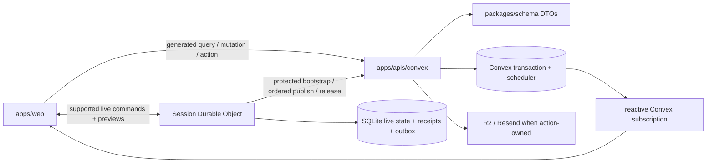
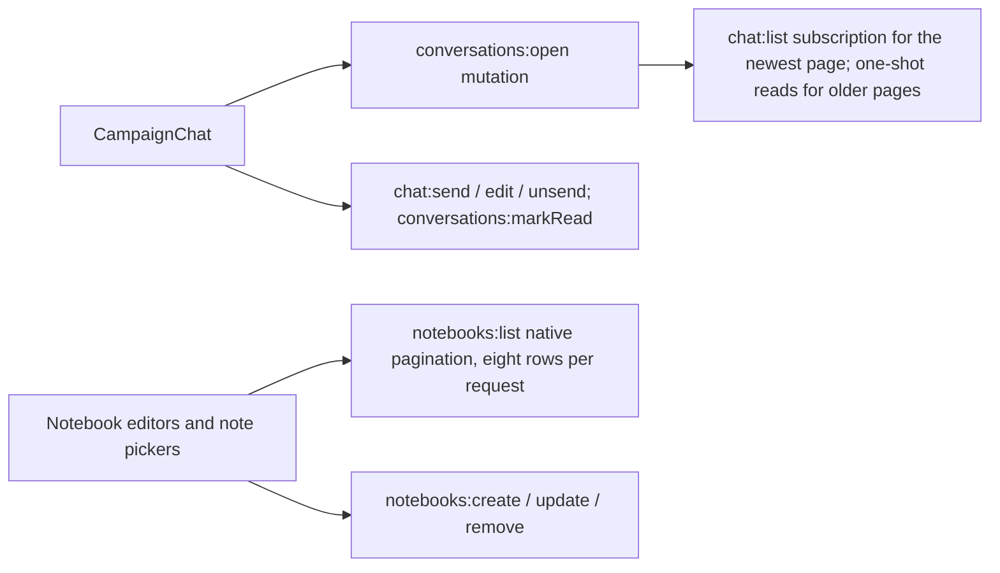
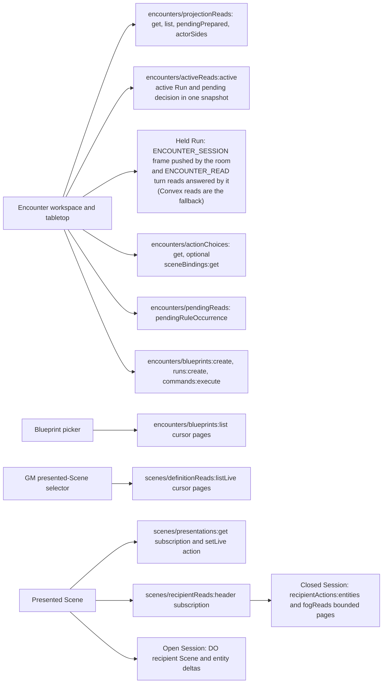
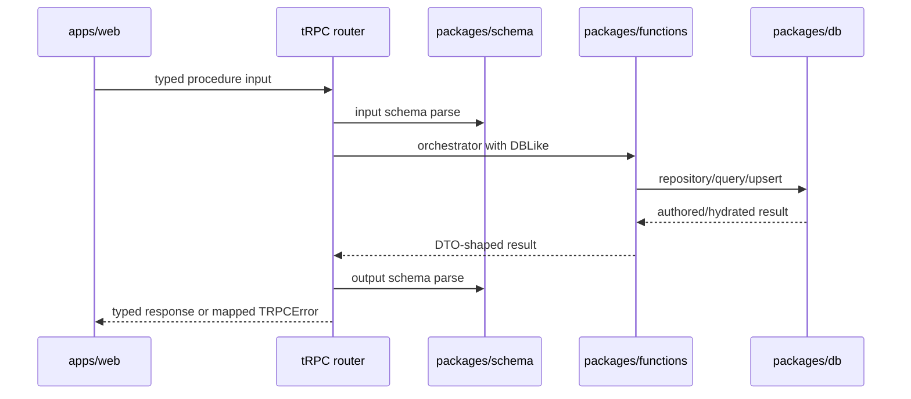
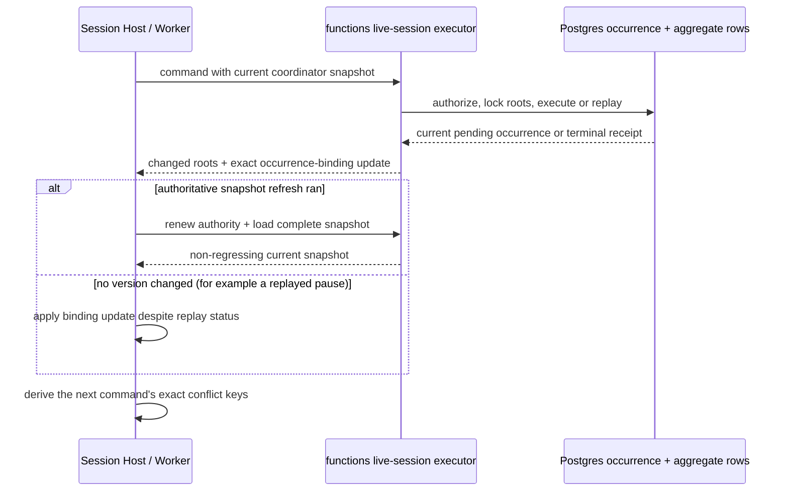

# Transport

> Status: canonical current Phase 8.2 boundary
>
> Scope: web product requests, Session DO commands/publications, and native Convex functions
>
> Update when: a public function, live-command DTO, authority fence, publication HTTP action, authorization rule, or error boundary changes
>
> Verification: `apps/web/src/data`, `apps/apis/convex`, generated Convex bindings, shared schemas, and focused owning tests

Convex is the durable product-data transport and persistence boundary. The browser and the public-page SSR loaders use
generated queries, mutations and actions for ordinary product work; active supported live commands use
the Session DO path below. Signed-in (`_authed`) routes do not run on the server (D75); their loaders run in the browser behind a Skeleton. No client chooses an account identity, database connection, storage key, or
internal function name.

Queries return bounded, recipient-authorized projections. Mutations derive the authenticated identity
from `ctx.auth`, validate shared inputs, and commit canonical state, projections, receipts and scheduled
continuations in one Convex transaction. Actions own Node or external-service work and re-enter through
validated internal mutations. Internal functions stay behind generated server references.

Better Auth routes and the small audited HTTP-action surface preserve same-origin/authentication and
secret boundaries. The Session Worker supplies both its private shared secret and the signed-in user's
bearer token. Convex rechecks Campaign, Session, role, membership and authority epoch during capture,
bootstrap and every ordered publication. The room accepts only the supported Door, standalone token
move/undo command contracts. All Character Sheet and Encounter rule commands keep their owning Convex
boundary, including during live Sessions.

Unexpected provider, storage and validation failures return generic product errors. Credentials,
private mechanics, object keys and raw provider responses do not cross the public boundary. Generated
bindings and `packages/schema` contracts are the reusable wire shapes; frontend code does not invent
local DTOs.

Portable import, media upload/finalization, account lifecycle and durable cleanup use the same native
boundary. Each owning guide defines its transaction, replay and privacy invariants.

## Lazy schema construction

Current (D59). Convex re-evaluates a function's module graph on every call, so a schema built at
module load is paid on every call. `packages/schema` builds no schema at module load:

- **Schemas.** Every module-level schema is `lazySchema(() => …)` from `packages/schema/src/zod.ts`.
  It returns a proxy that builds the schema on first use and memoizes it. The static type,
  `instanceof`, parsing, issues, `.shape`, composition, `zodToConvex` and JSON Schema output are the
  built schema's.
- **Shared parts.** A shape spread into several objects, or a variant list reused by several unions,
  is `lazySchemaParts(() => …)`. It is called only inside lazy factories and returns one set of
  instances, as the old module-level constant did.
- **Module scope** may reference a schema. It must not call `z.*`, call or read a schema (such as
  `fooSchema.shape` or `fooSchema._zod.def`), or call a local schema builder. A plain value that
  mirrors an enum is a literal checked with `satisfies z.infer<typeof …>`.
- **`z.json()` stays eager.** It references its own instance, so a proxy would give it two
  identities and change `zodToConvex` and JSON Schema output.
- **Late errors.** Construction errors move from import to first use.
  `packages/schema/src/__tests__/lazy-schemas.test.ts` imports every module, builds and parses with
  every exported schema, and fails if an exported schema other than `z.json()` is not lazy.
- **Lint rule.** `yarn lint` runs `yarn lint:schemas` (`node scripts/lazySchemas.mjs --check`). It
  fails on any schema built or forced at module load: `z.*` calls, calls or reads on a schema
  binding, callbacks run at load, and calls to local builders. Without `--check` the script wraps
  eager initializers mechanically and lists the sites that need a hand edit.
- **Content tables.** `apps/apis/convex/content/schema.ts` exports `buildContentTables()`. Root
  `schema.ts` spreads it, and `content/streams.ts` builds and memoizes the content schema on the
  first `contentStream()` call, because a stream needs only index metadata.

Evidence: [D59 rollout](../validation/phase-08-2/d59-lazy-schema-rollout-2026-09-27.md) and the
[D55 spike](../validation/phase-08-2/d55-lazy-schema-spike-2026-09-27.md).

## Historical transport record

The remainder of this file preserves the phased native build notes and the retired request stack. It
is not current deployment guidance or acceptance status.

### Original transport and tRPC guide

> Status: historical (retired tRPC/Supabase transport; runtime source removed)
>
> Scope: web → tRPC → schema → application services
>
> Update when: a procedure, DTO, auth rule, or error mapping changes
>
> Verification: `apps/apis/src/trpc/router.ts`, `apps/apis/src/trpc/procedures.ts`, the owning `apps/apis/src/trpc/*Router.ts`, `apps/apis/src/trpc/dbContext.ts`, `apps/apis/src/trpc/handler.ts`, `apps/web/src/lib/api.ts`, and the owning `apps/web/src/lib/api/*.ts` modules

`apps/apis` is the product-data boundary for the web app. Its domain routers are deliberately thin: each selects a schema, requires authentication where appropriate, opens a user-scoped DB context, and calls a function/query/repository service. Declared tRPC output schemas validate the completed callback result before the response leaves the boundary.

Shared DTOs use Zod Mini to reduce schema construction memory. Mini and remaining classic schemas
share core `$ZodType` contracts; generic transport parsers use free `parse`/`safeParse` functions,
and error mapping recognizes core `$ZodError`. The schema package initializes the existing English
messages from every focused entry path. Refinements, transformations, defaults and strict-object
behavior remain authoritative at the same input/output boundaries.

[ADR 0029](../adr/0029-convex-backend-cutover.md) defines the Convex replacement. The migrated
profile surface now calls `apps/apis/convex/account.ts` through native Convex subscriptions and
mutations, not the tRPC account adapter. Its query has no arguments; the update accepts only the
shared username/bio intent, derives the account from authenticated context, and returns the closed
profile projection. The [web guide](../../apps/web/README.md#phase-82-transition) records the current
client behavior and remaining avatar/browser proof. The rest of this guide describes unmigrated
transport, not a parallel backend required by the target architecture.

Native identity reads use `convex/lib/authUserReads.ts`. The app derives the subject and Session ID
from the verified Convex identity, then calls `betterAuth/sessionUser:get` once in the existing auth
component. That query reads the current Session and matching user directly, preserving expiry and
revocation checks without loading the generic adapter's HTTP plugin graph. The app then checks the
current ban, profile and role. Component functions do not receive `ctx.auth`; caller-provided product
arguments never supply these identifiers. Other account lookups retain the generic adapter. The shared
Better Auth client and account lifecycle triggers remain in `authClient.helper.ts` and
`authTriggers.helper.ts`; deletion restrictions and purge scheduling are unchanged.

The browser Better Auth client (`apps/web/src/auth/betterAuthClient.ts`) fetches the Convex token
through `fetchWithTokenRetry`. A transient `GET /api/auth/convex/token` failure (network error, 429 or
5xx) is retried up to four times, honoring `Retry-After`/`x-retry-after`, so a rate limit does not read
as a signed-out user while the server Session is valid. 401 and other definitive answers return at once.
After the retries are exhausted the response is returned unchanged, and the Convex auth adapter then
treats the token as absent.

Native Encounter commands run the Character work they need in the same transaction as direct calls,
not nested Convex functions: a GM tool's Sheet command goes through
`executeEncounterCharacterCommand` (`characters/encounterCommands.ts`) and initiative reads through
`loadCharacterEncounterInitiative`, both reached from `packages/encounter-persistence` through its
ports (ADR 0035 S1). They return only the Character receipt and health fields or initiative mechanics
the Encounter consumes; full Sheet responses stay in the Character boundary, and both sides keep
shared schema validation. A later Encounter failure rolls back the Character write and both receipt
streams. Managed Character/Encounter transaction and performance proof remain Phase 8.2 gates.

SSR session loading validates the trusted request context first. Requests with neither a Cookie
nor Authorization header skip the Better Auth token exchange, but still query the anonymous Convex
session for current server-owned feature flags. Either credential header retains the full token
verification path; verification errors propagate, and only the verified token authenticates the
Convex client. This is not a cached session or an authorization bypass.

Native account email changes use the installed Better Auth current-session endpoint. Confirmation goes
to the stored current address first, then to the new address. The stored email changes only after both
confirmations; credentials, profiles and existing sessions are preserved. As approved, final confirmation
in a signed-out browser also creates its native Better Auth session and signs that browser in. Both
provider verification URLs
retain their signed tokens and use the configured site's neutral `/settings/account?emailChanged=1`
callback. Provider errors take precedence over that neutral status and display fixed failure/retry copy;
the bounded shared search contract never renders provider error values. Email-change and signup
deliveries share the native sender and strict delivery contract.

Native signup and sign-in verification emails use the configured site's `/auth/confirmed` callback. The existing
Better Auth email sender sets it for signup and sign-in resends while preserving the provider's
verification URL and token. Browser sign-in must not set `callbackURL`: Better Auth also treats it
as a successful-login document redirect, which would compete with the router-owned return path.
The confirmation route is informational only. Its shared search schema bounds provider errors,
and the page shows fixed recovery copy without rendering the error value or creating a session.
Only Better Auth's `403 EMAIL_NOT_VERIFIED` result gets verification guidance; other credential
failures remain generic. Supabase invite-token confirmation is removed; native invitation
redemption remains the separate fragment-based setup flow. Full verified-signup HTTP/SSR
acceptance is still tracked by F05, not inferred from focused browser or sender tests.

The signed-in shell, notification feed, and channel-preference controls now use native Convex
queries/mutations (`apps/apis/convex/notifications.ts`). Subscription startup waits for verified
Convex authentication; no Supabase listener, polling, or tRPC notification adapter remains in
the web. Feed items retain the existing latest-25 limit, safe shared DTO, first-seen/read
timestamps, and recipient-only access. Preferences live on the private profile, defaulting both
channels on for older profiles; account deletion removes that profile and its bounded feed.
Delivery must prune to 25 in the same transaction; readers reject retention drift rather than
report an incorrect unseen count. Native Social admission and Campaign announcement producers,
cancellation and email delivery now have local implementation; complete source revalidation and
managed delivery proof remain pending, so this consumer migration does not complete `P18`.

Native `social/admissionLists` exposes recipient/applicant-private and current-listing-owner inbox
queries. `schema/api/socialAdmissionLists` owns their strict shared input/page contracts; callers
cannot supply account identities. Request separate PENDING and HISTORY cursor groups and render them
in that order. Invitation inputs also require a fixed ISO `asOf` horizon across all pages: refresh it
and reset both groups at the next pending expiry and on resume, since clock passage alone cannot
invalidate a Convex subscription. The timestamp changes presentation only, never authorization or
mutation eligibility. Empty pages can retain continuation after eligibility filtering. Existing DTO
privacy/masking and current symmetric blocks apply in both directions. Native Social browser binding
is still pending; see [inbox persistence](persistence.md#social-admission).

The System list is the first TanStack Query/Convex loader tracer. The request-local router owns
both clients, and `@convex-dev/react-query` supplies query hashing, consistent public SSR reads,
and pushed browser results. The Better Auth provider uses the same Convex client as the query
adapter. No auth token or Convex client instance is included in serialized route context. The list
uses bounded cursor pages. System detail/summary and authored-route System reads also use Convex;
selectors and authored-domain web adapters remain transitional. See
[the web transition guide](../../apps/web/README.md#phase-82-transition).

Internal System document readers import `convex/content/systemDocuments.ts`, not the public
`content/systems.ts` query module. Checksum/identity validation and indexed reads stay shared,
without making authoring load the capability query's full play execution registry and schemas.
The platform Rules registry remains the single source of installed capabilities/operations.
Authoring takes the System's policy vocabulary from `@artificer-toolkit/rules-runtime/platformSystemVocabulary`
alone, whose closure loads no play execution.
`convex/schemaBoundary.test.ts` checks the real authoring entry point's dependency graph, allowing only that
seam's listed files from rules-runtime; public
System query contracts and authorization are unchanged by this module separation.

Character receipt readers import `schema/api/characterHistory`, whose entry/page contracts depend
only on shared pagination and Sheet value schemas. The bounded Character read input is owned by
`schema/api/characterSheet`; full Sheet data/command modules retain their existing exports of these
same contracts. Stored Character validation and source-loss reconciliation therefore do not load
Sheet response/panel/command schemas merely to validate a receipt. The storage-reader entry point
is covered by `convex/schemaBoundary.test.ts`; payloads, authorization and atomic writes are unchanged.
The same test covers the authored deletion entry point. Its installed rules policy reads the shared
Encounter actor cap from `schema/shared/authoredLimits`, not the Encounter API module that imports
Sheet commands. `api/encounters` re-exports the same cap; actor and Cleaving limits do not change.

The native `content/details:get` backend now serves the existing eight authored detail DTOs from
indexed UUID/compact-route lookups. Master reads are public only with a valid same-System platform
source; working drafts and owned roots are owner-private. Default active reads omit draft payloads.
Explicit draft reads retain structured invalid-draft recovery and active fallback. Requested metadata
resolves only the item's referenced IDs, with current read access and System checks on referenced
authored labels. Convex validates the JSON envelope and the handler parses the exact full domain
response before returning it. These backend reads do not yet replace the authored web adapters.

### Native Campaign Character roll transport

Native `campaigns/characterSheet:executeRoll` uses
`campaignCharacterSheetRollInputSchema`: the existing strict/refined roll request extended with
explicit Campaign/Character UUID scope. Expression/mode validation is retained, not reconstructed
from field validators. It returns the unchanged `RollRecordDto` and writes only caller-owned private
history; public TABLE generation remains a separate Campaign roll endpoint. Personal `rolls:execute`
does not accept Campaign scope or GM authority. Scoped rest preview/completion continue to use their
existing shared contracts and actor-owned evidence. Native Campaign browser bindings remain pending.
See [Campaign roll persistence](persistence.md#campaign-rolls).

### Native Campaign audit transport

`campaigns/events:list` accepts the existing Campaign/Character UUID scope, optional UUID cursor and
1–100 limit. It returns `campaignEventPageTransportDtoSchema`: the existing page metadata and event
fields, with the recursive JSON payload encoded as `payloadJson`. The Convex validator converter
cannot expand recursive JSON; this is a lossless payload encoding, not a weaker domain validator.
The native query validates the decoded page before returning the wire response, and native clients
must call `decodeCampaignEventPage` from `schema/api/campaignEventTransport` before consuming events.
The helper parses both the wire envelope and the unchanged `campaignEventPageDtoSchema`; malformed
payload JSON rejects. UUID identity, cursor ordering and domain visibility semantics are unchanged.

GM supplemental-state writes use the existing shared save/delete inputs and return existing record
DTOs or `{ ok: true }`. Current Campaign owner/assignment authority and record versions are checked
inside the mutation, with state and audit writes in that same transaction. Native subscriptions own
delivery; no SQL, Broadcast or Durable Object invalidation is added. Browser Campaign binding remains
pending. [Persistence and visibility](persistence.md#gm-character-state-and-audit)
own the audit read projections and bounded scan details.

### Native Campaign settings and content transport

The Campaign parent detail and its route loaders use `campaigns/queries:get` through the shared
Convex query adapter, accepting a UUID or public handle. The subscription supplies the current
Campaign version to consecutive content removals. Settings, table-settings and shared-content
panels call native Convex functions directly.
`campaigns/queries:settings`, `campaigns/update:update` and `campaigns/playSettings:{get,options,save}`
own the settings path. `campaigns/contentShares:{list,share,unshare}` owns shared-content pagination and
writes, while the ADR 0036 catalogue `list` snapshot parts supply active owned candidates. Native subscriptions replace
the retired per-panel tRPC query caches. Campaign lifecycle, membership and Vehicles retain their
transitional transports until their owning cases close. The legacy Campaign realtime hook is mounted
only while the remaining Inventory tab needs it; native collaboration and Session surfaces subscribe
through Convex directly.

### Native Campaign collaboration transport

Chat opens the selected room before reading it. Its scope includes Campaign, room, DIRECT peer and
current membership access epoch. Only the newest page subscribes, through the existing Convex
TanStack Query adapter, so a new message re-runs one page per reader (D69). Older pages are read
once on request (`useConvex().query`) and kept below it: entries that slide out of the newest page
join the older history, and a newest page that no longer reaches the previous one (more than a page
arrived between two results) restarts older history from itself. Older entries therefore do not
show later edits or unsends; both windows are short (15 and 5 minutes). Changing membership authority
withholds cached history until opening succeeds, and an authority error clears displayed messages.
The public chat contract retains UUID cursors and a 50-entry page. Unread counts are capped at
`campaignChatUnreadCountLimit` (50); the badge shows `50+` at the cap.

Notebook editors, the notes drawer and Session/file note pickers use Convex native pagination with
explicit Load more controls. Shared/private visibility is enforced by the backend query. Native
mutations preserve the existing optimistic version and local dirty-text behavior. GM and Character
Sheet TABLE rolls, and a player's "To GM" rolls, call `campaigns/rolls:execute` with a `TABLE | GM`
destination; private GM rolls use `executePrivate`, and `reveal` posts one to the TABLE in full or as a notice. The GM's remembered Public/Private toggle is the `gmRollVisibility` roll preference.
A player's "Just me" roll stays on `campaigns/characterSheet:executeRoll`.
Chat, room unread counts and notebook updates no longer depend on Broadcast invalidation or DIRECT
Broadcast channels. File pickers/lists and upload, finalize, attachment and signed-delivery operations
use native functions too. Session workspace loaders, notes, references, RSVP, attendance and Session
pickers now use generated Convex endpoints with explicit pagination controls. The tabletop launcher
subscribes to the indexed latest OPEN Session rather than truncating history to its newest row.
Clock reads use `campaigns/clock:get`; owner commands use the corresponding atomic mutations. The
client displays elapsed time between updates and only an active owner requests reconciliation.
These bindings do not establish P14/P15 acceptance without their required browser/concurrency proof.

The web server's `VITE_MEDIA_STORAGE_ORIGIN` must match the exact origin of native signed storage
URLs. It permits browser uploads and image delivery through CSP without exposing R2 credentials or
allowing every R2 bucket. The storage service still enforces signed authorization and bucket CORS.

### Native Encounter and Scene transport

Each Encounter read is registered directly in its owning module, with current identity, Campaign
authority, shared argument/return validation, and recipient redaction. There is no public forwarding
query invocation. Projection, pending-decision, and timeline modules retain separate import graphs;
the prepared-Encounter read uses an internal pending registration sharing the public handler.

The web adapters read Encounters through Convex subscriptions (no polling interval remains) and, while
the room holds the Run, from the room's pushed session frame
([Held Encounter session](live-sessions.md#held-encounter-session)). The four version-keyed turn reads
(`actionChoices.get` and `.optional`, `evidenceRolls.latest`, `sceneBindings.get`) and the viewer's
Scene actor token bindings go over the socket
as `ENCOUNTER_READ` while the frame is held and fall back to those Convex queries otherwise
([Held turn reads](live-sessions.md#held-turn-reads)). They retain command IDs and
expected versions. Blueprint and live Scene selectors exhaust
cursor pages, including empty continuation pages, and reject repeated cursors. Scene list requests
retain cancellation and owner-only enablement. The tabletop subscribes to the exact Session's
presentation and recipient-safe Scene header. Open Sessions request `includeSnapshot:false` and use
the DO's recipient Scene and entity deltas. Closed Sessions assemble all six entity collections and fog through
bounded native pages, checking versions, continuation progress and the opaque recipient revision.
The final header read fences the complete assembly against authority changes. A changed recipient
revision or presentation clears the previous Scene while its replacement hydrates; partial pages
are never rendered. Hydration retries only the client's transient interrupted-action error, at most
twice; authority and consistency failures are not retried. Native presentation writes retain command
IDs and presentation CAS.

An effect whose holder may end it (`recurrence.holderEnd`, D113) is offered in the action choices as
`heldGrantEnds` (`activeEffectId`, label, `actionCost`, `warnings`). The holder ends it with the
`END_HELD_GRANT` Run command (`EndHeldGrantInputDto`: `actorId`, `activeEffectId`, `acknowledgedWarnings`), which spends that activation
and is refused for another member, an effect already ended, or an activation not available. The live commit
payloads (action, area, cleaving, concentration and turn) carry the grants the engine ended as `endedGrants`.
An effect another actor is offered to move (`effectOffers`, D160) is moved with the `MOVE_HELD_EFFECT` Run command
(`MoveHeldEffectInputDto`: `actorId`, `effectId`, `offerIndex`, `target: { kind: 'ACTOR', actorId }`, `acknowledgedWarnings`, optional `sceneContext`),
which spends the offer's activation, is a PLAYER command for the actor's controller, and is refused for a stale offer,
a defeated or unchanged holder, or an unacknowledged range warning.
A `REPEAT_SOURCE_PATH` effect offer (D166) is not a Run command of its own: the `effectOffers` entry carries an `actionId`
(`<actorId>:REPEAT_PATH:<effectId>:<offerIndex>`), started as an ordinary action (`RESOLVE_ACTION`) against the holder.
The Sheet `END_ACTIVE_EFFECT` command ends a `holderEnd` effect for its own player only when the Run is not live: in an
ACTIVE Encounter that holds the Character, a costed end is refused with "End this effect from the Encounter actions."

A list of chosen creatures (D118) is offered in the action choices as the `ACTORS` target: `maxTargets` caps it,
and is absent for a list with no cap, which names each creature once (SPELLS-4.T2a3: Pass without Trace's "each
creature you choose"); the tabletop then shows no cap. A list with `allowRepeatedTargets` always carries its
`maxTargets`, and the schema refuses one without it. The Worker refuses a list over its cap and, unless it repeats
creatures, one that names a creature twice.

Held escapes (D105, D152): the action choices' `escapes` carry `dc`, null for an escape the holder contests
(the tabletop shows "Contested"). A contest participant offered several checks answers its `CONTEST_CHECK`
pending decision with one `CONTEST_CHECK` resolution (`requestId`, `checkDefinitionId`, and the d20 `roll` as
`ENTER_DICE` or `SYSTEM_ROLL`). "Roll dice" (`ROLL_RULE_EVIDENCE`) accepts the contest's one `requestId` in the
picked check's `rollMode`; the decision drawer picks the check, then rolls or enters it. `ENTER_DICE` never carries
`keep`: the server derives it from the `rollMode`, which must be one of the pending request's `rollModes` (the
System's offered `{ code, label, keep }` entries), and refuses a face count that does not match it.

Added dice (D156, SPELLS-4.T2c1): a d20 evidence request for an Encounter attack roll or saving throw (concentration
and death saves included) carries `addedDice`, the rolled-die grants its roller holds (`label`, `count`, `faces`,
`sign` `ADD` or `SUBTRACT`; Bless, Bane), absent when there are none; one die per spell, different spells stack. The
dice add after advantage keeps one d20. `ENTER_DICE` carries the added dice's faces as `addedFaces`, flat in the
request's order, and "Roll dice" (`ROLL_RULE_EVIDENCE`) rolls them with the d20 and stores them on the held roll, so
`SYSTEM_ROLL` settles both. The receipt's d20 evidence records each die's `rolledFaces`, and the roll card appends one
term per added die after the d20, a subtracted one marked `subtracted`. Contest checks carry no added dice yet (T2c2).
Saving-throw d20 evidence (resultPath `ON_SAVE_SUCCESS` or `ON_SAVE_FAIL`) also carries `savingThrowAbilityDefinitionId` (SPELLS-4.T2c2b), the ability the save was rolled with, so the settled commit can spend the roller's saving-throw dice by ability; the schema refuses it on any other result path, and a save with no ability (a death save) omits it.

D20 floor (D156, SPELLS-4.T2c3): a basic-action check (a basic action's, an escape's, a concealment's) whose roller holds an `ABILITY_CHECK` `MINIMUM_ROLL` grant (Glibness's 15) freezes `minimumRoll` (`amount`, `label`, `sourceEffectId`) beside `addedDice` on the check's `d20` context, and the settled d20 evidence repeats it. `selectedNatural` stays the face the roller kept; `total` counts the higher of it and the floor (`d20CheckTotal` in `schema/shared/d20MinimumRoll`, which also adds the signed added dice), and the schema refuses a total that does not. Settlement compares the whole settled d20 with the frozen one (`settledCheckD20MatchesFrozen`). The roll record's d20 term shows the raised number and the card carries a `D20_MINIMUM_ROLL` rule check (`amount`, `label`) only when the floor raised the roll. Contests, saving throws, attack rolls and cast-reaction checks carry no floor yet.

Added damage dice (D156, SPELLS-4.T2d): `ADD_BONUS_DIE` on `DAMAGE` adds rolled dice to a hit's damage (Divine Favor,
Branding Smite, Hunter's Mark, Enlarge/Reduce, Bestow Curse). Each die is its own damage node (`added-<k>-`), of a fixed
damage type or the attack's, rolled with the hit's damage dice (doubled on a critical hit); a subtracted die reduces
the attack's damage, floored at 0. The mechanics batch output records them as `damageAddedDice` (`label`, `count`,
`faces`, `sign`, `damageTypeId`, null for the attack's own type), absent when there are none, and the roll card labels each die's damage
with its source ("Hunter's Mark: Piercing damage"). A holder's die applies to damage it deals (`HOLDER_DEALS`), or, on
a mark, only to damage the effect's source deals to the holder (`SOURCE_DEALS_TO_HOLDER`).

Contest outcomes (D105, ATTACK-7.6): a basic action whose win is a picked outcome (Shove) lists the options as
`target.choiceOptions` in the action choices, and `RESOLVE_ACTION` names one with `target.choiceOptionId`; an attempt
without a pick, or with one the action does not offer, is rejected. The `CONTESTED_ACTION` output's `stateTransition`
records a win's outcome as `CONDITIONS_APPLIED` (`appliedConditionIds`, the conditions newly applied) or
`FORCED_MOVEMENT` (`direction`, `feet`, `upTo`); `SCENE_TOKEN_MOVED` is removed. The room's contest commit
(`LiveSessionEncounterContestCommitInput`) carries the planned `conditionApplications` and `forcedMovements`; the commit
lands the push on the Scene through the same `applyRoomForcedMovements` path as an action's push.

Forced-movement destinations (D157): an action whose push has two or more legal squares pauses on a
`FORCED_MOVEMENT_DESTINATION` pending summary (`sourceActorId`, `targetActorId`, `requestId`, and the server-derived
`positions`, 2 to `MAX_FORCED_MOVEMENT_DESTINATIONS`, staying put first when legal) with `allowedResponses`
`['FORCED_MOVEMENT']`. The source's controller or the GM answers with a `FORCED_MOVEMENT` resolution (`requestId`,
`position`); a square the summary did not offer is rejected and the pick stays open. An area action's pushes surface
the same summary once every save settled, one creature at a time, farthest first, its `requestId` naming the creature;
only the GM and the caster's controllers read it. The commit's
`LiveSessionForcedMovement` carries `collision` (the authored collision, or null; T6k2b1; its mover damage is settled in T6k2b3 as commit entries after the caught creatures'), `upTo`, `sourceReachFeet` (set only for `ASIDE`), the picked `position` and, for
`RANDOM`, the unit compass `ray` the server rolled at plan time (null otherwise). Each committed `RESOLVE_ACTION`
command records `forcedMovementLandings`, one per moved creature, farthest first: `{targetActorId, feet, stoppedBy,
ray}` with `stoppedBy` `NONE`, `OBJECT` or the struck creature's actor ID (`encounterForcedMovementLandingSchema`). A strike on a creature (T6k2b4b) appends an area target with an optional
`collision` marker to the pending area (`ruleExecutionPendingSnapshots`); those targets carry the struck creature's save
and are excluded from `caughtChecksum`.

Half-speed fields (SPELLS-17): the voluntary `MOVE_SCENE_TOKEN` command carries an optional `carefully` flag
(forced and teleport movement ignore it). The held `ENCOUNTER_SESSION` frame and `encounters/activeReads:active`
carry `halfSpeedFields` (`encounterSessionStateDtoSchema`: `id`, `label`, `shape`), listing only the visible zones
(`PUBLIC`, or revealed) that allow passage at half speed; one `readSceneSpatialRows` read feeds it and `auras`. The server
re-derives which zones `carefully` applies to with the same visibility predicate, so a client cannot bypass a
hidden zone.

Drags (D105, ATTACK-7.T7): a voluntary `MOVE_SCENE_TOKEN` whose mover holds creatures through a `TARGET_DRAGGED`
hold commits as one move at one Scene version. Its committed delta is a `BATCH` of `TOKEN_MOVED`: the mover first,
then each dragged token moved by the mover's published displacement. The preparation records the drag as
`draggedTokens` (`{tokenId, from, to}`, 1 to 101), which receipt replay, persistence and undo read back. The
command carries no drag field; the server derives it. Prediction, broadcast and fog treat the batch as one move,
and each dragged token explores fog along the mover's walked segment from its own place. `UNDO_LAST_SCENE_MOVE`
of a drag commits a `BATCH` of `TOKEN_MOVE_UNDONE` that returns every token to where it stood
(`sceneUndoCommandResultSchema` accepts one entry or the batch).

Auras (SPELLS-20): the same frame and `encounters/activeReads:active` carry `auras` (`id`, `label`, `radius`,
`sourceTokenId`): the visible circle zones centered on a token, so the map draws them around the moving source.
`readSessionAuras` lists an aura only when its source actor is in the member's own presented projection
(`encounter.actors`), the one visibility rule (D121) the GM, a Convex read and the room share; Convex reads
(no fog) therefore list only sources the projection lists, and the room, which reads fog, lists more.

Zone movement costs (SPELLS-20 T4d): the same frame and read carry `movementCostZones` (`id`, `multiplier`,
`anchorKind`, `geometry`, `sourceTokenId`, `unaffectedActorIds`) so the map labels a dragged route with the
movement the room will charge. `readSessionMovementCostZones` lists visible zones only; a token zone needs its
source in the member's projection (as auras do) and rests while it is a defeated Creature's passive zone, and
designations name only listed actors. Shown, never enforced: the room prices the move.

Ordinary Scene editing uses the owning Convex functions. While a Session authority epoch is active,
live Door commands and standalone token move/undo travel through the Session Durable Object; direct
overlapping Convex writes are fenced. The browser supplies the exact expected versions and command ID.
The room validates the admitted actor, executes against its minimum live projection, and commits the
next SQLite state, replay receipt and ordered publication outbox entry before returning
`COMMAND_COMMITTED`. For a Run the room holds (any non-COMPLETED Run while the Campaign has a live
authority), every Encounter command also commits in the room (ADR 0035, D78): turn changes,
rule-occurrence decisions, Encounter-bound movement and actor-token bindings on the presented Scene,
which the room refuses with `SCENE_NOT_PRESENTED` for any other Scene. Checkpoints publish the result to
Convex, whose `encounters/actorTokenBindings:execute` refuses a held Run.

Live-session tickets use `liveSessions/tickets:issue`; identity and current Campaign membership come
from inherited authentication, and the exact open Session is required. The signed ticket retains its
60-second, one-use HS256 contract. The protected Worker HTTP surface captures authority, bootstraps the
minimum live projection, publishes outbox entries in sequence, and performs drain/release. Each
publication rechecks the Worker secret, current authority epoch, membership/role, expected durable
state and result semantics before committing Convex state and advancing the persisted sequence.
Subscriptions then expose the durable result. On release or eviction, a fresh authority epoch rebuilds
from Convex.

The same room carries recipient-filtered ephemeral previews. Capture and hydration require the signed-in
user JWT plus `LIVE_SESSION_WORKER_SECRET`; responses use `no-store` and generic errors. Hydration pages
remain fenced by exact revisions before fanout. Preview frames never enter the SQLite command journal or
publication outbox.

Raw hydration readers are internal. Current Session members may hydrate assigned Character vision
using owner-derived Character facts, while private Sense source reads retain the caller's identity.
Internal fog readers can assemble all layers for host projection; public fog reads retain recipient
filtering. No public owner-only Scene preparation read was widened.

Native paged fog commands may include the current Session ID and expected Session/presentation
versions in their shared input. That context is retained in the fog save and command checksum.
Begin, append and publication verify that the Session is open and still presents the Scene;
unpublished work also requires the captured version counters. An already published exact replay
retains authorization and presentation checks while tolerating later version counters. Existing
authored-editor saves without Session context retain their original contract. This fence is local
implementation evidence. Tabletop fog changes supply this Session context, append at most eight
chunks per call, and publish using the same command ID. Current-source generation and complete
local lifecycle acceptance remain pending.

### Transitional tRPC request flow

### Router shape

`procedures.ts` owns the shared tRPC setup, error formatter, authentication middleware, and base procedures. Each domain router owns only its procedure wiring, and `router.ts` directly composes those routers without a compatibility or merge layer.

Authenticated `rolls.execute` accepts a restricted expression, optional single-d20 advantage/disadvantage mode, and character/source context, resolves the character-owned ruleset, and returns server-generated ordered evidence including both d20 faces and the kept face. Manual expressions may attach one numeric modifier to each dice term; evidence retains those term modifiers and their aggregate for compatible total verification. Except for manual rolls, the expression, mode, and source must match a roll surface derived from the current Sheet projection. `rolls.history` returns the caller's latest 20 private records; `rolls.discard` removes only the caller's specified unconsumed roll when its presentation is canceled before settlement.

`appRouter` groups public application configuration, account identity/profile data, route identity, systems, authored content, characters, Campaigns, and `nodeRuntime`. `account.usernameStatus` exposes only username availability. `account.signInWithUsername` resolves the private auth email server-side, delegates password verification to Supabase Auth, and returns session credentials without returning the email; credential failures use one generic error while rate limits remain distinguishable. The trusted proxy client IP is forwarded to Supabase Auth with the secret-key client so its per-IP limits do not collapse onto one server bucket. `account.completeInvitation` claims the required username before marking invitation setup complete. `account.profile` and `account.updateProfile` are authenticated, user-scoped procedures over the private profile row. A user may rename immediately after validation; PostgreSQL remains authoritative for concurrent username claims and maps uniqueness races to `CONFLICT`. `application.featureFlags` is an unauthenticated typed response containing browser-safe, server-parsed booleans. It supports web and future native presentation decisions but is not an authorization boundary. Authored domains use a shared `authoredDomainRouter` for list/get/draft/activate/delete/duplicate operations. `activate` is the single direct-input activation path; there is no duplicate authored-content `upsert` alias. Character procedures are explicit because Builder and Sheet have different contracts: `draft`, `getDraft`, `saveDraft`, `resolve`, `previewSave`, `upsert`, `sheet`, `panel`, `history`, and `command`. The authenticated `panel` query accepts a closed target union and returns a schema-validated semantic panel variant; adjustment commands return affected panel variants alongside the updated Sheet.

`campaigns` exposes lifecycle, owner-only settings and copying, tokenless username invitation inbox operations, assignment, chat and Campaign rolls, notebook collaboration, Session scheduling/RSVP/attendance/sections/reference pins, Campaign play settings, Vehicle custody, private attachments, immutable announcements, the manual Campaign clock, inventory and currency custody, direct authored-content share/list operations, and GM adjustment/condition/spell/audit procedures. Direct shares are root-scoped Campaign authorization with no submission/review or approval-version contract; destructive share/member/source loss is reconciled by the owning transactional service. `getSettings` is the separately authorized owner-edit projection and returns original Campaign metadata; ordinary shared Campaign reads apply the Campaign maturity presentation policy. `copy` creates a fresh Campaign aggregate from reusable preparation without copying its cohort, run state, or third-party share authority. Invitation UUIDs are identifiers rather than bearer grants, and acceptance always binds the record to the authenticated recipient. RSVP commands may update only the caller's response. Session scheduling, attendance, GM-private preparation/reference pins, finish, clock commands, Vehicle changes, and announcement publication remain owner-authorized; finished sessions cannot reopen or be deleted, while notes remain editable by their author. Notebook entries and Session notes are private to their author and the GM until the author shares them (see [persistence](persistence.md#note-visibility-d87)).

`socialHub` is one thin authenticated router for Social profile initialization, the private Social content preference, public profile projection, discovery, listing lifecycle, applications, blocks, reports, and superadmin moderation. It never returns a Campaign identifier or route. `eligibility.initialize` creates the authenticated user's private Social profile on first use without collecting age or location data. `preferences.update` may receive a birth date only when Mature viewing needs adult self-attestation; the functions service calculates 18+ and discards the date before persistence. The owner-only `listings.getOwned` edit projection returns original listing text. Standard ordinary Social responses remain masked; Mature responses are original only for the Campaign owner or an adult-attested viewer with the Mature preference. Application text is returned only to the applicant, the sole Campaign owner, or a superadmin after the report-evidence view has been audited, and the owner's view is masked for a Standard Campaign. Moderator queue reads contain metadata only; `openReport` is intentionally a mutation because it appends the `VIEWED` action before returning original evidence.

`notifications.feed`, `markAllSeen`, `markRead`, `preferences`, and `updatePreferences` are authenticated procedures that resolve the caller server-side. They expose at most the latest 25 schema-validated safe items and SOCIAL/CAMPAIGN channel choices. The browser cannot select another recipient or read notification tables directly.

Notification payloads and links carry public source IDs only. One safe event payload drives the durable feed projection and direct Resend email in the Supabase Edge dispatcher. Rendered email HTML, text, subjects, email addresses, and provider URLs never enter an intent, log, or feed response. The web maps fixed data kinds to known internal routes rather than rendering provider URLs or HTML. Every destination performs its ordinary Social or Campaign API read, so current ownership, membership, moderation, and symmetric-block rules still apply. Missing or newly unauthorized sources return the same generic unavailable behavior; notification presence never grants access.

`encounters.blueprints` exposes creator-only, Game-System-scoped Blueprint list/create/update procedures. Create retries use owner-scoped command IDs; versioned updates use durable owner-and-command receipts and return the closed stored result on matching replay. `encounters.create` accepts a Campaign, open Session, and Blueprint ID; the Campaign supplies the System and current automation policy, while the service pins the Blueprint version/checksum and effective `automationMode` before copying actors. Player Encounter projections expose `automationMode` only. The transitional `rule_pack_revision_id` remains mechanics authority in Gate 1. GM commands, role-projected reads, and filtered timeline behavior remain unchanged.

Campaign Realtime is a private invalidation channel, not a second mutation or history transport. Services commit Postgres first and then attempt a best-effort Broadcast containing only the Campaign scope, entity/event identity, cursor, and version. A Campaign metadata hint invalidates both Campaign and Social query roots so maturity and indexed projections refetch immediately. The web falls back to polling/cursor recovery after disconnect.

### Historical authoritative live-session coordination

The local Session Host and managed Session Worker use the same server-only coordinator snapshot and executor-result contracts. The snapshot carries the Session-presented Campaign Scene, current aggregate versions, Character vision facts, optional Encounter-to-Scene and actor-to-token bindings, and the exact binding for each pending Encounter rule occurrence. That occurrence binding is derived from the occurrence's sealed pending snapshot rather than inferred from the Encounter or Scene catalogue:

- `SPATIAL` binds one occurrence to its exact Campaign Scene through the Encounter binding;
- `NON_SPATIAL` explicitly carries no Scene binding.

A d20 window (`ENCOUNTER_D20_WINDOW`, SPELLS-31.T4c1a) is answered by `RESOLVE_RULE_OCCURRENCE` with `D20_WINDOW_USE` or `D20_WINDOW_DECLINE`; the first response commit pends it (version +1, no receipt) and the answer settles the check, ends the spent effect and writes the receipt atomically. A GM void of it is refused.

`RESOLVE_RULE_OCCURRENCE` fails closed unless exactly one binding matches its Encounter and occurrence. A spatial resolution claims the Encounter, the exact bound Scene, and the Encounter's bound Characters; a non-spatial resolution does not claim a Scene merely because the Encounter has one. A command result adds, replaces, or clears the cached binding immediately. A persisted replay whose pause changed no aggregate version must still reconcile that binding; when a full authoritative refresh ran, the refreshed snapshot wins. Any replay refresh must cover both the replay's changed roots and every root already represented in the coordinator, so recovery cannot drop or regress unrelated state.

Every mechanics-bearing movement result carries a canonical, sorted list of the aggregate transitions committed by that exact command. Each transition includes its before and after version. The Host and Worker apply those transitions atomically and refresh only the roots named by the fresh command. A later occurrence resume may advance the same Character, Encounter, or Scene again, but replaying the original movement command returns the original command's transition list—not transitions reconstructed from the occurrence's final result. Current coordinator snapshots retain only the latest final version for each root.

Fresh command responses are visible to the GM and the currently authorized requester. Cached or reconnect delivery does not reuse the requester's privileged response projection. Local and managed hosts must apply the same response and redaction rules.

Every authenticated procedure uses `authenticatedProcedure`, then either the general RLS-scoped `withAuthenticatedDb` or the explicit-authority Campaign wrapper described above. `withAuthenticatedDb`:

1. rejects a missing `ctx.userId`;
2. obtains a shared Kysely instance for the connection string;
3. wraps the callback in `withUserContext`, setting the Supabase JWT subject inside a transaction;
4. maps known domain/schema errors to stable tRPC error codes.

Inputs and outputs come from `packages/schema/src/api/**` and subject/grant contracts. Do not create route-local DTOs when a reusable schema is missing; add it to schema and reuse it.

Authored detail responses may include structured draft validation issues (`code`, `message`, and nested `path`) when a saved JSON draft cannot be parsed. The web may use those paths for repair navigation while preserving the existing invalid-draft discard fallback. Detail lifecycle metadata uses active and draft timestamps rather than immutable revision IDs. These diagnostics describe boundary parsing; they do not replace node-runtime progress or compiler validation.

Authored `saveDraft`, `activateDraft`, and `activate` input failures also expose those structured issues through the tRPC error shape. The formatter is intentionally restricted to the eight authored-domain mutation paths and known validation error codes; unrelated and internal errors remain opaque. The web retains the issues on `ApiError`, routes each path to the deepest owning authoring target, and clears only issues related to a field the author changes.

### Error and security boundary

Zod input errors become `UNPROCESSABLE_CONTENT`; ownership, Campaign access/validation, not-found, dependency, entitlement, concurrency, node-runtime input, and Sheet command failures map to `FORBIDDEN`, `NOT_FOUND`, `CONFLICT`, or `BAD_REQUEST` as appropriate. An exhausted authored-root creation window maps to `TOO_MANY_REQUESTS`/HTTP 429. tRPC POST bodies over 1 MiB are rejected from their actual streamed bytes with HTTP 413 before authentication and JSON parsing; authored mutation schemas independently enforce the same total limit after domain parsing. Node-runtime inputs are also schema-parsed at the functions service seam with bounded encoded size, nesting depth, and array fanout, so a direct service caller cannot bypass the API parser. Declared output parsing runs after the procedure callback, so invalid server output remains an internal failure rather than a client validation error. Unknown failures return a generic internal error and never expose provider, database, configuration, credential, or token details.

The browser may know route names and DTOs, but it must not bypass the router to read/write product rows. Supabase client/server helpers in web are authentication infrastructure; product mutations belong in API procedures. Public sign-up, credential changes, appearance metadata, and account deletion are auth-lifecycle exceptions. Account deletion runs through a same-origin server function, requires the exact account email and current password, rejects users who still own Campaigns, then uses the server-only admin client for hard deletion and global refresh-session revocation; notification feed/preferences cascade with the account. A client-visible flag or user-metadata value is never an authorization decision.

### Authored-domain orchestration

The eight authored-domain procedures share functions-owned list/detail/draft/activate/duplicate use cases. The tRPC router supplies authentication, schemas, and the domain configuration only. Active detail hydrates the canonical domain aggregate; draft detail reads and validates the separate JSON payload. Active detail responses expose `hasDraft` without loading the draft payload; the full draft is returned only for an explicit draft view or its invalid-draft recovery response. Nested features, options, grants, and effects are saved through their owning root payload; they do not have competing product endpoints.

Duplicating authored content is a deep fork of that owned aggregate. The root and every nested entity identity are regenerated, references to identities owned by the copied graph are remapped to the corresponding replacements, and references to external canonical records remain unchanged. A copied draft must therefore have no mutable object or owned UUID identity in common with its source, and later edits to either aggregate cannot affect the other.

### Import and portable export

Authenticated `/api/imports/preview`, `/api/imports/commit`, and `/api/imports/export` are the product-data REST handlers. `preview` and `commit` are mutation handlers; `export` is read-only. Preview and commit accept the versioned import contracts from `packages/schema` and sit outside the 1 MiB tRPC JSON limit because a batch may contain up to 25 MiB of source files, while retaining the same-origin, authentication, size, schema, ownership, and error boundaries. Shared import limits also bound Foundry item fanout and portable reference count, array fanout, nesting depth, and total nodes before database preparation or recursive normalization. Preview is stateless and performs no writes; commit reparses the original batch, schema-validates each normalized authored payload before persistence, and applies only the selected entries plus their explicit collision resolutions transactionally. Expected D&D Beyond failures use approved import messages; unexpected provider, parser, configuration, and database failures remain generic internal errors. Invalid normalized content returns the generic authored-content error and writes nothing. Deselected entries are reported as skipped.

D&D Beyond inputs are ordinary character-sheet URLs. The server extracts the numeric ID and fetches only the allowlisted public character endpoint without forwarding browser credentials. Foundry and Artificer inputs are JSON text. Portable export is limited to an owned active item or its draft and omits ownership, timestamps, and internal lifecycle metadata.

Custom Equipment found on a D&D Beyond or Foundry Character keeps its real category, properties, damage, armor class, weight, rarity and price. Preparation reads the Character's System vocabulary through the same exact lookup as every other preparation read: `findSystemVocabulary({ systemId })` on `ImportPreparationLookup`, recorded by the preview recorder as a `SYSTEM_VOCABULARY` request and returned as the `systemVocabularies` field (damage types, rarities, currencies, speeds, skills, heritages) of the exact-lookup snapshot. Preview and commit both prepare through `prepareWithNativeLookup`, so they read the vocabulary identically and the commit no longer loads a separate vocabulary preflight. For each new custom item, preparation resolves in this order, drawing ids from `createId` in a fixed order: (1) the weapon attack effects (`applyImportedWeaponAttack`; an unknown damage type imports the weapon without an attack and adds `UNKNOWN_DAMAGE_TYPE`); (2) the equipment terms (`applyImportedEquipmentTerms`): the SRD modifier grants for its category and properties, then the armor rules (D&D Beyond `strengthRequirement` and `stealthCheck` of 2, Foundry `system.strength` and the `stealthDisadvantage` property, armor only) as the SRD's `heavyArmorStrengthModifier` and `stealthDisadvantageModifier`, then the magic bonus; the rarity and gold price resolve by name against the vocabulary and an unknown name is left out; an armor rule whose skill, speed or heritage the System lacks is left out with `UNKNOWN_ARMOR_VOCABULARY`; (3) normalization and the completeness check that sets `activationEligible` and `activate`. Eligibility is therefore decided on the same payload the commit stages. Issues from steps 1 and 2 are item issues of the Character in both preview and commit.

Equipment `parentEquipmentId` is an external Equipment reference, like the existing parent Class
and Race references. Shared portable reference collection includes it in active and draft exports,
and import normalization remaps it only through the matching Equipment reference map.

The client interface is manually composed in `apps/web/src/lib/api.ts`. Shared transport lives in `apps/web/src/lib/api/transport.ts`, while account, Campaign, character, authored-content, and platform modules own their procedure adapters. Procedure renames therefore require updating both the router and the owning client module until generated inference replaces that mirror.

### Local development build boundary

The web server imports the published package entrypoints, so `apps/apis` resolves through its compiled `dist` output during local development. The root `yarn dev` command runs `yarn dev:prepare` first to rebuild that output before starting Vite. If Vite is started directly from `apps/web`, run the root `yarn dev:prepare` command first; otherwise a changed API router or procedure can appear broken while the browser is still executing an older build artifact.
