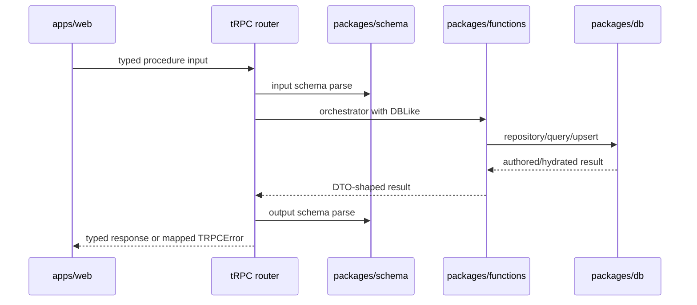

# Transport and tRPC

> Status: canonical (current working-tree baseline)
>
> Scope: web → tRPC → schema → application services
>
> Update when: a procedure, DTO, auth rule, or error mapping changes
>
> Verification: `apps/apis/src/trpc/router.ts`, `apps/apis/src/trpc/dbContext.ts`, `apps/apis/src/trpc/handler.ts`, and `apps/web/src/lib/api.ts`

`apps/apis` is the product-data boundary for the web app. The router is deliberately thin: it selects a schema, requires authentication where appropriate, opens a user-scoped DB context, calls a function/query/repository service, and parses the output schema.

## Router shape

`appRouter` groups public application configuration, route identity, systems, authored content, characters, and `nodeRuntime`. `application.featureFlags` is an unauthenticated typed response containing browser-safe, server-parsed booleans. It supports web and future native presentation decisions but is not an authorization boundary. Authored domains use a shared `authoredDomainRouter` for list/get/draft/activate/delete/duplicate operations. `activate` is the single direct-input activation path; there is no duplicate authored-content `upsert` alias. Character procedures are explicit because Builder and Sheet have different contracts: `draft`, `getDraft`, `saveDraft`, `resolve`, `previewSave`, `upsert`, `sheet`, `history`, and `command`.

Every authenticated procedure uses `authenticatedProcedure`, then `withAuthenticatedDb`. The latter:

1. rejects a missing `ctx.userId`;
2. obtains a shared Kysely instance for the connection string;
3. wraps the callback in `withUserContext`, setting the Supabase JWT subject inside a transaction;
4. maps known domain/schema errors to stable tRPC error codes.

Inputs and outputs come from `packages/schema/src/api/**` and subject/grant contracts. Do not create route-local DTOs when a reusable schema is missing; add it to schema and reuse it.

Authored detail responses may include structured draft validation issues (`code`, `message`, and nested `path`) when a saved JSON draft cannot be parsed. The web may use those paths for repair navigation while preserving the existing invalid-draft discard fallback. These diagnostics describe boundary parsing; they do not replace node-runtime progress or compiler validation.

Authored `saveDraft`, `activateDraft`, and `activate` input failures also expose those structured issues through the tRPC error shape. The formatter is intentionally restricted to the eight authored-domain mutation paths and known validation error codes; unrelated and internal errors remain opaque. The web retains the issues on `ApiError`, routes each path to the deepest owning authoring target, and clears only issues related to a field the author changes.

## Error and security boundary

Zod errors become `UNPROCESSABLE_CONTENT`; ownership, not-found, dependency, concurrency, node-runtime input, and Sheet command failures map to `FORBIDDEN`, `NOT_FOUND`, `CONFLICT`, or `BAD_REQUEST` as appropriate. Unknown errors remain internal.

The browser may know route names and DTOs, but it must not bypass the router to read/write product rows. Supabase client/server helpers in web are authentication infrastructure; product mutations belong in API procedures. Public sign-up is an auth exception: its same-origin web server function validates the shared auth DTO and rechecks the server-owned feature flag before calling Supabase Auth. A client-visible flag cannot authorize registration by itself.

## Authored-domain orchestration

The eight authored-domain procedures share functions-owned list/detail/draft/activate/duplicate use cases. The tRPC router supplies authentication, schemas, and the domain configuration only. Nested features, options, grants, and effects are saved through their owning root payload; they do not have competing product endpoints.

Duplicating authored content is a deep fork of that owned aggregate. The root and every nested entity identity are regenerated, references to identities owned by the copied graph are remapped to the corresponding replacements, and references to external canonical records remain unchanged. A copied draft must therefore have no mutable object or owned UUID identity in common with its source, and later revisions to either aggregate cannot affect the other.

The client interface is manually created in `apps/web/src/lib/api.ts`, so procedure renames require updating both router and client usage until generated inference replaces that mirror.

## Local development build boundary

The web server imports the published package entrypoints, so `apps/apis` resolves through its compiled `dist` output during local development. The root `yarn dev` command runs `yarn dev:prepare` first to rebuild that output before starting Vite. If Vite is started directly from `apps/web`, run the root `yarn dev:prepare` command first; otherwise a changed API router or procedure can appear broken while the browser is still executing an older build artifact.
